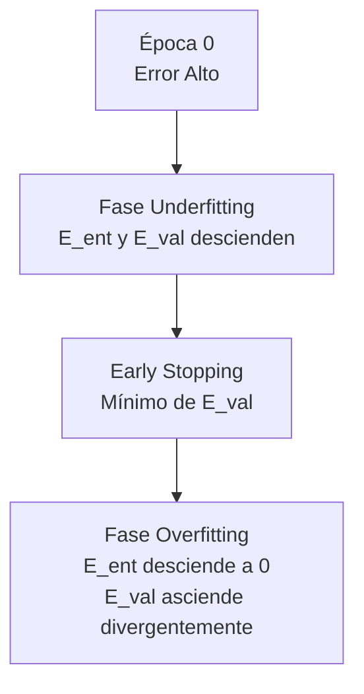
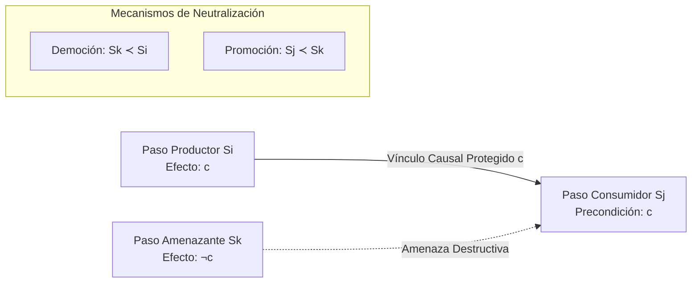

# Banco Integral de Preguntas Teóricas Reales de Exámenes Finales y Parciales (2020 – 2025)

**Institución:** Universidad Tecnológica Nacional – Facultad Regional Resistencia (UTN FRRe)  
**Carrera:** Ingeniería en Sistemas de Información  
**Asignatura:** Inteligencia Artificial (5to Nivel)  
**Autoría de Contenidos y Criterios Evaluativos:** La Cátedra de Inteligencia Artificial  
**Propósito:** Compilación forense, rigurosa, estructurada y pedagógica de todas las preguntas teóricas tomadas en turnos de exámenes finales (2020 a 2025) y parciales presenciales/virtuales, acompañada de sus resoluciones canónicas con el nivel exacto de formalismo exigido por la Cátedra.

---

> [!IMPORTANT]
> ### Convención y Guía de Estudio Rápido
> 1. **Prioridad Inmediata — Segundo Parcial (P2):**
>    Todos los temas correspondientes a la segunda mitad de la materia están desarrollados con máxima exhaustividad matemática y conceptual: **Redes Neuronales Artificiales (Perceptrón, MLP, Retropropagación, Momento, Curvas de Error y Early Stopping), Support Vector Machines (SVM Primal/Dual, Vectores de Soporte, $w$, $b$, márgenes y distancias), Mapas Autoorganizados de Kohonen (SOM), Redes de Hopfield (Hebb, ortogonalidad y recuperabilidad), Clustering K-Means y Disk K-Means, Clustering Jerárquico (Single, Complete y Average Link), Aprendizaje Basado en Instancias (KNN y KNN Ponderado) y Algoritmos Genéticos (Selección, Cruza y Mutación por Temperatura)**.
> 2. **Filtro Anti-Ruido P1 (`[TEMA_P1_RENDIDO]`):**
>    Las preguntas y ejercicios teóricos pertenecientes a la primera mitad de la materia (**Búsqueda Sistemática y Heurística $A^{\ast}$, Planificación POP/POT y Amenazas, Árboles de Decisión C4.5, Discretización Continua, Nodos Impuros, Ganancia y Tasa de Ganancia, Minería de Reglas de Asociación y Apriori con Downward Closure**) están identificadas con la etiqueta unívoca:
>    `[TEMA_P1_RENDIDO]`
>    *Esto permite al alumno enfocar el 100% de su atención en el temario del Segundo Parcial, preservando al mismo tiempo el banco completo para eventuales instancias de Examen Final o Recuperatorio de Primer Parcial.*
> 3. **Política de Anonimización Institucional:**
>    En estricto cumplimiento de las normas académicas y de preservación documental, se ha omitido todo nombre propio de docentes, haciendo referencia uniforme a **"la Cátedra"**.

---

## Índice General

1. [PARTE I: Banco de Exámenes Finales y Parciales Recientes (2024 – 2025)](#parte-i-banco-de-exámenes-finales-y-parciales-recientes-2024--2025)
   - [Mesa: Junio – 2025](#mesa-junio--2025)
   - [Mesa: Abril – 2025](#mesa-abril--2025)
   - [Mesa: Febrero 2025 – Mesa 3](#mesa-febrero-2025--mesa-3)
   - [Mesa: Febrero 2025 – Mesa Ordinaria](#mesa-febrero-2025--mesa-ordinaria)
   - [Mesa: Diciembre – 2024](#mesa-diciembre--2024)
   - [Mesa: Noviembre – 2024](#mesa-noviembre--2024)
   - [Mesa: Octubre – 2024](#mesa-octubre--2024)
   - [Mesa: Agosto – 2024](#mesa-agosto--2024)
   - [Mesa: Junio y Julio – 2024](#mesa-junio-y-julio--2024)
   - [Mesa: Febrero – 2024](#mesa-febrero--2024)
2. [PARTE II: Exámenes Finales Históricos Rescatados (2020 – 2021)](#parte-ii-exámenes-finales-históricos-rescatados-2020--2021)
   - [Final 17/02/2021 (Evaluación Escrita Completa)](#final-17022021)
   - [Final Segunda Mesa Febrero 2021 (Tabla Comparativa y Early Stopping)](#final-segunda-mesa-febrero-2021)
   - [Final 27/04/2021 (Tabla MLP/SVM/Hopfield y Aproximación Funcional)](#final-27042021)
   - [Final 08/06/2021 (Tabla KNN/K-Means/NB y XOR Tridimensional)](#final-08062021)
3. [PARTE III: Examen Teórico Oficial Escaneado Presencial (`teoria.jpg`)](#parte-iii-examen-teórico-oficial-escaneado-presencial-teoriajpg)
   - [Ejercicio 1: MLP vs Naïve Bayes en $\mathbb{R}^2$](#ejercicio-1-mlp-vs-naïve-bayes-en-mathbbr2)
   - [Ejercicio 2: Factores Clave en Aprendizaje por Ajuste de Parámetros](#ejercicio-2-factores-clave-en-aprendizaje-por-ajuste-de-parámetros)
   - [Ejercicio 3: Arquitectura y Algoritmo de Red Competitiva / SOM con Conexiones Laterales](#ejercicio-3-arquitectura-y-algoritmo-de-red-competitiva--som-con-conexiones-laterales)
   - [Ejercicio 4: Factor Determinante en Aprendizaje Basado en Explicaciones (EBL)](#ejercicio-4-factor-determinante-en-aprendizaje-basado-en-explicaciones-ebl)
   - [Ejercicios 5 a 8: Baterías Multiple Choice Oficiales con Corrección Docente](#ejercicios-5-a-8-baterías-multiple-choice-oficiales-con-corrección-docente)
4. [PARTE IV: Banco Exhaustivo de 37 Preguntas de Multiple Choice Oficiales](#parte-iv-banco-exhaustivo-de-37-preguntas-de-multiple-choice-oficiales)
5. [PARTE V: Compendio Doctrinario Maestro de Temas del Segundo Parcial](#parte-v-compendio-doctrinario-maestro-de-temas-del-segundo-parcial)
   - [1. Redes Neuronales Artificiales y Perceptrón Multicapa (MLP)](#1-redes-neuronales-artificiales-y-perceptrón-multicapa-mlp)
   - [2. Máquinas de Vectores de Soporte (SVM)](#2-máquinas-de-vectores-de-soporte-svm)
   - [3. Mapas Autoorganizados de Kohonen (SOM)](#3-mapas-autoorganizados-de-kohonen-som)
   - [4. Redes Asociativas Recurrentes de Hopfield](#4-redes-asociativas-recurrentes-de-hopfield)
   - [5. Clustering Particional: K-Means y Disk K-Means](#5-clustering-particional-k-means-y-disk-k-means)
   - [6. Clustering Jerárquico Aglomerativo (Estrategias de Enlace)](#6-clustering-jerárquico-aglomerativo-estrategias-de-enlace)
   - [7. Aprendizaje Basado en Instancias (k-NN y k-NN Ponderado)](#7-aprendizaje-basado-en-instancias-k-nn-y-k-nn-ponderado)
   - [8. Algoritmos Genéticos (AG)](#8-algoritmos-genéticos-ag)
6. [PARTE VI: Compendio Especial de Temas de Primer Parcial `[TEMA_P1_RENDIDO]`](#parte-vi-compendio-especial-de-temas-de-primer-parcial-tema_p1_rendido)
   - [1. Planificación: Algoritmo POP y Manejo de Amenazas](#1-planificación-algoritmo-pop-y-manejo-de-amenazas-tema_p1_rendido)
   - [2. Árboles de Decisión: Algoritmo C4.5](#2-árboles-de-decisión-algoritmo-c45-tema_p1_rendido)
   - [3. Minería de Reglas de Asociación y Algoritmo Apriori](#3-minería-de-reglas-de-asociación-y-algoritmo-apriori-tema_p1_rendido)
   - [4. Búsqueda Heurística: Algoritmo A*](#4-búsqueda-heurística-algoritmo-a-tema_p1_rendido)

---


# PARTE I: Banco de Exámenes Finales y Parciales Recientes (2024 – 2025)

Esta sección reúne y desarrolla exhaustivamente todas las consignas teóricas reales evaluadas en las mesas de examen final y parciales entre 2024 y 2025 (fuente: `doc1_examenes_2025.md`), categorizadas y respondidas con el nivel de rigor formal exigido en la UTN FRRe.

---

## Mesa: Junio – 2025

### Pregunta 1: Aprendizaje Supervisado y No Supervisado (Definición y Ejemplos)
* **Clasificación temática:** [TEMA_P2_TEORIA_GENERAL]
* **Enunciado original:** *Explicar aprendizaje supervisado y no supervisado. Definición y ejemplos.*
* **Respuesta Canónica de la Cátedra:**
  1. **Aprendizaje Supervisado:**
  - **Definición:** Es un paradigma de aprendizaje inductivo donde el algoritmo dispone durante su entrenamiento de un conjunto de pares de datos etiquetados $\mathcal{D} = \{(\mathbf{x}\_p, \mathbf{d}\_p)\}\_{p=1}^P$, donde cada $\mathbf{x}\_p \in \mathbb{R}^n$ es un vector de características (entradas) y $\mathbf{d}\_p$ es la salida objetivo o deseada (*target*) suministrada por un "supervisor" externo.
  - **Objetivo matemático:** Aprender una función de mapeo hipótesis $h: \mathcal{X} \to \mathcal{Y}$ que minimice una función de costo o pérdida $J(\mathbf{w})$, de modo que sea capaz de predecir con precisión la salida para vectores de entrada no observados previamente (capacidad de **generalización**).
  - **Tipos de problemas y ejemplos:**
       - *Clasificación (salida discreta/categórica):* Predecir si un paciente padece una patología (Sí/No) o clasificar especies botánicas (Perceptrón Simple, Multicapa / MLP, Support Vector Machines / SVM, Clasificador Naïve Bayes, Árboles C4.5, $k$-NN).
       - *Regresión (salida continua):* Predecir el valor del consumo energético de una planta fabril en función de temperatura y nivel de producción (MLP con función de salida lineal, Regresión Lineal/Polinomial).
  2. **Aprendizaje No Supervisado:**
  - **Definición:** Es un paradigma donde el conjunto de datos de entrenamiento carece por completo de etiquetas o valores objetivos: $\mathcal{D} = \{\mathbf{x}\_p\}\_{p=1}^P$. El sistema no recibe ninguna señal de retroalimentación, refuerzo ni corrección externa que indique si sus respuestas son válidas o erróneas.
  - **Objetivo matemático:** Descubrir por sí mismo patrones ocultos, correlaciones, densidades de probabilidad o la estructura topológica y geométrica intrínseca de los datos. Se dice que estas redes o algoritmos son capaces de **autoorganizarse**.
  - **Tipos de problemas y ejemplos:**
       - *Agrupamiento / Clustering:* Segmentar clientes en función de sus perfiles de consumo sin clases prefijadas ($K$-Means, Disk $K$-Means, Clustering Jerárquico Aglomerativo Single/Complete/Average Link).
       - *Reducción de Dimensionalidad y Mapas de Características:* Proyectar datos de alta dimensión sobre una cuadrícula bidimensional preservando relaciones de vecindad topológica (Mapas Autoorganizados de Kohonen / SOM, PCA).
       - *Memorización y Reconstrucción Autoasociativa:* Recuperar un patrón ruidoso o incompleto a partir de la memoria asociativa distribuida (Redes Recurrentes de Hopfield).

---

### Pregunta 2: Propiedad Downward Closure en Reglas de Asociación `[TEMA_P1_RENDIDO]`
* **Clasificación temática:** `[TEMA_P1_RENDIDO]` (Minería de Datos / Reglas de Asociación)
* **Enunciado original:** *Downward closure. Qué es y para qué sirve.*
* **Respuesta Canónica de la Cátedra:**
  1. **Definición y Enunciado Formal:**
     La propiedad de **Cierre hacia Abajo** (*Downward Closure* o propiedad antimonótona del soporte) establece que:  
     

$$
\text{Si un conjunto de ítems } X \text{ es frecuente (es decir, } \text{soporte}(X) \ge \text{minsup}\text{), entonces todo subconjunto no vacío } Y \subseteq X \text{ también es frecuente (}\text{soporte}(Y) \ge \text{minsup}\text{).}
$$

     De forma contrapositiva equivalente:  
     

$$
\text{Si un subconjunto } Y \text{ es infrecuente (}\text{soporte}(Y) < \text{minsup}\text{), entonces ningún superconjunto } X \supseteq Y \text{ puede ser frecuente.}
$$

  2. **Fundamento Matemático:**
     El soporte mide la frecuencia relativa de transacciones que contienen a un itemset: $\text{soporte}(X) = \frac{|\{t \in \mathcal{T} \mid X \subseteq t\}\vert }{ \vert\mathcal{T}|}$. Dado que cualquier transacción que contiene a un conjunto $X$ necesariamente contiene a cualquier subconjunto $Y \subseteq X$, se cumple monótonamente que:
     

$$
\{t \in \mathcal{T} \mid X \subseteq t\} \subseteq \{t \in \mathcal{T} \mid Y \subseteq t\} \implies \text{soporte}(X) \le \text{soporte}(Y)
$$

  3. **Para qué sirve (Utilidad Práctica en Algoritmo Apriori):**
     El espacio de búsqueda de posibles combinaciones de ítems escala exponencialmente ($2^{\vert I \vert} - 1$). La propiedad permite una **poda masiva del espacio de estados** durante la fase de generación de candidatos `candidate-gen`:
  - Al construir los candidatos de tamaño $k$ ($C\_k$) combinando pares de $(k-1)$-itemsets frecuentes en orden lexicográfico, se examinan todos sus subconjuntos de tamaño $k-1$.
  - Si tan solo uno de esos subconjuntos no se encuentra en el conjunto de frecuentes $L\_{k-1}$, el candidato se descarta de inmediato sin necesidad de consultar la base de datos de transacciones en disco.

---

### Pregunta 3: Estrategias de Planificación para Evitar la Explosión Combinatoria `[TEMA_P1_RENDIDO]`
* **Clasificación temática:** `[TEMA_P1_RENDIDO]` (Planificación / Algoritmo POP)
* **Enunciado original:** *Planning: estrategias para evitar la explosión combinatoria.*
* **Respuesta Canónica de la Cátedra:**
  Para evitar que el espacio de búsqueda crezca factorialmente al combinar posibles órdenes de acciones, los planificadores modernos (como POP / POT) utilizan **tres principios fundamentales**:
  1. **Apertura de la representación de estados, objetivos y acciones:**
  - En lugar de modelar los estados como "cajas negras" opacas (átomos monolíticos como en búsqueda heurística tradicional), se representan mediante conjuntos lógicos estructurados de oraciones proposicionales o predicados de primer orden.
  - Las acciones se definen formalmente mediante listas explícitas de **Precondiciones**, **Lista de Añadir (Add)** y **Lista de Eliminar (Delete)** (formato STRIPS). Esto permite al planificador razonar analíticamente hacia atrás (*goal regression*), seleccionando únicamente aquellas acciones cuyos efectos añadan directamente una condición requerida por el objetivo, ignorando las miles de acciones irrelevantes.
  2. **Postergación de decisiones (Principio del Mínimo Compromiso / *Least Commitment*):**
  - No comprometerse con un ordenamiento estricto ni instanciaciones tempranas de variables hasta que sea estrictamente necesario.
  - En lugar de construir secuencias lineales rígidas de pasos ($S\_1 \to S\_2 \to S\_3$), se genera un grafo de orden parcial donde dos pasos $S\_i$ y $S\_j$ sólo se ordenan temporalmente ($S\_i \prec S\_j$) si existe una amenaza destructiva o una dependencia causal directa entre ellos. Si son independientes, pueden ejecutarse en cualquier orden o en paralelo.
  3. **Descomposición de objetivos e independencia de submetas:**
  - El objetivo global se divide en un conjunto de subobjetivos casi-independientes. El planificador resuelve cada submeta de forma desacoplada y luego integra los planes parciales mediante la resolución de conflictos (amenazas a vínculos causales).

---

### Pregunta 4: Término de Momento Negativo en MLP
* **Clasificación temática:** [TEMA_P2_REDES_NEURONALES]
* **Enunciado original:** *¿El término de momento puede ser negativo?. Justificar y explicar desde cuándo se puede aplicar.*
* **Respuesta Canónica de la Cátedra:**
  1. **Regla de Actualización con Término de Momento:**
     

$$
\Delta w\_{ji}(t+1) = \alpha \cdot \delta\_{pj} \cdot y\_{pi} + \beta \cdot \Delta w\_{ji}(t)
$$

  donde:
  - $\alpha \in (0, 1)$ es la tasa de aprendizaje (*learning rate*).
  - $\beta \in [0, 1)$ es la constante o coeficiente de momento.
  - $T\_M = \beta \cdot \Delta w\_{ji}(t)$ es el **término de momento**.
  2. **¿Puede ser negativo? Justificación:**
  - **Sí, el término de momento numéricamente SÍ puede ser negativo.**
  - **Justificación:** Si bien el parámetro $\beta$ se configura como un escalar positivo ($0 \le \beta < 1$), el valor del término $T\_M = \beta \cdot \Delta w\_{ji}(t)$ adopta el signo algebraico que haya tenido el incremento de peso en la iteración inmediatamente previa $\Delta w\_{ji}(t)$.
  - Cuando en la iteración $t$ el peso se ajustó con un decremento (es decir, $\Delta w\_{ji}(t) < 0$ porque la derivada del error respecto a ese peso fue positiva: $\frac{\partial E\_p}{\partial w\_{ji}} > 0$), el producto escalar $\beta \cdot \Delta w\_{ji}(t)$ resulta estrictamente negativo.
  3. **¿Desde cuándo se puede aplicar?:**
  - Se puede aplicar **a partir de la segunda iteración ($t \ge 1$, considerando la primera iteración como $t=0$)**.
  - **Razón técnica:** Para la primera actualización de pesos ($t=0$), no existe una iteración previa $t=-1$; convencionalmente se asume $\Delta w\_{ji}(-1) = 0$. Por lo tanto, el término de momento se hace operativo y aporta inercia a partir de la segunda actualización en adelante.
  4. **Efecto en el proceso de entrenamiento:**
  - *Si el gradiente actual mantiene la misma dirección negativa:* El momento negativo suma su magnitud a la corrección del paso actual, acelerando el descenso hacia el mínimo a lo largo de mesetas o pendientes llanas.
  - *Si el gradiente actual cambió de signo (pasó a positivo):* Significa que la actualización dio un salto excesivo y se pasó del mínimo hacia la pared opuesta de un valle estrecho. En ese caso, el momento negativo amortigua el nuevo paso, actuando como filtro disipativo que previene oscilaciones divergentes.

---

### Pregunta 5: Algoritmo C4.5 para Atributos Continuos `[TEMA_P1_RENDIDO]`
* **Clasificación temática:** `[TEMA_P1_RENDIDO]` (Árboles de Decisión / C4.5)
* **Enunciado original:** *Algoritmo C4.5 para atributos continuos: si se puede aplicar tal cual o qué cambios se deberían hacer en el algoritmo.*
* **Respuesta Canónica de la Cátedra:**
  1. **¿Se puede aplicar tal cual?:**
     **NO se puede aplicar tal cual.** En atributos cualitativos discretos, el algoritmo genera una rama saliente por cada valor nominal distinto del atributo y luego elimina dicho atributo del conjunto de atributos disponibles para las ramas hijas. Con valores continuos numéricos, este procedimiento generaría tantas ramas como instancias existan, provocando un sobreajuste patológico (árbol univaluado con ramas de un solo elemento) y pérdida total de generalización.
  2. **Modificaciones que introduce C4.5:**
  - **Discretización Dinámica en Línea:** Para un atributo continuo $A$, se ordenan de menor a mayor los valores observados en el nodo actual: $v\_1 < v\_2 < \dots < v\_m$.
  - **Generación de Puntos de Corte Medios:** Se evalúan como posibles umbrales de partición binaria (*thresholds*) los puntos medios entre pares adyacentes de valores consecutivos:
       

$$
c\_i = \frac{v\_i + v\_{i+1}}{2}, \quad i = 1, \dots, m-1
$$

(Especialmente aquellos puntos donde cambia la clase observada entre $v\_i$ y $v\_{i+1}$).
  - **Evaluación de Ganancia:** Cada umbral $c\_i$ divide los datos en dos subconjuntos: $A \le c\_i$ y $A > c\_i$. Se calcula la Tasa de Ganancia de Información para cada umbral y se elige aquel $c^{\ast}$ que maximice la métrica.
  - **Persistencia del Atributo:** A diferencia del caso discreto, el atributo continuo **NO se elimina** del conjunto de atributos candidatos en los nodos descendientes, ya que un subintervalo (por ejemplo $A > c^{\ast}$) puede requerir una nueva partición más adelante. Así, un mismo atributo continuo puede aparecer múltiples veces a lo largo de un mismo camino raíz-hoja.
  - **Impacto Computacional:** La complejidad temporal por atributo pasa de ser lineal $\mathcal{O}(\vert D \vert)$ en el caso discreto a $\mathcal{O}(\vert D \vert \log \vert D \vert)$ debido al costo del ordenamiento.

---

## Mesa: Abril – 2025

### Pregunta 1: Errores de Entrenamiento y Validación (Diferencias, Comportamiento y Patrones)
* **Clasificación temática:** [TEMA_P2_REDES_NEURONALES]
* **Enunciado original:** *Explicar errores de entrenamiento y validación, diferencias, comportamiento, relación y patrones.*
* **Respuesta Canónica de la Cátedra:**
  1. **Definiciones y Fórmulas:**
  - **Error de Entrenamiento ($E\_{ent}$):** Se calcula como el error cuadrático medio acumulado sobre las instancias que el algoritmo utiliza activamente para ajustar sus pesos sinápticos mediante gradiente:
       

$$
E\_{ent} = \frac{1}{2 P\_{ent}} \sum\_{p=1}^{P\_{ent}} \sum\_{k=1}^M (d\_{pk} - y\_{pk})^2
$$

- **Error de Validación ($E\_{val}$):** Se evalúa sobre un conjunto disjunto de muestras que **no interviene** en la modificación de los pesos, sirviendo como estimador no sesgado del error de generalización durante el aprendizaje:
       

$$
E\_{val} = \frac{1}{2 P\_{val}} \sum\_{p=1}^{P\_{val}} \sum\_{k=1}^M (d\_{pk} - y\_{pk})^2
$$

  2. **Diferencias Fundamentales de Rol:**
     | Criterio | Conjunto de Entrenamiento | Conjunto de Validación |
     | :--- | :--- | :--- |
     | **Función activa** | Modifica los pesos de la red paso a paso (regla delta / backpropagation). | Monitorea la capacidad de generalización entre épocas sin alterar los pesos. |
     | **Evolución esperada** | Decrece de forma monótona a medida que transcurren las épocas de cómputo. | Decrece al inicio, alcanza un mínimo global y luego comienza a ascender. |
     | **Criterio de corte** | Si el error cae por debajo de un umbral prefijado $\varepsilon$, se puede detener. | Su punto de inflexión mínimo marca la parada temprana (*Early Stopping*). |
  3. **Comportamiento, Relación y Patrones Dinámicos:**
  - **Fase de Subajuste (*Underfitting*):** Al inicio del entrenamiento, ambos errores ($E\_{ent}$ y $E\_{val}$) son elevados y descienden a la par de forma pronunciada, ya que la red está capturando las regularidades macroscópicas dominantes del dominio.
  - **Punto Óptimo (*Early Stopping*):** El error de validación alcanza su mínimo valor absoluto ($E\_{val}^{\ast}$). En este instante la red ha maximizado su capacidad de generalización. Se debe detener el algoritmo y preservar la matriz de pesos de esta época.
  - **Fase de Sobreentrenamiento (*Overfitting*):** Si se continúa iterando, $E\_{ent}$ continúa descendiendo asintóticamente hacia cero (la red memoriza el ruido y particularidades individuales de la muestra), mientras que $E\_{val}$ comienza a subir progresivamente. La divergencia creciente entre ambas curvas es el síntoma indiscutible de pérdida de generalización.

---

### Pregunta 2: Amenazas en Planificación y Algoritmo de Detección `[TEMA_P1_RENDIDO]`
* **Clasificación temática:** `[TEMA_P1_RENDIDO]` (Planificación / Algoritmo POP)
* **Enunciado original:** *Explicar amenazas y donde se analizan en planning, utilizando el algoritmo.*
* **Respuesta Canónica de la Cátedra:**
  1. **Definición Formal de Amenaza:**
     En un plan de orden parcial, existe un **vínculo causal** $S\_i \xrightarrow{c} S\_j$ cuando el paso productor $S\_i$ tiene la precondición $c$ en su lista de añadir (*Add-list*) para satisfacerla en el paso consumidor $S\_j$, protegiendo dicha condición durante el intervalo temporal entre ambos.  
     Una **amenaza** es un paso $S\_{amenaza}$ perteneciente al plan que cumple simultáneamente dos condiciones:
  - $S\_{amenaza}$ incluye $\neg c$ en su lista de eliminar (*Delete-list*), destruyendo la condición protegida.
  - El ordenamiento temporal actual es compatible con que $S\_{amenaza}$ se ejecute entre $S\_i$ y $S\_j$ (es decir, no existe restricción que obligue a que ocurra antes de $S\_i$ ni después de $S\_j$).
  2. **En qué parte del algoritmo POP se analizan:**
     Se analizan en el procedimiento de verificación de consistencia del plan parcial, inmediatamente después de haber añadido un nuevo paso $S\_{add}$ o un nuevo vínculo causal al plan.
  3. **Mecanismo de Resolución Algorítmica:**
     Para neutralizar la amenaza y preservar el plan, el algoritmo aplica restricciones de orden:
  - **Democión / Degradación (*Demotion*):** Obligar a que el paso amenazante ocurra antes del paso productor:
       

$$
S\_{amenaza} \prec S\_i
$$

  - **Promoción (*Promotion*):** Obligar a que el paso amenazante ocurra después del paso consumidor:
       

$$
S\_j \prec S\_{amenaza}
$$

  Si ninguna de las dos ramas genera un ciclo en el grafo temporal, el plan sigue siendo viable; si ambas generan ciclos, el planificador retrocede (*backtracking*).

---

### Pregunta 3: Batería Verdadero / Falso: Árboles de Decisión y Búsqueda Heurística $A^{\ast}$ `[TEMA_P1_RENDIDO]`
* **Clasificación temática:** `[TEMA_P1_RENDIDO]`
* **Enunciado original:** *Verdaderos y falsos de: árboles de decisión, búsqueda heurística(A*)*
* **Desarrollo y Respuestas Oficiales:**
  1. *Árboles de Decisión:*
  - *Proposición:* Las hojas de un árbol de decisión pueden ser nodos impuros.  
       **VERDADERO.** Ocurre cuando se agotan los atributos disponibles o la ganancia es menor a un umbral prefijado, quedando instancias de diferentes clases en el nodo hoja.
  - *Proposición:* Los caminos desde la raíz a las hojas no son mutuamente excluyentes.  
       **FALSO.** Los caminos son estrictamente mutuamente excluyentes (ningún ejemplo puede seguir dos caminos distintos) y exhaustivos.
  2. *Búsqueda Heurística $A^{\ast}$:*
  - *Proposición:* Si $h'(n) = 0$ para todo $n$ y $g(n)$ es variable, el algoritmo encuentra el camino óptimo.  
       **VERDADERO.** El algoritmo se reduce al algoritmo de Dijkstra de costo uniforme, garantizando el camino de menor costo real acumulado.
  - *Proposición:* Si $h'(n) = 0$ y $g(n) = 1$ para todo $n$, encuentra el camino con menor cantidad de tramos.  
       **VERDADERO.** Al ser los costos uniformes, $A^{\ast}$ se transforma exactamente en una Búsqueda Primero en Amplitud (BFS).

---

### Pregunta 4: Batería Verdadero / Falso: Support Vector Machines (SVM)
* **Clasificación temática:** [TEMA_P2_SVM]
* **Enunciado original:** *SVM (20pts cada tema, 4 oraciones V/F cada una).*
* **Desarrollo y Respuestas Oficiales:**
  1. *Proposición:* Los vectores de soporte son aquellos cuyos multiplicadores de Lagrange $\alpha\_i$ son estrictamente distintos de cero.  
     **VERDADERO.** Por las condiciones de complementariedad de Karush-Kuhn-Tucker (KKT), las instancias que no son de soporte se ubican fuera del margen y tienen $\alpha\_i = 0$.
  2. *Proposición:* Entre los hiperplanos $H\_+$ y $H\_-$ no existen instancias de entrenamiento en el caso linealmente separable.  
     **VERDADERO.** La banda de margen máximo conforma una zona vacía de exclusión de ancho $\frac{2}{\\vert \mathbf{w}\ \vert}$.
  3. *Proposición:* El vector normal $\mathbf{w}$ y el bias $b$ deben recalcularse si ingresa una nueva instancia de entrenamiento.  
     **VERDADERO.** SVM es un método global que requiere resolver nuevamente el problema de optimización cuadrática al incorporar nuevas instancias de entrenamiento que puedan alterar el margen.
  4. *Proposición:* Las SVM lineales sólo pueden aplicarse a problemas bidimensionales de dos dimensiones.  
     **FALSO.** Las SVM se formulan para vectores en espacios continuos de cualquier dimensión $\mathbb{R}^n$, mediante hiperplanos de dimensión $n-1$.

---

## Mesa: Febrero 2025 – Mesa 3

### Pregunta 1: Término de Momento en MLP
*(Ver desarrollo formal en [Junio 2025 - Pregunta 4](#pregunta-4-término-de-momento-negativo-en-mlp))*. El momento acelera en gradientes consistentes y frena oscilaciones en valles estrechos.

---

### Pregunta 2: SVM — Términos $\mathbf{w}$ y $b$
* **Clasificación temática:** [TEMA_P2_SVM]
* **Enunciado original:** *SVM, término b y W.*
* **Respuesta Canónica de la Cátedra:**
  1. **Obtención del Vector Normal de Pesos $\mathbf{w}$:**
     A partir de la condición de estacionariedad del Lagrangiano Primal respecto a $\mathbf{w}$ en las condiciones KKT:
     

$$
\frac{\partial L\_P}{\partial \mathbf{w}} = \mathbf{w} - \sum\_{i=1}^N y\_i \alpha\_i \mathbf{x}\_i = 0 \implies \mathbf{w} = \sum\_{i=1}^N y\_i \alpha\_i \mathbf{x}\_i = \sum\_{s \in SV} y\_s \alpha\_s \mathbf{x}\_s
$$

El vector $\mathbf{w}$ queda expresado como una combinación lineal ponderada exclusivamente de los **vectores de soporte** ($SV$), ya que para los demás ejemplos $\alpha\_i = 0$.
  2. **Obtención del Término Independiente $b$ (*bias* o sesgo):**
     Para cualquier vector de soporte $\mathbf{x}\_s$ que descansa exactamente sobre los hiperplanos de frontera marginal ($H\_+$ o $H\_-$), se satisface con igualdad la restricción:
     

$$
y\_s (\mathbf{w}^T \mathbf{x}\_s + b) = 1
$$

Multiplicando ambos miembros por $y\_s$ (dado que $y\_s^2 = 1$ para $y\_s \in \{-1, +1\}$):
     

$$
b = y\_s - \mathbf{w}^T \mathbf{x}\_s = \frac{1}{y\_s} - \mathbf{w}^T \mathbf{x}\_s
$$

Para maximizar la estabilidad numérica frente a tolerancias de cálculo, la Cátedra indica promediar sobre todos los $\vert SV \vert$ vectores de soporte:
     

$$
b = \frac{1}{\vert SV \vert} \sum\_{s \in SV} \left( y\_s - \mathbf{w}^T \mathbf{x}\_s \right)
$$


---

### Pregunta 3: Downward Closure y su Ubicación Algorítmica `[TEMA_P1_RENDIDO]`
* **Clasificación temática:** `[TEMA_P1_RENDIDO]`
* **Enunciado original:** *Downward closure y donde está el algoritmo.*
* **Respuesta Canónica de la Cátedra:**
  Se ubica en la función **`candidate-gen`** del algoritmo Apriori. Al construir los $k$-candidatos $C\_k$ mediante la unión de pares de $L\_{k-1}$ que comparten sus primeros $k-2$ elementos, se verifica que todos los subconjuntos de tamaño $k-1$ del candidato pertenezcan a $L\_{k-1}$. Si alguno no pertenece, se poda inmediatamente.

---

### Pregunta 4: Amenazas en Planning con Ejemplo Práctico `[TEMA_P1_RENDIDO]`
* **Clasificación temática:** `[TEMA_P1_RENDIDO]`
* **Enunciado original:** *Amenazas Planning con un ejemplo práctico.*
* **Respuesta Canónica de la Cátedra:**
  - **Ejemplo en el Mundo de los Bloques:**  
    Queremos lograr la meta final `Sobre(A, B)` y `Sobre(B, C)`.
    Existe un vínculo causal entre el paso inicial $S\_0$ que añade `Mesa(A)` y `Despejado(B)`, y el paso $S\_1 = \text{Mover}(A, B)$ para poner $A$ sobre $B$.  
    Si se planifica otro paso $S\_2 = \text{Mover}(C, B)$, este paso añade `Sobre(C, B)` pero **elimina** `Despejado(B)` de su Delete-list.
    $S\_2$ constituye una **amenaza** al vínculo causal entre $S\_0$ y $S\_1$.
  - **Resolución:**
    - *Democión:* Ordenar $S\_2 \prec S\_1$ no resuelve el problema porque dejaría a $B$ ocupado cuando $S\_1$ lo necesita despejado.
    - *Promoción:* Se añade la restricción temporal $S\_1 \prec S\_2$, asegurando que $A$ se ubique sobre $B$ antes de que cualquier otra acción interactúe con el bloque.

---

### Pregunta 5: Entropía, Ganancia y Tasa de Ganancia `[TEMA_P1_RENDIDO]`
* **Clasificación temática:** `[TEMA_P1_RENDIDO]`
* **Enunciado original:** *Entropía, ganancias y Tasa Ganancia.*
* **Respuesta Canónica de la Cátedra:**
  1. **Entropía del Conjunto $D$:**
     

$$
\text{Entropía}(D) = - \sum\_{j=1}^{\vert C \vert} P(C\_j) \log\_2 P(C\_j)
$$

     Mide el grado de impureza o desorden de clases en una colección de datos.
  2. **Ganancia de Información (ID3):**
     

$$
\text{Ganancia}(D, A\_i) = \text{Entropía}(D) - \sum\_{j=1}^m \frac{\vert D\_j \vert}{\vert D \vert} \text{Entropía}(D\_j)
$$

Mide la reducción neta de impureza lograda al particionar según el atributo $A\_i$. Presenta un sesgo perjudicial hacia atributos con muchos valores distintos.
  3. **Tasa de Ganancia (*Gain Ratio* - C4.5):**
     

$$
\text{TasaDeGanancia}(D, A\_i) = \frac{\text{Ganancia}(D, A\_i)}{\text{SplitInfo}(D, A\_i)}, \quad \text{donde } \text{SplitInfo}(D, A\_i) = - \sum\_{j=1}^m \frac{\vert D\_j \vert}{\vert D \vert} \log\_2 \left( \frac{\vert D\_j \vert}{\vert D \vert} \right)
$$

     Normaliza la ganancia dividiéndola por la información intrínseca de partición (*SplitInfo*), penalizando atributos que generen divisiones atomizadas.

---

## Mesa: Febrero 2025 – Mesa Ordinaria

### Pregunta 1: Error de Validación y Entrenamiento (Fórmulas y Diferencias)
*(Ver respuesta detallada en [Abril 2025 - Pregunta 1](#pregunta-1-errores-de-entrenamiento-y-validación-diferencias-comportamiento-y-patrones))*.

---

### Pregunta 2: Redes SOM Completo (Arquitectura y Dinámica)
* **Clasificación temática:** [TEMA_P2_SOM]
* **Enunciado original:** *SOM completo.*
* **Respuesta Canónica de la Cátedra:**
  1. **Arquitectura:**
     Red no supervisada compuesta por dos capas completamente interconectadas mediante pesos $\mathbf{w}\_j$:
  - *Capa de entrada:* $N$ neuronas pasivas correspondientes a las dimensiones del vector $\mathbf{x} \in \mathbb{R}^N$.
  - *Capa de salida (Mapa):* Arreglo bidimensional de neuronas con conexiones laterales de competencia e inhibición (modelo de sombrero mexicano).
  2. **Fase 1: Competencia:**
     Al recibir un patrón $\mathbf{x}$, cada neurona calcula su distancia euclídea:
     

$$
d\_j = \|\mathbf{x} - \mathbf{w}\_j\| = \sqrt{\sum\_{i=1}^N (x\_i - w\_{ji})^2}
$$

     Se proclama ganadora la neurona con menor distancia (**BMU** - *Best Matching Unit*):
     

$$
c = \arg\min\_j \|\mathbf{x} - \mathbf{w}\_j\|
$$

  3. **Fase 2: Cooperación (Función de Vecindad):**
     La neurona ganadora $c$ excita a sus vecinas topológicas en la cuadrícula mediante una función de vecindad $h\_{cj}(t)$, tal como la función gaussiana o racional:
     

$$
h\_{cj}(t) = \exp\left( -\frac{\text{dist}^2(c, j)}{2 \sigma(t)^2} \right) \quad \text{o} \quad h\_{cj}(t) = \frac{1}{1 + \text{dist}^2(c, j)}
$$

El radio de vecindad $\sigma(t)$ decrece en el tiempo.
  4. **Fase 3: Adaptación (Actualización de Pesos):**
     Se modifican los pesos de la neurona ganadora y de sus vecinas para acercarlos al vector de entrada:
     

$$
\mathbf{w}\_j(t+1) = \mathbf{w}\_j(t) + \alpha(t) \cdot h\_{cj}(t) \cdot (\mathbf{x} - \mathbf{w}\_j(t))
$$

con una tasa de aprendizaje decreciente monótona: $\alpha(t) = \frac{\alpha\_0}{t}$ o $\frac{1}{t}$.

---

### Pregunta 3: Momento Negativo
*(Ver desarrollo en [Junio 2025 - Pregunta 4](#pregunta-4-término-de-momento-negativo-en-mlp))*.

---

### Pregunta 4: Planning y Explosión Combinatoria `[TEMA_P1_RENDIDO]`
*(Ver desarrollo en [Junio 2025 - Pregunta 3](#pregunta-3-estrategias-de-planificación-para-evitar-la-explosión-combinatoria-tema_p1_rendido))*.

---

### Pregunta 5: Obtención de las Distancias $d\_+$ y $d\_-$ en SVM
* **Clasificación temática:** [TEMA_P2_SVM]
* **Enunciado original:** *Explicar cómo se obtiene los d en svm.*
* **Respuesta Canónica de la Cátedra:**
  1. **Definición Geométrica:**
     Son las distancias euclídeas perpendiculares más cortas desde el hiperplano óptimo de decisión $H\_0: \mathbf{w}^T \mathbf{x} + b = 0$ hasta los hiperplanos de frontera marginal que contienen a los vectores de soporte:
  - $H\_1: \mathbf{w}^T \mathbf{x} + b = +1$ (para clase positiva $y\_i = +1$, distancia $d\_+$).
  - $H\_2: \mathbf{w}^T \mathbf{x} + b = -1$ (para clase negativa $y\_i = -1$, distancia $d\_-$).
  2. **Deducción Matemática:**
     La distancia ortogonal de un punto arbitrario $\mathbf{x}$ a un hiperplano $\mathbf{w}^T \mathbf{x} + b = 0$ viene dada por:
     

$$
\text{dist}(\mathbf{x}, H\_0) = \frac{|\mathbf{w}^T \mathbf{x} + b\vert }{\ \vert\mathbf{w}\|}
$$

Para cualquier vector de soporte positivo $\mathbf{x}\_+ \in H\_1$, se tiene $\mathbf{w}^T \mathbf{x}\_+ + b = 1$, por lo tanto:
     

$$
d\_+ = \frac{1}{\\vert \mathbf{w}\ \vert} = \frac{1}{\sqrt{w\_1^2 + w\_2^2 + \dots + w\_n^2}}
$$

Análogamente, para cualquier vector de soporte negativo $\mathbf{x}\_- \in H\_2$, se tiene $\mathbf{w}^T \mathbf{x}\_- + b = -1$, resultando:
     

$$
d\_- = \frac{|-1\vert }{\ \vert\mathbf{w}\|} = \frac{1}{\\vert \mathbf{w}\ \vert}
$$

     El ancho del margen separador total es:
     

$$
\text{Margen} = d\_+ + d\_- = \frac{2}{\\vert \mathbf{w}\ \vert}
$$


---

## Mesa: Diciembre – 2024

### Pregunta 1: Algoritmo Disk $K$-Means
* **Clasificación temática:** [TEMA_P2_CLUSTERING]
* **Enunciado original:** *Explique disk k means.*
* **Respuesta Canónica de la Cátedra:**
  1. **Motivación y Arquitectura Out-of-Core:**
     Diseñado para conjuntos de datos masivos que superan la capacidad de la memoria RAM. Evita cargar todo el dataset simultáneamente, procesando el archivo en disco mediante lecturas secuenciales en bloques.
  2. **Mecanismo de Acumulación Incremental:**
     En lugar de almacenar todas las asignaciones de cada punto, mantiene en memoria principal únicamente dos estructuras por cada cluster $j \in \{1, \dots, k\}$:
  - Un acumulador vectorial $\mathbf{s}\_j \in \mathbb{R}^n$, inicializado en $\mathbf{0}$.
  - Un contador escalar de instancias $n\_j \in \mathbb{N}$, inicializado en $0$.
  3. **Pseudocódigo Operativo:**
  - Se eligen $k$ centroides iniciales $\mathbf{m}\_j$.
  - Por cada pasada sobre el archivo en disco, para cada punto $\mathbf{x} \in \mathcal{D}$:
       1. Se calcula la distancia a los centroides y se encuentra el más cercano: $j = \arg\min\_i \text{dist}(\mathbf{x}, \mathbf{m}\_i)$.
       2. Se actualizan incrementalmente en memoria:
          

$$
\mathbf{s}\_j \leftarrow \mathbf{s}\_j + \mathbf{x}
$$

          

$$
n\_j \leftarrow n\_j + 1
$$

  - Finalizado el recorrido secuencial, se actualizan los centroides en un único paso:
       

$$
\mathbf{m}\_j \leftarrow \frac{\mathbf{s}\_j}{n\_j}
$$

  4. **Propiedad Crítica de Equivalencia:**
  Si se inicializan con las mismas semillas iniciales, **Disk $K$-Means genera exactamente los mismos clusters que la versión estándar en memoria**, dado que la media aritmética no sufre alteraciones por computarse secuencialmente.

---

### Pregunta 2: Generación de Reglas de Asociación con $f\_4 = (A, M, V, P)$ `[TEMA_P1_RENDIDO]`
* **Clasificación temática:** `[TEMA_P1_RENDIDO]` (Reglas de Asociación / Apriori)
* **Enunciado original:** *Explique el algoritmo de generación de reglas y use f4= (A, M, V, P) para ir explicando paso a paso.*
* **Respuesta Canónica de la Cátedra:**
  1. **Algoritmo General (`genRules` y `ap-genRules`):**
     A partir de un $k$-itemset frecuente $f\_k$, el soporte de cualquier regla derivada es constante: $\text{soporte}(X \to Y) = \text{soporte}(f\_k)$. Por lo tanto, el algoritmo sólo debe verificar la confianza:
     

$$
\text{confianza}(X \to Y) = \frac{\text{soporte}(f\_k)}{\text{soporte}(X)} \ge \text{minconf}
$$

  2. **Paso 1: Generación de Reglas con 1 Consecuente ($H\_1$):**
     Para $f\_4 = \{A, M, V, P\}$, se generan todas las reglas con un único ítem en el consecuente:
  - $R\_1: \{M, V, P\} \to \{A\}, \quad \text{conf} = \frac{\text{sop}(f\_4)}{\text{sop}(\{M, V, P\})}$
  - $R\_2: \{A, V, P\} \to \{M\}, \quad \text{conf} = \frac{\text{sop}(f\_4)}{\text{sop}(\{A, V, P\})}$
  - $R\_3: \{A, M, P\} \to \{V\}, \quad \text{conf} = \frac{\text{sop}(f\_4)}{\text{sop}(\{A, M, P\})}$
  - $R\_4: \{A, M, V\} \to \{P\}, \quad \text{conf} = \frac{\text{sop}(f\_4)}{\text{sop}(\{A, M, V\})}$
     Las reglas cuya confianza sea $\ge \text{minconf}$ se emiten, y sus consecuentes conforman el conjunto de candidatos válidos $H\_1$.
  3. **Paso 2: Generación Recursiva con `ap-genRules(f_4, H_1)` ($H\_2$):**
  - Se combinan pares de $H\_1$ para generar candidatos de 2 consecuentes $H\_2 = \text{candidate-gen}(H\_1)$.
  - **Poda por Cierre hacia Abajo de la Confianza:** Si un consecuente de 1 elemento fue descartado en el paso anterior (por ejemplo $\{P\}$ no superó minconf), ningún consecuente de 2 elementos que contenga a $P$ (ej. $\{A, P\}$) puede generar una regla válida, ya que el soporte del antecedente aumentaría, haciendo que la confianza sea aún menor.
  - Para los candidatos sobrevivientes (ej. $\{M, V\}$), se evalúa:
       

$$
\{A, P\} \to \{M, V\}, \quad \text{conf} = \frac{\text{sop}(f\_4)}{\text{sop}(\{A, P\})}
$$

  4. **Paso 3: Expansión a $H\_3$ y Detención:**
     El proceso continúa invocando recursivamente `ap-genRules` para generar reglas con 3 consecuentes (ej. $\{A\} \to \{M, V, P\}$) y se detiene cuando $k = m+1$ (pues no se permiten reglas con antecedente vacío).

---

### Pregunta 3: Downward Closure en Apriori `[TEMA_P1_RENDIDO]`
*(Ver desarrollo en [Junio 2025 - Pregunta 2](#pregunta-2-propiedad-downward-closure-en-reglas-de-asociación-tema_p1_rendido))*.

---

### Pregunta 4: Nodos Hojas Impuros en C4.5 `[TEMA_P1_RENDIDO]`
* **Clasificación temática:** `[TEMA_P1_RENDIDO]` (Árboles de Decisión)
* **Enunciado original:** *Cuando los nodos hojas son impuros en c4.5.*
* **Respuesta Canónica de la Cátedra:**
  Un nodo hoja queda con impureza de clases bajo dos condiciones algorítmicas de detención:
  1. **Agotamiento del conjunto de atributos ($A = \emptyset$):** Se han utilizado todos los atributos disponibles en las divisiones anteriores y las instancias restantes en el nodo aún pertenecen a clases distintas (típicamente debido a ruido, errores de etiquetado o patrones contradictorios con idénticos valores de atributos).
  2. **Ganancia por debajo del umbral de corte (*threshold*):** La máxima reducción de impureza obtenible con cualquiera de los atributos restantes no supera un umbral mínimo fijado por el diseñador, haciendo estadísticamente irrelevante continuar la ramificación.
  - *Etiquetado:* En ambos casos, el nodo hoja se etiqueta con la **clase mayoritaria** de los ejemplos que arribaron a dicho nodo.

---

### Pregunta 5: Redes de Hopfield — Ortogonalidad y Recuperabilidad
* **Clasificación temática:** [TEMA_P2_HOPFIELD]
* **Enunciado original:** *Ortogonalidad y condición de recuperabilidad en Hopfield.*
* **Respuesta Canónica de la Cátedra:**
  1. **Concepto de Ortogonalidad:**
     Dos patrones bipolares $\mathbf{e}^{(k)}, \mathbf{e}^{(m)} \in \{-1, +1\}^N$ son ortogonales si su producto escalar es nulo:
     

$$
\sum\_{i=1}^N e\_i^{(k)} \cdot e\_i^{(m)} = 0 \quad (\forall k \ne m)
$$

(La Cátedra acepta la condición de no interferencia constructiva: $\sum e\_i^{(k)} e\_i^{(m)} \le 0$).
  - *Significado Físico:* Expresa el grado de independencia o diferencia que existe entre los patrones. Si los patrones son ortogonales, no interfieren entre sí durante el proceso dinámico de recuperación asociativa (el término de interferencia cruzada o *crosstalk* en la sumatoria de activación se anula por completo).
  2. **Condiciones de Recuperabilidad:**
     Para una red de Hopfield de $N$ neuronas que memoriza $M$ patrones:
  - **Recuperación Perfecta (sin ningún bit de error en ningún patrón):**
       

$$
M \le \frac{N}{4 \ln(N)}
$$

  - **Recuperación Buena (tasa de error residual menor al 1% al 5%):**
       

$$
M \le 0.138 \cdot N
$$

Si el número de patrones almacenados supera $0.138 N$, la red entra en saturación catastrófica, emergiendo mínimos espurios y perdiendo la memoria asociativa.

---

## Mesa: Noviembre – 2024

### Preguntas Desarrolladas:
1. **Principios para evitar la explosión combinatoria en planning `[TEMA_P1_RENDIDO]`:** *(Ver [Junio 2025 - Pregunta 3](#pregunta-3-estrategias-de-planificación-para-evitar-la-explosión-combinatoria-tema_p1_rendido))*.
2. **Qué significa y cómo se obtienen $d\_+$ y $d\_-$ en SVM:** *(Ver [Febrero 2025 - Pregunta 5](#pregunta-5-obtención-de-las-distancias-d_-y-d_--en-svm))*.
3. **Explicar el funcionamiento de SOM:** *(Ver [Febrero 2025 - Pregunta 2](#pregunta-2-redes-som-completo-arquitectura-y-dinámica))*.
4. **Errores de validación y entrenamiento:** *(Ver [Abril 2025 - Pregunta 1](#pregunta-1-errores-de-entrenamiento-y-validación-diferencias-comportamiento-y-patrones))*.
5. **¿El término de momento puede ser negativo?:** *(Ver [Junio 2025 - Pregunta 4](#pregunta-4-término-de-momento-negativo-en-mlp))*.

---

## Mesa: Octubre – 2024

### Preguntas Desarrolladas:
1. **Disk $K$-Means:** *(Ver [Diciembre 2024 - Pregunta 1](#pregunta-1-algoritmo-disk-k-means))*.
2. **Error de entrenamiento y validación:** *(Ver [Abril 2025 - Pregunta 1](#pregunta-1-errores-de-entrenamiento-y-validación-diferencias-comportamiento-y-patrones))*.
3. **Algoritmo de generación de reglas con $f\_4 = (A, M, V, P)$ `[TEMA_P1_RENDIDO]`:** *(Ver [Diciembre 2024 - Pregunta 2](#pregunta-2-generación-de-reglas-de-asociación-con-f_4--a-m-v-p-tema_p1_rendido))*.
4. **Entrenamiento supervisado y no supervisado:** *(Ver [Junio 2025 - Pregunta 1](#pregunta-1-aprendizaje-supervisado-y-no-supervisado-definición-y-ejemplos))*.
5. **Árboles de decisión con atributos continuos `[TEMA_P1_RENDIDO]`:** *(Ver [Junio 2025 - Pregunta 5](#pregunta-5-algoritmo-c45-para-atributos-continuos-tema_p1_rendido))*.

---

## Mesa: Agosto – 2024

### Preguntas Desarrolladas:
1. **Set de entrenamiento y validación (Cálculo):** *(Ver [Abril 2025 - Pregunta 1](#pregunta-1-errores-de-entrenamiento-y-validación-diferencias-comportamiento-y-patrones))*.
2. **Cálculo de $d\_+$ en SVM:** *(Ver [Febrero 2025 - Pregunta 5](#pregunta-5-obtención-de-las-distancias-d_-y-d_--en-svm))*.
3. **Principios contra la explosión combinatoria en planning `[TEMA_P1_RENDIDO]`:** *(Ver [Junio 2025 - Pregunta 3](#pregunta-3-estrategias-de-planificación-para-evitar-la-explosión-combinatoria-tema_p1_rendido))*.
4. **Término momento negativo y su efecto en el entrenamiento:** *(Ver [Junio 2025 - Pregunta 4](#pregunta-4-término-de-momento-negativo-en-mlp))*.
5. **Algoritmo SOM:** *(Ver [Febrero 2025 - Pregunta 2](#pregunta-2-redes-som-completo-arquitectura-y-dinámica))*.

---

## Mesa: Junio y Julio – 2024

### Preguntas Desarrolladas:
1. **Qué es momento y para qué se utiliza:** *(Ver [Junio 2025 - Pregunta 4](#pregunta-4-término-de-momento-negativo-en-mlp))*.
2. **Cierre hacia abajo (Downward closure) en Apriori `[TEMA_P1_RENDIDO]`:** *(Ver [Junio 2025 - Pregunta 2](#pregunta-2-propiedad-downward-closure-en-reglas-de-asociación-tema_p1_rendido))*.
3. **Cálculo de $b$ y $\mathbf{w}$ en SVM tras obtener vectores de soporte:** *(Ver [Febrero 2025 M3 - Pregunta 2](#pregunta-2-svm--términos-mathbfw-y-b))*.
4. **Ganancia vs Tasa de Ganancia `[TEMA_P1_RENDIDO]`:** *(Ver [Febrero 2025 M3 - Pregunta 5](#pregunta-5-entropía-ganancia-y-tasa-de-ganancia-tema_p1_rendido))*.
5. **Definición y ejemplo de amenaza en planning `[TEMA_P1_RENDIDO]`:** *(Ver [Febrero 2025 M3 - Pregunta 4](#pregunta-4-amenazas-en-planning-con-ejemplo-práctico-tema_p1_rendido))*.

---

## Mesa: Febrero – 2024

### Pregunta 1: Ganancia y Tasa de Ganancia `[TEMA_P1_RENDIDO]`
*(Ver desarrollo en [Febrero 2025 M3 - Pregunta 5](#pregunta-5-entropía-ganancia-y-tasa-de-ganancia-tema_p1_rendido))*.

---

### Pregunta 2: Sobreestimación de $h$ en $A^{\ast}$ y Pérdida de Optimalidad `[TEMA_P1_RENDIDO]`
* **Clasificación temática:** `[TEMA_P1_RENDIDO]` (Búsqueda Heurística / $A^{\ast}$)
* **Enunciado original:** *Explique por qué al sobreestimar h no se garantiza el camino optimo en A*.*
* **Respuesta Canónica de la Cátedra:**
  1. **Condición de Admisibilidad y Optimalidad:**
     Para que el algoritmo $A^{\ast}$ garantice hallar la solución óptima, la función heurística $h'(n)$ debe ser **admisible**, es decir, nunca sobreestimar el costo real $h^{\ast}(n)$ desde el nodo $n$ hasta el objetivo más cercano:
     

$$
h'(n) \le h^{\ast}(n), \quad \forall n
$$

  2. **Demostración de por qué se quiebra la garantía al sobreestimar:**
  - Sea $n\_{sub}$ un nodo objetivo subóptimo alcanzado con costo real $V\_{sub}$, tal que $V\_{sub} > V\_{opt}$ (donde $V\_{opt}$ es el costo de la trayectoria verdaderamente óptima). Dado que es un nodo objetivo, su heurística remanente es nula: $h'(n\_{sub}) = 0$, por lo que su costo de evaluación es:
       

$$
f'(n\_{sub}) = g(n\_{sub}) = V\_{sub} > V\_{opt}
$$

- Sea $n\_{opt}$ un nodo en la frontera de búsqueda (`ABIERTOS`) que pertenece a la ruta verdaderamente óptima.
  - Si la heurística es admisible ($h'(n\_{opt}) \le h^{\ast}(n\_{opt})$ ), se cumple:
       

$$
f'(n\_{opt}) = g(n\_{opt}) + h'(n\_{opt}) \le g(n\_{opt}) + h^{\ast}(n\_{opt}) = V\_{opt} < V\_{sub}
$$

Dado que $f'(n\_{opt}) < f'(n\_{sub})$, $A^{\ast}$ siempre expandirá antes a $n\_{opt}$ que a $n\_{sub}$, garantizando encontrar la solución óptima.
  - **Pero si $h'$ sobreestima:** Ocurre que $h'(n\_{opt}) > h^{\ast}(n\_{opt})$, con lo cual:
       

$$
f'(n\_{opt}) = g(n\_{opt}) + h'(n\_{opt}) > V\_{opt}
$$

- Si esta sobreestimación hace que $f'(n\_{opt}) > V\_{sub} = f'(n\_{sub})$, el algoritmo $A^{\ast}$ extraerá de `ABIERTOS` y expandirá prematuramente al nodo meta subóptimo $n\_{sub}$, terminando la ejecución y retornando un camino de mayor costo sin haber explorado la ruta óptima.

---

### Pregunta 3: Aprendizaje Supervisado y No Supervisado
*(Ver desarrollo en [Junio 2025 - Pregunta 1](#pregunta-1-aprendizaje-supervisado-y-no-supervisado-definición-y-ejemplos))*.

---

### Pregunta 4: Algoritmo de Aprendizaje en MLP (Backpropagation)
* **Clasificación temática:** [TEMA_P2_REDES_NEURONALES]
* **Enunciado original:** *Algoritmo de aprendizaje en MLP.*
* **Respuesta Canónica de la Cátedra:**
  1. **Estructura:** Red neuronal multicapa de propagación hacia adelante (*feedforward*), con conexiones unidireccionales completas entre capas sucesivas y sin conexiones recurrentes ni laterales.
  2. **Fase 1: Propagación Hacia Adelante (*Forward Pass*):**
  - Para un patrón de entrada $\mathbf{x}\_p$, se calcula la entrada neta a cada neurona $j$:
       

$$
\text{net}\_{pj} = \sum\_i w\_{ji} y\_{pi} + \theta\_j
$$

- Se evalúa la función de activación continua y diferenciable (típicamente sigmoide logística $y\_{pj} = \frac{1}{1 + e^{-\text{net}\_{pj}}}$).
  3. **Fase 2: Retropropagación del Error (*Backward Pass*):**
  - *Para las neuronas de la capa de salida $k$:*
       

$$
\delta\_{pk} = f'\_k(\text{net}\_{pk}) \cdot (d\_{pk} - y\_{pk}) = y\_{pk}(1 - y\_{pk}) \cdot (d\_{pk} - y\_{pk})
$$

- *Para las neuronas de las capas ocultas $j$:*
       

$$
\delta\_{pj} = f'\_j(\text{net}\_{pj}) \cdot \sum\_k (\delta\_{pk} \cdot w\_{kj}) = y\_{pj}(1 - y\_{pj}) \cdot \sum\_k (\delta\_{pk} \cdot w\_{kj})
$$

  4. **Fase 3: Actualización de Pesos Sinápticos:**
     

$$
w\_{ji}(t+1) = w\_{ji}(t) + \alpha \cdot \delta\_{pj} \cdot y\_{pi} + \beta \cdot \Delta w\_{ji}(t)
$$

El proceso se repite por épocas completas hasta satisfacer el criterio de parada (error global de época $E\_g < \varepsilon$ o parada temprana por error de validación).


# PARTE II: Exámenes Finales Históricos Rescatados (2020 – 2021)

Esta sección rescata, documenta y desarrolla de manera exhaustiva las evaluaciones teóricas de exámenes finales tomados en los ciclos lectivos 2020 y 2021 (fuentes: `17_02_2021_Final_IA.pdf`, `2da_mesa_febrero.jpeg`, `final_screen_2021_04_27.png`, `final_screen_2021_06_08.png`). Se destacan las **grandes tablas comparativas multidisciplinarias** que la Cátedra suele evaluar con una ponderación de hasta el 42% del examen teórico.

---

## Final 17/02/2021

### Pregunta 1: Término de Momento en Redes MLP (Fórmula con Todos sus Componentes e Índices)
* **Clasificación temática:** [TEMA_P2_REDES_NEURONALES]
* **Enunciado original:** *(15 pts) ¿Qué es y para qué se utiliza el término de momento en redes MLP? (Colocar la fórmula con todos sus componentes detallados y sus índices).*
* **Respuesta Canónica de la Cátedra:**
  1. **Definición y Propósito:**
     El término de momento es una modificación introducida por Rumelhart a la regla delta generalizada del algoritmo *Backpropagation*. Añade un término inercial dependiente de la modificación de pesos realizada en la iteración previa. Se utiliza fundamentalmente para:
  - **Acelerar la convergencia:** En regiones llanas de la superficie de error (mesetas) o a lo largo de fondos de cañones con pendiente suave, acumula velocidad de descenso.
  - **Amortiguar oscilaciones:** En valles estrechos y empinados con curvatura pronunciada, donde el gradiente oscila violentamente de un lado a otro, filtra las fluctuaciones permitiendo utilizar tasas de aprendizaje mayores sin divergir.
  - **Superar mínimos locales someros:** Otorga inercia cinética al vector de pesos para atravesar pequeñas irregularidades o fosas poco profundas en la superficie de error.
  2. **Ecuación Formal Completa con Índices:**
     

$$
w\_{ji}(t+1) = w\_{ji}(t) + \alpha \cdot \delta\_{pj} \cdot y\_{pi} + \beta \cdot \left( w\_{ji}(t) - w\_{ji}(t-1) \right)
$$

     o expresada en función del incremento de pesos:
     

$$
\Delta w\_{ji}(t+1) = \alpha \cdot \delta\_{pj} \cdot y\_{pi} + \beta \cdot \Delta w\_{ji}(t)
$$

  3. **Desglose Riguroso de Cada Componente e Índice:**
  - $t \in \mathbb{N}\_0$: Índice temporal que representa el paso o ciclo discreto de actualización de pesos.
  - $w\_{ji}(t)$: Valor del peso sináptico que conecta la neurona emisora $i$ con la neurona receptora $j$ en el instante $t$.
  - $\alpha \in (0, 1)$: Tasa de aprendizaje (*learning rate*), escalar positivo que regula la magnitud del paso en la dirección del gradiente.
  - $p$: Identificador del patrón de entrenamiento actual presentado a la red ($p \in \{1, \dots, P\}$).
  - $y\_{pi}$: Señal de salida emitida por la neurona $i$ de la capa anterior ante la presentación del patrón $p$.
  - $\delta\_{pj}$: Término de error local de la neurona receptora $j$ para el patrón $p$:
       

$$
\delta\_{pj} = \begin{cases}
f'\_j(\text{net}\_{pj}) \cdot (d\_{pj} - y\_{pj}) & \text{si } j \text{ pertenece a la capa de salida} \\
f'\_j(\text{net}\_{pj}) \cdot \sum\_k \delta\_{pk} w\_{kj} & \text{si } j \text{ pertenece a una capa oculta}
\end{cases}
$$

- $\beta \in [0, 1)$: Coeficiente de momento (*momentum parameter*), constante empírica positiva que determina la fracción de inercia transferida del paso previo.
  - $\Delta w\_{ji}(t) = w\_{ji}(t) - w\_{ji}(t-1)$: Modificación neta que experimentó el peso en la iteración previa. Para $t=0$, convencionalmente se define $\Delta w\_{ji}(-1) = 0$.

---

### Pregunta 2: Agente Reactivo Simple (Ejemplo Distinto al Material de Estudio y Funcionamiento)
* **Clasificación temática:** `[TEMA_P1_RENDIDO]` (Agentes Inteligentes)
* **Enunciado original:** *(15 pts) De un ejemplo de agente reactivo distinto al del material de estudio y explique su funcionamiento.*
* **Respuesta Canónica de la Cátedra:**
  1. **Definición de Agente Reactivo Simple:**
     Es una arquitectura de agente inteligente basada exclusivamente en el paradigma de condición-acción (*Reglas Si-Entonces*). Su función de toma de decisiones se fundamenta únicamente en la **percepción sensorial actual**, ignorando por completo el historial de percepciones pasadas y careciendo de un modelo interno del estado del mundo. Su comportamiento sólo es eficaz en entornos **totalmente accesibles / observables**.
  2. **Ejemplo Original: Sistema Automático de Presurización y Alarma en Cabina de Aeronave:**
  - *Sensores:* Transductor barométrico de presión absoluta en cabina ($P\_{cab}$) y sensor diferencial de flujo de aire en válvulas de descarga ($F$).
  - *Actuadores:* Servoválvula moduladora de flujo de oxígeno de emergencia, compresor neumático y sirena acústica/lumínica de advertencia al piloto.
  - *Reglas Condición-Acción:*
       - **Regla 1:** `SI (P_cab < 75 kPa Y Variación_P < -5 kPa/s) ENTONCES (Desplegar Máscaras de Oxígeno Y Disparar Alarma Sonora Máxima)`.
       - **Regla 2:** `SI (75 kPa <= P_cab < 85 kPa) ENTONCES (Activar Compresor de Respaldo al 100% Y Cerrar Válvulas de Descarga)`.
       - **Regla 3:** `SI (P_cab >= 85 kPa) ENTONCES (Mantener Modo Crucero Normal)`.
  3. **Funcionamiento:**
     El bucle de ejecución lee instantáneamente los sensores en cada ciclo de reloj. Si la presión cae bruscamente (despresurización explosiva), se dispara de inmediato la acción motora asociada a la regla correspondiente sin requerir memoria, razonamiento prospectivo ni planificación temporal. Si el entorno se vuelve parcialmente observable (ej. falla un sensor), el agente reactivo es incapaz de inferir el estado real del sistema y puede fallar.

---

### Pregunta 3: SVM — Obtención de $\mathbf{w}$ y $b$ tras Identificar los Vectores de Soporte
*(Ver respuesta formal idéntica en [Febrero 2025 M3 - Pregunta 2](#pregunta-2-svm--términos-mathbfw-y-b))*.

---

### Pregunta 4: Redes SOM (Funcionamiento Completo)
*(Ver respuesta formal idéntica en [Febrero 2025 - Pregunta 2](#pregunta-2-redes-som-completo-arquitectura-y-dinámica))*.

---

### Pregunta 5: Algoritmo C4.5 (Funcionamiento Completo) `[TEMA_P1_RENDIDO]`
* **Clasificación temática:** `[TEMA_P1_RENDIDO]` (Árboles de Decisión)
* **Enunciado original:** *(15 pts) Explique el funcionamiento del algoritmo C4.5.*
* **Respuesta Canónica de la Cátedra:**
  1. **Paradigma General:** Algoritmo recursivo de inducción de árboles de decisión estructurado bajo el enfoque de división y conquista (*divide and conquer*), que extiende al algoritmo ID3 introduciendo el manejo de atributos continuos, datos faltantes y normalización mediante Tasa de Ganancia.
  2. **Ciclo Recursivo de Construcción:**
  - Si todas las instancias en el nodo pertenecen a la misma clase $C\_k$, el nodo se convierte en **hoja** etiquetado con $C\_k$.
  - Si el conjunto de atributos candidatos está vacío o la reducción de impureza es menor al umbral, el nodo se convierte en **hoja** etiquetado con la clase mayoritaria en dicho nodo.
  - De lo contrario, para cada atributo disponible $A\_i$:
       - Si $A\_i$ es discreto, evalúa la Tasa de Ganancia: $\text{TasaDeGanancia}(D, A\_i) = \frac{\text{Ganancia}(D, A\_i)}{\text{SplitInfo}(D, A\_i)}$.
       - Si $A\_i$ es continuo, ordena los valores, calcula los umbrales medios $c = \frac{v\_j + v\_{j+1}}{2}$, particiona binariamente ($A\_i \le c$ y $A\_i > c$) y selecciona el corte de máxima tasa de ganancia.
  - Se selecciona el atributo $A^{\ast}$ con la mayor tasa de ganancia como nodo de decisión.
  - Se particiona el dataset en subconjuntos $D\_1, \dots, D\_m$ según las ramas generadas y se invoca recursivamente C4.5 sobre cada subconjunto.
  3. **Poda Posterior (*Post-Pruning*):**
     C4.5 incorpora una fase de poda basada en estimaciones de error pesimista con distribución binomial, transformando ramas sobreajustadas en nodos hoja simples para optimizar la generalización sobre datos de test.

---

### Pregunta 6: Clustering Aglomerativo vs Divisivo (Diferencias y Algoritmo Aglomerativo)
* **Clasificación temática:** [TEMA_P2_CLUSTERING]
* **Enunciado original:** *(15 pts) ¿Cuáles son las diferencias entre clustering aglomerativo y divisivo? Explique el algoritmo aglomerativo.*
* **Respuesta Canónica de la Cátedra:**
  1. **Diferencias Principales:**
     | Criterio | Clustering Aglomerativo (Ascendente / *Bottom-Up*) | Clustering Divisivo (Descendente / *Top-Down*) |
     | :--- | :--- | :--- |
     | **Estado Inicial** | Cada punto de dato conforma individualmente un cluster unitario ($N$ clusters para $N$ puntos). | Todos los datos comienzan juntos en un único gran cluster global ($1$ cluster con $N$ puntos). |
     | **Dirección del proceso** | En cada paso se fusionan (*merge*) los dos clusters más cercanos según una métrica de enlace. | En cada paso se particiona (*split*) sucesivamente un cluster en dos subgrupos disjuntos. |
     | **Complejidad computacional** | $\mathcal{O}(N^2)$ a $\mathcal{O}(N^3)$, altamente eficiente y estándar en la literatura. | $\mathcal{O}(2^N)$ en división exhaustiva, requiriendo heurísticas (como sub-$k$-means) para ser viable. |
  2. **Algoritmo Jerárquico Aglomerativo (Pasos Canónicos):**
     1. Iniciar con $N$ clusters singleton: $C\_i = \{\mathbf{x}\_i\}, \; \forall i=1, \dots, N$.
     2. Calcular la matriz de distancias simétrica inicial $D \in \mathbb{R}^{N \times N}$, evaluando la distancia entre cada par de puntos $d(\mathbf{x}\_i, \mathbf{x}\_j)$.
     3. **Repetir:**
        - Buscar en la matriz $D$ el par de clusters $(A, B)$ que tengan la **mínima distancia**:
          

$$
(A^{\ast}, B^{\ast}) = \arg\min\_{A, B} \text{Dist}(A, B)
$$

- Fusionar los dos clusters en uno nuevo: $C\_{nuevo} = A^{\ast} \cup B^{\ast}$.
        - Actualizar la matriz de distancias eliminando las filas/columnas de $A^{\ast}$ y $B^{\ast}$ e insertando la distancia entre $C\_{nuevo}$ y todos los restantes clusters $K$, utilizando la estrategia de enlace elegida:
          - *Single Link:* $\text{Dist}(C\_{nuevo}, K) = \min(d(A^{\ast}, K), d(B^{\ast}, K))$.
          - *Complete Link:* $\text{Dist}(C\_{nuevo}, K) = \max(d(A^{\ast}, K), d(B^{\ast}, K))$.
          - *Average Link:* $\text{Dist}(C\_{nuevo}, K) = \frac{|A^{\ast}| \cdot d(A^{\ast}, K) + |B^{\ast}| \cdot d(B^{\ast}, K)}{|A^{\ast}| + |B^{\ast}|}$.
     4. **Detención:** Cuando todos los puntos queden agrupados en un único cluster raíz de tamaño $N$, o al alcanzar un umbral de distancia prefijado. El proceso completo queda representado en el **dendrograma**.

---

### Pregunta 7: Amenazas en Planificadores de Orden Parcial (POP) `[TEMA_P1_RENDIDO]`
*(Ver desarrollo en [Abril 2025 - Pregunta 2](#pregunta-2-amenazas-en-planificación-y-algoritmo-de-detección-tema_p1_rendido))*.

---

## Final Segunda Mesa Febrero 2021

### Pregunta 1: Tabla Comparativa Tridimensional: SOM vs Hopfield vs Perceptrón (Puntaje: 40%)
* **Clasificación temática:** [TEMA_P2_REDES_NEURONALES_Y_COMPETITIVAS]
* **Enunciado original:** *(40%) Compare los modelos SOM, Hopfield y del Perceptrón, teniendo en cuenta los siguientes aspectos: (a) Cantidad de entradas, (b) Cantidad de salidas, (c) Aprendizaje online/offline, (d) Aprendizaje supervisado/no supervisado, (e) Condición de finalización del aprendizaje, (f) Función de transferencia de la/s salida/s, (g) Limitaciones, (h) Ejemplo de implementación.*
* **Tabla Maestra Comparativa Canónica:**

| Aspecto Evaluado | Red de Kohonen (SOM) | Red de Hopfield | Perceptrón Simple |
| :--- | :--- | :--- | :--- |
| **a. Cantidad de entradas** | $N$ entradas continuas en $\mathbb{R}^N$ (coincide con la dimensionalidad del vector de características de entrada). | $N$ entradas bipolares $x\_i \in \{-1, +1\}$ (o binarias $\{0, 1\}$), coincidentes con el vector de memorización. | $N$ entradas continuas o discretas $x\_i \in \mathbb{R}^N$, más un término de polarización o *bias* $x\_0 = 1$. |
| **b. Cantidad de salidas** | $M$ neuronas dispuestas en una grilla o mapa topológico (usualmente bidimensional de dimensiones $m\_1 \times m\_2$). | $N$ salidas bipolares $s\_i \in \{-1, +1\}$ (las neuronas actúan simultáneamente como entradas y salidas). | Una única salida $y \in \{0, 1\}$ o bipolar $y \in \{-1, +1\}$ (o $M$ salidas para $M$ clases linealmente separables desacopladas). |
| **c. Aprendizaje online / offline** | **Online:** Actualiza los pesos de la neurona ganadora (BMU) y su vecindario tras la presentación de cada patrón individual. | **Offline / Analítico:** Los pesos se calculan en un solo paso mediante suma exterior hebbiana: $W = \sum (E\_k^T E\_k - I)$. | **Online:** Actualiza el vector de pesos paso a paso cada vez que comete un error de clasificación ante un patrón. |
| **d. Aprendizaje supervisado / no supervisado** | **No supervisado:** No requiere etiquetas; se autoorganiza descubriendo la topología y densidad del espacio de entrada. | **No supervisado (o autoasociativo):** Almacena patrones completos sin parejas de entrada-salida deseadas. | **Supervisado:** Requiere una señal de salida deseada explícita $d\_p \in \{-1, +1\}$ para calcular el error $d\_p - y\_p$. |
| **e. Condición de finalización** | Finaliza al cumplirse un número prefijado de épocas $T\_{\max}$, o cuando la tasa de aprendizaje $\alpha(t) \to 0$ y los pesos se estabilizan. | La fase de entrenamiento es instantánea (fórmula Hebbiana). La recuperación finaliza al alcanzar un punto fijo / atractor estable ($s(t+1)=s(t)$) o mínimo de energía $\Delta E = 0$. | Finaliza cuando el conjunto de entrenamiento es clasificado al 100% sin cometer ningún error (convergencia finita), o por límite de iteraciones. |
| **f. Función de transferencia** | **Competitiva / Ninguna no lineal:** Las neuronas compiten por mínima distancia euclídea; la neurona BMU se activa con 1 y las demás con 0 (*winner-take-all*). | **Escalón Bipolar (Signo):** $f(\text{net}\_i) = +1$ si $\text{net}\_i > 0$, $-1$ si $\text{net}\_i < 0$, $s\_i(t)$ si $\text{net}\_i = 0$. | **Escalón Discreto (Umbral / Heaviside):** $f(\text{net}) = 1$ si $\mathbf{w}^T \mathbf{x} \ge 0$, $0$ si $\mathbf{w}^T \mathbf{x} < 0$. |
| **g. Limitaciones principales** | Sensible a la elección inicial de la cuadrícula y función de vecindad; no provee clasificación supervisada directa; convergencia no garantiza mínimo global. | **Capacidad de memoria reducida:** Sólo retiene hasta $M \le 0.138 N$ patrones (buena) o $\frac{N}{4 \ln N}$ (perfecta). Mínimos locales espurios y estados espurios invertidos ($-E\_k$). | **Frontera estrictamente lineal:** Incapaz de clasificar conjuntos que no sean linealmente separables (ej. problema del XOR). |
| **h. Ejemplo de implementación** | Agrupamiento de documentos temáticos o reducción de colores RGB en compresión de imágenes. | Memoria asociativa de reconocimiento de dígitos ópticos pixelados o caracteres con ruido estocástico. | Compuerta lógica AND / OR lineal, o detección de fraude con una única frontera hiperplana. |

---

### Pregunta 2: Solución para Red MLP que Interrumpe Entrenamiento por Error de Validación Creciente (Puntaje: 20%)
* **Clasificación temática:** [TEMA_P2_REDES_NEURONALES]
* **Enunciado original:** (20%) Proponga una solución para una red MLP que finaliza el entrenamiento porque el error de validación crece antes de alcanzar el mínimo aceptable.
* **Respuesta Canónica de la Cátedra:**
  1. **Diagnóstico Técnico:**
     Cuando el error de validación comienza a incrementarse tempranamente antes de que el error de entrenamiento alcance la tolerancia mínima aceptable ($E\_{ent} \le \varepsilon$), el fenómeno se debe a un **sobreajuste prematuro (*early overfitting*) o mala convergencia**, donde la red comienza a memorizar las instancias de entrenamiento o no logra generalizar por deficiencias de diseño hiperparamétrico.
  2. **Propuesta Exhaustiva de Soluciones Técnicas (Cátedra):**
  - **1. Disminución de la Capacidad / Complejidad de la Red (Arquitectura):**  
       La red posee demasiados grados de libertad (exceso de neuronas en la capa oculta o demasiadas capas ocultas). Se debe aplicar el principio de parsimonia (*Navaja de Ockham*), podando o reduciendo la cantidad de neuronas ocultas para restringir la capacidad de memorización espuria y forzar el aprendizaje de rasgos invariantes.
  - **2. Incorporación de Regularización de Pesos (*Weight Decay* / Penalización $L\_2$):**  
       Modificar la función de costo global agregando una penalización por pesos de gran magnitud:
       

$$
J(\mathbf{w}) = E\_{global} + \frac{\lambda}{2} \sum\_{i, j} w\_{ji}^2
$$

       Esto previene que los pesos adquieran valores extremos que provocan transiciones abruptas y saturación sigmoidal, suavizando la superficie de decisión.
  - **3. Reducción de la Tasa de Aprendizaje ($\alpha$) y Ajuste del Momento ($\beta$):**  
       Si $\alpha$ es excesivamente grande, los pesos saltan caóticamente entre mínimos locales provocando inestabilidad en la generalización. Reducir $\alpha$ o incorporar una tasa de aprendizaje adaptativa (como decaimiento exponencial $\alpha(t) = \alpha\_0 e^{-t/\tau}$) permite un descenso gradual y fino.
  - **4. Aumento y Acondicionamiento de Datos (*Data Augmentation* y Limpieza):**  
       Si el conjunto de entrenamiento es muy pequeño en comparación con la dimensionalidad del espacio, la red sobreajusta rápidamente. Se debe enriquecer la muestra de entrenamiento mediante técnicas de aumento de datos (inyecciones controladas de ruido gaussiano, perturbaciones) y verificar que no existan contradicciones de etiquetas o sesgos entre el conjunto de entrenamiento y el de validación.
  - **5. Normalización Rigurosa de Entradas:**  
       Escalar todas las características continuas al rango $[0, 1]$ o normalizarlas con media cero y varianza unitaria (Z-Score) para evitar que variables de gran escala dominen los gradientes y desestabilicen el entrenamiento.

---

### Pregunta 3: Downward Closure en Apriori `[TEMA_P1_RENDIDO]`
*(Ver desarrollo en [Junio 2025 - Pregunta 2](#pregunta-2-propiedad-downward-closure-en-reglas-de-asociación-tema_p1_rendido))*.

---

### Pregunta 4: C4.5 Nodos Hojas Impuros y Árbol Univaluado `[TEMA_P1_RENDIDO]`
* **Clasificación temática:** `[TEMA_P1_RENDIDO]` (Árboles de Decisión)
* **Enunciado original:** (20%) Al finalizar la ejecución del algoritmo C4.5: (a) ¿Pueden quedar nodos hojas impuros? Justifique su respuesta. (b) ¿El árbol generado puede solamente tener un nodo (el raíz)? Justifique su respuesta.
* **Respuesta Canónica de la Cátedra:**
  - **(a) ¿Pueden quedar nodos hojas impuros?**  
    **SÍ.** Ocurre en dos circunstancias bien definidas:
    1. Cuando se agotan los atributos disponibles ($A = \emptyset$) y las instancias en dicho nodo poseen clases diferentes (datos contradictorios o ruido en la muestra).
    2. Cuando la reducción de impureza (Tasa de Ganancia) es menor al umbral de corte prefijado (*threshold*). En ambos casos, el nodo se etiqueta con la clase mayoritaria.
  - **(b) ¿El árbol generado puede solamente tener un nodo (el raíz)?**  
    **SÍ.** Ocurre cuando se presenta la primera condición base de detención del algoritmo: si todas las instancias del conjunto de entrenamiento inicial pertenecen a una única y misma clase $C\_k$, el algoritmo no realiza ninguna partición, creando directamente un único nodo raíz etiquetado con la clase $C\_k$ y deteniendo la ejecución.

---

## Final 27/04/2021

### Pregunta 1: Tabla Comparativa: MLP vs SVM vs Hopfield (Puntaje: 40%)
* **Clasificación temática:** [TEMA_P2_REDES_Y_CLASIFICADORES]
* **Enunciado original:** *(40%) Compare arquitecturas MLP, SVM y Hopfield teniendo en cuenta los siguientes aspectos: (a) Cantidad de entradas, (b) Cantidad de salidas, (c) Aprendizaje online/offline, (d) Aprendizaje supervisado/no supervisado, (e) Condición de finalización del aprendizaje, (f) Función de transferencia de la/s salida/s, (g) Limitaciones.*
* **Tabla Maestra Comparativa Canónica:**

| Criterio Evaluado | Perceptrón Multicapa (MLP) | Máquinas de Vectores de Soporte (SVM) | Red Recurrente de Hopfield |
| :--- | :--- | :--- | :--- |
| **a. Cantidad de entradas** | $N$ entradas continuas en $\mathbb{R}^N$ más nodo de polarización fija (*bias* $x\_0 = 1$). | $N$ entradas continuas en $\mathbb{R}^N$ (vector de atributos $\mathbf{x}\_i$). | $N$ entradas bipolares discretas $x\_i \in \{-1, +1\}$. |
| **b. Cantidad de salidas** | $M$ salidas continuas o discretas (permite clasificación multiclase 1-hot o regresión múltiple). | Una única salida escalar $\hat{y} \in \{-1, +1\}$ en la formulación canónica (dos clases). | $N$ salidas bipolares $s\_i \in \{-1, +1\}$ (las neuronas son bidireccionales). |
| **c. Aprendizaje online / offline** | **Ambos viables:** Típicamente *online* (patrón a patrón) o *batch* (por lote/época) mediante gradiente descendente. | **Offline / Batch:** Requiere resolver un problema global de Programación Cuadrática (QP) con todo el dataset. | **Offline / Analítico:** Asignación directa de pesos mediante sumatoria Hebbiana en una sola pasada. |
| **d. Aprendizaje supervisado / no supervisado** | **Supervisado:** Requiere vectores de salida deseada $\mathbf{d}\_p$ para computar los errores locales $\delta$. | **Supervisado:** Requiere etiquetas de clase $y\_i \in \{-1, +1\}$ en las restricciones de margen. | **No supervisado / Autoasociativo:** Almacena los patrones sin parejas de salida externas. |
| **e. Condición de finalización** | $E\_{global} \le \varepsilon$, número máximo de épocas, o punto de inflexión mínimo de $E\_{val}$ (*Early Stopping*). | Cumplimiento de las condiciones de Karush-Kuhn-Tucker (KKT) en el óptimo global del problema dual cuadrático. | Matriz construida analíticamente. En recuperación: estado atractor estable $s\_i(t+1)=s\_i(t)$ o $\Delta E = 0$. |
| **f. Función de transferencia** | **No lineal continua y derivable:** Sigmoide $\frac{1}{1+e^{-\text{net}}}$, $\tanh$, o lineal en regresión. | **Signo del producto interno hiperplano:** $\hat{y} = \text{sign}(\mathbf{w}^T \mathbf{x} + b)$ (o función kernel implícita en espacio $\mathcal{H}$). | **Escalón Bipolar (Signo):** $\text{sign}\left(\sum w\_{ij} s\_j - \theta\_i\right)$. |
| **g. Limitaciones principales** | Caja negra; propenso a mínimos locales del error; sobreajuste; costo computacional de retropropagación. | Costo computacional cúbico $\mathcal{O}(N^3)$ en grandes volúmenes de datos; sensible a la elección del kernel y parámetro $C$. | Capacidad de memoria severamente acotada ($0.138 N$ patrones); mínima tolerancia a patrones correlacionados (no ortogonales). |

---

### Pregunta 2: Consideraciones de Diseño de Red MLP para $f(x, y) = \sin(xy) - 0.5$ (Puntaje: 20%)
* **Clasificación temática:** [TEMA_P2_REDES_NEURONALES]
* **Enunciado original:** (20%) Explique las consideraciones que debería tener en el diseño de una red MLP para que pueda aprender la siguiente función: $f(x, y) = \text{sen}(xy) - 0.5$.
* **Respuesta Canónica de la Cátedra:**
  1. **Análisis Funcional del Problema:**
  - La función objetivo $f(x, y) = \sin(xy) - 0.5$ es una tarea de **aproximación de funciones continuas / regresión no lineal** en dos variables independientes continuas $(x, y) \in \mathbb{R}^2$.
  - Dado que $-1 \le \sin(u) \le 1$, el rango de variación analítico de la salida es estrictamente acotado:
       

$$
\text{Rango}(f) = [-1 - 0.5, \; 1 - 0.5] = [-1.5, \; +0.5]
$$

  2. **Definición de la Topología y Arquitectura:**
  - **Capa de Entrada:** 2 neuronas receptoras pasivas asociadas a las coordenadas continuas $(x, y)$, más un nodo de polarización constante (*bias* $x\_0 = 1$).
  - **Capas Ocultas:** Por el Teorema de Aproximación Universal de Cybenko-Hornik, una red con **una capa oculta** (o dos capas ocultas para modelar la periodicidad rápida del producto $xy$) con funciones de activación continuas no lineales es suficiente. Se recomienda entre 8 y 16 neuronas en la capa oculta.
  - **Funciones de Activación en Capa Oculta:** Se debe emplear la función **Tangente Hiperbólica** ($\tanh(net) \in [-1, 1]$) o Sigmoide Logística. La función $\tanh$ es óptima por su antisimetría respecto al origen, acelerando el aprendizaje de funciones sinusoidales.
  - **Capa de Salida:** **Una única neurona de salida**.
       - *Función de Activación de Salida:* **Debe ser una función Lineal / Identidad ($f(net) = net$)**.  
         *Justificación crítica de Cátedra:* Si se colocara una función sigmoide tradicional en la salida ($[0, 1]$), sería **imposible** aprender los valores negativos de la función (cuyo mínimo es $-1.5$). Si se usara $\tanh$ ($[-1, 1]$), tampoco alcanzaría el valor $-1.5$. Por lo tanto, la capa de salida debe ser lineal, o bien se debe normalizar linealmente la salida objetivo hacia el intervalo $[-0.8, 0.8]$.
  3. **Función de Pérdida y Algoritmo de Entrenamiento:**
  - Se define el error cuadrático medio como función de costo: $E = \frac{1}{2 P} \sum\_{p=1}^P (f(x\_p, y\_p) - y\_{out, p})^2$.
  - Algoritmo de entrenamiento: *Backpropagation* con término de momento para evitar estancamientos en las ondulaciones del producto $xy$, y parada temprana monitoreando un conjunto de validación.

---

### Pregunta 3: Concepto de Amenaza en Planificación `[TEMA_P1_RENDIDO]`
*(Ver desarrollo en [Abril 2025 - Pregunta 2](#pregunta-2-amenazas-en-planificación-y-algoritmo-de-detección-tema_p1_rendido))*.

---

### Pregunta 4: Conjunto de Reglas Vacío en Apriori en Condiciones Normales `[TEMA_P1_RENDIDO]`
* **Clasificación temática:** `[TEMA_P1_RENDIDO]` (Reglas de Asociación)
* **Enunciado original:** (20%) Al finalizar la ejecución del algoritmo a priori, ¿el conjunto de reglas encontradas puede estar vacío? (realice el análisis en base a situaciones normales, es decir, no considere casos excepcionales como ser que la base de transacciones esté vacía, que contenga solo un elemento, etc).
* **Respuesta Canónica de la Cátedra:**
  **SÍ, el conjunto final de reglas encontradas puede resultar completamente vacío**, incluso en condiciones plenamente normales y operativas de la base de transacciones. Esto ocurre debido a dos causas fundamentales:
  1. **Inexistencia de itemsets frecuentes:** Si el usuario fija un umbral de soporte mínimo (`minsup`) excesivamente restrictivo (o si los ítems en la base se compran de forma atomizada e inconexa), ningún $k$-itemset (o ninguno con $k \ge 2$) alcanza el soporte mínimo requerido. Sin itemsets frecuentes de tamaño $\ge 2$, no es posible generar ninguna regla de asociación.
  2. **Poda total por umbral de confianza:** Aunque existan múltiples itemsets frecuentes de tamaño $\ge 2$, puede ocurrir que el umbral de confianza mínima (`minconf`) fijado sea muy alto y que los ítems dentro de los itemsets frecuentes posean alta dispersión probabilística condicional (es decir, co-ocurren por mero azar de volumen general, pero $\frac{\text{sop}(X \cup Y)}{\text{sop}(X)} < \text{minconf}$ para todas las particiones antecedente-consecuente). Al fallar la prueba de confianza en todas las combinaciones, todas las reglas son descartadas por `ap-genRules`.

---

## Final 08/06/2021

### Pregunta 1: Tabla Comparativa: $k$-NN vs $K$-Means vs Naïve Bayes (Puntaje: 42%)
* **Clasificación temática:** [TEMA_P2_MODELOS_APRENDIZAJE]
* **Enunciado original:** *(42%) Compare los modelos knn, k-means y NB, teniendo en cuenta los siguientes aspectos: (a) Dimensionalidad (cantidad de atributos que pueden manejar), (b) Cantidad de clases y/o clusters que pueden generar, (c) Aprendizaje online/offline, (d) Aprendizaje supervisado/no supervisado, (e) Condición de finalización del aprendizaje, (f) Limitaciones.*
* **Tabla Maestra Comparativa Canónica:**

| Criterio Evaluado | $k$-Nearest Neighbors ($k$-NN) | Algoritmo $K$-Means | Clasificador Naïve Bayes (NB) |
| :--- | :--- | :--- | :--- |
| **a. Dimensionalidad** | **Baja a moderada:** Sufre fuertemente la *maldición de la dimensionalidad* (en dimensiones elevadas, las distancias euclídeas entre puntos tienden a igualarse). | **Moderada a alta:** Puede operar en dimensiones medianas o elevadas, aunque la distancia entre centroides pierde contraste en altísima dimensión. | **Muy alta:** Excelente escalabilidad en cientos o miles de atributos (típico en clasificación de texto y minería web). |
| **b. Clases o clusters** | Número arbitrario de $C$ clases supervisadas previamente presentes en las etiquetas de los datos. | Exactamente $K$ clusters disjuntos, especificados a priori por el usuario antes de iniciar la ejecución. | Número arbitrario de $C$ clases supervisadas discretas prefijadas en el conjunto de entrenamiento. |
| **c. Aprendizaje online / offline** | **Online / Lazy puro:** No realiza cómputos de aprendizaje previo; almacena los datos y calcula las distancias en tiempo de consulta. | **Offline / Por pasadas iterativas:** Requiere iterar sobre la muestra completa hasta recalcular centroides estables. | **Ambos viables (fácilmente online):** Las probabilidades a priori y verosimilitudes se actualizan incrementalmente contando frecuencias. |
| **d. Supervisado / no supervisado** | **Supervisado:** Requiere etiquetas de clase asociadas a cada instancia almacenada. | **No supervisado:** Agrupa datos según similitud geométrica sin requerir ninguna etiqueta. | **Supervisado:** Requiere etiquetas de clase para estimar las distribuciones condicionales $P(x\_i \mid C\_k)$. |
| **e. Condición de finalización** | Finaliza instantáneamente la memorización. Para clasificar una consulta, finaliza al calcular distancias y ordenar los $k$ vecinos. | Finaliza cuando los centroides convergen (su desplazamiento es menor a un umbral $\varepsilon$) o cuando ninguna instancia cambia de cluster. | Finaliza en una sola pasada de conteo estadístico sobre la tabla de entrenamiento (estimación de medias/varianzas o frecuencias relativas). |
| **f. Limitaciones principales** | Costo de predicción elevado $\mathcal{O}(N \cdot d)$; requiere almacenar todo el dataset; sensible a atributos irrelevantes y ruido. | Sensible a la selección de semillas iniciales (puede caer en mínimos locales); asume clusters esféricos e isótropos de tamaño similar. | **Supuesto de independencia condicional:** Asume independencia total de atributos dada la clase, lo cual es teóricamente irreal en problemas complejos. |

---

### Pregunta 2: Consideraciones de Diseño de MLP para $f(x, y, z) = (x \text{ XOR } y) \text{ XOR } z$ (Puntaje: 18%)
* **Clasificación temática:** [TEMA_P2_REDES_NEURONALES]
* **Enunciado original:** (18%) Explique las consideraciones que debería tener en el diseño de una red MLP para que pueda aprender la siguiente función de variables binarias x, y, z: $f(x, y, z) = (x \text{ XOR } y) \text{ XOR } z$.
* **Respuesta Canónica de la Cátedra:**
  1. **Análisis Funcional y Separabilidad en $\mathbb{R}^3$:**
  - La función representa la compuerta de **paridad impar de 3 variables** (XOR ternario) sobre los 8 vértices del hipercubo binario $\{0, 1\}^3$.
  - La salida es $1$ si la cantidad de variables en $1$ es impar (vértices $(1,0,0), (0,1,0), (0,0,1)$ y $(1,1,1)$); y es $0$ si la suma de unos es par ($(0,0,0), (1,1,0), (1,0,1), (0,1,1)$).
  - Las cuatro instancias con clase $1$ están intercaladas geométricamente con las cuatro instancias de clase $0$. Esta función **NO es linealmente separable**; requiere al menos **3 planos de corte hiperplanos** en el espacio tridimensional para aislar los vértices de paridad impar de los de paridad par.
  2. **Diseño de la Arquitectura de la Red:**
  - **Capa de Entrada:** 3 neuronas de entrada receptoras asociadas a las variables binarias $(x, y, z)$, más un nodo de polarización fija (*bias* $x\_0 = 1$).
  - **Capa Oculta:**
       - *Enfoque en cascada modular:* Una capa oculta con **4 neuronas** es la configuración mínima canónica más estable para aislar las 4 regiones hiperplanas de activación (o alternativamente dos capas ocultas en cascada de 2 neuronas cada una, computando primero $u = x \oplus y$ y luego $u \oplus z$).
       - *Funciones de Activación:* Deben ser funciones continuas y derivables **sigmoideas** ($y = \frac{1}{1 + e^{-net}}$) o tangente hiperbólica (si se codifica en variables bipolares $\{-1, +1\}$).
  - **Capa de Salida:** 1 neurona de salida única, con función de activación sigmoidea logística acotada en $[0, 1]$, interpretando la salida como probabilidad de clase $1$ con umbral de decisión en $0.5$.
  3. **Entrenamiento y Convergencia:**
  - Se entrena mediante *Backpropagation* sobre los 8 patrones exactos.
  - Dada la alta simetría y las múltiples crestas de error del problema de paridad, es mandatorio utilizar el **término de momento ($\beta \approx 0.8$)** y pesos iniciales aleatorios pequeños no nulos para romper la simetría y evitar atascarse en sillas de montar o mínimos locales someros.

---

### Pregunta 3: Downward Closure e Implementación en Apriori `[TEMA_P1_RENDIDO]`
*(Ver desarrollo en [Junio 2025 - Pregunta 2](#pregunta-2-propiedad-downward-closure-en-reglas-de-asociación-tema_p1_rendido) y [Febrero 2025 M3 - Pregunta 3](#pregunta-3-downward-closure-y-su-ubicación-algorítmica-tema_p1_rendido))*.

---

### Pregunta 4: SVM — Obtención de $\mathbf{w}$ y $b$ a Partir de los Multiplicadores de Lagrange
*(Ver desarrollo en [Febrero 2025 M3 - Pregunta 2](#pregunta-2-svm--términos-mathbfw-y-b))*.


# PARTE III: Examen Teórico Oficial Escaneado Presencial (`teoria.jpg`)

Esta sección documenta y resuelve con rigor exhaustivo el examen teórico oficial escaneado tomado de forma presencial (fuente: `scratch/remote_images/teoria.jpg`, validado como `IA-H-2019-TEOR` / `IA-H0129`). Incluye los 4 problemas de desarrollo conceptual y las 4 baterías de opciones múltiple choice con sus respectivas correcciones docentes oficiales y notas explicativas.

---

## Ejercicio 1: MLP vs Naïve Bayes en $\mathbb{R}^2$

### Enunciado Oficial
**01.- Dado el siguiente conjunto de datos en $\mathbb{R}^2$ explique cómo implementar:**
- **1.a. (15%) Una red del tipo MLP.**
- **1.b. (15%) Un clasificador basado en NB.**

*(El gráfico original presenta tres agrupamientos continuos de puntos en el plano $(x\_1, x\_2)$ que representan tres clases no linealmente separables entre sí: $C\_1$ en el sector inferior izquierdo, $C\_2$ en el sector superior derecho y $C\_3$ en el sector inferior derecho).*

### Resolución 1.a: Implementación de Red Neuronal MLP
1. **Definición de la Topología y Arquitectura:**
   - **Capa de entrada:** 2 neuronas de entrada pasivas correspondientes a las coordenadas espaciales $[x\_1, x\_2]^T$, más un nodo de polarización fija (*bias* $x\_0 = 1$).
   - **Capa oculta:** Dado que las 3 regiones forman convexidades separadas en el plano no linealmente separables con hiperplanos simples, se requiere **al menos una capa oculta con 4 a 6 neuronas** (o dos capas ocultas en cascada de 3 neuronas cada una) dotadas de funciones de activación sigmoideas continuas y derivables:
     

$$
y\_{pj} = f(\text{net}\_{pj}) = \frac{1}{1 + e^{-\text{net}\_{pj}}} \quad \text{o} \quad y\_{pj} = \tanh(\text{net}\_{pj})
$$

   - **Capa de salida:** Se diseñan **3 neuronas de salida** estructuradas bajo codificación *One-Hot*:
  - Clase $C\_1$: $\mathbf{d} = [1, 0, 0]^T$
  - Clase $C\_2$: $\mathbf{d} = [0, 1, 0]^T$
  - Clase $C\_3$: $\mathbf{d} = [0, 0, 1]^T$
  - *Función de activación de salida:* Sigmoide logística con interpretación de pseudo-probabilidad, o función *Softmax* para forzar una distribución estocástica normalizada $\sum\_{k=1}^3 y\_{pk} = 1$:
       

$$
P(C\_k \mid \mathbf{x}) = \frac{e^{\text{net}\_k}}{\sum\_{j=1}^3 e^{\text{net}\_j}}
$$

2. **Algoritmo de Aprendizaje y Optimización:**
   - Se emplea el algoritmo de retropropagación del gradiente (*Backpropagation*) minimizando el error global:
     

$$
E\_{global} = \frac{1}{2 P} \sum\_{p=1}^P \sum\_{k=1}^3 (d\_{pk} - y\_{pk})^2
$$

   - Para acelerar la convergencia y filtrar oscilaciones entre las tres regiones convexas, se incorpora el **término de momento ($\beta \approx 0.8$)** y pesos iniciales aleatorios pequeños cercanos a cero.
3. **Regla de Clasificación Final:**
   Ante una nueva instancia $\mathbf{x}^{\ast}$, se evalúa la propagación hacia adelante y se asigna a la clase cuya neurona de salida active el valor máximo:
   

$$
\text{Clase}(\mathbf{x}^{\ast}) = \arg\max\_{k \in \{1, 2, 3\}} y\_k(\mathbf{x}^{\ast})
$$


---

### Resolución 1.b: Implementación de Clasificador Naïve Bayes Gaussiano
1. **Modelado Estadístico y Suposición Fundamental:**
   - Se asume la hipótesis fundamental de Naïve Bayes: **independencia condicional de las variables $x\_1$ y $x\_2$ dada la clase $C\_k$**:
     

$$
P(x\_1, x\_2 \mid C\_k) = P(x\_1 \mid C\_k) \cdot P(x\_2 \mid C\_k)
$$

   - Dado que los atributos son continuos en $\mathbb{R}^2$ y forman clusters agrupados, se modela cada atributo condicional como una **Distribución Normal (Gaussiana)**:
     

$$
P(x\_i \mid C\_k) = \frac{1}{\sigma\_{ki} \sqrt{2\pi}} \exp\left( -\frac{(x\_i - \mu\_{ki})^2}{2 \sigma\_{ki}^2} \right), \quad i \in \{1, 2\}
$$

2. **Fase de Estimación de Parámetros (Entrenamiento):**
   A partir de la muestra de datos de cada clase $C\_k$ (con $N\_k$ instancias):
   - **Probabilidades a priori de clase:**
     

$$
P(C\_k) = \frac{N\_k}{N\_{total}}
$$

   - **Vector de Medias:**
     

$$
\mu\_{ki} = \frac{1}{N\_k} \sum\_{\mathbf{x} \in C\_k} x\_i
$$

   - **Varianza Muestral:**
     

$$
\sigma\_{ki}^2 = \frac{1}{N\_k} \sum\_{\mathbf{x} \in C\_k} (x\_i - \mu\_{ki})^2
$$

3. **Regla de Decisión Máxima a Posteriori (MAP):**
   Para clasificar una nueva coordenada $\mathbf{x}^{\ast} = [x\_1^{\ast}, x\_2^{\ast}]^T$, se calcula el numerador del Teorema de Bayes para cada una de las 3 clases y se elige la mayor:
   

$$
\text{Clase}(\mathbf{x}^{\ast}) = \arg\max\_{k \in \{1, 2, 3\}} \left[ P(C\_k) \cdot P(x\_1^{\ast} \mid C\_k) \cdot P(x\_2^{\ast} \mid C\_k) \right]
$$


---

## Ejercicio 2: Factores Clave en Aprendizaje por Ajuste de Parámetros

### Enunciado Oficial
**02.- (15%) ¿Cuáles son los factores principales a considerar en el aprendizaje basado en ajuste de parámetros?**

### Respuesta Canónica de la Cátedra
En los modelos conexionistas y estadísticos donde el aprendizaje consiste en la optimización continua de un vector o matriz de pesos $\mathbf{w}$ (como redes neuronales y regresión), la Cátedra identifica **cinco factores determinantes esenciales**:

1. **Inicialización de los Parámetros / Pesos:**
   - La elección de los valores iniciales de los pesos sinápticos es crítica. Deben inicializarse con valores aleatorios pequeños no nulos en un entorno simétrico a cero (ej. $[-0.5, +0.5]$). Si se inicializan todos en cero, las neuronas de la capa oculta computan idénticos errores e idénticos gradientes, permaneciendo simétricas y bloqueando el aprendizaje de rasgos diferenciados. Si se inicializan con valores excesivamente grandes, las funciones sigmoides se saturan en sus asíntotas ($0$ o $1$), donde la derivada $f'$ es prácticamente nula, congelando el descenso por gradiente (*vanishing gradient*).
2. **Tasa de Aprendizaje (*Learning Rate* $\alpha$):**
   - Determina el tamaño del paso que da el vector de pesos en dirección contraria al gradiente del error. Si $\alpha$ es demasiado alta, el algoritmo da saltos excesivos que provocan oscilaciones violentas o divergencia en valles angostos; si $\alpha$ es excesivamente pequeña, la convergencia se vuelve exasperantemente lenta y susceptible de estancarse en mínimos locales someros o puntos de silla.
3. **Superficie de Error y Función de Pérdida / Coste:**
   - La topología geométrica del espacio de error (definida por la función objetivo, ej. suma de errores cuadráticos o entropía cruzada) define la dificultad del problema. Factores como la presencia de múltiples mínimos locales, mesetas de gradiente plano y cañones estrechos dictan si el gradiente descendente estándar convergerá o quedará atrapado.
4. **Término de Momento ($\beta$):**
   - Incorpora inercia direccional al incorporar una fracción de la actualización anterior $\beta \Delta \mathbf{w}(t)$. Esencial para filtrar oscilaciones de alta frecuencia en paredes opuestas de barrancos y para acelerar el desplazamiento a través de mesetas donde el gradiente es casi nulo.
5. **Criterios de Parada y Control del Sobreajuste (*Stopping Criteria* y Validación):**
   - Determinar cuándo finalizar las iteraciones es indispensable. Si se itera indefinidamente persiguiendo un error de entrenamiento nulo, la red memoriza el ruido de la muestra perdiendo generalización. El factor clave consiste en evaluar simultáneamente un **conjunto de validación disjunto** y detener el entrenamiento en el punto de inflexión donde su error comience a ascender (**Early Stopping**).

---

## Ejercicio 3: Arquitectura y Algoritmo de Red Competitiva / SOM con Conexiones Laterales

### Enunciado Oficial
**03.- (20%) ¿A qué modelo corresponde la siguiente arquitectura de red neuronal? Explique el funcionamiento del algoritmo de aprendizaje de este modelo indicando las características principales.**

*(El diagrama exhibe una capa de Neuronas de Entrada $e\_1, \dots, e\_j, \dots, e\_N$ conectadas completamente hacia adelante con una capa de Neuronas de Salida $S\_1, \dots, S\_i, \dots, S\_M$ mediante pesos $w\_{ij}$. Crucialmente, entre las neuronas de salida existen flechas recurrentes laterales con bucles de autoexcitación positiva local y conexiones inhibitorias negativas hacia neuronas adyacentes).*

### Respuesta Canónica de la Cátedra
1. **Identificación de la Arquitectura:**
   - Corresponde a una **Red Neuronal Autoorganizada Competitiva de Kohonen (SOM - *Self-Organizing Map*)** con interacciones laterales basadas en el modelo biológico del **"Sombrero Mexicano" (*Mexican-Hat Interconnection*)**.
   - *Fundamento de las conexiones laterales:* Cada neurona de salida posee una autoexcitación positiva local sobre sí misma y sus vecinas inmediatas (cooperación a corta distancia), mientras que envía señales inhibitorias negativas a las neuronas situadas a media y larga distancia en la grilla (competencia global).
2. **Fases del Algoritmo de Aprendizaje:**
   - **1. Inicialización:** Se inicializan los vectores de pesos $\mathbf{w}\_j \in \mathbb{R}^N$ con valores aleatorios pequeños y se fija el radio de vecindad inicial $\sigma\_0$ y la tasa de aprendizaje $\alpha\_0$.
   - **2. Fase de Competencia:** Al presentarse un vector de entrada continuo $\mathbf{e} = [e\_1, e\_2, \dots, e\_N]^T$, todas las neuronas de salida compiten calculando su distancia euclídea:
     

$$
d\_j = \|\mathbf{e} - \mathbf{w}\_j\| = \sqrt{\sum\_{i=1}^N (e\_i - w\_{ji})^2}
$$

La neurona cuyo vector de pesos sea más cercano al patrón de entrada es declarada **Neurona Ganadora (BMU - *Best Matching Unit*)**, denotada por el índice $c$:
     

$$
c = \arg\min\_j \|\mathbf{e} - \mathbf{w}\_j\|
$$

   - **3. Fase de Cooperación (Topología de Vecindad):** La neurona ganadora $c$ define el centro de excitación en el mapa topológico. Las neuronas cercanas se activan en función de una función de vecindad decreciente:
     

$$
h\_{cj}(t) = \exp\left( -\frac{\text{dist}\_{mapa}^2(c, j)}{2 \sigma(t)^2} \right)
$$

donde $\text{dist}\_{mapa}(c, j)$ es la distancia física en la grilla del mapa entre la neurona $c$ y la neurona $j$. El radio de vecindad se contrae con el tiempo: $\sigma(t) = \sigma\_0 \exp(-t / \tau\_1)$.
   - **4. Fase de Adaptación (Ajuste Sináptico):** Los pesos de la neurona ganadora y de todas las neuronas que caen dentro de su radio de vecindad se desplazan hacia el vector de entrada:
     

$$
\mathbf{w}\_j(t+1) = \mathbf{w}\_j(t) + \alpha(t) \cdot h\_{cj}(t) \cdot (\mathbf{e} - \mathbf{w}\_j(t))
$$

con $\alpha(t)$ decreciendo monótonamente (ej. $\alpha(t) = \alpha\_0 (1 - t/T\_{\max})$ ).
3. **Propiedad Característica Principal:**
   **Preservación Topológica:** Los patrones que son cercanos geométricamente en el espacio continuo de entrada de alta dimensión $\mathbb{R}^N$ activan neuronas que están espacialmente contiguas en la cuadrícula de salida bidimensional.

---

## Ejercicio 4: Factor Determinante en Aprendizaje Basado en Explicaciones (EBL)

### Enunciado Oficial
**04.- (15%) ¿Cuál es el factor determinante en el aprendizaje basado en explicaciones? Justifique la respuesta.**

### Respuesta Canónica de la Cátedra
1. **Factor Determinante:**
   El factor determinante esencial en el Aprendizaje Basado en Explicaciones (EBL - *Explanation-Based Learning*) es la **Teoría del Dominio (*Domain Theory*)**.
2. **Justificación Técnica:**
   - A diferencia de los métodos de aprendizaje inductivo empírico (como árboles de decisión o redes neuronales), que requieren cientos de ejemplos estadísticos para inferir regularidades por correlación, el paradigma EBL es un método **analítico-deductivo**.
   - En EBL, el sistema es capaz de aprender un concepto general a partir de **un único ejemplo de entrenamiento (*one-shot learning*)**. Esto es posible única y exclusivamente porque el agente dispone a priori de una **Teoría del Dominio** constituida por un cuerpo riguroso de axiomas, reglas lógicas, definiciones y relaciones causales que describen el funcionamiento del entorno.
   - El algoritmo utiliza la Teoría del Dominio para construir un árbol formal de deducción o prueba que *explica lógicamente* por qué el ejemplo suministrado satisface el concepto meta. Posteriormente, generaliza dicha explicación reemplazando las constantes específicas del ejemplo por variables universales mediante el método de regresión de objetivos (*Goal Regression* / EBG), deduciendo una regla operacional que preserva la validez deductiva de la explicación.
   - **Conclusión de Cátedra:** Sin una Teoría del Dominio completa y consistente, es matemáticamente imposible construir la explicación deductiva fundacional; por lo tanto, la Teoría del Dominio constituye el factor determinante del modelo.

---

## Ejercicios 5 a 8: Baterías Multiple Choice Oficiales con Corrección Docente

### Ejercicio 5: Algoritmo $A^{\ast}$ `[TEMA_P1_RENDIDO]`
* **Enunciado Oficial:** *05. (05%) Utilizando el algoritmo A\*:*
  - **• Se encuentra el camino de menor costo si el valor de la heurística se considera igual a cero $\forall$ los nodos.**  
    **Opción Oficial: VERDADERO (V)**  
    *Justificación Cátedra:* Si $h'(n) = 0$ para todo $n$, la función de costo se reduce a $f'(n) = g(n)$ (costo real acumulado desde el inicio). El algoritmo $A^{\ast}$ se transforma exactamente en el algoritmo de Dijkstra de camino de costo uniforme, el cual garantiza encontrar la solución de menor costo total acumulado.
  - **• La búsqueda se transforma en primero en amplitud con $g'(n) = 0$, $h'(n) \ne 0$ y $h'(n)$ no cte., $\forall n$.**  
    **Opción Oficial: FALSO (F)**  
    *Justificación Cátedra:* Cuando $g'(n) = 0$ y la función heurística $h'(n)$ varía libremente orientando la expansión hacia el objetivo, el algoritmo se transforma en una Búsqueda Voraz (*Greedy Best-First Search*), la cual se guía únicamente por la heurística local y difiere por completo de la Búsqueda Primero en Amplitud (BFS).
  - **• Se encuentra el camino de menor cantidad de tramos si $g'(n) = 0$, $h'(n) \ne 0$ y $h'(n)$ no cte., $\forall n$.**  
    **Opción Oficial: FALSO (F)**  
    *Justificación Cátedra:* La búsqueda voraz persigue ciegamente la estimación a la meta, sin ofrecer ninguna garantía formal de hallar el camino más corto ni en costo ni en cantidad de aristas/tramos recorridos.

---

### Ejercicio 6: Clustering Jerárquico — Distancias Inter-Cluster
* **Enunciado Oficial:** *06. (05%) En clustering jerárquico, la distancia entre dos clusters:*
  - **• Se calcula utilizando la máxima distancia de sus centroides si se emplea el método complete-link.**  
    **Opción Oficial: FALSO (F)**  
    *Justificación Cátedra:* El método de enlace completo (*complete-link*) se define formalmente como la distancia euclídea máxima entre **pares individuales de instancias pertenecientes a ambos clusters**:
    

$$
D\_{complete}(A, B) = \max\_{\mathbf{x} \in A, \mathbf{y} \in B} d(\mathbf{x}, \mathbf{y})
$$

    No calcula centroides ni distancias entre ellos.
  - **• Se calcula utilizando la mínima distancia de sus centroides si se emplea el método single-link.**  
    **Opción Oficial: FALSO (F)**  
    *Justificación Cátedra:* El método de enlace simple (*single-link*) se define como la distancia mínima entre **pares individuales de instancias**:
    

$$
D\_{single}(A, B) = \min\_{\mathbf{x} \in A, \mathbf{y} \in B} d(\mathbf{x}, \mathbf{y})
$$

    No intervienen centroides.
  - **• Se calcula utilizando el promedio de las distancias de sus centroides si se emplea el método average-link.**  
    **Opción Oficial: FALSO (F)**  
    *Justificación Cátedra:* El método de enlace promedio (*average-link*) evalúa la **media aritmética de todas las distancias cruzadas entre todos los pares individuales de instancias**:
    

$$
D\_{average}(A, B) = \frac{1}{\vert A \vert \cdot \vert B \vert} \sum\_{\mathbf{x} \in A} \sum\_{\mathbf{y} \in B} d(\mathbf{x}, \mathbf{y})
$$

    Esta distancia difiere matemática y conceptualmente de la distancia euclídea entre los baricentros/centroides de los grupos.
  > [!NOTE]
  > Las tres opciones de este bloque son **FALSAS**, ya que los métodos clásicos jerárquicos de enlace se definen a nivel de puntos individuales, no de centroides.

---

### Ejercicio 7: Algoritmo $k$-NN Ponderado
* **Enunciado Oficial:** *07. (05%) Para utilizar el algoritmo k-nn ponderado:*
  - **• No es necesario que las clases sean linealmente separables.**  
    **Opción Oficial: VERDADERO (V)**  
    *Justificación Cátedra:* $k$-NN es un algoritmo de aprendizaje no paramétrico y basado en instancias que construye fronteras de decisión localmente altamente no lineales y poligonales complejas; no presupone ninguna hipótesis de separabilidad lineal entre las clases. *(Nota forense: en el examen impreso el alumno marcó erróneamente F y el docente lo corrigió con cruz roja, asentando la pauta oficial).*
  - **• Es necesario establecer previamente el valor de k óptimo.**  
    **Opción Oficial: FALSO (F)**  
    *Justificación Cátedra:* El valor óptimo de $k$ es desconocido a priori y debe ajustarse mediante validación empírica (ej. validación cruzada). Más aún, en la variante ponderada por distancia, es perfectamente viable prescindir de la búsqueda de un $k$ pequeño asignando $k = N$.
  - **• Pueden utilizarse todo el conjunto de datos para estimar la clase de una nueva instancia.**  
    **Opción Oficial: VERDADERO (V)**  
    *Justificación Cátedra:* En el algoritmo $k$-NN ponderado por el inverso de la distancia ($w\_i = \frac{1}{d^2}$ o $\frac{1}{1+d^2}$), se puede tomar $k = N$ (la totalidad de la base de entrenamiento), dado que las instancias lejanas reciben un factor de ponderación infinitesimalmente pequeño que no distorsiona la decisión local.

---

### Ejercicio 8: Algoritmo Disk $k$-means
* **Enunciado Oficial:** *08. (05%) El algoritmo Disk k-means:*
  - **• Retorna los mismos clusters que la versión k-means si las semillas utilizadas en ambos casos son las mismas.**  
    **Opción Oficial: VERDADERO (V)**  
    *Justificación Cátedra:* Disk $k$-means implementa de manera exacta la misma formulación analítica de acumulación de medias que $K$-Means estándar en memoria; por lo tanto, bajo idénticas semillas iniciales, converge a la misma partición clusterizada.
  - **• Requiere establecer la cantidad de clusters al inicio de la ejecución.**  
    **Opción Oficial: VERDADERO (V)**  
    *Justificación Cátedra:* El hiperparámetro $k$ es un dato de entrada mandatorio del algoritmo que debe ser especificado previamente por el usuario.
  - **• Permite analizar distintas configuraciones de clusters para seleccionar la adecuada.**  
    **Opción Oficial: FALSO (F)**  
    *Justificación Cátedra:* Una ejecución del algoritmo trabaja con una única partición fija para el valor de $k$ provisto. Para explorar distintas configuraciones (ej. variar $k$ de 2 a 10 y aplicar el método del codo o coeficiente de silueta), se requiere orquestar un bucle iterativo externo independiente.


# PARTE IV: Banco Exhaustivo de 37 Preguntas de Multiple Choice Oficiales

Esta sección compila de forma integral las **37 preguntas reales de opción múltiple** tomadas en parciales y exámenes finales de la UTN FRRe (fuentes: `Multiple_choice.docx` y cuestionarios oficiales del CVG). Cada ejercicio incluye su clasificación de parcial, enunciado, opciones completas, respuesta(s) correcta(s) según la pauta oficial y justificación técnica.

---

### Pregunta 01: Propiedades de las Reglas de Decisión / Asociación `[TEMA_P1_RENDIDO]`
* **Clasificación temática:** `[TEMA_P1_RENDIDO]` (Reglas de Asociación)
* **Enunciado y Opciones:**
  En reglas de decisión / asociación:
  - a) Si una regla cumple con el minconf, también cumple con el minSup. $\to$ **FALSO.**
  - b) El conjunto de reglas final puede estar conformado por todas las combinaciones posibles de extraer de la BD. $\to$ **VERDADERO.**
  - c) El objetivo es encontrar relaciones de co-ocurrencia entre los atributos y las clases. $\to$ **FALSO.**
* **Justificación Canónica de la Cátedra:**
  - *Opción a (Falso):* La confianza y el soporte son métricas desacopladas; una regla puede tener 100% de confianza involucrando apenas una única transacción de un millón, no alcanzando el minsup.
  - *Opción b (Verdadero):* Si los umbrales minsup y minconf se establecen en cero, o si todos los ítems co-ocurren en todas las transacciones, el conjunto extraído comprende la totalidad del retículo combinatorio.
  - *Opción c (Falso):* En minería de reglas de asociación el aprendizaje es no supervisado; no existe un atributo privilegiado de "clase". Busca asociaciones entre cualquier par de itemsets $X \to Y$.

---

### Pregunta 02: Determinación del Nodo Raíz en un Árbol de Decisión `[TEMA_P1_RENDIDO]`
* **Clasificación temática:** `[TEMA_P1_RENDIDO]` (Árboles de Decisión)
* **Enunciado:** ¿Cómo se determina el nodo raíz en un árbol de decisión?
  - a) Atributo con mayor cantidad de valores.
  - b) Atributo que aporta más entropía.
  - c) Atributo que aporte menos ganancia.
  - d) Ninguna de las anteriores.
* **Opción Oficial Correcta:** **d) Ninguna de las anteriores.**
* **Justificación Canónica de la Cátedra:**
  El nodo raíz se determina seleccionando aquel atributo que maximiza la **Ganancia de Información** (ID3) o la **Tasa de Ganancia de Información** (C4.5), lo cual equivale a lograr la máxima reducción neta de entropía. Ninguna de las opciones a, b o c describe este criterio.

---

### Pregunta 03: Estructura de Árboles de Decisión `[TEMA_P1_RENDIDO]`
* **Clasificación temática:** `[TEMA_P1_RENDIDO]` (Árboles de Decisión)
* **Enunciado y Opciones:**
  En árboles de decisión:
  - a) Las hojas pueden ser nodos impuros. $\to$ **VERDADERO.**
  - b) Los caminos no son mutuamente excluyentes. $\to$ **FALSO** *(en el apunte de cátedra se aclara que los caminos son estrictamente mutuamente excluyentes y exhaustivos)*.
  - c) Se obtienen todas las reglas que superan el minsup y el minconf establecidos. $\to$ **FALSO.**
* **Justificación Canónica de la Cátedra:**
  - *Opción a (Verdadero):* Si se agotan los atributos predictivos o la ganancia es menor al umbral y coexisten instancias de distintas clases, la hoja queda impura y se etiqueta por mayoría.
  - *Opción c (Falso):* Un árbol de decisión sólo extrae un **subconjunto mínimo** de reglas mutuamente excluyentes suficientes para clasificar, a diferencia de la minería de asociación que extrae todas las reglas que superan los umbrales.

---

### Pregunta 04: Estado al Finalizar el Algoritmo POP (Planificación de Orden Parcial) `[TEMA_P1_RENDIDO]`
* **Clasificación temática:** `[TEMA_P1_RENDIDO]` (Planificación)
* **Enunciado y Opciones:**
  Al finalizar la ejecución del algoritmo POP:
  - a) No pueden haber amenazas sin resolver. $\to$ **VERDADERO.**
  - b) Se obtiene una o más secuencia de pasos para resolver un problema. $\to$ **VERDADERO.**
  - c) No puede haber post-condiciones de operadores sin resolver. $\to$ **FALSO.**
* **Justificación Canónica de la Cátedra:**
  - *Opción a (Verdadero):* Para que un plan de orden parcial sea solución válida, todos los conflictos y amenazas a vínculos causales deben haber sido resueltos mediante promoción o democión.
  - *Opción b (Verdadero):* Un plan de orden parcial representa un conjunto (familia) de secuencias de linearización admisibles; cualquier ordenamiento topológico compatible resuelve el problema.
  - *Opción c (Falso):* Las postcondiciones no se "resuelven"; son efectos producidos por los pasos. Lo que debe quedar resuelto son todas las **precondiciones** de los pasos abiertos.

---

### Pregunta 05: Comparación entre Búsqueda en Amplitud y $A^{\ast}$ con Heurística Perfecta `[TEMA_P1_RENDIDO]`
* **Clasificación temática:** `[TEMA_P1_RENDIDO]` (Búsqueda Heurística)
* **Enunciado:** Comparación entre búsqueda primero en amplitud y $A^{\ast}$ con $h'$ realizando estimación perfecta de $h$ ($h'=h^{\ast}$) y costo por paso $g=1$:
  - a) $A^{\ast}$ encuentra el camino de menor costo.
  - b) Primero en amplitud encuentra el camino de menor costo.
  - c) $A^{\ast}$ encuentra el camino de menor longitud en cantidad de tramos.
  - d) Primero en amplitud encuentra el camino de menor longitud en cantidad de tramos.
  - e) Todas son correctas.
* **Opción Oficial Correcta:** **e) Todas son correctas.**
* **Justificación Canónica de la Cátedra:**
  Si el costo de cada arista es unitario ($g=1$), el costo total coincide exactamente con la cantidad de tramos. Dado que tanto BFS como $A^{\ast}$ admisible garantizan optimalidad bajo costos uniformes, ambos algoritmos hallan el camino de menor costo y de menor cantidad de tramos (son equivalentes semánticamente).

---

### Pregunta 06: Búsqueda Heurística con $h'=0$ y $g$ Variable `[TEMA_P1_RENDIDO]`
* **Clasificación temática:** `[TEMA_P1_RENDIDO]` (Búsqueda Heurística)
* **Enunciado:** En búsqueda heurística si $h'(n) = 0$ y $g(n)$ es variable:
  - a) Se encuentra la solución más corta en cantidad de tramos.
  - b) No se garantiza que se encuentre el camino óptimo.
  - c) Se encuentra el camino óptimo.
  - d) Ninguna de las anteriores.
* **Opción Oficial Correcta:** **c) Se encuentra el camino óptimo.**
* **Justificación Canónica de la Cátedra:**
  Al anular la heurística ($h'=0$), la función de evaluación es $f'(n) = g(n)$ (costo real acumulado). El algoritmo $A^{\ast}$ degenera en el algoritmo de Dijkstra (búsqueda de costo uniforme), el cual garantiza encontrar el camino de costo mínimo global, aunque no necesariamente tenga la menor cantidad de tramos.

---

### Pregunta 07: $A^{\ast}$ con $h'=0$ y $g=1$ `[TEMA_P1_RENDIDO]`
* **Clasificación temática:** `[TEMA_P1_RENDIDO]` (Búsqueda Heurística)
* **Enunciado:** $A^{\ast}$ con $h'(n)=0$ y $g(n)=1$ para todo nodo:
  - a) No se puede asegurar que encuentre la solución en menor cantidad de tramos.
  - b) Encuentra la solución en menor cantidad de tramos/pasos.
  - c) Se comporta como escalada simple.
  - d) Ninguna de las anteriores.
* **Opción Oficial Correcta:** **b) Encuentra la solución en menor cantidad de tramos/pasos.**
* **Justificación Canónica de la Cátedra:**
  Con $g=1$ uniforme y $h'=0$, los nodos se expanden en orden estricto de profundidad creciente ($g(n) = \text{profundidad}$), comportándose idénticamente a la Búsqueda Primero en Amplitud (BFS), que garantiza la solución en la menor cantidad de pasos.

---

### Pregunta 08: $A^{\ast}$ con $h'=0$ y $g=3$ (Costo Constante Arbitrario) `[TEMA_P1_RENDIDO]`
* **Clasificación temática:** `[TEMA_P1_RENDIDO]` (Búsqueda Heurística)
* **Enunciado:** $A^{\ast}$ con $h'=0$ y $g=3$ (costo uniforme por tramo):
* **Opción Oficial Correcta:** **Encuentra la solución en menor cantidad de tramos.**
* **Justificación Canónica de la Cátedra:**
  Al ser el costo constante para cualquier arista ($g = 3 \cdot k$), la minimización de $f'(n)$ es monotónicamente equivalente a minimizar el número de aristas $k$. Se comporta como BFS.

---

### Pregunta 09: $A^{\ast}$ con $h'=0$ y $g \ne 0$ No Constante `[TEMA_P1_RENDIDO]`
* **Clasificación temática:** `[TEMA_P1_RENDIDO]` (Búsqueda Heurística)
* **Enunciado:** $A^{\ast}$ con $h'=0$ y $g \ne 0$ (variable entre aristas):
* **Opción Oficial Correcta:** **Se encuentra la solución con el menor costo.** (No garantiza la menor cantidad de tramos).

---

### Pregunta 10: Costo en $A^{\ast}$ con $h'=0$ y $g=1$ `[TEMA_P1_RENDIDO]`
* **Clasificación temática:** `[TEMA_P1_RENDIDO]`
* **Enunciado:** En un problema de búsqueda con múltiples soluciones, si se utiliza $A^{\ast}$ con $h'=0$ y $g=1$:
* **Opción Oficial Correcta:** **El costo total del camino solución será igual a la cantidad de tramos.**

---

### Pregunta 11: Propiedades de Support Vector Machines (SVM)
* **Clasificación temática:** [TEMA_P2_SVM]
* **Enunciado y Opciones:**
  En Support Vector Machines (SVM):
  - a) Los vectores de soporte son aquellos cuyo $\alpha\_i$ es distinto de cero. $\to$ **CORRECTO.**
  - b) Se recalcula el método cuando ingresa una nueva instancia de entrenamiento. $\to$ **CORRECTO.**
  - c) Entre $H\_+$ y $H\_-$ no existen instancias de entrenamiento en el caso separable. $\to$ **CORRECTO.**
  - d) Se debe conocer la clase de la instancia antes de comenzar el entrenamiento. $\to$ **CORRECTO.**
* **Justificación Canónica de la Cátedra:**
  - Por KKT, las instancias fuera del margen satisfacen la restricción holgadamente y tienen multiplicadores $\alpha\_i = 0$.
  - Al ser un algoritmo global basado en programación cuadrática, la inserción de nuevos datos altera potencialmente las restricciones activas, exigiendo reoptimizar.
  - La banda de margen máximo conforma una región vacía de exclusión de ancho $\frac{2}{\\vert \mathbf{w}\ \vert}$.
  - Es un método supervisado; requiere las etiquetas binarias $y\_i \in \{-1, +1\}$.

---

### Pregunta 12: Ortogonalidad en Redes de Hopfield
* **Clasificación temática:** [TEMA_P2_HOPFIELD]
* **Enunciado:** En el modelo de Hopfield, el concepto de ortogonalidad está asociado a:
  - a) La cantidad de información que puede almacenar la red.
  - b) Al grado de diferencia que hay entre los patrones de entrenamiento.
  - c) A la complejidad de los cálculos en el proceso de entrenamiento.
* **Opción Oficial Correcta:** **b) Al grado de diferencia que hay entre los patrones de entrenamiento.**
* **Justificación Canónica de la Cátedra:**
  La ortogonalidad matemática ($\sum e\_i^{(k)} e\_i^{(m)} = 0$) significa que dos vectores son perpendiculares en el hiperespacio bipolar, lo cual indica que la correlación o similitud entre ellos es nula (máxima diferenciación). Esto elimina la diafonía o interferencia destructiva en la memoria asociativa.

---

### Pregunta 13: Clasificación Taxonómica del Algoritmo $K$-Means
* **Clasificación temática:** [TEMA_P2_CLUSTERING]
* **Enunciado:** El algoritmo $K$-means:
  - a) Es un método de clasificación local.
  - b) Es un método de clasificación lazy.
  - c) Es un algoritmo de aprendizaje supervisado.
  - d) Ninguna de las anteriores.
* **Opción Oficial Correcta:** **d) Ninguna de las anteriores.**
* **Justificación Canónica de la Cátedra:**
  $K$-Means es un algoritmo de **agrupamiento (clustering) no supervisado y particional**, no un método de clasificación supervisada ni un algoritmo *lazy* (estas últimas propiedades caracterizan a $k$-NN).

---

### Pregunta 14: Equivalencia entre $K$-Means y Disk $K$-Means
* **Clasificación temática:** [TEMA_P2_CLUSTERING]
* **Enunciado:** En relación a $K$-Means:
  - a) Si se seleccionan las mismas semillas en $K$-means y en Disk $K$-means, se obtienen los mismos resultados. $\to$ **CORRECTO.**
  - b) Se debe definir desde un principio el número de clases/clusters. $\to$ **CORRECTO.**
* **Justificación Canónica de la Cátedra:**
  Disk $k$-means acumula de forma secuencial las coordenadas en disco pero computa exactamente la misma media matemática por grupo, garantizando idéntica trayectoria de centroides. El valor de $k$ es un hiperparámetro estático inicial mandatorio.

---

### Pregunta 15: Comportamiento Límite de $k$-NN con $k = N$
* **Clasificación temática:** [TEMA_P2_KNN]
* **Enunciado:** En $k$-NN no ponderado se tienen $p$ instancias de la clase A y $q$ instancias de la clase B. Se presenta una nueva instancia para clasificar siendo $k = p + q$ (la totalidad del conjunto de datos):
  - a) Se clasifica como A si $p > q$. $\to$ **CORRECTO.**
  - b) Se clasifica como B si $p < q$. $\to$ **CORRECTO.**
  - c) No se puede determinar de antemano sin haber calculado las distancias con la nueva instancia. $\to$ **INCORRECTO.**
* **Justificación Canónica de la Cátedra:**
  Al fijar $k = N$ en $k$-NN sin ponderación por distancia, el algoritmo toma como vecinos a todos los puntos de la base sin importar su cercanía a la consulta. La votación por mayoría simple se convierte en un conteo global fijo del dataset; por ende, clasifica siempre a la clase mayoritaria a priori sin importar las distancias.

---

### Pregunta 16: Naturaleza de $k$-NN
* **Clasificación temática:** [TEMA_P2_KNN]
* **Enunciado:** $k$-NN es:
  - a) Es lazy (perezoso). $\to$ **CORRECTA.**
  - b) Es un método local. $\to$ **CORRECTA.**
  - c) Requiere una cantidad parecida de instancias en las clases. $\to$ Falso.
* **Justificación Canónica de la Cátedra:**
  Es *lazy* porque difiere el cómputo hasta la fase de prueba (no crea modelo explícito), y es *local* porque aproxima la función objetivo únicamente en el entorno inmediato de la consulta.

---

### Pregunta 17: Clustering Jerárquico y Centroides
* **Clasificación temática:** [TEMA_P2_CLUSTERING]
* **Enunciado:** En clustering jerárquico:
  - a) En single link la distancia entre dos clusters es la distancia mínima entre sus centroides. $\to$ **INCORRECTO.**
  - b) En complete link la distancia entre dos clusters es la distancia máxima entre sus centroides. $\to$ **INCORRECTO.**
  - c) En average link la distancia entre dos clusters es la distancia promedio entre sus centroides. $\to$ **INCORRECTO.**
* **Justificación Canónica de la Cátedra:**
  Las tres afirmaciones son falsas. En los métodos jerárquicos de enlace clásico, las distancias inter-cluster se calculan entre **pares individuales de elementos** ($\min d(x,y)$, $\max d(x,y)$ o promedio de todas las distancias cruzadas), nunca entre centroides.

---

### Pregunta 18: Algoritmo Apriori e Itemsets Frecuentes `[TEMA_P1_RENDIDO]`
* **Clasificación temática:** `[TEMA_P1_RENDIDO]` (Reglas de Asociación)
* **Enunciado:** En el algoritmo Apriori, la generación de itemsets frecuentes:
  - a) Utiliza la propiedad downward closure. $\to$ **CORRECTO.**
  - b) Se realiza en base al mínimo de confianza definido por el usuario. $\to$ Falso.
  - c) Utiliza la propiedad lexicographical closure. $\to$ Falso.
  - d) Se realiza en base al mínimo de soporte definido por el usuario. $\to$ **CORRECTO.**
* **Justificación Canónica de la Cátedra:**
  La etapa 1 de Apriori filtra itemsets basándose exclusivamente en el **mínimo de soporte** utilizando la propiedad **downward closure**. La confianza mínima sólo interviene en la etapa 2 (generación de reglas).

---

### Pregunta 19: Control de Coherencia en Sistemas Basados en Reglas `[TEMA_P1_RENDIDO]`
* **Clasificación temática:** `[TEMA_P1_RENDIDO]` (Sistemas Expertos)
* **Enunciado:** En un Sistema Basado en Reglas, el control de la coherencia de datos:
  - a) Evita que todas las inferencias sean hechas con datos falsos.
  - b) Evita que el usuario cargue evidencia contradictoria. $\to$ **CORRECTO.**
  - c) Evita que el conocimiento sea incoherente.
  - d) Evita que las reglas sean incoherentes.
* **Justificación Canónica de la Cátedra:**
  El control de coherencia de hechos/datos valida dinámicamente que la memoria de trabajo no admita hechos incompatibles simultáneos (ej. `Fiebre = Sí` y `Temperatura = 36.0 °C`).

---

### Pregunta 20: Confianza de una Regla de Asociación `[TEMA_P1_RENDIDO]`
* **Clasificación temática:** `[TEMA_P1_RENDIDO]`
* **Enunciado:** En el modelo de Reglas de Asociación, la confianza de una regla $X \to Y$:
  - a) Puede ser considerado con el estimado de la probabilidad $P(Y \mid X)$. $\to$ **CORRECTO.**
  - b) Es el porcentaje de transacciones que contiene $X \cup Y$. $\to$ Falso (eso es soporte).
  - c) Puede ser considerado con el estimado de la probabilidad $P(X \mid Y)$. $\to$ Falso.
* **Justificación Canónica de la Cátedra:**
  Por definición bayesiana: $\text{confianza}(X \to Y) = \frac{\text{soporte}(X \cup Y)}{\text{soporte}(X)} = \frac{P(X \cap Y)}{P(X)} = P(Y \mid X)$.

---

### Pregunta 21: Subconjunto de Datos Puros `[TEMA_P1_RENDIDO]`
* **Clasificación temática:** `[TEMA_P1_RENDIDO]`
* **Enunciado:** Un subconjunto de datos puros es aquel que contiene:
  - **Datos de entrenamiento de una sola clase.** $\to$ **CORRECTO.** (Entropía = 0).

---

### Pregunta 22: Caminos en un Árbol de Decisión `[TEMA_P1_RENDIDO]`
* **Clasificación temática:** `[TEMA_P1_RENDIDO]`
* **Enunciado:** En árboles de decisión los caminos desde la raíz hasta las hojas son:
  - a) Mutuamente excluyentes y expansivos.
  - b) Mutuamente excluyentes y de longitud máxima max.
  - c) Mutuamente excluyentes y exhaustivos. $\to$ **CORRECTO.**
* **Justificación Canónica de la Cátedra:**
  Son *mutuamente excluyentes* porque una instancia sólo puede activar una rama en cada bifurcación; y son *exhaustivos* porque cualquier combinación posible en el dominio de atributos tiene un camino de clasificación definido.

---

### Pregunta 23: Conjunto de Test en Aprendizaje Supervisado
* **Clasificación temática:** [TEMA_P2_TEORIA_GENERAL]
* **Enunciado:** En aprendizaje supervisado el conjunto de test:
  - a) Contiene datos, pero no sus etiquetas. $\to$ Falso.
  - b) Contiene datos y sus respectivas etiquetas. $\to$ **CORRECTO.**
  - c) No se utiliza para entrenar el modelo. $\to$ **CORRECTO.**
  - d) Se utiliza durante el proceso de aprendizaje. $\to$ Falso.
* **Justificación Canónica de la Cátedra:**
  El conjunto de test debe contener etiquetas reales para poder cuantificar la tasa de acierto y la matriz de confusión, pero debe permanecer estrictamente aislado durante la optimización de parámetros y selección de hiperparámetros.

---

### Pregunta 24: Objetivo del Aprendizaje Inductivo
* **Clasificación temática:** [TEMA_P2_TEORIA_GENERAL]
* **Enunciado:** Dado un dataset $\mathcal{D}$, el objetivo del aprendizaje es:
* **Opción Oficial Correcta:** **Obtener una función de predicción/clasificación que relacione los atributos y las clases.**

---

### Pregunta 25: Relación entre Árboles y Reglas `[TEMA_P1_RENDIDO]`
* **Clasificación temática:** `[TEMA_P1_RENDIDO]`
* **Enunciado:** Un árbol de decisión:
* **Opción Oficial Correcta:** **Contiene un subconjunto de todas las reglas que se pueden construir en base a los datos de entrenamiento.**

---

### Pregunta 26: $A^{\ast}$ con $h'(n)=0$ Conduce la Búsqueda `[TEMA_P1_RENDIDO]`
* **Clasificación temática:** `[TEMA_P1_RENDIDO]`
* **Enunciado:** Si en el algoritmo $A^{\ast}$ se toma $h'(n) = 0$ (para todo $n$):
* **Opción Oficial Correcta:** **El costo real acumulado conduce la búsqueda.**

---

### Pregunta 27: Método de Escalada Simple `[TEMA_P1_RENDIDO]`
* **Clasificación temática:** `[TEMA_P1_RENDIDO]`
* **Enunciado:** En un proceso de búsqueda, el método de escalada simple:
* **Opción Oficial Correcta:** **Elige el primer estado disponible mejor que el actual para continuar el proceso.** (A diferencia de la máxima pendiente, que evalúa todos los vecinos y elige el mejor).

---

### Pregunta 28: Memoria en Búsqueda Sistemática `[TEMA_P1_RENDIDO]`
* **Clasificación temática:** `[TEMA_P1_RENDIDO]`
* **Enunciado:** Respecto a la utilización de memoria:
* **Opción Oficial Correcta:** **El algoritmo primero en profundidad requiere menos cantidad de memoria que el algoritmo primero en amplitud.** (Profundidad escala linealmente con la profundidad $\mathcal{O}(b \cdot d)$, mientras que amplitud escala exponencialmente $\mathcal{O}(b^d)$ ).

---

### Pregunta 29: Multiplicadores de Lagrange en Vectores No de Soporte
* **Clasificación temática:** [TEMA_P2_SVM]
* **Enunciado:** En una SVM, los vectores que no son de soporte tienen asociados multiplicadores de Lagrange cuyos valores son:
* **Opción Oficial Correcta:** **Cero ($\alpha\_i = 0$).**

---

### Pregunta 30: Capacidad de Memorización en Redes de Hopfield
* **Clasificación temática:** [TEMA_P2_HOPFIELD]
* **Enunciado:** La cantidad de patrones ($M$) que puede memorizar una red de Hopfield de $N$ neuronas para una recuperación buena/perfecta es:
* **Opción Oficial Correcta:** $M = \frac{N}{4 \ln(N)}$ (para recuperación perfecta) y $M \le 0.138 N$ (para recuperación buena con bajo error).

---

### Pregunta 31: Fase de Competencia en Red SOM
* **Clasificación temática:** [TEMA_P2_SOM]
* **Enunciado:** En la fase de competencia del entrenamiento de un SOM:
* **Opción Oficial Correcta:** **Se establece la neurona de salida ganadora (BMU).**

---

### Pregunta 32: Entradas de un SOM
* **Clasificación temática:** [TEMA_P2_SOM]
* **Enunciado:** La cantidad de entradas de un SOM está definida por:
* **Opción Oficial Correcta:** **Las dimensiones del problema (dimensionalidad del vector de entrada).**

---

### Pregunta 33: Separabilidad Lineal en SVM
* **Clasificación temática:** [TEMA_P2_SVM]
* **Enunciado:** Las SVM (caso lineal) realizan separaciones lineales:
* **Opciones Oficiales Correctas:**
  - **Solamente en problemas de clasificación de dos clases.**
  - **En problemas de clasificación de varias dimensiones (mayor a dos dimensiones).**

---

### Pregunta 34: Optimalidad en $A^{\ast}$ `[TEMA_P1_RENDIDO]`
* **Clasificación temática:** `[TEMA_P1_RENDIDO]`
* **Enunciado:** Utilizando el algoritmo $A^{\ast}$:
* **Opción Oficial Correcta:** **Se encuentra el camino de menor costo si el valor de la heurística se considera igual a cero para todos los nodos.**

---

### Pregunta 35: $k$-NN Ponderado y Tamaño de Muestra
* **Clasificación temática:** [TEMA_P2_KNN]
* **Enunciado:** Para utilizar el algoritmo $k$-NN ponderado:
* **Opciones Oficiales Correctas:**
  - **Pueden utilizarse todo el conjunto de datos ($k=N$) para estimar la clase de una nueva instancia.**
  - **No es necesario que las clases sean linealmente separables.**

---

### Pregunta 36: Algoritmo Disk $k$-means
* **Clasificación temática:** [TEMA_P2_CLUSTERING]
* **Enunciado:** El algoritmo Disk $k$-means:
* **Opciones Oficiales Correctas:**
  - **Retorna los mismos clusters que la versión $k$-means si las semillas utilizadas en ambos casos son las mismas.**
  - **Requiere establecer la cantidad de clusters al inicio de la ejecución.**

---

### Pregunta 37: Sistemas de Frames y Sistemas Expertos Deterministas `[TEMA_P1_RENDIDO]`
* **Clasificación temática:** `[TEMA_P1_RENDIDO]` (Representación del Conocimiento / Sistemas Expertos)
* **Enunciado y Opciones:**
  - En un Sistema de Frames, la Herencia de Propiedades puede ser: **Simple** y **Múltiple**.
  - Según Castillo, Gutiérrez y Hadi, los sistemas expertos que tratan problemas deterministas son conocidos como: **Sistemas basados en reglas**.
  - Según Wooldridge, un agente se caracteriza porque: **Tiene la capacidad de percibir su entorno y de actuar sobre él de forma autónoma y flexible**.


# PARTE V: Compendio Doctrinario Maestro de Temas del Segundo Parcial

Esta sección sintetiza el marco teórico formal unificado de la Cátedra para todos los núcleos temáticos del Segundo Parcial y Exámenes Finales, con formulación matemática rigurosa en KaTeX y enfoque en los errores conceptuales penalizados en las correcciones.

---

## 1. Redes Neuronales Artificiales y Perceptrón Multicapa (MLP)

### 1.1. Arquitectura y Propagación Hacia Adelante (*Forward Pass*)
Una red MLP está estructurada en capas sucesivas de neuronas interconectadas por pesos sinápticos unidireccionales. Para una neurona $j$ en una capa dada, ante el patrón de entrada $p$:


$$
\text{net}\_{pj} = \sum\_{i=1}^n w\_{ji} y\_{pi} + \theta\_j
$$

donde $\theta\_j$ es el sesgo (*bias*) que actúa como un peso conectado a una entrada constante $x\_0 = 1$.  
La activación de la neurona se obtiene aplicando la función de transferencia:


$$
y\_{pj} = f\_j(\text{net}\_{pj})
$$


#### Funciones de Transferencia Típicas y sus Derivadas:
1. **Sigmoide Logística (Rango $(0, 1)$):**
   

$$
y = \frac{1}{1 + e^{-\text{net}}} \implies f'(\text{net}) = y \cdot (1 - y)
$$

   - Con parámetro de pendiente $\beta$:
     

$$
y = \frac{1}{1 + e^{-2\beta \cdot \text{net}}} \implies f'(\text{net}) = 2\beta \cdot y \cdot (1 - y)
$$

2. **Tangente Hiperbólica (Rango $(-1, 1)$):**
   

$$
y = \tanh(\text{net}) = \frac{e^{\text{net}} - e^{-\text{net}}}{e^{\text{net}} + e^{-\text{net}}} \implies f'(\text{net}) = 1 - y^2
$$

   - Con parámetro de escala $\beta$:
     

$$
y = \frac{e^{\beta \cdot \text{net}} - e^{-\beta \cdot \text{net}}}{e^{\beta \cdot \text{net}} + e^{-\beta \cdot \text{net}}} \implies f'(\text{net}) = \beta \cdot (1 - y^2)
$$


---

### 1.2. Retropropagación del Error (*Backpropagation* y Regla de la Cadena)
El objetivo es minimizar el error cuadrático acumulado para el patrón $p$:


$$
E\_p = \frac{1}{2} \sum\_{k=1}^M (d\_{pk} - y\_{pk})^2
$$

Aplicando la regla de la cadena para calcular el gradiente respecto al peso $w\_{ji}$:


$$
\frac{\partial E\_p}{\partial w\_{ji}} = \frac{\partial E\_p}{\partial y\_{pj}} \cdot \frac{\partial y\_{pj}}{\partial \text{net}\_{pj}} \cdot \frac{\partial \text{net}\_{pj}}{\partial w\_{ji}} = -\delta\_{pj} \cdot y\_{pi}
$$

donde el término de error local $\delta\_{pj}$ se calcula como:
- **Capa de Salida (Neurona $k$):**
  

$$
\delta\_{pk} = - \frac{\partial E\_p}{\partial \text{net}\_{pk}} = f'\_k(\text{net}\_{pk}) \cdot (d\_{pk} - y\_{pk})
$$

- **Capa Oculta (Neurona $j$):**
  

$$
\delta\_{pj} = f'\_j(\text{net}\_{pj}) \cdot \sum\_{k} (\delta\_{pk} \cdot w\_{kj})
$$


---

### 1.3. Regla de Actualización con Término de Momento


$$
\Delta w\_{ji}(t+1) = \alpha \cdot \delta\_{pj} \cdot y\_{pi} + \beta \cdot \Delta w\_{ji}(t)
$$


$$
w\_{ji}(t+1) = w\_{ji}(t) + \Delta w\_{ji}(t+1)
$$

- **Interpretación Física y Mecánica:** El término $\beta \Delta w\_{ji}(t)$ actúa como la masa o inercia de una partícula rodando por la superficie del error.
- **Signo Negativo del Momento:** Ocurre cuando en la iteración previa $\Delta w\_{ji}(t) < 0$.
  - Si el gradiente actual también es negativo, se suman en magnitud acelerando el descenso en mesetas.
  - Si el gradiente actual cambia a positivo, se restan amortiguando oscilaciones en valles estrechos.
- **Aplicabilidad Temporal:** Operativo a partir de $t \ge 1$, asumiendo $\Delta w\_{ji}(-1) = 0$.

---

### 1.4. Curvas de Error, Sobreajuste y Parada Temprana (*Early Stopping*)


$$
E\_{global} = \frac{1}{2 P} \sum\_{p=1}^P \sum\_{k=1}^M (d\_{pk} - y\_{pk})^2
$$


- **Procedimiento Canónico de Early Stopping:** Monitorear $E\_{val}$ al cierre de cada época; si no mejora durante una ventana de paciencia (*patience* de 5 a 10 épocas), se corta el entrenamiento y se restituyen los pesos de la época con $E\_{val}^{\ast}$ mínimo.

---

## 2. Máquinas de Vectores de Soporte (SVM)

### 2.1. Formulación Primal Canónica (Caso Linealmente Separable)
Dado $\mathcal{D} = \{(\mathbf{x}\_i, y\_i)\}\_{i=1}^N$ con $y\_i \in \{-1, +1\}$:


$$
\text{Minimizar: } \frac{1}{2} \\vert \mathbf{w}\ \vert^2 = \frac{1}{2} \mathbf{w}^T \mathbf{w}
$$


$$
\text{Sujeto a: } y\_i (\mathbf{w}^T \mathbf{x}\_i + b) \ge 1, \quad i = 1, \dots, N
$$


### 2.2. Formulación Dual de Wolfe
Introduciendo los multiplicadores de Lagrange $\alpha\_i \ge 0$:


$$
\text{Maximizar: } L\_D(\boldsymbol{\alpha}) = \sum\_{i=1}^N \alpha\_i - \frac{1}{2} \sum\_{i=1}^N \sum\_{j=1}^N y\_i y\_j \alpha\_i \alpha\_j \mathbf{x}\_i^T \mathbf{x}\_j
$$


$$
\text{Sujeto a: } \sum\_{i=1}^N y\_i \alpha\_i = 0 \quad \text{y} \quad \alpha\_i \ge 0, \; \forall i
$$


### 2.3. Condiciones de Karush-Kuhn-Tucker (KKT) y Vectores de Soporte
Las condiciones KKT exigen:
1. $\alpha\_i \ge 0$
2. $y\_i (\mathbf{w}^T \mathbf{x}\_i + b) - 1 \ge 0$
3. **Holgura complementaria:** $\alpha\_i \cdot [y\_i (\mathbf{w}^T \mathbf{x}\_i + b) - 1] = 0$
- **Consecuencia directa:**
  - Si una instancia está fuera del margen: $y\_i (\mathbf{w}^T \mathbf{x}\_i + b) > 1 \implies \alpha\_i = 0$.
  - Si una instancia descansa exactamente sobre el margen: $y\_i (\mathbf{w}^T \mathbf{x}\_i + b) = 1 \implies \alpha\_i > 0$. Éstos son los **Vectores de Soporte (SV)**.

### 2.4. Deducción Analítica de $\mathbf{w}$ y $b$


$$
\mathbf{w} = \sum\_{i=1}^N y\_i \alpha\_i \mathbf{x}\_i = \sum\_{s \in SV} y\_s \alpha\_s \mathbf{x}\_s
$$

Para cualquier vector de soporte $\mathbf{x}\_s$ con $y\_s \in \{-1, +1\}$:


$$
b = y\_s - \mathbf{w}^T \mathbf{x}\_s \implies b = \frac{1}{\vert SV \vert} \sum\_{s \in SV} \left( y\_s - \mathbf{w}^T \mathbf{x}\_s \right)
$$


### 2.5. Geometría de Hiperplanos y Márgenes
- Hiperplano Central: $H\_0: \mathbf{w}^T \mathbf{x} + b = 0$
- Hiperplano Marginal Positivo: $H\_1: \mathbf{w}^T \mathbf{x} + b = +1$
- Hiperplano Marginal Negativo: $H\_2: \mathbf{w}^T \mathbf{x} + b = -1$
- Distancias Marginales:
  

$$
d\_+ = \frac{1}{\\vert \mathbf{w}\ \vert}, \quad d\_- = \frac{1}{\\vert \mathbf{w}\ \vert}
$$

  

$$
\text{Margen Total} = d\_+ + d\_- = \frac{2}{\\vert \mathbf{w}\ \vert} = \frac{2}{\sqrt{w\_1^2 + w\_2^2 + \dots + w\_n^2}}
$$


---

## 3. Mapas Autoorganizados de Kohonen (SOM)

### 3.1. Arquitectura Topológica y Biológica
- Red bicapa: Capa de entrada de $N$ neuronas continuas y capa de salida reticular con conexiones recurrentes laterales (autoexcitación a distancia corta e inhibición a distancia media/larga - modelo del sombrero mexicano).

### 3.2. Fases del Algoritmo SOM
1. **Competencia:**
   

$$
d\_j = \|\mathbf{x} - \mathbf{w}\_j\| = \sqrt{\sum\_{i=1}^N (x\_i - w\_{ji})^2} \implies c = \arg\min\_j d\_j
$$

2. **Cooperación (Función de Vecindad):**
   

$$
h\_{cj}(t) = \exp\left( -\frac{\text{dist}^2(c, j)}{2 \sigma(t)^2} \right) \quad \text{o} \quad h\_{cj}(t) = \frac{1}{1 + \text{dist}^2(c, j)}
$$

   

$$
\sigma(t) = \sigma\_0 \exp(-t / \tau\_1)
$$

3. **Adaptación de Pesos:**
   

$$
\mathbf{w}\_j(t+1) = \mathbf{w}\_j(t) + \alpha(t) \cdot h\_{cj}(t) \cdot (\mathbf{x} - \mathbf{w}\_j(t))
$$

   

$$
\alpha(t) = \alpha\_0 \left(1 - \frac{t}{T\_{\max}}\right) \quad \text{o} \quad \alpha(t) = \frac{\alpha\_0}{t}
$$


---

## 4. Redes Asociativas Recurrentes de Hopfield

### 4.1. Topología y Matriz de Pesos Hebbiana
Red autoasociativa monocapa simétrica ($w\_{ij} = w\_{ji}$) y sin autoconexiones ($w\_{ii} = 0$). Para almacenar $M$ patrones bipolares $\{E\_k\}\_{k=1}^M$ de dimensión $N$ con $E\_k \in \{-1, +1\}^N$:


$$
W = \sum\_{k=1}^M (E\_k^T E\_k - I)
$$


$$
w\_{ij} = \begin{cases}
\sum\_{k=1}^M e\_i^{(k)} e\_j^{(k)} & \text{si } i \ne j \\
0 & \text{si } i = j
\end{cases}
$$


### 4.2. Condición de Ortogonalidad


$$
\sum\_{i=1}^N e\_i^{(k)} \cdot e\_i^{(m)} \le 0, \quad \forall k \ne m
$$

Mide la independencia de los patrones. Si son estrictamente ortogonales, el producto cruzado se anula y la recuperación es inmune al ruido de diafonía.

### 4.3. Condiciones de Recuperabilidad
- **Recuperación Perfecta:** $M \le \frac{N}{4 \ln(N)}$
- **Recuperación Buena (error $< 1\% - 5\%$):** $M \le 0.138 \cdot N$

### 4.4. Dinámica de Recuperación y Función de Liapunov
Actualización asíncrona:


$$
s\_i(t+1) = \text{sign}\left( \sum\_{j=1}^N w\_{ij} s\_j(t) - \theta\_i \right)
$$

Función de Energía de Liapunov (garantiza convergencia monótona $\Delta E \le 0$):


$$
E = -\frac{1}{2} \sum\_{i=1}^N \sum\_{j=1}^N w\_{ij} s\_i s\_j + \sum\_{i=1}^N \theta\_i s\_i
$$

La dinámica se detiene cuando $\Delta E = 0$ o $s\_i(t+1) = s\_i(t), \; \forall i$.

---

## 5. Clustering Particional: $K$-Means y Disk $K$-Means

### 5.1. $K$-Means Estándar
1. Elegir $k$ centroides iniciales $\mathbf{m}\_j$.
2. Asignar cada punto $\mathbf{x}\_i \in \mathcal{D}$ al cluster más cercano:
   

$$
j = \arg\min\_{l \in \{1, \dots, k\}} \|\mathbf{x}\_i - \mathbf{m}\_l\|^2
$$

3. Recalcular cada centroide como el baricentro del grupo:
   

$$
\mathbf{m}\_j = \frac{1}{\vert C\_j \vert} \sum\_{\mathbf{x} \in C\_j} \mathbf{x}
$$

4. Repetir hasta convergencia de centroides.

### 5.2. Disk $K$-Means (Acumulación Incremental Out-of-Core)
```text
Algoritmo disk-k-means(k, D)
1. Elegir k semillas como centroides mj
2. Repetir
3.    sj <- 0 (vector de ceros), j = 1..k
4.    nj <- 0 (contador entero), j = 1..k
5.    para cada punto x leído secuencialmente de disco D hacer:
6.       j <- arg min dist(x, mi)
7.       sj <- sj + x
8.       nj <- nj + 1
9.    finpara
10.   mj <- sj / nj, j = 1..k
11. hasta criterio de parada
```
- **Equivalencia Matemática:** Bajo idénticas semillas iniciales, genera los mismos clusters que la versión en memoria.

---

## 6. Clustering Jerárquico Aglomerativo (Estrategias de Enlace)

Diferenciación crítica exigida por la Cátedra: **Las distancias inter-cluster se calculan entre pares de elementos, NUNCA entre centroides.**

### 6.1. Métodos de Enlace Canónicos
- **Single Link (Vecino Más Cercano):**
  

$$
D(A, B) = \min\_{\mathbf{x} \in A, \mathbf{y} \in B} d(\mathbf{x}, \mathbf{y})
$$

  *(Tiende al efecto de encadenamiento o "chaining", formando clusters alargados).*
- **Complete Link (Vecino Más Lejano):**
  

$$
D(A, B) = \max\_{\mathbf{x} \in A, \mathbf{y} \in B} d(\mathbf{x}, \mathbf{y})
$$

  *(Tiende a generar clusters compactos y esféricos de diámetro similar).*
- **Average Link (Enlace Promedio):**
  

$$
D(A, B) = \frac{1}{\vert A \vert \cdot \vert B \vert} \sum\_{\mathbf{x} \in A} \sum\_{\mathbf{y} \in B} d(\mathbf{x}, \mathbf{y})
$$

  *(Excelente balance frente a ruido y agrupamientos de diversas densidades).*

---

## 7. Aprendizaje Basado en Instancias ($k$-NN y $k$-NN Ponderado)

### 7.1. Características Fundamentales
- *Clasificador Lazy y No Paramétrico:* Postergación del cómputo hasta la fase de inferencia.
- *Fronteras Complejas:* Capaz de generar regiones no lineales poligonales (diagramas de Voronoi).

### 7.2. $k$-NN Ponderado por Distancia Inversa
En lugar de votación por mayoría simple, pondera el voto de cada instancia por el inverso de su distancia al cuadrado:


$$
w\_i = \frac{1}{d(\mathbf{x}\_q, \mathbf{x}\_i)^2} \quad \text{o} \quad w\_i = \frac{1}{1 + d(\mathbf{x}\_q, \mathbf{x}\_i)^2}
$$


$$
\hat{y}(\mathbf{x}\_q) = \arg\max\_{c \in C} \sum\_{i=1}^K w\_i \cdot \delta(c, y\_i)
$$

- **Propiedad Fundamental:** Permite asignar $K = N$ (utilizar todo el conjunto de entrenamiento), dado que el peso decae asintóticamente a cero con la distancia, eliminando la influencia de puntos remotos.
- **Sintonización de $k$ Óptimo:** Se realiza mediante validación cruzada ($k$-fold CV o Leave-One-Out).

---

## 8. Algoritmos Genéticos (AG)

### 8.1. Métodos de Selección
1. **Selección por Ruleta Proporcional:**
   

$$
P\_i = \frac{\text{aptitud}\_i}{\sum\_{j=1}^N \text{aptitud}\_j} \times 100
$$

2. **Selección con Control sobre el Número Esperado de Copias:**
   

$$
c\_i = \frac{\text{aptitud}\_i}{\overline{\text{aptitud}}}
$$

   (Asigna $\lfloor c\_i \rfloor$ copias enteras garantizadas y compite por la parte decimal).
3. **Selección por Ranking Lineal:**
   

$$
c\_i = R\_{\min} + 2 \cdot \frac{(n - i) \cdot (1 - R\_{\min})}{n - 1}
$$

4. **Elitismo:** Preserva intactos los mejores individuos de la generación anterior en la nueva población.

### 8.2. Métodos de Cruza (*Crossover*)
- **Cruza Simple:** Un único punto de corte $G\_k$; se intercambian los segmentos posteriores.
- **Cruza Multipunto:** Múltiples puntos de corte ($G\_2, G\_5, G\_7$); se alternan los segmentos entre progenitores.
- **Cruza Uniforme / Binomial:** Cada gen se hereda de uno u otro progenitor según una probabilidad $p$.

### 8.3. Mutación Adaptativa por Temperatura Descendente (*Simulated Annealing*)


$$
P\_m(t+1) = P\_m(t) \pm \lambda, \quad P\_{\min} \le P\_m(t) \le P\_{\max}
$$

- **Axioma de Examen:** Este esquema de mutación **NO tiene en cuenta la homogeneidad interna de la población**. Su decaimiento es estrictamente paramétrico-temporal exógeno (función del número de generaciones transcurridas), promoviendo exploración global al inicio y explotación refinada al final.


# PARTE VI: Compendio Especial de Temas de Primer Parcial `[TEMA_P1_RENDIDO]`

Esta sección contiene el desarrollo doctrinal exhaustivo de los contenidos de la primera mitad de la asignatura evaluados recurrentemente en exámenes finales y recuperatorios. Se mantiene aislada bajo la etiqueta `[TEMA_P1_RENDIDO]` para facilitar el estudio selectivo del alumno.

---

## 1. Planificación: Algoritmo POP y Manejo de Amenazas `[TEMA_P1_RENDIDO]`

### 1.1. Los Tres Principios Clave Contra la Explosión Combinatoria
1. **Apertura de la representación de estados, objetivos y acciones:**
   Los estados se representan como conjuntos de oraciones proposicionales o literales de primer orden, y las acciones mediante esquemas de operadores con **Precondiciones**, **Add-list** y **Delete-list** (formato STRIPS). Esto permite razonar analíticamente hacia atrás (*goal regression*), seleccionando únicamente aquellas acciones cuyos efectos añadan directamente una condición requerida por el objetivo, ignorando las miles de acciones irrelevantes.
2. **Postergación de decisiones (Principio del Mínimo Compromiso / *Least Commitment*):**
   No comprometerse con un ordenamiento estricto ni instanciaciones tempranas de variables hasta que sea estrictamente necesario. Se construye un grafo de orden parcial donde dos pasos $S\_i$ y $S\_j$ sólo se ordenan temporalmente ($S\_i \prec S\_j$) si existe una amenaza destructiva o una dependencia causal directa entre ellos.
3. **Descomposición de objetivos e independencia de submetas:**
   El objetivo global se divide en un conjunto de subobjetivos casi-independientes. El planificador resuelve cada submeta de forma desacoplada y luego integra los planes parciales mediante la resolución de conflictos (amenazas a vínculos causales).

---

### 1.2. Vínculos Causales y Manejo Formal de Amenazas
- **Vínculo Causal:** Denotado como $S\_i \xrightarrow{c} S\_j$, expresa que el paso productor $S\_i$ tiene la precondición $c$ en su lista de añadir para satisfacerla en el paso consumidor $S\_j$, protegiendo la condición $c$ en el intervalo $[S\_i, S\_j]$.
- **Amenaza:** Existe cuando un paso $S\_k$ pertenece al plan tal que:
  - $\neg c \in \text{Delete-list}(S\_k)$ (el paso destruye la condición protegida).
  - El ordenamiento temporal no impide que $S\_k$ ocurra entre $S\_i$ y $S\_j$.
- **Mecanismos de Resolución:**
  - **Democión (*Demotion*):** Obligar a que la amenaza ocurra antes del paso productor:
    

$$
S\_k \prec S\_i
$$

  - **Promoción (*Promotion*):** Obligar a que la amenaza ocurra después del paso consumidor:
    

$$
S\_j \prec S\_k
$$




---

## 2. Árboles de Decisión: Algoritmo C4.5 `[TEMA_P1_RENDIDO]`

### 2.1. Tratamiento Dinámico de Atributos Continuos
En atributos continuos numéricos $A$, C4.5 realiza una discretización dinámica en línea:
1. Se ordenan los valores únicos observados en el nodo: $v\_1 < v\_2 < \dots < v\_m$.
2. Se generan los puntos medios adyacentes como posibles umbrales de partición binaria:
   

$$
c\_i = \frac{v\_i + v\_{i+1}}{2}, \quad i = 1, \dots, m-1
$$

3. Cada corte divide los datos en dos ramas: $A \le c\_i$ y $A > c\_i$. Se calcula la Tasa de Ganancia para cada corte y se selecciona el corte óptimo $c^{\ast}$.
4. **Persistencia:** A diferencia de los atributos discretos, el atributo continuo **NO se elimina** del conjunto de candidatos en los nodos descendientes, ya que los subintervalos pueden requerir cortes adicionales más adelante.
5. **Costo Computacional:** La complejidad temporal por atributo pasa de lineal $\mathcal{O}(\vert D \vert)$ a $\mathcal{O}(\vert D \vert \log \vert D \vert)$ por el ordenamiento previo.

---

### 2.2. Nodos Hoja Impuros y Árboles Univaluados
- **Causas de Hojas Impuras:**
  1. Agotamiento de atributos disponibles ($A = \emptyset$) con datos contradictorios en las etiquetas de clase.
  2. Reducción de impureza menor al umbral de corte preestablecido (*threshold*).
  - *Etiquetado:* El nodo hoja se etiqueta con la clase mayoritaria de los datos que llegaron a él.
- **Árbol de un solo nodo (el raíz):** Ocurre si todas las instancias del dataset inicial pertenecen a una misma clase $C\_k$; el algoritmo se detiene inmediatamente etiquetando la raíz con $C\_k$.

---

### 2.3. Entropía, Ganancia de Información y Tasa de Ganancia


$$
\text{Entropía}(D) = - \sum\_{j=1}^{\vert C \vert} P(C\_j) \log\_2 P(C\_j)
$$


$$
\text{Ganancia}(D, A\_i) = \text{Entropía}(D) - \sum\_{j=1}^m \frac{\vert D\_j \vert}{\vert D \vert} \text{Entropía}(D\_j)
$$


$$
\text{TasaDeGanancia}(D, A\_i) = \frac{\text{Ganancia}(D, A\_i)}{\text{SplitInfo}(D, A\_i)}
$$


$$
\text{SplitInfo}(D, A\_i) = - \sum\_{j=1}^m \frac{\vert D\_j \vert}{\vert D \vert} \log\_2 \left( \frac{\vert D\_j \vert}{\vert D \vert} \right)
$$

- *Rol del SplitInfo:* Penaliza fuertemente a los atributos que generan una gran cantidad de ramas con pocos ejemplos (como números de DNI o identificadores unívocos), corrigiendo el sesgo de la ganancia pura de ID3.

---

## 3. Minería de Reglas de Asociación y Algoritmo Apriori `[TEMA_P1_RENDIDO]`

### 3.1. Propiedad de Cierre hacia Abajo (*Downward Closure*)
- **Enunciado:** Todo subconjunto no vacío de un conjunto de ítems frecuente es también frecuente. De forma equivalente: si un itemset es infrecuente, ninguno de sus superconjuntos puede ser frecuente.
- **Fundamento Matemático:**
  

$$
\text{soporte}(X) = \frac{|\{t \in \mathcal{T} \mid X \subseteq t\}\vert }{ \vert\mathcal{T}|} \implies \forall Y \subseteq X, \; \text{soporte}(X) \le \text{soporte}(Y)
$$

- **Ubicación en Apriori:** Se ejecuta en la rutina `candidate-gen` al generar $C\_k$ a partir de $L\_{k-1}$: si cualquier $(k-1)$-subconjunto del candidato no pertenece a $L\_{k-1}$, se poda de inmediato.

---

### 3.2. Generación Paso a Paso de Reglas desde $f\_4 = (A, M, V, P)$
A partir del 4-itemset frecuente $f\_4 = \{A, M, V, P\}$:
1. **Nivel 1 ($H\_1$ - Reglas con 1 consecuente):**
   - Evaluar:
     

$$
\{M, V, P\} \to \{A\}, \quad \{A, V, P\} \to \{M\}, \quad \{A, M, P\} \to \{V\}, \quad \{A, M, V\} \to \{P\}
$$

     

$$
\text{confianza}(X \to Y) = \frac{\text{soporte}(f\_4)}{\text{soporte}(X)}
$$

   - Se emiten aquellas con $\text{conf} \ge \text{minconf}$. Sus consecuentes forman el conjunto $H\_1$.
2. **Nivel 2 ($H\_2$ - Reglas con 2 consecuentes):**
   - Se combinan los elementos sobrevivientes de $H\_1$ mediante `candidate-gen(H_1)`.
   - **Poda por Cierre hacia Abajo de la Confianza:** Si $\{P\}$ fue descartado en $H\_1$, ningún candidato de $H\_2$ que contenga a $P$ (ej. $\{M, P\}$) es evaluado, pues:
     

$$
\text{conf}(\{A, V\} \to \{M, P\}) = \frac{\text{sop}(f\_4)}{\text{sop}(\{A, V\})} \le \frac{\text{sop}(f\_4)}{\text{sop}(\{A, M, V\})} = \text{conf}(\{A, M, V\} \to \{P\}) < \text{minconf}
$$

   - Para los pares válidos (ej. $\{M, V\}$), se evalúa $\{A, P\} \to \{M, V\}$.
3. **Nivel 3 ($H\_3$ - Reglas con 3 consecuentes):**
   - Genera reglas con antecedentes unitarios: $\{A\} \to \{M, V, P\}$, etc.
   - El proceso se detiene cuando $k = m + 1$ (no hay reglas con antecedente vacío).

---

## 4. Búsqueda Heurística: Algoritmo $A^{\ast}$ `[TEMA_P1_RENDIDO]`

### 4.1. Función de Evaluación y Admisibilidad


$$
f'(n) = g(n) + h'(n)
$$

- $g(n)$: Costo real acumulado desde el estado inicial hasta el nodo $n$.
- $h'(n)$: Estimación heurística del costo restante desde $n$ hasta el objetivo.
- **Admisibilidad:** $h'(n) \le h^{\ast}(n)$ para todo $n$ (nunca sobreestima el costo real).

---

### 4.2. Demostración Rigurosa de Optimalidad y Sobreestimación
1. **Caso Admisible ($h' \le h^{\ast}$):**
   - Sea $n\_{sub}$ un nodo objetivo subóptimo con costo real $V\_{sub} > V\_{opt}$. Como es objetivo, $h'(n\_{sub}) = 0$, resultando:
     

$$
f'(n\_{sub}) = g(n\_{sub}) = V\_{sub} > V\_{opt}
$$

   - Sea $n\_{opt}$ un nodo en `ABIERTOS` perteneciente a la trayectoria óptima. Al no sobreestimar:
     

$$
f'(n\_{opt}) = g(n\_{opt}) + h'(n\_{opt}) \le g(n\_{opt}) + h^{\ast}(n\_{opt}) = V\_{opt} < V\_{sub}
$$

   - Como $f'(n\_{opt}) < f'(n\_{sub})$, $A^{\ast}$ siempre expandirá $n\_{opt}$ antes que $n\_{sub}$, alcanzando primero la meta óptima.
2. **Consecuencias de Sobreestimar ($h' > h^{\ast}$):**
   - Si para el nodo $n\_{opt}$ la heurística sobreestima en exceso:
     

$$
f'(n\_{opt}) = g(n\_{opt}) + h'(n\_{opt}) > V\_{opt}
$$

   - Puede suceder que $f'(n\_{opt}) > V\_{sub} = f'(n\_{sub})$. En ese caso, $A^{\ast}$ seleccionará y expandirá prematuramente a $n\_{sub}$, terminando la búsqueda con una solución subóptima antes de haber considerado la rama verdaderamente óptima.

---

### 4.3. Casos Degenerados de $A^{\ast}$
- **Caso 1: $h'(n) = 0$ y $g(n)$ variable:**  
  $f'(n) = g(n)$. El algoritmo se transforma en la **Búsqueda de Costo Uniforme (Dijkstra)**, garantizando el camino de menor costo real acumulado.
- **Caso 2: $h'(n) = 0$ y $g(n) = 1$ (o constante):**  
  $f'(n) = \text{profundidad}(n)$. El algoritmo se transforma exactamente en la **Búsqueda Primero en Amplitud (BFS)**, garantizando la solución en la menor cantidad de tramos/pasos.
- **Caso 3: $g(n) = 0$ y $h'(n)$ variable:**  
  $f'(n) = h'(n)$. El algoritmo se transforma en la **Búsqueda Voraz (*Greedy Best-First Search*)**, la cual persigue ciegamente la meta sin garantizar menor costo ni menor cantidad de tramos.

