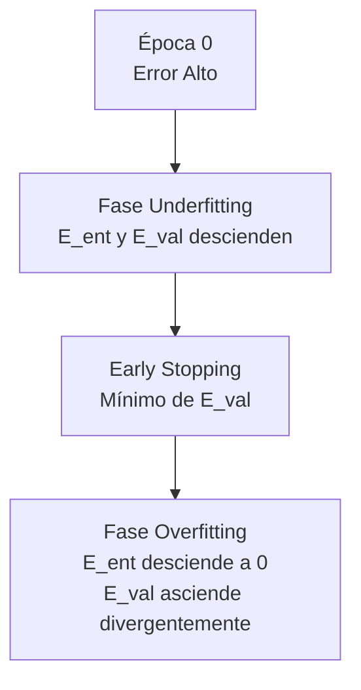
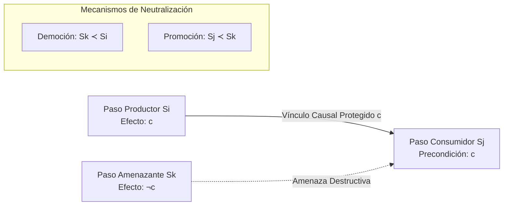

# BANCO MAESTRO CONSOLIDADO TOTAL DE PREGUNTAS TEÓRICAS, EXÁMENES REALES, GUÍA TEÓRICA Y TIPS PARA EL EXAMEN PRÁCTICO

**Materia:** Inteligencia Artificial  
**Institución:** Universidad Tecnológica Nacional – Facultad Regional Resistencia (UTN FRRe)  
**Cátedra:** Inteligencia Artificial  
**Versión:** Consolidada Definitiva y Exhaustiva (Enriquecida con `Preguntas_Parcial_2.pdf`, `doc_2do_parcial_D3.md` y `tips_practica_D3.docx`)

---

## PRESENTACIÓN Y ALCANCE DE ESTA OBRA
Este compendio representa el repositorio unificado, definitivo y oficial de preparación teórica y metodológica para los exámenes parciales y finales de Inteligencia Artificial de la UTN FRRe.

El documento integra en un único cuerpo armónico:
1. **Tips Metodológicos de la Cátedra para el Examen Práctico y Teórico:** Criterios formales de diagramación, construcción paso a paso de dendrogramas, tabulación de errores en MLP, cómo justificar condiciones de parada, cómo graficar arquitecturas de Hopfield y SOM, y cómo presentar soluciones formales en Perceptrón y SVM.
2. **Banco Exhaustivo de Exámenes Finales y Mesas de Examen de Cátedra:** Resoluciones integrales de mesas de examen de cátedra y parciales presenciales.
3. **Exámenes Finales Históricos Rescatados (2020 – 2021) y Examen Escaneado Oficial (`teoria.jpg`).**
4. **Banco Exhaustivo de 51 Preguntas de Multiple Choice Oficiales:** Cada opción clasificada como Verdadero o Falso con su correspondiente fundamentación teórica canónica.
5. **Compendio Total de las 78 Preguntas de Desarrollo Reales de Segundo Parcial (`Preguntas_Parcial_2.pdf`) + 4 Preguntas de Examen Teórico (82 Preguntas en Total):** Cada pregunta desarrollada en profundidad con fórmulas en KaTeX, análisis dimensional y tablas comparativas tridimensionales completas (SOM vs Hopfield vs Perceptrón; $k$-NN vs $K$-Means vs Naïve Bayes).
6. **Compendio Teórico y Preguntas Avanzadas de la Cátedra (`doc_2do_parcial_D3.md`):** Demostraciones formales de optimalidad, derivación analítica de pesos en SVM, función de energía de Liapunov en Hopfield, y análisis de convergencia.
7. **Compendio Especial de Temas de Primer Parcial `[TEMA_P1_RENDIDO]`:** Conservado íntegramente con etiqueta de advertencia para repaso de finales (Apriori, Árboles C4.5, Planificación POP y Búsqueda Heurística).

---

## ÍNDICE GENERAL

* [SECCIÓN MAESTRA: TIPS Y CONSEJOS METODOLÓGICOS DE LA CÁTEDRA PARA EL EXAMEN PRÁCTICO Y TEÓRICO](#sección-maestra-tips-y-consejos-metodológicos-de-la-cátedra-para-el-examen-práctico-y-teórico)
  * [Tip 1: Búsqueda Sistemática (DFS y BFS)](#tip-1-búsqueda-sistemática-primero-en-profundidad---dfs-y-primero-en-amplitud---bfs)
  * [Tip 2: Búsqueda Heurística ($A^{\ast}$, Escalada Simple y Máxima Pendiente)](#tip-2-búsqueda-heurística-a-escalada-simple-y-máxima-pendiente)
  * [Tip 3: Algoritmos Genéticos (Resolución Práctica)](#tip-3-algoritmos-genéticos-resolución-práctica)
  * [Tip 4: Planificación de Orden Parcial (POP) `[TEMA_P1_RENDIDO]`](#tip-4-planificación-de-orden-parcial-pop-tema_p1_rendido)
  * [Tip 5: Perceptrón Simple y ADALINE (Cómo Presentar la Solución)](#tip-5-perceptrón-simple-y-adaline-cómo-presentar-la-solución)
  * [Tip 6: Redes Multicapa (MLP / BPN) y Tabulación de Errores](#tip-6-redes-multicapa-mlp--bpn-y-tabulación-de-errores)
  * [Tip 7: Redes de Hopfield (Cómo Graficar y Operar)](#tip-7-redes-de-hopfield-cómo-graficar-y-operar)
  * [Tip 8: Self-Organizing Maps (SOM) (Cómo Graficar y Operar)](#tip-8-self-organizing-maps-som-cómo-graficar-y-operar)
  * [Tip 9: Support Vector Machines (SVM) (Cómo Presentar la Solución)](#tip-9-support-vector-machines-svm-cómo-presentar-la-solución)
  * [Tip 10: Clustering Jerárquico y Construcción de Dendrogramas](#tip-10-clustering-jerárquico-y-construcción-de-dendrogramas)
  * [Tip 11: $K$-Means y Disk $K$-Means](#tip-11-k-means-y-disk-k-means)
  * [Tip 12: Clasificador Naive Bayes y $k$-NN](#tip-12-clasificador-naive-bayes-y-k-nn)
  * [Tip 13: Aprendizaje por Refuerzo ($Q$-Learning)](#tip-13-aprendizaje-por-refuerzo-q-learning)
* [PARTE I: BANCO DE EXÁMENES FINALES Y MESAS DE EXAMEN DE CÁTEDRA](#parte-i-banco-de-exámenes-finales-y-mesas-de-examen-de-cátedra)
* [PARTE II: EXÁMENES FINALES HISTÓRICOS RESCATADOS (2020 – 2021)](#parte-ii-exámenes-finales-históricos-rescatados-2020--2021)
* [PARTE III: EXAMEN TEÓRICO OFICIAL ESCANEADO PRESENCIAL (`teoria.jpg`)](#parte-iii-examen-teórico-oficial-escaneado-presencial-teoriajpg)
* [PARTE IV: BANCO EXHAUSTIVO DE 51 PREGUNTAS DE MULTIPLE CHOICE OFICIALES](#parte-iv-banco-exhaustivo-de-51-preguntas-de-multiple-choice-oficiales)
* [PARTE V: COMPENDIO TOTAL DE LAS 78 PREGUNTAS DE DESARROLLO DE SEGUNDO PARCIAL CON RESPUESTAS OFICIALES](#parte-v-compendio-total-de-las-78-preguntas-de-desarrollo-de-segundo-parcial-con-respuestas-oficiales)
* [PARTE VI: COMPENDIO TEÓRICO Y PREGUNTAS AVANZADAS DE LA CÁTEDRA](#parte-vi-compendio-teorico-y-preguntas-avanzadas-de-la-catedra)
* [PARTE VII: COMPENDIO ESPECIAL DE TEMAS DE PRIMER PARCIAL `[TEMA_P1_RENDIDO]`](#parte-vii-compendio-especial-de-temas-de-primer-parcial-tema_p1_rendido)

---

# SECCIÓN MAESTRA: TIPS Y CONSEJOS METODOLÓGICOS DE LA CÁTEDRA PARA EL EXAMEN PRÁCTICO Y TEÓRICO

> [!IMPORTANT]
> **GUÍA OFICIAL DE RESOLUCIÓN METODOLÓGICA DE EXÁMENES (UTN FRRe)**
> Esta sección reúne las pautas canónicas, directivas de diagramación y criterios formales exigidos por la Cátedra en las correcciones de parciales y exámenes finales. Seguir al pie de la letra estas reglas garantiza obtener el máximo puntaje en los ejercicios prácticos de desarrollo.

---

## Tip 1: Búsqueda Sistemática (Primero en Profundidad - DFS y Primero en Amplitud - BFS)

### 1. Formato de Tabulación Obligatorio
En los exámenes prácticos, todo ejercicio de búsqueda sistemática debe desarrollarse mediante una tabla con exactamente tres columnas:

| Tiempo ($t$) | Estructura (PILA / COLA) | Observaciones |
| :---: | :---: | :--- |
| $t = 0$ | $[S]$ | Estado inicial en la estructura. Se expande $S$. |
| $t = 1$ | $[A, B, C]$ | Se procesa $S$, se insertan hijos de $S$. |
| $t = 2$ | $[D, E, B, C]$ | Reemplazo $A$ por sus hijos $D, E$. Proceso $A$. |

### 2. Dinámica de Estructuras de Datos
* **Primero en Profundidad (DFS):**
  * Utiliza una estructura de **PILA (LIFO)**.
  * **Regla de Inserción:** Los nodos ingresan por el **frente / por delante**, reemplazando a sus padres directos.
  * **Regla de Poda de Nodos Repetidos:** Si aparece un nodo repetido en la estructura, **se tacha el repetido que está ÚLTIMO en la PILA** (se conserva la instancia más profunda / más cercana al tope).
  * **Regla de Nodos Procesados:** Si se genera un nodo que ya fue completamente procesado y expandido con anterioridad, **se tacha inmediatamente** en la columna de Observaciones.
* **Primero en Amplitud (BFS):**
  * Utiliza una estructura de **COLA (FIFO)**.
  * **Regla de Inserción:** Los nodos ingresan por **detrás / al final** de la estructura.
  * **Regla de Poda:** Si aparece un nodo repetido, se tacha el que ingresó último (el que está más al fondo de la COLA). Si un nodo ya fue procesado, se descarta.

### 3. Fórmulas de Complejidad Temporal y Espacial Exigidas en Examen
Parámetros canónicos definidos por la Cátedra:
* $d$: Profundidad máxima del árbol.
* $b$: Factor de ramificación promedio.
* $m$: Profundidad de la solución menos profunda.

#### Primero en Profundidad (DFS):
* **Complejidad Temporal:**
  


$$
\text{Tiempo Total} = \frac{b^{d+1} - 1}{b - 1} \quad \implies \quad O(b^d)
$$

  * *Tip de Examen:* Si el enunciado proporciona el tiempo de procesamiento unitario por nodo (ej. $2 \text{ ms}$), se multiplica el total de nodos por dicho valor y se expresa en segundos o minutos.
* **Complejidad Espacial (Memoria):**
  

$$
\text{Memoria Total} = ((b - 1) \cdot d) + 1 \quad \implies \quad O(b \cdot d)
$$

  * *Tip de Examen:* Si el enunciado da el tamaño de almacenamiento de cada nodo (ej. $128 \text{ bytes}$), se multiplica por este valor y se expresa en KiloBytes o MegaBytes.

#### Primero en Amplitud (BFS):
* **Complejidad Temporal:** $O(b^m)$ (nodos generados hasta el nivel de la solución).
* **Complejidad Espacial:** $O(b^m)$ (debe retener todos los nodos del nivel en memoria).

---

## Tip 2: Búsqueda Heurística ($A^{\ast}$, Escalada Simple y Máxima Pendiente)

### 1. Escalada Simple vs Escalada por Máxima Pendiente
* **Escalada Simple:** Se parte del estado inicial y se genera el primer sucesor. Si su heurística mejora al estado actual, se toma inmediatamente como estado actual sin evaluar a los demás hermanos. Si ninguno mejora, el algoritmo se paraliza.
* **Escalada por Máxima Pendiente:** Se generan y evalúan **todos los nodos hijos** del estado actual. Se selecciona el mejor de todos ellos. Si el mejor no supera al estado actual, el algoritmo se detiene.
* **Problemas Críticos de la Escalada:** En el examen se debe identificar explícitamente si el algoritmo se detuvo por:
  1. *Máximo Local:* Pico más alto que sus vecinos pero inferior al objetivo global.
  2. *Meseta:* Zona plana del espacio de búsqueda donde todos los sucesores tienen igual heurística.
  3. *Cresta:* Forma de relieve con pendiente oblicua que la escalada ortogonal no puede ascender.

### 2. Algoritmo $A^{\ast}$ y Evaluación de Función
* **Fórmula canónica:** $f'(n) = g(n) + h'(n)$
  * $g(n)$: Costo real acumulado desde el inicio hasta el nodo $n$.
  * $h'(n)$: Estimación heurística desde $n$ hasta la meta.
* **Regla de Poda de Caminos Alternativos:** Si durante la expansión se alcanza un mismo nodo $N$ a través de dos caminos distintos, **se conserva aquel con menor valor de $f'(N)$ y se tacha definitivamente el camino con mayor $f'$**.
* **Condición Formal de Fin de $A^{\ast}$:** El algoritmo **NO termina** cuando se genera un nodo meta, sino **únicamente cuando el nodo meta es extraído de la lista ABIERTA (Open List) para ser expandido**. Esto garantiza la optimalidad si $h'$ es admisible ($h'(n) \le h(n)$ ).

---

## Tip 3: Algoritmos Genéticos (Resolución Práctica)

### 1. Operadores de Selección
* **Selección por Ruleta:**
  1. Se calcula la aptitud de cada individuo $f\_i$ y la aptitud total $F = \sum\_{i=1}^N f\_i$.
  2. Se calcula la probabilidad proporcional de selección: $p\_i = \frac{f\_i}{F} \times 100\%$.
  3. Se construyen los intervalos cerrados acumulados: $[0, p\_1], [p\_1, p\_1 + p\_2], \dots, [\sum\_{j=1}^{N-1} p\_j, 100\%]$.
  4. Se simulan números pseudoaleatorios $r \in [0, 100]$; el intervalo donde caiga $r$ define al individuo seleccionado.
* **Control de Copia Esperado:**
  * Se calcula el número esperado de copias $c\_i = \frac{f\_i}{\bar{f}}$, donde $\bar{f} = \frac{F}{N}$ es la aptitud media. La parte entera $\lfloor c\_i \rfloor$ garantiza copias deterministas, y la parte fraccionaria compite por ruleta.
* **Selección Elitista:** Se ordenan los individuos de mayor a menor aptitud y pasan directamente a la siguiente generación los mejores (ej. el $10\%$ o $15\%$).
* **Selección por Ranking:** Se ordenan de menor a mayor y se asigna una probabilidad proporcional a la posición en el orden (independiente de la escala de la aptitud), evitando que un super-individuo domine la población prematuramente.
* **Selección por Torneo:** Se toman subgrupos de tamaño $k$ al azar y se selecciona al mejor de cada grupo.

### 2. Operadores de Cruce (*Crossover*)
* **Cruce Simple:** Se selecciona aleatoriamente un punto de corte $k \in [1, L-1]$ e intercambian sus colas genéticas a partir de la posición $k$.
* **Cruce Multipunto:** Se eligen múltiples posiciones de corte e intercambian los segmentos alternadamente.
* **Cruce Binomial / Uniforme:** Cada gen del descendiente se toma del padre con probabilidad $p$ o de la madre con probabilidad $1-p$, determinado mediante tirada de números aleatorios gen por gen.

### 3. Operadores de Mutación Adaptativa (Fórmulas Canónicas de Cátedra)
La mutación mantiene la diversidad genética para evitar que el algoritmo quede atrapado en óptimos locales.

#### Mutación Adaptativa por Temperatura:
No depende de la homogeneidad de la población, sino del número de generaciones transcurridas (parámetro de tiempo).
* **Temperatura Ascendente:**
  

$$
P(gen\_x) = P\_{min} + \lambda \cdot (gen\_x - 1)
$$

  * *Justificación de Cátedra:* Comienza con una probabilidad mínima y aumenta con las generaciones. Se utiliza porque en las primeras generaciones la población es diversa y heterogénea; al avanzar el tiempo y homogeneizarse la población, se eleva la mutación para forzar diversidad y evitar convergencia prematura.
* **Temperatura Descendente:**
  

$$
P(gen\_x) = P\_{max} - \lambda \cdot (gen\_x - 1)
$$

  * *Justificación de Cátedra:* Comienza con mutación máxima y se reduce a medida que transcurren las generaciones. Se utiliza para fomentar una **exploración inicial exhaustiva** del espacio de búsqueda en las primeras etapas, reduciendo la perturbación al final para permitir la **explotación / ajuste fino** alrededor del óptimo.

---

## Tip 4: Planificación de Orden Parcial (POP) `[TEMA_P1_RENDIDO]`

1. **Planteo Formal de Acciones Canónicas:**
   * **Paso Inicial (`Empezar`):** Precondiciones: $\emptyset$. Poscondiciones: Todas las condiciones iniciales del problema.
   * **Paso Final (`Terminar`):** Precondiciones: Las metas u objetivos del problema. Poscondiciones: $\emptyset$.
2. **Encadenamiento Causal:** Se trabaja mediante **regresión de metas** (de atrás hacia adelante), resolviendo precondiciones abiertas con poscondiciones de operadores existentes o agregando nuevos operadores.
3. **Detección y Manejo de Amenazas:**
   * Una **amenaza** ocurre cuando la poscondición de un operador $O\_k$ borra o contradice la precondición de un operador $O\_j$ que está siendo sostenida por un vínculo causal $O\_i \xrightarrow{c} O\_j$.
   * **Resolución Formal:**
     * **Promoción:** Ordenar que $O\_k$ se ejecute antes de $O\_i$ ($O\_k < O\_i$).
     * **Degradación:** Ordenar que $O\_k$ se ejecute después de $O\_j$ ($O\_j < O\_k$).

---

## Tip 5: Perceptrón Simple y ADALINE (Cómo Presentar la Solución)

### 1. Comprobación de Separabilidad Lineal
* En $\mathbb{R}^2$: Se grafican los puntos positivos y negativos en un eje de coordenadas cartesiano y se traza una línea divisoria continua que separe estrictamente ambas clases.
* En $\mathbb{R}^3$: Para evitar dibujar en perspectiva 3D, la Cátedra instruye hacer **cero de a una las variables** y graficar las proyecciones en los planos bidimensionales coordenados ($x\_1 - x\_2$, $x\_2 - x\_3$, $x\_1 - x\_3$), identificando los puntos de corte del plano separador con los ejes.

### 2. Método Analítico de Obtención de Pesos
Dada la ecuación del hiperplano separador $w\_1 x\_1 + w\_2 x\_2 - \theta = 0$:
1. Se eligen los puntos de intersección con los ejes coordenados:
   * Con $x\_2 = 0 \implies x\_1 = c\_1 \implies w\_1 \cdot c\_1 - \theta = 0 \implies w\_1 = \frac{\theta}{c\_1}$.
   * Con $x\_1 = 0 \implies x\_2 = c\_2 \implies w\_2 \cdot c\_2 - \theta = 0 \implies w\_2 = \frac{\theta}{c\_2}$.
2. Se asigna un valor arbitrario al umbral (típicamente $\theta = 1$) y se despejan directamente los valores de $w\_1$ y $w\_2$.
3. Se verifica algebraicamente que todos los patrones clasifiquen con el signo correcto.

### 3. Método Iterativo (Regla Delta del Perceptrón)
1. Inicializar pesos aleatoriamente (o en ceros según indique la consigna).
2. Para cada patrón $k$, calcular la salida de red:
   

$$
net\_k = \sum\_{j=1}^n w\_j x\_{kj} - \theta
$$

   

$$
y\_k = \begin{cases}
1 & \text{si } net\_k \ge 0 \\
0 \text{ (o } -1) & \text{si } net\_k < 0
\end{cases}
$$


3. Si hay error ($S\_d \ne S\_o$), actualizar pesos:
   


$$
w\_j(t+1) = w\_j(t) + \alpha \cdot (S\_d - S\_o) \cdot x\_j
$$

   

$$
\theta(t+1) = \theta(t) - \alpha \cdot (S\_d - S\_o)
$$

4. **Condición Formal de Parada:** El algoritmo termina **únicamente cuando se completa una ÉPOCA ENTERA (ciclo completo de presentación de todos los patrones de entrenamiento) sin cometer ningún error**.

### 4. Diferencia Fundamental con ADALINE
* **ADALINE (Adaptive Linear Neuron):** Evalúa el error de entrenamiento sobre la **salida lineal neta** ($net = \sum w\_i x\_i$) **antes** de aplicar la función escalón, utilizando la regla Widrow-Hoff (mínimos cuadrados / LMS):
  

$$
\Delta w\_i = \alpha \cdot (S\_d - net) \cdot x\_i
$$

* **Perceptrón Simple:** Evalúa el error sobre la **salida discreta/umbralizada** ($y = f(net)$):
  

$$
\Delta w\_i = \alpha \cdot (S\_d - y) \cdot x\_i
$$


---

## Tip 6: Redes Multicapa (MLP / BPN) y Tabulación de Errores

### 1. Tabulación y Graficación de Curvas de Error
En los ejercicios prácticos se debe presentar la evolución del entrenamiento en una tabla comparativa de errores:

| Época ($t$) | $E\_{entrenamiento}$ | $E\_{validación}$ | $E\_{test}$ | Decisión Metodológica |
| :---: | :---: | :---: | :---: | :--- |
| 10 | 0.450 | 0.470 | — | Continúa entrenamiento (ambos errores descienden). |
| 50 | 0.120 | 0.145 | — | Descenso sostenido. |
| 100 | 0.040 | 0.080 | — | Mínimo de validación alcanzado ($E\_{val}$ óptimo). |
| 120 | 0.025 | 0.095 | — | **Alerta:** $E\_{train}$ baja pero $E\_{val}$ comienza a subir (**Sobreajuste**). |
| **Parada** | **0.040** | **0.080** | **0.082** | **Early Stopping:** Se restauran los pesos de la época 100 y se evalúa $E\_{test}$. |

### 2. Qué Hacer según los Errores
* **Si $E\_{val}$ crece antes de alcanzar el error mínimo admisible:** Ocurre sobreajuste prematuro o la red quedó atrapada en oscilaciones. Soluciones:
  1. Reducir la tasa de aprendizaje $\alpha$.
  2. Ajustar el término de momento $\beta$.
  3. Reducir la cantidad de neuronas en la capa oculta para limitar la capacidad de memorización.
  4. Incrementar el tamaño y la representatividad del conjunto de datos de entrenamiento.
* **Si $E\_{val} < E\_{min}$ (menor al error tolerable):** La red convergió con éxito y posee capacidad de generalización demostrada. Se interrumpe el entrenamiento inmediatamente y se corre el conjunto de test para certificar la métrica final antes de su despliegue en producción.

### 3. Fórmulas de Backpropagation (Regla de la Cadena)
* Para una neurona de salida $k$:
  

$$
\delta\_k = (y\_k^d - y\_k) \cdot f'(net\_k)
$$

* Para una neurona oculta $j$:
  

$$
\delta\_j = f'(net\_j) \cdot \sum\_{k} w\_{kj} \delta\_k
$$

* Derivadas de funciones de activación:
  * Si $f$ es lineal: $f'(net) = 1$.
  * Si $f$ es sigmoidea logística: $f'(net) = y \cdot (1 - y)$.
  * Si $f$ es tangente hiperbólica: $f'(net) = 1 - y^2$.
* Actualización con Término de Momento:
  

$$
\Delta w\_{ji}(t) = \alpha \cdot \delta\_j \cdot x\_i + \beta \cdot \Delta w\_{ji}(t-1)
$$

  * Momento Negativo ($-\beta$): Se aplica para contrarrestar oscilaciones destructivas en valles de error muy estrechos con gradientes alternantes.

---

## Tip 7: Redes de Hopfield (Cómo Graficar y Operar)

### 1. Cómo Graficar la Arquitectura de Hopfield
1. Se dibuja una única capa con $N$ neuronas (numeradas de $1$ a $N$).
2. Cada neurona $i$ proyecta una línea hacia un bus de retorno que se conecta a las entradas de **todas las demás neuronas $j \ne i$**.
3. **Regla estricta:** No existen auto-conexiones ($w\_{ii} = 0$).
4. Las conexiones entre pares de neuronas son estrictamente simétricas ($w\_{ij} = w\_{ji}$).

```
       +--- Neurona 1 <----+
       |         ^         |
       |  w12=w21|         | w13=w31
       v         v         v
Neurona 2 <------------> Neurona 3
         w23 = w32
   (w11 = w22 = w33 = 0)
```

### 2. Cálculo de la Matriz de Pesos Hebbiana
Para $M$ patrones bipolares $E\_k \in \{-1, +1\}^N$:


$$
W = \sum\_{k=1}^M \left( E\_k E\_k^T - I \right)
$$

O elemento a elemento:


$$
w\_{ij} = \begin{cases}
\sum\_{k=1}^M E\_{ki} E\_{kj} & \text{si } i \ne j \\
0 & \text{si } i = j
\end{cases}
$$


### 3. Dinámica de Recuperación y Criterio de Parada
1. Se aplica el vector de entrada distorsionado $e\_d(0)$.
2. Se multiplica: $net = e\_d \cdot W$.
3. Se aplica la función de activación bipolar:
   


$$
e\_d(t+1) = \text{signo}(net) = \begin{cases}
+1 & \text{si } net\_i > 0 \\
-1 & \text{si } net\_i < 0 \\
e\_d(t) & \text{si } net\_i = 0
\end{cases}
$$


4. **Condición de Fin:**
   * **Convergencia Correcta:** Si $e\_d(t+1) = e\_d(t)$, la red alcanzó un estado estable (mínimo de energía). Se compara con los patrones almacenados.
   * **Ciclo Límite:** Si $e\_d(t+n) = e\_d(t)$ con $n > 1$, la red entró en oscilación periódica y no se estabiliza.

### 4. Capacidad de Almacenamiento y Ortogonalidad
* **Recuperación Exacta:** $M \le \frac{N}{4 \ln N}$
* **Con Error Tolerable ($< 1\%$):** $M \le 0.138 \cdot N$
* **Condición de Ortogonalidad:** $E\_k \cdot E\_m = 0$. Los patrones deben diferir en al menos el $50\%$ de sus bits. Si $E\_k \cdot E\_m > 0$, existe correlación e interferencia (crosstalk).

---

## Tip 8: Self-Organizing Maps (SOM) (Cómo Graficar y Operar)

### 1. Cómo Graficar la Arquitectura de SOM
1. Se dibuja una **capa de entrada** con $N$ nodos sensoriales (tantos como componentes del vector de entrada).
2. Se dibuja una **capa de salida** constituida por una grilla discreta de neuronas (típicamente 2D en malla hexagonal o rectangular, o 1D en cadena).
3. Cada nodo de entrada está conectado a **todas y cada una de las neuronas de salida** mediante un peso sináptico $w\_{ji}$.
4. **No existen conexiones físicas entre las neuronas de salida**, pero se dibuja una elipse o campana gaussiana punteada sobre la grilla para indicar la **función de vecindad topológica**.

```
Entradas:    ( x1 )      ( x2 )      ( x3 )
                \       / | \       /
                 \     /  |  \     /
Grilla Salida:  [N1] --- [N2] --- [N3]
                 |         |        |
                [N4] --- [BMU] -- [N6]  <-- Función de Vecindad h(t)
                 |         |        |
                [N7] --- [N8] --- [N9]
```

### 2. Algoritmo Paso a Paso
1. **Fase de Competencia:** Presentar patrón $x$. Calcular la distancia euclídea a los pesos de todas las neuronas de salida:
   


$$
d\_j = \|x - w\_j\| = \sqrt{\sum\_{i=1}^N (x\_i - w\_{ji})^2}
$$

   La neurona con menor distancia es la ganadora (Best Matching Unit - BMU) $c = \arg\min\_j d\_j$.
2. **Fase de Cooperación:** Calcular la función de vecindad centrada en la BMU:
   

$$
h\_{cj}(t) = \exp\left(-\frac{\|r\_c - r\_j\|^2}{2 \sigma(t)^2}\right)
$$

   El radio de vecindad $\sigma(t)$ decae exponencialmente en el tiempo.
3. **Fase de Adaptación:** Actualizar los pesos de la BMU y de sus vecinas:
   

$$
\Delta w\_{ji} = \eta(t) \cdot h\_{cj}(t) \cdot (x\_i - w\_{ji})
$$

   La tasa de aprendizaje $\eta(t)$ también decae en el tiempo.
4. **Condición de Parada:** El algoritmo termina cuando los pesos se estabilizan y el desplazamiento de los vectores $\Delta w$ es menor a un umbral infinitesimal preestablecido tras miles de épocas.

---

## Tip 9: Support Vector Machines (SVM) (Cómo Presentar la Solución)

### 1. Elementos Obligatorios a Escribir en la Solución
1. **Ecuación del Hiperplano Separador Óptimo:**
   

$$
\mathbf{w}^T \mathbf{x} + b = 0
$$

2. **Hiperplanos Canónicos de Margen:**
   

$$
H\_1: \mathbf{w}^T \mathbf{x} + b = +1 \quad (\text{para } y\_i = +1)
$$

   

$$
H\_2: \mathbf{w}^T \mathbf{x} + b = -1 \quad (\text{para } y\_i = -1)
$$

3. **Ancho del Margen Geométrico:**
   

$$
M = \frac{2}{\\|\mathbf{w}\|}
$$

4. **Vectores de Soporte ($SV$):** Son los puntos que satisfacen la igualdad $y\_i(\mathbf{w}^T \mathbf{x}\_i + b) = 1$. Poseen multiplicador de Lagrange $\alpha\_i > 0$.
5. **Vectores No de Soporte:** Poseen $\alpha\_i = 0$ y no tienen ninguna influencia en el cálculo de $\mathbf{w}$ ni de $b$.

### 2. Fórmulas de Deducción Analítica
* **Vector de Pesos $\mathbf{w}$:**
  

$$
\mathbf{w} = \sum\_{i \in SV} \alpha\_i y\_i \mathbf{x}\_i
$$

* **Sesgo $b$:** Se evalúa a partir de cualquier vector de soporte $\mathbf{x}\_s$ con $y\_s(\mathbf{w}^T \mathbf{x}\_s + b) = 1$:
  

$$
b = y\_s - \mathbf{w}^T \mathbf{x}\_s
$$

  (Si hay múltiples vectores de soporte, la Cátedra recomienda calcular el promedio de $b$ sobre todos ellos para estabilidad numérica).

---

## Tip 10: Clustering Jerárquico y Construcción de Dendrogramas

### 1. Cómo Graficar un Dendrograma en el Examen
1. **Eje Horizontal ($X$):** Se ubican los identificadores de todas las instancias o elementos individuales del dataset ($A, B, C, D, \dots$).
2. **Eje Vertical ($Y$):** Representa la escala de **distancia / disimilitud** a la cual se fusionan los grupos.
3. **Trazado de Fusiones:**
   * Se trazan dos líneas verticales desde los elementos o clusters que se van a unir.
   * Se unen mediante una barra horizontal **a la altura exacta calculada en la matriz de distancias** (formando una estructura de "$U$ invertida").
4. **Corte del Dendrograma:** Se traza una línea punteada horizontal a una distancia umbral $D\_{corte}$. La cantidad de líneas verticales interceptadas determina exactamente la **cantidad de clusters ($k$)** generados.

```
Distancia (Y)
  ^
4 |            +---------------------+
  |            |                     |
3 |      +-----+-----+               |
  |      |           |               |
2 |      |        +--+--+            |
  |   +--+--+     |     |            |
1 |   |     |     |     |         +--+--+
0 +---+-----+-----+-----+---------+-----+---> Instancias (X)
      A     B     C     D         E     F
```

### 2. Métodos de Enlace y Distancias Inter-Cluster
* **Single Link (Vecino Más Próximo):**
  

$$
d(C\_1, C\_2) = \min\_{x \in C\_1, y \in C\_2} d(x, y)
$$

  *Tendencia:* Genera clusters alargados y en forma de cadena (*chaining effect*).
* **Complete Link (Vecino Más Lejano):**
  

$$
d(C\_1, C\_2) = \max\_{x \in C\_1, y \in C\_2} d(x, y)
$$

  *Tendencia:* Genera clusters compactos, esféricos y de diámetros similares.
* **Average Link (Promedio):**
  

$$
d(C\_1, C\_2) = \frac{1}{\vert C\_1 \vert \cdot \vert C\_2 \vert} \sum\_{x \in C\_1} \sum\_{y \in C\_2} d(x, y)
$$

* **¡ALERTA CANÓNICA DE EXAMEN!**
  * **NINGUNO** de los tres métodos anteriores calcula la distancia entre los centroides de los clusters.
  * La distancia entre centroides es un método independiente llamado **Centroid Linkage**, que solo mide $\|\mu\_1 - \mu\_2\|$ sin promediar los pares de instancias individuales como hace Average Link.

---

## Tip 11: $K$-Means y Disk $K$-Means

### 1. Algoritmo $K$-Means Canónico
1. Seleccionar $k$ semillas iniciales como centroides.
2. Asignar cada dato al centroide más cercano según distancia euclídea.
3. Recalcular cada centroide como el promedio vectorial de las instancias asignadas:
   

$$
\mu\_j = \frac{1}{\vert C\_j \vert} \sum\_{x \in C\_j} x
$$

4. **Condición de Parada:** El algoritmo termina cuando las asignaciones no cambian o los centroides se repiten entre dos iteraciones sucesivas.

### 2. Manejo de Sobreajuste en $K$-Means
* Si $k$ es demasiado grande (caso extremo $k = N$), la suma de errores al cuadrado ($SSE$) es 0, lo que representa un sobreajuste total.
* **Soluciones:**
  1. Aplicar la técnica del **Codo (*Elbow Method*)** graficando $SSE$ vs $k$ y eligiendo el punto de inflexión.
  2. Evaluar el coeficiente de **Silueta Media**.
  3. Penalizar el número de clusters mediante criterios de información (AIC / BIC).
  4. Fusionar clusters cuyas distancias inter-centroides sean menores a un umbral preestablecido.

### 3. Disk $K$-Means (Implementación Out-of-Core)
* Diseñado para datasets masivos que no caben en memoria RAM.
* En lugar de almacenar todas las instancias, almacena únicamente un buffer de acumulación en memoria primaria con:
  1. Un contador de instancias por cluster: $N\_j$.
  2. Un vector acumulador de sumas: $\mathbf{S}\_j = \sum\_{x \in C\_j} x$.
* Lee los datos secuencialmente desde disco en bloques y actualiza el buffer. Al final del paso, calcula los centroides como $\mu\_j = \mathbf{S}\_j / N\_j$.
* **Criterio Oficial:** Disk $K$-Means retorna **exactamente los mismos clusters** que $K$-Means estándar si se parte de las mismas semillas iniciales.

---

## Tip 12: Clasificador Naive Bayes y $k$-NN

### 1. Clasificador Naive Bayes
* **Principio:** Teorema de Bayes asumiendo independencia condicional entre atributos dado el valor de la clase:
  

$$
P(C\_k | X) = \frac{P(C\_k) \prod\_{i=1}^d P(x\_i | C\_k)}{P(X)}
$$

* **Distribuciones Continuas (Gaussianas):** Se calculan la media $\mu\_{ik}$ y varianza $\sigma\_{ik}^2$ para cada atributo $i$ en cada clase $C\_k$, y la verosimilitud se calcula como:
  

$$
P(x\_i | C\_k) = \frac{1}{\sqrt{2\pi \sigma\_{ik}^2}} \exp\left(-\frac{(x\_i - \mu\_{ik})^2}{2\sigma\_{ik}^2}\right)
$$

* **Histogramas (Bins):** Se divide el rango de valores continuos en intervalos cerrados (*bins*). Se cuenta la frecuencia relativa de observaciones en cada bin para cada clase. La cantidad de bins define el balance sesgo-varianza.

### 2. $k$-NN y $k$-NN Ponderado
* **Algoritmo Canónico:**
  1. Calcular la distancia euclídea desde la nueva instancia $x\_0$ a **todos** los puntos del conjunto de entrenamiento.
  2. Ordenar las distancias de menor a mayor.
  3. Seleccionar las $k$ instancias más cercanas y realizar votación mayoritaria.
* **$k$-NN Ponderado:**
  * Se asigna a cada vecino un peso inversamente proporcional al cuadrado de la distancia:
    

$$
w\_i = \frac{1}{1 + d(x\_0, x\_i)^2} \quad \text{o bien} \quad w\_i = \frac{1}{d(x\_0, x\_i)^2}
$$

  * *Tip de Examen:* En $k$-NN ponderado **puede utilizarse todo el conjunto de datos ($k = N$)** para clasificar, ya que los puntos muy lejanos reciben un peso que tiende asintóticamente a 0, evitando que degraden la predicción.
* **Determinación de $k$ Óptimo:** Se aplica **Leave-One-Out Cross Validation** (o $k$-fold cross validation) evaluando el porcentaje de clasificación correcta para diferentes valores de $k$ en una tabla de aciertos. Se elige el $k$ con mayor tasa de éxito.

---

## Tip 13: Aprendizaje por Refuerzo ($Q$-Learning)

### 1. Matrices $R$ y $Q$
* **Matriz de Recompensas $R$:** Las filas representan el estado actual $s$ y las columnas el estado siguiente $s'$. Se colocan las recompensas inmediatas y **un guión ($-$) en caso de que no exista enlace directo entre los estados**.
* **Matriz de Valores $Q$:** Se inicializa completamente en ceros: $Q(s, a) = 0$.

### 2. Razón de Iniciar con Valores Optimistas
* Inicializar los valores de la matriz $Q$ con valores optimistas altos (ej. $+10$ en lugar de $0$) tiene como objetivo **fomentar la exploración exhaustiva** de todas las acciones del espacio de estados. Al recibir recompensas reales inferiores al valor optimista, el agente explora alternativas sistemáticamente.

### 3. Selección de Acciones y Actualización de Bellman
* **$\epsilon$-greedy:** Con probabilidad $1-\epsilon$ se explota (se elige la acción con mayor $Q(s, a)$); con probabilidad $\epsilon$ se explora al azar.
* **Softmax (Distribución de Boltzmann):** Calcula la probabilidad de cada acción mediante ranuras proporcionales en ruleta:
  

$$
P(a\_i) = \frac{e^{Q(s, a\_i)/\tau}}{\sum\_j e^{Q(s, a\_j)/\tau}}
$$

* **Ecuación de Actualización de Bellman:**
  

$$
Q(s, a) \leftarrow Q(s, a) + \alpha \left[ R(s, a) + \gamma \max\_{a'} Q(s', a') - Q(s, a) \right]
$$


# PARTE I: Banco de Exámenes Finales y Mesas de Examen de Cátedra

Esta sección reúne y desarrolla exhaustivamente todas las consignas teóricas reales evaluadas en las mesas de examen final y parciales de la cátedra, categorizadas y respondidas con el nivel de rigor formal exigido en la UTN FRRe.

---

## Mesa de Examen de Cátedra — Turno 1

### Pregunta 1: Aprendizaje Supervisado y No Supervisado (Definición y Ejemplos)
* **Clasificación temática:** [TEMA_P2_TEORIA_GENERAL]
* **Enunciado original:** *Explicar aprendizaje supervisado y no supervisado. Definición y ejemplos.*
* **Respuesta Canónica de la Cátedra:**
  1. **Aprendizaje Supervisado:**
  - **Definición:** Es un paradigma de aprendizaje inductivo donde el algoritmo dispone durante su entrenamiento de un conjunto de pares de datos etiquetados $\mathcal{D} = \{(\mathbf{x}\_p, \mathbf{d}\_p)\}\_{p=1}^P$, donde cada $\mathbf{x}\_p \in \mathbb{R}^n$ es un vector de características (entradas) y $\mathbf{d}\_p$ es la salida objetivo o deseada (*target*) suministrada por un "supervisor" externo.
  - **Objetivo matemático:** Aprender una función de mapeo hipótesis $h: \mathcal{X} \to \mathcal{Y}$ que minimice una función de costo o pérdida $J(\mathbf{w})$, de modo que sea capaz de predecir con precisión la salida para vectores de entrada no observados previamente (capacidad de **generalización**).
  - **Tipos de problemas y ejemplos:**
       - *Clasificación (salida discreta/categórica):* Predecir si un paciente padece una patología (Sí/No) o clasificar especies botánicas (Perceptrón Simple, Multicapa / MLP, Support Vector Machines / SVM, Clasificador Naïve Bayes, Árboles C4.5, $k$-NN).
       - *Regresión (salida continua):* Predecir el valor del consumo energético de una planta fabril en función de temperatura y nivel de producción (MLP con función de salida lineal, Regresión Lineal/Polinomial).
  2. **Aprendizaje No Supervisado:**
  - **Definición:** Es un paradigma donde el conjunto de datos de entrenamiento carece por completo de etiquetas o valores objetivos: $\mathcal{D} = \{\mathbf{x}\_p\}\_{p=1}^P$. El sistema no recibe ninguna señal de retroalimentación, refuerzo ni corrección externa que indique si sus respuestas son válidas o erróneas.
  - **Objetivo matemático:** Descubrir por sí mismo patrones ocultos, correlaciones, densidades de probabilidad o la estructura topológica y geométrica intrínseca de los datos. Se dice que estas redes o algoritmos son capaces de **autoorganizarse**.
  - **Tipos de problemas y ejemplos:**
       - *Agrupamiento / Clustering:* Segmentar clientes en función de sus perfiles de consumo sin clases prefijadas ($K$-Means, Disk $K$-Means, Clustering Jerárquico Aglomerativo Single/Complete/Average Link).
       - *Reducción de Dimensionalidad y Mapas de Características:* Proyectar datos de alta dimensión sobre una cuadrícula bidimensional preservando relaciones de vecindad topológica (Mapas Autoorganizados de Kohonen / SOM, PCA).
       - *Memorización y Reconstrucción Autoasociativa:* Recuperar un patrón ruidoso o incompleto a partir de la memoria asociativa distribuida (Redes Recurrentes de Hopfield).

---

### Pregunta 2: Propiedad Downward Closure en Reglas de Asociación `[TEMA_P1_RENDIDO]`
* **Clasificación temática:** `[TEMA_P1_RENDIDO]` (Minería de Datos / Reglas de Asociación)
* **Enunciado original:** *Downward closure. Qué es y para qué sirve.*
* **Respuesta Canónica de la Cátedra:**
  1. **Definición y Enunciado Formal:**
     La propiedad de **Cierre hacia Abajo** (*Downward Closure* o propiedad antimonótona del soporte) establece que:  
     

$$
\text{Si un conjunto de ítems } X \text{ es frecuente (es decir, } \text{soporte}(X) \ge \text{minsup}\text{), entonces todo subconjunto no vacío } Y \subseteq X \text{ también es frecuente (}\text{soporte}(Y) \ge \text{minsup}\text{).}
$$

     De forma contrapositiva equivalente:  
     

$$
\text{Si un subconjunto } Y \text{ es infrecuente (}\text{soporte}(Y) < \text{minsup}\text{), entonces ningún superconjunto } X \supseteq Y \text{ puede ser frecuente.}
$$

  2. **Fundamento Matemático:**
     El soporte mide la frecuencia relativa de transacciones que contienen a un itemset: $\text{soporte}(X) = \frac{|\{t \in \mathcal{T} \mid X \subseteq t\}\vert }{ \vert\mathcal{T}|}$. Dado que cualquier transacción que contiene a un conjunto $X$ necesariamente contiene a cualquier subconjunto $Y \subseteq X$, se cumple monótonamente que:
     

$$
\{t \in \mathcal{T} \mid X \subseteq t\} \subseteq \{t \in \mathcal{T} \mid Y \subseteq t\} \implies \text{soporte}(X) \le \text{soporte}(Y)
$$

  3. **Para qué sirve (Utilidad Práctica en Algoritmo Apriori):**
     El espacio de búsqueda de posibles combinaciones de ítems escala exponencialmente ($2^{\vert I \vert} - 1$). La propiedad permite una **poda masiva del espacio de estados** durante la fase de generación de candidatos `candidate-gen`:
  - Al construir los candidatos de tamaño $k$ ($C\_k$) combinando pares de $(k-1)$-itemsets frecuentes en orden lexicográfico, se examinan todos sus subconjuntos de tamaño $k-1$.
  - Si tan solo uno de esos subconjuntos no se encuentra en el conjunto de frecuentes $L\_{k-1}$, el candidato se descarta de inmediato sin necesidad de consultar la base de datos de transacciones en disco.

---

### Pregunta 3: Estrategias de Planificación para Evitar la Explosión Combinatoria `[TEMA_P1_RENDIDO]`
* **Clasificación temática:** `[TEMA_P1_RENDIDO]` (Planificación / Algoritmo POP)
* **Enunciado original:** *Planning: estrategias para evitar la explosión combinatoria.*
* **Respuesta Canónica de la Cátedra:**
  Para evitar que el espacio de búsqueda crezca factorialmente al combinar posibles órdenes de acciones, los planificadores modernos (como POP / POT) utilizan **tres principios fundamentales**:
  1. **Apertura de la representación de estados, objetivos y acciones:**
  - En lugar de modelar los estados como "cajas negras" opacas (átomos monolíticos como en búsqueda heurística tradicional), se representan mediante conjuntos lógicos estructurados de oraciones proposicionales o predicados de primer orden.
  - Las acciones se definen formalmente mediante listas explícitas de **Precondiciones**, **Lista de Añadir (Add)** y **Lista de Eliminar (Delete)** (formato STRIPS). Esto permite al planificador razonar analíticamente hacia atrás (*goal regression*), seleccionando únicamente aquellas acciones cuyos efectos añadan directamente una condición requerida por el objetivo, ignorando las miles de acciones irrelevantes.
  2. **Postergación de decisiones (Principio del Mínimo Compromiso / *Least Commitment*):**
  - No comprometerse con un ordenamiento estricto ni instanciaciones tempranas de variables hasta que sea estrictamente necesario.
  - En lugar de construir secuencias lineales rígidas de pasos ($S\_1 \to S\_2 \to S\_3$), se genera un grafo de orden parcial donde dos pasos $S\_i$ y $S\_j$ sólo se ordenan temporalmente ($S\_i \prec S\_j$) si existe una amenaza destructiva o una dependencia causal directa entre ellos. Si son independientes, pueden ejecutarse en cualquier orden o en paralelo.
  3. **Descomposición de objetivos e independencia de submetas:**
  - El objetivo global se divide en un conjunto de subobjetivos casi-independientes. El planificador resuelve cada submeta de forma desacoplada y luego integra los planes parciales mediante la resolución de conflictos (amenazas a vínculos causales).

---

### Pregunta 4: Término de Momento Negativo en MLP
* **Clasificación temática:** [TEMA_P2_REDES_NEURONALES]
* **Enunciado original:** *¿El término de momento puede ser negativo?. Justificar y explicar desde cuándo se puede aplicar.*
* **Respuesta Canónica de la Cátedra:**
  1. **Regla de Actualización con Término de Momento:**
     

$$
\Delta w\_{ji}(t+1) = \alpha \cdot \delta\_{pj} \cdot y\_{pi} + \beta \cdot \Delta w\_{ji}(t)
$$

  donde:
  - $\alpha \in (0, 1)$ es la tasa de aprendizaje (*learning rate*).
  - $\beta \in [0, 1)$ es la constante o coeficiente de momento.
  - $T\_M = \beta \cdot \Delta w\_{ji}(t)$ es el **término de momento**.
  2. **¿Puede ser negativo? Justificación:**
  - **Sí, el término de momento numéricamente SÍ puede ser negativo.**
  - **Justificación:** Si bien el parámetro $\beta$ se configura como un escalar positivo ($0 \le \beta < 1$), el valor del término $T\_M = \beta \cdot \Delta w\_{ji}(t)$ adopta el signo algebraico que haya tenido el incremento de peso en la iteración inmediatamente previa $\Delta w\_{ji}(t)$.
  - Cuando en la iteración $t$ el peso se ajustó con un decremento (es decir, $\Delta w\_{ji}(t) < 0$ porque la derivada del error respecto a ese peso fue positiva: $\frac{\partial E\_p}{\partial w\_{ji}} > 0$), el producto escalar $\beta \cdot \Delta w\_{ji}(t)$ resulta estrictamente negativo.
  3. **¿Desde cuándo se puede aplicar?:**
  - Se puede aplicar **a partir de la segunda iteración ($t \ge 1$, considerando la primera iteración como $t=0$)**.
  - **Razón técnica:** Para la primera actualización de pesos ($t=0$), no existe una iteración previa $t=-1$; convencionalmente se asume $\Delta w\_{ji}(-1) = 0$. Por lo tanto, el término de momento se hace operativo y aporta inercia a partir de la segunda actualización en adelante.
  4. **Efecto en el proceso de entrenamiento:**
  - *Si el gradiente actual mantiene la misma dirección negativa:* El momento negativo suma su magnitud a la corrección del paso actual, acelerando el descenso hacia el mínimo a lo largo de mesetas o pendientes llanas.
  - *Si el gradiente actual cambió de signo (pasó a positivo):* Significa que la actualización dio un salto excesivo y se pasó del mínimo hacia la pared opuesta de un valle estrecho. En ese caso, el momento negativo amortigua el nuevo paso, actuando como filtro disipativo que previene oscilaciones divergentes.

---

### Pregunta 5: Algoritmo C4.5 para Atributos Continuos `[TEMA_P1_RENDIDO]`
* **Clasificación temática:** `[TEMA_P1_RENDIDO]` (Árboles de Decisión / C4.5)
* **Enunciado original:** *Algoritmo C4.5 para atributos continuos: si se puede aplicar tal cual o qué cambios se deberían hacer en el algoritmo.*
* **Respuesta Canónica de la Cátedra:**
  1. **¿Se puede aplicar tal cual?:**
     **NO se puede aplicar tal cual.** En atributos cualitativos discretos, el algoritmo genera una rama saliente por cada valor nominal distinto del atributo y luego elimina dicho atributo del conjunto de atributos disponibles para las ramas hijas. Con valores continuos numéricos, este procedimiento generaría tantas ramas como instancias existan, provocando un sobreajuste patológico (árbol univaluado con ramas de un solo elemento) y pérdida total de generalización.
  2. **Modificaciones que introduce C4.5:**
  - **Discretización Dinámica en Línea:** Para un atributo continuo $A$, se ordenan de menor a mayor los valores observados en el nodo actual: $v\_1 < v\_2 < \dots < v\_m$.
  - **Generación de Puntos de Corte Medios:** Se evalúan como posibles umbrales de partición binaria (*thresholds*) los puntos medios entre pares adyacentes de valores consecutivos:
       

$$
c\_i = \frac{v\_i + v\_{i+1}}{2}, \quad i = 1, \dots, m-1
$$

(Especialmente aquellos puntos donde cambia la clase observada entre $v\_i$ y $v\_{i+1}$).
  - **Evaluación de Ganancia:** Cada umbral $c\_i$ divide los datos en dos subconjuntos: $A \le c\_i$ y $A > c\_i$. Se calcula la Tasa de Ganancia de Información para cada umbral y se elige aquel $c^{\ast}$ que maximice la métrica.
  - **Persistencia del Atributo:** A diferencia del caso discreto, el atributo continuo **NO se elimina** del conjunto de atributos candidatos en los nodos descendientes, ya que un subintervalo (por ejemplo $A > c^{\ast}$) puede requerir una nueva partición más adelante. Así, un mismo atributo continuo puede aparecer múltiples veces a lo largo de un mismo camino raíz-hoja.
  - **Impacto Computacional:** La complejidad temporal por atributo pasa de ser lineal $\mathcal{O}(\vert D \vert)$ en el caso discreto a $\mathcal{O}(\vert D \vert \log \vert D \vert)$ debido al costo del ordenamiento.

---

## Mesa de Examen de Cátedra — Turno 2

### Pregunta 1: Errores de Entrenamiento y Validación (Diferencias, Comportamiento y Patrones)
* **Clasificación temática:** [TEMA_P2_REDES_NEURONALES]
* **Enunciado original:** *Explicar errores de entrenamiento y validación, diferencias, comportamiento, relación y patrones.*
* **Respuesta Canónica de la Cátedra:**
  1. **Definiciones y Fórmulas:**
  - **Error de Entrenamiento ($E\_{ent}$):** Se calcula como el error cuadrático medio acumulado sobre las instancias que el algoritmo utiliza activamente para ajustar sus pesos sinápticos mediante gradiente:
       

$$
E\_{ent} = \frac{1}{2 P\_{ent}} \sum\_{p=1}^{P\_{ent}} \sum\_{k=1}^M (d\_{pk} - y\_{pk})^2
$$

  - **Error de Validación ($E\_{val}$):** Se evalúa sobre un conjunto disjunto de muestras que **no interviene** en la modificación de los pesos, sirviendo como estimador no sesgado del error de generalización durante el aprendizaje:
       

$$
E\_{val} = \frac{1}{2 P\_{val}} \sum\_{p=1}^{P\_{val}} \sum\_{k=1}^M (d\_{pk} - y\_{pk})^2
$$

  2. **Diferencias Fundamentales de Rol:**
     | Criterio | Conjunto de Entrenamiento | Conjunto de Validación |
     | :--- | :--- | :--- |
     | **Función activa** | Modifica los pesos de la red paso a paso (regla delta / backpropagation). | Monitorea la capacidad de generalización entre épocas sin alterar los pesos. |
     | **Evolución esperada** | Decrece de forma monótona a medida que transcurren las épocas de cómputo. | Decrece al inicio, alcanza un mínimo global y luego comienza a ascender. |
     | **Criterio de corte** | Si el error cae por debajo de un umbral prefijado $\varepsilon$, se puede detener. | Su punto de inflexión mínimo marca la parada temprana (*Early Stopping*). |
  3. **Comportamiento, Relación y Patrones Dinámicos:**
  - **Fase de Subajuste (*Underfitting*):** Al inicio del entrenamiento, ambos errores ($E\_{ent}$ y $E\_{val}$) son elevados y descienden a la par de forma pronunciada, ya que la red está capturando las regularidades macroscópicas dominantes del dominio.
  - **Punto Óptimo (*Early Stopping*):** El error de validación alcanza su mínimo valor absoluto ($E\_{val}^{\ast}$). En este instante la red ha maximizado su capacidad de generalización. Se debe detener el algoritmo y preservar la matriz de pesos de esta época.
  - **Fase de Sobreentrenamiento (*Overfitting*):** Si se continúa iterando, $E\_{ent}$ continúa descendiendo asintóticamente hacia cero (la red memoriza el ruido y particularidades individuales de la muestra), mientras que $E\_{val}$ comienza a subir progresivamente. La divergencia creciente entre ambas curvas es el síntoma indiscutible de pérdida de generalización.

---

### Pregunta 2: Amenazas en Planificación y Algoritmo de Detección `[TEMA_P1_RENDIDO]`
* **Clasificación temática:** `[TEMA_P1_RENDIDO]` (Planificación / Algoritmo POP)
* **Enunciado original:** *Explicar amenazas y donde se analizan en planning, utilizando el algoritmo.*
* **Respuesta Canónica de la Cátedra:**
  1. **Definición Formal de Amenaza:**
     En un plan de orden parcial, existe un **vínculo causal** $S\_i \xrightarrow{c} S\_j$ cuando el paso productor $S\_i$ tiene la precondición $c$ en su lista de añadir (*Add-list*) para satisfacerla en el paso consumidor $S\_j$, protegiendo dicha condición durante el intervalo temporal entre ambos.  
     Una **amenaza** es un paso $S\_{amenaza}$ perteneciente al plan que cumple simultáneamente dos condiciones:
  - $S\_{amenaza}$ incluye $\neg c$ en su lista de eliminar (*Delete-list*), destruyendo la condición protegida.
  - El ordenamiento temporal actual es compatible con que $S\_{amenaza}$ se ejecute entre $S\_i$ y $S\_j$ (es decir, no existe restricción que obligue a que ocurra antes de $S\_i$ ni después de $S\_j$).
  2. **En qué parte del algoritmo POP se analizan:**
     Se analizan en el procedimiento de verificación de consistencia del plan parcial, inmediatamente después de haber añadido un nuevo paso $S\_{add}$ o un nuevo vínculo causal al plan.
  3. **Mecanismo de Resolución Algorítmica:**
     Para neutralizar la amenaza y preservar el plan, el algoritmo aplica restricciones de orden:
  - **Democión / Degradación (*Demotion*):** Obligar a que el paso amenazante ocurra antes del paso productor:
       

$$
S\_{amenaza} \prec S\_i
$$

  - **Promoción (*Promotion*):** Obligar a que el paso amenazante ocurra después del paso consumidor:
       

$$
S\_j \prec S\_{amenaza}
$$

  Si ninguna de las dos ramas genera un ciclo en el grafo temporal, el plan sigue siendo viable; si ambas generan ciclos, el planificador retrocede (*backtracking*).

---

### Pregunta 3: Batería Verdadero / Falso: Árboles de Decisión y Búsqueda Heurística $A^{\ast}$ `[TEMA_P1_RENDIDO]`
* **Clasificación temática:** `[TEMA_P1_RENDIDO]`
* **Enunciado original:** *Verdaderos y falsos de: árboles de decisión, búsqueda heurística(A*)*
* **Desarrollo y Respuestas Oficiales:**
  1. *Árboles de Decisión:*
  - *Proposición:* Las hojas de un árbol de decisión pueden ser nodos impuros.  
       **VERDADERO.** Ocurre cuando se agotan los atributos disponibles o la ganancia es menor a un umbral prefijado, quedando instancias de diferentes clases en el nodo hoja.
  - *Proposición:* Los caminos desde la raíz a las hojas no son mutuamente excluyentes.  
       **FALSO.** Los caminos son estrictamente mutuamente excluyentes (ningún ejemplo puede seguir dos caminos distintos) y exhaustivos.
  2. *Búsqueda Heurística $A^{\ast}$:*
  - *Proposición:* Si $h'(n) = 0$ para todo $n$ y $g(n)$ es variable, el algoritmo encuentra el camino óptimo.  
       **VERDADERO.** El algoritmo se reduce al algoritmo de Dijkstra de costo uniforme, garantizando el camino de menor costo real acumulado.
  - *Proposición:* Si $h'(n) = 0$ y $g(n) = 1$ para todo $n$, encuentra el camino con menor cantidad de tramos.  
       **VERDADERO.** Al ser los costos uniformes, $A^{\ast}$ se transforma exactamente en una Búsqueda Primero en Amplitud (BFS).

---

### Pregunta 4: Batería Verdadero / Falso: Support Vector Machines (SVM)
* **Clasificación temática:** [TEMA_P2_SVM]
* **Enunciado original:** *SVM (20pts cada tema, 4 oraciones V/F cada una).*
* **Desarrollo y Respuestas Oficiales:**
  1. *Proposición:* Los vectores de soporte son aquellos cuyos multiplicadores de Lagrange $\alpha\_i$ son estrictamente distintos de cero.  
     **VERDADERO.** Por las condiciones de complementariedad de Karush-Kuhn-Tucker (KKT), las instancias que no son de soporte se ubican fuera del margen y tienen $\alpha\_i = 0$.
  2. *Proposición:* Entre los hiperplanos $H\_+$ y $H\_-$ no existen instancias de entrenamiento en el caso linealmente separable.  
     **VERDADERO.** La banda de margen máximo conforma una zona vacía de exclusión de ancho $\frac{2}{\\|\mathbf{w}\|}$.
  3. *Proposición:* El vector normal $\mathbf{w}$ y el bias $b$ deben recalcularse si ingresa una nueva instancia de entrenamiento.  
     **VERDADERO.** SVM es un método global que requiere resolver nuevamente el problema de optimización cuadrática al incorporar nuevas instancias de entrenamiento que puedan alterar el margen.
  4. *Proposición:* Las SVM lineales sólo pueden aplicarse a problemas bidimensionales de dos dimensiones.  
     **FALSO.** Las SVM se formulan para vectores en espacios continuos de cualquier dimensión $\mathbb{R}^n$, mediante hiperplanos de dimensión $n-1$.

---

## Mesa de Examen de Cátedra — Turno 3

### Pregunta 1: Término de Momento en MLP
*(Ver desarrollo formal en [Mesa de Examen — Turno 1, Pregunta 4](#pregunta-4-término-de-momento-negativo-en-mlp))*. El momento acelera en gradientes consistentes y frena oscilaciones en valles estrechos.

---

### Pregunta 2: SVM — Términos $\mathbf{w}$ y $b$
* **Clasificación temática:** [TEMA_P2_SVM]
* **Enunciado original:** *SVM, término b y W.*
* **Respuesta Canónica de la Cátedra:**
  1. **Obtención del Vector Normal de Pesos $\mathbf{w}$:**
     A partir de la condición de estacionariedad del Lagrangiano Primal respecto a $\mathbf{w}$ en las condiciones KKT:
     

$$
\frac{\partial L\_P}{\partial \mathbf{w}} = \mathbf{w} - \sum\_{i=1}^N y\_i \alpha\_i \mathbf{x}\_i = 0 \implies \mathbf{w} = \sum\_{i=1}^N y\_i \alpha\_i \mathbf{x}\_i = \sum\_{s \in SV} y\_s \alpha\_s \mathbf{x}\_s
$$

El vector $\mathbf{w}$ queda expresado como una combinación lineal ponderada exclusivamente de los **vectores de soporte** ($SV$), ya que para los demás ejemplos $\alpha\_i = 0$.
  2. **Obtención del Término Independiente $b$ (*bias* o sesgo):**
     Para cualquier vector de soporte $\mathbf{x}\_s$ que descansa exactamente sobre los hiperplanos de frontera marginal ($H\_+$ o $H\_-$), se satisface con igualdad la restricción:
     

$$
y\_s (\mathbf{w}^T \mathbf{x}\_s + b) = 1
$$

Multiplicando ambos miembros por $y\_s$ (dado que $y\_s^2 = 1$ para $y\_s \in \{-1, +1\}$):
     

$$
b = y\_s - \mathbf{w}^T \mathbf{x}\_s = \frac{1}{y\_s} - \mathbf{w}^T \mathbf{x}\_s
$$

Para maximizar la estabilidad numérica frente a tolerancias de cálculo, la Cátedra indica promediar sobre todos los $\vert SV \vert$ vectores de soporte:
     

$$
b = \frac{1}{\vert SV \vert} \sum\_{s \in SV} \left( y\_s - \mathbf{w}^T \mathbf{x}\_s \right)
$$


---

### Pregunta 3: Downward Closure y su Ubicación Algorítmica `[TEMA_P1_RENDIDO]`
* **Clasificación temática:** `[TEMA_P1_RENDIDO]`
* **Enunciado original:** *Downward closure y donde está el algoritmo.*
* **Respuesta Canónica de la Cátedra:**
  Se ubica en la función **`candidate-gen`** del algoritmo Apriori. Al construir los $k$-candidatos $C\_k$ mediante la unión de pares de $L\_{k-1}$ que comparten sus primeros $k-2$ elementos, se verifica que todos los subconjuntos de tamaño $k-1$ del candidato pertenezcan a $L\_{k-1}$. Si alguno no pertenece, se poda inmediatamente.

---

### Pregunta 4: Amenazas en Planning con Ejemplo Práctico `[TEMA_P1_RENDIDO]`
* **Clasificación temática:** `[TEMA_P1_RENDIDO]`
* **Enunciado original:** *Amenazas Planning con un ejemplo práctico.*
* **Respuesta Canónica de la Cátedra:**
  - **Ejemplo en el Mundo de los Bloques:**  
    Queremos lograr la meta final `Sobre(A, B)` y `Sobre(B, C)`.
    Existe un vínculo causal entre el paso inicial $S\_0$ que añade `Mesa(A)` y `Despejado(B)`, y el paso $S\_1 = \text{Mover}(A, B)$ para poner $A$ sobre $B$.  
    Si se planifica otro paso $S\_2 = \text{Mover}(C, B)$, este paso añade `Sobre(C, B)` pero **elimina** `Despejado(B)` de su Delete-list.
    $S\_2$ constituye una **amenaza** al vínculo causal entre $S\_0$ y $S\_1$.
  - **Resolución:**
    - *Democión:* Ordenar $S\_2 \prec S\_1$ no resuelve el problema porque dejaría a $B$ ocupado cuando $S\_1$ lo necesita despejado.
    - *Promoción:* Se añade la restricción temporal $S\_1 \prec S\_2$, asegurando que $A$ se ubique sobre $B$ antes de que cualquier otra acción interactúe con el bloque.

---

### Pregunta 5: Entropía, Ganancia y Tasa de Ganancia `[TEMA_P1_RENDIDO]`
* **Clasificación temática:** `[TEMA_P1_RENDIDO]`
* **Enunciado original:** *Entropía, ganancias y Tasa Ganancia.*
* **Respuesta Canónica de la Cátedra:**
  1. **Entropía del Conjunto $D$:**
     

$$
\text{Entropía}(D) = - \sum\_{j=1}^{\vert C \vert} P(C\_j) \log\_2 P(C\_j)
$$

     Mide el grado de impureza o desorden de clases en una colección de datos.
  2. **Ganancia de Información (ID3):**
     

$$
\text{Ganancia}(D, A\_i) = \text{Entropía}(D) - \sum\_{j=1}^m \frac{\vert D\_j \vert}{\vert D \vert} \text{Entropía}(D\_j)
$$

Mide la reducción neta de impureza lograda al particionar según el atributo $A\_i$. Presenta un sesgo perjudicial hacia atributos con muchos valores distintos.
  3. **Tasa de Ganancia (*Gain Ratio* - C4.5):**
     

$$
\text{TasaDeGanancia}(D, A\_i) = \frac{\text{Ganancia}(D, A\_i)}{\text{SplitInfo}(D, A\_i)}, \quad \text{donde } \text{SplitInfo}(D, A\_i) = - \sum\_{j=1}^m \frac{\vert D\_j \vert}{\vert D \vert} \log\_2 \left( \frac{\vert D\_j \vert}{\vert D \vert} \right)
$$

     Normaliza la ganancia dividiéndola por la información intrínseca de partición (*SplitInfo*), penalizando atributos que generen divisiones atomizadas.

---

## Mesa de Examen de Cátedra — Turno 4

### Pregunta 1: Error de Validación y Entrenamiento (Fórmulas y Diferencias)
*(Ver respuesta detallada en [Mesa de Examen — Turno 2, Pregunta 1](#pregunta-1-errores-de-entrenamiento-y-validación-diferencias-comportamiento-y-patrones))*.

---

### Pregunta 2: Redes SOM Completo (Arquitectura y Dinámica)
* **Clasificación temática:** [TEMA_P2_SOM]
* **Enunciado original:** *SOM completo.*
* **Respuesta Canónica de la Cátedra:**
  1. **Arquitectura:**
     Red no supervisada compuesta por dos capas completamente interconectadas mediante pesos $\mathbf{w}\_j$:
  - *Capa de entrada:* $N$ neuronas pasivas correspondientes a las dimensiones del vector $\mathbf{x} \in \mathbb{R}^N$.
  - *Capa de salida (Mapa):* Arreglo bidimensional de neuronas con conexiones laterales de competencia e inhibición (modelo de sombrero mexicano).
  2. **Fase 1: Competencia:**
     Al recibir un patrón $\mathbf{x}$, cada neurona calcula su distancia euclídea:
     

$$
d\_j = \|\mathbf{x} - \mathbf{w}\_j\| = \sqrt{\sum\_{i=1}^N (x\_i - w\_{ji})^2}
$$

     Se proclama ganadora la neurona con menor distancia (**BMU** - *Best Matching Unit*):
     

$$
c = \arg\min\_j \|\mathbf{x} - \mathbf{w}\_j\|
$$

  3. **Fase 2: Cooperación (Función de Vecindad):**
     La neurona ganadora $c$ excita a sus vecinas topológicas en la cuadrícula mediante una función de vecindad $h\_{cj}(t)$, tal como la función gaussiana o racional:
     

$$
h\_{cj}(t) = \exp\left( -\frac{\text{dist}^2(c, j)}{2 \sigma(t)^2} \right) \quad \text{o} \quad h\_{cj}(t) = \frac{1}{1 + \text{dist}^2(c, j)}
$$

El radio de vecindad $\sigma(t)$ decrece en el tiempo.
  4. **Fase 3: Adaptación (Actualización de Pesos):**
     Se modifican los pesos de la neurona ganadora y de sus vecinas para acercarlos al vector de entrada:
     

$$
\mathbf{w}\_j(t+1) = \mathbf{w}\_j(t) + \alpha(t) \cdot h\_{cj}(t) \cdot (\mathbf{x} - \mathbf{w}\_j(t))
$$

con una tasa de aprendizaje decreciente monótona: $\alpha(t) = \frac{\alpha\_0}{t}$ o $\frac{1}{t}$.

---

### Pregunta 3: Momento Negativo
*(Ver desarrollo en [Mesa de Examen — Turno 1, Pregunta 4](#pregunta-4-término-de-momento-negativo-en-mlp))*.

---

### Pregunta 4: Planning y Explosión Combinatoria `[TEMA_P1_RENDIDO]`
*(Ver desarrollo en [Mesa de Examen — Turno 1, Pregunta 3](#pregunta-3-estrategias-de-planificación-para-evitar-la-explosión-combinatoria-tema_p1_rendido))*.

---

### Pregunta 5: Obtención de las Distancias $d\_+$ y $d\_-$ en SVM
* **Clasificación temática:** [TEMA_P2_SVM]
* **Enunciado original:** *Explicar cómo se obtiene los d en svm.*
* **Respuesta Canónica de la Cátedra:**
  1. **Definición Geométrica:**
     Son las distancias euclídeas perpendiculares más cortas desde el hiperplano óptimo de decisión $H\_0: \mathbf{w}^T \mathbf{x} + b = 0$ hasta los hiperplanos de frontera marginal que contienen a los vectores de soporte:
  - $H\_1: \mathbf{w}^T \mathbf{x} + b = +1$ (para clase positiva $y\_i = +1$, distancia $d\_+$).
  - $H\_2: \mathbf{w}^T \mathbf{x} + b = -1$ (para clase negativa $y\_i = -1$, distancia $d\_-$).
  2. **Deducción Matemática:**
     La distancia ortogonal de un punto arbitrario $\mathbf{x}$ a un hiperplano $\mathbf{w}^T \mathbf{x} + b = 0$ viene dada por:
     

$$
\text{dist}(\mathbf{x}, H\_0) = \frac{|\mathbf{w}^T \mathbf{x} + b\vert }{\ \vert\mathbf{w}\|}
$$

Para cualquier vector de soporte positivo $\mathbf{x}\_+ \in H\_1$, se tiene $\mathbf{w}^T \mathbf{x}\_+ + b = 1$, por lo tanto:
     

$$
d\_+ = \frac{1}{\\|\mathbf{w}\|} = \frac{1}{\sqrt{w\_1^2 + w\_2^2 + \dots + w\_n^2}}
$$

Análogamente, para cualquier vector de soporte negativo $\mathbf{x}\_- \in H\_2$, se tiene $\mathbf{w}^T \mathbf{x}\_- + b = -1$, resultando:
     

$$
d\_- = \frac{|-1\vert }{\ \vert\mathbf{w}\|} = \frac{1}{\\|\mathbf{w}\|}
$$

     El ancho del margen separador total es:
     

$$
\text{Margen} = d\_+ + d\_- = \frac{2}{\\|\mathbf{w}\|}
$$


---

## Mesa de Examen de Cátedra — Turno 5

### Pregunta 1: Algoritmo Disk $K$-Means
* **Clasificación temática:** [TEMA_P2_CLUSTERING]
* **Enunciado original:** *Explique disk k means.*
* **Respuesta Canónica de la Cátedra:**
  1. **Motivación y Arquitectura Out-of-Core:**
     Diseñado para conjuntos de datos masivos que superan la capacidad de la memoria RAM. Evita cargar todo el dataset simultáneamente, procesando el archivo en disco mediante lecturas secuenciales en bloques.
  2. **Mecanismo de Acumulación Incremental:**
     En lugar de almacenar todas las asignaciones de cada punto, mantiene en memoria principal únicamente dos estructuras por cada cluster $j \in \{1, \dots, k\}$:
  - Un acumulador vectorial $\mathbf{s}\_j \in \mathbb{R}^n$, inicializado en $\mathbf{0}$.
  - Un contador escalar de instancias $n\_j \in \mathbb{N}$, inicializado en $0$.
  3. **Pseudocódigo Operativo:**
  - Se eligen $k$ centroides iniciales $\mathbf{m}\_j$.
  - Por cada pasada sobre el archivo en disco, para cada punto $\mathbf{x} \in \mathcal{D}$:
       1. Se calcula la distancia a los centroides y se encuentra el más cercano: $j = \arg\min\_i \text{dist}(\mathbf{x}, \mathbf{m}\_i)$.
       2. Se actualizan incrementalmente en memoria:
          

$$
\mathbf{s}\_j \leftarrow \mathbf{s}\_j + \mathbf{x}
$$

          

$$
n\_j \leftarrow n\_j + 1
$$

  - Finalizado el recorrido secuencial, se actualizan los centroides en un único paso:
       

$$
\mathbf{m}\_j \leftarrow \frac{\mathbf{s}\_j}{n\_j}
$$

  4. **Propiedad Crítica de Equivalencia:**
  Si se inicializan con las mismas semillas iniciales, **Disk $K$-Means genera exactamente los mismos clusters que la versión estándar en memoria**, dado que la media aritmética no sufre alteraciones por computarse secuencialmente.

---

### Pregunta 2: Generación de Reglas de Asociación con $f\_4 = (A, M, V, P)$ `[TEMA_P1_RENDIDO]`
* **Clasificación temática:** `[TEMA_P1_RENDIDO]` (Reglas de Asociación / Apriori)
* **Enunciado original:** *Explique el algoritmo de generación de reglas y use f4= (A, M, V, P) para ir explicando paso a paso.*
* **Respuesta Canónica de la Cátedra:**
  1. **Algoritmo General (`genRules` y `ap-genRules`):**
     A partir de un $k$-itemset frecuente $f\_k$, el soporte de cualquier regla derivada es constante: $\text{soporte}(X \to Y) = \text{soporte}(f\_k)$. Por lo tanto, el algoritmo sólo debe verificar la confianza:
     

$$
\text{confianza}(X \to Y) = \frac{\text{soporte}(f\_k)}{\text{soporte}(X)} \ge \text{minconf}
$$

  2. **Paso 1: Generación de Reglas con 1 Consecuente ($H\_1$):**
     Para $f\_4 = \{A, M, V, P\}$, se generan todas las reglas con un único ítem en el consecuente:
  - $R\_1: \{M, V, P\} \to \{A\}, \quad \text{conf} = \frac{\text{sop}(f\_4)}{\text{sop}(\{M, V, P\})}$
  - $R\_2: \{A, V, P\} \to \{M\}, \quad \text{conf} = \frac{\text{sop}(f\_4)}{\text{sop}(\{A, V, P\})}$
  - $R\_3: \{A, M, P\} \to \{V\}, \quad \text{conf} = \frac{\text{sop}(f\_4)}{\text{sop}(\{A, M, P\})}$
  - $R\_4: \{A, M, V\} \to \{P\}, \quad \text{conf} = \frac{\text{sop}(f\_4)}{\text{sop}(\{A, M, V\})}$
     Las reglas cuya confianza sea $\ge \text{minconf}$ se emiten, y sus consecuentes conforman el conjunto de candidatos válidos $H\_1$.
  3. **Paso 2: Generación Recursiva con `ap-genRules(f_4, H_1)` ($H\_2$):**
  - Se combinan pares de $H\_1$ para generar candidatos de 2 consecuentes $H\_2 = \text{candidate-gen}(H\_1)$.
  - **Poda por Cierre hacia Abajo de la Confianza:** Si un consecuente de 1 elemento fue descartado en el paso anterior (por ejemplo $\{P\}$ no superó minconf), ningún consecuente de 2 elementos que contenga a $P$ (ej. $\{A, P\}$) puede generar una regla válida, ya que el soporte del antecedente aumentaría, haciendo que la confianza sea aún menor.
  - Para los candidatos sobrevivientes (ej. $\{M, V\}$), se evalúa:
       

$$
\{A, P\} \to \{M, V\}, \quad \text{conf} = \frac{\text{sop}(f\_4)}{\text{sop}(\{A, P\})}
$$

  4. **Paso 3: Expansión a $H\_3$ y Detención:**
     El proceso continúa invocando recursivamente `ap-genRules` para generar reglas con 3 consecuentes (ej. $\{A\} \to \{M, V, P\}$) y se detiene cuando $k = m+1$ (pues no se permiten reglas con antecedente vacío).

---

### Pregunta 3: Downward Closure en Apriori `[TEMA_P1_RENDIDO]`
*(Ver desarrollo en [Mesa de Examen — Turno 1, Pregunta 2](#pregunta-2-propiedad-downward-closure-en-reglas-de-asociación-tema_p1_rendido))*.

---

### Pregunta 4: Nodos Hojas Impuros en C4.5 `[TEMA_P1_RENDIDO]`
* **Clasificación temática:** `[TEMA_P1_RENDIDO]` (Árboles de Decisión)
* **Enunciado original:** *Cuando los nodos hojas son impuros en c4.5.*
* **Respuesta Canónica de la Cátedra:**
  Un nodo hoja queda con impureza de clases bajo dos condiciones algorítmicas de detención:
  1. **Agotamiento del conjunto de atributos ($A = \emptyset$):** Se han utilizado todos los atributos disponibles en las divisiones anteriores y las instancias restantes en el nodo aún pertenecen a clases distintas (típicamente debido a ruido, errores de etiquetado o patrones contradictorios con idénticos valores de atributos).
  2. **Ganancia por debajo del umbral de corte (*threshold*):** La máxima reducción de impureza obtenible con cualquiera de los atributos restantes no supera un umbral mínimo fijado por el diseñador, haciendo estadísticamente irrelevante continuar la ramificación.
  - *Etiquetado:* En ambos casos, el nodo hoja se etiqueta con la **clase mayoritaria** de los ejemplos que arribaron a dicho nodo.

---

### Pregunta 5: Redes de Hopfield — Ortogonalidad y Recuperabilidad
* **Clasificación temática:** [TEMA_P2_HOPFIELD]
* **Enunciado original:** *Ortogonalidad y condición de recuperabilidad en Hopfield.*
* **Respuesta Canónica de la Cátedra:**
  1. **Concepto de Ortogonalidad:**
     Dos patrones bipolares $\mathbf{e}^{(k)}, \mathbf{e}^{(m)} \in \{-1, +1\}^N$ son ortogonales si su producto escalar es nulo:
     

$$
\sum\_{i=1}^N e\_i^{(k)} \cdot e\_i^{(m)} = 0 \quad (\forall k \ne m)
$$

(La Cátedra acepta la condición de no interferencia constructiva: $\sum e\_i^{(k)} e\_i^{(m)} \le 0$).
  - *Significado Físico:* Expresa el grado de independencia o diferencia que existe entre los patrones. Si los patrones son ortogonales, no interfieren entre sí durante el proceso dinámico de recuperación asociativa (el término de interferencia cruzada o *crosstalk* en la sumatoria de activación se anula por completo).
  2. **Condiciones de Recuperabilidad:**
     Para una red de Hopfield de $N$ neuronas que memoriza $M$ patrones:
  - **Recuperación Perfecta (sin ningún bit de error en ningún patrón):**
       

$$
M \le \frac{N}{4 \ln(N)}
$$

  - **Recuperación Buena (tasa de error residual menor al 1% al 5%):**
       

$$
M \le 0.138 \cdot N
$$

  Si el número de patrones almacenados supera $0.138 N$, la red entra en saturación catastrófica, emergiendo mínimos espurios y perdiendo la memoria asociativa.

---

## Mesa de Examen de Cátedra — Turno 6

### Preguntas Desarrolladas:
1. **Principios para evitar la explosión combinatoria en planning `[TEMA_P1_RENDIDO]`:** *(Ver [Mesa de Examen — Turno 1, Pregunta 3](#pregunta-3-estrategias-de-planificación-para-evitar-la-explosión-combinatoria-tema_p1_rendido))*.
2. **Qué significa y cómo se obtienen $d\_+$ y $d\_-$ en SVM:** *(Ver [Mesa de Examen — Turno 4, Pregunta 5](#pregunta-5-obtención-de-las-distancias-d_-y-d_--en-svm))*.
3. **Explicar el funcionamiento de SOM:** *(Ver [Mesa de Examen — Turno 4, Pregunta 2](#pregunta-2-redes-som-completo-arquitectura-y-dinámica))*.
4. **Errores de validación y entrenamiento:** *(Ver [Mesa de Examen — Turno 2, Pregunta 1](#pregunta-1-errores-de-entrenamiento-y-validación-diferencias-comportamiento-y-patrones))*.
5. **¿El término de momento puede ser negativo?:** *(Ver [Mesa de Examen — Turno 1, Pregunta 4](#pregunta-4-término-de-momento-negativo-en-mlp))*.

---

## Mesa de Examen de Cátedra — Turno 7

### Preguntas Desarrolladas:
1. **Disk $K$-Means:** *(Ver [Mesa de Examen — Turno 5, Pregunta 1](#pregunta-1-algoritmo-disk-k-means))*.
2. **Error de entrenamiento y validación:** *(Ver [Mesa de Examen — Turno 2, Pregunta 1](#pregunta-1-errores-de-entrenamiento-y-validación-diferencias-comportamiento-y-patrones))*.
3. **Algoritmo de generación de reglas con $f\_4 = (A, M, V, P)$ `[TEMA_P1_RENDIDO]`:** *(Ver [Mesa de Examen — Turno 5, Pregunta 2](#pregunta-2-generación-de-reglas-de-asociación-con-f_4--a-m-v-p-tema_p1_rendido))*.
4. **Entrenamiento supervisado y no supervisado:** *(Ver [Mesa de Examen — Turno 1, Pregunta 1](#pregunta-1-aprendizaje-supervisado-y-no-supervisado-definición-y-ejemplos))*.
5. **Árboles de decisión con atributos continuos `[TEMA_P1_RENDIDO]`:** *(Ver [Mesa de Examen — Turno 1, Pregunta 5](#pregunta-5-algoritmo-c45-para-atributos-continuos-tema_p1_rendido))*.

---

## Mesa de Examen de Cátedra — Turno 8

### Preguntas Desarrolladas:
1. **Set de entrenamiento y validación (Cálculo):** *(Ver [Mesa de Examen — Turno 2, Pregunta 1](#pregunta-1-errores-de-entrenamiento-y-validación-diferencias-comportamiento-y-patrones))*.
2. **Cálculo de $d\_+$ en SVM:** *(Ver [Mesa de Examen — Turno 4, Pregunta 5](#pregunta-5-obtención-de-las-distancias-d_-y-d_--en-svm))*.
3. **Principios contra la explosión combinatoria en planning `[TEMA_P1_RENDIDO]`:** *(Ver [Mesa de Examen — Turno 1, Pregunta 3](#pregunta-3-estrategias-de-planificación-para-evitar-la-explosión-combinatoria-tema_p1_rendido))*.
4. **Término momento negativo y su efecto en el entrenamiento:** *(Ver [Mesa de Examen — Turno 1, Pregunta 4](#pregunta-4-término-de-momento-negativo-en-mlp))*.
5. **Algoritmo SOM:** *(Ver [Mesa de Examen — Turno 4, Pregunta 2](#pregunta-2-redes-som-completo-arquitectura-y-dinámica))*.

---

## Mesa de Examen de Cátedra — Turno 9

### Preguntas Desarrolladas:
1. **Qué es momento y para qué se utiliza:** *(Ver [Mesa de Examen — Turno 1, Pregunta 4](#pregunta-4-término-de-momento-negativo-en-mlp))*.
2. **Cierre hacia abajo (Downward closure) en Apriori `[TEMA_P1_RENDIDO]`:** *(Ver [Mesa de Examen — Turno 1, Pregunta 2](#pregunta-2-propiedad-downward-closure-en-reglas-de-asociación-tema_p1_rendido))*.
3. **Cálculo de $b$ y $\mathbf{w}$ en SVM tras obtener vectores de soporte:** *(Ver [Mesa de Examen — Turno 3, Pregunta 2](#pregunta-2-svm--términos-mathbfw-y-b))*.
4. **Ganancia vs Tasa de Ganancia `[TEMA_P1_RENDIDO]`:** *(Ver [Mesa de Examen — Turno 3, Pregunta 5](#pregunta-5-entropía-ganancia-y-tasa-de-ganancia-tema_p1_rendido))*.
5. **Definición y ejemplo de amenaza en planning `[TEMA_P1_RENDIDO]`:** *(Ver [Mesa de Examen — Turno 3, Pregunta 4](#pregunta-4-amenazas-en-planning-con-ejemplo-práctico-tema_p1_rendido))*.

---

## Mesa de Examen de Cátedra — Turno 10

### Pregunta 1: Ganancia y Tasa de Ganancia `[TEMA_P1_RENDIDO]`
*(Ver desarrollo en [Mesa de Examen — Turno 3, Pregunta 5](#pregunta-5-entropía-ganancia-y-tasa-de-ganancia-tema_p1_rendido))*.

---

### Pregunta 2: Sobreestimación de $h$ en $A^{\ast}$ y Pérdida de Optimalidad `[TEMA_P1_RENDIDO]`
* **Clasificación temática:** `[TEMA_P1_RENDIDO]` (Búsqueda Heurística / $A^{\ast}$)
* **Enunciado original:** *Explique por qué al sobreestimar h no se garantiza el camino optimo en A*.*
* **Respuesta Canónica de la Cátedra:**
  1. **Condición de Admisibilidad y Optimalidad:**
     Para que el algoritmo $A^{\ast}$ garantice hallar la solución óptima, la función heurística $h'(n)$ debe ser **admisible**, es decir, nunca sobreestimar el costo real $h^{\ast}(n)$ desde el nodo $n$ hasta el objetivo más cercano:
     

$$
h'(n) \le h^{\ast}(n), \quad \forall n
$$

  2. **Demostración de por qué se quiebra la garantía al sobreestimar:**
  - Sea $n\_{sub}$ un nodo objetivo subóptimo alcanzado con costo real $V\_{sub}$, tal que $V\_{sub} > V\_{opt}$ (donde $V\_{opt}$ es el costo de la trayectoria verdaderamente óptima). Dado que es un nodo objetivo, su heurística remanente es nula: $h'(n\_{sub}) = 0$, por lo que su costo de evaluación es:
       

$$
f'(n\_{sub}) = g(n\_{sub}) = V\_{sub} > V\_{opt}
$$

  - Sea $n\_{opt}$ un nodo en la frontera de búsqueda (`ABIERTOS`) que pertenece a la ruta verdaderamente óptima.
  - Si la heurística es admisible ($h'(n\_{opt}) \le h^{\ast}(n\_{opt})$ ), se cumple:
       

$$
f'(n\_{opt}) = g(n\_{opt}) + h'(n\_{opt}) \le g(n\_{opt}) + h^{\ast}(n\_{opt}) = V\_{opt} < V\_{sub}
$$

Dado que $f'(n\_{opt}) < f'(n\_{sub})$, $A^{\ast}$ siempre expandirá antes a $n\_{opt}$ que a $n\_{sub}$, garantizando encontrar la solución óptima.
  - **Pero si $h'$ sobreestima:** Ocurre que $h'(n\_{opt}) > h^{\ast}(n\_{opt})$, con lo cual:
       

$$
f'(n\_{opt}) = g(n\_{opt}) + h'(n\_{opt}) > V\_{opt}
$$

  - Si esta sobreestimación hace que $f'(n\_{opt}) > V\_{sub} = f'(n\_{sub})$, el algoritmo $A^{\ast}$ extraerá de `ABIERTOS` y expandirá prematuramente al nodo meta subóptimo $n\_{sub}$, terminando la ejecución y retornando un camino de mayor costo sin haber explorado la ruta óptima.

---

### Pregunta 3: Aprendizaje Supervisado y No Supervisado
*(Ver desarrollo en [Mesa de Examen — Turno 1, Pregunta 1](#pregunta-1-aprendizaje-supervisado-y-no-supervisado-definición-y-ejemplos))*.

---

### Pregunta 4: Algoritmo de Aprendizaje en MLP (Backpropagation)
* **Clasificación temática:** [TEMA_P2_REDES_NEURONALES]
* **Enunciado original:** *Algoritmo de aprendizaje en MLP.*
* **Respuesta Canónica de la Cátedra:**
  1. **Estructura:** Red neuronal multicapa de propagación hacia adelante (*feedforward*), con conexiones unidireccionales completas entre capas sucesivas y sin conexiones recurrentes ni laterales.
  2. **Fase 1: Propagación Hacia Adelante (*Forward Pass*):**
  - Para un patrón de entrada $\mathbf{x}\_p$, se calcula la entrada neta a cada neurona $j$:
       

$$
\text{net}\_{pj} = \sum\_i w\_{ji} y\_{pi} + \theta\_j
$$

  - Se evalúa la función de activación continua y diferenciable (típicamente sigmoide logística $y\_{pj} = \frac{1}{1 + e^{-\text{net}\_{pj}}}$).
  3. **Fase 2: Retropropagación del Error (*Backward Pass*):**
  - *Para las neuronas de la capa de salida $k$:*
       

$$
\delta\_{pk} = f'\_k(\text{net}\_{pk}) \cdot (d\_{pk} - y\_{pk}) = y\_{pk}(1 - y\_{pk}) \cdot (d\_{pk} - y\_{pk})
$$

  - *Para las neuronas de las capas ocultas $j$:*
       

$$
\delta\_{pj} = f'\_j(\text{net}\_{pj}) \cdot \sum\_k (\delta\_{pk} \cdot w\_{kj}) = y\_{pj}(1 - y\_{pj}) \cdot \sum\_k (\delta\_{pk} \cdot w\_{kj})
$$

  4. **Fase 3: Actualización de Pesos Sinápticos:**
     

$$
w\_{ji}(t+1) = w\_{ji}(t) + \alpha \cdot \delta\_{pj} \cdot y\_{pi} + \beta \cdot \Delta w\_{ji}(t)
$$

El proceso se repite por épocas completas hasta satisfacer el criterio de parada (error global de época $E\_g < \varepsilon$ o parada temprana por error de validación).

# PARTE II: Exámenes Finales Históricos Rescatados (2020 – 2021)

Esta sección rescata, documenta y desarrolla de manera exhaustiva las evaluaciones teóricas de exámenes finales tomados en los ciclos lectivos 2020 y 2021 (fuentes: `17_02_2021_Final_IA.pdf`, `2da_mesa_febrero.jpeg`, `final_screen_2021_04_27.png`, `final_screen_2021_06_08.png`). Se destacan las **grandes tablas comparativas multidisciplinarias** que la Cátedra suele evaluar con una ponderación de hasta el 42% del examen teórico.

---

## Final 17/02/2021

### Pregunta 1: Término de Momento en Redes MLP (Fórmula con Todos sus Componentes e Índices)
* **Clasificación temática:** [TEMA_P2_REDES_NEURONALES]
* **Enunciado original:** *(15 pts) ¿Qué es y para qué se utiliza el término de momento en redes MLP? (Colocar la fórmula con todos sus componentes detallados y sus índices).*
* **Respuesta Canónica de la Cátedra:**
  1. **Definición y Propósito:**
     El término de momento es una modificación introducida por Rumelhart a la regla delta generalizada del algoritmo *Backpropagation*. Añade un término inercial dependiente de la modificación de pesos realizada en la iteración previa. Se utiliza fundamentalmente para:
  - **Acelerar la convergencia:** En regiones llanas de la superficie de error (mesetas) o a lo largo de fondos de cañones con pendiente suave, acumula velocidad de descenso.
  - **Amortiguar oscilaciones:** En valles estrechos y empinados con curvatura pronunciada, donde el gradiente oscila violentamente de un lado a otro, filtra las fluctuaciones permitiendo utilizar tasas de aprendizaje mayores sin divergir.
  - **Superar mínimos locales someros:** Otorga inercia cinética al vector de pesos para atravesar pequeñas irregularidades o fosas poco profundas en la superficie de error.
  2. **Ecuación Formal Completa con Índices:**
     

$$
w\_{ji}(t+1) = w\_{ji}(t) + \alpha \cdot \delta\_{pj} \cdot y\_{pi} + \beta \cdot \left( w\_{ji}(t) - w\_{ji}(t-1) \right)
$$

     o expresada en función del incremento de pesos:
     

$$
\Delta w\_{ji}(t+1) = \alpha \cdot \delta\_{pj} \cdot y\_{pi} + \beta \cdot \Delta w\_{ji}(t)
$$

  3. **Desglose Riguroso de Cada Componente e Índice:**
  - $t \in \mathbb{N}\_0$: Índice temporal que representa el paso o ciclo discreto de actualización de pesos.
  - $w\_{ji}(t)$: Valor del peso sináptico que conecta la neurona emisora $i$ con la neurona receptora $j$ en el instante $t$.
  - $\alpha \in (0, 1)$: Tasa de aprendizaje (*learning rate*), escalar positivo que regula la magnitud del paso en la dirección del gradiente.
  - $p$: Identificador del patrón de entrenamiento actual presentado a la red ($p \in \{1, \dots, P\}$).
  - $y\_{pi}$: Señal de salida emitida por la neurona $i$ de la capa anterior ante la presentación del patrón $p$.
  - $\delta\_{pj}$: Término de error local de la neurona receptora $j$ para el patrón $p$:
       

$$
\delta\_{pj} = \begin{cases}
f'\_j(\text{net}\_{pj}) \cdot (d\_{pj} - y\_{pj}) & \text{si } j \text{ pertenece a la capa de salida} \\
f'\_j(\text{net}\_{pj}) \cdot \sum\_k \delta\_{pk} w\_{kj} & \text{si } j \text{ pertenece a una capa oculta}
\end{cases}
$$


  - $\beta \in [0, 1)$: Coeficiente de momento (*momentum parameter*), constante empírica positiva que determina la fracción de inercia transferida del paso previo.
  - $\Delta w\_{ji}(t) = w\_{ji}(t) - w\_{ji}(t-1)$: Modificación neta que experimentó el peso en la iteración previa. Para $t=0$, convencionalmente se define $\Delta w\_{ji}(-1) = 0$.

---

### Pregunta 2: Agente Reactivo Simple (Ejemplo Distinto al Material de Estudio y Funcionamiento)
* **Clasificación temática:** `[TEMA_P1_RENDIDO]` (Agentes Inteligentes)
* **Enunciado original:** *(15 pts) De un ejemplo de agente reactivo distinto al del material de estudio y explique su funcionamiento.*
* **Respuesta Canónica de la Cátedra:**
  1. **Definición de Agente Reactivo Simple:**
     Es una arquitectura de agente inteligente basada exclusivamente en el paradigma de condición-acción (*Reglas Si-Entonces*). Su función de toma de decisiones se fundamenta únicamente en la **percepción sensorial actual**, ignorando por completo el historial de percepciones pasadas y careciendo de un modelo interno del estado del mundo. Su comportamiento sólo es eficaz en entornos **totalmente accesibles / observables**.
  2. **Ejemplo Original: Sistema Automático de Presurización y Alarma en Cabina de Aeronave:**
  - *Sensores:* Transductor barométrico de presión absoluta en cabina ($P\_{cab}$) y sensor diferencial de flujo de aire en válvulas de descarga ($F$).
  - *Actuadores:* Servoválvula moduladora de flujo de oxígeno de emergencia, compresor neumático y sirena acústica/lumínica de advertencia al piloto.
  - *Reglas Condición-Acción:*
       - **Regla 1:** `SI (P_cab < 75 kPa Y Variación_P < -5 kPa/s) ENTONCES (Desplegar Máscaras de Oxígeno Y Disparar Alarma Sonora Máxima)`.
       - **Regla 2:** `SI (75 kPa <= P_cab < 85 kPa) ENTONCES (Activar Compresor de Respaldo al 100% Y Cerrar Válvulas de Descarga)`.
       - **Regla 3:** `SI (P_cab >= 85 kPa) ENTONCES (Mantener Modo Crucero Normal)`.
  3. **Funcionamiento:**
     El bucle de ejecución lee instantáneamente los sensores en cada ciclo de reloj. Si la presión cae bruscamente (despresurización explosiva), se dispara de inmediato la acción motora asociada a la regla correspondiente sin requerir memoria, razonamiento prospectivo ni planificación temporal. Si el entorno se vuelve parcialmente observable (ej. falla un sensor), el agente reactivo es incapaz de inferir el estado real del sistema y puede fallar.

---

### Pregunta 3: SVM — Obtención de $\mathbf{w}$ y $b$ tras Identificar los Vectores de Soporte
*(Ver respuesta formal idéntica en [Mesa de Examen — Turno 3, Pregunta 2](#pregunta-2-svm--términos-mathbfw-y-b))*.

---

### Pregunta 4: Redes SOM (Funcionamiento Completo)
*(Ver respuesta formal idéntica en [Mesa de Examen — Turno 4, Pregunta 2](#pregunta-2-redes-som-completo-arquitectura-y-dinámica))*.

---

### Pregunta 5: Algoritmo C4.5 (Funcionamiento Completo) `[TEMA_P1_RENDIDO]`
* **Clasificación temática:** `[TEMA_P1_RENDIDO]` (Árboles de Decisión)
* **Enunciado original:** *(15 pts) Explique el funcionamiento del algoritmo C4.5.*
* **Respuesta Canónica de la Cátedra:**
  1. **Paradigma General:** Algoritmo recursivo de inducción de árboles de decisión estructurado bajo el enfoque de división y conquista (*divide and conquer*), que extiende al algoritmo ID3 introduciendo el manejo de atributos continuos, datos faltantes y normalización mediante Tasa de Ganancia.
  2. **Ciclo Recursivo de Construcción:**
  - Si todas las instancias en el nodo pertenecen a la misma clase $C\_k$, el nodo se convierte en **hoja** etiquetado con $C\_k$.
  - Si el conjunto de atributos candidatos está vacío o la reducción de impureza es menor al umbral, el nodo se convierte en **hoja** etiquetado con la clase mayoritaria en dicho nodo.
  - De lo contrario, para cada atributo disponible $A\_i$:
       - Si $A\_i$ es discreto, evalúa la Tasa de Ganancia: $\text{TasaDeGanancia}(D, A\_i) = \frac{\text{Ganancia}(D, A\_i)}{\text{SplitInfo}(D, A\_i)}$.
       - Si $A\_i$ es continuo, ordena los valores, calcula los umbrales medios $c = \frac{v\_j + v\_{j+1}}{2}$, particiona binariamente ($A\_i \le c$ y $A\_i > c$) y selecciona el corte de máxima tasa de ganancia.
  - Se selecciona el atributo $A^{\ast}$ con la mayor tasa de ganancia como nodo de decisión.
  - Se particiona el dataset en subconjuntos $D\_1, \dots, D\_m$ según las ramas generadas y se invoca recursivamente C4.5 sobre cada subconjunto.
  3. **Poda Posterior (*Post-Pruning*):**
     C4.5 incorpora una fase de poda basada en estimaciones de error pesimista con distribución binomial, transformando ramas sobreajustadas en nodos hoja simples para optimizar la generalización sobre datos de test.

---

### Pregunta 6: Clustering Aglomerativo vs Divisivo (Diferencias y Algoritmo Aglomerativo)
* **Clasificación temática:** [TEMA_P2_CLUSTERING]
* **Enunciado original:** *(15 pts) ¿Cuáles son las diferencias entre clustering aglomerativo y divisivo? Explique el algoritmo aglomerativo.*
* **Respuesta Canónica de la Cátedra:**
  1. **Diferencias Principales:**
     | Criterio | Clustering Aglomerativo (Ascendente / *Bottom-Up*) | Clustering Divisivo (Descendente / *Top-Down*) |
     | :--- | :--- | :--- |
     | **Estado Inicial** | Cada punto de dato conforma individualmente un cluster unitario ($N$ clusters para $N$ puntos). | Todos los datos comienzan juntos en un único gran cluster global ($1$ cluster con $N$ puntos). |
     | **Dirección del proceso** | En cada paso se fusionan (*merge*) los dos clusters más cercanos según una métrica de enlace. | En cada paso se particiona (*split*) sucesivamente un cluster en dos subgrupos disjuntos. |
     | **Complejidad computacional** | $\mathcal{O}(N^2)$ a $\mathcal{O}(N^3)$, altamente eficiente y estándar en la literatura. | $\mathcal{O}(2^N)$ en división exhaustiva, requiriendo heurísticas (como sub-$k$-means) para ser viable. |
  2. **Algoritmo Jerárquico Aglomerativo (Pasos Canónicos):**
     1. Iniciar con $N$ clusters singleton: $C\_i = \{\mathbf{x}\_i\}, \; \forall i=1, \dots, N$.
     2. Calcular la matriz de distancias simétrica inicial $D \in \mathbb{R}^{N \times N}$, evaluando la distancia entre cada par de puntos $d(\mathbf{x}\_i, \mathbf{x}\_j)$.
     3. **Repetir:**
        - Buscar en la matriz $D$ el par de clusters $(A, B)$ que tengan la **mínima distancia**:
          


$$
(A^{\ast}, B^{\ast}) = \arg\min\_{A, B} \text{Dist}(A, B)
$$

- Fusionar los dos clusters en uno nuevo: $C\_{nuevo} = A^{\ast} \cup B^{\ast}$.
        - Actualizar la matriz de distancias eliminando las filas/columnas de $A^{\ast}$ y $B^{\ast}$ e insertando la distancia entre $C\_{nuevo}$ y todos los restantes clusters $K$, utilizando la estrategia de enlace elegida:
          - *Single Link:* $\text{Dist}(C\_{nuevo}, K) = \min(d(A^{\ast}, K), d(B^{\ast}, K))$.
          - *Complete Link:* $\text{Dist}(C\_{nuevo}, K) = \max(d(A^{\ast}, K), d(B^{\ast}, K))$.
          - *Average Link:* $\text{Dist}(C\_{nuevo}, K) = \frac{|A^{\ast}| \cdot d(A^{\ast}, K) + |B^{\ast}| \cdot d(B^{\ast}, K)}{|A^{\ast}| + |B^{\ast}|}$.
     4. **Detención:** Cuando todos los puntos queden agrupados en un único cluster raíz de tamaño $N$, o al alcanzar un umbral de distancia prefijado. El proceso completo queda representado en el **dendrograma**.

---

### Pregunta 7: Amenazas en Planificadores de Orden Parcial (POP) `[TEMA_P1_RENDIDO]`
*(Ver desarrollo en [Mesa de Examen — Turno 2, Pregunta 2](#pregunta-2-amenazas-en-planificación-y-algoritmo-de-detección-tema_p1_rendido))*.

---

## Final Segunda Mesa Febrero 2021

### Pregunta 1: Tabla Comparativa Tridimensional: SOM vs Hopfield vs Perceptrón (Puntaje: 40%)
* **Clasificación temática:** [TEMA_P2_REDES_NEURONALES_Y_COMPETITIVAS]
* **Enunciado original:** *(40%) Compare los modelos SOM, Hopfield y del Perceptrón, teniendo en cuenta los siguientes aspectos: (a) Cantidad de entradas, (b) Cantidad de salidas, (c) Aprendizaje online/offline, (d) Aprendizaje supervisado/no supervisado, (e) Condición de finalización del aprendizaje, (f) Función de transferencia de la/s salida/s, (g) Limitaciones, (h) Ejemplo de implementación.*
* **Tabla Maestra Comparativa Canónica:**

| Aspecto Evaluado | Red de Kohonen (SOM) | Red de Hopfield | Perceptrón Simple |
| :--- | :--- | :--- | :--- |
| **a. Cantidad de entradas** | $N$ entradas continuas en $\mathbb{R}^N$ (coincide con la dimensionalidad del vector de características de entrada). | $N$ entradas bipolares $x\_i \in \{-1, +1\}$ (o binarias $\{0, 1\}$), coincidentes con el vector de memorización. | $N$ entradas continuas o discretas $x\_i \in \mathbb{R}^N$, más un término de polarización o *bias* $x\_0 = 1$. |
| **b. Cantidad de salidas** | $M$ neuronas dispuestas en una grilla o mapa topológico (usualmente bidimensional de dimensiones $m\_1 \times m\_2$). | $N$ salidas bipolares $s\_i \in \{-1, +1\}$ (las neuronas actúan simultáneamente como entradas y salidas). | Una única salida $y \in \{0, 1\}$ o bipolar $y \in \{-1, +1\}$ (o $M$ salidas para $M$ clases linealmente separables desacopladas). |
| **c. Aprendizaje online / offline** | **Online:** Actualiza los pesos de la neurona ganadora (BMU) y su vecindario tras la presentación de cada patrón individual. | **Offline / Analítico:** Los pesos se calculan en un solo paso mediante suma exterior hebbiana: $W = \sum (E\_k^T E\_k - I)$. | **Online:** Actualiza el vector de pesos paso a paso cada vez que comete un error de clasificación ante un patrón. |
| **d. Aprendizaje supervisado / no supervisado** | **No supervisado:** No requiere etiquetas; se autoorganiza descubriendo la topología y densidad del espacio de entrada. | **No supervisado (o autoasociativo):** Almacena patrones completos sin parejas de entrada-salida deseadas. | **Supervisado:** Requiere una señal de salida deseada explícita $d\_p \in \{-1, +1\}$ para calcular el error $d\_p - y\_p$. |
| **e. Condición de finalización** | Finaliza al cumplirse un número prefijado de épocas $T\_{\max}$, o cuando la tasa de aprendizaje $\alpha(t) \to 0$ y los pesos se estabilizan. | La fase de entrenamiento es instantánea (fórmula Hebbiana). La recuperación finaliza al alcanzar un punto fijo / atractor estable ($s(t+1)=s(t)$) o mínimo de energía $\Delta E = 0$. | Finaliza cuando el conjunto de entrenamiento es clasificado al 100% sin cometer ningún error (convergencia finita), o por límite de iteraciones. |
| **f. Función de transferencia** | **Competitiva / Ninguna no lineal:** Las neuronas compiten por mínima distancia euclídea; la neurona BMU se activa con 1 y las demás con 0 (*winner-take-all*). | **Escalón Bipolar (Signo):** $f(\text{net}\_i) = +1$ si $\text{net}\_i > 0$, $-1$ si $\text{net}\_i < 0$, $s\_i(t)$ si $\text{net}\_i = 0$. | **Escalón Discreto (Umbral / Heaviside):** $f(\text{net}) = 1$ si $\mathbf{w}^T \mathbf{x} \ge 0$, $0$ si $\mathbf{w}^T \mathbf{x} < 0$. |
| **g. Limitaciones principales** | Sensible a la elección inicial de la cuadrícula y función de vecindad; no provee clasificación supervisada directa; convergencia no garantiza mínimo global. | **Capacidad de memoria reducida:** Sólo retiene hasta $M \le 0.138 N$ patrones (buena) o $\frac{N}{4 \ln N}$ (perfecta). Mínimos locales espurios y estados espurios invertidos ($-E\_k$). | **Frontera estrictamente lineal:** Incapaz de clasificar conjuntos que no sean linealmente separables (ej. problema del XOR). |
| **h. Ejemplo de implementación** | Agrupamiento de documentos temáticos o reducción de colores RGB en compresión de imágenes. | Memoria asociativa de reconocimiento de dígitos ópticos pixelados o caracteres con ruido estocástico. | Compuerta lógica AND / OR lineal, o detección de fraude con una única frontera hiperplana. |

---

### Pregunta 2: Solución para Red MLP que Interrumpe Entrenamiento por Error de Validación Creciente (Puntaje: 20%)
* **Clasificación temática:** [TEMA_P2_REDES_NEURONALES]
* **Enunciado original:** (20%) Proponga una solución para una red MLP que finaliza el entrenamiento porque el error de validación crece antes de alcanzar el mínimo aceptable.
* **Respuesta Canónica de la Cátedra:**
  1. **Diagnóstico Técnico:**
     Cuando el error de validación comienza a incrementarse tempranamente antes de que el error de entrenamiento alcance la tolerancia mínima aceptable ($E\_{ent} \le \varepsilon$), el fenómeno se debe a un **sobreajuste prematuro (*early overfitting*) o mala convergencia**, donde la red comienza a memorizar las instancias de entrenamiento o no logra generalizar por deficiencias de diseño hiperparamétrico.
  2. **Propuesta Exhaustiva de Soluciones Técnicas (Cátedra):**
  - **1. Disminución de la Capacidad / Complejidad de la Red (Arquitectura):**  
       La red posee demasiados grados de libertad (exceso de neuronas en la capa oculta o demasiadas capas ocultas). Se debe aplicar el principio de parsimonia (*Navaja de Ockham*), podando o reduciendo la cantidad de neuronas ocultas para restringir la capacidad de memorización espuria y forzar el aprendizaje de rasgos invariantes.
  - **2. Incorporación de Regularización de Pesos (*Weight Decay* / Penalización $L\_2$):**  
       Modificar la función de costo global agregando una penalización por pesos de gran magnitud:
       

$$
J(\mathbf{w}) = E\_{global} + \frac{\lambda}{2} \sum\_{i, j} w\_{ji}^2
$$

       Esto previene que los pesos adquieran valores extremos que provocan transiciones abruptas y saturación sigmoidal, suavizando la superficie de decisión.
  - **3. Reducción de la Tasa de Aprendizaje ($\alpha$) y Ajuste del Momento ($\beta$):**  
       Si $\alpha$ es excesivamente grande, los pesos saltan caóticamente entre mínimos locales provocando inestabilidad en la generalización. Reducir $\alpha$ o incorporar una tasa de aprendizaje adaptativa (como decaimiento exponencial $\alpha(t) = \alpha\_0 e^{-t/\tau}$) permite un descenso gradual y fino.
  - **4. Aumento y Acondicionamiento de Datos (*Data Augmentation* y Limpieza):**  
       Si el conjunto de entrenamiento es muy pequeño en comparación con la dimensionalidad del espacio, la red sobreajusta rápidamente. Se debe enriquecer la muestra de entrenamiento mediante técnicas de aumento de datos (inyecciones controladas de ruido gaussiano, perturbaciones) y verificar que no existan contradicciones de etiquetas o sesgos entre el conjunto de entrenamiento y el de validación.
  - **5. Normalización Rigurosa de Entradas:**  
       Escalar todas las características continuas al rango $[0, 1]$ o normalizarlas con media cero y varianza unitaria (Z-Score) para evitar que variables de gran escala dominen los gradientes y desestabilicen el entrenamiento.

---

### Pregunta 3: Downward Closure en Apriori `[TEMA_P1_RENDIDO]`
*(Ver desarrollo en [Mesa de Examen — Turno 1, Pregunta 2](#pregunta-2-propiedad-downward-closure-en-reglas-de-asociación-tema_p1_rendido))*.

---

### Pregunta 4: C4.5 Nodos Hojas Impuros y Árbol Univaluado `[TEMA_P1_RENDIDO]`
* **Clasificación temática:** `[TEMA_P1_RENDIDO]` (Árboles de Decisión)
* **Enunciado original:** (20%) Al finalizar la ejecución del algoritmo C4.5: (a) ¿Pueden quedar nodos hojas impuros? Justifique su respuesta. (b) ¿El árbol generado puede solamente tener un nodo (el raíz)? Justifique su respuesta.
* **Respuesta Canónica de la Cátedra:**
  - **(a) ¿Pueden quedar nodos hojas impuros?**  
    **SÍ.** Ocurre en dos circunstancias bien definidas:
    1. Cuando se agotan los atributos disponibles ($A = \emptyset$) y las instancias en dicho nodo poseen clases diferentes (datos contradictorios o ruido en la muestra).
    2. Cuando la reducción de impureza (Tasa de Ganancia) es menor al umbral de corte prefijado (*threshold*). En ambos casos, el nodo se etiqueta con la clase mayoritaria.
  - **(b) ¿El árbol generado puede solamente tener un nodo (el raíz)?**  
    **SÍ.** Ocurre cuando se presenta la primera condición base de detención del algoritmo: si todas las instancias del conjunto de entrenamiento inicial pertenecen a una única y misma clase $C\_k$, el algoritmo no realiza ninguna partición, creando directamente un único nodo raíz etiquetado con la clase $C\_k$ y deteniendo la ejecución.

---

## Final 27/04/2021

### Pregunta 1: Tabla Comparativa: MLP vs SVM vs Hopfield (Puntaje: 40%)
* **Clasificación temática:** [TEMA_P2_REDES_Y_CLASIFICADORES]
* **Enunciado original:** *(40%) Compare arquitecturas MLP, SVM y Hopfield teniendo en cuenta los siguientes aspectos: (a) Cantidad de entradas, (b) Cantidad de salidas, (c) Aprendizaje online/offline, (d) Aprendizaje supervisado/no supervisado, (e) Condición de finalización del aprendizaje, (f) Función de transferencia de la/s salida/s, (g) Limitaciones.*
* **Tabla Maestra Comparativa Canónica:**

| Criterio Evaluado | Perceptrón Multicapa (MLP) | Máquinas de Vectores de Soporte (SVM) | Red Recurrente de Hopfield |
| :--- | :--- | :--- | :--- |
| **a. Cantidad de entradas** | $N$ entradas continuas en $\mathbb{R}^N$ más nodo de polarización fija (*bias* $x\_0 = 1$). | $N$ entradas continuas en $\mathbb{R}^N$ (vector de atributos $\mathbf{x}\_i$). | $N$ entradas bipolares discretas $x\_i \in \{-1, +1\}$. |
| **b. Cantidad de salidas** | $M$ salidas continuas o discretas (permite clasificación multiclase 1-hot o regresión múltiple). | Una única salida escalar $\hat{y} \in \{-1, +1\}$ en la formulación canónica (dos clases). | $N$ salidas bipolares $s\_i \in \{-1, +1\}$ (las neuronas son bidireccionales). |
| **c. Aprendizaje online / offline** | **Ambos viables:** Típicamente *online* (patrón a patrón) o *batch* (por lote/época) mediante gradiente descendente. | **Offline / Batch:** Requiere resolver un problema global de Programación Cuadrática (QP) con todo el dataset. | **Offline / Analítico:** Asignación directa de pesos mediante sumatoria Hebbiana en una sola pasada. |
| **d. Aprendizaje supervisado / no supervisado** | **Supervisado:** Requiere vectores de salida deseada $\mathbf{d}\_p$ para computar los errores locales $\delta$. | **Supervisado:** Requiere etiquetas de clase $y\_i \in \{-1, +1\}$ en las restricciones de margen. | **No supervisado / Autoasociativo:** Almacena los patrones sin parejas de salida externas. |
| **e. Condición de finalización** | $E\_{global} \le \varepsilon$, número máximo de épocas, o punto de inflexión mínimo de $E\_{val}$ (*Early Stopping*). | Cumplimiento de las condiciones de Karush-Kuhn-Tucker (KKT) en el óptimo global del problema dual cuadrático. | Matriz construida analíticamente. En recuperación: estado atractor estable $s\_i(t+1)=s\_i(t)$ o $\Delta E = 0$. |
| **f. Función de transferencia** | **No lineal continua y derivable:** Sigmoide $\frac{1}{1+e^{-\text{net}}}$, $\tanh$, o lineal en regresión. | **Signo del producto interno hiperplano:** $\hat{y} = \text{sign}(\mathbf{w}^T \mathbf{x} + b)$ (o función kernel implícita en espacio $\mathcal{H}$). | **Escalón Bipolar (Signo):** $\text{sign}\left(\sum w\_{ij} s\_j - \theta\_i\right)$. |
| **g. Limitaciones principales** | Caja negra; propenso a mínimos locales del error; sobreajuste; costo computacional de retropropagación. | Costo computacional cúbico $\mathcal{O}(N^3)$ en grandes volúmenes de datos; sensible a la elección del kernel y parámetro $C$. | Capacidad de memoria severamente acotada ($0.138 N$ patrones); mínima tolerancia a patrones correlacionados (no ortogonales). |

---

### Pregunta 2: Consideraciones de Diseño de Red MLP para $f(x, y) = \sin(xy) - 0.5$ (Puntaje: 20%)
* **Clasificación temática:** [TEMA_P2_REDES_NEURONALES]
* **Enunciado original:** (20%) Explique las consideraciones que debería tener en el diseño de una red MLP para que pueda aprender la siguiente función: $f(x, y) = \text{sen}(xy) - 0.5$.
* **Respuesta Canónica de la Cátedra:**
  1. **Análisis Funcional del Problema:**
  - La función objetivo $f(x, y) = \sin(xy) - 0.5$ es una tarea de **aproximación de funciones continuas / regresión no lineal** en dos variables independientes continuas $(x, y) \in \mathbb{R}^2$.
  - Dado que $-1 \le \sin(u) \le 1$, el rango de variación analítico de la salida es estrictamente acotado:
       

$$
\text{Rango}(f) = [-1 - 0.5, \; 1 - 0.5] = [-1.5, \; +0.5]
$$

  2. **Definición de la Topología y Arquitectura:**
  - **Capa de Entrada:** 2 neuronas receptoras pasivas asociadas a las coordenadas continuas $(x, y)$, más un nodo de polarización constante (*bias* $x\_0 = 1$).
  - **Capas Ocultas:** Por el Teorema de Aproximación Universal de Cybenko-Hornik, una red con **una capa oculta** (o dos capas ocultas para modelar la periodicidad rápida del producto $xy$) con funciones de activación continuas no lineales es suficiente. Se recomienda entre 8 y 16 neuronas en la capa oculta.
  - **Funciones de Activación en Capa Oculta:** Se debe emplear la función **Tangente Hiperbólica** ($\tanh(net) \in [-1, 1]$) o Sigmoide Logística. La función $\tanh$ es óptima por su antisimetría respecto al origen, acelerando el aprendizaje de funciones sinusoidales.
  - **Capa de Salida:** **Una única neurona de salida**.
       - *Función de Activación de Salida:* **Debe ser una función Lineal / Identidad ($f(net) = net$)**.  
         *Justificación crítica de Cátedra:* Si se colocara una función sigmoide tradicional en la salida ($[0, 1]$), sería **imposible** aprender los valores negativos de la función (cuyo mínimo es $-1.5$). Si se usara $\tanh$ ($[-1, 1]$), tampoco alcanzaría el valor $-1.5$. Por lo tanto, la capa de salida debe ser lineal, o bien se debe normalizar linealmente la salida objetivo hacia el intervalo $[-0.8, 0.8]$.
  3. **Función de Pérdida y Algoritmo de Entrenamiento:**
  - Se define el error cuadrático medio como función de costo: $E = \frac{1}{2 P} \sum\_{p=1}^P (f(x\_p, y\_p) - y\_{out, p})^2$.
  - Algoritmo de entrenamiento: *Backpropagation* con término de momento para evitar estancamientos en las ondulaciones del producto $xy$, y parada temprana monitoreando un conjunto de validación.

---

### Pregunta 3: Concepto de Amenaza en Planificación `[TEMA_P1_RENDIDO]`
*(Ver desarrollo en [Mesa de Examen — Turno 2, Pregunta 2](#pregunta-2-amenazas-en-planificación-y-algoritmo-de-detección-tema_p1_rendido))*.

---

### Pregunta 4: Conjunto de Reglas Vacío en Apriori en Condiciones Normales `[TEMA_P1_RENDIDO]`
* **Clasificación temática:** `[TEMA_P1_RENDIDO]` (Reglas de Asociación)
* **Enunciado original:** (20%) Al finalizar la ejecución del algoritmo a priori, ¿el conjunto de reglas encontradas puede estar vacío? (realice el análisis en base a situaciones normales, es decir, no considere casos excepcionales como ser que la base de transacciones esté vacía, que contenga solo un elemento, etc).
* **Respuesta Canónica de la Cátedra:**
  **SÍ, el conjunto final de reglas encontradas puede resultar completamente vacío**, incluso en condiciones plenamente normales y operativas de la base de transacciones. Esto ocurre debido a dos causas fundamentales:
  1. **Inexistencia de itemsets frecuentes:** Si el usuario fija un umbral de soporte mínimo (`minsup`) excesivamente restrictivo (o si los ítems en la base se compran de forma atomizada e inconexa), ningún $k$-itemset (o ninguno con $k \ge 2$) alcanza el soporte mínimo requerido. Sin itemsets frecuentes de tamaño $\ge 2$, no es posible generar ninguna regla de asociación.
  2. **Poda total por umbral de confianza:** Aunque existan múltiples itemsets frecuentes de tamaño $\ge 2$, puede ocurrir que el umbral de confianza mínima (`minconf`) fijado sea muy alto y que los ítems dentro de los itemsets frecuentes posean alta dispersión probabilística condicional (es decir, co-ocurren por mero azar de volumen general, pero $\frac{\text{sop}(X \cup Y)}{\text{sop}(X)} < \text{minconf}$ para todas las particiones antecedente-consecuente). Al fallar la prueba de confianza en todas las combinaciones, todas las reglas son descartadas por `ap-genRules`.

---

## Final 08/06/2021

### Pregunta 1: Tabla Comparativa: $k$-NN vs $K$-Means vs Naïve Bayes (Puntaje: 42%)
* **Clasificación temática:** [TEMA_P2_MODELOS_APRENDIZAJE]
* **Enunciado original:** *(42%) Compare los modelos knn, k-means y NB, teniendo en cuenta los siguientes aspectos: (a) Dimensionalidad (cantidad de atributos que pueden manejar), (b) Cantidad de clases y/o clusters que pueden generar, (c) Aprendizaje online/offline, (d) Aprendizaje supervisado/no supervisado, (e) Condición de finalización del aprendizaje, (f) Limitaciones.*
* **Tabla Maestra Comparativa Canónica:**

| Criterio Evaluado | $k$-Nearest Neighbors ($k$-NN) | Algoritmo $K$-Means | Clasificador Naïve Bayes (NB) |
| :--- | :--- | :--- | :--- |
| **a. Dimensionalidad** | **Baja a moderada:** Sufre fuertemente la *maldición de la dimensionalidad* (en dimensiones elevadas, las distancias euclídeas entre puntos tienden a igualarse). | **Moderada a alta:** Puede operar en dimensiones medianas o elevadas, aunque la distancia entre centroides pierde contraste en altísima dimensión. | **Muy alta:** Excelente escalabilidad en cientos o miles de atributos (típico en clasificación de texto y minería web). |
| **b. Clases o clusters** | Número arbitrario de $C$ clases supervisadas previamente presentes en las etiquetas de los datos. | Exactamente $K$ clusters disjuntos, especificados a priori por el usuario antes de iniciar la ejecución. | Número arbitrario de $C$ clases supervisadas discretas prefijadas en el conjunto de entrenamiento. |
| **c. Aprendizaje online / offline** | **Online / Lazy puro:** No realiza cómputos de aprendizaje previo; almacena los datos y calcula las distancias en tiempo de consulta. | **Offline / Por pasadas iterativas:** Requiere iterar sobre la muestra completa hasta recalcular centroides estables. | **Ambos viables (fácilmente online):** Las probabilidades a priori y verosimilitudes se actualizan incrementalmente contando frecuencias. |
| **d. Supervisado / no supervisado** | **Supervisado:** Requiere etiquetas de clase asociadas a cada instancia almacenada. | **No supervisado:** Agrupa datos según similitud geométrica sin requerir ninguna etiqueta. | **Supervisado:** Requiere etiquetas de clase para estimar las distribuciones condicionales $P(x\_i \mid C\_k)$. |
| **e. Condición de finalización** | Finaliza instantáneamente la memorización. Para clasificar una consulta, finaliza al calcular distancias y ordenar los $k$ vecinos. | Finaliza cuando los centroides convergen (su desplazamiento es menor a un umbral $\varepsilon$) o cuando ninguna instancia cambia de cluster. | Finaliza en una sola pasada de conteo estadístico sobre la tabla de entrenamiento (estimación de medias/varianzas o frecuencias relativas). |
| **f. Limitaciones principales** | Costo de predicción elevado $\mathcal{O}(N \cdot d)$; requiere almacenar todo el dataset; sensible a atributos irrelevantes y ruido. | Sensible a la selección de semillas iniciales (puede caer en mínimos locales); asume clusters esféricos e isótropos de tamaño similar. | **Supuesto de independencia condicional:** Asume independencia total de atributos dada la clase, lo cual es teóricamente irreal en problemas complejos. |

---

### Pregunta 2: Consideraciones de Diseño de MLP para $f(x, y, z) = (x \text{ XOR } y) \text{ XOR } z$ (Puntaje: 18%)
* **Clasificación temática:** [TEMA_P2_REDES_NEURONALES]
* **Enunciado original:** (18%) Explique las consideraciones que debería tener en el diseño de una red MLP para que pueda aprender la siguiente función de variables binarias x, y, z: $f(x, y, z) = (x \text{ XOR } y) \text{ XOR } z$.
* **Respuesta Canónica de la Cátedra:**
  1. **Análisis Funcional y Separabilidad en $\mathbb{R}^3$:**
  - La función representa la compuerta de **paridad impar de 3 variables** (XOR ternario) sobre los 8 vértices del hipercubo binario $\{0, 1\}^3$.
  - La salida es $1$ si la cantidad de variables en $1$ es impar (vértices $(1,0,0), (0,1,0), (0,0,1)$ y $(1,1,1)$); y es $0$ si la suma de unos es par ($(0,0,0), (1,1,0), (1,0,1), (0,1,1)$).
  - Las cuatro instancias con clase $1$ están intercaladas geométricamente con las cuatro instancias de clase $0$. Esta función **NO es linealmente separable**; requiere al menos **3 planos de corte hiperplanos** en el espacio tridimensional para aislar los vértices de paridad impar de los de paridad par.
  2. **Diseño de la Arquitectura de la Red:**
  - **Capa de Entrada:** 3 neuronas de entrada receptoras asociadas a las variables binarias $(x, y, z)$, más un nodo de polarización fija (*bias* $x\_0 = 1$).
  - **Capa Oculta:**
       - *Enfoque en cascada modular:* Una capa oculta con **4 neuronas** es la configuración mínima canónica más estable para aislar las 4 regiones hiperplanas de activación (o alternativamente dos capas ocultas en cascada de 2 neuronas cada una, computando primero $u = x \oplus y$ y luego $u \oplus z$).
       - *Funciones de Activación:* Deben ser funciones continuas y derivables **sigmoideas** ($y = \frac{1}{1 + e^{-net}}$) o tangente hiperbólica (si se codifica en variables bipolares $\{-1, +1\}$).
  - **Capa de Salida:** 1 neurona de salida única, con función de activación sigmoidea logística acotada en $[0, 1]$, interpretando la salida como probabilidad de clase $1$ con umbral de decisión en $0.5$.
  3. **Entrenamiento y Convergencia:**
  - Se entrena mediante *Backpropagation* sobre los 8 patrones exactos.
  - Dada la alta simetría y las múltiples crestas de error del problema de paridad, es mandatorio utilizar el **término de momento ($\beta \approx 0.8$)** y pesos iniciales aleatorios pequeños no nulos para romper la simetría y evitar atascarse en sillas de montar o mínimos locales someros.

---

### Pregunta 3: Downward Closure e Implementación en Apriori `[TEMA_P1_RENDIDO]`
*(Ver desarrollo en [Mesa de Examen — Turno 1, Pregunta 2](#pregunta-2-propiedad-downward-closure-en-reglas-de-asociación-tema_p1_rendido) y [Mesa de Examen — Turno 3, Pregunta 3](#pregunta-3-downward-closure-y-su-ubicación-algorítmica-tema_p1_rendido))*.

---

### Pregunta 4: SVM — Obtención de $\mathbf{w}$ y $b$ a Partir de los Multiplicadores de Lagrange
*(Ver desarrollo en [Mesa de Examen — Turno 3, Pregunta 2](#pregunta-2-svm--términos-mathbfw-y-b))*.

# PARTE III: Examen Teórico Oficial Escaneado Presencial (`teoria.jpg`)

Esta sección documenta y resuelve con rigor exhaustivo el examen teórico oficial escaneado tomado de forma presencial (fuente: `scratch/remote_images/teoria.jpg`, validado como `IA-H-2019-TEOR` / `IA-H0129`). Incluye los 4 problemas de desarrollo conceptual y las 4 baterías de opciones múltiple choice con sus respectivas correcciones docentes oficiales y notas explicativas.

---

## Ejercicio 1: MLP vs Naïve Bayes en $\mathbb{R}^2$

### Enunciado Oficial
**01.- Dado el siguiente conjunto de datos en $\mathbb{R}^2$ explique cómo implementar:**
- **1.a. (15%) Una red del tipo MLP.**
- **1.b. (15%) Un clasificador basado en NB.**

*(El gráfico original presenta tres agrupamientos continuos de puntos en el plano $(x\_1, x\_2)$ que representan tres clases no linealmente separables entre sí: $C\_1$ en el sector inferior izquierdo, $C\_2$ en el sector superior derecho y $C\_3$ en el sector inferior derecho).*

### Resolución 1.a: Implementación de Red Neuronal MLP
1. **Definición de la Topología y Arquitectura:**
   - **Capa de entrada:** 2 neuronas de entrada pasivas correspondientes a las coordenadas espaciales $[x\_1, x\_2]^T$, más un nodo de polarización fija (*bias* $x\_0 = 1$).
   - **Capa oculta:** Dado que las 3 regiones forman convexidades separadas en el plano no linealmente separables con hiperplanos simples, se requiere **al menos una capa oculta con 4 a 6 neuronas** (o dos capas ocultas en cascada de 3 neuronas cada una) dotadas de funciones de activación sigmoideas continuas y derivables:
     

$$
y\_{pj} = f(\text{net}\_{pj}) = \frac{1}{1 + e^{-\text{net}\_{pj}}} \quad \text{o} \quad y\_{pj} = \tanh(\text{net}\_{pj})
$$

   - **Capa de salida:** Se diseñan **3 neuronas de salida** estructuradas bajo codificación *One-Hot*:
  - Clase $C\_1$: $\mathbf{d} = [1, 0, 0]^T$
  - Clase $C\_2$: $\mathbf{d} = [0, 1, 0]^T$
  - Clase $C\_3$: $\mathbf{d} = [0, 0, 1]^T$
  - *Función de activación de salida:* Sigmoide logística con interpretación de pseudo-probabilidad, o función *Softmax* para forzar una distribución estocástica normalizada $\sum\_{k=1}^3 y\_{pk} = 1$:
       

$$
P(C\_k \mid \mathbf{x}) = \frac{e^{\text{net}\_k}}{\sum\_{j=1}^3 e^{\text{net}\_j}}
$$

2. **Algoritmo de Aprendizaje y Optimización:**
   - Se emplea el algoritmo de retropropagación del gradiente (*Backpropagation*) minimizando el error global:
     

$$
E\_{global} = \frac{1}{2 P} \sum\_{p=1}^P \sum\_{k=1}^3 (d\_{pk} - y\_{pk})^2
$$

   - Para acelerar la convergencia y filtrar oscilaciones entre las tres regiones convexas, se incorpora el **término de momento ($\beta \approx 0.8$)** y pesos iniciales aleatorios pequeños cercanos a cero.
3. **Regla de Clasificación Final:**
   Ante una nueva instancia $\mathbf{x}^{\ast}$, se evalúa la propagación hacia adelante y se asigna a la clase cuya neurona de salida active el valor máximo:
   

$$
\text{Clase}(\mathbf{x}^{\ast}) = \arg\max\_{k \in \{1, 2, 3\}} y\_k(\mathbf{x}^{\ast})
$$


---

### Resolución 1.b: Implementación de Clasificador Naïve Bayes Gaussiano
1. **Modelado Estadístico y Suposición Fundamental:**
   - Se asume la hipótesis fundamental de Naïve Bayes: **independencia condicional de las variables $x\_1$ y $x\_2$ dada la clase $C\_k$**:
     

$$
P(x\_1, x\_2 \mid C\_k) = P(x\_1 \mid C\_k) \cdot P(x\_2 \mid C\_k)
$$

   - Dado que los atributos son continuos en $\mathbb{R}^2$ y forman clusters agrupados, se modela cada atributo condicional como una **Distribución Normal (Gaussiana)**:
     

$$
P(x\_i \mid C\_k) = \frac{1}{\sigma\_{ki} \sqrt{2\pi}} \exp\left( -\frac{(x\_i - \mu\_{ki})^2}{2 \sigma\_{ki}^2} \right), \quad i \in \{1, 2\}
$$

2. **Fase de Estimación de Parámetros (Entrenamiento):**
   A partir de la muestra de datos de cada clase $C\_k$ (con $N\_k$ instancias):
   - **Probabilidades a priori de clase:**
     

$$
P(C\_k) = \frac{N\_k}{N\_{total}}
$$

   - **Vector de Medias:**
     

$$
\mu\_{ki} = \frac{1}{N\_k} \sum\_{\mathbf{x} \in C\_k} x\_i
$$

   - **Varianza Muestral:**
     

$$
\sigma\_{ki}^2 = \frac{1}{N\_k} \sum\_{\mathbf{x} \in C\_k} (x\_i - \mu\_{ki})^2
$$

3. **Regla de Decisión Máxima a Posteriori (MAP):**
   Para clasificar una nueva coordenada $\mathbf{x}^{\ast} = [x\_1^{\ast}, x\_2^{\ast}]^T$, se calcula el numerador del Teorema de Bayes para cada una de las 3 clases y se elige la mayor:
   

$$
\text{Clase}(\mathbf{x}^{\ast}) = \arg\max\_{k \in \{1, 2, 3\}} \left[ P(C\_k) \cdot P(x\_1^{\ast} \mid C\_k) \cdot P(x\_2^{\ast} \mid C\_k) \right]
$$


---

## Ejercicio 2: Factores Clave en Aprendizaje por Ajuste de Parámetros

### Enunciado Oficial
**02.- (15%) ¿Cuáles son los factores principales a considerar en el aprendizaje basado en ajuste de parámetros?**

### Respuesta Canónica de la Cátedra
En los modelos conexionistas y estadísticos donde el aprendizaje consiste en la optimización continua de un vector o matriz de pesos $\mathbf{w}$ (como redes neuronales y regresión), la Cátedra identifica **cinco factores determinantes esenciales**:

1. **Inicialización de los Parámetros / Pesos:**
   - La elección de los valores iniciales de los pesos sinápticos es crítica. Deben inicializarse con valores aleatorios pequeños no nulos en un entorno simétrico a cero (ej. $[-0.5, +0.5]$). Si se inicializan todos en cero, las neuronas de la capa oculta computan idénticos errores e idénticos gradientes, permaneciendo simétricas y bloqueando el aprendizaje de rasgos diferenciados. Si se inicializan con valores excesivamente grandes, las funciones sigmoides se saturan en sus asíntotas ($0$ o $1$), donde la derivada $f'$ es prácticamente nula, congelando el descenso por gradiente (*vanishing gradient*).
2. **Tasa de Aprendizaje (*Learning Rate* $\alpha$):**
   - Determina el tamaño del paso que da el vector de pesos en dirección contraria al gradiente del error. Si $\alpha$ es demasiado alta, el algoritmo da saltos excesivos que provocan oscilaciones violentas o divergencia en valles angostos; si $\alpha$ es excesivamente pequeña, la convergencia se vuelve exasperantemente lenta y susceptible de estancarse en mínimos locales someros o puntos de silla.
3. **Superficie de Error y Función de Pérdida / Coste:**
   - La topología geométrica del espacio de error (definida por la función objetivo, ej. suma de errores cuadráticos o entropía cruzada) define la dificultad del problema. Factores como la presencia de múltiples mínimos locales, mesetas de gradiente plano y cañones estrechos dictan si el gradiente descendente estándar convergerá o quedará atrapado.
4. **Término de Momento ($\beta$):**
   - Incorpora inercia direccional al incorporar una fracción de la actualización anterior $\beta \Delta \mathbf{w}(t)$. Esencial para filtrar oscilaciones de alta frecuencia en paredes opuestas de barrancos y para acelerar el desplazamiento a través de mesetas donde el gradiente es casi nulo.
5. **Criterios de Parada y Control del Sobreajuste (*Stopping Criteria* y Validación):**
   - Determinar cuándo finalizar las iteraciones es indispensable. Si se itera indefinidamente persiguiendo un error de entrenamiento nulo, la red memoriza el ruido de la muestra perdiendo generalización. El factor clave consiste en evaluar simultáneamente un **conjunto de validación disjunto** y detener el entrenamiento en el punto de inflexión donde su error comience a ascender (**Early Stopping**).

---

## Ejercicio 3: Arquitectura y Algoritmo de Red Competitiva / SOM con Conexiones Laterales

### Enunciado Oficial
**03.- (20%) ¿A qué modelo corresponde la siguiente arquitectura de red neuronal? Explique el funcionamiento del algoritmo de aprendizaje de este modelo indicando las características principales.**

*(El diagrama exhibe una capa de Neuronas de Entrada $e\_1, \dots, e\_j, \dots, e\_N$ conectadas completamente hacia adelante con una capa de Neuronas de Salida $S\_1, \dots, S\_i, \dots, S\_M$ mediante pesos $w\_{ij}$. Crucialmente, entre las neuronas de salida existen flechas recurrentes laterales con bucles de autoexcitación positiva local y conexiones inhibitorias negativas hacia neuronas adyacentes).*

### Respuesta Canónica de la Cátedra
1. **Identificación de la Arquitectura:**
   - Corresponde a una **Red Neuronal Autoorganizada Competitiva de Kohonen (SOM - *Self-Organizing Map*)** con interacciones laterales basadas en el modelo biológico del **"Sombrero Mexicano" (*Mexican-Hat Interconnection*)**.
   - *Fundamento de las conexiones laterales:* Cada neurona de salida posee una autoexcitación positiva local sobre sí misma y sus vecinas inmediatas (cooperación a corta distancia), mientras que envía señales inhibitorias negativas a las neuronas situadas a media y larga distancia en la grilla (competencia global).
2. **Fases del Algoritmo de Aprendizaje:**
   - **1. Inicialización:** Se inicializan los vectores de pesos $\mathbf{w}\_j \in \mathbb{R}^N$ con valores aleatorios pequeños y se fija el radio de vecindad inicial $\sigma\_0$ y la tasa de aprendizaje $\alpha\_0$.
   - **2. Fase de Competencia:** Al presentarse un vector de entrada continuo $\mathbf{e} = [e\_1, e\_2, \dots, e\_N]^T$, todas las neuronas de salida compiten calculando su distancia euclídea:
     

$$
d\_j = \|\mathbf{e} - \mathbf{w}\_j\| = \sqrt{\sum\_{i=1}^N (e\_i - w\_{ji})^2}
$$

La neurona cuyo vector de pesos sea más cercano al patrón de entrada es declarada **Neurona Ganadora (BMU - *Best Matching Unit*)**, denotada por el índice $c$:
     

$$
c = \arg\min\_j \|\mathbf{e} - \mathbf{w}\_j\|
$$

   - **3. Fase de Cooperación (Topología de Vecindad):** La neurona ganadora $c$ define el centro de excitación en el mapa topológico. Las neuronas cercanas se activan en función de una función de vecindad decreciente:
     

$$
h\_{cj}(t) = \exp\left( -\frac{\text{dist}\_{mapa}^2(c, j)}{2 \sigma(t)^2} \right)
$$

donde $\text{dist}\_{mapa}(c, j)$ es la distancia física en la grilla del mapa entre la neurona $c$ y la neurona $j$. El radio de vecindad se contrae con el tiempo: $\sigma(t) = \sigma\_0 \exp(-t / \tau\_1)$.
   - **4. Fase de Adaptación (Ajuste Sináptico):** Los pesos de la neurona ganadora y de todas las neuronas que caen dentro de su radio de vecindad se desplazan hacia el vector de entrada:
     

$$
\mathbf{w}\_j(t+1) = \mathbf{w}\_j(t) + \alpha(t) \cdot h\_{cj}(t) \cdot (\mathbf{e} - \mathbf{w}\_j(t))
$$

con $\alpha(t)$ decreciendo monótonamente (ej. $\alpha(t) = \alpha\_0 (1 - t/T\_{\max})$ ).
3. **Propiedad Característica Principal:**
   **Preservación Topológica:** Los patrones que son cercanos geométricamente en el espacio continuo de entrada de alta dimensión $\mathbb{R}^N$ activan neuronas que están espacialmente contiguas en la cuadrícula de salida bidimensional.

---

## Ejercicio 4: Factor Determinante en Aprendizaje Basado en Explicaciones (EBL)

### Enunciado Oficial
**04.- (15%) ¿Cuál es el factor determinante en el aprendizaje basado en explicaciones? Justifique la respuesta.**

### Respuesta Canónica de la Cátedra
1. **Factor Determinante:**
   El factor determinante esencial en el Aprendizaje Basado en Explicaciones (EBL - *Explanation-Based Learning*) es la **Teoría del Dominio (*Domain Theory*)**.
2. **Justificación Técnica:**
   - A diferencia de los métodos de aprendizaje inductivo empírico (como árboles de decisión o redes neuronales), que requieren cientos de ejemplos estadísticos para inferir regularidades por correlación, el paradigma EBL es un método **analítico-deductivo**.
   - En EBL, el sistema es capaz de aprender un concepto general a partir de **un único ejemplo de entrenamiento (*one-shot learning*)**. Esto es posible única y exclusivamente porque el agente dispone a priori de una **Teoría del Dominio** constituida por un cuerpo riguroso de axiomas, reglas lógicas, definiciones y relaciones causales que describen el funcionamiento del entorno.
   - El algoritmo utiliza la Teoría del Dominio para construir un árbol formal de deducción o prueba que *explica lógicamente* por qué el ejemplo suministrado satisface el concepto meta. Posteriormente, generaliza dicha explicación reemplazando las constantes específicas del ejemplo por variables universales mediante el método de regresión de objetivos (*Goal Regression* / EBG), deduciendo una regla operacional que preserva la validez deductiva de la explicación.
   - **Conclusión de Cátedra:** Sin una Teoría del Dominio completa y consistente, es matemáticamente imposible construir la explicación deductiva fundacional; por lo tanto, la Teoría del Dominio constituye el factor determinante del modelo.

---

## Ejercicios 5 a 8: Baterías Multiple Choice Oficiales con Corrección Docente

### Ejercicio 5: Algoritmo $A^{\ast}$ `[TEMA_P1_RENDIDO]`
* **Enunciado Oficial:** *05. (05%) Utilizando el algoritmo A\*:*
  - **• Se encuentra el camino de menor costo si el valor de la heurística se considera igual a cero $\forall$ los nodos.**  
    **Opción Oficial: VERDADERO (V)**  
    *Justificación Cátedra:* Si $h'(n) = 0$ para todo $n$, la función de costo se reduce a $f'(n) = g(n)$ (costo real acumulado desde el inicio). El algoritmo $A^{\ast}$ se transforma exactamente en el algoritmo de Dijkstra de camino de costo uniforme, el cual garantiza encontrar la solución de menor costo total acumulado.
  - **• La búsqueda se transforma en primero en amplitud con $g'(n) = 0$, $h'(n) \ne 0$ y $h'(n)$ no cte., $\forall n$.**  
    **Opción Oficial: FALSO (F)**  
    *Justificación Cátedra:* Cuando $g'(n) = 0$ y la función heurística $h'(n)$ varía libremente orientando la expansión hacia el objetivo, el algoritmo se transforma en una Búsqueda Voraz (*Greedy Best-First Search*), la cual se guía únicamente por la heurística local y difiere por completo de la Búsqueda Primero en Amplitud (BFS).
  - **• Se encuentra el camino de menor cantidad de tramos si $g'(n) = 0$, $h'(n) \ne 0$ y $h'(n)$ no cte., $\forall n$.**  
    **Opción Oficial: FALSO (F)**  
    *Justificación Cátedra:* La búsqueda voraz persigue ciegamente la estimación a la meta, sin ofrecer ninguna garantía formal de hallar el camino más corto ni en costo ni en cantidad de aristas/tramos recorridos.

---

### Ejercicio 6: Clustering Jerárquico — Distancias Inter-Cluster
* **Enunciado Oficial:** *06. (05%) En clustering jerárquico, la distancia entre dos clusters:*
  - **• Se calcula utilizando la máxima distancia de sus centroides si se emplea el método complete-link.**  
    **Opción Oficial: FALSO (F)**  
    *Justificación Cátedra:* El método de enlace completo (*complete-link*) se define formalmente como la distancia euclídea máxima entre **pares individuales de instancias pertenecientes a ambos clusters**:
    

$$
D\_{complete}(A, B) = \max\_{\mathbf{x} \in A, \mathbf{y} \in B} d(\mathbf{x}, \mathbf{y})
$$

    No calcula centroides ni distancias entre ellos.
  - **• Se calcula utilizando la mínima distancia de sus centroides si se emplea el método single-link.**  
    **Opción Oficial: FALSO (F)**  
    *Justificación Cátedra:* El método de enlace simple (*single-link*) se define como la distancia mínima entre **pares individuales de instancias**:
    

$$
D\_{single}(A, B) = \min\_{\mathbf{x} \in A, \mathbf{y} \in B} d(\mathbf{x}, \mathbf{y})
$$

    No intervienen centroides.
  - **• Se calcula utilizando el promedio de las distancias de sus centroides si se emplea el método average-link.**  
    **Opción Oficial: FALSO (F)**  
    *Justificación Cátedra:* El método de enlace promedio (*average-link*) evalúa la **media aritmética de todas las distancias cruzadas entre todos los pares individuales de instancias**:
    

$$
D\_{average}(A, B) = \frac{1}{\vert A \vert \cdot \vert B \vert} \sum\_{\mathbf{x} \in A} \sum\_{\mathbf{y} \in B} d(\mathbf{x}, \mathbf{y})
$$

    Esta distancia difiere matemática y conceptualmente de la distancia euclídea entre los baricentros/centroides de los grupos.
  > [!NOTE]
  > Las tres opciones de este bloque son **FALSAS**, ya que los métodos clásicos jerárquicos de enlace se definen a nivel de puntos individuales, no de centroides.

---

### Ejercicio 7: Algoritmo $k$-NN Ponderado
* **Enunciado Oficial:** *07. (05%) Para utilizar el algoritmo k-nn ponderado:*
  - **• No es necesario que las clases sean linealmente separables.**  
    **Opción Oficial: VERDADERO (V)**  
    *Justificación Cátedra:* $k$-NN es un algoritmo de aprendizaje no paramétrico y basado en instancias que construye fronteras de decisión localmente altamente no lineales y poligonales complejas; no presupone ninguna hipótesis de separabilidad lineal entre las clases. *(Nota forense: en el examen impreso el alumno marcó erróneamente F y el docente lo corrigió con cruz roja, asentando la pauta oficial).*
  - **• Es necesario establecer previamente el valor de k óptimo.**  
    **Opción Oficial: FALSO (F)**  
    *Justificación Cátedra:* El valor óptimo de $k$ es desconocido a priori y debe ajustarse mediante validación empírica (ej. validación cruzada). Más aún, en la variante ponderada por distancia, es perfectamente viable prescindir de la búsqueda de un $k$ pequeño asignando $k = N$.
  - **• Pueden utilizarse todo el conjunto de datos para estimar la clase de una nueva instancia.**  
    **Opción Oficial: VERDADERO (V)**  
    *Justificación Cátedra:* En el algoritmo $k$-NN ponderado por el inverso de la distancia ($w\_i = \frac{1}{d^2}$ o $\frac{1}{1+d^2}$), se puede tomar $k = N$ (la totalidad de la base de entrenamiento), dado que las instancias lejanas reciben un factor de ponderación infinitesimalmente pequeño que no distorsiona la decisión local.

---

### Ejercicio 8: Algoritmo Disk $k$-means
* **Enunciado Oficial:** *08. (05%) El algoritmo Disk k-means:*
  - **• Retorna los mismos clusters que la versión k-means si las semillas utilizadas en ambos casos son las mismas.**  
    **Opción Oficial: VERDADERO (V)**  
    *Justificación Cátedra:* Disk $k$-means implementa de manera exacta la misma formulación analítica de acumulación de medias que $K$-Means estándar en memoria; por lo tanto, bajo idénticas semillas iniciales, converge a la misma partición clusterizada.
  - **• Requiere establecer la cantidad de clusters al inicio de la ejecución.**  
    **Opción Oficial: VERDADERO (V)**  
    *Justificación Cátedra:* El hiperparámetro $k$ es un dato de entrada mandatorio del algoritmo que debe ser especificado previamente por el usuario.
  - **• Permite analizar distintas configuraciones de clusters para seleccionar la adecuada.**  
    **Opción Oficial: FALSO (F)**  
    *Justificación Cátedra:* Una ejecución del algoritmo trabaja con una única partición fija para el valor de $k$ provisto. Para explorar distintas configuraciones (ej. variar $k$ de 2 a 10 y aplicar el método del codo o coeficiente de silueta), se requiere orquestar un bucle iterativo externo independiente.

# PARTE IV: BANCO EXHAUSTIVO DE 51 PREGUNTAS DE MULTIPLE CHOICE OFICIALES

Esta sección compila de forma integral las **37 preguntas reales de opción múltiple** tomadas en parciales y exámenes finales de la UTN FRRe (fuentes: `Multiple_choice.docx` y cuestionarios oficiales del CVG). Cada ejercicio incluye su clasificación de parcial, enunciado, opciones completas, respuesta(s) correcta(s) según la pauta oficial y justificación técnica.

---

### Pregunta 01: Propiedades de las Reglas de Decisión / Asociación `[TEMA_P1_RENDIDO]`
* **Clasificación temática:** `[TEMA_P1_RENDIDO]` (Reglas de Asociación)
* **Enunciado y Opciones:**
  En reglas de decisión / asociación:
  - a) Si una regla cumple con el minconf, también cumple con el minSup. $\to$ **FALSO.**
  - b) El conjunto de reglas final puede estar conformado por todas las combinaciones posibles de extraer de la BD. $\to$ **VERDADERO.**
  - c) El objetivo es encontrar relaciones de co-ocurrencia entre los atributos y las clases. $\to$ **FALSO.**
* **Justificación Canónica de la Cátedra:**
  - *Opción a (Falso):* La confianza y el soporte son métricas desacopladas; una regla puede tener 100% de confianza involucrando apenas una única transacción de un millón, no alcanzando el minsup.
  - *Opción b (Verdadero):* Si los umbrales minsup y minconf se establecen en cero, o si todos los ítems co-ocurren en todas las transacciones, el conjunto extraído comprende la totalidad del retículo combinatorio.
  - *Opción c (Falso):* En minería de reglas de asociación el aprendizaje es no supervisado; no existe un atributo privilegiado de "clase". Busca asociaciones entre cualquier par de itemsets $X \to Y$.

---

### Pregunta 02: Determinación del Nodo Raíz en un Árbol de Decisión `[TEMA_P1_RENDIDO]`
* **Clasificación temática:** `[TEMA_P1_RENDIDO]` (Árboles de Decisión)
* **Enunciado:** ¿Cómo se determina el nodo raíz en un árbol de decisión?
  - a) Atributo con mayor cantidad de valores.
  - b) Atributo que aporta más entropía.
  - c) Atributo que aporte menos ganancia.
  - d) Ninguna de las anteriores.
* **Opción Oficial Correcta:** **d) Ninguna de las anteriores.**
* **Justificación Canónica de la Cátedra:**
  El nodo raíz se determina seleccionando aquel atributo que maximiza la **Ganancia de Información** (ID3) o la **Tasa de Ganancia de Información** (C4.5), lo cual equivale a lograr la máxima reducción neta de entropía. Ninguna de las opciones a, b o c describe este criterio.

---

### Pregunta 03: Estructura de Árboles de Decisión `[TEMA_P1_RENDIDO]`
* **Clasificación temática:** `[TEMA_P1_RENDIDO]` (Árboles de Decisión)
* **Enunciado y Opciones:**
  En árboles de decisión:
  - a) Las hojas pueden ser nodos impuros. $\to$ **VERDADERO.**
  - b) Los caminos no son mutuamente excluyentes. $\to$ **FALSO** *(en el apunte de cátedra se aclara que los caminos son estrictamente mutuamente excluyentes y exhaustivos)*.
  - c) Se obtienen todas las reglas que superan el minsup y el minconf establecidos. $\to$ **FALSO.**
* **Justificación Canónica de la Cátedra:**
  - *Opción a (Verdadero):* Si se agotan los atributos predictivos o la ganancia es menor al umbral y coexisten instancias de distintas clases, la hoja queda impura y se etiqueta por mayoría.
  - *Opción c (Falso):* Un árbol de decisión sólo extrae un **subconjunto mínimo** de reglas mutuamente excluyentes suficientes para clasificar, a diferencia de la minería de asociación que extrae todas las reglas que superan los umbrales.

---

### Pregunta 04: Estado al Finalizar el Algoritmo POP (Planificación de Orden Parcial) `[TEMA_P1_RENDIDO]`
* **Clasificación temática:** `[TEMA_P1_RENDIDO]` (Planificación)
* **Enunciado y Opciones:**
  Al finalizar la ejecución del algoritmo POP:
  - a) No pueden haber amenazas sin resolver. $\to$ **VERDADERO.**
  - b) Se obtiene una o más secuencia de pasos para resolver un problema. $\to$ **VERDADERO.**
  - c) No puede haber post-condiciones de operadores sin resolver. $\to$ **FALSO.**
* **Justificación Canónica de la Cátedra:**
  - *Opción a (Verdadero):* Para que un plan de orden parcial sea solución válida, todos los conflictos y amenazas a vínculos causales deben haber sido resueltos mediante promoción o democión.
  - *Opción b (Verdadero):* Un plan de orden parcial representa un conjunto (familia) de secuencias de linearización admisibles; cualquier ordenamiento topológico compatible resuelve el problema.
  - *Opción c (Falso):* Las postcondiciones no se "resuelven"; son efectos producidos por los pasos. Lo que debe quedar resuelto son todas las **precondiciones** de los pasos abiertos.

---

### Pregunta 05: Comparación entre Búsqueda en Amplitud y $A^{\ast}$ con Heurística Perfecta `[TEMA_P1_RENDIDO]`
* **Clasificación temática:** `[TEMA_P1_RENDIDO]` (Búsqueda Heurística)
* **Enunciado:** Comparación entre búsqueda primero en amplitud y $A^{\ast}$ con $h'$ realizando estimación perfecta de $h$ ($h'=h^{\ast}$) y costo por paso $g=1$:
  - a) $A^{\ast}$ encuentra el camino de menor costo.
  - b) Primero en amplitud encuentra el camino de menor costo.
  - c) $A^{\ast}$ encuentra el camino de menor longitud en cantidad de tramos.
  - d) Primero en amplitud encuentra el camino de menor longitud en cantidad de tramos.
  - e) Todas son correctas.
* **Opción Oficial Correcta:** **e) Todas son correctas.**
* **Justificación Canónica de la Cátedra:**
  Si el costo de cada arista es unitario ($g=1$), el costo total coincide exactamente con la cantidad de tramos. Dado que tanto BFS como $A^{\ast}$ admisible garantizan optimalidad bajo costos uniformes, ambos algoritmos hallan el camino de menor costo y de menor cantidad de tramos (son equivalentes semánticamente).

---

### Pregunta 06: Búsqueda Heurística con $h'=0$ y $g$ Variable `[TEMA_P1_RENDIDO]`
* **Clasificación temática:** `[TEMA_P1_RENDIDO]` (Búsqueda Heurística)
* **Enunciado:** En búsqueda heurística si $h'(n) = 0$ y $g(n)$ es variable:
  - a) Se encuentra la solución más corta en cantidad de tramos.
  - b) No se garantiza que se encuentre el camino óptimo.
  - c) Se encuentra el camino óptimo.
  - d) Ninguna de las anteriores.
* **Opción Oficial Correcta:** **c) Se encuentra el camino óptimo.**
* **Justificación Canónica de la Cátedra:**
  Al anular la heurística ($h'=0$), la función de evaluación es $f'(n) = g(n)$ (costo real acumulado). El algoritmo $A^{\ast}$ degenera en el algoritmo de Dijkstra (búsqueda de costo uniforme), el cual garantiza encontrar el camino de costo mínimo global, aunque no necesariamente tenga la menor cantidad de tramos.

---

### Pregunta 07: $A^{\ast}$ con $h'=0$ y $g=1$ `[TEMA_P1_RENDIDO]`
* **Clasificación temática:** `[TEMA_P1_RENDIDO]` (Búsqueda Heurística)
* **Enunciado:** $A^{\ast}$ con $h'(n)=0$ y $g(n)=1$ para todo nodo:
  - a) No se puede asegurar que encuentre la solución en menor cantidad de tramos.
  - b) Encuentra la solución en menor cantidad de tramos/pasos.
  - c) Se comporta como escalada simple.
  - d) Ninguna de las anteriores.
* **Opción Oficial Correcta:** **b) Encuentra la solución en menor cantidad de tramos/pasos.**
* **Justificación Canónica de la Cátedra:**
  Con $g=1$ uniforme y $h'=0$, los nodos se expanden en orden estricto de profundidad creciente ($g(n) = \text{profundidad}$), comportándose idénticamente a la Búsqueda Primero en Amplitud (BFS), que garantiza la solución en la menor cantidad de pasos.

---

### Pregunta 08: $A^{\ast}$ con $h'=0$ y $g=3$ (Costo Constante Arbitrario) `[TEMA_P1_RENDIDO]`
* **Clasificación temática:** `[TEMA_P1_RENDIDO]` (Búsqueda Heurística)
* **Enunciado:** $A^{\ast}$ con $h'=0$ y $g=3$ (costo uniforme por tramo):
* **Opción Oficial Correcta:** **Encuentra la solución en menor cantidad de tramos.**
* **Justificación Canónica de la Cátedra:**
  Al ser el costo constante para cualquier arista ($g = 3 \cdot k$), la minimización de $f'(n)$ es monotónicamente equivalente a minimizar el número de aristas $k$. Se comporta como BFS.

---

### Pregunta 09: $A^{\ast}$ con $h'=0$ y $g \ne 0$ No Constante `[TEMA_P1_RENDIDO]`
* **Clasificación temática:** `[TEMA_P1_RENDIDO]` (Búsqueda Heurística)
* **Enunciado:** $A^{\ast}$ con $h'=0$ y $g \ne 0$ (variable entre aristas):
* **Opción Oficial Correcta:** **Se encuentra la solución con el menor costo.** (No garantiza la menor cantidad de tramos).

---

### Pregunta 10: Costo en $A^{\ast}$ con $h'=0$ y $g=1$ `[TEMA_P1_RENDIDO]`
* **Clasificación temática:** `[TEMA_P1_RENDIDO]`
* **Enunciado:** En un problema de búsqueda con múltiples soluciones, si se utiliza $A^{\ast}$ con $h'=0$ y $g=1$:
* **Opción Oficial Correcta:** **El costo total del camino solución será igual a la cantidad de tramos.**

---

### Pregunta 11: Propiedades de Support Vector Machines (SVM)
* **Clasificación temática:** [TEMA_P2_SVM]
* **Enunciado y Opciones:**
  En Support Vector Machines (SVM):
  - a) Los vectores de soporte son aquellos cuyo $\alpha\_i$ es distinto de cero. $\to$ **CORRECTO.**
  - b) Se recalcula el método cuando ingresa una nueva instancia de entrenamiento. $\to$ **CORRECTO.**
  - c) Entre $H\_+$ y $H\_-$ no existen instancias de entrenamiento en el caso separable. $\to$ **CORRECTO.**
  - d) Se debe conocer la clase de la instancia antes de comenzar el entrenamiento. $\to$ **CORRECTO.**
* **Justificación Canónica de la Cátedra:**
  - Por KKT, las instancias fuera del margen satisfacen la restricción holgadamente y tienen multiplicadores $\alpha\_i = 0$.
  - Al ser un algoritmo global basado en programación cuadrática, la inserción de nuevos datos altera potencialmente las restricciones activas, exigiendo reoptimizar.
  - La banda de margen máximo conforma una región vacía de exclusión de ancho $\frac{2}{\\|\mathbf{w}\|}$.
  - Es un método supervisado; requiere las etiquetas binarias $y\_i \in \{-1, +1\}$.

---

### Pregunta 12: Ortogonalidad en Redes de Hopfield
* **Clasificación temática:** [TEMA_P2_HOPFIELD]
* **Enunciado:** En el modelo de Hopfield, el concepto de ortogonalidad está asociado a:
  - a) La cantidad de información que puede almacenar la red.
  - b) Al grado de diferencia que hay entre los patrones de entrenamiento.
  - c) A la complejidad de los cálculos en el proceso de entrenamiento.
* **Opción Oficial Correcta:** **b) Al grado de diferencia que hay entre los patrones de entrenamiento.**
* **Justificación Canónica de la Cátedra:**
  La ortogonalidad matemática ($\sum e\_i^{(k)} e\_i^{(m)} = 0$) significa que dos vectores son perpendiculares en el hiperespacio bipolar, lo cual indica que la correlación o similitud entre ellos es nula (máxima diferenciación). Esto elimina la diafonía o interferencia destructiva en la memoria asociativa.

---

### Pregunta 13: Clasificación Taxonómica del Algoritmo $K$-Means
* **Clasificación temática:** [TEMA_P2_CLUSTERING]
* **Enunciado:** El algoritmo $K$-means:
  - a) Es un método de clasificación local.
  - b) Es un método de clasificación lazy.
  - c) Es un algoritmo de aprendizaje supervisado.
  - d) Ninguna de las anteriores.
* **Opción Oficial Correcta:** **d) Ninguna de las anteriores.**
* **Justificación Canónica de la Cátedra:**
  $K$-Means es un algoritmo de **agrupamiento (clustering) no supervisado y particional**, no un método de clasificación supervisada ni un algoritmo *lazy* (estas últimas propiedades caracterizan a $k$-NN).

---

### Pregunta 14: Equivalencia entre $K$-Means y Disk $K$-Means
* **Clasificación temática:** [TEMA_P2_CLUSTERING]
* **Enunciado:** En relación a $K$-Means:
  - a) Si se seleccionan las mismas semillas en $K$-means y en Disk $K$-means, se obtienen los mismos resultados. $\to$ **CORRECTO.**
  - b) Se debe definir desde un principio el número de clases/clusters. $\to$ **CORRECTO.**
* **Justificación Canónica de la Cátedra:**
  Disk $k$-means acumula de forma secuencial las coordenadas en disco pero computa exactamente la misma media matemática por grupo, garantizando idéntica trayectoria de centroides. El valor de $k$ es un hiperparámetro estático inicial mandatorio.

---

### Pregunta 15: Comportamiento Límite de $k$-NN con $k = N$
* **Clasificación temática:** [TEMA_P2_KNN]
* **Enunciado:** En $k$-NN no ponderado se tienen $p$ instancias de la clase A y $q$ instancias de la clase B. Se presenta una nueva instancia para clasificar siendo $k = p + q$ (la totalidad del conjunto de datos):
  - a) Se clasifica como A si $p > q$. $\to$ **CORRECTO.**
  - b) Se clasifica como B si $p < q$. $\to$ **CORRECTO.**
  - c) No se puede determinar de antemano sin haber calculado las distancias con la nueva instancia. $\to$ **INCORRECTO.**
* **Justificación Canónica de la Cátedra:**
  Al fijar $k = N$ en $k$-NN sin ponderación por distancia, el algoritmo toma como vecinos a todos los puntos de la base sin importar su cercanía a la consulta. La votación por mayoría simple se convierte en un conteo global fijo del dataset; por ende, clasifica siempre a la clase mayoritaria a priori sin importar las distancias.

---

### Pregunta 16: Naturaleza de $k$-NN
* **Clasificación temática:** [TEMA_P2_KNN]
* **Enunciado:** $k$-NN es:
  - a) Es lazy (perezoso). $\to$ **CORRECTA.**
  - b) Es un método local. $\to$ **CORRECTA.**
  - c) Requiere una cantidad parecida de instancias en las clases. $\to$ Falso.
* **Justificación Canónica de la Cátedra:**
  Es *lazy* porque difiere el cómputo hasta la fase de prueba (no crea modelo explícito), y es *local* porque aproxima la función objetivo únicamente en el entorno inmediato de la consulta.

---

### Pregunta 17: Clustering Jerárquico y Centroides
* **Clasificación temática:** [TEMA_P2_CLUSTERING]
* **Enunciado:** En clustering jerárquico:
  - a) En single link la distancia entre dos clusters es la distancia mínima entre sus centroides. $\to$ **INCORRECTO.**
  - b) En complete link la distancia entre dos clusters es la distancia máxima entre sus centroides. $\to$ **INCORRECTO.**
  - c) En average link la distancia entre dos clusters es la distancia promedio entre sus centroides. $\to$ **INCORRECTO.**
* **Justificación Canónica de la Cátedra:**
  Las tres afirmaciones son falsas. En los métodos jerárquicos de enlace clásico, las distancias inter-cluster se calculan entre **pares individuales de elementos** ($\min d(x,y)$, $\max d(x,y)$ o promedio de todas las distancias cruzadas), nunca entre centroides.

---

### Pregunta 18: Algoritmo Apriori e Itemsets Frecuentes `[TEMA_P1_RENDIDO]`
* **Clasificación temática:** `[TEMA_P1_RENDIDO]` (Reglas de Asociación)
* **Enunciado:** En el algoritmo Apriori, la generación de itemsets frecuentes:
  - a) Utiliza la propiedad downward closure. $\to$ **CORRECTO.**
  - b) Se realiza en base al mínimo de confianza definido por el usuario. $\to$ Falso.
  - c) Utiliza la propiedad lexicographical closure. $\to$ Falso.
  - d) Se realiza en base al mínimo de soporte definido por el usuario. $\to$ **CORRECTO.**
* **Justificación Canónica de la Cátedra:**
  La etapa 1 de Apriori filtra itemsets basándose exclusivamente en el **mínimo de soporte** utilizando la propiedad **downward closure**. La confianza mínima sólo interviene en la etapa 2 (generación de reglas).

---

### Pregunta 19: Control de Coherencia en Sistemas Basados en Reglas `[TEMA_P1_RENDIDO]`
* **Clasificación temática:** `[TEMA_P1_RENDIDO]` (Sistemas Expertos)
* **Enunciado:** En un Sistema Basado en Reglas, el control de la coherencia de datos:
  - a) Evita que todas las inferencias sean hechas con datos falsos.
  - b) Evita que el usuario cargue evidencia contradictoria. $\to$ **CORRECTO.**
  - c) Evita que el conocimiento sea incoherente.
  - d) Evita que las reglas sean incoherentes.
* **Justificación Canónica de la Cátedra:**
  El control de coherencia de hechos/datos valida dinámicamente que la memoria de trabajo no admita hechos incompatibles simultáneos (ej. `Fiebre = Sí` y `Temperatura = 36.0 °C`).

---

### Pregunta 20: Confianza de una Regla de Asociación `[TEMA_P1_RENDIDO]`
* **Clasificación temática:** `[TEMA_P1_RENDIDO]`
* **Enunciado:** En el modelo de Reglas de Asociación, la confianza de una regla $X \to Y$:
  - a) Puede ser considerado con el estimado de la probabilidad $P(Y \mid X)$. $\to$ **CORRECTO.**
  - b) Es el porcentaje de transacciones que contiene $X \cup Y$. $\to$ Falso (eso es soporte).
  - c) Puede ser considerado con el estimado de la probabilidad $P(X \mid Y)$. $\to$ Falso.
* **Justificación Canónica de la Cátedra:**
  Por definición bayesiana: $\text{confianza}(X \to Y) = \frac{\text{soporte}(X \cup Y)}{\text{soporte}(X)} = \frac{P(X \cap Y)}{P(X)} = P(Y \mid X)$.

---

### Pregunta 21: Subconjunto de Datos Puros `[TEMA_P1_RENDIDO]`
* **Clasificación temática:** `[TEMA_P1_RENDIDO]`
* **Enunciado:** Un subconjunto de datos puros es aquel que contiene:
  - **Datos de entrenamiento de una sola clase.** $\to$ **CORRECTO.** (Entropía = 0).

---

### Pregunta 22: Caminos en un Árbol de Decisión `[TEMA_P1_RENDIDO]`
* **Clasificación temática:** `[TEMA_P1_RENDIDO]`
* **Enunciado:** En árboles de decisión los caminos desde la raíz hasta las hojas son:
  - a) Mutuamente excluyentes y expansivos.
  - b) Mutuamente excluyentes y de longitud máxima max.
  - c) Mutuamente excluyentes y exhaustivos. $\to$ **CORRECTO.**
* **Justificación Canónica de la Cátedra:**
  Son *mutuamente excluyentes* porque una instancia sólo puede activar una rama en cada bifurcación; y son *exhaustivos* porque cualquier combinación posible en el dominio de atributos tiene un camino de clasificación definido.

---

### Pregunta 23: Conjunto de Test en Aprendizaje Supervisado
* **Clasificación temática:** [TEMA_P2_TEORIA_GENERAL]
* **Enunciado:** En aprendizaje supervisado el conjunto de test:
  - a) Contiene datos, pero no sus etiquetas. $\to$ Falso.
  - b) Contiene datos y sus respectivas etiquetas. $\to$ **CORRECTO.**
  - c) No se utiliza para entrenar el modelo. $\to$ **CORRECTO.**
  - d) Se utiliza durante el proceso de aprendizaje. $\to$ Falso.
* **Justificación Canónica de la Cátedra:**
  El conjunto de test debe contener etiquetas reales para poder cuantificar la tasa de acierto y la matriz de confusión, pero debe permanecer estrictamente aislado durante la optimización de parámetros y selección de hiperparámetros.

---

### Pregunta 24: Objetivo del Aprendizaje Inductivo
* **Clasificación temática:** [TEMA_P2_TEORIA_GENERAL]
* **Enunciado:** Dado un dataset $\mathcal{D}$, el objetivo del aprendizaje es:
* **Opción Oficial Correcta:** **Obtener una función de predicción/clasificación que relacione los atributos y las clases.**

---

### Pregunta 25: Relación entre Árboles y Reglas `[TEMA_P1_RENDIDO]`
* **Clasificación temática:** `[TEMA_P1_RENDIDO]`
* **Enunciado:** Un árbol de decisión:
* **Opción Oficial Correcta:** **Contiene un subconjunto de todas las reglas que se pueden construir en base a los datos de entrenamiento.**

---

### Pregunta 26: $A^{\ast}$ con $h'(n)=0$ Conduce la Búsqueda `[TEMA_P1_RENDIDO]`
* **Clasificación temática:** `[TEMA_P1_RENDIDO]`
* **Enunciado:** Si en el algoritmo $A^{\ast}$ se toma $h'(n) = 0$ (para todo $n$):
* **Opción Oficial Correcta:** **El costo real acumulado conduce la búsqueda.**

---

### Pregunta 27: Método de Escalada Simple `[TEMA_P1_RENDIDO]`
* **Clasificación temática:** `[TEMA_P1_RENDIDO]`
* **Enunciado:** En un proceso de búsqueda, el método de escalada simple:
* **Opción Oficial Correcta:** **Elige el primer estado disponible mejor que el actual para continuar el proceso.** (A diferencia de la máxima pendiente, que evalúa todos los vecinos y elige el mejor).

---

### Pregunta 28: Memoria en Búsqueda Sistemática `[TEMA_P1_RENDIDO]`
* **Clasificación temática:** `[TEMA_P1_RENDIDO]`
* **Enunciado:** Respecto a la utilización de memoria:
* **Opción Oficial Correcta:** **El algoritmo primero en profundidad requiere menos cantidad de memoria que el algoritmo primero en amplitud.** (Profundidad escala linealmente con la profundidad $\mathcal{O}(b \cdot d)$, mientras que amplitud escala exponencialmente $\mathcal{O}(b^d)$ ).

---

### Pregunta 29: Multiplicadores de Lagrange en Vectores No de Soporte
* **Clasificación temática:** [TEMA_P2_SVM]
* **Enunciado:** En una SVM, los vectores que no son de soporte tienen asociados multiplicadores de Lagrange cuyos valores son:
* **Opción Oficial Correcta:** **Cero ($\alpha\_i = 0$).**

---

### Pregunta 30: Capacidad de Memorización en Redes de Hopfield
* **Clasificación temática:** [TEMA_P2_HOPFIELD]
* **Enunciado:** La cantidad de patrones ($M$) que puede memorizar una red de Hopfield de $N$ neuronas para una recuperación buena/perfecta es:
* **Opción Oficial Correcta:** $M = \frac{N}{4 \ln(N)}$ (para recuperación perfecta) y $M \le 0.138 N$ (para recuperación buena con bajo error).

---

### Pregunta 31: Fase de Competencia en Red SOM
* **Clasificación temática:** [TEMA_P2_SOM]
* **Enunciado:** En la fase de competencia del entrenamiento de un SOM:
* **Opción Oficial Correcta:** **Se establece la neurona de salida ganadora (BMU).**

---

### Pregunta 32: Entradas de un SOM
* **Clasificación temática:** [TEMA_P2_SOM]
* **Enunciado:** La cantidad de entradas de un SOM está definida por:
* **Opción Oficial Correcta:** **Las dimensiones del problema (dimensionalidad del vector de entrada).**

---

### Pregunta 33: Separabilidad Lineal en SVM
* **Clasificación temática:** [TEMA_P2_SVM]
* **Enunciado:** Las SVM (caso lineal) realizan separaciones lineales:
* **Opciones Oficiales Correctas:**
  - **Solamente en problemas de clasificación de dos clases.**
  - **En problemas de clasificación de varias dimensiones (mayor a dos dimensiones).**

---

### Pregunta 34: Optimalidad en $A^{\ast}$ `[TEMA_P1_RENDIDO]`
* **Clasificación temática:** `[TEMA_P1_RENDIDO]`
* **Enunciado:** Utilizando el algoritmo $A^{\ast}$:
* **Opción Oficial Correcta:** **Se encuentra el camino de menor costo si el valor de la heurística se considera igual a cero para todos los nodos.**

---

### Pregunta 35: $k$-NN Ponderado y Tamaño de Muestra
* **Clasificación temática:** [TEMA_P2_KNN]
* **Enunciado:** Para utilizar el algoritmo $k$-NN ponderado:
* **Opciones Oficiales Correctas:**
  - **Pueden utilizarse todo el conjunto de datos ($k=N$) para estimar la clase de una nueva instancia.**
  - **No es necesario que las clases sean linealmente separables.**

---

### Pregunta 36: Algoritmo Disk $k$-means
* **Clasificación temática:** [TEMA_P2_CLUSTERING]
* **Enunciado:** El algoritmo Disk $k$-means:
* **Opciones Oficiales Correctas:**
  - **Retorna los mismos clusters que la versión $k$-means si las semillas utilizadas en ambos casos son las mismas.**
  - **Requiere establecer la cantidad de clusters al inicio de la ejecución.**

---

### Pregunta 37: Sistemas de Frames y Sistemas Expertos Deterministas `[TEMA_P1_RENDIDO]`
* **Clasificación temática:** `[TEMA_P1_RENDIDO]` (Representación del Conocimiento / Sistemas Expertos)
* **Enunciado y Opciones:**
  - En un Sistema de Frames, la Herencia de Propiedades puede ser: **Simple** y **Múltiple**.
  - Según Castillo, Gutiérrez y Hadi, los sistemas expertos que tratan problemas deterministas son conocidos como: **Sistemas basados en reglas**.
  - Según Wooldridge, un agente se caracteriza porque: **Tiene la capacidad de percibir su entorno y de actuar sobre él de forma autónoma y flexible**.

---

### Pregunta 38: En Clustering Jerárquico: Single-Link, Complete-Link y Average-Link frente a Centroides
**Enunciado Oficial:**
En clustering jerárquico, la distancia entre dos clusters:
1. Se calcula utilizando la máxima distancia de sus centroides si se emplea el método complete-link. **(V / F)**
2. Se calcula utilizando la mínima distancia de sus centroides si se emplea el método single-link. **(V / F)**
3. Se calcula utilizando el promedio de la distancia de sus centroides si se emplea el método average-link. **(V / F)**

**Evaluación y Justificación Teórica de la Cátedra:**
1. **FALSO.** En *complete-link* (enlace completo), la distancia entre dos clusters $A$ y $B$ se define como la distancia máxima entre **pares de elementos individuales** ($d(A, B) = \max\_{x \in A, y \in B} d(x, y)$ ), **NO** entre sus centroides.
2. **FALSO.** En *single-link* (enlace simple), la distancia inter-cluster se define como la distancia mínima entre **pares de puntos individuales** ($d(A, B) = \min\_{x \in A, y \in B} d(x, y)$ ), **NO** entre sus centroides.
3. **FALSO.** En *average-link* (enlace promedio), la distancia se calcula como el promedio de **todas las distancias entre pares de elementos** de ambos clusters ($d(A, B) = \frac{1}{|A| \cdot |B|} \sum\_{x \in A} \sum\_{y \in B} d(x, y)$ ). La distancia entre centroides corresponde a una técnica totalmente distinta denominada *Centroid Linkage*.

---

### Pregunta 39: Algoritmo $k$-NN Ponderado: Separabilidad Lineal, $k$-Óptimo y Uso de Todo el Conjunto ($k=N$)
**Enunciado Oficial:**
Para utilizar el algoritmo $k$-NN ponderado:
1. No es necesario que las clases sean linealmente separables. **(V / F)**
2. Es necesario establecer previamente el valor del $k$-óptimo. **(V / F)**
3. Puede utilizarse todo el conjunto de datos para estimar la clase de una nueva instancia. **(V / F)**

**Evaluación y Justificación Teórica de la Cátedra:**
1. **VERDADERO.** $k$-NN es un algoritmo de aprendizaje no paramétrico y basado en instancias (local), capaz de modelar fronteras de decisión arbitrariamente complejas, cóncavas o no lineales sin requerir separabilidad lineal.
2. **FALSO.** No es estrictamente obligatorio conocer el $k$-óptimo antes de ejecutar; puede emplearse un valor empírico predeterminado o estimarse iterativamente mediante técnicas de validación cruzada (*Leave-One-Out*).
3. **VERDADERO.** En $k$-NN ponderado con función de peso por distancia inversa ($w\_i = \frac{1}{1 + d(x\_0, x\_i)^2}$ o $w\_i = \frac{1}{d^2}$), los puntos situados a gran distancia reciben una ponderación infinitesimalmente cercana a cero. Por ende, puede fijarse $k = N$ (todo el dataset) sin que las instancias remotas distorsionen negativamente la clasificación.

---

### Pregunta 40: Algoritmo Disk $K$-Means: Equivalencia con $K$-Means Estándar, Semillas y Selección de $k$
**Enunciado Oficial:**
El algoritmo Disk $K$-Means:
1. Retorna los mismos clusters que la versión $k$-means si las semillas utilizadas en ambos casos son las mismas. **(V / F)**
2. Requiere establecer la cantidad de clusters al inicio de la ejecución. **(V / F)**
3. Permite analizar distintas configuraciones de clusters para seleccionar la adecuada. **(V / F)**

**Evaluación y Justificación Teórica de la Cátedra:**
1. **VERDADERO.** Disk $K$-Means implementa exactamente el mismo modelo matemático de actualización centroidal que $K$-Means estándar; la única diferencia es de arquitectura de almacenamiento (acumula sumas y contadores en un buffer en memoria leyendo los datos secuencialmente desde disco). Por ende, ante idénticas semillas iniciales, converge a idénticos clusters.
2. **VERDADERO.** Como todo algoritmo de la familia $K$-Means, el número de agrupamientos $k$ es un hiperparámetro obligatorio que debe especificarse antes de la corrida.
3. **VERDADERO.** Al procesar eficientemente datasets que exceden la memoria RAM mediante lecturas en bloque, posibilita evaluar corridas con diferentes valores de $k$ para aplicar el método del codo o coeficiente de silueta.

---

### Pregunta 41: Support Vector Machines (SVM): Vectores de Soporte ($\alpha\_i > 0$), Recálculo y Banda $H\_+$ / $H\_-$
**Enunciado Oficial:**
En SVM (caso lineal separable canónico):
1. Los vectores de soporte son aquellos cuyo $\alpha$ es distinto de 0. **(V / F)**
2. Se recalcula el método cuando ingresa una nueva instancia de entrenamiento. **(V / F)**
3. Entre $H\_+$ y $H\_-$ no existen instancias de entrenamiento. **(V / F)**
4. Ninguna de las anteriores. **(V / F)**

**Evaluación y Justificación Teórica de la Cátedra:**
1. **VERDADERO.** De acuerdo con las condiciones de Karush-Kuhn-Tucker (KKT), los puntos de datos que no están sobre el margen tienen $\alpha\_i = 0$, mientras que los puntos situados exactamente sobre los hiperplanos de margen ($H\_1$ y $H\_2$) son los únicos con multiplicadores de Lagrange $\alpha\_i > 0$.
2. **VERDADERO.** En el aprendizaje supervisado por lotes (*batch*), la incorporación de una nueva instancia puede alterar la envolvente convexa y la posición del hiperplano de soporte óptimo, requiriendo un reentrenamiento del modelo.
3. **VERDADERO.** En la formulación de margen duro (*Hard Margin*), por definición analítica estricta, la región comprendida entre $H\_+$ ($\mathbf{w}^T \mathbf{x} + b = +1$) y $H\_-$ ($\mathbf{w}^T \mathbf{x} + b = -1$) constituye una zona de margen vacía donde no puede residir ninguna instancia de entrenamiento.
4. **FALSO.** Las afirmaciones 1, 2 y 3 son correctas.

---

### Pregunta 42: Redes de Hopfield: Concepto de Ortogonalidad, Diferencia del 50% y Capacidad de Almacenamiento
**Enunciado Oficial:**
En el modelo Hopfield, el concepto de ortogonalidad está asociado a:
1. La cantidad de información que puede almacenar la red. **(V / F)**
2. Al grado de diferencia que hay entre los patrones de entrenamiento. **(V / F)**
3. A la complejidad de los cálculos en el proceso de entrenamiento. **(V / F)**

**Evaluación y Justificación Teórica de la Cátedra:**
1. **VERDADERO.** Si los patrones almacenados son ortogonales entre sí, se minimiza la diafonía o interferencia (*crosstalk*) en la matriz de pesos Hebbiana, lo que permite a la red aproximarse a su cota máxima de memorización ($M \approx 0.138 N$).
2. **VERDADERO.** En el espacio bipolar $\{-1, +1\}^N$, dos patrones $E\_k$ y $E\_m$ son ortogonales ($E\_k \cdot E\_m = 0$) si y solo si difieren en exactamente la mitad ($50\%$) de sus componentes vectoriales.
3. **FALSO.** La complejidad de cómputo para construir la matriz de pesos ($W = \sum (E\_k E\_k^T - I)$ ) es $O(M \cdot N^2)$ y es idéntica independientemente de si los patrones son ortogonales o no.

---

### Pregunta 43: Algoritmo $K$-Means: Clasificación Local vs Lazy vs Aprendizaje No Supervisado
**Enunciado Oficial:**
El algoritmo $K$-Means:
1. Es un método de clasificación local. **(V / F)**
2. Es un método de clasificación lazy. **(V / F)**
3. Es un algoritmo de aprendizaje supervisado. **(V / F)**
4. Ninguna de las anteriores. **(V / F)**

**Evaluación y Justificación Teórica de la Cátedra:**
1. **FALSO.** $K$-Means **NO es un método de clasificación**; es un algoritmo de agrupamiento (*clustering*) no supervisado que busca estructura intrínseca en datos no etiquetados.
2. **FALSO.** No es un método de clasificación ni es *lazy*; construye un modelo explícito basado en centroides durante la fase iterativa de ajuste.
3. **FALSO.** No es aprendizaje supervisado; opera sin etiquetas de clase externas.
4. **VERDADERO.** Ninguna de las proposiciones anteriores es correcta.

---

### Pregunta 44: Algoritmo $k$-NN: Naturaleza Lazy, Método Local e Impacto del Desbalance de Clases
**Enunciado Oficial:**
El algoritmo $k$-NN:
1. Es lazy. **(V / F)**
2. Es un método local. **(V / F)**
3. Requiere una cantidad parecida de instancias en las clases. **(V / F)**
4. Ninguna de las anteriores. **(V / F)**

**Evaluación y Justificación Teórica de la Cátedra:**
1. **VERDADERO.** Es un clasificador *lazy* (perezoso) porque no construye un modelo de generalización explícito durante el entrenamiento; posterga todo el cómputo de distancias hasta el momento de clasificar una nueva consulta.
2. **VERDADERO.** Es un método local porque estima la clase basándose únicamente en el entorno o vecindario geométrico inmediato de la consulta.
3. **VERDADERO.** En $k$-NN estándar sin ponderación, si las clases están fuertemente desbalanceadas, la clase mayoritaria tiende a predominar estadísticamente en los $k$ vecinos más próximos, provocando un sesgo perjudicial; por ello, requiere clases con proporciones comparables o el uso de pesos normalizados.
4. **FALSO.** Las opciones 1, 2 y 3 son teóricamente correctas según el criterio de cátedra.

---

### Pregunta 45: $k$-NN con $k = p + q$ (Todo el Conjunto): Predicción con Muestras Desbalanceadas $p > q$ vs $p < q$
**Enunciado Oficial:**
En $k$-NN estándar se tienen $p$ instancias de la clase A y $q$ instancias de la clase B. Se presenta una nueva instancia para clasificar fijando $k = p + q$ (todo el conjunto de entrenamiento):
1. Se clasifica como A si $p > q$. **(V / F)**
2. Se clasifica como B si $p < q$. **(V / F)**
3. No se puede determinar de antemano sin haber calculado las distancias con la nueva instancia. **(V / F)**

**Evaluación y Justificación Teórica de la Cátedra:**
1. **VERDADERO.** En $k$-NN simple (votación mayoritaria sin ponderar por distancia), si $k$ incluye a todas las instancias del dataset ($k = p + q$), todos los datos emiten exactamente un voto. Por ende, la clase A obtiene $p$ votos y la clase B obtiene $q$ votos. Si $p > q$, la clase A gana indefectiblemente.
2. **VERDADERO.** Por la misma razón matemática, si $p < q$, la clase B gana por mayoría simple ($q > p$).
3. **FALSO.** Para el caso de $k$-NN **no ponderado**, el resultado es totalmente independiente de las distancias y se conoce a priori mediante el recuento total de instancias. (Nota: Si fuese $k$-NN ponderado, esta proposición sería verdadera).

---

### Pregunta 46: Clustering Jerárquico: Enlace Simple, Completo y Promedio vs Distancia entre Centroides
**Enunciado Oficial:**
En clustering jerárquico:
1. En single link la distancia entre dos clusters es la distancia mínima entre sus centroides. **(V / F)**
2. En complete link la distancia entre dos clusters es la distancia máxima entre sus centroides. **(V / F)**
3. En average link la distancia entre dos clusters es la distancia promedio entre sus centroides. **(V / F)**

**Evaluación y Justificación Teórica de la Cátedra:**
1. **FALSO.** La distancia de enlace simple es la distancia mínima entre cualquier par de instancias $x \in C\_1, y \in C\_2$.
2. **FALSO.** La distancia de enlace completo es la distancia máxima entre cualquier par de instancias $x \in C\_1, y \in C\_2$.
3. **FALSO.** La distancia de enlace promedio es la media aritmética de todas las distancias entre pares de puntos. Ninguna de las tres utiliza centroides.

---

### Pregunta 47: SVM: Valores de los Multiplicadores de Lagrange $\alpha\_i$ en Vectores No de Soporte
**Enunciado Oficial:**
En una SVM, los vectores que no son de soporte tienen asociados multiplicadores de Lagrange cuyos valores son:
1. Positivos. **(V / F)**
2. Ceros. **(V / F)**
3. Negativos. **(V / F)**

**Evaluación y Justificación Teórica de la Cátedra:**
1. **FALSO.** Los multiplicadores estrictamente positivos ($\alpha\_i > 0$) pertenecen con exclusividad a los vectores de soporte.
2. **VERDADERO.** La condición de holgura complementaria KKT establece que $\alpha\_i [y\_i (\mathbf{w}^T \mathbf{x}\_i + b) - 1] = 0$. Como para los vectores no de soporte la distancia al margen es mayor a cero ($y\_i (\mathbf{w}^T \mathbf{x}\_i + b) > 1$), obligatoriamente debe cumplirse $\alpha\_i = 0$.
3. **FALSO.** Por restricción primal-dual de optimización convexa, los multiplicadores de Lagrange en SVM están acotados inferiormente por cero ($\alpha\_i \ge 0$). Nunca pueden ser negativos.

---

### Pregunta 48: Redes de Hopfield: Capacidad de Memorización Máxima para Recuperación Buena
**Enunciado Oficial:**
La cantidad de patrones ($M$) que puede memorizar una red de Hopfield de $N$ neuronas para una recuperación libre de errores es:
1. $M = \frac{M}{4 \ln N}$ **(V / F)**
2. $N = \frac{M}{4 \ln M}$ **(V / F)**
3. $N = \frac{N}{4 \ln M}$ **(V / F)**
4. $M = \frac{N}{4 \ln N}$ **(V / F)**

**Evaluación y Justificación Teórica de la Cátedra:**
1. **FALSO.** Ecuación circular inconsistente.
2. **FALSO.**
3. **FALSO.**
4. **VERDADERO.** La cota asintótica matemática de recuperación exacta sin error demostrada para redes recurrentes de Hopfield con patrones pseudo-aleatorios es $M \le \frac{N}{4 \ln N}$.

---

### Pregunta 49: Redes SOM: Fase de Competencia y Determinación de la Neurona Ganadora (BMU)
**Enunciado Oficial:**
En la fase de competencia del entrenamiento de un SOM:
1. Las mejores entradas definen la influencia en las neuronas de salida. **(V / F)**
2. Se establece la magnitud de actualización de los pesos mediante la función de vecindad. **(V / F)**
3. Se establece la neurona de salida ganadora. **(V / F)**
4. Las entradas compiten por actualizar los pesos de las conexiones. **(V / F)**

**Evaluación y Justificación Teórica de la Cátedra:**
1. **FALSO.** En la fase de competencia las entradas no se seleccionan; compiten las **neuronas de salida** para determinar cuál se asemeja más al vector de entrada.
2. **FALSO.** La magnitud de actualización mediante la función de vecindad corresponde a las fases posteriores de **cooperación y adaptación**.
3. **VERDADERO.** La fase de competencia consiste exclusivamente en calcular la distancia entre el patrón de entrada y el vector de pesos de cada neurona de salida; la neurona cuya distancia sea mínima es declarada la neurona ganadora o *Best Matching Unit* (BMU).
4. **FALSO.** Las entradas no compiten entre sí; compiten las neuronas del mapa topológico.

---

### Pregunta 50: Redes SOM: Determinación de la Cantidad de Entradas según las Dimensiones del Problema
**Enunciado Oficial:**
La cantidad de entradas de una red SOM está definida por:
1. La cantidad de conexiones. **(V / F)**
2. Las dimensiones del problema. **(V / F)**
3. La cantidad de pesos de las conexiones. **(V / F)**
4. El diseñador de la red. **(V / F)**

**Evaluación y Justificación Teórica de la Cátedra:**
1. **FALSO.** La cantidad de conexiones es un resultado derivado del producto entre entradas y salidas.
2. **VERDADERO.** La cantidad de neuronas en la capa de entrada coincide exactamente con la dimensión del espacio de características del dataset (número de atributos del vector de entrada $\mathbf{x} \in \mathbb{R}^d$).
3. **FALSO.** Los pesos son parámetros libres dependientes de la arquitectura total.
4. **FALSO.** Si bien el diseñador define la grilla de salida, la cantidad de entradas viene impuesta de forma rígida por las variables/atributos que describen el fenómeno físico a modelar.

---

### Pregunta 51: Support Vector Machines (SVM): Separaciones Lineales Binarias vs Multiclase y Dimensionalidad Espacial
**Enunciado Oficial:**
Las SVM (caso lineal estándar) realizan separaciones lineales:
1. Solamente en problemas de clasificación de dos dimensiones. **(V / F)**
2. Solamente en problemas de clasificación de dos clases. **(V / F)**
3. En problemas de clasificación de varias clases (mayor a dos clases). **(V / F)**
4. En problemas de clasificación de varias dimensiones (mayor a dos dimensiones). **(V / F)**

**Evaluación y Justificación Teórica de la Cátedra:**
1. **FALSO.** Las SVM lineales operan en espacios vectoriales $\mathbb{R}^d$ de cualquier dimensionalidad arbitraria ($d \ge 2$), definiendo hiperplanos de dimensión $d-1$.
2. **VERDADERO.** La formulación matemática canónica de SVM es estrictamente binaria ($y\_i \in \{-1, +1\}$), separando exactamente dos clases mediante un único hiperplano de soporte óptimo.
3. **FALSO.** La SVM estándar no es directamente multiclase; para resolver problemas con más de dos clases requiere acoplar múltiples clasificadores binarios mediante estrategias heurísticas externas como *One-vs-Rest* (OvR) o *One-vs-One* (OvO).
4. **VERDADERO.** Las SVM lineales operan naturalmente en espacios multidimensionales de alta dimensión mediante hiperplanos $\mathbf{w}^T \mathbf{x} + b = 0$.

# PARTE V: COMPENDIO TOTAL DE LAS 78 PREGUNTAS DE DESARROLLO DE SEGUNDO PARCIAL CON RESPUESTAS OFICIALES

> [!NOTE]
> Este bloque reúne las 78 preguntas de desarrollo reales de parciales con sus respuestas canónicas emitidas y convalidadas por la Cátedra de Inteligencia Artificial (UTN FRRe), más las 4 preguntas teóricas de exámenes anteriores (página 29).

### Pregunta 01: Principio Fundamental del Modelo Naïve Bayes
**Enunciado Oficial de la Cátedra:**
*"¿Cuál es el principio en el cual se basa el modelo Naives Bayes?"*

**Respuesta Canónica de la Cátedra:**
El modelo Naïve Bayes se fundamenta en el **Teorema de Bayes** de la probabilidad condicional, el cual establece una metodología formal para estimar la probabilidad a posteriori de que ocurra una hipótesis o clase $C\_k$, habiendo observado un vector de atributos o evidencias $X = (x\_1, x\_2, \dots, x\_d)$:


$$
P(C\_k | X) = \frac{P(X | C\_k) \cdot P(C\_k)}{P(X)}
$$


Donde:
* $P(C\_k | X)$: Probabilidad a posteriori de que la instancia pertenezca a la clase $C\_k$.
* $P(C\_k)$: Probabilidad a priori de la clase $C\_k$, estimada como la frecuencia relativa de la clase en el dataset de entrenamiento ($N\_k / N$).
* $P(X | C\_k)$: Verosimilitud (*likelihood*) de observar el patrón de características $X$ dado que la clase es $C\_k$.
* $P(X)$: Evidencia marginal (factor de normalización), calculada como $P(X) = \sum\_j P(X | C\_j) P(C\_j)$.

**La Asunción "Naïve" (Ingenua):**
El principio clave que define a este modelo es la **asunción de independencia condicional entre todos los atributos dado el valor de la clase**:


$$
P(X | C\_k) = P(x\_1, x\_2, \dots, x\_d | C\_k) = \prod\_{i=1}^d P(x\_i | C\_k)
$$


Esta simplificación reduce drásticamente el espacio muestral y la cantidad de parámetros a estimar: de una complejidad exponencial $O(\vert V \vert^d)$ a una lineal $O(d \cdot \vert V \vert)$, posibilitando la inferencia estadística eficiente mediante la regla MAP (Máximo a Posteriori):


$$
C\_{MAP} = \arg\max\_{C\_k} P(C\_k) \prod\_{i=1}^d P(x\_i | C\_k)
$$


---

### Pregunta 02: Red MLP con Error de Validación Creciente y Rol del Término de Momento
**Enunciado Oficial de la Cátedra:**
*"¿Cómo se podría solucionar una red MLP cuyo error de validación crece antes de llegar al mínimo aceptable? ¿Podría ser agregado el término momento para filtrar este tipo de oscilaciones?"*

**Respuesta Canónica de la Cátedra:**
Cuando el error de validación comienza a crecer sostenidamente mientras que el error de entrenamiento sigue descendiendo, la red está entrando en **sobreajuste (*overfitting*)**, memorizando el ruido del conjunto de entrenamiento y perdiendo su capacidad de generalización.

**1. Soluciones Metodológicas Recomendadas por la Cátedra:**
* **Parada Temprana (*Early Stopping*):** Interrumpir el entrenamiento en el instante en que el error de validación alcanza su valor mínimo y comienza a ascender de forma consecutiva durante un número prefijado de épocas (*patience*). Se restauran los pesos sinápticos correspondientes a dicha época mínima.
* **Reducción de la Capacidad de la Red:** Disminuir la cantidad de neuronas en la capa oculta o la cantidad de capas ocultas para restringir el número de parámetros libres.
* **Regularización:** Aplicar decaimiento de pesos (*weight decay* / regularización $L\_2$) para penalizar pesos excesivamente grandes.
* **Ampliación del Conjunto de Entrenamiento:** Incorporar más instancias representativas o aplicar técnicas de aumento de datos (*data augmentation*).
* **Ajuste de la Tasa de Aprendizaje:** Reducir $\alpha$ si la red está oscilando alrededor de un mínimo.

**2. ¿Podría ser agregado el término de momento para filtrar este tipo de oscilaciones?**
El término de momento $\beta \cdot \Delta w(t-1)$ fue concebido para **acelerar la convergencia en zonas de pendiente suave y filtrar oscilaciones de alta frecuencia en valles estrechos**, manteniendo la inercia del movimiento en la dirección promedio del gradiente.
Sin embargo, **el término de momento NO soluciona el sobreajuste**. De hecho, si $\beta$ es excesivamente elevado, puede agravar el problema al empujar a la red a sobrepasar mínimos de validación óptimos debido al exceso de inercia cinética. No obstante, si el incremento en el error de validación no es sobreajuste estructural sino una oscilación errática del gradiente estocástico, un ajuste cuidadoso del momento (incluso un momento amortiguador negativo) puede estabilizar la trayectoria del descenso de gradiente.

---

### Pregunta 03: Implementación de Red MLP para Aproximar $f(x, y) = \sin(xy) - 0.5$
**Enunciado Oficial de la Cátedra:**
*"¿Cómo se implementaría una red MLP para que reconozca una función f(x,y)=sen(xy)-0,5?"*

**Respuesta Canónica de la Cátedra:**
Para implementar una red perceptrón multicapa (MLP) capaz de aprender la función no lineal continua $f(x, y) = \sin(xy) - 0.5$, la Cátedra establece las siguientes pautas de diseño:

1. **Topología de la Red:**
   * **Capa de Entrada:** 2 neuronas sensoriales lineales correspondientes a las variables independientes $x$ e $y$.
   * **Capas Ocultas:** 1 o 2 capas intermedias con neuronas no lineales. Se recomiendan entre 6 y 12 neuronas ocultas con función de activación sigmoidea logística o preferentemente **tangente hiperbólica ($\tanh$)**, dado que la función posee simetría respecto al origen y oscila en el rango $[-1.5, +0.5]$.
   * **Capa de Salida:** 1 neurona de salida. Como el rango de la función es $[-1.5, +0.5]$, la función de activación de la neurona de salida debe ser **lineal ($f(net) = net$)**, o bien, si se emplea $\tanh$ (cuyo rango es $[-1, +1]$), se debe normalizar linealmente la salida deseada al intervalo $[-0.8, +0.8]$.
2. **Generación del Dataset:**
   * Muestrear exhaustivamente el dominio de interés en $\mathbb{R}^2$ formando una grilla homogénea de pares $(x\_i, y\_i)$ y calcular su salida objetivo $z\_i = \sin(x\_i y\_i) - 0.5$.
   * Dividir el conjunto total en: $70\%$ Entrenamiento, $15\%$ Validación y $15\%$ Test.
3. **Dinámica de Aprendizaje:**
   * Algoritmo de retropropagación del error (*Backpropagation*) con regla delta generalizada.
   * Inicialización de pesos aleatorios uniformes pequeños en $[-\epsilon, +\epsilon]$.
   * Criterio de parada por *Early Stopping* monitoreando el mínimo del error de validación.

---

### Pregunta 04: Clustering Jerárquico: Impacto del Cálculo Distinto de Centroides
**Enunciado Oficial de la Cátedra:**
*"En cluster jerárquico, ¿qué ocurre si se calcula de manera distinta los centroides?"*

**Respuesta Canónica de la Cátedra:**
En el clustering jerárquico clásico (tanto aglomerativo como divisivo) que utiliza métodos de enlace como **Single Link, Complete Link o Average Link**, **los centroides NO intervienen en la métrica de fusión**. Por lo tanto, cualquier modificación en la forma de calcular centroides **no produce ningún impacto** en el dendrograma resultante.

A diferencia del algoritmo $K$-Means (que depende exclusivamente de la posición de los centroides $\mu\_k$ para asignar instancias y recalcular medias), los algoritmos jerárquicos basados en enlaces operan directamente sobre la **matriz de distancias por pares** entre los elementos individuales del dataset. Únicamente si se implementara la variante específica de *Centroid Linkage* (enlace por centroides) afectaría la topología del árbol.

---

### Pregunta 05: Diseño de Red MLP y Clasificador Naïve Bayes para Dataset en $\mathbb{R}^2$
**Enunciado Oficial de la Cátedra:**
*"Dado el siguiente conjunto de datos en R^2 explique las características que debe tener en cuenta para implementarla en una red MLP. Tenga en cuenta la descripción de las etapas de entrenamiento y funcionamiento."*

**Respuesta Canónica de la Cátedra:**
Dado un conjunto de datos en $\mathbb{R}^2$ compuesto por dos variables de entrada continuas $(x\_1, x\_2)$ y etiquetas de clase $C\_k$:

### a. Implementación con Red MLP
1. **Arquitectura:**
   * Capa de entrada con 2 neuronas sensoriales ($x\_1, x\_2$).
   * Una capa oculta con neuronas con activación sigmoide o ReLU para modelar la frontera de decisión no lineal. La cantidad de neuronas dependerá de la concavidad de la frontera (típicamente entre 4 y 8 neuronas).
   * Capa de salida: 1 neurona con activación sigmoide (si es clasificación binaria $0/1$), o bien $K$ neuronas con activación Softmax si son múltiples clases.
2. **Etapa de Entrenamiento:**
   * Se normalizan los atributos en $[0, 1]$ o media cero y varianza unitaria.
   * Se presentan los patrones secuencialmente, se calcula el error cuadrático medio y se propagan los gradientes hacia atrás mediante la regla delta generalizada ajustando pesos y sesgos.
   * Se evalúa el error de validación para aplicar parada temprana.
3. **Etapa de Funcionamiento (Inferencia):**
   * Se congelan los pesos sinápticos. Ante un nuevo vector $(x\_1, x\_2)$, la red realiza un único paso hacia adelante (*forward pass*) y clasifica según el umbral de decisión (ej. clase 1 si $y \ge 0.5$, clase 0 si $y < 0.5$).

### b. Implementación con Clasificador Naïve Bayes
1. **Modelado Estadístico:**
   * Al tratarse de variables continuas en $\mathbb{R}^2$, se utiliza **Naïve Bayes Gaussiano**.
   * Para cada clase $C\_k$, se estiman los parámetros muestrales de cada atributo: media $\mu\_{1k}, \mu\_{2k}$ y varianza $\sigma\_{1k}^2, \sigma\_{2k}^2$.
2. **Regla de Clasificación MAP:**
   * Para clasificar una nueva instancia $(x\_1, x\_2)$:
   

$$
P(C\_k | x\_1, x\_2) \propto P(C\_k) \cdot \mathcal{N}(x\_1; \mu\_{1k}, \sigma\_{1k}^2) \cdot \mathcal{N}(x\_2; \mu\_{2k}, \sigma\_{2k}^2)
$$

   * Se asigna a la clase que maximice el producto de las verosimilitudes gaussianas y la probabilidad a priori.

---

### Pregunta 06: Average Link en Clustering Jerárquico vs Distancia entre Centroides
**Enunciado Oficial de la Cátedra:**
*"Cuando se utiliza la Average Link en clustering jerárquico, la distancia entre dos clusters se obtiene como promedio de todas las distancias entre los elementos de cada clúster. ¿Esto es equivalente a calcular la distancia entre los centroides de los dos clusters?"*

**Respuesta Canónica de la Cátedra:**
**No, no es equivalente.** Existe una diferencia matemática y conceptual determinante:
* **Average Link (Enlace Promedio):** Calcula la media aritmética de **todas las distancias euclídeas individuales entre cada punto del clúster A y cada punto del clúster B**:
  

$$
d\_{Avg}(A, B) = \frac{1}{\vert A \vert \cdot \vert B \vert} \sum\_{x \in A} \sum\_{y \in B} \|x - y\|
$$

  Toma en cuenta la dispersión interna, forma y densidad completa de todos los pares de datos.
* **Distancia entre Centroides (*Centroid Linkage*):** Calcula únicamente la distancia euclídea entre los vectores promedio de cada grupo:
  

$$
d\_{Centroid}(A, B) = \|\mu\_A - \mu\_B\|
$$

  Donde $\mu\_A = \frac{1}{\vert A \vert} \sum\_{x \in A} x$ y $\mu\_B = \frac{1}{\vert B \vert} \sum\_{y \in B} y$.

Matemáticamente, $\frac{1}{\vert A \vert\vert B \vert} \sum \sum \|x - y\| \ne \|\mu\_A - \mu\_B\|$. La distancia centroidal ignora la varianza geométrica interna de los clusters y puede provocar inversiones topológicas en el dendrograma (donde dos clusters se fusionan a una distancia menor que sus subclusters constituyentes), anomalía que Average Link nunca genera.

---

### Pregunta 07: Etapa de Cooperación en Redes SOM y Función de Vecindad
**Enunciado Oficial de la Cátedra:**
*"En la etapa de cooperación del algoritmo de entrenamiento de los SOM se establece que los pesos asociados a las neuronas de salida se actualizan en función de la distancia a la que estas se encuentran de la neurona ganadora. ¿Cómo se mide esa distancia y cómo afecta a la actualización de los pesos de la red?"*

**Respuesta Canónica de la Cátedra:**
En la etapa de cooperación del algoritmo SOM de Kohonen:
1. **Medición de la Distancia:** La distancia **no** se mide en el espacio de entrada, sino en el **espacio topológico de la grilla de salida**. Si la neurona ganadora (BMU) ocupa la coordenada discreta $r\_c$ en la grilla y otra neurona ocupa la posición $r\_j$, la distancia topológica es:
   

$$
d\_{top} = \|r\_c - r\_j\|
$$

2. **Efecto en la Actualización de Pesos:**
   La influencia de la ganadora decae con la distancia según una **función de vecindad topológica** (típicamente Gaussiana):
   

$$
h\_{cj}(t) = \exp\left(-\frac{\|r\_c - r\_j\|^2}{2 \sigma(t)^2}\right)
$$

   Los pesos se actualizan como:
   

$$
\Delta w\_{ji} = \eta(t) \cdot h\_{cj}(t) \cdot (x\_i - w\_{ji})
$$

   * La neurona ganadora ($r\_j = r\_c$) tiene $h\_{cc} = 1$ y recibe la máxima actualización.
   * Las neuronas vecinas cercanas reciben una actualización proporcional a su proximidad topológica.
   * Las neuronas fuera del radio $\sigma(t)$ tienen $h\_{cj} \approx 0$ y no alteran sus pesos.
   * Con el transcurso de las épocas, el radio $\sigma(t)$ y la tasa $\eta(t)$ decaen exponencialmente, transformando el proceso de ordenamiento global inicial en un ajuste fino local final.

---

### Pregunta 08: Diseño de Red MLP y Clasificador Naïve Bayes para Dataset en $\mathbb{R}^2$
**Enunciado Oficial de la Cátedra:**
*"Dado el siguiente conjunto de datos en R^2 explique cómo implementar:"*

**Respuesta Canónica de la Cátedra:**
Dado un conjunto de datos en $\mathbb{R}^2$ compuesto por dos variables de entrada continuas $(x\_1, x\_2)$ y etiquetas de clase $C\_k$:

### a. Implementación con Red MLP
1. **Arquitectura:**
   * Capa de entrada con 2 neuronas sensoriales ($x\_1, x\_2$).
   * Una capa oculta con neuronas con activación sigmoide o ReLU para modelar la frontera de decisión no lineal. La cantidad de neuronas dependerá de la concavidad de la frontera (típicamente entre 4 y 8 neuronas).
   * Capa de salida: 1 neurona con activación sigmoide (si es clasificación binaria $0/1$), o bien $K$ neuronas con activación Softmax si son múltiples clases.
2. **Etapa de Entrenamiento:**
   * Se normalizan los atributos en $[0, 1]$ o media cero y varianza unitaria.
   * Se presentan los patrones secuencialmente, se calcula el error cuadrático medio y se propagan los gradientes hacia atrás mediante la regla delta generalizada ajustando pesos y sesgos.
   * Se evalúa el error de validación para aplicar parada temprana.
3. **Etapa de Funcionamiento (Inferencia):**
   * Se congelan los pesos sinápticos. Ante un nuevo vector $(x\_1, x\_2)$, la red realiza un único paso hacia adelante (*forward pass*) y clasifica según el umbral de decisión (ej. clase 1 si $y \ge 0.5$, clase 0 si $y < 0.5$).

### b. Implementación con Clasificador Naïve Bayes
1. **Modelado Estadístico:**
   * Al tratarse de variables continuas en $\mathbb{R}^2$, se utiliza **Naïve Bayes Gaussiano**.
   * Para cada clase $C\_k$, se estiman los parámetros muestrales de cada atributo: media $\mu\_{1k}, \mu\_{2k}$ y varianza $\sigma\_{1k}^2, \sigma\_{2k}^2$.
2. **Regla de Clasificación MAP:**
   * Para clasificar una nueva instancia $(x\_1, x\_2)$:
   

$$
P(C\_k | x\_1, x\_2) \propto P(C\_k) \cdot \mathcal{N}(x\_1; \mu\_{1k}, \sigma\_{1k}^2) \cdot \mathcal{N}(x\_2; \mu\_{2k}, \sigma\_{2k}^2)
$$

   * Se asigna a la clase que maximice el producto de las verosimilitudes gaussianas y la probabilidad a priori.

---

### Pregunta 09: Factores Principales en el Aprendizaje Basado en Ajuste de Parámetros
**Enunciado Oficial de la Cátedra:**
*"¿Cuáles son los factores principales para considerar en el aprendizaje basado en ajuste de parámetros?"*

**Respuesta Canónica de la Cátedra:**
En los sistemas basados en ajuste de parámetros (como redes neuronales y algoritmos de control de pesos), un programa debe considerar dos factores críticos para converger y estabilizarse:

1. **El Problema de la Asignación de Crédito (*Credit Assignment Problem*):**
   * *En el Espacio (Componentes):* Determinar con precisión qué parte o parámetro interno del sistema (qué peso específico en qué capa) es responsable del error observado en la salida global.
   * *En el Tiempo:* En problemas secuenciales, identificar qué acción o decisión tomada en instantes temporales previos condujo al fracaso o recompensa actual.
2. **La Dinámica de Magnitud y Dirección del Ajuste:**
   * *Dirección del Cambio:* Saber con certeza cuándo y en qué sentido se debe incrementar o decrementar el valor de cada parámetro para garantizar el descenso hacia el mínimo de la superficie de error.
   * Magnitud del Paso (Tasa de Aprendizaje $\alpha$): Un valor demasiado alto provoca sobreoscilaciones inestables y divergencia; un valor demasiado bajo produce un estancamiento en mínimos locales o tiempos de convergencia prohibitivos.

---

### Pregunta 10: Arquitectura y Dinámica de Aprendizaje de los Mapas Auto-Organizados (SOM)
**Enunciado Oficial de la Cátedra:**
*"¿A qué modelo corresponde la siguiente arquitectura de red neuronal? Explique el funcionamiento del algoritmo de aprendizaje de este modelo indicando las características principales."*

**Respuesta Canónica de la Cátedra:**
Corresponde al modelo **SOM (*Self-Organizing Map*) de Teuvo Kohonen**.

### 1. Arquitectura de la Red:
* **Capa de Entrada:** $N$ nodos dimensionales que reciben el vector continuo $X = (x\_1, \dots, x\_N)$.
* **Capa de Salida:** Grilla topológica discreta (unidimensional o bidimensional, generalmente cuadrada o hexagonal) de $M$ neuronas.
* **Conexiones:** Cada nodo de entrada está completamente conectado a todas las neuronas de la grilla de salida mediante un vector de pesos sinápticos $W\_j = (w\_{j1}, \dots, w\_{jN})$. No existen conexiones físicas inter-neuronales en la salida, pero interactúan mediante vecindades topológicas.

### 2. Algoritmo de Aprendizaje (No Supervisado y Competitivo):
1. **Inicialización:** Inicializar los vectores de pesos con valores aleatorios pequeños y definir el radio de vecindad inicial $\sigma\_0$ y la tasa de aprendizaje inicial $\eta\_0$.
2. **Presentación del Patrón:** Presentar un vector de entrada $X\_k$.
3. **Fase de Competencia:** Calcular la distancia euclídea entre $X\_k$ y los pesos de todas las neuronas de salida:
   

$$
d\_j = \|X\_k - W\_j\| = \sqrt{\sum\_{i=1}^N (x\_i - w\_{ji})^2}
$$

   Se determina la neurona ganadora o *Best Matching Unit* (BMU) $c$ tal que $c = \arg\min\_j d\_j$.
4. **Fase de Cooperación:** Evaluar la función de vecindad $h\_{cj}(t)$ sobre la grilla alrededor de la BMU.
5. **Fase de Adaptación:** Actualizar los vectores de pesos de la ganadora y sus vecinas:
   

$$
W\_j(t+1) = W\_j(t) + \eta(t) \cdot h\_{cj}(t) \cdot [X\_k - W\_j(t)]
$$

6. **Criterio de Parada:** El entrenamiento culmina cuando los pesos sinápticos se estabilizan topológicamente y el desplazamiento global de los pesos desciende por debajo de un umbral infinitesimal preestablecido.

---

### Pregunta 11: Factor Determinante en el Aprendizaje Basado en Explicaciones (EBL)
**Enunciado Oficial de la Cátedra:**
*"¿Cuál es el factor determinante en el aprendizaje basado en explicaciones? Justifique la respuesta."*

**Respuesta Canónica de la Cátedra:**
El factor determinante en el **Aprendizaje Basado en Explicaciones (EBL - *Explanation-Based Learning*)** es la disponibilidad de una **Teoría del Dominio (*Domain Theory*) completa y correcta** previamente cargada en el sistema.

**Justificación:**
A diferencia del aprendizaje inductivo empírico (que requiere cientos o miles de instancias estadísticas para descubrir correlaciones por ensayo y error), el modelo EBL es deductivo:
* Utiliza un **único ejemplo de entrenamiento positivo** para construir una prueba lógica formal (árbol de explicación) que demuestra analíticamente por qué dicho ejemplo satisface el concepto meta, aplicando las reglas y axiomas de su teoría del dominio.
* Una vez construida la explicación, el sistema generaliza la prueba mediante un proceso de unificación lógica (eliminando las restricciones incidentales del ejemplo concreto), deduciendo una regla operacional general que incorpora a su base de conocimiento.
* Sin una teoría del dominio rica y consistente, el sistema no puede construir la justificación causal y el método colapsa.

---

### Pregunta 12: Término de Momento en Redes MLP: Fundamento y Ecuación
**Enunciado Oficial de la Cátedra:**
*"¿Qué es y para qué se utiliza el término de momento en redes MLP?"*

**Respuesta Canónica de la Cátedra:**
El **término de momento** es una modificación de la regla delta generalizada introducida por Rumelhart, Hinton y Williams para acelerar la convergencia del descenso de gradiente y evitar que la red quede atrapada en oscilaciones locales en valles estrechos de la superficie de error.

**Ecuación de Actualización:**


$$
\Delta w\_{ji}(t) = \alpha \cdot \delta\_j \cdot x\_i + \beta \cdot \Delta w\_{ji}(t-1)
$$


$$
w\_{ji}(t+1) = w\_{ji}(t) + \Delta w\_{ji}(t)
$$


Donde:
* $\alpha \in (0, 1]$: Tasa o factor de aprendizaje.
* $\beta \in [0, 1)$: Coeficiente de momento.
* $\Delta w\_{ji}(t-1)$: Modificación de peso efectuada en la iteración inmediatamente anterior.

**Mecanismo Físico de Funcionamiento:**
Actúa como un filtro de inercia mecánica (análogo al momento lineal de una esfera rodando en una superficie):
* Si las correcciones de peso sucesivas mantienen el mismo signo, el momento suma velocidad y permite cruzar mesetas planas rápidamente con menos iteraciones.
* Si el gradiente cambia de signo alternadamente (oscilaciones destructivas entre las paredes de una quebrada empinada), el término de momento promedia los saltos contrarios, amortiguando la oscilación y dirigiendo la trayectoria a lo largo del fondo del valle.

---

### Pregunta 13: Solución a Red MLP que Interrumpe Entrenamiento por Error de Validación Creciente
**Enunciado Oficial de la Cátedra:**
*"Proponga una solución para una red MLP que finaliza el entrenamiento porque el error de validación crece antes de alcanzar el mínimo aceptable."*

**Respuesta Canónica de la Cátedra:**
Si la red finaliza o debe finalizar su entrenamiento porque el error de validación comienza a crecer antes de que el error de entrenamiento alcance el valor admisible, se debe diagnosticar y resolver el sobreajuste temprano:

1. **Parada Temprana (*Early Stopping*):** El error de validación creciente indica que la red comenzó a memorizar particularidades irrelevantes del set de entrenamiento. La solución óptima inmediata es detener el entrenamiento y **recuperar los pesos sinápticos de la época donde $E\_{val}$ alcanzó su mínimo absoluto**.
2. **Reducción de Complejidad Arquitectónica:** Si el mínimo de validación alcanzado sigue siendo inaceptablemente alto, significa que la red tiene exceso de grados de libertad. Se debe reducir la cantidad de capas ocultas o neuronas intermedias.
3. **Aumento de la Tasa de Regularización:** Añadir penalización de pesos (*Weight Decay* $L\_2$ o Dropout) para obligar a las neuronas a mantener representaciones distribuidas y pesos pequeños.
4. **Revisión de la Tasa de Aprendizaje y Momento:** Reducir $\alpha$ para evitar saltos destructivos alrededor del mínimo.

---

### Pregunta 14: Arquitectura y Dinámica de Aprendizaje de los Mapas Auto-Organizados (SOM)
**Enunciado Oficial de la Cátedra:**
*"Explique el funcionamiento de SOM — Respuesta en Pregunta 10"*

**Respuesta Canónica de la Cátedra:**
Corresponde al modelo **SOM (*Self-Organizing Map*) de Teuvo Kohonen**.

### 1. Arquitectura de la Red:
* **Capa de Entrada:** $N$ nodos dimensionales que reciben el vector continuo $X = (x\_1, \dots, x\_N)$.
* **Capa de Salida:** Grilla topológica discreta (unidimensional o bidimensional, generalmente cuadrada o hexagonal) de $M$ neuronas.
* **Conexiones:** Cada nodo de entrada está completamente conectado a todas las neuronas de la grilla de salida mediante un vector de pesos sinápticos $W\_j = (w\_{j1}, \dots, w\_{jN})$. No existen conexiones físicas inter-neuronales en la salida, pero interactúan mediante vecindades topológicas.

### 2. Algoritmo de Aprendizaje (No Supervisado y Competitivo):
1. **Inicialización:** Inicializar los vectores de pesos con valores aleatorios pequeños y definir el radio de vecindad inicial $\sigma\_0$ y la tasa de aprendizaje inicial $\eta\_0$.
2. **Presentación del Patrón:** Presentar un vector de entrada $X\_k$.
3. **Fase de Competencia:** Calcular la distancia euclídea entre $X\_k$ y los pesos de todas las neuronas de salida:
   

$$
d\_j = \|X\_k - W\_j\| = \sqrt{\sum\_{i=1}^N (x\_i - w\_{ji})^2}
$$

   Se determina la neurona ganadora o *Best Matching Unit* (BMU) $c$ tal que $c = \arg\min\_j d\_j$.
4. **Fase de Cooperación:** Evaluar la función de vecindad $h\_{cj}(t)$ sobre la grilla alrededor de la BMU.
5. **Fase de Adaptación:** Actualizar los vectores de pesos de la ganadora y sus vecinas:
   

$$
W\_j(t+1) = W\_j(t) + \eta(t) \cdot h\_{cj}(t) \cdot [X\_k - W\_j(t)]
$$

6. **Criterio de Parada:** El entrenamiento culmina cuando los pesos sinápticos se estabilizan topológicamente y el desplazamiento global de los pesos desciende por debajo de un umbral infinitesimal preestablecido.

---

### Pregunta 15: Tabla Comparativa Tridimensional Canónica: SOM vs Hopfield vs Perceptrón
**Enunciado Oficial de la Cátedra:**
*"Compare los modelos de SOM, Hopfield y de Perceptrón, teniendo en cuenta los siguientes aspectos:"*

**Respuesta Canónica de la Cátedra:**
Tabla comparativa exigida por la Cátedra evaluando los tres modelos neuronales bajo los criterios oficiales:

| Criterio Evaluado | Red SOM (Kohonen) | Red de Hopfield | Perceptrón Simple |
| :--- | :--- | :--- | :--- |
| **a. Cantidad de Entradas** | $N$ entradas continuas | $N$ entradas discretas | $N$ entradas continuas o binarias |
| **b. Cantidad de Salidas** | $M$ salidas (grilla 1D/2D) | $N$ salidas (igual a entradas) | $1$ salida binaria / bipolar |
| **c. Aprendizaje Online / Offline** | Offline (entrenamiento por épocas) | Offline (cálculo directo en un paso) | Online / Iterativo patrón por patrón |
| **d. Supervisado / No Supervisado** | **No Supervisado** (competitivo) | **No Supervisado** (asociativo/Hebbiano) | **Supervisado** (con etiqueta deseada) |
| **e. Condición de Finalización** | Estabilización de pesos sinápticos ($\Delta w \to 0$) | Estado estable atractor: $S(t+1) = S(t)$ | Época completa con $0$ errores ($S\_d = S\_o$) |
| **f. Función de Transferencia** | Continua / Lineal en distancias | Escalón bipolar ($\text{signo}$) | Escalón binario $[0, 1]$ o bipolar $[-1, 1]$ |
| **g. Limitaciones Principales** | Alto costo computacional; sensible a topología inicial | Capacidad acotada ($0.138N$); requiere ortogonalidad | Solo resuelve problemas linealmente separables |
| **h. Ejemplo de Aplicación** | Clustering visual; reducción de dimensionalidad | Memoria asociativa; recuperación de patrones con ruido | Clasificador binario lineal (ej. Compuerta AND/OR) |

---

### Pregunta 16: Tabla Comparativa Tridimensional Canónica: $k$-NN vs $K$-Means vs Naïve Bayes
**Enunciado Oficial de la Cátedra:**
*"Compare los modelos knn, k-means y NB, teniendo en cuenta los siguientes aspectos:"*

**Respuesta Canónica de la Cátedra:**
Tabla comparativa exigida por la Cátedra evaluando los modelos de aprendizaje automático:

| Criterio Evaluado | Clasificador $k$-NN | Agrupador $K$-Means | Clasificador Naïve Bayes |
| :--- | :--- | :--- | :--- |
| **Tipo de Algoritmo** | Clasificador Supervisado Basado en Instancias | Algoritmo de Clustering Particional No Supervisado | Clasificador Supervisado Probabilístico Generativo |
| **a. Dimensionalidad** | Mínimo 1 atributo; sin cota teórica (sufre *maldición de dimensionalidad*) | Mínimo 1 atributo; sin cota teórica (requiere espacio métrico) | Mínimo 1 atributo; maneja alta dimensionalidad eficientemente |
| **b. Cantidad de Clases / Clusters** | Determinado por las clases presentes en el set de entrenamiento | El usuario debe fijar el hiperparámetro $k$ a priori | Determinado por las clases presentes en el set de entrenamiento |
| **c. Aprendizaje Online / Offline** | *Lazy* (sin entrenamiento explícito) | Offline (iterativo hasta estabilización de centroides) | Offline (estimación paramétrica previa de probabilidades) |
| **d. Supervisado / No Supervisado** | **Supervisado** | **No Supervisado** | **Supervisado** |
| **e. Condición de Finalización** | Finaliza al registrar el dataset en memoria | Finaliza cuando los centroides se repiten entre iteraciones sucesivas | Finaliza al tabular todas las probabilidades a priori y verosimilitudes |
| **f. Limitaciones Principales** | Alto costo en consulta $O(N \cdot d)$; sensible al desbalance de clases | Sensible a semillas iniciales y *outliers*; solo clusters esféricos | Asunción de independencia condicional; falla ante atributos correlacionados |

---

### Pregunta 17: Proceso de Aprendizaje de ADALINE vs Perceptrón Simple
**Enunciado Oficial de la Cátedra:**
*"Explique el proceso de aprendizaje del modelo ADALINA y las diferencias con el modelo PERCEPTRÓN simple."*

**Respuesta Canónica de la Cátedra:**
### 1. Modelo ADALINE (Adaptive Linear Neuron)
* **Arquitectura:** Red de una sola capa con una neurona que calcula la suma ponderada $net = \sum\_{i=1}^n w\_i x\_i - \theta$.
* **Mecanismo de Aprendizaje (Regla Widrow-Hoff / LMS):**
  Minimiza el **error cuadrático medio** evaluando el error directamente sobre la **salida lineal neta** antes de aplicar la función de activación:
  

$$
e = S\_d - net
$$

  

$$
\Delta w\_i = \alpha \cdot (S\_d - net) \cdot x\_i
$$

  

$$
\theta(t+1) = \theta(t) - \alpha \cdot (S\_d - net)
$$

  El descenso de gradiente es suave y continuo, permitiendo converger incluso si las clases no son estrictamente separables en el sentido de que minimiza la varianza del error residual.

### 2. Modelo Perceptrón Simple (Rosenblatt)
* **Mecanismo de Aprendizaje (Regla Delta del Perceptrón):**
  Evalúa el error **únicamente sobre la salida binaria o bipolar umbralizada**:
  

$$
y = f(net) = \begin{cases} +1 & \text{si } net \ge 0 \\
-1 & \text{si } net < 0
\end{cases}
$$


  


$$
e = S\_d - y
$$

  

$$
\Delta w\_i = \alpha \cdot (S\_d - y) \cdot x\_i
$$

* **Diferencias Críticas Exigidas en Examen:**
  1. *Punto de Cálculo del Error:* ADALINE evalúa en la señal continua $net$; Perceptrón evalúa en la señal discreta umbralizada $y$.
  2. *Superficie de Error:* ADALINE se desplaza sobre un paraboloide cuadrático continuo sin mínimos locales; Perceptrón tiene saltos abruptos debido a la función escalón.
  3. *Comportamiento ante No Separabilidad:* Si las clases no son linealmente separables, el Perceptrón oscila indefinidamente sin converger jamás (el teorema de convergencia de Rosenblatt falla); ADALINE converge de forma estable a los pesos que minimizan el error cuadrático medio.

---

### Pregunta 18: Estrategias para Solucionar el Sobreajuste en $K$-Means
**Enunciado Oficial de la Cátedra:**
*"Explique cómo solucionar el problema de sobreajuste en el algoritmo k-means. Para abordar el problema de sobreajuste en el algoritmo k-means, se pueden aplicar las siguientes estrategias:"*

**Respuesta Canónica de la Cátedra:**
El sobreajuste en $K$-Means ocurre cuando se asigna un valor de $k$ artificialmente grande, alcanzando el extremo trivial de fijar $k = N$ (donde cada punto es su propio centroide y el error intra-cluster $SSE = 0$), perdiendo todo poder de generalización y agrupación intrínseca.

**Estrategias Metodológicas Dictadas por la Cátedra:**
1. **Método del Codo (*Elbow Method*):** Graficar la suma de errores cuadráticos intra-cluster ($SSE$) en función de $k$. Elegir el valor donde la curva experimenta una inflexión abrupta (el codo), a partir del cual agregar más clusters no aporta una ganancia significativa de compacidad.
2. **Análisis del Coeficiente de Silueta:** Medir cuán similar es cada punto a su propio cluster en comparación con los clusters vecinos. Seleccionar el $k$ que maximice la silueta media global.
3. **Criterios de Penalización de Complejidad (AIC / BIC):** Aplicar criterios de información que penalicen el número excesivo de parámetros libres ($k \cdot d$).
4. **Poda y Fusión de Clusters:** Si tras la convergencia se observan clusters con muy pocas instancias o cuya distancia inter-centroides sea inferior a un umbral $\delta\_{min}$, fusionarlos iterativamente.

---

### Pregunta 19: Implementación del Algoritmo Naïve Bayes con Distribuciones Continuas
**Enunciado Oficial de la Cátedra:**
*"Explique cómo se implementa el algoritmo NB con distribuciones continuas. El algoritmo NB con distribuciones continuas funciona asumiendo que las verosimilitudes de cada atributo de cada dato del dataset sigue un tipo de distribución, de esta manera reemplaza la verosimilitud por la distribución de probabilidad asumida."*

**Respuesta Canónica de la Cátedra:**
Cuando los atributos del vector $X = (x\_1, \dots, x\_d)$ son continuos en lugar de discretos, no se pueden construir tablas de conteo de frecuencias. Se implementa el **Naïve Bayes Gaussiano**:

1. **Supuesto de Densidad:** Se asume que dentro de cada clase $C\_k$, cada atributo continuo $x\_i$ se distribuye según una distribución Normal o Gaussiana $\mathcal{N}(\mu\_{ik}, \sigma\_{ik}^2)$.
2. **Estimación Paramétrica en Entrenamiento:**
   Para cada clase $C\_k$ y para cada atributo $i$, se calculan la media muestral y la varianza muestral:
   

$$
\mu\_{ik} = \frac{1}{N\_k} \sum\_{j \in C\_k} x\_{ji}
$$

   

$$
\sigma\_{ik}^2 = \frac{1}{N\_k - 1} \sum\_{j \in C\_k} (x\_{ji} - \mu\_{ik})^2
$$

3. **Cálculo de Verosimilitudes Continuas:**
   Ante una nueva instancia de prueba, la verosimilitud se evalúa con la función de densidad de probabilidad gaussiana:
   

$$
P(x\_i | C\_k) = \frac{1}{\sqrt{2\pi \sigma\_{ik}^2}} \exp\left(-\frac{(x\_i - \mu\_{ik})^2}{2\sigma\_{ik}^2}\right)
$$

4. **Regla de Clasificación Final:**
   

$$
C\_{opt} = \arg\max\_{C\_k} \left[ P(C\_k) \prod\_{i=1}^d \frac{1}{\sqrt{2\pi \sigma\_{ik}^2}} \exp\left(-\frac{(x\_i - \mu\_{ik})^2}{2\sigma\_{ik}^2}\right) \right]
$$


---

### Pregunta 20: $k$-NN Ponderado con $w\_i = 1 / (1 + d^2)$ y $k = m + n$
**Enunciado Oficial de la Cátedra:**
*"En un problema de clasificación donde se utiliza k-nn ponderado, con pesos wi= 1/ (1+ [d(x0,xi)^2]), se tienen dos clases A con m instancias y B con n instancias. Evalúe qué sucede si se utiliza k =m+n, suponga que m>n, m=n y m<n."*

**Respuesta Canónica de la Cátedra:**
En un problema con dos clases $A$ ($m$ instancias) y $B$ ($n$ instancias), si se utiliza **$k$-NN ponderado** con pesos $w\_i = \frac{1}{1 + d(x\_0, x\_i)^2}$ y se fija $k = m + n$ (todo el conjunto de datos):

**Análisis de la Regla de Ponderación:**
A diferencia de $k$-NN simple (donde cada instancia aporta $1$ voto y ganaría siempre la clase con más elementos), en $k$-NN ponderado cada instancia aporta un voto modulado por su distancia inversa al cuadrado:


$$
V\_A = \sum\_{x\_i \in A} \frac{1}{1 + d(x\_0, x\_i)^2} \qquad V\_B = \sum\_{x\_j \in B} \frac{1}{1 + d(x\_0, x\_j)^2}
$$


* **Caso 1: $m > n$ (Clase A mayoritaria)**
  Aunque la clase A posee mayor cantidad de instancias, si la consulta $x\_0$ se encuentra ubicada en una región densa de la clase B (a distancias muy pequeñas de instancias de B), los pesos de esas pocas instancias de B serán cercanos a $1.0$, mientras que las muchas instancias de A (si están alejadas) tendrán pesos infinitesimales ($w \to 0$). Por ende, **puede clasificar como B a pesar de que $m > n$**. La proximidad local domina sobre la masa global.
* **Caso 2: $m = n$ (Clases perfectamente balanceadas)**
  La decisión depende con absoluta pureza de la distribución espacial: ganará la clase que tenga los puntos más cercanos a $x\_0$.
* **Caso 3: $m < n$ (Clase A minoritaria)**
  Análogo al caso 1: la clase minoritaria A puede vencer si sus puntos rodean de cerca a la consulta $x\_0$.

---

### Pregunta 21: Dinámica Operativa y Condiciones de Cierre de la Red de Hopfield
**Enunciado Oficial de la Cátedra:**
*"Explicar el funcionamiento de Hopfield y sus condiciones de cierre. El funcionamiento del modelo puede especificarse como sigue:"*

**Respuesta Canónica de la Cátedra:**
### 1. Dinámica Operativa
1. **Tiempo $t = 0$:** Se aplica el vector de entrada distorsionado o incompleto $e\_d(0) \in \{-1, +1\}^N$.
2. **Propagación:** Se calcula el potencial neto de cada neurona multiplicando por la matriz de pesos Hebbiana simétrica $W$:
   

$$
net\_i(t) = \sum\_{j=1}^N w\_{ij} \cdot e\_{d, j}(t)
$$

3. **Actualización Bipolar:**
   

$$
e\_{d, i}(t+1) = \text{signo}(net\_i(t)) = \begin{cases}
+1 & \text{si } net\_i(t) > 0 \\
-1 & \text{si } net\_i(t) < 0 \\
e\_{d, i}(t) & \text{si } net\_i(t) = 0
\end{cases}
$$


### 2. Condiciones de Cierre / Finalización
* **Estabilización en Atractor Estable (Mínimo de Energía):**
  


$$
e\_d(t+1) = e\_d(t)
$$

  Si el vector no experimenta cambios entre dos pasos sucesivos, la red alcanzó un punto fijo. Si dicho punto coincide con uno de los patrones memorizados, la recuperación fue exitosa. Si no coincide, convergió a un **estado espurio o mínimo local falso**.
* **Ciclo Límite Oscilatorio:**
  

$$
e\_d(t+n) = e\_d(t) \quad (\text{con } n > 1)
$$

  Si el estado se repite periódicamente en bucle, la red no se estabiliza. Ocurre típicamente ante dinámicas asíncronas no convergentes o patrones no ortogonales.

---

### Pregunta 22: Determinación del $k$-Óptimo en $k$-NN mediante Leave-One-Out Cross Validation
**Enunciado Oficial de la Cátedra:**
*"Explique el modelo k-cross validation y su relación con Knn. El método k-cross fold validation es un método para determinar el K óptimo, el cual es el k con el que se produce menos error a la hora de clasificar."*

**Respuesta Canónica de la Cátedra:**
Para determinar el valor de $k$ óptimo en el algoritmo $k$-NN se aplica el método de validación cruzada **$k$-Fold Cross Validation** o en su versión canónica **Leave-One-Out (LOOCV)**:

1. **Procedimiento Metodológico:**
   * Dado un conjunto de $N$ instancias, se itera sobre cada instancia individual $x\_i$, utilizándola como conjunto de prueba unitario y empleando las restantes $N-1$ instancias como conjunto de entrenamiento.
   * Se clasifica $x\_i$ utilizando diferentes valores de $k$ candidatos (típicamente $k = 1, 3, 5, 7, \dots$ impares para evitar empates).
2. **Construcción de la Tabla de Éxitos:**
   Se construye una tabla donde se registra si cada punto clasificó bien o mal para cada $k$:

| Instancia | $k=1$ | $k=3$ | $k=5$ | $k=7$ |
| :---: | :---: | :---: | :---: | :---: |
| $E\_1$ | Acierto | Acierto | Error | Error |
| $E\_2$ | Acierto | Acierto | Acierto | Error |
| $\dots$ | $\dots$ | $\dots$ | $\dots$ | $\dots$ |
| **Total Aciertos** | **$N-3$** | **$N-1$ (Máximo)** | **$N-4$** | **$N-6$** |

3. **Criterio de Selección:** Se selecciona como **$k$-óptimo** aquel valor que maximice la tasa de clasificación correcta acumulada en la validación cruzada.

---

### Pregunta 23: Decisión Metodológica cuando Error de Validación < Error Mínimo Aceptable
**Enunciado Oficial de la Cátedra:**
*"Explicar qué hacer cuando el Error de validación < Error mínimo aceptable. Cuando el error de validación es menor que el error mínimo aceptable, significa que la red ha logrado un buen rendimiento en la tarea de generalización y se ha ajustado correctamente a los datos de entrenamiento y validación. En este caso, se puede detener el proceso de entrenamiento ya que no se espera una mejora significativa en el rendimiento de la red."*

**Respuesta Canónica de la Cátedra:**
Cuando el error de validación desciende por debajo del umbral del error mínimo admisible ($E\_{val} < \epsilon\_{min}$):

1. **Detención Inmediata del Entrenamiento:** La red ha satisfecho rigurosamente los dos requisitos de convergencia: ha minimizado el error y ha demostrado poseer capacidad de generalización sobre datos no vistos durante el cálculo de gradientes. Continuar entrenando solo aumentará el riesgo de sobreajuste.
2. **Evaluación en el Conjunto de Test:** Se congelan todos los pesos sinápticos y se evalúa la red **una única vez sobre el conjunto de test independiente**. Esto valida que el modelo no esté sesgado por la selección de hiperparámetros.
3. **Pase a Producción:** Confirmado el rendimiento en test, la arquitectura queda lista para su despliegue operativo.

---

### Pregunta 24: Diferencia Fundamental entre Aprendizaje Supervisado y por Refuerzo
**Enunciado Oficial de la Cátedra:**
*"¿Cuál es la diferencia entre el aprendizaje supervisado y aprendizaje por refuerzo?"*

**Respuesta Canónica de la Cátedra:**
* **Aprendizaje Supervisado:** Existe un "maestro" o supervisor externo que proporciona explícitamente para cada entrada $X\_k$ su **etiqueta o salida deseada exacta $y\_k$**. El sistema calcula inmediatamente el error direccional ($S\_d - S\_o$) y ajusta los parámetros mediante descenso de gradiente guiado.
* **Aprendizaje por Refuerzo:** **No existe salida deseada ni supervisor**. El agente interactúa dinámicamente con un entorno mediante ensayo y error: ejecuta una acción y recibe del entorno una **señal de recompensa o castigo escalar demorada en el tiempo**. El agente debe resolver por sí mismo el problema de asignación de crédito temporal y descubrir qué secuencia de acciones maximiza el retorno acumulado a largo plazo.

---

### Pregunta 25: Problemas y Limitaciones Intrínsecas del Modelo de Red de Hopfield
**Enunciado Oficial de la Cátedra:**
*"Mencione todos los problemas de reconocimiento que puede tener una red neuronal Hopfield."*

**Respuesta Canónica de la Cátedra:**
Las redes recurrentes auto-asociativas de Hopfield presentan cuatro dificultades críticas:

1. **Capacidad de Almacenamiento Severamente Acotada:**
   * Para una recuperación perfecta sin errores: $M \le \frac{N}{4 \ln N}$.
   * Con una tasa de error menor al $1\%$: $M \le 0.138 \cdot N$.
   *(Ejemplo: 100 neuronas solo pueden memorizar de forma confiable 13 patrones).* Si se supera esta cota, la red experimenta saturación catastrófica y recupera basura.
2. **Requisito de Ortogonalidad Estricta:**
   Si los patrones almacenados no son ortogonales ($E\_k \cdot E\_m \ne 0$), se produce interferencia destructiva (*crosstalk*) en la matriz Hebbiana, fusionando atractores y degradando la recuperación.
3. **Convergencia a Mínimos Locales Falsos (Estados Espurios):**
   La función de energía de Liapunov posee mínimos locales que no corresponden a ningún patrón aprendido, atrapando a la red en estados artificiales.
4. **Inversión de Patrones Complementarios:**
   Por la simetría de la regla Hebbiana, si un patrón $E\_k$ es un atractor estable, su complemento bipolar $-E\_k$ también es un atractor con idéntica energía.

---

### Pregunta 26: Razón de Iniciar con Valores Optimistas en Aprendizaje por Refuerzo
**Enunciado Oficial de la Cátedra:**
*"¿Cuál es la razón de iniciar los valores optimistas en el proceso de aprendizaje por refuerzo?"*

**Respuesta Canónica de la Cátedra:**
Inicializar la matriz de valores $Q(s, a)$ con **valores optimistas artificialmente altos** (ej. $Q\_0 = +10$ cuando las recompensas reales oscilan en $[0, 1]$) tiene como propósito **incentivar una exploración exhaustiva y sistemática de todo el espacio de estados y acciones**.

**Mecanismo:** Al inicio, cualquier acción seleccionada por primera vez devolverá una recompensa real menor a $+10$, reduciendo su valor $Q$. Como consecuencia, las restantes acciones no exploradas mantendrán un valor optimista mayor ($+10$), forzando al algoritmo codicioso a probar todas las alternativas antes de repetir una acción previamente ensayada. Garantiza que ninguna política óptima quede ignorada por una mala experiencia inicial.

---

### Pregunta 27: Limitaciones de Naïve Bayes ante Datos No Lineales o en Espiral
**Enunciado Oficial de la Cátedra:**
*"¿Cuáles son los problemas de NB con distribución de probabilidades (gaussiana, etc)?"*

**Respuesta Canónica de la Cátedra:**
El clasificador Naïve Bayes asume que los atributos son condicionalmente independientes dado el valor de la clase. Por ello:
* Sus fronteras de decisión con distribuciones gaussianas son cuádricas o lineales con ejes principales alineados paralelamente a los ejes coordenados (asume matrices de covarianza diagonales).
* **Falla rotundamente ante distribuciones no lineales entrelazadas**, como problemas de dos espirales entrelazadas, anillos concéntricos o atributos con fuerte dependencia mutua no lineal. Al proyectar los datos sobre cada dimensión por separado, las densidades de ambas clases se solapan completamente, impidiendo al modelo discriminar las clases.

---

### Pregunta 28: Diagnóstico en Algoritmos Genéticos: Selección por Orden vs Cruce y Mutación
**Enunciado Oficial de la Cátedra:**
*"Si se tiene una solución de AG que utiliza selección elitista 15%, cruza 70% y mutación 15% y no se llega a la solución esperada. ¿Es una buena alternativa cambiar los métodos de cruza y mutación por selección basada en orden? Justificación."*

**Respuesta Canónica de la Cátedra:**
**No, no sería una buena alternativa.**
En la teoría y praxis de los Algoritmos Genéticos, los tres operadores (selección, cruce y mutación) cumplen roles complementarios e indispensables:
1. **El Cruce (*Crossover*)** es el motor principal de búsqueda: recombina sub-bloques de información genética prometedora existentes en la población para generar nuevas soluciones.
2. **La Mutación** introduce diversidad genética y previene el estancamiento en óptimos locales.
3. **La Selección** ejerce la presión evolutiva hacia los individuos más aptos.

Eliminar o desvirtuar la cruza y mutación para reemplazarlas por selección basada en orden destruiría la capacidad de exploración del algoritmo.
**Solución Correcta de la Cátedra:** Conservar la cruza y mutación, y solucionar el estancamiento aplicando **mutación adaptativa** (aumentando la probabilidad de mutación para escapar del óptimo local) o modificando el operador de selección por uno basado en ranking para reducir la presión selectiva y evitar la convergencia prematura.

---

### Pregunta 29: Arquitectura BPN para Aproximar $f(x, y, z) = \sin(x + y/z)$
**Enunciado Oficial de la Cátedra:**
*"Determine la arquitectura de una red BPN que aproxime la salida de la función sen(x+y/z). Detallar todas las consideraciones de diseño."*

**Respuesta Canónica de la Cátedra:**
Para aproximar la función trigonométrica multivariable no lineal $f(x, y, z) = \sin(x + y/z)$ mediante una red Backpropagation (BPN):

1. **Capa de Entrada:** 3 neuronas lineales correspondientes a las variables $x, y, z$.
2. **Capas Ocultas:** 1 o 2 capas ocultas con neuronas con activación **tangente hiperbólica ($\tanh$)**, dado que modela con mayor rapidez las alternancias de signo de las funciones seno. Se recomiendan entre 8 y 16 neuronas en la primera capa oculta.
3. **Capa de Salida:** 1 neurona con activación lineal o $\tanh$ (cuyo codominio natural es $[-1, +1]$, coincidente con el recorrido de la función seno).
4. **Consideración Crítica de Dominio:** El dominio de entrenamiento debe restringirse para evitar la asíntota vertical en $z = 0$, acotando $z \in [\epsilon, z\_{max}]$ para impedir divisiones por cero e inestabilidad en el gradiente.

---

### Pregunta 30: Algoritmo de Aprendizaje de MLP con Criterios de Parada y Curvas de Error
**Enunciado Oficial de la Cátedra:**
*"Explique el algoritmo de aprendizaje de MLP, poner condición de parada (el error global mínimo), función de transferencia. ¿Se puede agregar los errores de entrenamiento, test y validación?"*

**Respuesta Canónica de la Cátedra:**
El algoritmo de aprendizaje de una red perceptrón multicapa mediante retropropagación (*Backpropagation*):

1. **Inicialización:** Inicializar pesos y sesgos con valores aleatorios pequeños uniformemente distribuidos en $[-\epsilon, +\epsilon]$.
2. **Propagación hacia Adelante (*Forward Pass*):**
   * Calcular la entrada neta a cada neurona oculta y su salida:
     

$$
net\_j = \sum\_i w\_{ji} x\_i + \theta\_j \implies y\_j = f(net\_j)
$$

   * Calcular la entrada neta y salida de cada neurona de salida:
     

$$
net\_k = \sum\_j w\_{kj} y\_j + \theta\_k \implies y\_k = f(net\_k)
$$

3. **Cálculo del Error Global Cuadrático:**
   

$$
E\_p = \frac{1}{2} \sum\_k (y\_k^d - y\_k)^2 \qquad E\_{global} = \frac{1}{P} \sum\_{p=1}^P E\_p
$$

4. **Propagación hacia Atrás (*Backward Pass*):**
   * Calcular gradientes locales de error para las neuronas de salida:
     

$$
\delta\_k = (y\_k^d - y\_k) \cdot f'(net\_k)
$$

   * Calcular gradientes para las neuronas ocultas:
     

$$
\delta\_j = f'(net\_j) \cdot \sum\_k w\_{kj} \delta\_k
$$

5. **Actualización de Pesos:**
   

$$
w\_{kj}(t+1) = w\_{kj}(t) + \alpha \cdot \delta\_k \cdot y\_j + \beta \cdot \Delta w\_{kj}(t-1)
$$

   

$$
w\_{ji}(t+1) = w\_{ji}(t) + \alpha \cdot \delta\_j \cdot x\_i + \beta \cdot \Delta w\_{ji}(t-1)
$$

6. **Condiciones de Parada:**
   * El error de entrenamiento desciende por debajo de la tolerancia admisible: $E\_{global} < \epsilon$.
   * Se alcanza el número máximo de épocas fijado.
   * **Criterio de Validación (Early Stopping):** El error sobre el conjunto de validación comienza a crecer durante $k$ épocas consecutivas.

---

### Pregunta 31: Consideraciones de Diseño de MLP para la Función de Paridad $f(x, y, z) = (x \text{ XOR } y) \text{ XOR } z$
**Enunciado Oficial de la Cátedra:**
*"Explique las consideraciones que debería tener el diseño de una red MLP para que pueda aprender la siguiente función de variables binarias x, y, z: f(x,y,z) = (x XOR y)XOR z."*

**Respuesta Canónica de la Cátedra:**
La función de paridad de 3 variables $f(x, y, z) = (x \oplus y) \oplus z$ es una extensión de la compuerta XOR a tres dimensiones y es un problema clásico **fuertemente no linealmente separable**:

1. **Topología Requerida:**
   * Capa de entrada con 3 neuronas binarias ($x, y, z \in \{0, 1\}$).
   * **Capas Ocultas:** Es matemáticamente imposible de resolver con un perceptrón simple. Requiere al menos **1 capa oculta con un mínimo de 3 a 4 neuronas** (la regla teórica establece al menos $N$ neuronas ocultas para resolver la paridad de $N$ bits) para trazar los hiperplanos que aíslan los vértices del hipercubo $\{0, 1\}^3$.
   * Capa de salida: 1 neurona sigmoidea binaria.
2. **Dataset Exhaustivo:**
   Consta exactamente de $2^3 = 8$ patrones de entrenamiento donde la salida deseada es $1$ si la cantidad de unos es impar, y $0$ si es par.

---

### Pregunta 32: Clustering Aglomerativo vs Divisivo y Algoritmo Aglomerativo Paso a Paso
**Enunciado Oficial de la Cátedra:**
*"¿Cuáles son las diferencias entre clustering aglomerativo y divisivo? Explique el algoritmo aglomerativo."*

**Respuesta Canónica de la Cátedra:**
### 1. Diferencias Fundamentales:
* **Clustering Aglomerativo (*Bottom-Up*):** Comienza considerando a cada instancia individual como un clúster independiente (con $N$ clusters iniciales). En cada iteración sucesiva, fusiona el par de clusters más cercanos o similares hasta agruparlos a todos en un único clúster raíz.
* **Clustering Divisivo (*Top-Down*):** Comienza con todas las instancias contenidas dentro de un único gran clúster raíz. En cada paso, divide iterativamente los clusters más heterogéneos hasta que cada dato constituye un clúster unitario.

### 2. Algoritmo Aglomerativo Paso a Paso:
1. Asignar cada dato a su propio clúster unitario $C\_1, C\_2, \dots, C\_N$.
2. Calcular la matriz de distancias por pares $D$ de dimensión $N \times N$ utilizando una función métrica (ej. distancia euclídea).
3. Encontrar en la matriz $D$ el par de clusters $(C\_i, C\_j)$ con menor distancia inter-cluster $d(C\_i, C\_j)$ según el método de enlace elegido (*Single, Complete o Average Link*).
4. Fusionar $C\_i$ y $C\_j$ en un nuevo clúster $C\_{nuevo}$ y registrar la altura de la unión en el dendrograma.
5. Actualizar la matriz de distancias recalculando las distancias entre $C\_{nuevo}$ y los restantes clusters.
6. Repetir desde el paso 3 hasta que todos los clusters queden unificados en uno solo.

---

### Pregunta 33: En Hopfield: Significado de la Condición $E\_k \cdot E\_m > 0$
**Enunciado Oficial de la Cátedra:**
*"En Hopfield: ¿Qué significa ek * em>0?"*

**Respuesta Canónica de la Cátedra:**
En el modelo de Hopfield bipolar ($E\_k \in \{-1, +1\}^N$), el producto escalar entre dos patrones de entrenamiento $E\_k \cdot E\_m$ mide su grado de correlación:
* Si $E\_k \cdot E\_m = 0$, los patrones son **ortogonales** (difieren en exactamente el $50\%$ de sus bits), lo que garantiza que no generen interferencia en la matriz Hebbiana.
* Si **$E\_k \cdot E\_m > 0$**, significa que los patrones **NO son ortogonales**: comparten más del $50\%$ de bits idénticos, existiendo correlación positiva entre ellos. Esto produce diafonía (*crosstalk*), reduciendo la profundidad de los valles de energía de los atractores y provocando que la red confunda un patrón con otro o converja a estados espurios.

---

### Pregunta 34: Ejemplo Inédito de Ambiente No Accesible y Episódico
**Enunciado Oficial de la Cátedra:**
*"Ejemplo diferente al del apunte de ambiente no accesible y ambiente episódico. Ejemplo: Robot recolector de basura en un terreno irregular - No accesible: El robot tiene información limitada sobre el ambiente porque no cuenta con sensores avanzados o datos globales del terreno."*

**Respuesta Canónica de la Cátedra:**
**Ejemplo de la Cátedra:** Un robot recolector de residuos en un parque recreativo irregular:
* **No Accesible (Parcialmente Observable):** El robot carece de sensores satelitales o visión global completa del parque; solo percibe su entorno inmediato mediante ultrasonido y cámaras frontales. Desconoce si detrás de un árbol o colina existen obstáculos o más residuos.
* **Episódico:** La tarea del robot se organiza por ciclos independientes: identificar una pieza de residuo visible, recogerla y depositarla en su contenedor interno. La decisión tomada para recolectar una lata vacía en el episodio actual no altera el estado del residuo que recogerá en el siguiente cuadrante.

---

### Pregunta 35: Problemas y Limitaciones Intrínsecas del Modelo de Red de Hopfield
**Enunciado Oficial de la Cátedra:**
*"Dificultades del modelo de red de HOPFIELD. 1."*

**Respuesta Canónica de la Cátedra:**
Las redes recurrentes auto-asociativas de Hopfield presentan cuatro dificultades críticas:

1. **Capacidad de Almacenamiento Severamente Acotada:**
   * Para una recuperación perfecta sin errores: $M \le \frac{N}{4 \ln N}$.
   * Con una tasa de error menor al $1\%$: $M \le 0.138 \cdot N$.
   *(Ejemplo: 100 neuronas solo pueden memorizar de forma confiable 13 patrones).* Si se supera esta cota, la red experimenta saturación catastrófica y recupera basura.
2. **Requisito de Ortogonalidad Estricta:**
   Si los patrones almacenados no son ortogonales ($E\_k \cdot E\_m \ne 0$), se produce interferencia destructiva (*crosstalk*) en la matriz Hebbiana, fusionando atractores y degradando la recuperación.
3. **Convergencia a Mínimos Locales Falsos (Estados Espurios):**
   La función de energía de Liapunov posee mínimos locales que no corresponden a ningún patrón aprendido, atrapando a la red en estados artificiales.
4. **Inversión de Patrones Complementarios:**
   Por la simetría de la regla Hebbiana, si un patrón $E\_k$ es un atractor estable, su complemento bipolar $-E\_k$ también es un atractor con idéntica energía.

---

### Pregunta 36: Arquitectura Completa del Modelo de Red de Hopfield
**Enunciado Oficial de la Cátedra:**
*"Describa la arquitectura del modelo de Hopfield. La arquitectura del modelo Hopfield es la siguiente:"*

**Respuesta Canónica de la Cátedra:**
La arquitectura de la red de Hopfield es **monocapa recurrente y auto-asociativa**:
* Posee $N$ neuronas que actúan simultáneamente como entradas y salidas.
* **Topología de Interconexión Total:** Cada neurona $i$ está conectada con todas las demás neuronas $j \ne i$ de la red mediante una conexión bidireccional con peso sináptico simétrico:
  

$$
w\_{ij} = w\_{ji}
$$

* **Ausencia de Auto-Conexiones:** No existen bucles auto-recurrentes sobre la misma neurona:
  

$$
w\_{ii} = 0 \quad (\text{diagonal nula de la matriz } W)
$$


---

### Pregunta 37: Aprendizaje por Analogía Transformacional
**Enunciado Oficial de la Cátedra:**
*"Como funciona el aprendizaje por analogía transformacional. En el aprendizaje por analogía transformacional se busca tratar de transformar la resolución de un problema viejo al problema nuevo."*

**Respuesta Canónica de la Cátedra:**
En el **aprendizaje por analogía transformacional**, el sistema resuelve un problema nuevo identificando un problema viejo similar resuelto con anterioridad en su base de casos y **transforma directamente la solución existente** para ajustarla a las diferencias del problema nuevo. Modifica los pasos u operadores de la solución previa sin necesidad de reconstruir todo el proceso de razonamiento o justificación que la generó.

---

### Pregunta 38: Aprendizaje Online vs Aprendizaje Offline
**Enunciado Oficial de la Cátedra:**
*"Explique aprendizaje online y offline. - Aprendizaje Offline: existe aprendizaje o entrenamiento y una fase de funcionamiento."*

**Respuesta Canónica de la Cátedra:**
* **Aprendizaje Offline (*Batch*):** Existe una separación temporal estricta entre la fase de entrenamiento y la fase de operación/producción. Durante el entrenamiento, se procesa todo el dataset de forma iterativa y se fijan los pesos; durante el funcionamiento, los pesos están congelados y no se alteran.
* **Aprendizaje Online (*Incremental*):** El sistema actualiza sus parámetros y conocimiento de forma continua con cada nuevo dato o evento que ingresa durante su operación normal en tiempo real, adaptándose dinámicamente a cambios de entorno.

---

### Pregunta 39: Teorema de Bayes y su Aplicación en Clasificación Supervisada
**Enunciado Oficial de la Cátedra:**
*"Explique el teorema de BAYES y para qué se lo utiliza en los sistemas de clasificación. === PAGE 16 === El teorema de Bayes es un SBP, se aplica a situaciones no determinísticas. Estima la probabilidad de ocurrencia de un evento dada la ocurrencia de n hechos o sucesos. Se implementa mediante dos modelos:"*

**Respuesta Canónica de la Cátedra:**
El Teorema de Bayes es una regla formal de probabilidad condicional que permite invertir el orden de las dependencias estadísticas:


$$
P(C\_k | X) = \frac{P(X | C\_k) \cdot P(C\_k)}{P(X)}
$$


En los sistemas de clasificación supervisada, permite determinar de forma probabilísticamente óptima la clase $C\_k$ a la que pertenece un vector de atributos $X$, seleccionando aquella clase que posea la **máxima probabilidad a posteriori (regla MAP)**, minimizando el riesgo de error Bayesiano.

---

### Pregunta 40: Tipo de Aprendizaje que Realiza Naïve Bayes
**Enunciado Oficial de la Cátedra:**
*"¿Qué tipo de aprendizaje realiza NAIVE BAYES?"*

**Respuesta Canónica de la Cátedra:**
Naïve Bayes realiza un aprendizaje:
1. **Supervisado:** Requiere que cada instancia del dataset posea su etiqueta de clase conocida.
2. **Inductivo y Paramétrico:** Generaliza estimando probabilidades a priori y parámetros estadísticos de verosimilitud ($\mu, \sigma^2$ o frecuencias relativas).
3. **Probabilístico Generativo:** Modela la distribución conjunta $P(X, C) = P(X|C) P(C)$.
4. **Offline o Incremental:** Puede entrenarse en un solo paso estadístico y actualizarse fácilmente de forma *online* simplemente incrementando contadores.

---

### Pregunta 41: Explicación del Denominador del Teorema de Bayes (Evidencia Marginal)
**Enunciado Oficial de la Cátedra:**
*"Explique el término denominador del TEOREMA DE BAYES."*

**Respuesta Canónica de la Cátedra:**
En la formulación del Teorema de Bayes:


$$
P(C\_k | X) = \frac{P(X | C\_k) P(C\_k)}{P(X)}
$$


El término denominador $P(X)$ representa la **probabilidad marginal total de la evidencia observada $X$**.
* **Fórmula canónica:** Por el teorema de la probabilidad total:
  

$$
P(X) = \sum\_{j=1}^K P(X | C\_j) \cdot P(C\_j)
$$

* **Función Conceptual:** Actúa como una **constante de normalización** independiente de la clase. Garantiza que la suma de las probabilidades a posteriori sobre todas las clases posibles sea exactamente igual a $1$:
  

$$
\sum\_{k=1}^K P(C\_k | X) = 1
$$

* **Rol en Clasificación:** Dado que $P(X)$ es idéntico y positivo para todas las hipótesis que compiten, suele omitirse al maximizar:
  

$$
C\_{MAP} = \arg\max\_{C\_k} \left[ P(X | C\_k) \cdot P(C\_k) \right]
$$


---

### Pregunta 42: Origen y Significado del Nombre "Naïve" Bayes
**Enunciado Oficial de la Cátedra:**
*"Explique por qué el nombre del clasificador Naive Bayes. El nombre "Naive Bayes" proviene de la simplificación o suposición "ingenua" (naive) que realiza este clasificador al aplicar el Teorema de Bayes. Se asume que todas las características (o variables) son condicionalmente independientes entre sí dado el valor de la clase. Esta suposición de independencia simplifica enormemente los cálculos, porque: No === PAGE 17 === se requiere estimar la probabilidad conjunta P(x1,x2,...,xn∣Ck), que puede ser muy compleja."*

**Respuesta Canónica de la Cátedra:**
El término *"Naïve"* (ingenuo o inocente) proviene de la fuerte suposición simplificadora en la que se basa el clasificador: **asume que todos los atributos son condicionalmente independientes entre sí, dado el valor de la clase**.
En el mundo real, esta condición casi nunca se cumple (los síntomas médicos, palabras de un correo o indicadores financieros suelen estar correlacionados). Sin embargo, se adopta de forma "ingenua" porque simplifica drásticamente el cómputo y, en la práctica, mantiene un excelente rendimiento predictivo.

---

### Pregunta 43: Definición de Probabilidades a Priori y Verosimilitudes
**Enunciado Oficial de la Cátedra:**
*"Explique que son las probabilidades a priori y las verosimilitudes. - Probabilidad a priori: Son las probabilidades iniciales de las clases antes de observar cualquier evidencia, basadas en conocimiento previo (P(C)."*

**Respuesta Canónica de la Cátedra:**
* **Probabilidad a Priori $P(C\_k)$:** Es la probabilidad asignada a la hipótesis o clase $C\_k$ antes de observar la evidencia o atributos de la nueva instancia. Refleja el conocimiento histórico de la prevalencia o proporción de cada clase en el universo de estudio.
* **Verosimilitud (*Likelihood*) $P(X | C\_k)$:** Es la probabilidad condicional de observar el conjunto específico de características $X$, bajo la suposición de que la hipótesis o clase $C\_k$ es verdadera. Mide cuán compatible o factible es la evidencia empírica observada con la clase postulada.

---

### Pregunta 44: ¿Por Qué se Utilizan Verosimilitudes en la Inferencia Bayesiana?
**Enunciado Oficial de la Cátedra:**
*"¿Por qué se utilizan verosimilitudes?"*

**Respuesta Canónica de la Cátedra:**
Se utilizan porque:
1. **Reducen el Espacio Muestral:** Condicionan el análisis exclusivamente a las instancias históricas que pertenecen a la clase evaluada, simplificando el modelado estadístico.
2. **Permiten Estimar Hipótesis No Observables:** Es mucho más directo y accesible calcular $P(X | C)$ (ej. probabilidad de tener fiebre dado que se tiene gripe) a partir de registros clínicos que evaluar directamente $P(C | X)$ (probabilidad de gripe dada la fiebre).

---

### Pregunta 45: ¿Dónde se Almacena el Conocimiento en el Modelo de Bayes?
**Enunciado Oficial de la Cátedra:**
*"¿Dónde se almacena el conocimiento en el modelo de Bayes?"*

**Respuesta Canónica de la Cátedra:**
El conocimiento en el modelo Naïve Bayes se almacena en su **Base de Probabilidades**, constituida físicamente por:
1. Una tabla de **probabilidades a priori** para cada clase: $P(C\_1), \dots, P(C\_K)$.
2. Las tablas de **verosimilitudes condicionales** discretas $P(x\_i | C\_k)$, o bien los **vectores de parámetros estadísticos continuos** (medias $\mu\_{ik}$ y varianzas $\sigma\_{ik}^2$) calculados para cada atributo y clase.

---

### Pregunta 46: ¿Por Qué MLP es Feedforward si su Algoritmo es Backpropagation?
**Enunciado Oficial de la Cátedra:**
*"¿Por qué el algoritmo de aprendizaje del modelo MLP se conoce como Backpropagation, si es un modelo feedforward?"*

**Respuesta Canónica de la Cátedra:**
* **Es Feedforward (Propagación hacia Adelante)** por su **topología arquitectónica de inferencia**: las señales de entrada se propagan exclusivamente hacia adelante, de la capa de entrada a las capas ocultas y de allí a la salida, sin la existencia de conexiones laterales ni bucles de retroalimentación en la red.
* **Su algoritmo es Backpropagation (Retropropagación)** porque el cálculo del gradiente del error durante el entrenamiento se efectúa en **sentido inverso**: el error generado en la capa de salida se propaga hacia atrás hacia las capas ocultas aplicando sistemáticamente la regla de la cadena para determinar cómo debe corregirse cada peso sináptico.

---

### Pregunta 47: Diferencia Funcional entre Errores de Entrenamiento, Validación y Test
**Enunciado Oficial de la Cátedra:**
*"Explique qué son los errores de entrenamiento, validación y test utilizados en el aprendizaje del modelo MLP."*

**Respuesta Canónica de la Cátedra:**
1. **Error de Entrenamiento ($E\_{train}$):** Se calcula sobre el lote de datos utilizado activamente por la regla delta para ajustar y actualizar los pesos sinápticos. Mide la capacidad de aprendizaje o ajuste del modelo. Desciende de forma monótona durante el entrenamiento.
2. **Error de Validación ($E\_{val}$):** Se calcula sobre un conjunto de datos independiente al que la red no tiene acceso directo para actualizar pesos. Se evalúa al final de cada época para monitorear la capacidad de generalización y detectar el inicio del sobreajuste mediante *Early Stopping*.
3. **Error de Test ($E\_{test}$):** Se evalúa **una única vez** al finalizar por completo el proceso de entrenamiento y selección de hiperparámetros. Proporciona una estimación insesgada de la verdadera tasa de error del modelo antes de su implementación en producción.

---

### Pregunta 48: ¿El Término de Momento en MLP Puede ser Negativo? Justificación
**Enunciado Oficial de la Cátedra:**
*"¿El término de momento puede ser negativo? Justifique su respuesta Cuando β es una constante que consigue la convergencia de la red en menor número de iteraciones: si en t el incremento de un peso era positivo y en t+1 también, entonces el descenso por la superficie de error en t+1 es mayor. Sin embargo, si en t el incremento era positivo y en t+1 es negativo, el paso que se da en t+1 es más pequeño, ya que se ha pasado por un mínimo y los pasos deben ser menores para poder alcanzarlo."*

**Respuesta Canónica de la Cátedra:**
**Sí, el término de momento puede ser negativo.**
En la formulación canónica:


$$
\Delta w(t) = \alpha \cdot \delta \cdot x + \beta \cdot \Delta w(t-1)
$$


Normalmente $\beta \in (0, 1)$ actúa como inercia positiva para acelerar en pendientes suaves. Sin embargo, cuando la superficie de error presenta un **valle muy estrecho y abrupto con curvaturas extremas**, el gradiente salta fuertemente de una pared a otra con cambios de signo alternantes:
* Si $\beta > 0$, la inercia acumula energía y produce sobreoscilaciones violentas que pueden provocar divergencia o hacer que la red escape del mínimo óptimo.
* Si se define un **momento negativo ($\beta < 0$)**, el término actúa como un **amortiguador o freno activo**: resta parte del incremento del paso previo cuando se invierte la dirección, amortiguando la oscilación perpendicular y forzando a la red a descender con estabilidad a lo largo del eje del valle.

---

### Pregunta 49: Esquema Anatómico y Componentes Matemáticos de una Neurona Artificial
**Enunciado Oficial de la Cátedra:**
*"Esquematice una neurona artificial e indique los elementos que la constituyen. === PAGE 19 ==="*

**Respuesta Canónica de la Cátedra:**
Esquema anatómico de una neurona artificial (modelo Perceptrón / ADALINE):

```
Entradas (x_i)     Pesos (w_i)
   x1 -----------> [ w1 ] \
   x2 -----------> [ w2 ] ---\
    .                         --> [ SUMATORIA ] --> [ FUNCION ] ----> Salida (y)
    .                         ---/  net = Σ w_i x_i - θ  ACTIVACION
   xn -----------> [ wn ] ---/                             f(net)
                               ^
                              ---
                             Umbral / Bias (θ)
```

**Componentes Constitutivos Fundamentales:**
1. **Entradas sensoriales ($x\_1, \dots, x\_n$):** Señales numéricas provenientes del exterior u otras neuronas.
2. **Pesos sinápticos ($w\_1, \dots, w\_n$):** Factores de ponderación que modulan la intensidad de cada enlace.
3. **Regla de Propagación / Función de Entrada Neta:**
   

$$
net = \sum\_{i=1}^n w\_i x\_i - \theta \quad \text{o en notación aumentada} \quad net = \sum\_{i=0}^n w\_i x\_i \text{ con } x\_0 = -1, w\_0 = \theta
$$

4. **Función de Activación / Transferencia $f(net)$:** Función matemática que determina el estado de salida final $y = f(net)$.

---

### Pregunta 50: Clasificación de Neuronas según su Nivel Jerárquico
**Enunciado Oficial de la Cátedra:**
*"¿Qué tipo de neuronas existen?"*

**Respuesta Canónica de la Cátedra:**
En una red neuronal multicapa existen tres tipos de neuronas:
1. **Neuronas de Entrada (Sensoriales):** Reciben las variables del entorno exterior sin aplicar ponderaciones internas; transmiten la señal a las capas siguientes.
2. **Neuronas Ocultas (Interneuronas):** Situadas entre la entrada y la salida; realizan transformaciones no lineales y extraen características internas del espacio de patrones.
3. **Neuronas de Salida (Motoras):** Generan la respuesta final o predicción de la red comunicándola al usuario o actuador.

---

### Pregunta 51: Función de Transferencia de una Neurona: Tipos y Propiedades
**Enunciado Oficial de la Cátedra:**
*"¿Cuál es la función de Transferencia de una neurona? ¿Qué tipos de funciones de transferencia existen?"*

**Respuesta Canónica de la Cátedra:**
La función de transferencia $f(net)$ determina la respuesta o nivel de excitación de la neurona a partir de su potencial neto.
**Tipos Principales:**
1. **Escalón Bipolar o Umbral:** $f(net) = +1$ si $net \ge 0$, $-1$ si $net < 0$. No derivable en el origen.
2. **Lineal / Identidad:** $f(net) = net$. Derivada constante $f' = 1$. Utilizada en capas de salida de regresores.
3. **Sigmoidea Logística:**
   

$$
f(net) = \frac{1}{1 + e^{-net}} \implies f'(net) = f(net) \cdot (1 - f(net))
$$

   Codominio en $(0, 1)$, continuamente derivable.
4. **Tangente Hiperbólica:**
   

$$
f(net) = \tanh(net) = \frac{e^{net} - e^{-net}}{e^{net} + e^{-net}} \implies f'(net) = 1 - f(net)^2
$$

   Codominio simétrico en $(-1, +1)$, ideal para acelerar el aprendizaje alrededor del origen.

---

### Pregunta 52: Redes Feedforward vs Redes Feedback / Recurrentes
**Enunciado Oficial de la Cátedra:**
*"Explique redes de propagación hacia adelante y redes de propagación hacia atrás. - Feedforward neural network (FNN): es aquella red en la cual la salida de una neurona se propaga siempre hacia el siguiente nivel, nunca hacia neuronas del mismo nivel o hacia neuronas del nivel anterior."*

**Respuesta Canónica de la Cátedra:**
* **Redes Feedforward (Hacia Adelante):** La información fluye en un único sentido estricto desde la entrada hacia la salida. No existen conexiones hacia capas anteriores ni conexiones laterales entre neuronas de una misma capa. No poseen memoria temporal interna (ejemplos: Perceptrón Simple, ADALINE, MLP).
* **Redes Feedback (Recurrentes / Hacia Atrás):** Poseen al menos una conexión sináptica cuya salida realimenta a neuronas del mismo nivel o de capas precedentes. Presentan comportamiento dinámico temporal y memoria asociativa interna (ejemplo paradigmático: Red de Hopfield).

---

### Pregunta 53: Proceso de Aprendizaje de ADALINE vs Perceptrón Simple
**Enunciado Oficial de la Cátedra:**
*"Explique aprendizaje en perceptrón simple. — Respuesta en Pregunta 17"*

**Respuesta Canónica de la Cátedra:**
### 1. Modelo ADALINE (Adaptive Linear Neuron)
* **Arquitectura:** Red de una sola capa con una neurona que calcula la suma ponderada $net = \sum\_{i=1}^n w\_i x\_i - \theta$.
* **Mecanismo de Aprendizaje (Regla Widrow-Hoff / LMS):**
  Minimiza el **error cuadrático medio** evaluando el error directamente sobre la **salida lineal neta** antes de aplicar la función de activación:
  

$$
e = S\_d - net
$$

  

$$
\Delta w\_i = \alpha \cdot (S\_d - net) \cdot x\_i
$$

  

$$
\theta(t+1) = \theta(t) - \alpha \cdot (S\_d - net)
$$

  El descenso de gradiente es suave y continuo, permitiendo converger incluso si las clases no son estrictamente separables en el sentido de que minimiza la varianza del error residual.

### 2. Modelo Perceptrón Simple (Rosenblatt)
* **Mecanismo de Aprendizaje (Regla Delta del Perceptrón):**
  Evalúa el error **únicamente sobre la salida binaria o bipolar umbralizada**:
  

$$
y = f(net) = \begin{cases}
+1 & \text{si } net \ge 0 \\
-1 & \text{si } net < 0
\end{cases}
$$


  


$$
e = S\_d - y
$$

  

$$
\Delta w\_i = \alpha \cdot (S\_d - y) \cdot x\_i
$$

* **Diferencias Críticas Exigidas en Examen:**
  1. *Punto de Cálculo del Error:* ADALINE evalúa en la señal continua $net$; Perceptrón evalúa en la señal discreta umbralizada $y$.
  2. *Superficie de Error:* ADALINE se desplaza sobre un paraboloide cuadrático continuo sin mínimos locales; Perceptrón tiene saltos abruptos debido a la función escalón.
  3. *Comportamiento ante No Separabilidad:* Si las clases no son linealmente separables, el Perceptrón oscila indefinidamente sin converger jamás (el teorema de convergencia de Rosenblatt falla); ADALINE converge de forma estable a los pesos que minimizan el error cuadrático medio.

---

### Pregunta 54: Algoritmo de la Regla Delta Generalizada
**Enunciado Oficial de la Cátedra:**
*"Explique el algoritmo de la Regla Delta Generalizada. Es la regla Delta extendida a redes con capas intermedias con conexiones hacia adelante. Los pesos se actualizan en forma proporcional al delta, que es la diferencia entre salida deseada y obtenida. La diferencia con la regla delta es en la forma de calcular el delta (o error) porque en las neuronas de capa oculta, no se conoce la salida deseada. Lo que se hace es calcular el error en las neuronas de salida, donde sí se conoce la salida deseada y luego propagar el error hacia atrás, luego se multiplica el error por el peso de la conexión."*

**Respuesta Canónica de la Cátedra:**
La Regla Delta Generalizada (Rumelhart, Hinton, Williams) es una extensión de la regla delta de Widrow-Hoff para redes multicapa con capas ocultas y funciones de activación continuas derivables.
Minimiza el error cuadrático medio mediante descenso de gradiente estocástico:


$$
\Delta w\_{ji} = -\alpha \frac{\partial E}{\partial w\_{ji}} = \alpha \cdot \delta\_j \cdot o\_i
$$


Donde el gradiente local $\delta\_j$ se calcula por la regla de la cadena:
* Si $j$ es una **neurona de la capa de salida**:
  

$$
\delta\_j = (y\_j^d - y\_j) \cdot f'(net\_j)
$$

* Si $j$ es una **neurona de una capa oculta**:
  

$$
\delta\_j = f'(net\_j) \cdot \sum\_k w\_{kj} \delta\_k
$$

(donde la suma recorre todas las neuronas $k$ de la capa inmediata posterior a las que $j$ proyecta su salida).

---

### Pregunta 55: Concepto y Manifestaciones de Sobreajuste (*Overfitting*)
**Enunciado Oficial de la Cátedra:**
*"Explique overfitting (sobreajuste) Cuando se ingresan patrones entrada-salida deseada durante el aprendizaje, se busca que el modelo aprenda y luego pueda determinar la clase de nuevas instancias desconocidas. Puede === PAGE 20 === suceder que el modelo se adapte muy bien a los ejemplos de entrenamiento (curva negra), pero que presente grandes diferencias para los valores en medio que no conoce (curva roja)."*

**Respuesta Canónica de la Cátedra:**
El **sobreajuste (*Overfitting*)** es el fenómeno patológico donde un modelo de aprendizaje memoriza con excesivo detalle los datos y el ruido particular del conjunto de entrenamiento, perdiendo su capacidad para generalizar correctamente sobre datos nuevos e independientes.
* **Manifestación Gráfica:** El error de entrenamiento desciende asintóticamente a cero mientras que el error de validación, tras alcanzar un mínimo, comienza a crecer sostenidamente.
* **Causas Principales:** Exceso de parámetros libres (demasiadas neuronas o capas), número insuficiente de instancias de entrenamiento, o entrenamiento excesivamente prolongado.

---

### Pregunta 56: Etapa y Tipo de Aprendizaje del Modelo de Hopfield
**Enunciado Oficial de la Cátedra:**
*"¿Qué tipo de aprendizaje utiliza el modelo de Hopfield? — Respuesta en Pregunta 59"*

**Respuesta Canónica de la Cátedra:**
El modelo de Hopfield utiliza un **aprendizaje no supervisado, asociativo y estrictamente offline**:
* **Cálculo Directo en un Solo Paso:** No existe un proceso iterativo de descenso de gradiente ni ajuste progresivo de pesos.
* **Fórmula de Construcción Hebbiana:**
  

$$
W = \sum\_{k=1}^M (E\_k E\_k^T - I)
$$

  Los pesos sinápticos se fijan algebraicamente sumando los productos externos de los $M$ vectores de entrenamiento bipolares y restando la matriz identidad para anular la diagonal principal ($w\_{ii} = 0$). Una vez fijados los pesos, la fase de aprendizaje concluye definitivamente.

---

### Pregunta 57: Significado de que la Red de Hopfield sea una Memoria Auto-Asociativa
**Enunciado Oficial de la Cátedra:**
*"¿Qué significa que el modelo de Hopfield es una red auto-asociativa?"*

**Respuesta Canónica de la Cátedra:**
Significa que la red almacena internamente patrones de información y es capaz de **asociar una versión ruidosa, degradada o incompleta de una entrada consigo misma**. Al recibir un vector de entrada distorsionado, la red evoluciona dinámicamente minimizando su función de energía hasta converger al patrón original nítido que más se asemeje a la entrada (memoria direccionable por contenido).

---

### Pregunta 58: Representación de la Información en el Modelo de Hopfield
**Enunciado Oficial de la Cátedra:**
*"¿Cómo debe representarse la información que recibe el modelo de Hopfield?"*

**Respuesta Canónica de la Cátedra:**
La información debe codificarse obligatoriamente en forma de **vectores discretos bipolares $\{-1, +1\}^N$** (o binarios $\{0, 1\}^N$, requiriendo transformación matemática). La representación bipolar es la preferida por la Cátedra porque cancela términos cruzados espurios en el producto externo $E\_k E\_k^T$ y facilita la condición de ortogonalidad simétrica.

---

### Pregunta 59: Etapa y Tipo de Aprendizaje del Modelo de Hopfield
**Enunciado Oficial de la Cátedra:**
*"Describa la etapa de aprendizaje del modelo de Hopfield. Utiliza aprendizaje offline. La fase de entrenamiento o aprendizaje consiste en fijar los valores de los pesos en función de las informaciones que se pretende que la red memorice. Para eso debe confeccionarse la matriz de pesos:"*

**Respuesta Canónica de la Cátedra:**
El modelo de Hopfield utiliza un **aprendizaje no supervisado, asociativo y estrictamente offline**:
* **Cálculo Directo en un Solo Paso:** No existe un proceso iterativo de descenso de gradiente ni ajuste progresivo de pesos.
* **Fórmula de Construcción Hebbiana:**
  

$$
W = \sum\_{k=1}^M (E\_k E\_k^T - I)
$$

  Los pesos sinápticos se fijan algebraicamente sumando los productos externos de los $M$ vectores de entrenamiento bipolares y restando la matriz identidad para anular la diagonal principal ($w\_{ii} = 0$). Una vez fijados los pesos, la fase de aprendizaje concluye definitivamente.

---

### Pregunta 60: Clasificación Topológica de la Red SOM según sus Conexiones
**Enunciado Oficial de la Cátedra:**
*"Según sus conexiones, ¿qué tipo de red es el modelo SOM?"*

**Respuesta Canónica de la Cátedra:**
Según sus conexiones sinápticas físicas, el modelo SOM es una red **Feedforward** (las señales sensoriales viajan exclusivamente hacia adelante desde la capa de entrada a la grilla de salida, sin bucles recurrentes). Las interacciones laterales que definen la cooperación no son conexiones físicas por cableado, sino interacciones matemáticas modeladas mediante la **función de vecindad topológica**.

---

### Pregunta 61: Modelado de la Influencia Mutua y Objetivo de la Función de Vecindad en SOM
**Enunciado Oficial de la Cátedra:**
*"¿Cómo se modela la influencia de las neuronas entre sí en los SOM?"*

**Respuesta Canónica de la Cátedra:**
La influencia de las neuronas entre sí se modela en función de la **distancia geométrica sobre la grilla de salida**, mediante una función de vecindad $h\_{cj}(t)$ (campana Gaussiana o ventana rectangular).
**Objetivo Fundamental:**
Preservar la **topología del espacio de entrada**: garantiza que patrones de entrada que sean cercanos en el espacio multidimensional $\mathbb{R}^d$ queden mapeados en neuronas contiguas en la grilla bidimensional de salida, logrando una reducción no lineal de dimensionalidad preservando la vecindad topológica.

---

### Pregunta 62: Etapas de Aprendizaje de SOM: Competencia y Cooperación
**Enunciado Oficial de la Cátedra:**
*"Describa la etapa de aprendizaje del modelo SOM, especificando claramente las fases de competencia y cooperación."*

**Respuesta Canónica de la Cátedra:**
1. **Fase de Competencia:** Ante un vector de entrada $X$, todas las neuronas de salida calculan su distancia euclídea $\|X - W\_j\|$. La neurona con menor distancia es declarada ganadora (BMU $c$).
2. **Fase de Cooperación:** La BMU determina una vecindad topológica a su alrededor regida por $h\_{cj}(t)$.
3. **Fase de Adaptación:** La ganadora y sus vecinas ajustan sus pesos hacia el vector de entrada: $\Delta W\_j = \eta(t) h\_{cj}(t) [X - W\_j]$, mientras que las neuronas fuera del radio no sufren alteraciones.

---

### Pregunta 63: Modelado de la Influencia Mutua y Objetivo de la Función de Vecindad en SOM
**Enunciado Oficial de la Cátedra:**
*"¿Qué objetivo tiene la función de vecindad utilizada en los SOM?"*

**Respuesta Canónica de la Cátedra:**
La influencia de las neuronas entre sí se modela en función de la **distancia geométrica sobre la grilla de salida**, mediante una función de vecindad $h\_{cj}(t)$ (campana Gaussiana o ventana rectangular).
**Objetivo Fundamental:**
Preservar la **topología del espacio de entrada**: garantiza que patrones de entrada que sean cercanos en el espacio multidimensional $\mathbb{R}^d$ queden mapeados en neuronas contiguas en la grilla bidimensional de salida, logrando una reducción no lineal de dimensionalidad preservando la vecindad topológica.

---

### Pregunta 64: Tabla Comparativa Exhaustiva: Hopfield vs SOM
**Enunciado Oficial de la Cátedra:**
*"Enumere y explique las diferencias principales entre el modelo de Hopfield y el modelo SOM."*

**Respuesta Canónica de la Cátedra:**
| Aspecto Comparado | Red de Hopfield | Red SOM (Kohonen) |
| :--- | :--- | :--- |
| **Arquitectura de Conexiones** | Recurrente (*Feedback*) totalmente interconectada | *Feedforward* de entrada a grilla |
| **Cantidad de Capas** | Monocapa ($N$ neuronas entrada/salida) | 2 capas (Capa de Entrada y Grilla 2D) |
| **Tipo de Aprendizaje** | Hebbiano directo (un solo paso algebraico) | Competitivo no supervisado iterativo |
| **Objetivo Primario** | Memoria asociativa y corrección de ruido | Mapeo topológico y clustering |
| **Capacidad y Restricciones** | Acotada por $0.138N$; requiere ortogonalidad | Limitada por la resolución de la grilla |

---

### Pregunta 65: Concepto de Clustering y Noción de Agrupamiento Intrínseco
**Enunciado Oficial de la Cátedra:**
*"Explique el concepto de clustering. Clustering es el proceso de organizar datos en grupos cuyos miembros son similares bajo alguna medida de similaridad. Un cluster es un conjunto de instancias similares entre sí y que son diferentes de otras."*

**Respuesta Canónica de la Cátedra:**
* **Clustering:** Es una técnica de aprendizaje no supervisado que organiza un conjunto de datos en grupos (*clusters*) tales que los miembros de un mismo grupo compartan una alta similitud interna (**máxima cohesión intra-cluster**) y sean claramente diferenciables de los miembros de otros grupos (**máxima separación inter-cluster**).
* **Agrupamiento Intrínseco:** Significa que las agrupaciones no vienen impuestas por etiquetas externas preexistentes, sino que emergen naturalmente de la **estructura matemática y topológica subyacente** en el espacio de características.

---

### Pregunta 66: Taxonomía de Métodos de Clustering
**Enunciado Oficial de la Cátedra:**
*"Explique cuáles son los tipos de clustering más importantes. Los tipos de clustering más importantes son:"*

**Respuesta Canónica de la Cátedra:**
Los tipos más importantes son:
1. **Particionales (No Jerárquicos):** Dividen directamente los $N$ datos en $k$ grupos disjuntos optimizando una función de costo de error cuadrático (ejemplos: $K$-Means, Disk $K$-Means, PAM/K-Medoids).
2. **Jerárquicos:** Construyen una estructura anidada de grupos en forma de árbol o dendrograma:
   * *Aglomerativos (Ascendentes).*
   * *Divisivos (Descendentes).*
3. **Basados en Densidad:** Definen clusters como regiones densas separadas por regiones de baja densidad (ejemplo: DBSCAN).

---

### Pregunta 67: Elementos Indispensables para Realizar Clustering
**Enunciado Oficial de la Cátedra:**
*"¿Qué elementos son indispensables para realizar clustering en un conjunto de datos? ¿Esos elementos son complementarios?"*

**Respuesta Canónica de la Cátedra:**
Son indispensables dos elementos plenamente complementarios:
1. **Una Medida de Similaridad o Distancia:** Métrica cuantitativa que mida la proximidad entre instancias (ej. distancia euclídea, Manhattan, distancia coseno).
2. **Un Algoritmo de Agrupamiento y Criterio de Calidad:** Regla operativa que guíe la asignación de elementos y la condición de corte o convergencia.

---

### Pregunta 68: Estructura y Definición de un Dendrograma
**Enunciado Oficial de la Cátedra:**
*"¿Qué es un dendograma?"*

**Respuesta Canónica de la Cátedra:**
Un dendrograma es un diagrama jerárquico anidado en forma de árbol invertido:
* Las **hojas** (en el eje horizontal) representan las instancias individuales del dataset.
* Las **ramas y nodos de unión** representan las fusiones sucesivas de subclusters.
* El **eje vertical** indica la distancia métrica o nivel de disimilitud a la cual se produjo cada fusión.

---

### Pregunta 69: Concepto de Clustering y Noción de Agrupamiento Intrínseco
**Enunciado Oficial de la Cátedra:**
*"¿Cuál es el objetivo del clustering? Explique el concepto de agrupamiento intrínseco. El objetivo del clustering es encontrar similitudes entre los datos de entrada para agruparlos mediante un algoritmo de clustering y medidas de distancia. El clustering es un modelo de agrupamiento, que dentro de un mar de datos busca patrones intrínsecos en cada uno de los datos que le permita agruparlos según sus similitudes."*

**Respuesta Canónica de la Cátedra:**
* **Clustering:** Es una técnica de aprendizaje no supervisado que organiza un conjunto de datos en grupos (*clusters*) tales que los miembros de un mismo grupo compartan una alta similitud interna (**máxima cohesión intra-cluster**) y sean claramente diferenciables de los miembros de otros grupos (**máxima separación inter-cluster**).
* **Agrupamiento Intrínseco:** Significa que las agrupaciones no vienen impuestas por etiquetas externas preexistentes, sino que emergen naturalmente de la **estructura matemática y topológica subyacente** en el espacio de características.

---

### Pregunta 70: Algoritmo $K$-Means Canónico de la Cátedra
**Enunciado Oficial de la Cátedra:**
*"Explique el algoritmo k-means presentado en el material de referencia. Algoritmo k-means 1."*

**Respuesta Canónica de la Cátedra:**
1. Seleccionar $k$ semillas iniciales como centroides iniciales de los clusters.
2. Para cada punto del dataset, calcular la distancia euclídea a todos los centroides y asignarlo al cluster cuyo centroide esté más próximo.
3. Recalcular la posición de cada centroide como el promedio vectorial de las instancias asignadas.
4. Repetir desde el paso 2 hasta que los centroides no cambien su posición entre iteraciones sucesivas.

---

### Pregunta 71: Ventajas y Desventajas Comparativas del Algoritmo $K$-Means
**Enunciado Oficial de la Cátedra:**
*"Enumere y explique las ventajas y desventajas del algoritmo k-means. Ventajas Desventajas Simplicidad y eficiencia Sólo se puede aplicar a datasets donde exista la noción de media."*

**Respuesta Canónica de la Cátedra:**
* **Ventajas:** Simplicidad conceptual, facilidad de implementación, alta eficiencia computacional $O(t \cdot k \cdot N \cdot d)$, escala bien a grandes datasets.
* **Desventajas:** El usuario debe fijar $k$ a priori; converge a mínimos locales dependiendo fuertemente de las semillas iniciales; muy sensible a *outliers*; solo puede detectar clusters convexos e hiper-esféricos de diámetros semejantes.

---

### Pregunta 72: Algoritmo $k$-NN Canónico de la Cátedra
**Enunciado Oficial de la Cátedra:**
*"Explique el algoritmo knn presentado en el material de referencia. Algoritmo Knn:"*

**Respuesta Canónica de la Cátedra:**
1. Calcular la distancia métrica desde la nueva instancia a clasificar hacia **todas** las instancias del dataset de entrenamiento.
2. Ordenar las distancias de menor a mayor.
3. Seleccionar las $k$ instancias más próximas.
4. Asignar a la nueva instancia la clase que cuente con la **mayoría de votos** entre los $k$ vecinos seleccionados.

---

### Pregunta 73: Determinación del $k$-Óptimo en $k$-NN mediante Leave-One-Out Cross Validation
**Enunciado Oficial de la Cátedra:**
*"Explique cómo calcular el valor de k óptimo para la ejecución del algoritmo knn. Para calcular el valor del k óptimo en la ejecución del algoritmo knn se debe aplicar un algoritmo que permita medir la precisión de las clasificaciones, como k-fold cross validation."*

**Respuesta Canónica de la Cátedra:**
Para determinar el valor de $k$ óptimo en el algoritmo $k$-NN se aplica el método de validación cruzada **$k$-Fold Cross Validation** o en su versión canónica **Leave-One-Out (LOOCV)**:

1. **Procedimiento Metodológico:**
   * Dado un conjunto de $N$ instancias, se itera sobre cada instancia individual $x\_i$, utilizándola como conjunto de prueba unitario y empleando las restantes $N-1$ instancias como conjunto de entrenamiento.
   * Se clasifica $x\_i$ utilizando diferentes valores de $k$ candidatos (típicamente $k = 1, 3, 5, 7, \dots$ impares para evitar empates).
2. **Construcción de la Tabla de Éxitos:**
   Se construye una tabla donde se registra si cada punto clasificó bien o mal para cada $k$:

| Instancia | $k=1$ | $k=3$ | $k=5$ | $k=7$ |
| :---: | :---: | :---: | :---: | :---: |
| $E\_1$ | Acierto | Acierto | Error | Error |
| $E\_2$ | Acierto | Acierto | Acierto | Error |
| $\dots$ | $\dots$ | $\dots$ | $\dots$ | $\dots$ |
| **Total Aciertos** | **$N-3$** | **$N-1$ (Máximo)** | **$N-4$** | **$N-6$** |

3. **Criterio de Selección:** Se selecciona como **$k$-óptimo** aquel valor que maximice la tasa de clasificación correcta acumulada en la validación cruzada.

---

### Pregunta 74: Métodos de Selección Proporcionales en Algoritmos Genéticos
**Enunciado Oficial de la Cátedra:**
*"Explique los métodos de selección proporcionales. Ejemplifique. Los métodos de selección proporcionales son los que tienen en cuenta la aptitud de los individuos respecto a la población. Su problema es la convergencia prematura ya que puede pasar que los mejores individuos dominen a la población rápidamente."*

**Respuesta Canónica de la Cátedra:**
Son aquellos donde la probabilidad de reproducción de un individuo es directamente proporcional a su valor de aptitud respecto al total de la población:
* **Selección por Ruleta:** $p\_i = \frac{f\_i}{\sum f\_j}$. Se arman ranuras acumuladas y se tiran números aleatorios.
* **Control de Copia Esperado:** Calcula $c\_i = f\_i / \bar{f}$.
* **Limitación Crítica:** Suelen sufrir de convergencia prematura si aparece un individuo super-dotado al inicio que monopoliza la ruleta.

---

### Pregunta 75: Métodos de Selección Basados en Orden en Algoritmos Genéticos
**Enunciado Oficial de la Cátedra:**
*"Explique los métodos de selección basados en orden. Ejemplifique. Los métodos de selección basados en orden tienen en cuenta una lista ordenada según la aptitud de los individuos. Entre ellos existe la selección por ranking, en la que cada individuo recibe una cantidad de copias según su posición en una lista ordenada por aptitud. Se utiliza la fórmula c = r min + 2 *( n - i )* (1 – r min) / n -1, donde r min es el número mínimo de copias"*

**Respuesta Canónica de la Cátedra:**
Asignan probabilidades de selección en función de la **posición del individuo en un ranking ordenado por aptitud**, independizándose de la magnitud numérica de la aptitud:
* **Selección por Ranking:** Los individuos se ordenan de peor a mejor y se les asigna una probabilidad linealmente creciente. Previene que individuos con aptitudes desproporcionadas monopolicen la selección.
* **Selección por Torneo:** Se toman al azar $k$ individuos y el de mayor aptitud pasa a la siguiente fase.

---

### Pregunta 76: Operadores de Cruce en Algoritmos Genéticos
**Enunciado Oficial de la Cátedra:**
*"Explique los métodos de cruce. Ejemplifique. El cruce es otro operador que se encarga de recombinar individuos de la población generando nuevos no existentes. Existen varios métodos:"*

**Respuesta Canónica de la Cátedra:**
Recombinan material genético de dos progenitores:
1. **Cruce Simple:** Se selecciona un único punto de corte $k$ y se intercambian los segmentos a partir de dicha posición.
2. **Cruce Multipunto:** Se eligen $m$ puntos de corte alternando la procedencia de los genes.
3. **Cruce Binomial / Uniforme:** Cada gen se sortea independientemente con probabilidad $p$ de provenir del padre o $1-p$ de la madre.

---

### Pregunta 77: Mutación Adaptativa por Convergencia en Algoritmos Genéticos
**Enunciado Oficial de la Cátedra:**
*"Explique los métodos de mutación adaptativa por convergencia. Ejemplifique. La mutación es utilizada para mantener la diversidad de la población, si un individuo es seleccionado para mutar entonces muta si o sí. Existe la mutación constante y adaptativa."*

**Respuesta Canónica de la Cátedra:**
Modula la probabilidad de mutación en función del **grado de heterogeneidad o diversidad genética** de la población actual:
* Se mide la varianza de la aptitud o la distancia de Hamming promedio entre los cromosomas de la población.
* Si la población es heterogénea (alta diversidad), se mantiene una mutación baja.
* Si la población comienza a converger y los individuos se vuelven idénticos (riesgo de estancamiento), la probabilidad de mutación se incrementa automáticamente para introducir nuevos alelos y restaurar la variabilidad.

---

### Pregunta 78: Mutación Adaptativa por Temperatura en Algoritmos Genéticos
**Enunciado Oficial de la Cátedra:**
*"Explique los métodos de mutación adaptativa por temperatura. Ejemplifique. La mutación adaptativa por temperatura no usa la diversidad, sino que se basa en el tiempo, es decir en la cantidad de generaciones. Los métodos de este tipo de mutación son:"*

**Respuesta Canónica de la Cátedra:**
La mutación adaptativa por temperatura modula la probabilidad de mutación en función del **tiempo evolutivo transcurrido (número de generaciones)**:

1. **Temperatura Ascendente:**
   

$$
P(gen\_x) = P\_{min} + \lambda \cdot (gen\_x - 1)
$$

   *Comienza en un valor mínimo y aumenta linealmente con las generaciones.*
   *Ventaja:* Evita perturbar al individuo más apto en las etapas iniciales cuando la población ya es diversa, elevando la mutación al final para evitar la convergencia prematura.
2. **Temperatura Descendente (*Simulated Annealing*):**
   

$$
P(gen\_x) = P\_{max} - \lambda \cdot (gen\_x - 1)
$$

   *Comienza en un valor máximo y disminuye con el avance de las generaciones.*
   *Ventaja:* Fomenta una exploración exhaustiva y global del espacio de búsqueda en las primeras etapas, reduciendo la perturbación al final para consolidar la explotación y convergencia en el óptimo.

---

### Pregunta 79: Término de Momento: Deducción Matemática Rigurosa y Parámetro $\beta$
**Enunciado Oficial de la Cátedra:**
El término de momento se utiliza para acelerar la convergencia de la red durante el entrenamiento, reduciendo el número de iteraciones necesarias para alcanzar el mínimo del error.

**Respuesta Canónica de la Cátedra:**
El término de momento añade un componente inercial a la ecuación de actualización de pesos:


$$
\Delta w\_{ji}(t) = \alpha \cdot \delta\_j \cdot x\_i + \beta \cdot (w\_{ji}(t) - w\_{ji}(t-1))
$$

Donde $\beta \in [0, 1)$ es una constante que determina el efecto en $t+1$ del cambio de pesos en $t$, teniendo en cuenta la dirección del paso anterior para definir el nuevo incremento. Si el descenso sigue la misma dirección, la velocidad aumenta; si el gradiente oscila, el término amortigua las fluctuaciones.

---

### Pregunta 80: Mutación Adaptativa por Temperatura: Dinámica de Reinicio y Ventajas Comparativas
**Enunciado Oficial de la Cátedra:**
La mutación adaptativa por temperatura no usa la diversidad, sino que se basa en el tiempo (cantidad de generaciones).

**Respuesta Canónica de la Cátedra:**
* **Temperatura Ascendente:** Arranca con un valor mínimo y aumenta a medida que pasan las generaciones. Al llegar a un valor máximo predefinido, la Cátedra indica que puede decidirse trabajar con ese valor máximo hasta el final o **reiniciar el valor a la probabilidad mínima y recomenzar el ciclo**. *Ventaja:* Evita la mutación prematura cuando la población inicial es heterogénea.
* **Temperatura Descendente:** Arranca con mutación máxima y desciende. Al alcanzar el mínimo, puede mantenerse o reiniciarse al máximo. *Ventaja:* Maximiza la exploración global del espacio al inicio del proceso evolutivo.

---

### Pregunta 81: Topología de Redes Neuronales: Feedforward Neural Network vs Redes Feedback (Recurrentes)
**Enunciado Oficial de la Cátedra:**
Definición comparativa de redes de propagación hacia adelante y redes de propagación hacia atrás.

**Respuesta Canónica de la Cátedra:**
* **Feedforward Neural Network (FNN):** Es aquella arquitectura en la cual la salida de una neurona se propaga siempre hacia el nivel siguiente, nunca hacia neuronas del mismo nivel o niveles anteriores (ejemplos canónicos: Perceptrón Simple, ADALINE, Perceptrón Multicapa BPN).
* **Feedback / Red Recurrente:** Es aquella red en la cual existe al menos una conexión cuya salida constituye entrada de una neurona del mismo nivel o de capas precedentes (ejemplo paradigmático: Red de Hopfield).

---

### Pregunta 82: Capacidad de Recuperación Exacta de Hopfield ($N / (4 \ln N)$) y Ortogonalidad Estricta
**Enunciado Oficial de la Cátedra:**
A. Número de informaciones que pueden ser aprendidas en Hopfield. B. Ortogonalidad de las informaciones.

**Respuesta Canónica de la Cátedra:**
* **A. Número de Informaciones:** Si se almacenan demasiadas informaciones, la red recupera resultados incorrectos. Para una **recuperación perfecta**, la cantidad de informaciones debe satisfacer:
  

$$
M \le \frac{N}{4 \ln N}
$$

  Donde $N$ es el número de neuronas. Aceptando un pequeño margen de error tolerable ($<1\%$), la capacidad se suaviza a la cota práctica $M \le 0.138 \cdot N$. En síntesis, se requiere un número elevado de neuronas para almacenar un número reducido de patrones (100 neuronas almacenan apenas 13 patrones).
* **B. Ortogonalidad de las Informaciones:** Aunque se respete la cota numérica de capacidad, no puede garantizarse la recuperación correcta si los patrones no son **ortogonales** entre sí. En el espacio bipolar, deben **diferenciarse en al menos un 50% de sus componentes** ($E\_k \cdot E\_m = 0$). De lo contrario, se produce interferencia destructiva y la red converge a patrones incorrectos.

---

# PARTE VI: COMPENDIO TEÓRICO Y PREGUNTAS AVANZADAS DE LA CÁTEDRA

> [!NOTE]
> Esta parte unifica las demostraciones analíticas canónicas y preguntas teóricas de desarrollo profundo del documento oficial de la Cátedra (`doc_2do_parcial_D3.md`) junto a los núcleos temáticos estructurales de Segundo Parcial.

Esta sección sintetiza el marco teórico formal unificado de la Cátedra para todos los núcleos temáticos del Segundo Parcial y Exámenes Finales, con formulación matemática rigurosa en KaTeX y enfoque en los errores conceptuales penalizados en las correcciones.

---

## 1. Redes Neuronales Artificiales y Perceptrón Multicapa (MLP)

### 1.1. Arquitectura y Propagación Hacia Adelante (*Forward Pass*)
Una red MLP está estructurada en capas sucesivas de neuronas interconectadas por pesos sinápticos unidireccionales. Para una neurona $j$ en una capa dada, ante el patrón de entrada $p$:


$$
\text{net}\_{pj} = \sum\_{i=1}^n w\_{ji} y\_{pi} + \theta\_j
$$

donde $\theta\_j$ es el sesgo (*bias*) que actúa como un peso conectado a una entrada constante $x\_0 = 1$.  
La activación de la neurona se obtiene aplicando la función de transferencia:


$$
y\_{pj} = f\_j(\text{net}\_{pj})
$$


#### Funciones de Transferencia Típicas y sus Derivadas:
1. **Sigmoide Logística (Rango $(0, 1)$):**
   

$$
y = \frac{1}{1 + e^{-\text{net}}} \implies f'(\text{net}) = y \cdot (1 - y)
$$

   - Con parámetro de pendiente $\beta$:
     

$$
y = \frac{1}{1 + e^{-2\beta \cdot \text{net}}} \implies f'(\text{net}) = 2\beta \cdot y \cdot (1 - y)
$$

2. **Tangente Hiperbólica (Rango $(-1, 1)$):**
   

$$
y = \tanh(\text{net}) = \frac{e^{\text{net}} - e^{-\text{net}}}{e^{\text{net}} + e^{-\text{net}}} \implies f'(\text{net}) = 1 - y^2
$$

   - Con parámetro de escala $\beta$:
     

$$
y = \frac{e^{\beta \cdot \text{net}} - e^{-\beta \cdot \text{net}}}{e^{\beta \cdot \text{net}} + e^{-\beta \cdot \text{net}}} \implies f'(\text{net}) = \beta \cdot (1 - y^2)
$$


---

### 1.2. Retropropagación del Error (*Backpropagation* y Regla de la Cadena)
El objetivo es minimizar el error cuadrático acumulado para el patrón $p$:


$$
E\_p = \frac{1}{2} \sum\_{k=1}^M (d\_{pk} - y\_{pk})^2
$$

Aplicando la regla de la cadena para calcular el gradiente respecto al peso $w\_{ji}$:


$$
\frac{\partial E\_p}{\partial w\_{ji}} = \frac{\partial E\_p}{\partial y\_{pj}} \cdot \frac{\partial y\_{pj}}{\partial \text{net}\_{pj}} \cdot \frac{\partial \text{net}\_{pj}}{\partial w\_{ji}} = -\delta\_{pj} \cdot y\_{pi}
$$

donde el término de error local $\delta\_{pj}$ se calcula como:
- **Capa de Salida (Neurona $k$):**
  

$$
\delta\_{pk} = - \frac{\partial E\_p}{\partial \text{net}\_{pk}} = f'\_k(\text{net}\_{pk}) \cdot (d\_{pk} - y\_{pk})
$$

- **Capa Oculta (Neurona $j$):**
  

$$
\delta\_{pj} = f'\_j(\text{net}\_{pj}) \cdot \sum\_{k} (\delta\_{pk} \cdot w\_{kj})
$$


---

### 1.3. Regla de Actualización con Término de Momento


$$
\Delta w\_{ji}(t+1) = \alpha \cdot \delta\_{pj} \cdot y\_{pi} + \beta \cdot \Delta w\_{ji}(t)
$$


$$
w\_{ji}(t+1) = w\_{ji}(t) + \Delta w\_{ji}(t+1)
$$

- **Interpretación Física y Mecánica:** El término $\beta \Delta w\_{ji}(t)$ actúa como la masa o inercia de una partícula rodando por la superficie del error.
- **Signo Negativo del Momento:** Ocurre cuando en la iteración previa $\Delta w\_{ji}(t) < 0$.
  - Si el gradiente actual también es negativo, se suman en magnitud acelerando el descenso en mesetas.
  - Si el gradiente actual cambia a positivo, se restan amortiguando oscilaciones en valles estrechos.
- **Aplicabilidad Temporal:** Operativo a partir de $t \ge 1$, asumiendo $\Delta w\_{ji}(-1) = 0$.

---

### 1.4. Curvas de Error, Sobreajuste y Parada Temprana (*Early Stopping*)


$$
E\_{global} = \frac{1}{2 P} \sum\_{p=1}^P \sum\_{k=1}^M (d\_{pk} - y\_{pk})^2
$$


- **Procedimiento Canónico de Early Stopping:** Monitorear $E\_{val}$ al cierre de cada época; si no mejora durante una ventana de paciencia (*patience* de 5 a 10 épocas), se corta el entrenamiento y se restituyen los pesos de la época con $E\_{val}^{\ast}$ mínimo.

---

## 2. Máquinas de Vectores de Soporte (SVM)

### 2.1. Formulación Primal Canónica (Caso Linealmente Separable)
Dado $\mathcal{D} = \{(\mathbf{x}\_i, y\_i)\}\_{i=1}^N$ con $y\_i \in \{-1, +1\}$:


$$
\text{Minimizar: } \frac{1}{2} \\|\mathbf{w}\|^2 = \frac{1}{2} \mathbf{w}^T \mathbf{w}
$$


$$
\text{Sujeto a: } y\_i (\mathbf{w}^T \mathbf{x}\_i + b) \ge 1, \quad i = 1, \dots, N
$$


### 2.2. Formulación Dual de Wolfe
Introduciendo los multiplicadores de Lagrange $\alpha\_i \ge 0$:


$$
\text{Maximizar: } L\_D(\boldsymbol{\alpha}) = \sum\_{i=1}^N \alpha\_i - \frac{1}{2} \sum\_{i=1}^N \sum\_{j=1}^N y\_i y\_j \alpha\_i \alpha\_j \mathbf{x}\_i^T \mathbf{x}\_j
$$


$$
\text{Sujeto a: } \sum\_{i=1}^N y\_i \alpha\_i = 0 \quad \text{y} \quad \alpha\_i \ge 0, \; \forall i
$$


### 2.3. Condiciones de Karush-Kuhn-Tucker (KKT) y Vectores de Soporte
Las condiciones KKT exigen:
1. $\alpha\_i \ge 0$
2. $y\_i (\mathbf{w}^T \mathbf{x}\_i + b) - 1 \ge 0$
3. **Holgura complementaria:** $\alpha\_i \cdot [y\_i (\mathbf{w}^T \mathbf{x}\_i + b) - 1] = 0$
- **Consecuencia directa:**
  - Si una instancia está fuera del margen: $y\_i (\mathbf{w}^T \mathbf{x}\_i + b) > 1 \implies \alpha\_i = 0$.
  - Si una instancia descansa exactamente sobre el margen: $y\_i (\mathbf{w}^T \mathbf{x}\_i + b) = 1 \implies \alpha\_i > 0$. Éstos son los **Vectores de Soporte (SV)**.

### 2.4. Deducción Analítica de $\mathbf{w}$ y $b$


$$
\mathbf{w} = \sum\_{i=1}^N y\_i \alpha\_i \mathbf{x}\_i = \sum\_{s \in SV} y\_s \alpha\_s \mathbf{x}\_s
$$

Para cualquier vector de soporte $\mathbf{x}\_s$ con $y\_s \in \{-1, +1\}$:


$$
b = y\_s - \mathbf{w}^T \mathbf{x}\_s \implies b = \frac{1}{\vert SV \vert} \sum\_{s \in SV} \left( y\_s - \mathbf{w}^T \mathbf{x}\_s \right)
$$


### 2.5. Geometría de Hiperplanos y Márgenes
- Hiperplano Central: $H\_0: \mathbf{w}^T \mathbf{x} + b = 0$
- Hiperplano Marginal Positivo: $H\_1: \mathbf{w}^T \mathbf{x} + b = +1$
- Hiperplano Marginal Negativo: $H\_2: \mathbf{w}^T \mathbf{x} + b = -1$
- Distancias Marginales:
  

$$
d\_+ = \frac{1}{\\|\mathbf{w}\|}, \quad d\_- = \frac{1}{\\|\mathbf{w}\|}
$$

  

$$
\text{Margen Total} = d\_+ + d\_- = \frac{2}{\\|\mathbf{w}\|} = \frac{2}{\sqrt{w\_1^2 + w\_2^2 + \dots + w\_n^2}}
$$


---

## 3. Mapas Autoorganizados de Kohonen (SOM)

### 3.1. Arquitectura Topológica y Biológica
- Red bicapa: Capa de entrada de $N$ neuronas continuas y capa de salida reticular con conexiones recurrentes laterales (autoexcitación a distancia corta e inhibición a distancia media/larga - modelo del sombrero mexicano).

### 3.2. Fases del Algoritmo SOM
1. **Competencia:**
   

$$
d\_j = \|\mathbf{x} - \mathbf{w}\_j\| = \sqrt{\sum\_{i=1}^N (x\_i - w\_{ji})^2} \implies c = \arg\min\_j d\_j
$$

2. **Cooperación (Función de Vecindad):**
   

$$
h\_{cj}(t) = \exp\left( -\frac{\text{dist}^2(c, j)}{2 \sigma(t)^2} \right) \quad \text{o} \quad h\_{cj}(t) = \frac{1}{1 + \text{dist}^2(c, j)}
$$

   

$$
\sigma(t) = \sigma\_0 \exp(-t / \tau\_1)
$$

3. **Adaptación de Pesos:**
   

$$
\mathbf{w}\_j(t+1) = \mathbf{w}\_j(t) + \alpha(t) \cdot h\_{cj}(t) \cdot (\mathbf{x} - \mathbf{w}\_j(t))
$$

   

$$
\alpha(t) = \alpha\_0 \left(1 - \frac{t}{T\_{\max}}\right) \quad \text{o} \quad \alpha(t) = \frac{\alpha\_0}{t}
$$


---

## 4. Redes Asociativas Recurrentes de Hopfield

### 4.1. Topología y Matriz de Pesos Hebbiana
Red autoasociativa monocapa simétrica ($w\_{ij} = w\_{ji}$) y sin autoconexiones ($w\_{ii} = 0$). Para almacenar $M$ patrones bipolares $\{E\_k\}\_{k=1}^M$ de dimensión $N$ con $E\_k \in \{-1, +1\}^N$:


$$
W = \sum\_{k=1}^M (E\_k^T E\_k - I)
$$


$$
w\_{ij} = \begin{cases}
\sum\_{k=1}^M e\_i^{(k)} e\_j^{(k)} & \text{si } i \ne j \\
0 & \text{si } i = j
\end{cases}
$$


### 4.2. Condición de Ortogonalidad


$$
\sum\_{i=1}^N e\_i^{(k)} \cdot e\_i^{(m)} \le 0, \quad \forall k \ne m
$$

Mide la independencia de los patrones. Si son estrictamente ortogonales, el producto cruzado se anula y la recuperación es inmune al ruido de diafonía.

### 4.3. Condiciones de Recuperabilidad
- **Recuperación Perfecta:** $M \le \frac{N}{4 \ln(N)}$
- **Recuperación Buena (error $< 1\% - 5\%$):** $M \le 0.138 \cdot N$

### 4.4. Dinámica de Recuperación y Función de Liapunov
Actualización asíncrona:


$$
s\_i(t+1) = \text{sign}\left( \sum\_{j=1}^N w\_{ij} s\_j(t) - \theta\_i \right)
$$

Función de Energía de Liapunov (garantiza convergencia monótona $\Delta E \le 0$):


$$
E = -\frac{1}{2} \sum\_{i=1}^N \sum\_{j=1}^N w\_{ij} s\_i s\_j + \sum\_{i=1}^N \theta\_i s\_i
$$

La dinámica se detiene cuando $\Delta E = 0$ o $s\_i(t+1) = s\_i(t), \; \forall i$.

---

## 5. Clustering Particional: $K$-Means y Disk $K$-Means

### 5.1. $K$-Means Estándar
1. Elegir $k$ centroides iniciales $\mathbf{m}\_j$.
2. Asignar cada punto $\mathbf{x}\_i \in \mathcal{D}$ al cluster más cercano:
   

$$
j = \arg\min\_{l \in \{1, \dots, k\}} \|\mathbf{x}\_i - \mathbf{m}\_l\|^2
$$

3. Recalcular cada centroide como el baricentro del grupo:
   

$$
\mathbf{m}\_j = \frac{1}{\vert C\_j \vert} \sum\_{\mathbf{x} \in C\_j} \mathbf{x}
$$

4. Repetir hasta convergencia de centroides.

### 5.2. Disk $K$-Means (Acumulación Incremental Out-of-Core)
```text
Algoritmo disk-k-means(k, D)
1. Elegir k semillas como centroides mj
2. Repetir
3.    sj <- 0 (vector de ceros), j = 1..k
4.    nj <- 0 (contador entero), j = 1..k
5.    para cada punto x leído secuencialmente de disco D hacer:
6.       j <- arg min dist(x, mi)
7.       sj <- sj + x
8.       nj <- nj + 1
9.    finpara
10.   mj <- sj / nj, j = 1..k
11. hasta criterio de parada
```
- **Equivalencia Matemática:** Bajo idénticas semillas iniciales, genera los mismos clusters que la versión en memoria.

---

## 6. Clustering Jerárquico Aglomerativo (Estrategias de Enlace)

Diferenciación crítica exigida por la Cátedra: **Las distancias inter-cluster se calculan entre pares de elementos, NUNCA entre centroides.**

### 6.1. Métodos de Enlace Canónicos
- **Single Link (Vecino Más Cercano):**
  

$$
D(A, B) = \min\_{\mathbf{x} \in A, \mathbf{y} \in B} d(\mathbf{x}, \mathbf{y})
$$

  *(Tiende al efecto de encadenamiento o "chaining", formando clusters alargados).*
- **Complete Link (Vecino Más Lejano):**
  

$$
D(A, B) = \max\_{\mathbf{x} \in A, \mathbf{y} \in B} d(\mathbf{x}, \mathbf{y})
$$

  *(Tiende a generar clusters compactos y esféricos de diámetro similar).*
- **Average Link (Enlace Promedio):**
  

$$
D(A, B) = \frac{1}{\vert A \vert \cdot \vert B \vert} \sum\_{\mathbf{x} \in A} \sum\_{\mathbf{y} \in B} d(\mathbf{x}, \mathbf{y})
$$

  *(Excelente balance frente a ruido y agrupamientos de diversas densidades).*

---

## 7. Aprendizaje Basado en Instancias ($k$-NN y $k$-NN Ponderado)

### 7.1. Características Fundamentales
- *Clasificador Lazy y No Paramétrico:* Postergación del cómputo hasta la fase de inferencia.
- *Fronteras Complejas:* Capaz de generar regiones no lineales poligonales (diagramas de Voronoi).

### 7.2. $k$-NN Ponderado por Distancia Inversa
En lugar de votación por mayoría simple, pondera el voto de cada instancia por el inverso de su distancia al cuadrado:


$$
w\_i = \frac{1}{d(\mathbf{x}\_q, \mathbf{x}\_i)^2} \quad \text{o} \quad w\_i = \frac{1}{1 + d(\mathbf{x}\_q, \mathbf{x}\_i)^2}
$$


$$
\hat{y}(\mathbf{x}\_q) = \arg\max\_{c \in C} \sum\_{i=1}^K w\_i \cdot \delta(c, y\_i)
$$

- **Propiedad Fundamental:** Permite asignar $K = N$ (utilizar todo el conjunto de entrenamiento), dado que el peso decae asintóticamente a cero con la distancia, eliminando la influencia de puntos remotos.
- **Sintonización de $k$ Óptimo:** Se realiza mediante validación cruzada ($k$-fold CV o Leave-One-Out).

---

## 8. Algoritmos Genéticos (AG)

### 8.1. Métodos de Selección
1. **Selección por Ruleta Proporcional:**
   

$$
P\_i = \frac{\text{aptitud}\_i}{\sum\_{j=1}^N \text{aptitud}\_j} \times 100
$$

2. **Selección con Control sobre el Número Esperado de Copias:**
   

$$
c\_i = \frac{\text{aptitud}\_i}{\overline{\text{aptitud}}}
$$

   (Asigna $\lfloor c\_i \rfloor$ copias enteras garantizadas y compite por la parte decimal).
3. **Selección por Ranking Lineal:**
   

$$
c\_i = R\_{\min} + 2 \cdot \frac{(n - i) \cdot (1 - R\_{\min})}{n - 1}
$$

4. **Elitismo:** Preserva intactos los mejores individuos de la generación anterior en la nueva población.

### 8.2. Métodos de Cruza (*Crossover*)
- **Cruza Simple:** Un único punto de corte $G\_k$; se intercambian los segmentos posteriores.
- **Cruza Multipunto:** Múltiples puntos de corte ($G\_2, G\_5, G\_7$); se alternan los segmentos entre progenitores.
- **Cruza Uniforme / Binomial:** Cada gen se hereda de uno u otro progenitor según una probabilidad $p$.

### 8.3. Mutación Adaptativa por Temperatura Descendente (*Simulated Annealing*)


$$
P\_m(t+1) = P\_m(t) \pm \lambda, \quad P\_{\min} \le P\_m(t) \le P\_{\max}
$$

- **Axioma de Examen:** Este esquema de mutación **NO tiene en cuenta la homogeneidad interna de la población**. Su decaimiento es estrictamente paramétrico-temporal exógeno (función del número de generaciones transcurridas), promoviendo exploración global al inicio y explotación refinada al final.

---

> [!NOTE]
> Esta parte compendia las demostraciones matemáticas, desarrollos analíticos y respuestas conceptuales profundas extraídas del documento canónico oficial de la Cátedra (`doc_2do_parcial_D3.md`), abarcando tanto tópicos avanzados de Segundo Parcial como fundamentos epistemológicos de Inteligencia Artificial.

---

### Pregunta 01: ¿Cuándo Termina Primero en Amplitud? ¿Y Primero en Profundidad? `[TEMA_P1_RENDIDO]`
**Respuesta Canónica de la Cátedra:**
* **Primero en Amplitud (BFS):** Si existe al menos una solución, finaliza en el instante en que **extrae el primer nodo meta del nivel más superficial** del árbol de búsqueda. Si el espacio de estados es finito y no contiene solución, finaliza cuando recorre y agota exhaustivamente todos los nodos de la estructura (cola vacía).
* **Primero en Profundidad (DFS):** Si existe solución, finaliza en el momento en que **la rama que está explorando alcanza un nodo meta**. Si no existe solución, en un espacio finito finaliza cuando agota todas las ramas mediante retroceso (*backtracking*). En un espacio infinito, DFS no termina nunca a menos que se fije una profundidad límite.

---

### Pregunta 02: Si hay Solo una Solución, ¿Cuál Algoritmo la Encuentra Primero: DFS o BFS? `[TEMA_P1_RENDIDO]`
**Respuesta Canónica de la Cátedra:**
En ambos casos, si existe una solución, ambos algoritmos la encuentran (suponiendo espacios finitos sin ciclos). **Cuál la encuentre primero dependerá exclusivamente de la ubicación topológica de dicha solución en el árbol**:
* Si la solución se encuentra ubicada a **poca profundidad**, Primero en Amplitud (BFS) la encontrará primero, ya que explora nivel por nivel de forma concéntrica.
* Si la solución está a **gran profundidad en la rama más a la izquierda** del árbol (la primera que desciende DFS), Primero en Profundidad (DFS) la encontrará mucho antes, requiriendo un tiempo y memoria mínimos.
* Si la solución está a gran profundidad en una de las últimas ramas de la derecha, DFS explorará innecesariamente todo el subárbol izquierdo antes de hallarla, siendo superado ampliamente por BFS.

---

### Pregunta 03: Algoritmo $A^{\ast}$ con $h'(n) = 0$ y Costo de Paso Constante $g(n) = 3$ `[TEMA_P1_RENDIDO]`
**Respuesta Canónica de la Cátedra:**
Cuando en el algoritmo $A^{\ast}$ la función heurística es nula en todos los nodos ($h'(n) = 0$) y el costo de transición entre estados es constante (por ejemplo $c(n, a, n') = 3$ o cualquier constante $k > 0$):
* La función de evaluación degenera en:
  

$$
f'(n) = g(n) + h'(n) = g(n) + 0 = 3 \cdot \text{profundidad}(n)
$$

* **Comportamiento Idéntico a Primero en Amplitud (BFS):** Dado que el costo $g(n)$ crece de manera monótona y estrictamente proporcional a la profundidad del nodo en el árbol ($g = 3, 6, 9, \dots$), $A^{\ast}$ expande siempre todos los nodos de menor costo acumulado antes de pasar a los de mayor costo. Esto equivale exactamente a expandir nivel por nivel.
* **Resultado:** **Encuentra la solución en la menor cantidad de tramos (pasos)** y garantiza encontrar el camino de menor costo.

---

### Pregunta 04: ¿Qué Sucede si Todos los Nodos Están Sobreestimados en $A^{\ast}$? `[TEMA_P1_RENDIDO]`
**Respuesta Canónica de la Cátedra:**
Si la función heurística $h'(n)$ sobreestima el costo real restante hacia la meta ($h'(n) > h(n)$):
1. **Pérdida de la Garantía de Admisibilidad y Optimalidad:** **No se garantiza que el algoritmo devuelva el camino óptimo (de menor costo)**. Al estar sobreestimados los nodos, un camino óptimo prometedor puede recibir un valor $f'$ artificialmente alto, haciendo que el algoritmo lo postergue en la lista ABIERTA y termine extrayendo primero un nodo meta a través de un camino subóptimo de menor longitud aparente.
2. **Conservación de la Completitud:** El algoritmo **sigue siendo completo**: si existe un camino a la solución, $A^{\ast}$ lo encontrará indefectiblemente; lo que pierde es la certeza de que el camino encontrado sea el de mínimo costo.

---

### Pregunta 05: Si $h'$ Sobreestima a $h$, ¿Es Posible que $A^{\ast}$ No Encuentre un Camino a la Solución? `[TEMA_P1_RENDIDO]`
**Respuesta Canónica de la Cátedra:**
**No, eso no es posible.**
Si existe al menos un camino factible entre el estado inicial y el estado meta, el algoritmo $A^{\ast}$ **siempre encontrará una solución** (asumiendo factores de ramificación finitos y costos de paso acotados inferiormente por $\epsilon > 0$).
La sobreestimación de la heurística perjudica la calidad del camino retornado (pérdida de optimalidad) y puede alterar el orden de expansión de los nodos, pero nunca impide que el algoritmo explore el grafo hasta alcanzar un estado final.

---

### Pregunta 06: Demostración Formal de la Condición de Fin de $A^{\ast}$ y Admisibilidad `[TEMA_P1_RENDIDO]`
**Respuesta Canónica de la Cátedra:**
Para garantizar la optimalidad de $A^{\ast}$, se debe cumplir:
1. **Admisibilidad:** $h'(n) \le h(n)$ para todo nodo $n$, con $h'(Meta) = 0$.
2. **Condición de Fin:** El algoritmo debe detenerse **únicamente cuando el nodo meta es extraído de la lista ABIERTA para ser expandido**, jamás cuando es generado e insertado.

**Demostración:**
Supóngase que existe un camino óptimo con costo real $C^{\ast}$ que conduce a la meta óptima $G\_1$, y que un nodo meta subóptimo $G\_2$ se encuentra en la lista ABIERTA con costo $f'(G\_2) = g(G\_2) > C^{\ast}$.
Sea $n$ un nodo no expandido perteneciente al camino óptimo hacia $G\_1$. Por admisibilidad:


$$
f'(n) = g(n) + h'(n) \le g(n) + h(n) = C^{\ast}
$$

Dado que $C^{\ast} < g(G\_2) = f'(G\_2)$, se tiene estrictamente:


$$
f'(n) \le C^{\ast} < f'(G\_2)
$$

Por lo tanto, el nodo $n$ del camino óptimo siempre tendrá un valor $f'$ estrictamente menor que el del nodo meta subóptimo $G\_2$. Como $A^{\ast}$ extrae siempre el nodo con menor $f'$, el nodo $n$ (y todos sus sucesores del camino óptimo) será extraído antes que $G\_2$, alcanzando y expandiendo a $G\_1$ antes de que $G\_2$ pueda ser seleccionado para fin de búsqueda.

---

### Pregunta 07: ¿Cómo se Resuelve la Convergencia Prematura en Algoritmos Genéticos?
**Respuesta Canónica de la Cátedra:**
La convergencia prematura es el fenómeno patológico donde individuos con aptitud localmente alta dominan rápidamente la población en las primeras generaciones, homogeneizando los cromosomas antes de haber explorado adecuadamente el espacio de búsqueda.
**Mecanismos de Solución de la Cátedra:**
1. **Aplicación de Mutación Adaptativa:** Incrementar automáticamente la probabilidad de mutación cuando la varianza de la aptitud o la diversidad fenotípica de la población descienda de un umbral.
2. **Sustitución de Selección por Ruleta por Selección por Ranking:** El ranking asigna probabilidades basadas estrictamente en el orden posicional, evitando que individuos con aptitudes desproporcionadamente grandes monopolicen la selección.
3. **Selección con Compartición de Aptitud (*Fitness Sharing*):** Penalizar la aptitud de individuos que se encuentren aglomerados en el mismo nicho ecológico del espacio fenotípico.
4. **Modelos de Poblaciones Aisladas (Islas / Migración):** Mantener subpoblaciones independientes que evolucionen en paralelo con intercambios periódicos limitados.

---

### Pregunta 08: Aprendizaje por Descubrimiento y sus Tipos
**Respuesta Canónica de la Cátedra:**
El **aprendizaje por descubrimiento** es una modalidad de aprendizaje inductivo no supervisado en la cual el sistema no recibe ejemplos clasificados ni recompensas guiadas; su objetivo es formular nuevas teorías, leyes empíricas o agrupamientos organizando datos crudos observados del entorno.
**Tipos Principales:**
1. **Formulación de Teorías Científicas / Leyes Empíricas:** El sistema analiza correlaciones cuantitativas entre variables continuas y propone ecuaciones algebraicas que describen regularidades físicas (ejemplo: descubrimiento de la Tercera Ley de Kepler por el sistema BACON).
2. **Descubrimiento de Conceptos y Taxonomías (Clustering no Supervisado):** El sistema analiza similitudes entre objetos multidimensionales y construye jerarquías de conceptos o clases intrínsecas (ejemplo: sistema GLAUBER y algoritmos de clustering).

---

### Pregunta 09: Aprendizaje por Analogía y sus Modalidades
**Respuesta Canónica de la Cátedra:**
El **aprendizaje por analogía** consiste en transferir conocimiento o métodos de solución desde una situación conocida o problema fuente (*origen*) hacia un problema nuevo no resuelto pero estructuralmente semejante (*destino*).
**Dos Tipos de Aprendizaje por Analogía:**
1. **Analogía Transformacional:** El sistema recupera la solución concreta final del problema fuente y le aplica un conjunto de operadores de transformación directa para ajustarla a las diferencias del problema destino. No requiere conocer el razonamiento interno que generó la solución previa.
2. **Analogía Derivacional:** El sistema recupera el **proceso de razonamiento, justificaciones lógicas y secuencia de metas intermedias** que condujeron a resolver el problema fuente. En lugar de transformar la solución final, "re-ejecuta" el proceso de deducción en el contexto nuevo, evitando los caminos fallidos explorados en el pasado.

---

### Pregunta 10: Naïve Bayes con Distribución Gaussiana: Fórmulas y Elementos Necesarios
**Respuesta Canónica de la Cátedra:**
Para aplicar Naïve Bayes con distribución Gaussiana a variables continuas se requiere:
1. **Elementos Necesarios:**
   * Un conjunto de entrenamiento supervisado con etiquetas de clase $C\_k \in \{C\_1, \dots, C\_K\}$.
   * Vectores de características continuas $X = (x\_1, \dots, x\_d) \in \mathbb{R}^d$.
   * Asunción de distribución Normal para cada atributo condicionado a la clase.
2. **Fórmulas de Cálculo:**
   * **Media Muestral por Clase:**
     

$$
\mu\_{ik} = \frac{1}{N\_k} \sum\_{j=1}^{N\_k} x\_{ji}^{(k)}
$$

   * **Varianza Muestral por Clase:**
     

$$
\sigma\_{ik}^2 = \frac{1}{N\_k - 1} \sum\_{j=1}^{N\_k} (x\_{ji}^{(k)} - \mu\_{ik})^2
$$

   * **Función de Densidad / Verosimilitud:**
     

$$
P(x\_i | C\_k) = \frac{1}{\sqrt{2\pi \sigma\_{ik}^2}} \exp\left(-\frac{(x\_i - \mu\_{ik})^2}{2\sigma\_{ik}^2}\right)
$$


---

### Pregunta 11: Cantidad Correcta de Bins en Naïve Bayes con Histogramas
**Respuesta Canónica de la Cátedra:**
En el tratamiento de atributos continuos mediante discretización en histogramas (*bins*):
* **No existe un número universalmente fijo a priori**; depende del compromiso clásico entre sesgo y varianza:
  * Si la cantidad de bins es **demasiado pequeña**, los intervalos son muy anchos, promediando datos disímiles y provocando un elevado **sesgo de subajuste (*underfitting*)**.
  * Si la cantidad de bins es **demasiado grande**, los intervalos son muy estrechos, resultando en muchos bins vacíos o con una única instancia, provocando alta **varianza y sobreajuste (*overfitting*)**.
* **Criterio de Cátedra:** Se seleccionan heurísticas estadísticas formales (como la regla de Sturges: $k = 1 + \log\_2(N)$, o la regla de Freedman-Diaconis basada en el rango intercuartílico), o bien se determina evaluando el desempeño de clasificación mediante validación cruzada.

---

### Pregunta 12: Factorización de Probabilidad Conjunta en Redes de Creencias Bayesianas
**Respuesta Canónica de la Cátedra:**
**Pregunta:** ¿La probabilidad conjunta puede ser expresada como $P(s\_1, s\_2, \dots, s\_n) = \prod\_{i=1}^n P(s\_i | \text{Padres}(s\_i))$?
**Justificación:**
**Sí, es estrictamente correcto.**
En una Red Bayesiana estructurada mediante un Grafo Acíclico Dirigido (DAG), la propiedad de **Markov condicional** establece que cada variable $X\_i$ es condicionalmente independiente de sus no-descendientes, dados únicamente sus padres inmediatos en el grafo $\text{Padres}(X\_i)$.
Aplicando la regla de la cadena de probabilidades e introduciendo estas independencias locales, la distribución conjunta completa de las $n$ variables se factoriza de forma exacta y no redundante como el producto directo de las probabilidades condicionales locales:


$$
P(x\_1, x\_2, \dots, x\_n) = \prod\_{i=1}^n P(x\_i | \text{Padres}(x\_i))
$$

Esto reduce la complejidad de almacenamiento de $O(2^n)$ a $O(n \cdot 2^k)$, donde $k$ es el número máximo de padres por nodo.

---

### Pregunta 13: Perceptrón con Función Escalón $[0, 1]$ y Umbral $\theta = -3$ con Entrada Ficticia $-w\_0 = \theta$
**Respuesta Canónica de la Cátedra:**
**Pregunta:** Un Perceptrón con función escalón $[0, 1]$ y un umbral $\theta = -3$. Se tiene una entrada ficticia con $-w\_0 = \theta$. ¿Es correcta la $F\_{net}$?
**Análisis y Justificación:**
La formulación analítica de activación del perceptrón con umbral explícito es:


$$
net = \sum\_{i=1}^n w\_i x\_i - \theta
$$


$$
y = f(net) = \begin{cases}
1 & \text{si } net \ge 0 \implies \sum\_{i=1}^n w\_i x\_i \ge \theta \\
0 & \text{si } net < 0 \implies \sum\_{i=1}^n w\_i x\_i < \theta
\end{cases}
$$


Al convertir el umbral en un peso sináptico asociado a una entrada ficticia $x\_0$, la Cátedra establece la convención:
* Si $x\_0 = -1$, entonces $w\_0 \cdot x\_0 = w\_0 \cdot (-1) = -w\_0$. Para que coincida con $-\theta$, debe definirse $-w\_0 = -\theta \implies w\_0 = \theta = -3$.
* Si la convención adoptada define entrada $x\_0 = +1$ y peso $w\_0$, entonces para que el potencial sea $\sum\_{i=1}^n w\_i x\_i - \theta$, debe cumplirse $w\_0 = -\theta = -(-3) = +3$.
Por ende, la formulación $-w\_0 = \theta$ es formalmente coherente con la convención de entrada ficticia $x\_0 = -1$, trasladando el hiperplano al semi-espacio $\sum w\_i x\_i \ge -3$.

---

### Pregunta 14: Hiperplanos $H\_+$ y $H\_-$ en Support Vector Machines (SVM)
**Respuesta Canónica de la Cátedra:**
1. **Definición Geométrica y Analítica:**
   En una SVM linealmente separable, el hiperplano separador óptimo es $\mathbf{w}^T \mathbf{x} + b = 0$.
   Los hiperplanos $H\_+$ y $H\_-$ son los dos hiperplanos canónicos paralelos al separador que pasan exactamente por los puntos más cercanos de cada clase (**vectores de soporte**):
   

$$
H\_+: \mathbf{w}^T \mathbf{x} + b = +1 \quad (\text{para instancias con etiqueta } y\_i = +1)
$$

   

$$
H\_-: \mathbf{w}^T \mathbf{x} + b = -1 \quad (\text{para instancias con etiqueta } y\_i = -1)
$$

2. **Propósito de los Hiperplanos:**
   * Delimitan el **margen geométrico de separación**.
   * La distancia perpendicular desde el hiperplano central a $H\_+$ es $d\_+ = \frac{1}{\\|\mathbf{w}\|}$ y a $H\_-$ es $d\_- = \frac{1}{\\|\mathbf{w}\|}$.
   * El margen total de separación es el ancho de la banda vacía:
     

$$
M = d\_+ + d\_- = \frac{2}{\\|\mathbf{w}\|}
$$

   * Maximizar el margen equivale directamente a minimizar $\\|\mathbf{w}\|$ sujeto a que ninguna instancia caiga dentro de la banda entre $H\_+$ y $H\_-$.

---

### Pregunta 15: Deducción Formal de $\mathbf{w}$ y $b$ a partir del Lagrangiano Dual en SVM
**Respuesta Canónica de la Cátedra:**
Una vez resuelto el problema de optimización dual de Wolfe mediante multiplicadores de Lagrange $\alpha\_i \ge 0$:


$$
\max\_{\alpha} \sum\_{i=1}^N \alpha\_i - \frac{1}{2} \sum\_{i=1}^N \sum\_{j=1}^N \alpha\_i \alpha\_j y\_i y\_j (\mathbf{x}\_i^T \mathbf{x}\_j)
$$

Sujeto a $\sum\_{i=1}^N \alpha\_i y\_i = 0$ y $\alpha\_i \ge 0$.

1. **Obtención del Vector de Pesos $\mathbf{w}$:**
   De la derivada del Lagrangiano primal respecto a $\mathbf{w}$ igualada a cero:
   

$$
\frac{\partial L\_P}{\partial \mathbf{w}} = \mathbf{w} - \sum\_{i=1}^N \alpha\_i y\_i \mathbf{x}\_i = 0 \implies \mathbf{w} = \sum\_{i \in SV} \alpha\_i y\_i \mathbf{x}\_i
$$

   (Solo intervienen los vectores de soporte con $\alpha\_i > 0$).
2. **Obtención del Sesgo $b$:**
   Por la condición de holgura complementaria KKT, para cualquier vector de soporte $\mathbf{x}\_s$ se cumple estrictamente $y\_s (\mathbf{w}^T \mathbf{x}\_s + b) = 1$. Multiplicando por $y\_s$ (dado que $y\_s^2 = 1$):
   

$$
\mathbf{w}^T \mathbf{x}\_s + b = y\_s \implies b = y\_s - \mathbf{w}^T \mathbf{x}\_s
$$

   Para asegurar estabilidad numérica contra posibles errores de redondeo computacional, la Cátedra indica promediar sobre todos los vectores de soporte $N\_{SV}$:
   

$$
b = \frac{1}{N\_{SV}} \sum\_{s \in SV} \left( y\_s - \mathbf{w}^T \mathbf{x}\_s \right)
$$


---

### Pregunta 16: Función de Energía de Liapunov en Redes de Hopfield
**Respuesta Canónica de la Cátedra:**
La estabilidad asintótica de las redes recurrentes de Hopfield se fundamenta en la existencia de una función escalar de energía acotada inferiormente (función de Liapunov):


$$
E = -\frac{1}{2} \sum\_{i=1}^N \sum\_{j=1}^N w\_{ij} s\_i s\_j - \sum\_{i=1}^N I\_i s\_i + \sum\_{i=1}^N \theta\_i s\_i
$$

Donde $s\_i \in \{-1, +1\}$ es el estado de la neurona $i$, $w\_{ij} = w\_{ji}$ y $w\_{ii} = 0$.

**Demostración de Convergencia:**
Sea $\Delta s\_i = s\_i(t+1) - s\_i(t)$ la actualización de una neurona individual. La variación de energía inducida es:


$$
\Delta E = -\left( \sum\_{j=1}^N w\_{ij} s\_j - \theta\_i \right) \Delta s\_i = -net\_i \cdot \Delta s\_i
$$

* Si $net\_i > 0$, la regla de actualización fija $s\_i(t+1) = +1$, de modo que $\Delta s\_i \ge 0 \implies \Delta E \le 0$.
* Si $net\_i < 0$, la regla fija $s\_i(t+1) = -1$, de modo que $\Delta s\_i \le 0 \implies \Delta E \le 0$.
* Si $net\_i = 0$, el estado no cambia $\Delta s\_i = 0 \implies \Delta E = 0$.
Como $\Delta E \le 0$ en toda transición y la energía $E$ está acotada inferiormente por $-\frac{1}{2} \sum \sum \vert w\_{ij} \vert$, la red está matemáticamente obligada a converger a un **mínimo local de energía (atractor estable)** en un número finito de pasos.

---

### Pregunta 17: Impacto del Desbalance de Clases en el Clasificador $k$-NN
**Respuesta Canónica de la Cátedra:**
En el algoritmo $k$-NN estándar:
* **Sesgo hacia la Clase Mayoritaria:** Si una clase $A$ posee un número abrumadoramente superior de instancias respecto a la clase $B$ ($m \gg n$), la densidad global de $A$ satura el espacio. Ante una nueva consulta, la probabilidad matemática de que la mayoría de los $k$ vecinos pertenezca a la clase mayoritaria $A$ es muy elevada, incluso si la consulta está físicamente ubicada en las inmediaciones de una pequeña concentración de la clase minoritaria $B$.
* **Mecanismos Correctores:**
  1. Utilizar **$k$-NN Ponderado por Distancia Inversa** ($w\_i = \frac{1}{1 + d^2}$), donde la proximidad geométrica inmediata puede vencer al recuento de instancias remotas.
  2. Aplicar factores de normalización por tamaño de clase: $w\_i' = \frac{w\_i}{N\_{clase}}$.
  3. Técnicas de re-muestreo (sub-muestreo de la mayoritaria o sobre-muestreo SMOTE de la minoritaria).

---

### Pregunta 18: ¿Qué Método Clasifica Mejor: Naïve Bayes o $k$-Vecinos Próximos ($k$-NN)?
**Respuesta Canónica de la Cátedra:**
**No existe un ganador absoluto; el desempeño depende de la estructura geométrica y dimensional del problema:**
1. **$k$-NN Clasifica Mejor Cuando:**
   * Las fronteras de decisión son altamente complejas, discontinuas o no lineales (ej. espirales entrelazadas, anillos concéntricos).
   * La dimensionalidad $d$ es baja o moderada y se dispone de un volumen denso de datos.
   * Existen fuertes correlaciones y dependencias complejas entre los atributos que violan la independencia bayesiana.
2. **Naïve Bayes Clasifica Mejor Cuando:**
   * La dimensionalidad $d$ es muy alta (ej. clasificación de texto, filtrado de spam con miles de palabras), donde $k$-NN colapsa por la *maldición de la dimensionalidad*.
   * Los datos son escasos; Naïve Bayes estima parámetros robustos con pocas muestras sin sobreajustar.
   * La asunción de independencia condicional se cumple razonablemente bien.

# PARTE VII: COMPENDIO ESPECIAL DE TEMAS DE PRIMER PARCIAL `[TEMA_P1_RENDIDO]`

Esta sección contiene el desarrollo teórico exhaustivo de los contenidos de la primera mitad de la asignatura evaluados recurrentemente en exámenes finales y recuperatorios. Se mantiene aislada bajo la etiqueta `[TEMA_P1_RENDIDO]` para facilitar el estudio selectivo del alumno.

---

## 1. Planificación: Algoritmo POP y Manejo de Amenazas `[TEMA_P1_RENDIDO]`

### 1.1. Los Tres Principios Clave Contra la Explosión Combinatoria
1. **Apertura de la representación de estados, objetivos y acciones:**
   Los estados se representan como conjuntos de oraciones proposicionales o literales de primer orden, y las acciones mediante esquemas de operadores con **Precondiciones**, **Add-list** y **Delete-list** (formato STRIPS). Esto permite razonar analíticamente hacia atrás (*goal regression*), seleccionando únicamente aquellas acciones cuyos efectos añadan directamente una condición requerida por el objetivo, ignorando las miles de acciones irrelevantes.
2. **Postergación de decisiones (Principio del Mínimo Compromiso / *Least Commitment*):**
   No comprometerse con un ordenamiento estricto ni instanciaciones tempranas de variables hasta que sea estrictamente necesario. Se construye un grafo de orden parcial donde dos pasos $S\_i$ y $S\_j$ sólo se ordenan temporalmente ($S\_i \prec S\_j$) si existe una amenaza destructiva o una dependencia causal directa entre ellos.
3. **Descomposición de objetivos e independencia de submetas:**
   El objetivo global se divide en un conjunto de subobjetivos casi-independientes. El planificador resuelve cada submeta de forma desacoplada y luego integra los planes parciales mediante la resolución de conflictos (amenazas a vínculos causales).

---

### 1.2. Vínculos Causales y Manejo Formal de Amenazas
- **Vínculo Causal:** Denotado como $S\_i \xrightarrow{c} S\_j$, expresa que el paso productor $S\_i$ tiene la precondición $c$ en su lista de añadir para satisfacerla en el paso consumidor $S\_j$, protegiendo la condición $c$ en el intervalo $[S\_i, S\_j]$.
- **Amenaza:** Existe cuando un paso $S\_k$ pertenece al plan tal que:
  - $\neg c \in \text{Delete-list}(S\_k)$ (el paso destruye la condición protegida).
  - El ordenamiento temporal no impide que $S\_k$ ocurra entre $S\_i$ y $S\_j$.
- **Mecanismos de Resolución:**
  - **Democión (*Demotion*):** Obligar a que la amenaza ocurra antes del paso productor:
    

$$
S\_k \prec S\_i
$$

  - **Promoción (*Promotion*):** Obligar a que la amenaza ocurra después del paso consumidor:
    

$$
S\_j \prec S\_k
$$




---

## 2. Árboles de Decisión: Algoritmo C4.5 `[TEMA_P1_RENDIDO]`

### 2.1. Tratamiento Dinámico de Atributos Continuos
En atributos continuos numéricos $A$, C4.5 realiza una discretización dinámica en línea:
1. Se ordenan los valores únicos observados en el nodo: $v\_1 < v\_2 < \dots < v\_m$.
2. Se generan los puntos medios adyacentes como posibles umbrales de partición binaria:
   

$$
c\_i = \frac{v\_i + v\_{i+1}}{2}, \quad i = 1, \dots, m-1
$$

3. Cada corte divide los datos en dos ramas: $A \le c\_i$ y $A > c\_i$. Se calcula la Tasa de Ganancia para cada corte y se selecciona el corte óptimo $c^{\ast}$.
4. **Persistencia:** A diferencia de los atributos discretos, el atributo continuo **NO se elimina** del conjunto de candidatos en los nodos descendientes, ya que los subintervalos pueden requerir cortes adicionales más adelante.
5. **Costo Computacional:** La complejidad temporal por atributo pasa de lineal $\mathcal{O}(\vert D \vert)$ a $\mathcal{O}(\vert D \vert \log \vert D \vert)$ por el ordenamiento previo.

---

### 2.2. Nodos Hoja Impuros y Árboles Univaluados
- **Causas de Hojas Impuras:**
  1. Agotamiento de atributos disponibles ($A = \emptyset$) con datos contradictorios en las etiquetas de clase.
  2. Reducción de impureza menor al umbral de corte preestablecido (*threshold*).
  - *Etiquetado:* El nodo hoja se etiqueta con la clase mayoritaria de los datos que llegaron a él.
- **Árbol de un solo nodo (el raíz):** Ocurre si todas las instancias del dataset inicial pertenecen a una misma clase $C\_k$; el algoritmo se detiene inmediatamente etiquetando la raíz con $C\_k$.

---

### 2.3. Entropía, Ganancia de Información y Tasa de Ganancia


$$
\text{Entropía}(D) = - \sum\_{j=1}^{\vert C \vert} P(C\_j) \log\_2 P(C\_j)
$$


$$
\text{Ganancia}(D, A\_i) = \text{Entropía}(D) - \sum\_{j=1}^m \frac{\vert D\_j \vert}{\vert D \vert} \text{Entropía}(D\_j)
$$


$$
\text{TasaDeGanancia}(D, A\_i) = \frac{\text{Ganancia}(D, A\_i)}{\text{SplitInfo}(D, A\_i)}
$$


$$
\text{SplitInfo}(D, A\_i) = - \sum\_{j=1}^m \frac{\vert D\_j \vert}{\vert D \vert} \log\_2 \left( \frac{\vert D\_j \vert}{\vert D \vert} \right)
$$

- *Rol del SplitInfo:* Penaliza fuertemente a los atributos que generan una gran cantidad de ramas con pocos ejemplos (como números de DNI o identificadores unívocos), corrigiendo el sesgo de la ganancia pura de ID3.

---

## 3. Minería de Reglas de Asociación y Algoritmo Apriori `[TEMA_P1_RENDIDO]`

### 3.1. Propiedad de Cierre hacia Abajo (*Downward Closure*)
- **Enunciado:** Todo subconjunto no vacío de un conjunto de ítems frecuente es también frecuente. De forma equivalente: si un itemset es infrecuente, ninguno de sus superconjuntos puede ser frecuente.
- **Fundamento Matemático:**
  

$$
\text{soporte}(X) = \frac{|\{t \in \mathcal{T} \mid X \subseteq t\}\vert }{ \vert\mathcal{T}|} \implies \forall Y \subseteq X, \; \text{soporte}(X) \le \text{soporte}(Y)
$$

- **Ubicación en Apriori:** Se ejecuta en la rutina `candidate-gen` al generar $C\_k$ a partir de $L\_{k-1}$: si cualquier $(k-1)$-subconjunto del candidato no pertenece a $L\_{k-1}$, se poda de inmediato.

---

### 3.2. Generación Paso a Paso de Reglas desde $f\_4 = (A, M, V, P)$
A partir del 4-itemset frecuente $f\_4 = \{A, M, V, P\}$:
1. **Nivel 1 ($H\_1$ - Reglas con 1 consecuente):**
   - Evaluar:
     

$$
\{M, V, P\} \to \{A\}, \quad \{A, V, P\} \to \{M\}, \quad \{A, M, P\} \to \{V\}, \quad \{A, M, V\} \to \{P\}
$$

     

$$
\text{confianza}(X \to Y) = \frac{\text{soporte}(f\_4)}{\text{soporte}(X)}
$$

   - Se emiten aquellas con $\text{conf} \ge \text{minconf}$. Sus consecuentes forman el conjunto $H\_1$.
2. **Nivel 2 ($H\_2$ - Reglas con 2 consecuentes):**
   - Se combinan los elementos sobrevivientes de $H\_1$ mediante `candidate-gen(H_1)`.
   - **Poda por Cierre hacia Abajo de la Confianza:** Si $\{P\}$ fue descartado en $H\_1$, ningún candidato de $H\_2$ que contenga a $P$ (ej. $\{M, P\}$) es evaluado, pues:
     

$$
\text{conf}(\{A, V\} \to \{M, P\}) = \frac{\text{sop}(f\_4)}{\text{sop}(\{A, V\})} \le \frac{\text{sop}(f\_4)}{\text{sop}(\{A, M, V\})} = \text{conf}(\{A, M, V\} \to \{P\}) < \text{minconf}
$$

   - Para los pares válidos (ej. $\{M, V\}$), se evalúa $\{A, P\} \to \{M, V\}$.
3. **Nivel 3 ($H\_3$ - Reglas con 3 consecuentes):**
   - Genera reglas con antecedentes unitarios: $\{A\} \to \{M, V, P\}$, etc.
   - El proceso se detiene cuando $k = m + 1$ (no hay reglas con antecedente vacío).

---

## 4. Búsqueda Heurística: Algoritmo $A^{\ast}$ `[TEMA_P1_RENDIDO]`

### 4.1. Función de Evaluación y Admisibilidad


$$
f'(n) = g(n) + h'(n)
$$

- $g(n)$: Costo real acumulado desde el estado inicial hasta el nodo $n$.
- $h'(n)$: Estimación heurística del costo restante desde $n$ hasta el objetivo.
- **Admisibilidad:** $h'(n) \le h^{\ast}(n)$ para todo $n$ (nunca sobreestima el costo real).

---

### 4.2. Demostración Rigurosa de Optimalidad y Sobreestimación
1. **Caso Admisible ($h' \le h^{\ast}$):**
   - Sea $n\_{sub}$ un nodo objetivo subóptimo con costo real $V\_{sub} > V\_{opt}$. Como es objetivo, $h'(n\_{sub}) = 0$, resultando:
     

$$
f'(n\_{sub}) = g(n\_{sub}) = V\_{sub} > V\_{opt}
$$

   - Sea $n\_{opt}$ un nodo en `ABIERTOS` perteneciente a la trayectoria óptima. Al no sobreestimar:
     

$$
f'(n\_{opt}) = g(n\_{opt}) + h'(n\_{opt}) \le g(n\_{opt}) + h^{\ast}(n\_{opt}) = V\_{opt} < V\_{sub}
$$

   - Como $f'(n\_{opt}) < f'(n\_{sub})$, $A^{\ast}$ siempre expandirá $n\_{opt}$ antes que $n\_{sub}$, alcanzando primero la meta óptima.
2. **Consecuencias de Sobreestimar ($h' > h^{\ast}$):**
   - Si para el nodo $n\_{opt}$ la heurística sobreestima en exceso:
     

$$
f'(n\_{opt}) = g(n\_{opt}) + h'(n\_{opt}) > V\_{opt}
$$

   - Puede suceder que $f'(n\_{opt}) > V\_{sub} = f'(n\_{sub})$. En ese caso, $A^{\ast}$ seleccionará y expandirá prematuramente a $n\_{sub}$, terminando la búsqueda con una solución subóptima antes de haber considerado la rama verdaderamente óptima.

---

### 4.3. Casos Degenerados de $A^{\ast}$
- **Caso 1: $h'(n) = 0$ y $g(n)$ variable:**  
  $f'(n) = g(n)$. El algoritmo se transforma en la **Búsqueda de Costo Uniforme (Dijkstra)**, garantizando el camino de menor costo real acumulado.
- **Caso 2: $h'(n) = 0$ y $g(n) = 1$ (o constante):**  
  $f'(n) = \text{profundidad}(n)$. El algoritmo se transforma exactamente en la **Búsqueda Primero en Amplitud (BFS)**, garantizando la solución en la menor cantidad de tramos/pasos.
- **Caso 3: $g(n) = 0$ y $h'(n)$ variable:**  
  $f'(n) = h'(n)$. El algoritmo se transforma en la **Búsqueda Voraz (*Greedy Best-First Search*)**, la cual persigue ciegamente la meta sin garantizar menor costo ni menor cantidad de tramos.
