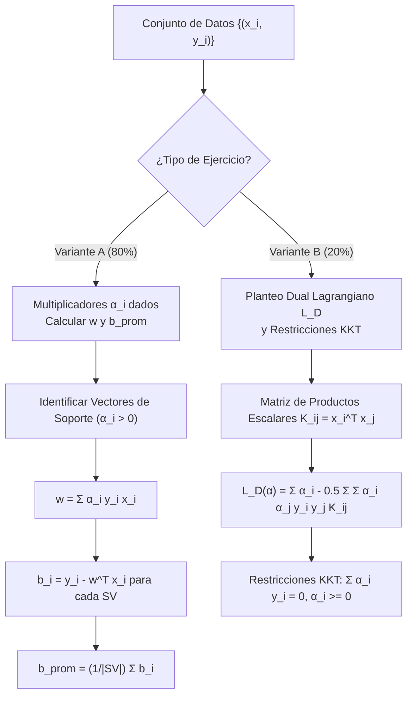

# Guía Paso a Paso: Support Vector Machines (SVM)
**Cátedra:** Inteligencia Artificial — UTN FRRe (5to Nivel ISI)  
**Profesor Titular:** Ing. Marcelo Karanik  
**Tiempo estimado en examen:** 20 - 25 minutos | **Ponderación:** 25% (Cuadrante Q1 Canónico)

---

## 1. Fundamentos Teóricos y Ecuaciones Canónicas de Cátedra

Una Máquina de Vectores de Soporte lineal busca encontrar el hiperplano óptimo de separación que maximice el margen geométrico entre dos clases linealmente separables ($y_i \in \{-1, +1\}$).

### 1.1 Ecuación del Hiperplano y Márgenes
* **Hiperplano Separador Central ($H_0$):**
  $$\mathbf{w}^T \mathbf{x} + b = 0$$
* **Hiperplanos de Margen Canónico:**
  $$H_+ : \mathbf{w}^T \mathbf{x} + b = +1 \quad (\text{para } y_i = +1)$$
  $$H_- : \mathbf{w}^T \mathbf{x} + b = -1 \quad (\text{para } y_i = -1)$$
* **Distancias al hiperplano:**
  $$d(+) = \frac{1}{\|\mathbf{w}\|}, \qquad d(-) = \frac{1}{\|\mathbf{w}\|}$$
  $$\text{Margen Geométrico Total: } M = d(+) + d(-) = \frac{2}{\|\mathbf{w}\|}$$

### 1.2 Formulación Dual y Condiciones KKT
* **Función Objetivo Dual Lagrangiana:**
  $$L_D(\boldsymbol{\alpha}) = \sum_{i=1}^N \alpha_i - \frac{1}{2} \sum_{i=1}^N \sum_{j=1}^N \alpha_i \alpha_j y_i y_j (\mathbf{x}_i^T \mathbf{x}_j)$$
* **Condiciones Karush-Kuhn-Tucker (KKT):**
  1. $\sum_{i=1}^N \alpha_i y_i = 0$
  2. $\alpha_i \ge 0 \quad \forall i = 1, \dots, N$
  3. $\alpha_i [y_i (\mathbf{w}^T \mathbf{x}_i + b) - 1] = 0 \quad \forall i$ (Holgura complementaria)

> [!IMPORTANT]
> **Definición de Vector de Soporte:**  
> Un punto $\mathbf{x}_i$ es **Vector de Soporte (SV)** si y sólo si su multiplicador de Lagrange es estrictamente positivo ($\alpha_i > 0$). Si $\alpha_i = 0$, el punto se encuentra fuera de los márgenes o es interior, y **no interviene en la determinación de $\mathbf{w}$ ni de $b$**.

---

## 2. Variante A: Cálculo Analítico de $\mathbf{w}$ y Sesgo Promediado $b_{prom}$

### Enunciado Tipo Examen (Fuente: Parcial 2023 Tema 2 `IA-H0075`)
Dados los siguientes vectores en $\mathbb{R}^2$:
$$p_1 = \begin{bmatrix} 0 \\ 4 \end{bmatrix}, \quad p_2 = \begin{bmatrix} 3 \\ 0 \end{bmatrix}, \quad p_3 = \begin{bmatrix} -2 \\ 0 \end{bmatrix}, \quad p_4 = \begin{bmatrix} -3 \\ -3 \end{bmatrix}$$
con etiquetas de clase:
$$y_1 = +1, \quad y_2 = +1, \quad y_3 = -1, \quad y_4 = -1$$
y los multiplicadores de Lagrange obtenidos tras la optimización:
$$\alpha_1 = \frac{1}{2} = 0.50, \quad \alpha_2 = \frac{1}{4} = 0.25, \quad \alpha_3 = \frac{3}{4} = 0.75, \quad \alpha_4 = 0$$

**Se solicita:** Calcule el vector de pesos $\mathbf{w}$, el sesgo $b$ y la ecuación del hiperplano separador.

---

### Procedimiento de Resolución Paso a Paso con Calculadora

#### Paso 1: Identificación y Tabulación de Vectores de Soporte
Se descartan los puntos con $\alpha = 0$.

| Punto | $x_1$ | $x_2$ | $y_i$ | $\alpha_i$ | Condición | Rol en SVM |
| :---: | :---: | :---: | :---: | :---: | :---: | :---: |
| $p_1$ | 0 | 4 | $+1$ | 0.50 | $\alpha_1 > 0$ | **Vector de Soporte** |
| $p_2$ | 3 | 0 | $+1$ | 0.25 | $\alpha_2 > 0$ | **Vector de Soporte** |
| $p_3$ | -2 | 0 | $-1$ | 0.75 | $\alpha_3 > 0$ | **Vector de Soporte** |
| $p_4$ | -3 | -3 | $-1$ | 0.00 | $\alpha_4 = 0$ | *Punto interior / Inactivo* |

*Verificación KKT obligatoria en hoja:*
$$\sum_{i=1}^4 \alpha_i y_i = (0.50)(+1) + (0.25)(+1) + (0.75)(-1) + 0(-1) = 0.50 + 0.25 - 0.75 = 0 \quad \checkmark$$

---

#### Paso 2: Cálculo del Vector de Pesos $\mathbf{w}$
Se aplica la fórmula canónica de reconstrucción primal:
$$\mathbf{w} = \sum_{i \in SV} \alpha_i y_i \mathbf{x}_i$$

*Sustitución explícita por componentes:*
$$\mathbf{w} = \alpha_1 y_1 p_1 + \alpha_2 y_2 p_2 + \alpha_3 y_3 p_3$$
$$\mathbf{w} = (0.5)(+1)\begin{bmatrix} 0 \\ 4 \end{bmatrix} + (0.25)(+1)\begin{bmatrix} 3 \\ 0 \end{bmatrix} + (0.75)(-1)\begin{bmatrix} -2 \\ 0 \end{bmatrix}$$
$$\mathbf{w} = \begin{bmatrix} 0 \\ 2.0 \end{bmatrix} + \begin{bmatrix} 0.75 \\ 0 \end{bmatrix} + \begin{bmatrix} 1.50 \\ 0 \end{bmatrix} = \begin{bmatrix} 0 + 0.75 + 1.50 \\ 2.0 + 0 + 0 \end{bmatrix} = \begin{bmatrix} 2.25 \\ 2.00 \end{bmatrix}$$

*Secuencia en calculadora estándar:*
1. Componente $w_1$: `0.5 * 1 * 0 + 0.25 * 1 * 3 + 0.75 * (-1) * (-2) =` $\to$ **2.25**
2. Componente $w_2$: `0.5 * 1 * 4 + 0.25 * 1 * 0 + 0.75 * (-1) * 0 =` $\to$ **2.00**

---

#### Paso 3: Cálculo del Sesgo $b$ en Cada Vector de Soporte (Trampa 6)
Para cualquier vector de soporte se cumple:
$$y_i (\mathbf{w}^T \mathbf{x}_i + b) = 1 \implies \mathbf{w}^T \mathbf{x}_i + b = y_i \implies b_i = y_i - \mathbf{w}^T \mathbf{x}_i$$

*Evaluación sobre cada vector de soporte:*

1. **Sobre $p_1 = [0, 4]^T$ ($y_1 = +1$):**
   $$\mathbf{w}^T p_1 = (2.25)(0) + (2.00)(4) = 8.00$$
   $$b_1 = 1 - 8.00 = -7.00$$

2. **Sobre $p_2 = [3, 0]^T$ ($y_2 = +1$):**
   $$\mathbf{w}^T p_2 = (2.25)(3) + (2.00)(0) = 6.75$$
   $$b_2 = 1 - 6.75 = -5.75$$

3. **Sobre $p_3 = [-2, 0]^T$ ($y_3 = -1$):**
   $$\mathbf{w}^T p_3 = (2.25)(-2) + (2.00)(0) = -4.50$$
   $$b_3 = -1 - (-4.50) = -1 + 4.50 = +3.50$$

> [!WARNING]
> **Alerta de Cátedra — Dispersión de $b$ en Datos de Enunciado:**  
> Si los multiplicadores del enunciado provienen de un redondeo o datos artificiales, los valores individuales de $b_i$ pueden no ser idénticos. La cátedra exige reportar el promedio de todos los vectores de soporte:
> $$b_{prom} = \frac{1}{|SV|} \sum_{i \in SV} b_i = \frac{-7.00 + (-5.75) + 3.50}{3} = \frac{-9.25}{3} \approx -3.083$$
> *Si el enunciado pide usar un vector testigo de la frontera positiva:* consignar explícitamente $b = -7.00$ y dejar asentado el promedio de respaldo.

---

#### Paso 4: Ecuación del Hiperplano y Norma
* **Ecuación del hiperplano:**
  $$2.25 x_1 + 2.00 x_2 - 3.083 = 0$$
* **Norma del vector de pesos:**
  $$\|\mathbf{w}\| = \sqrt{w_1^2 + w_2^2} = \sqrt{(2.25)^2 + (2.00)^2} = \sqrt{5.0625 + 4.00} = \sqrt{9.0625} \approx 3.010$$
* **Margen total:**
  $$M = \frac{2}{\|\mathbf{w}\|} = \frac{2}{3.010} \approx 0.664$$

---

## 3. Variante B: Planteo Dual Lagrangiano $L_D$ y Matriz de Gram

### Enunciado Tipo Examen (Fuente: `IA-H0122-EJ02` / `IA-H0125-EJ05`)
Dados los siguientes puntos de entrenamiento en $\mathbb{R}^2$:
$$P_1 = \begin{bmatrix} -3 \\ 1 \end{bmatrix} (y_1 = +1), \quad P_2 = \begin{bmatrix} 0 \\ 1 \end{bmatrix} (y_2 = +1), \quad P_3 = \begin{bmatrix} 3 \\ -3 \end{bmatrix} (y_3 = -1)$$
plantee formalmente el problema Dual de Lagrange $L_D(\alpha_1, \alpha_2, \alpha_3)$ y las restricciones KKT necesarias para resolverlo.

---

### Procedimiento de Resolución Paso a Paso

#### Paso 1: Cálculo de la Matriz de Productos Escalares (Matriz de Gram $K_{ij} = \mathbf{x}_i^T \mathbf{x}_j$)
Calculamos los 6 productos escalares independientes:
* $K_{11} = P_1^T P_1 = (-3)^2 + 1^2 = 9 + 1 = 10$
* $K_{12} = P_1^T P_2 = (-3)(0) + (1)(1) = 1$
* $K_{13} = P_1^T P_3 = (-3)(3) + (1)(-3) = -9 - 3 = -12$
* $K_{22} = P_2^T P_2 = 0^2 + 1^2 = 1$
* $K_{23} = P_2^T P_3 = (0)(3) + (1)(-3) = -3$
* $K_{33} = P_3^T P_3 = 3^2 + (-3)^2 = 9 + 9 = 18$

Matriz simétrica $K$:
$$K = \begin{bmatrix} 10 & 1 & -12 \\ 1 & 1 & -3 \\ -12 & -3 & 18 \end{bmatrix}$$

---

#### Paso 2: Desarrollo del Término Cuadrático Doble Sumatoria
Fórmula:
$$Q = \frac{1}{2} \sum_{i=1}^3 \sum_{j=1}^3 \alpha_i \alpha_j y_i y_j K_{ij}$$

Desdoblando términos diagonales ($i = j$) y cruzados ($i \ne j$, con factor 2 por simetría):
* **Términos diagonales ($y_i^2 = 1$ siempre):**
  $$\frac{1}{2} [ K_{11} \alpha_1^2 + K_{22} \alpha_2^2 + K_{33} \alpha_3^2 ] = \frac{1}{2} [ 10 \alpha_1^2 + 1 \alpha_2^2 + 18 \alpha_3^2 ] = 5\alpha_1^2 + 0.5\alpha_2^2 + 9\alpha_3^2$$
* **Términos cruzados (con signo $y_i y_j$):**
  * Para $(1, 2)$: $y_1 y_2 = (+1)(+1) = +1 \implies 2 \cdot \frac{1}{2} \cdot (+1) \cdot (1) \alpha_1 \alpha_2 = + \alpha_1 \alpha_2$
  * Para $(1, 3)$: $y_1 y_3 = (+1)(-1) = -1 \implies 2 \cdot \frac{1}{2} \cdot (-1) \cdot (-12) \alpha_1 \alpha_3 = + 12 \alpha_1 \alpha_3$
  * Para $(2, 3)$: $y_2 y_3 = (+1)(-1) = -1 \implies 2 \cdot \frac{1}{2} \cdot (-1) \cdot (-3) \alpha_2 \alpha_3 = + 3 \alpha_2 \alpha_3$

Sumando todo el término cuadrático:
$$Q = 5\alpha_1^2 + 0.5\alpha_2^2 + 9\alpha_3^2 + \alpha_1 \alpha_2 + 12\alpha_1 \alpha_3 + 3\alpha_2 \alpha_3$$

---

#### Paso 3: Escribir la Función Objetivo Dual Completa $L_D$
$$L_D(\alpha_1, \alpha_2, \alpha_3) = \alpha_1 + \alpha_2 + \alpha_3 - \left( 5\alpha_1^2 + 0.5\alpha_2^2 + 9\alpha_3^2 + \alpha_1 \alpha_2 + 12\alpha_1 \alpha_3 + 3\alpha_2 \alpha_3 \right)$$

---

#### Paso 4: Detallar las Restricciones KKT de Optimización
1. **Restricción de Igualdad Lineal:**
   $$\sum_{i=1}^3 \alpha_i y_i = 0 \implies \alpha_1(+1) + \alpha_2(+1) + \alpha_3(-1) = 0 \implies \alpha_1 + \alpha_2 - \alpha_3 = 0$$
2. **Restricción de No Negatividad:**
   $$\alpha_1 \ge 0, \quad \alpha_2 \ge 0, \quad \alpha_3 \ge 0$$

---

## 4. Checklist Antifallas para Entregar el Ejercicio de SVM

- [ ] ¿Escribiste la fórmula general $\mathbf{w} = \sum \alpha_i y_i \mathbf{x}_i$ antes de sustituir números?
- [ ] ¿Descartaste explícitamente los puntos con $\alpha = 0$ indicando *"punto no soporte / interior"*?
- [ ] ¿Verificaste que la suma $\sum \alpha_i y_i = 0$?
- [ ] ¿Calculaste $b$ para cada vector de soporte y reportaste el promedio $b_{prom}$? (Trampa 6 evitada).
- [ ] En el planteo Dual, ¿tuviste cuidado con el signo de $y_i y_j$ al multiplicar por $K_{ij}$? Recordá que un doble negativo $(-1)(-K_{ij})$ se convierte en positivo.
- [ ] ¿Indicaste las unidades o la dimensión geométrica de la recta/plano resultante?
