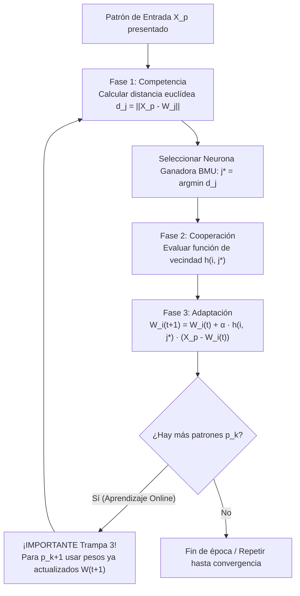

# Guía Paso a Paso: Mapas Autoorganizados de Kohonen (SOM)
**Cátedra:** Inteligencia Artificial — UTN FRRe (5to Nivel ISI)  
**Cátedra:** Inteligencia Artificial (UTN FRRe)  
**Tiempo estimado en examen:** 20 - 25 minutos | **Ponderación:** 25% (Patrón de alta frecuencia histórica)

---

## 1. Fundamentos del Modelo SOM y Dinámica de Aprendizaje

Los Mapas Autoorganizados (*Self-Organizing Maps*) son redes neuronales no supervisadas competitivas que proyectan un espacio continuo de entrada en una grilla discreta de neuronas de salida preservando las relaciones topológicas.



### 1.1 Ecuaciones Clave de Cátedra

1. **Fase de Competencia (Distancia Euclidiana):**
   $$d_j = \|\mathbf{x} - \mathbf{w}_j\| = \sqrt{\sum_{k=1}^D (x_k - w_{jk})^2}$$
   *Para comparar distancias en calculadora, basta con comparar la distancia cuadrática $d_j^2 = \sum (x_k - w_{jk})^2$, pero la cátedra exige escribir la raíz cuadrada explícita.*
2. **Neurona Ganadora (BMU - Best Matching Unit):**
   $$j^* = \arg\min_j d_j$$
3. **Fase de Cooperación (Función de Vecindad Topológica):**
   * **Caso A (Vecindad Continua con distancia entre pesos):**
     $$h(i, j^*) = \frac{1}{1 + \text{dist}(W_i, W_{j^*})} \quad \text{o bien} \quad h(i, j^*) = \frac{1}{2 + \text{dist}(W_i, W_{j^*})}$$
     *Para la ganadora:* $\text{dist}(W_{j^*}, W_{j^*}) = 0 \implies h(j^*, j^*) = 1 \text{ (o } 0.50 \text{ si el denominador base es 2)}$.
     *Para las vecinas:* Se calcula la distancia euclidiana entre sus vectores de pesos $\text{dist}(W_i, W_{j^*}) > 0$.
   * **Caso B (Vecindad Nula / Ganadora única):**
     $$h(i, j^*) = \begin{cases} 1 & \text{si } i = j^* \\ 0 & \text{si } i \ne j^* \end{cases}$$
4. **Fase de Adaptación (Actualización de Pesos Sinápticos):**
   $$\mathbf{w}_i(t+1) = \mathbf{w}_i(t) + \alpha \cdot h(i, j^*) \cdot (\mathbf{x} - \mathbf{w}_i(t))$$

---

## 2. Las Dos Trampas Mortales de Cátedra en SOM

> [!CAUTION]
> ### TRAMPA 2: La Vecindad Nula vs. Continua
> Si el enunciado define una función como $h(i) = \frac{1}{2 + \text{dist}(i, j^*)}$, **NO actualices solamente la neurona ganadora**. Si hacés eso, la cátedra anula el ejercicio completo (0/25).  
> **Regla:** Se evalúa $h$ para la ganadora Y para todas las neuronas del mapa. Todas las neuronas con $h > 0$ actualizan sus pesos.

> [!CAUTION]
> ### TRAMPA 3: Falta de Persistencia en el Aprendizaje Online
> Si el examen pide: *"Presentar primero el patrón $p_1$ y luego el patrón $p_2$"*, para calcular las distancias de $p_2$ **DEBÉS USAR LA MATRIZ DE PESOS $W(1)$ RESULTANTE DEL PATRÓN $p_1$**, NUNCA los pesos iniciales $W(0)$. El algoritmo de examen es estrictamente secuencial online.

---

## 3. Ejercicio Resuelto Completo Tipo Examen (Tema 2 2023 `IA-H0075`)

### Enunciado Oficial:
De acuerdo al conjunto de datos mostrado en la siguiente tabla, presentar el patrón $p_2$ y actualizar los pesos correspondientes a las neuronas de salida. Considere factor de aprendizaje $\alpha = 0.70$ y la función de vecindad:
$$h(i) = \frac{1}{2 + \text{dist}(W_i, W_{j^*})}$$
Grafique la arquitectura de la red.

*Pesos iniciales:*
$$W_1(0) = [+0.70, -0.10], \quad W_2(0) = [-0.10, +0.40]$$

*Tabla de datos:*
| Coordenada | $p_1$ | $p_2$ | $p_3$ | $p_4$ | $p_5$ |
| :---: | :---: | :---: | :---: | :---: | :---: |
| $x_1$ | -0.5 | **-0.8** | -0.2 | -0.1 | -0.3 |
| $x_2$ | -0.9 | **-0.9** | -0.1 | -0.3 | -0.7 |

---

### Procedimiento de Resolución Paso a Paso con Calculadora

#### Paso 1: Esquematizar la Arquitectura de la Red en la Hoja
La red tiene:
* **Capa de entrada:** 2 neuronas ($x_1, x_2$) correspondientes a la dimensión del vector de entrada.
* **Capa de salida:** 2 neuronas competitivas ($N_1, N_2$).
* Conexiones completas desde cada entrada hacia cada neurona de salida con pesos $w_{ij}$.

```
      Entradas (D=2)             Salida Competitiva (M=2)
     [ x1 = -0.8 ]  ======w11, w21=====>  ( Neurona 1 ) W1=[+0.7, -0.1]
                    \                  /
                     \                /
                      \              /
     [ x2 = -0.9 ]  ======w12, w22=====>  ( Neurona 2 ) W2=[-0.1, +0.4]
```

---

#### Paso 2: Fase de Competencia — Cálculo de Distancias Euclidianas
Patrón a presentar: $p_2 = \begin{bmatrix} -0.80 \\ -0.90 \end{bmatrix}$.

1. **Distancia a la Neurona 1 ($W_1 = [+0.70, -0.10]$):**
   $$d_1^2 = (x_1 - w_{11})^2 + (x_2 - w_{12})^2$$
   $$d_1^2 = (-0.80 - 0.70)^2 + (-0.90 - (-0.10))^2 = (-1.50)^2 + (-0.80)^2 = 2.25 + 0.64 = 2.89$$
   $$d_1 = \sqrt{2.89} = 1.700$$
   *Calculadora:* `(-0.8 - 0.7) x² + (-0.9 - (-0.1)) x² = 2.89` $\to$ `√2.89 = 1.7`

2. **Distancia a la Neurona 2 ($W_2 = [-0.10, +0.40]$):**
   $$d_2^2 = (x_1 - w_{21})^2 + (x_2 - w_{22})^2$$
   $$d_2^2 = (-0.80 - (-0.10))^2 + (-0.90 - 0.40)^2 = (-0.70)^2 + (-1.30)^2 = 0.49 + 1.69 = 2.18$$
   $$d_2 = \sqrt{2.18} \approx 1.476$$
   *Calculadora:* `(-0.8 - (-0.1)) x² + (-0.9 - 0.4) x² = 2.18` $\to$ `√2.18 = 1.47648...`

3. **Determinación de la BMU:**
   $$\text{Como } d_2 = 1.476 < d_1 = 1.700 \implies \mathbf{\text{La Neurona Ganadora es }} j^* = 2$$
   *Frase obligatoria en hoja:* *"La neurona 2 resulta ganadora (BMU) por presentar la menor distancia euclidiana al patrón $p_2$."*

---

#### Paso 3: Fase de Cooperación — Cálculo de Factores de Vecindad $h(i)$
La función provista es $h(i) = \frac{1}{2 + \text{dist}(W_i, W_{j^*})}$.

1. **Para la neurona ganadora ($i = 2$):**
   La distancia de la ganadora a sí misma en el espacio de pesos es cero: $\text{dist}(W_2, W_2) = 0$.
   $$h(2) = \frac{1}{2 + 0} = \frac{1}{2} = 0.500$$

2. **Para la neurona vecina ($i = 1$):**
   Calculamos la distancia euclidiana entre los pesos de $W_1$ y $W_2$:
   $$\text{dist}(W_1, W_2) = \sqrt{(w_{11} - w_{21})^2 + (w_{12} - w_{22})^2}$$
   $$\text{dist}(W_1, W_2) = \sqrt{(0.70 - (-0.10))^2 + (-0.10 - 0.40)^2} = \sqrt{(0.80)^2 + (-0.50)^2} = \sqrt{0.64 + 0.25} = \sqrt{0.89} \approx 0.943$$
   Ahora evaluamos $h(1)$:
   $$h(1) = \frac{1}{2 + 0.943} = \frac{1}{2.943} \approx 0.340$$

---

#### Paso 4: Fase de Adaptación — Actualización de Pesos Sinápticos
Fórmula canónica: $\mathbf{w}_i(t+1) = \mathbf{w}_i(t) + \alpha \cdot h(i) \cdot (\mathbf{x} - \mathbf{w}_i(t))$.

1. **Actualización de la Neurona Ganadora 2 ($h(2) = 0.500$, $\alpha \cdot h(2) = 0.70 \times 0.500 = 0.350$):**
   * Componente 1:
     $$w_{21}(1) = w_{21}(0) + 0.350 \cdot (x_1 - w_{21}(0))$$
     $$w_{21}(1) = -0.10 + 0.350 \cdot (-0.80 - (-0.10)) = -0.10 + 0.350 \cdot (-0.70) = -0.10 - 0.245 = -0.345$$
   * Componente 2:
     $$w_{22}(1) = w_{22}(0) + 0.350 \cdot (x_2 - w_{22}(0))$$
     $$w_{22}(1) = 0.40 + 0.350 \cdot (-0.90 - 0.40) = 0.40 + 0.350 \cdot (-1.30) = 0.40 - 0.455 = -0.055$$
   $$\mathbf{W}_2(1) = \begin{bmatrix} -0.345 \\ -0.055 \end{bmatrix}$$

2. **Actualización de la Neurona Vecina 1 ($h(1) = 0.340$, $\alpha \cdot h(1) = 0.70 \times 0.340 = 0.238$):**
   * Componente 1:
     $$w_{11}(1) = w_{11}(0) + 0.238 \cdot (x_1 - w_{11}(0))$$
     $$w_{11}(1) = 0.70 + 0.238 \cdot (-0.80 - 0.70) = 0.70 + 0.238 \cdot (-1.50) = 0.70 - 0.357 = +0.343$$
   * Componente 2:
     $$w_{12}(1) = w_{12}(0) + 0.238 \cdot (x_2 - w_{12}(0))$$
     $$w_{12}(1) = -0.10 + 0.238 \cdot (-0.90 - (-0.10)) = -0.10 + 0.238 \cdot (-0.80) = -0.10 - 0.190 = -0.290$$
   $$\mathbf{W}_1(1) = \begin{bmatrix} +0.343 \\ -0.290 \end{bmatrix}$$

---

#### Paso 5: Resumen Final de Pesos tras Presentar $p_2$
$$\mathbf{W}(1) = \begin{bmatrix} W_1(1) \\ W_2(1) \end{bmatrix} = \begin{bmatrix} +0.343 & -0.290 \\ -0.345 & -0.055 \end{bmatrix}$$

> [!TIP]
> **Interpretación Física del Movimiento:**  
> Notar que ambos vectores de pesos se desplazaron en el plano euclidiano acercándose hacia las coordenadas de $p_2 = [-0.80, -0.90]$, pero la ganadora $W_2$ se acercó con mayor fuerza ($\Delta w \approx -0.245$) que la vecina $W_1$ ($\Delta w \approx -0.357$ sobre una distancia mayor).

---

## 4. Checklist Antifallas para Entregar SOM

- [ ] ¿Dibujaste la arquitectura con entradas, salidas y nombres de pesos?
- [ ] ¿Escribiste la fórmula de la distancia euclídea completa $d = \sqrt{\sum (x_i - w_i)^2}$ y mostraste los dos cálculos?
- [ ] ¿Declaraste formalmente la neurona ganadora con una frase justificativa?
- [ ] ¿Calculaste $h(i)$ tanto para la ganadora como para las vecinas? (Evitar Trampa 2).
- [ ] ¿Si el ejercicio continúa con un patrón siguiente, usaste los pesos de $\mathbf{W}(1)$ recién calculados? (Evitar Trampa 3).
- [ ] ¿Redondeaste a 3 decimales prolijos?
