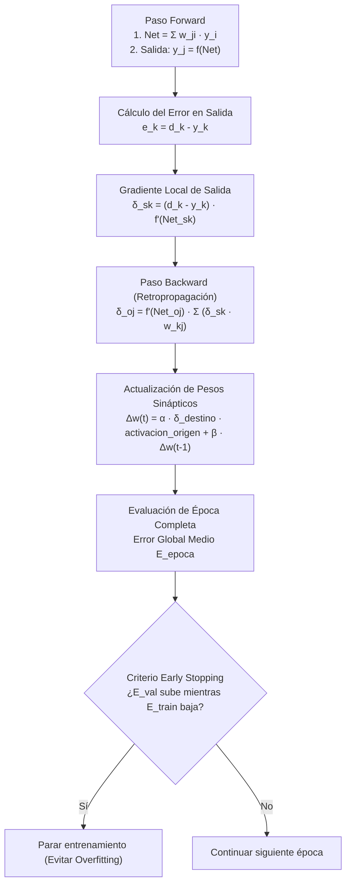

# Guía Paso a Paso: Perceptrón Multicapa (MLP) y Backpropagation
**Cátedra:** Inteligencia Artificial — UTN FRRe (5to Nivel ISI)  
**Tiempo estimado en examen:** 25 - 30 minutos | **Ponderación:** 25% (Patrón de alta frecuencia histórica)

---

## 1. Fundamentos Matemáticos del Algoritmo Backpropagation

El Perceptrón Multicapa entrenado con Retropropagación del Error (*Backpropagation*) es una red neuronal feedforward supervisada capaz de resolver problemas no linealmente separables mediante la regla de la cadena aplicada al descenso por el gradiente del error cuadrático medio.

---

### 1.1 Fórmulas Canónicas de Cátedra

1. **Función de Activación Sigmoidal (Logística) y su Derivada:**
   $$f(net) = \frac{1}{1 + e^{-net}}$$
   $$f'(net) = \frac{d f(net)}{d(net)} = f(net) \cdot (1 - f(net))$$
   > [!TIP]
   > En los exámenes de la UTN FRRe, la cátedra **suele proveer directamente el valor precalculado de $f(net)$** en una tabla, ahorrando tiempo de exponencial en calculadora. La derivada se computa simplemente como:
   > $$f'(net) = \text{valor} \cdot (1 - \text{valor})$$

2. **Gradiente Local en Neuronas de Salida (Capa $S$):**
   $$\delta_{sk} = (d_k - y_k) \cdot f'(net_{sk}) = (d_k - f(net_{sk})) \cdot f(net_{sk}) \cdot (1 - f(net_{sk}))$$
   *Donde $d_k$ es la salida deseada y $y_k = f(net_{sk})$ es la salida calculada.*

3. **Gradiente Local en Neuronas Ocultas (Capa $O$):**
   $$\delta_{oj} = f'(net_{oj}) \cdot \sum_{k \in \text{Salidas}} \delta_{sk} \cdot w_{sk-oj}$$
   *Donde $w_{sk-oj}$ es el peso de la conexión que va **desde la neurona oculta $j$ hacia la neurona de salida $k$**.*

4. **Regla General de Actualización de Pesos (Regla Delta Generalizada):**
   $$w_{ji}(t+1) = w_{ji}(t) + \Delta w_{ji}(t)$$
   $$\Delta w_{ji}(t) = \alpha \cdot \delta_j \cdot y_i + \beta \cdot \Delta w_{ji}(t-1)$$
   * $\alpha$: Tasa o coeficiente de aprendizaje ($\alpha \in (0, 1]$).
   * $\delta_j$: Gradiente local de la neurona de **destino**.
   * $y_i$: Señal de activación proveniente de la neurona de **origen** (puede ser una entrada $x_i$ o la salida oculta $f(net_{oj})$).
   * $\beta$: Término de momento ($\beta \in [0, 1)$).

5. **Error Cuadrático Global Medio de Época:**
   $$E_{\text{época}} = \frac{1}{2 L} \sum_{p=1}^L \sum_{k=1}^M (d_{pk} - y_{pk})^2$$
   *Donde $L$ es la cantidad de patrones de la época y $M$ la cantidad de salidas.*

---

## 2. Puntos Críticos y Trampas de Cátedra en MLP

### 2.1 El Significado y Signo del Término de Momento $\beta$
* El coeficiente $\beta$ es un escalar no negativo ($0 \le \beta < 1$).
* **Pregunta clásica de parcial:** *¿El término momento puede ser negativo?*  
  **Respuesta:** **SÍ**. Aunque $\beta > 0$, el término completo es $\beta \cdot \Delta w(t-1)$. Si en la iteración anterior el peso disminuyó ($\Delta w(t-1) < 0$), el término de momento es estrictamente **negativo**. Su función es actuar como fuerza inercial para amortiguar oscilaciones en valles estrechos o acelerar el descenso en mesetas.

### 2.2 Criterio de Parada Temprana (*Early Stopping*)
* Los datos se dividen en 3 conjuntos disjuntos: **Entrenamiento (Training)**, **Validación (Validation)** y **Prueba (Test)**.
* **Comportamiento en sobreajuste (*overfitting*):** A medida que pasan las épocas, el error de entrenamiento sigue descendiendo asintóticamente a cero. Sin embargo, el error de validación alcanza un mínimo y luego **comienza a subir**.
* **Acción ingenieril obligatoria:** Se debe detener inmediatamente el entrenamiento en el punto de inflexión donde el error de validación comienza a crecer, y restaurar los pesos sinápticos correspondientes al mínimo de validación.

---

## 3. Ejercicio Resuelto Completo Tipo Examen (Tema 2 2023 `IA-H0075`)

### Enunciado Oficial:
Dada la red MLP de la figura y los datos suministrados en la tabla (todas las neuronas tienen función de activación sigmoidal $f(net) = \frac{1}{1 + e^{-net}}$):
Calcule los errores locales de las neuronas ($\delta$) y actualice los pesos $w_{o2-x2}$, $w_{o1-x3}$, $w_{s3-o1}$ y $w_{s1-o2}$.

*Arquitectura de la Red:*
* Entradas: $x_1, x_2, x_3$
* Capa Oculta ($O$): 2 neuronas ($o_1, o_2$)
* Capa de Salida ($S$): 3 neuronas ($s_1, s_2, s_3$)
* Tasa de aprendizaje: $\alpha = 0.80$ (sin momento, $\beta = 0$).

*Pesos entre Oculta y Salida (dados en el gráfico):*
* Hacia $s_1$: $w_{s1-o1} = +2.5, \quad w_{s1-o2} = -1.5$
* Hacia $s_2$: $w_{s2-o1} = +0.5, \quad w_{s2-o2} = -2.5$
* Hacia $s_3$: $w_{s3-o1} = -5.5, \quad w_{s3-o2} = +3.5$

*Pesos entre Entrada y Oculta (a actualizar):*
* $w_{o2-x2} = -0.50, \quad w_{o1-x3} = -1.50$

*Datos suministrados por la Cátedra en tabla:*
| Neurona / Entrada | Entrada $x_i$ | Salida Deseada $d_k$ | Activación $f(net)$ |
| :---: | :---: | :---: | :---: |
| $x_1$ | 0.03 | — | — |
| $x_2$ | 0.05 | — | — |
| $x_3$ | 0.08 | — | — |
| $o_1$ | — | — | **0.60** |
| $o_2$ | — | — | **0.46** |
| $s_1$ | — | **0.00** | **0.27** |
| $s_2$ | — | **0.00** | **0.11** |
| $s_3$ | — | **0.00** | **0.87** |

---

### Procedimiento de Resolución Paso a Paso con Calculadora

#### Paso 1: Derivadas de las Funciones de Activación
Usamos la propiedad sigmoidal: $f'(net) = f(net) \cdot (1 - f(net))$.

* **Neuronas de Salida:**
  * $f'(net_{s1}) = 0.27 \times (1 - 0.27) = 0.27 \times 0.73 = 0.1971$
  * $f'(net_{s2}) = 0.11 \times (1 - 0.11) = 0.11 \times 0.89 = 0.0979$
  * $f'(net_{s3}) = 0.87 \times (1 - 0.87) = 0.87 \times 0.13 = 0.1131$

* **Neuronas Ocultas:**
  * $f'(net_{o1}) = 0.60 \times (1 - 0.60) = 0.60 \times 0.40 = 0.2400$
  * $f'(net_{o2}) = 0.46 \times (1 - 0.46) = 0.46 \times 0.54 = 0.2484$

---

#### Paso 2: Errores Locales en la Capa de Salida ($\delta_{sk}$)
Fórmula: $\delta_{sk} = (d_k - f(net_{sk})) \cdot f'(net_{sk})$.

1. **Neurona $s_1$:**
   $$\delta_{s1} = (0.00 - 0.27) \cdot 0.1971 = -0.27 \cdot 0.1971 = -0.05322 \approx \mathbf{-0.0532}$$
2. **Neurona $s_2$:**
   $$\delta_{s2} = (0.00 - 0.11) \cdot 0.0979 = -0.11 \cdot 0.0979 = -0.01077 \approx \mathbf{-0.0108}$$
3. **Neurona $s_3$:**
   $$\delta_{s3} = (0.00 - 0.87) \cdot 0.1131 = -0.87 \cdot 0.1131 = -0.09840 \approx \mathbf{-0.0984}$$

---

#### Paso 3: Retropropagación de Errores a la Capa Oculta ($\delta_{oj}$)
Fórmula: $\delta_{oj} = f'(net_{oj}) \cdot \sum_{k=1}^3 \delta_{sk} \cdot w_{sk-oj}$.

1. **Neurona Oculta $o_1$:**
   Recibe el error de las 3 salidas a través de los pesos que parten de $o_1$:
   $$\sum_{k=1}^3 \delta_{sk} w_{sk-o1} = \delta_{s1} w_{s1-o1} + \delta_{s2} w_{s2-o1} + \delta_{s3} w_{s3-o1}$$
   $$\sum = (-0.0532)(+2.5) + (-0.0108)(+0.5) + (-0.0984)(-5.5)$$
   $$\sum = -0.1330 - 0.0054 + 0.5412 = +0.4028$$
   Multiplicamos por su derivada:
   $$\delta_{o1} = 0.2400 \cdot (+0.4028) = +0.09667 \approx \mathbf{+0.0967}$$

2. **Neurona Oculta $o_2$:**
   Recibe el error de las 3 salidas a través de los pesos que parten de $o_2$:
   $$\sum_{k=1}^3 \delta_{sk} w_{sk-o2} = \delta_{s1} w_{s1-o2} + \delta_{s2} w_{s2-o2} + \delta_{s3} w_{s3-o2}$$
   $$\sum = (-0.0532)(-1.5) + (-0.0108)(-2.5) + (-0.0984)(+3.5)$$
   $$\sum = +0.0798 + 0.0270 - 0.3444 = -0.2376$$
   Multiplicamos por su derivada:
   $$\delta_{o2} = 0.2484 \cdot (-0.2376) = -0.05902 \approx \mathbf{-0.0590}$$

---

#### Paso 4: Actualización de los 4 Pesos Solicitados
Fórmula general: $w_{\text{nuevo}} = w_{\text{anterior}} + \alpha \cdot \delta_{\text{destino}} \cdot \text{activación}_{\text{origen}}$.

1. **Peso $w_{s3-o1}$ (de oculta $o_1$ a salida $s_3$):**
   * Destino: $s_3$ ($\delta_{s3} = -0.0984$).
   * Origen: $o_1$ ($f(net_{o1}) = 0.60$).
   $$\Delta w_{s3-o1} = 0.80 \cdot (-0.0984) \cdot 0.60 = -0.04723$$
   $$w_{s3-o1}^{\text{nuevo}} = -5.50 + (-0.04723) = \mathbf{-5.5472}$$

2. **Peso $w_{s1-o2}$ (de oculta $o_2$ a salida $s_1$):**
   * Destino: $s_1$ ($\delta_{s1} = -0.0532$).
   * Origen: $o_2$ ($f(net_{o2}) = 0.46$).
   $$\Delta w_{s1-o2} = 0.80 \cdot (-0.0532) \cdot 0.46 = -0.01958$$
   $$w_{s1-o2}^{\text{nuevo}} = -1.50 + (-0.01958) = \mathbf{-1.5196}$$

3. **Peso $w_{o2-x2}$ (de entrada $x_2$ a oculta $o_2$):**
   * Destino: $o_2$ ($\delta_{o2} = -0.0590$).
   * Origen: entrada $x_2 = 0.05$.
   $$\Delta w_{o2-x2} = 0.80 \cdot (-0.0590) \cdot 0.05 = -0.00236$$
   $$w_{o2-x2}^{\text{nuevo}} = -0.50 + (-0.00236) = \mathbf{-0.5024}$$

4. **Peso $w_{o1-x3}$ (de entrada $x_3$ a oculta $o_1$):**
   * Destino: $o_1$ ($\delta_{o1} = +0.0967$).
   * Origen: entrada $x_3 = 0.08$.
   $$\Delta w_{o1-x3} = 0.80 \cdot (+0.0967) \cdot 0.08 = +0.00619$$
   $$w_{o1-x3}^{\text{nuevo}} = -1.50 + (+0.00619) = \mathbf{-1.4938}$$

---

## 4. Checklist Antifallas para Entregar MLP

- [ ] ¿Escribiste la derivada sigmoidal $f'(net) = f(net)(1 - f(net))$ de forma explícita?
- [ ] ¿Verificaste el signo de $(d_k - y_k)$? Si la salida calculada es mayor que la deseada, el error DEBE ser negativo.
- [ ] En la sumatoria hacia atrás para $\delta_{oj}$, ¿usaste los pesos salientes de esa neurona oculta hacia las salidas correspondientes?
- [ ] En $\Delta w$, ¿multiplicaste por la activación de la neurona de **origen** y el $\delta$ de la neurona de **destino**?
- [ ] Si el ejercicio incluye término de momento $\beta$, ¿sumaste $\beta \cdot \Delta w(t-1)$ respetando su signo?
- [ ] ¿Consignaste al menos 4 decimales en $\delta$ y 4 decimales en el peso final?
