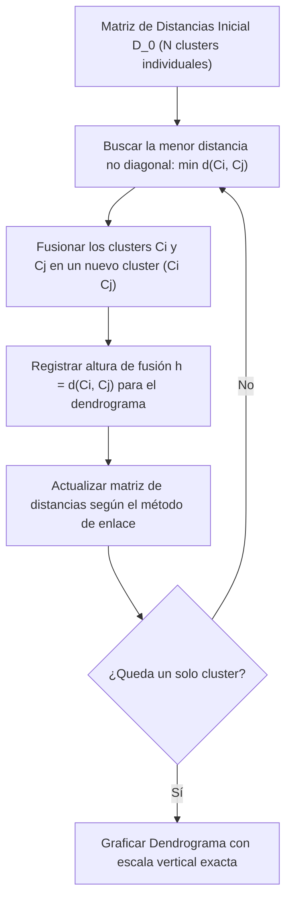

# Guía Paso a Paso: Clustering Jerárquico Aglomerativo (Average Linkage)
**Cátedra:** Inteligencia Artificial — UTN FRRe (5to Nivel ISI)  
**Tiempo estimado en examen:** 20 - 25 minutos | **Ponderación:** 25% (Patrón de alta frecuencia histórica)

---

## 1. Fundamentos del Algoritmo Jerárquico Aglomerativo

El Clustering Jerárquico Aglomerativo es un método de aprendizaje no supervisado que construye un árbol de agrupamiento (dendrograma) de abajo hacia arriba (*bottom-up*), comenzando con cada elemento como un cluster individual y fusionando en cada paso los dos clusters más cercanos.



---

### 1.1 Métodos de Enlace Clásicos

| Método | Fórmula de Distancia entre Clusters $A$ y $B$ | Comportamiento Geométrico |
| :--- | :--- | :--- |
| **Single Linkage (Mínimo)** | $d(A, B) = \min_{x \in A, y \in B} d(x, y)$ | Tiende al encadenamiento (*chaining*). Une clusters alargados. |
| **Complete Linkage (Máximo)** | $d(A, B) = \max_{x \in A, y \in B} d(x, y)$ | Tiende a formar clusters esféricos compactos y de diámetros similares. |
| **Average Linkage (Promedio)** | $d(A, B) = \frac{1}{\vert A \vert \cdot \vert B \vert} \sum_{x \in A} \sum_{y \in B} d(x, y)$ | Solución de compromiso robusta frente a ruido y valores atípicos. |

---

## 2. Trampa Crítica de Cátedra: El Error de Promediado en Average Linkage

> [!CAUTION]
> ### TRAMPA 5: Promediar clusters sin ponderar por cardinalidad
> **El error del alumno:** Al tener un cluster formado por $\{A, N\}$ (2 elementos) y fusionarlo con $\{R\}$ (1 elemento), y luego calcular la distancia a $\{S, P\}$ (2 elementos), el alumno hace un promedio simple de los valores previos:
> $$d \ne \frac{d((AN), (SP)) + d(R, (SP))}{2} \quad \text{¡ERROR GRAVE!}$$
> **La regla de oro:** Average Linkage exige el **promedio de todas las distancias entre pares cruzados originales**, o bien utilizar la ponderación de Lance-Williams por la cantidad de elementos:
> $$d((A \cup B), C) = \frac{|A|}{|A| + |B|} d(A, C) + \frac{|B|}{|A| + |B|} d(B, C)$$
> *Si el nuevo cluster tiene 3 elementos (2 de $AN$ y 1 de $R$), la distancia a otro grupo es $\frac{2 \cdot d(AN, \cdot) + 1 \cdot d(R, \cdot)}{3}$.*

---

## 3. Pregunta Teórica Clave: ¿Es Average Link equivalente a la distancia entre centroides?

**Respuesta oficial de cátedra:** **NO es equivalente.**
* En Average Link, la distancia se define sobre los puntos individuales:
  $$d_{\text{avg}}(A, B) = \frac{1}{|A||B|} \sum_{x \in A} \sum_{y \in B} \|x - y\|$$
* La distancia entre centroides calcula:
  $$d_{\text{cent}}(A, B) = \|\mu_A - \mu_B\| = \left\| \frac{1}{|A|}\sum_{x \in A} x - \frac{1}{|B|}\sum_{y \in B} y \right\|$$
* Por la desigualdad triangular y la no linealidad de la norma euclídea (raíz cuadrada de suma de cuadrados, desigualdad de Jensen), la media de las normas euclidianas no es igual a la norma de las medias:
  $$\mathbb{E}[\|X - Y\|] \ne \|\mathbb{E}[X] - \mathbb{E}[Y]\|$$
* Además, el método de centroides puede sufrir de **inversiones** (el dendrograma retrocede hacia abajo), mientras que Average Link siempre produce alturas monótonamente crecientes.

---

## 4. Ejercicio Resuelto Completo Tipo Examen (Tema 2 2023 `IA-H0075`)

### Enunciado Oficial:
Dada la siguiente matriz de distancias, aplique el algoritmo de clustering jerárquico aglomerativo utilizando la estrategia **Average Link** y dibuje el dendograma obtenido. Adjunte una breve descripción en cada paso de la ejecución del algoritmo.

#### Matriz de Distancias Inicial $D_0$:
| | **A** | **N** | **R** | **S** | **P** |
| :---: | :---: | :---: | :---: | :---: | :---: |
| **A** | 0.00 | 1.45 | 3.23 | 6.32 | 2.25 |
| **N** | 1.45 | 0.00 | 2.44 | 6.12 | 4.73 |
| **R** | 3.23 | 2.44 | 0.00 | 9.10 | 8.12 |
| **S** | 6.32 | 6.12 | 9.10 | 0.00 | 1.98 |
| **P** | 2.25 | 4.73 | 8.12 | 1.98 | 0.00 |

---

### Procedimiento de Resolución Paso a Paso con Calculadora

#### Paso 1: Búsqueda del mínimo en $D_0$ y primera fusión
* Se busca el menor elemento fuera de la diagonal principal:
  $$d(A, N) = 1.45$$
* **Fusión:** Se agrupan los elementos $\{A\}$ y $\{N\}$ en el cluster **$(AN)$** a nivel **$h_1 = 1.45$**.
* **Cardinalidad:** $|(AN)| = 2$.
* **Recálculo riguroso de distancias desde $(AN)$ hacia los restantes clusters individuales:**
  * Hacia $R$:
    $$d((AN), R) = \frac{d(A, R) + d(N, R)}{2} = \frac{3.23 + 2.44}{2} = \frac{5.67}{2} = \mathbf{2.835}$$
  * Hacia $S$:
    $$d((AN), S) = \frac{d(A, S) + d(N, S)}{2} = \frac{6.32 + 6.12}{2} = \frac{12.44}{2} = \mathbf{6.220}$$
  * Hacia $P$:
    $$d((AN), P) = \frac{d(A, P) + d(N, P)}{2} = \frac{2.25 + 4.73}{2} = \frac{6.98}{2} = \mathbf{3.490}$$

#### Matriz Reducida $D_1$ ($4 \times 4$):
| | **(AN)** | **R** | **S** | **P** |
| :---: | :---: | :---: | :---: | :---: |
| **(AN)** | 0.000 | 2.835 | 6.220 | 3.490 |
| **R** | 2.835 | 0.000 | 9.100 | 8.120 |
| **S** | 6.220 | 9.100 | 0.000 | **1.980** |
| **P** | 3.490 | 8.120 | **1.980** | 0.000 |

---

#### Paso 2: Búsqueda del mínimo en $D_1$ y segunda fusión
* El valor mínimo no diagonal en $D_1$ es:
  $$d(S, P) = 1.980$$
* **Fusión:** Se agrupan $\{S\}$ y $\{P\}$ en el cluster **$(SP)$** a nivel **$h_2 = 1.98$**.
* **Cardinalidad:** $|(SP)| = 2$.
* **Recálculo de distancias desde $(SP)$ hacia los otros clusters:**
  * Hacia $R$:
    $$d((SP), R) = \frac{d(S, R) + d(P, R)}{2} = \frac{9.100 + 8.120}{2} = \frac{17.220}{2} = \mathbf{8.610}$$
  * Hacia $(AN)$ (promedio de los 4 pares cruzados originales $2 \times 2 = 4$):
    $$d((SP), (AN)) = \frac{d(S, A) + d(S, N) + d(P, A) + d(P, N)}{4}$$
    $$d((SP), (AN)) = \frac{6.32 + 6.12 + 2.25 + 4.73}{4} = \frac{19.42}{4} = \mathbf{4.855}$$
    *(Alternativamente usando $D_1$: $\frac{d(S, (AN)) + d(P, (AN))}{2} = \frac{6.220 + 3.490}{2} = \frac{9.710}{2} = 4.855 \quad \checkmark$)*

#### Matriz Reducida $D_2$ ($3 \times 3$):
| | **(AN)** | **R** | **(SP)** |
| :---: | :---: | :---: | :---: |
| **(AN)** | 0.000 | **2.835** | 4.855 |
| **R** | **2.835** | 0.000 | 8.610 |
| **(SP)** | 4.855 | 8.610 | 0.000 |

---

#### Paso 3: Búsqueda del mínimo en $D_2$ y tercera fusión (¡Atención a la Trampa 5!)
* El valor mínimo no diagonal en $D_2$ es:
  $$d((AN), R) = 2.835$$
* **Fusión:** Se fusiona $(AN)$ con $\{R\}$ formando el cluster **$((AN)R)$** a nivel **$h_3 = 2.835 \approx 2.84$**.
* **Cardinalidad:** $|((AN)R)| = 2 + 1 = 3$ elementos.
* **Recálculo riguroso de distancia hacia $(SP)$ (Cluster con 2 elementos):**
  * La cantidad total de pares cruzados es $|((AN)R)| \times |(SP)| = 3 \times 2 = 6$ pares.
  * *Método canónico por pares originales:*
    $$d(((AN)R), (SP)) = \frac{d(A,S) + d(A,P) + d(N,S) + d(N,P) + d(R,S) + d(R,P)}{6}$$
    $$d = \frac{6.32 + 2.25 + 6.12 + 4.73 + 9.10 + 8.12}{6} = \frac{36.64}{6} \approx \mathbf{6.107}$$
  * *Método de recurrencia ponderada (Lance-Williams):*
    $$d(((AN)R), (SP)) = \frac{|AN| \cdot d((AN), (SP)) + |R| \cdot d(R, (SP))}{|AN| + |R|} = \frac{2 \cdot (4.855) + 1 \cdot (8.610)}{3}$$
    $$d = \frac{9.710 + 8.610}{3} = \frac{18.320}{3} = \mathbf{6.107}$$

#### Matriz Final $D_3$ ($2 \times 2$):
| | **((AN)R)** | **(SP)** |
| :---: | :---: | :---: |
| **((AN)R)** | 0.000 | **6.107** |
| **(SP)** | **6.107** | 0.000 |

---

#### Paso 4: Fusión final de todos los elementos
* Se unen los dos únicos clusters restantes: **$((AN)R)$** y **$(SP)$** a nivel **$h_4 = 6.107 \approx 6.11$**.

---

## 5. Construcción y Dibujo Técnico del Dendrograma

Para obtener los 25 puntos completos, el dendrograma debe dibujarse en papel con un eje vertical milimetrado o proporcionado que refleje con exactitud las 4 alturas de corte:

```
 Altura d
   ▲
6.1│                           ┌───────────────────────────────┐  <--- Fusión Raíz a 6.107
   │                           │                               │
2.8│               ┌───────────┴───────────┐                   │  <--- Fusión ((AN)R) a 2.840
   │               │                       │                   │
2.0│               │                       │           ┌───────┴───────┐  <--- Fusión (SP) a 1.980
1.5│       ┌───────┴───────┐               │           │               │  <--- Fusión (AN) a 1.455
   │       │               │               │           │               │
0.0└───────┴───────────────┴───────────────┴───────────┴───────────────┴────► Elementos
           A               N               R           S               P
```

* **Secuencia de Fusión Justificada para la Cátedra:**
  1. Nivel $1.45$: Se unen $\{A\}$ y $\{N\}$ por presentar la menor distancia global en la matriz inicial.
  2. Nivel $1.98$: Se unen $\{S\}$ y $\{P\}$ como segundo cluster disjunto.
  3. Nivel $2.84$: Se incorpora $\{R\}$ al cluster $\{A, N\}$ con distancia ponderada $2.835$.
  4. Nivel $6.11$: Fusión de las dos ramas principales con la distancia media de los 6 pares cruzados.

---

## 6. Checklist Antifallas para Entregar Clustering

- [ ] ¿Escribiste todas las matrices intermedias ($D_0, D_1, D_2, D_3$)?
- [ ] ¿Pusiste una breve frase explicativa en cada paso indicando el mínimo elegido?
- [ ] ¿Al promediar distancias con clusters de más de un elemento, ponderaste por las cardinalidades (2 y 1 para dividir por 3)? (Trampa 5 evitada).
- [ ] ¿El dendrograma tiene el eje vertical graduado con los valores numéricos exactos ($1.45, 1.98, 2.84, 6.11$)?
- [ ] ¿Las hojas del árbol corresponden a los elementos individuales ($A, N, R, S, P$)?
