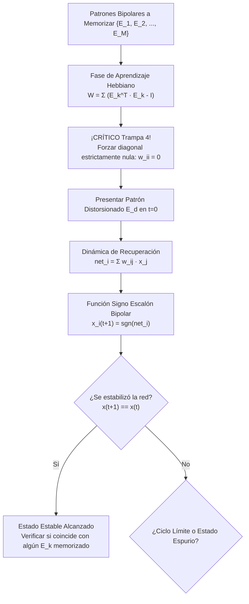

# Guía Paso a Paso: Redes Asociativas de Hopfield
**Cátedra:** Inteligencia Artificial — UTN FRRe (5to Nivel ISI)  
**Cátedra:** Inteligencia Artificial (UTN FRRe)  
**Tiempo estimado en examen:** 20 - 25 minutos | **Ponderación:** 20% - 25% (Alternante en Q4)

---

## 1. Fundamentos del Modelo de Hopfield

La red neuronal de Hopfield es un modelo recurrente autoasociativo mono-capa totalmente interconectado donde las neuronas operan con estados bipolares $x_i \in \{-1, +1\}$. Funciona como una memoria direccionable por contenido (*CAM - Content Addressable Memory*), capaz de reconstruir un patrón memorizado a partir de una versión incompleta o ruidosa.

---

### 1.1 Ecuaciones Clave de Cátedra

1. **Matriz de Pesos Hebbiana:**
   $$W = \sum_{k=1}^M \left( \mathbf{e}_k^T \mathbf{e}_k - I \right) \quad \text{con } w_{ii} = 0$$
   *Donde $\mathbf{e}_k$ es el vector fila del $k$-ésimo patrón, $\mathbf{e}_k^T \mathbf{e}_k$ es su producto exterior (matriz $N \times N$) e $I$ es la matriz identidad.*
   *Por componentes:*
   $$w_{ij} = \begin{cases} \sum_{k=1}^M e_{ki} \cdot e_{kj} & \text{si } i \ne j \\ 0 & \text{si } i = j \end{cases}$$
2. **Propiedades de la Matriz $W$:**
   * **Simetría:** $w_{ij} = w_{ji}$.
   * **Diagonal nula:** $w_{ii} = 0$ (sin autolazos neuronales).
3. **Dinámica de Recuperación (Función de Transferencia Bipolar):**
   $$net_i(t) = \sum_{j=1}^N w_{ij} x_j(t) = \mathbf{x}(t) \cdot W_{*, i}$$
   $$x_i(t+1) = \text{sgn}(net_i(t)) = \begin{cases} +1 & \text{si } net_i(t) > 0 \\ -1 & \text{si } net_i(t) < 0 \\ x_i(t) & \text{si } net_i(t) = 0 \text{ (mantiene estado previo)} \end{cases}$$

---

## 2. Puntos Críticos y Trampas de Cátedra en Hopfield

> [!CAUTION]
> ### TRAMPA 4: La Diagonal Principal NO Nula
> **El error del alumno:** Sumar los productos exteriores $\mathbf{e}_1^T \mathbf{e}_1 + \mathbf{e}_2^T \mathbf{e}_2$ y dejar en la diagonal el valor $M$ (número de patrones).  
> **Consecuencia:** Cero automático en el ejercicio.  
> **Justificación física/matemática:** Los autolazos ($w_{ii} > 0$) violan las hipótesis del teorema de convergencia de Hopfield basado en la función de energía de Lyapunov:
> $$E = -\frac{1}{2} \sum_{i=1}^N \sum_{j=1}^N w_{ij} x_i x_j$$
> Si $w_{ii} \ne 0$, la energía no decrece monotónicamente y la red puede entrar en ciclos infinitos o atascarse en la misma entrada ruidosa sin corregirla.

### 2.1 Ortogonalidad y Capacidad de Almacenamiento
* **Condición de Ortogonalidad:** Dos patrones bipolares de longitud $N$ son ortogonales si su producto escalar es nulo:
  $$\mathbf{e}_k \cdot \mathbf{e}_m = \sum_{i=1}^N e_{ki} e_{mi} = 0$$
  En el espacio bipolar, esto significa que los patrones deben **diferir exactamente en el 50% de sus componentes** ($N/2$).
* **Límites de Capacidad Máxima:**
  * **Recuperación Perfecta:** $M \le \frac{N}{4 \ln N}$
  * **Recuperación con Pequeño Error Aceptable (Hopfield Empírico):** $M \approx 0.138 N$  
    *(Para 100 neuronas, la red almacena con solvencia apenas unas 14 informaciones distintas).*

---

## 3. Ejercicio Resuelto Completo Tipo Examen (Fuente: `IA-H0122-EJ04`)

### Enunciado Oficial:
Calcule la matriz de pesos de una red de Hopfield que pueda reconocer los siguientes patrones de entrada. Luego presente el patrón distorsionado correspondiente ($E_d$) y verifique en cuál de los patrones aprendidos se estabiliza (si se estabiliza en alguno).

*Patrones aprendidos ($N = 5$ neuronas):*
$$\mathbf{E}_1 = [+1, +1, +1, -1, -1]$$
$$\mathbf{E}_2 = [+1, -1, -1, -1, +1]$$

*Patrón distorsionado de prueba:*
$$\mathbf{E}_d = [+1, -1, +1, -1, -1]$$

---

### Procedimiento de Resolución Paso a Paso con Calculadora

#### Paso 1: Análisis de Ortogonalidad Previo
Calculamos el producto escalar entre $\mathbf{E}_1$ y $\mathbf{E}_2$:
$$\mathbf{E}_1 \cdot \mathbf{E}_2 = (+1)(+1) + (+1)(-1) + (+1)(-1) + (-1)(-1) + (-1)(+1) = 1 - 1 - 1 + 1 - 1 = -1$$
*Comentario para la Cátedra:* *"El producto escalar es $\mathbf{E}_1 \cdot \mathbf{E}_2 = -1 \approx 0$. Presentan un alto grado de cuasi-ortogonalidad sobre $N=5$, lo que minimiza la diafonía o crosstalk."*

---

#### Paso 2: Cálculo de Matrices de Productos Exteriores

1. **Producto exterior para $\mathbf{E}_1 = [+1, +1, +1, -1, -1]$:**
   Cada elemento es $(E_1^T E_1)_{ij} = E_{1i} \cdot E_{1j}$:
   $$W^{(1)} = \begin{bmatrix}
   +1 & +1 & +1 & -1 & -1 \\
   +1 & +1 & +1 & -1 & -1 \\
   +1 & +1 & +1 & -1 & -1 \\
   -1 & -1 & -1 & +1 & +1 \\
   -1 & -1 & -1 & +1 & +1
   \end{bmatrix}$$

2. **Producto exterior para $\mathbf{E}_2 = [+1, -1, -1, -1, +1]$:**
   $$W^{(2)} = \begin{bmatrix}
   +1 & -1 & -1 & -1 & +1 \\
   -1 & +1 & +1 & +1 & -1 \\
   -1 & +1 & +1 & +1 & -1 \\
   -1 & +1 & +1 & +1 & -1 \\
   +1 & -1 & -1 & -1 & +1
   \end{bmatrix}$$

---

#### Paso 3: Suma Hebbiana y Anulación Estricta de la Diagonal (Trampa 4)
Sumamos $W^{(1)} + W^{(2)}$ y colocamos $0$ en toda la diagonal principal ($w_{ii} = 0$):

* Suma directa:
  * Fila 1: $[1+1, 1-1, 1-1, -1-1, -1+1] = [2, 0, 0, -2, 0]$
  * Fila 2: $[1-1, 1+1, 1+1, -1+1, -1-1] = [0, 2, 2, 0, -2]$
  * Fila 3: $[1-1, 1+1, 1+1, -1+1, -1-1] = [0, 2, 2, 0, -2]$
  * Fila 4: $[-1-1, -1+1, -1+1, 1+1, 1-1] = [-2, 0, 0, 2, 0]$
  * Fila 5: $[-1+1, -1-1, -1-1, 1-1, 1+1] = [0, -2, -2, 0, 2]$

* **Matriz Final de Hopfield $W$ (con $w_{ii} = 0$):**
  $$W = \begin{bmatrix}
  \mathbf{0} & 0 & 0 & -2 & 0 \\
  0 & \mathbf{0} & 2 & 0 & -2 \\
  0 & 2 & \mathbf{0} & 0 & -2 \\
  -2 & 0 & 0 & \mathbf{0} & 0 \\
  0 & -2 & -2 & 0 & \mathbf{0}
  \end{bmatrix}$$

---

#### Paso 4: Presentación del Patrón Distorsionado y Dinámica de Recuperación
Vector inicial en $t=0$: $\mathbf{x}(0) = \mathbf{E}_d = [+1, -1, +1, -1, -1]$.

Calculamos el vector de entradas netas: $\mathbf{net} = \mathbf{x}(0) \cdot W$.
* Multiplicación vector fila $\times$ columnas de $W$:
  * $net_1 = (+1)(0) + (-1)(0) + (+1)(0) + (-1)(-2) + (-1)(0) = 0 + 0 + 0 + 2 + 0 = \mathbf{+2}$
  * $net_2 = (+1)(0) + (-1)(0) + (+1)(2) + (-1)(0) + (-1)(-2) = 0 + 0 + 2 + 0 + 2 = \mathbf{+4}$
  * $net_3 = (+1)(0) + (-1)(2) + (+1)(0) + (-1)(0) + (-1)(-2) = 0 - 2 + 0 + 0 + 2 = \mathbf{0}$
  * $net_4 = (+1)(-2) + (-1)(0) + (+1)(0) + (-1)(0) + (-1)(0) = -2 + 0 + 0 + 0 + 0 = \mathbf{-2}$
  * $net_5 = (+1)(0) + (-1)(-2) + (+1)(-2) + (-1)(0) + (-1)(0) = 0 + 2 - 2 + 0 + 0 = \mathbf{0}$

$$\mathbf{net} = [+2, +4, 0, -2, 0]$$

---

#### Paso 5: Aplicación de la Función Signo y Nuevo Estado $\mathbf{x}(1)$
Regla de activación:
* $x_1(1) = \text{sgn}(+2) = \mathbf{+1}$
* $x_2(1) = \text{sgn}(+4) = \mathbf{+1}$
* $x_3(1)$: Como $net_3 = 0$, mantiene su estado anterior $\implies x_3(0) = \mathbf{+1}$
* $x_4(1) = \text{sgn}(-2) = \mathbf{-1}$
* $x_5(1)$: Como $net_5 = 0$, mantiene su estado anterior $\implies x_5(0) = \mathbf{-1}$

$$\mathbf{x}(1) = [+1, +1, +1, -1, -1]$$

---

#### Paso 6: Verificación de Estabilización y Conclusión
* Comparamos $\mathbf{x}(1)$ con el patrón aprendido $\mathbf{E}_1$:
  $$\mathbf{x}(1) = [+1, +1, +1, -1, -1] \equiv \mathbf{E}_1$$
* Calculamos una iteración adicional para comprobar estado estacionario:
  $\mathbf{x}(1) \cdot W$:
  * $net_1 = (-1)(-2) = +2 \implies +1$
  * $net_2 = (+1)(2) + (-1)(-2) = +4 \implies +1$
  * $net_3 = (+1)(2) + (-1)(-2) = +4 \implies +1$
  * $net_4 = (+1)(-2) = -2 \implies -1$
  * $net_5 = (+1)(-2) + (+1)(-2) = -4 \implies -1$
  $$\mathbf{x}(2) = [+1, +1, +1, -1, -1] = \mathbf{x}(1)$$

* **Conclusión formal en hoja:**  
  *"La red de Hopfield se estabiliza de forma monótona en una sola iteración ($t=1$), recuperando de manera exacta el patrón aprendido $\mathbf{E}_1$ y corrigiendo la distorsión que presentaba en la segunda componente."*

---

## 4. Checklist Antifallas para Entregar Hopfield

- [ ] ¿Calculaste los productos exteriores $E_k^T E_k$ de forma prolija?
- [ ] ¿Verificaste que la matriz resultante $W$ sea estrictamente **simétrica** ($w_{ij} = w_{ji}$)?
- [ ] ¿Verificaste que la **diagonal principal esté poblada exclusivamente por CEROS**? (Evitar Trampa 4).
- [ ] ¿Calculaste el producto vector-matriz paso a paso mostrando los 5 términos de cada suma?
- [ ] Si alguna componente da $net = 0$, ¿conservaste el valor anterior $x_i(t)$?
- [ ] ¿Escribiste la conclusión final identificando con cuál de los patrones aprendidos coincide el vector estable?
