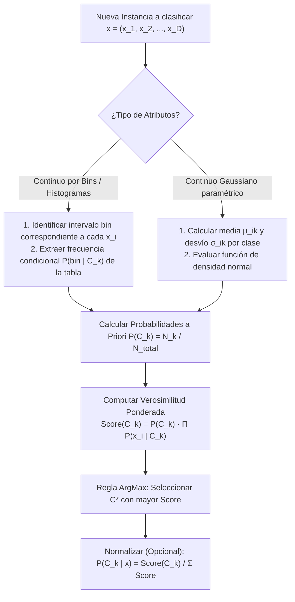

# Guía Paso a Paso: Naïve Bayes con Histogramas y Continuo Gaussiano
**Cátedra:** Inteligencia Artificial — UTN FRRe (5to Nivel ISI)  
**Tiempo estimado en examen:** 20 minutos | **Ponderación:** 20% - 25% (Alternante en Q4)

---

## 1. Fundamentos del Clasificador Naïve Bayes

El modelo Naïve Bayes es un clasificador probabilístico supervisado y generativo basado en el Teorema de Bayes. Su calificativo de "ingenuo" (*naïve*) proviene del supuesto de que todas las variables predictoras son **condicionalmente independientes entre sí dada la clase**.

---

### 1.1 Ecuaciones Clave de Cátedra

1. **Teorema de Bayes con Supuesto de Independencia:**
   $$P(C_k \mid \mathbf{x}) = \frac{P(C_k) \cdot P(\mathbf{x} \mid C_k)}{P(\mathbf{x})} = \frac{P(C_k) \prod_{i=1}^D P(x_i \mid C_k)}{\sum_{j} P(C_j) \prod_{i=1}^D P(x_i \mid C_j)}$$
2. **Regla de Clasificación (MAP - Maximum A Posteriori):**
   $$C^* = \arg\max_{C_k} \left[ P(C_k) \cdot \prod_{i=1}^D P(x_i \mid C_k) \right]$$
   *(El denominador $P(\mathbf{x})$ es una constante normalizadora idéntica para todas las clases, por lo que no altera el orden del $\arg\max$)*.

3. **Verosimilitudes en Naïve Bayes con Histogramas (Bins Discretizados):**
   $$P(x_i \in \text{Bin}_m \mid C_k) = \frac{\text{Cantidad de muestras de clase } C_k \text{ en el } \text{Bin}_m}{N_k}$$
   *Donde $N_k$ es la cantidad total de instancias de la clase $C_k$.*

4. **Verosimilitudes en Naïve Bayes Continuo Gaussiano:**
   $$P(x_i \mid C_k) = \frac{1}{\sqrt{2\pi} \sigma_{ik}} \exp\left( -\frac{(x_i - \mu_{ik})^2}{2 \sigma_{ik}^2} \right)$$
   *Donde $\mu_{ik}$ es la media y $\sigma_{ik}^2$ la varianza muestral del atributo $i$ en la clase $k$.*

---

## 2. Variante A: Naïve Bayes con Histogramas (Examen Real `IA-H0125-EJ02`)

### Enunciado Oficial:
En el estudio de tres clases diferentes de nuevos materiales ($NM_1, NM_2, NM_3$) se ha obtenido un conjunto de **101.875 muestras** caracterizadas por dos propiedades continuas: Resistencia ($Res$) y Flexibilidad ($Fle$). Los valores discretizados en intervalos (*bins*) se muestran en las siguientes tablas de contingencia:

#### Tabla 1: Frecuencias para Resistencia ($Res$)
| Bin de Resistencia | $NM_1$ ($N_1 = 34.200$) | $NM_2$ ($N_2 = 42.500$) | $NM_3$ ($N_3 = 25.175$) |
| :---: | :---: | :---: | :---: |
| $[-3.0, -1.2)$ | 2.150 | 18.200 | 1.100 |
| **$[-1.2, -0.1)$** | **14.300** | **12.100** | **2.500** |
| $[-0.1, +1.0)$ | 12.500 | 8.200 | 9.400 |
| $[+1.0, +3.0]$ | 5.250 | 4.000 | 12.175 |

#### Tabla 2: Frecuencias para Flexibilidad ($Fle$)
| Bin de Flexibilidad | $NM_1$ ($N_1 = 34.200$) | $NM_2$ ($N_2 = 42.500$) | $NM_3$ ($N_3 = 25.175$) |
| :---: | :---: | :---: | :---: |
| $[-150.0, -90.2)$ | 1.800 | 3.400 | 8.175 |
| **$[-90.2, -21.2)$** | **18.400** | **6.100** | **4.200** |
| $[-21.2, +40.0)$ | 11.200 | 15.000 | 7.800 |
| $[+40.0, +120.0]$ | 2.800 | 18.000 | 5.000 |

**Se solicita:**  
Clasifique la siguiente nueva muestra mediante Naïve Bayes con Histogramas:
$$\mathbf{X}_{\text{nueva}} = (Res = -0.12; Fle = -22.25)$$

---

### Procedimiento de Resolución Paso a Paso con Calculadora

#### Paso 1: Cálculo de Probabilidades a Priori $P(NM_k)$
Total de muestras: $N_{\text{total}} = 101.875$.
* $P(NM_1) = \frac{34.200}{101.875} \approx \mathbf{0.3357}$
* $P(NM_2) = \frac{42.500}{101.875} \approx \mathbf{0.4172}$
* $P(NM_3) = \frac{25.175}{101.875} \approx \mathbf{0.2471}$
*(Control: $0.3357 + 0.4172 + 0.2471 = 1.0000 \quad \checkmark$)*

---

#### Paso 2: Ubicación de los Bins Correspondientes
* Para $Res = -0.12$: cae estrictamente en el intervalo **$[-1.2, -0.1)$** (Fila 2 de Tabla 1).
* Para $Fle = -22.25$: cae estrictamente en el intervalo **$[-90.2, -21.2)$** (Fila 2 de Tabla 2).

---

#### Paso 3: Extracción de Verosimilitudes Condicionales

1. **Para la clase $NM_1$ ($N_1 = 34.200$):**
   * $P(Res \in \text{Bin}_2 \mid NM_1) = \frac{14.300}{34.200} \approx \mathbf{0.4181}$
   * $P(Fle \in \text{Bin}_2 \mid NM_1) = \frac{18.400}{34.200} \approx \mathbf{0.5380}$

2. **Para la clase $NM_2$ ($N_2 = 42.500$):**
   * $P(Res \in \text{Bin}_2 \mid NM_2) = \frac{12.100}{42.500} \approx \mathbf{0.2847}$
   * $P(Fle \in \text{Bin}_2 \mid NM_2) = \frac{6.100}{42.500} \approx \mathbf{0.1435}$

3. **Para la clase $NM_3$ ($N_3 = 25.175$):**
   * $P(Res \in \text{Bin}_2 \mid NM_3) = \frac{2.500}{25.175} \approx \mathbf{0.0993}$
   * $P(Fle \in \text{Bin}_2 \mid NM_3) = \frac{4.200}{25.175} \approx \mathbf{0.1668}$

---

#### Paso 4: Cálculo del Numerador Bayesiano (Score Conjunto)
Fórmula: $\text{Score}(NM_k) = P(NM_k) \cdot P(Res \in \text{Bin} \mid NM_k) \cdot P(Fle \in \text{Bin} \mid NM_k)$.

* **Clase $NM_1$:**
  $$\text{Score}(NM_1) = 0.3357 \times 0.4181 \times 0.5380 = \mathbf{0.07551}$$
* **Clase $NM_2$:**
  $$\text{Score}(NM_2) = 0.4172 \times 0.2847 \times 0.1435 = \mathbf{0.01704}$$
* **Clase $NM_3$:**
  $$\text{Score}(NM_3) = 0.2471 \times 0.0993 \times 0.1668 = \mathbf{0.00409}$$

---

#### Paso 5: Normalización y Determinación de la Clase Ganadora
Suma total de numeradores:
$$\sum \text{Score} = 0.07551 + 0.01704 + 0.00409 = 0.09664$$

* Probabilidades a posteriori normalizadas:
  $$P(NM_1 \mid \mathbf{X}) = \frac{0.07551}{0.09664} \approx \mathbf{78.13\%}$$
  $$P(NM_2 \mid \mathbf{X}) = \frac{0.01704}{0.09664} \approx \mathbf{17.63\%}$$
  $$P(NM_3 \mid \mathbf{X}) = \frac{0.00409}{0.09664} \approx \mathbf{4.23\%}$$

* **Conclusión formal en hoja:**  
  *"La muestra $\mathbf{X}_{\text{nueva}} = (-0.12; -22.25)$ se clasifica como perteneciente al material **$NM_1$** con una probabilidad a posteriori del **$78.13\%$**, superando ampliamente a $NM_2$ y $NM_3$."*

---

## 3. Variante B: Naïve Bayes con Distribución Continua Gaussiana

Cuando los datos continuos no vienen agrupados en bins, la cátedra exige estimar los parámetros de una Normal $\mathcal{N}(\mu, \sigma^2)$:

### Fórmulas con Calculadora:
1. **Media:** $\mu_k = \frac{1}{N_k} \sum x_i$
2. **Desvío Estándar:** $\sigma_k = \sqrt{\frac{1}{N_k - 1} \sum (x_i - \mu_k)^2}$
3. **Verosimilitud Gaussiana:**
   $$p(x \mid C_k) = \frac{1}{\sqrt{2\pi} \sigma_k} \exp\left( -\frac{(x - \mu_k)^2}{2\sigma_k^2} \right)$$
   *Secuencia en calculadora Casio:*
   `1 / ( √(2 * π) * σ ) * e^( - (x - μ)² / (2 * σ²) )`

> [!NOTE]
> **Pregunta Conceptual Típica de Examen:**  
> *¿Cuáles son los problemas de Naïve Bayes con distribución gaussiana?*  
> **Respuesta:** No puede resolver problemas con distribuciones multimodales o formas espirales/anulares (donde las clases están intrínsecamente entrelazadas). Al asumir independencia y gaussianidad unimodal, genera fronteras cuadráticas o lineales que fallan estrepitosamente si los datos reales tienen colas pesadas o dependencias cruzadas no lineales. La alternativa recomendada por la cátedra en esos casos es discretizar el espacio en **bins o intervalos de clase**.

---

## 4. Checklist Antifallas para Entregar Naïve Bayes

- [ ] ¿Calculaste las probabilidades a priori dividiendo por el total exacto del dataset?
- [ ] ¿Identificaste correctamente los límites de los bins (abierto/cerrado: $[a, b)$)?
- [ ] ¿Dividiste la cantidad del bin por el total de esa CLASE ($N_k$) y no por el total global del dataset?
- [ ] ¿Multiplicaste a priori $\times$ verosimilitud 1 $\times$ verosimilitud 2?
- [ ] ¿Presentaste las probabilidades a posteriori normalizadas (sumando 100%)?
- [ ] ¿Redactaste la conclusión final indicando la clase predicha?
