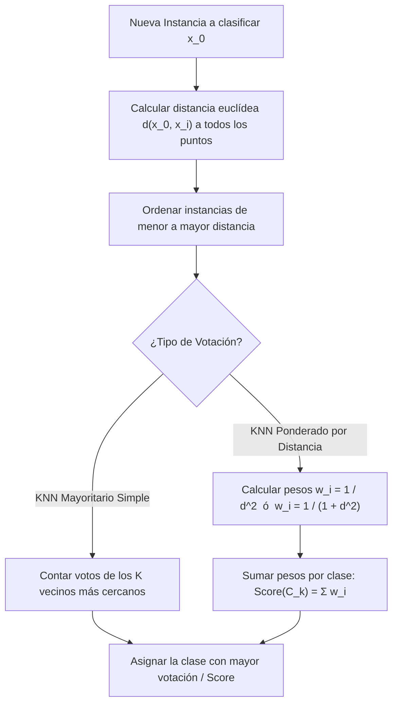

# Guía Paso a Paso: K-Nearest Neighbors (KNN) Ponderado y Leave-One-Out CV
**Cátedra:** Inteligencia Artificial — UTN FRRe (5to Nivel ISI)  
**Tiempo estimado en examen:** 20 - 25 minutos | **Ponderación:** 20% - 25% (Alternante en Q4)

---

## 1. Fundamentos del Algoritmo $K$-Nearest Neighbors

El clasificador $K$-NN es un método de aprendizaje supervisado **no paramétrico**, **basado en instancias (*instance-based*)** y de tipo **lazy** (vago/perezoso): no construye una función de discriminación explícita durante una fase previa de entrenamiento, sino que almacena todas las instancias y posterga todo cómputo hasta el momento de clasificar una nueva consulta.

---

### 1.1 Fórmulas Canónicas de Cátedra

1. **Distancia Euclidiana en $\mathbb{R}^D$:**
   $$d(\mathbf{x}\_0, \mathbf{x}\_i) = \sqrt{\sum\_{j=1}^D (x\_{0j} - x\_{ij})^2}$$
2. **Ponderación por Inversa del Cuadrado de la Distancia:**
   $$w_i = \frac{1}{d(\mathbf{x}\_0, \mathbf{x}\_i)^2} \quad \text{o bien} \quad w_i = \frac{1}{1 + d(\mathbf{x}\_0, \mathbf{x}\_i)^2}$$
   (La cátedra utiliza preferentemente $w_i = \frac{1}{1 + d^2}$ cuando un punto coincide exactamente con un dato de entrenamiento, evitando la indeterminación por división por cero).
3. **Puntuación Ponderada de Clase:**
   $$\text{Score}(C_k) = \sum_{i \in \text{Vecinos}, y_i = C_k} w_i$$
   $$\text{Clase Predicha: } C^* = \arg\max_{C_k} \text{Score}(C_k)$$

---

## 2. Pregunta Teórica Crítica: ¿Qué sucede si $K = m + n$?

*(Pregunta literal de examen teórico `IA-H0076` y `preguntas_parcial_2_text.txt`, Pregunta 20).*

**Consigna:** En un problema con dos clases $A$ (con $m$ instancias) y $B$ (con $n$ instancias), se utiliza KNN ponderado con $w_i = \frac{1}{1 + d^2}$ y se fija $K = m + n$ (todo el dataset). Evalúe qué sucede si $m > n$, $m = n$ y $m < n$.

**Respuesta Oficial de Cátedra:**
* **Caso $m > n$:** La nueva instancia tenderá casi siempre a clasificarse como **Clase $A$**. A pesar de la ponderación decreciente con la distancia, la gran acumulación de términos de la clase mayoritaria superará la suma de la clase minoritaria (efecto de desbalance de clases).
* **Caso $m < n$:** Por simetría, la nueva instancia se clasificará preferentemente como **Clase $B$** por predominancia de volumen muestral.
* **Caso $m = n$:** Al estar equilibradas las cantidades, el factor cuantitativo se anula y la clasificación depende **estrictamente de la proximidad espacial (los pesos $w_i$)**. La clase que posea los vecinos más cercanos a la consulta ganará la clasificación.

---

## 3. Optimización de $K$ mediante Leave-One-Out Cross-Validation (LOOCV)

Para determinar el hiperparámetro $K$ óptimo en papel:

### Algoritmo Formal LOOCV:
Para un conjunto de $N$ ejemplos:
1. Para cada candidato $K \in \{1, 3, 5\}$:
   * Para cada instancia $i$ de $1$ a $N$:
     * Extraer $\mathbf{x}_i$ como conjunto de validación unitario.
     * Los restantes $N-1$ puntos forman el conjunto de entrenamiento.
     * Clasificar $\mathbf{x}_i$ mediante sus $K$ vecinos más cercanos del conjunto restante.
     * Registrar si la predicción fue **Correcta ($\checkmark$)** o **Error ($\times$)**.
2. Calcular la tasa de error global para ese $K$:
   $$E_{\text{LOOCV}}(K) = \frac{\text{Cantidad de Clasificaciones Erróneas}}{N}$$
3. Seleccionar $K^* = \arg\min_K E_{\text{LOOCV}}(K)$.

---

## 4. Ejercicio Resuelto Completo Tipo Examen (Fuente: `IA-H0122` / `IA-H0124`)

### Enunciado Oficial:
Dado el siguiente conjunto de entrenamiento bidimensional con dos clases ($+1$ y $-1$):
| Punto | $x_1$ | $x_2$ | Clase Real ($y_i$) |
| :---: | :---: | :---: | :---: |
| $p_1$ | 1.0 | 2.0 | $+1$ |
| $p_2$ | 2.0 | 3.0 | $+1$ |
| $p_3$ | 2.0 | 1.0 | $+1$ |
| $p_4$ | 4.0 | 2.0 | $-1$ |
| $p_5$ | 5.0 | 3.0 | $-1$ |
| $p_6$ | 5.0 | 1.0 | $-1$ |

1. Clasifique la nueva instancia $\mathbf{x}_0 = (3.0, 2.0)$ mediante $K$-NN con $K=3$ ponderado por $w_i = \frac{1}{1 + d^2}$.
2. Aplique Leave-One-Out Cross-Validation para $K=1$ y evalúe la tasa de error.

---

### Procedimiento de Resolución Paso a Paso con Calculadora

#### Parte 1: Clasificación de $\mathbf{x}_0 = (3.0, 2.0)$ con $K=3$ ponderado

##### Paso 1: Cálculo de distancias euclidianas a todos los puntos
* $d(\mathbf{x}_0, p_1)^2 = (3 - 1)^2 + (2 - 2)^2 = 2^2 + 0^2 = 4 \implies d_1 = 2.000$
* $d(\mathbf{x}_0, p_2)^2 = (3 - 2)^2 + (2 - 3)^2 = 1^2 + (-1)^2 = 2 \implies d_2 = \sqrt{2} \approx 1.414$
* $d(\mathbf{x}_0, p_3)^2 = (3 - 2)^2 + (2 - 1)^2 = 1^2 + 1^2 = 2 \implies d_3 = \sqrt{2} \approx 1.414$
* $d(\mathbf{x}_0, p_4)^2 = (3 - 4)^2 + (2 - 2)^2 = (-1)^2 + 0^2 = 1 \implies d_4 = 1.000$
* $d(\mathbf{x}_0, p_5)^2 = (3 - 5)^2 + (2 - 3)^2 = (-2)^2 + (-1)^2 = 5 \implies d_5 = \sqrt{5} \approx 2.236$
* $d(\mathbf{x}_0, p_6)^2 = (3 - 5)^2 + (2 - 1)^2 = (-2)^2 + 1^2 = 5 \implies d_6 = \sqrt{5} \approx 2.236$

##### Paso 2: Ordenar y seleccionar los $K=3$ vecinos más cercanos
1. **1º vecino:** $p_4$ ($d = 1.000$, Clase $-1$)
2. **2º vecino:** $p_2$ ($d = 1.414$, Clase $+1$)
3. **3º vecino:** $p_3$ ($d = 1.414$, Clase $+1$)

##### Paso 3: Cálculo de ponderaciones $w_i = \frac{1}{1 + d^2}$
* Para $p_4$: $w_4 = \frac{1}{1 + 1} = \frac{1}{2} = \mathbf{0.500}$
* Para $p_2$: $w_2 = \frac{1}{1 + 2} = \frac{1}{3} \approx \mathbf{0.333}$
* Para $p_3$: $w_3 = \frac{1}{1 + 2} = \frac{1}{3} \approx \mathbf{0.333}$

##### Paso 4: Suma ponderada por clase
* **Score Clase $+1$:**
  $$\text{Score}(+1) = w_2 + w_3 = 0.333 + 0.333 = \mathbf{0.666}$$
* **Score Clase $-1$:**
  $$\text{Score}(-1) = w_4 = \mathbf{0.500}$$

* **Conclusión:**  
  $$\text{Score}(+1) = 0.666 > \text{Score}(-1) = 0.500 \implies \mathbf{x}_0 \text{ se clasifica como Clase } \mathbf{+1}$$

---

#### Parte 2: Evaluación Leave-One-Out para $K=1$

Para cada punto, buscamos su vecino más próximo entre los 5 restantes:
* **Punto $p_1 (1,2) [+1]$:** Su vecino más cercano es $p_2$ o $p_3$ ($d^2 = 1^2 + 1^2 = 2$). Ambos son de clase $+1$. Predicción: $+1$. $\implies$ **Acierto ($\checkmark$)**.
* **Punto $p_2 (2,3) [+1]$:** Su vecino más cercano es $p_1$ ($d^2=2$) o $p_3$ ($d^2 = 0^2 + 2^2 = 4$). Vecino más cercano: $p_1 (+1)$. Predicción: $+1$. $\implies$ **Acierto ($\checkmark$)**.
* **Punto $p_3 (2,1) [+1]$:** Su vecino más cercano es $p_1$ ($d^2=2$). Clase $+1$. $\implies$ **Acierto ($\checkmark$)**.
* **Punto $p_4 (4,2) [-1]$:** Distancias: a $p_5$ es $d^2 = 1^2 + 1^2 = 2$; a $p_6$ es $d^2 = 1^2 + 1^2 = 2$; a $p_2$ es $d^2 = 2^2 + 1^2 = 5$. Vecinos más próximos: $p_5$ y $p_6$ (ambos clase $-1$). Predicción: $-1$. $\implies$ **Acierto ($\checkmark$)**.
* **Punto $p_5 (5,3) [-1]$:** Vecino más cercano: $p_4$ ($d^2 = 2$). Clase $-1$. $\implies$ **Acierto ($\checkmark$)**.
* **Punto $p_6 (5,1) [-1]$:** Vecino más cercano: $p_4$ ($d^2 = 2$). Clase $-1$. $\implies$ **Acierto ($\checkmark$)**.

* **Cómputo de Error LOOCV para $K=1$:**
  $$\text{Errores} = 0 \implies E_{\text{LOOCV}}(K=1) = \frac{0}{6} = \mathbf{0.00\%}$$
  *El clasificador con $K=1$ no comete ningún error en la validación cruzada Leave-One-Out.*

---

## 5. Checklist Antifallas para Entregar KNN

- [ ] ¿Calculaste las distancias a todos los puntos antes de elegir los $K$ más cercanos?
- [ ] ¿Anotaste la fórmula de ponderación provista ($1/d^2$ o $1/(1+d^2)$)?
- [ ] ¿Sumaste las ponderaciones agrupadas por clase y mostraste los dos scores?
- [ ] En Leave-One-Out, ¿excluiste explícitamente el punto evaluado de la búsqueda de vecinos?
- [ ] ¿Escribiste la conclusión con la clase resultante?
