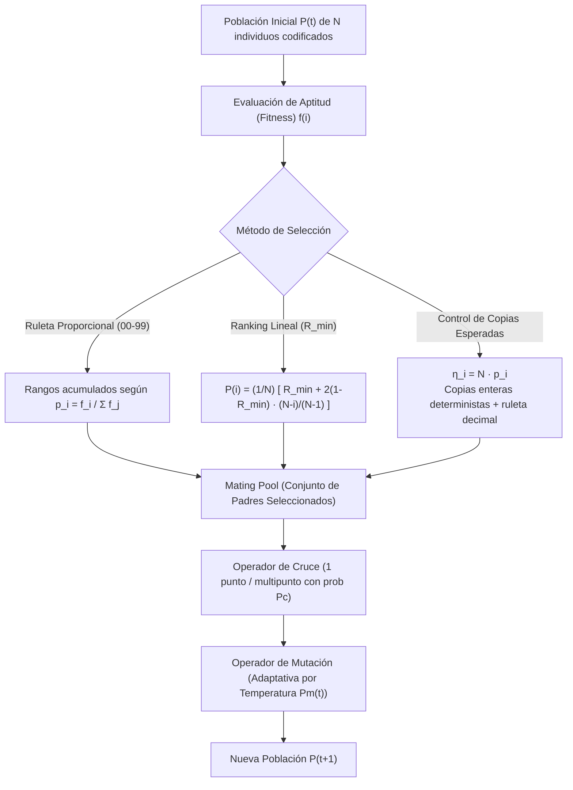

# Guía Paso a Paso: Algoritmos Genéticos (Selección, Cruce y Mutación)
**Cátedra:** Inteligencia Artificial — UTN FRRe (5to Nivel ISI)  
**Cátedra:** Inteligencia Artificial (UTN FRRe)  
**Tiempo estimado en examen:** 25 minutos | **Ponderación:** Cierre de Brecha Curricular (Teoría / Práctica Especial)

---

## 1. Fundamentos de los Algoritmos Genéticos Canónicos

Los Algoritmos Genéticos (AG) son métodos estocásticos de optimización y búsqueda global basados en la teoría darwiniana de la selección natural y la evolución biológica. Operan sobre una población de cromosomas (soluciones candidatas codificadas) sometidos a ciclos de evaluación, selección, cruzamiento y mutación.

---

### 1.1 Fórmulas Canónicas de Cátedra

1. **Aptitud Relativa y Ruleta Proporcional:**
   $$p_i = \frac{f_i}{\sum_{j=1}^N f_j}, \qquad q_i = \sum_{k=1}^i p_k \quad (\text{con } q_N = 1.00)$$
   *Mapeo a la ruleta $[00, 99]$:*
   $$\text{Rango}_i = [\text{Rango}_{i-1}^{\text{fin}} + 1, \; \text{round}(100 \cdot q_i) - 1]$$
2. **Selección por Ranking Lineal (Ordenamiento por Aptitud):**
   Los individuos se ordenan decrecientemente según su fitness ($i = 1$ es el más apto, $i = N$ el menos apto):
   $$P(i) = \frac{1}{N} \left[ R_{\min} + 2(1 - R_{\min}) \frac{N - i}{N - 1} \right]$$
   *Donde $R_{\min} \in [0, 1]$ es la probabilidad base asignada al peor individuo (típicamente $R_{\min} = 0.30$ en la UTN).*
3. **Control del Número Esperado de Copias (Muestreo Estocástico con Resto):**
   $$\text{Valor Esperado: } \eta_i = N \cdot p_i$$
   * **Asignación determinista:** El individuo recibe $c_i = \lfloor \eta_i \rfloor$ copias directas.
   * **Asignación probabilística:** Las plazas restantes hasta completar $N$ se sortean por ruleta entre las partes fraccionarias $\text{frac}_i = \eta_i - \lfloor \eta_i \rfloor$.
4. **Mutación Adaptativa por Temperatura:**
   * **Descendente:** $P_m(t) = P_{\max} - \lambda \cdot t$  
     *(Mejora la exploración inicial y realiza refinamiento local en fases tardías).*
   * **Ascendente:** $P_m(t) = P_{\min} + \lambda \cdot t$  
     *(Evita mutaciones disruptivas al inicio y previene el estancamiento prematuro en óptimos locales al final).*

> [!IMPORTANT]
> **Pregunta Conceptual Oficial de Examen:**  
> *¿La mutación adaptativa por temperatura tiene en cuenta la homogeneidad de la población?*  
> **Respuesta:** **NO**. Depende estrictamente del tiempo transcurrido (número de generación $t$). El operador que sí mide la similitud genética es la **Mutación Adaptativa por Grado de Convergencia**.

---

## 2. Ejercicio Resuelto Completo Tipo Examen (Fuente: Guía TP-AG Ejercicio 07)

### Enunciado Oficial:
Considere una población de $N = 4$ cromosomas binarios de longitud $L = 6$:
* $C_1 = 110010$ con aptitud $f_1 = 12$
* $C_2 = 011100$ con aptitud $f_2 = 28$
* $C_3 = 001011$ con aptitud $f_3 = 8$
* $C_4 = 101101$ con aptitud $f_4 = 32$

**Se solicita:**
1. Construya la tabla de selección por Ruleta Normalizada $[00 - 99]$.
2. Determine los padres asignados utilizando la siguiente secuencia de números aleatorios: $r_1 = 64, r_2 = 15, r_3 = 88, r_4 = 42$.
3. Aplique Cruce en un Punto en la posición $k = 3$ a la pareja $(P_1, P_2)$.
4. Si la tasa de mutación inicial es $P_m(0) = 0.05$ y se emplea mutación adaptativa con $\lambda = 0.01$ por generación, calcule $P_m(3)$.

---

### Procedimiento de Resolución Paso a Paso con Calculadora

#### Paso 1: Suma Total de Aptitud y Probabilidades
$$\sum_{j=1}^4 f_j = 12 + 28 + 8 + 32 = 80$$

* Aptitudes relativas ($p_i = f_i / 80$):
  * $p_1 = \frac{12}{80} = 0.150 \implies 15.0\%$
  * $p_2 = \frac{28}{80} = 0.350 \implies 35.0\%$
  * $p_3 = \frac{8}{80} = 0.100 \implies 10.0\%$
  * $p_4 = \frac{32}{80} = 0.400 \implies 40.0\%$
  *(Control: $0.15 + 0.35 + 0.10 + 0.40 = 1.00 \quad \checkmark$)*

---

#### Paso 2: Aptitud Acumulada y Asignación de Rangos $[00 - 99]$
* $q_1 = 0.150 \implies$ Rango: **$[00 - 14]$** (15 enteros)
* $q_2 = 0.150 + 0.350 = 0.500 \implies$ Rango: **$[15 - 49]$** (35 enteros)
* $q_3 = 0.500 + 0.100 = 0.600 \implies$ Rango: **$[50 - 59]$** (10 enteros)
* $q_4 = 0.600 + 0.400 = 1.000 \implies$ Rango: **$[60 - 99]$** (40 enteros)

#### Tabla Consolidada de Selección:
| Cromosoma | Fitness ($f_i$) | Probabilidad ($p_i$) | Acumulado ($q_i$) | Rango Asignado $[00 - 99]$ |
| :---: | :---: | :---: | :---: | :---: |
| $C_1$ | 12 | 0.15 | 0.15 | **$[00 - 14]$** |
| $C_2$ | 28 | 0.35 | 0.50 | **$[15 - 49]$** |
| $C_3$ | 8 | 0.10 | 0.60 | **$[50 - 59]$** |
| $C_4$ | 32 | 0.40 | 1.00 | **$[60 - 99]$** |

---

#### Paso 3: Sorteo de Padres con los Números Aleatorios Provistos
* $r_1 = 64$: Cae en el intervalo $[60 - 99] \implies$ **Padre 1: $C_4$**
* $r_2 = 15$: Cae en el intervalo $[15 - 49] \implies$ **Padre 2: $C_2$**
* $r_3 = 88$: Cae en el intervalo $[60 - 99] \implies$ **Padre 3: $C_4$**
* $r_4 = 42$: Cae en el intervalo $[15 - 49] \implies$ **Padre 4: $C_2$**

*Mating Pool seleccionado:* $\{C_4, C_2, C_4, C_2\}$.  
*(Notar cómo la ruleta eliminó a los individuos menos aptos $C_1$ y $C_3$, reproduciendo los de mayor fitness).*

---

#### Paso 4: Cruce en un Punto (Crossover)
Se toma la primera pareja seleccionada:
* Padre A ($C_4$): `1 0 1 | 1 0 1`
* Padre B ($C_2$): `0 1 1 | 1 0 0`
* Punto de corte: $k = 3$ (después del tercer gen).

Se intercambian los segmentos derechos:
* **Hijo 1 ($H_1$):** segmento izquierdo de $C_4$ + segmento derecho de $C_2$:
  $$H_1 = \mathbf{1 0 1} \; \mathbf{1 0 0}$$
* **Hijo 2 ($H_2$):** segmento izquierdo de $C_2$ + segmento derecho de $C_4$:
  $$H_2 = \mathbf{0 1 1} \; \mathbf{1 0 1}$$

---

#### Paso 5: Cálculo de la Mutación Adaptativa por Temperatura en Generación $t=3$
Si se utiliza temperatura descendente con $P_{m0} = 0.05$ y factor de enfriamiento $\lambda = 0.01$:
$$P_m(t) = P_{m0} - \lambda \cdot t$$
$$P_m(3) = 0.05 - 0.01 \times 3 = 0.05 - 0.03 = \mathbf{0.02} \quad (2.0\%)$$

*Si se utilizara temperatura ascendente:*
$$P_m(3) = 0.05 + 0.01 \times 3 = 0.05 + 0.03 = \mathbf{0.08} \quad (8.0\%)$$

---

## 3. Checklist Antifallas para Entregar Algoritmos Genéticos

- [ ] ¿Calculaste la suma total $\sum f_i$ y dividiste cada aptitud para hallar $p_i$?
- [ ] ¿El acumulado $q_N$ finaliza exactamente en $1.00$?
- [ ] ¿Los rangos enteros $[00 - 99]$ cubren exactamente 100 números discretos sin solapamientos ni huecos?
- [ ] ¿Indicaste a qué intervalo pertenece cada número pseudoaleatorio provisto?
- [ ] En el cruce, ¿respetaste la posición del punto de corte indicada por el enunciado?
- [ ] Si preguntan por temperatura en mutación, ¿aclaraste que depende del tiempo/generación y NO de la homogeneidad de la población?
