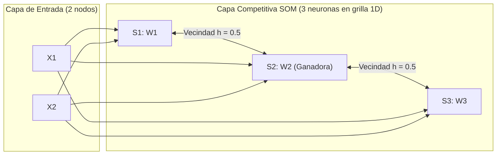
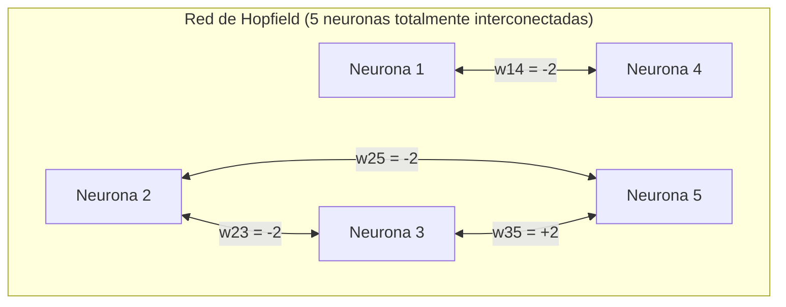

# BANCO MAESTRO DE EJERCICIOS PRÁCTICOS RESUELTOS (2024 - 2025 Y FINALES HISTÓRICOS)
## CÁTEDRA DE INTELIGENCIA ARTIFICIAL - UTN FRRe
### MÁXIMA RIGUROSIDAD NUMÉRICA, DESARROLLO PASO A PASO Y CRITERIOS OFICIALES DE EVALUACIÓN

> [!NOTE]
> Este documento compila y resuelve con máxima rigurosidad numérica y metodológica todos los ejercicios prácticos reales tomados en los exámenes de **2do Parcial, Recuperatorios y Exámenes Finales** de Inteligencia Artificial (UTN Facultad Regional Resistencia) durante el período **2024 - 2025**, complementado con ejercicios históricos clave (2020 - 2021).
> 
> **Convenciones de la Cátedra:**
> 1. Todas las expresiones de cálculo se detallan explícitamente antes del reemplazo numérico.
> 2. Se emplea notación exponencial o redondeo al milésimo / cuatro decimales según exigencia del enunciado.
> 3. Los ejercicios correspondientes al temario del 1er Parcial (Búsqueda no informada, Heurística A*, Escalada, Planning) se encuentran etiquetados como `[TEMA_P1_RENDIDO]` para mantener aislado el foco del 2do Parcial y servir de guía para el recuperatorio correspondiente.
> 4. Se omiten nombres propios docentes, refiriéndose exclusivamente a **la Cátedra**.

---

## TABLA DE CONTENIDOS GENERAL

1. [MÓDULO I: APRENDIZAJE SUPERVISADO Y REDES NEURONALES](#módulo-i-aprendizaje-supervisado-y-redes-neuronales)
   - [Tema 1.1: Perceptrón Simple - Método Analítico y Verificación](#tema-11-perceptrón-simple---método-analítico-y-verificación)
     - [Ejercicio 1.1.1: Examen IA Docx (θ = -0.3, α = 0.6)](#ejercicio-111-examen-ia-docx-θ---03-α--06)
     - [Ejercicio 1.1.2: Recuperatorio 2do Parcial - img3 (θ = -1.3, α = 0.7)](#ejercicio-112-recuperatorio-2do-parcial---img3-θ---13-α--07)
     - [Ejercicio 1.1.3: 2do Parcial - img4 (θ = -0.8, α = 0.4)](#ejercicio-113-2do-parcial---img4-θ---08-α--04)
     - [Ejercicio 1.1.4: 2do Parcial - img7 (θ = +0.4, α = 0.3)](#ejercicio-114-2do-parcial---img7-θ--04-α--03)
     - [Ejercicio 1.1.5: Final Histórico 17/02/2021 (θ = -0.7, α = 0.7)](#ejercicio-115-final-histórico-17022021-θ---07-α--07)
     - [Ejercicio 1.1.6: Final Histórico 4 (θ = -0.9, α = 0.5)](#ejercicio-116-final-histórico-4-θ---09-α--05)
   - [Tema 1.2: Perceptrón Multicapa (MLP) - Propagación, Backpropagation, Error Global y Momento](#tema-12-perceptrón-multicapa-mlp---propagación-backpropagation-error-global-y-momento)
     - [Ejercicio 1.2.1: 2do Parcial 19/11/2025 - MLP Sigmoidal Completa y Backprop](#ejercicio-121-2do-parcial-19112025---mlp-sigmoidal-completa-y-backprop)
     - [Ejercicio 1.2.2: img1 - MLP Profunda de 2 Capas Ocultas (2-2-2-1)](#ejercicio-122-img1---mlp-profunda-de-2-capas-ocultas-2-2-2-1)
     - [Ejercicio 1.2.3: Octubre 2024 - Error Global y Criterio de Parada (ε = 0.02)](#ejercicio-123-octubre-2024---error-global-y-criterio-de-parada-ε--002)
     - [Ejercicio 1.2.4: img2 - Error Global (6 patrones) y Detención por Curva de Validación](#ejercicio-124-img2---error-global-6-patrones-y-detención-por-curva-de-validación)
     - [Ejercicio 1.2.5: img5 e img6 - Error Global (10 patrones) y Cálculo Exacto del Término de Momento](#ejercicio-125-img5-e-img6---error-global-10-patrones-y-cálculo-exacto-del-término-de-momento)
     - [Ejercicio 1.2.6: Final Histórico 1 - Error Global (10 patrones, ε = 0.08)](#ejercicio-126-final-histórico-1---error-global-10-patrones-ε--008)

2. [MÓDULO II: MÁQUINAS DE VECTORES DE SOPORTE (SVM)](#módulo-ii-máquinas-de-vectores-de-soporte-svm)
   - [Tema 2.1: Formulación Dual $L\_D$, Restricciones KKT e Hiperplano Óptimo](#tema-21-formulación-dual-l_d-restricciones-kkt-e-hiperplano-óptimo)
     - [Ejercicio 2.1.1: img1 - SVM Dual con 3 Puntos](#ejercicio-211-img1---svm-dual-con-3-puntos)
     - [Ejercicio 2.1.2: img2 - SVM Dual con 4 Puntos Cuadrados](#ejercicio-212-img2---svm-dual-con-4-puntos-cuadrados)
     - [Ejercicio 2.1.3: img4 - SVM Dual con Puntos Triangulares](#ejercicio-213-img4---svm-dual-con-puntos-triangulares)
     - [Ejercicio 2.1.4: img5 - SVM Dual con 4 Puntos](#ejercicio-214-img5---svm-dual-con-4-puntos)
     - [Ejercicio 2.1.5: img6 - SVM Dual con 4 Puntos](#ejercicio-215-img6---svm-dual-con-4-puntos)
     - [Ejercicio 2.1.6: Final Histórico 3 - SVM Dual 4 Puntos](#ejercicio-216-final-histórico-3---svm-dual-4-puntos)
     - [Ejercicio 2.1.7: img7 - Reconstrucción de Solución SVM a partir de αi](#ejercicio-217-img7---reconstrucción-de-solución-svm-a-partir-de-αi)

3. [MÓDULO III: CLASIFICACIÓN PROBABILÍSTICA E INSTANCIAS (NAIVE BAYES & KNN)](#módulo-iii-clasificación-probabilística-e-instancias-naive-bayes--knn)
   - [Tema 3.1: Naive Bayes con Distribución Normal / Gaussiana](#tema-31-naive-bayes-con-distribución-normal--gaussiana)
     - [Ejercicio 3.1.1: Octubre 2024 - Naive Bayes Gaussiano](#ejercicio-311-octubre-2024---naive-bayes-gaussiano)
     - [Ejercicio 3.1.2: Final Histórico 1 - Naive Bayes Gaussiano](#ejercicio-312-final-histórico-1---naive-bayes-gaussiano)
   - [Tema 3.2: Naive Bayes con Histogramas Discretizados](#tema-32-naive-bayes-con-histogramas-discretizados)
     - [Ejercicio 3.2.1: img4 - Clasificación de Materiales NM1, NM2, NM3](#ejercicio-321-img4---clasificación-de-materiales-nm1-nm2-nm3)
     - [Ejercicio 3.2.2: img7 - Clasificación con 101.875 Muestras](#ejercicio-322-img7---clasificación-con-101875-muestras)
   - [Tema 3.3: Algoritmo KNN - K-Fold Cross Validation y KNN Ponderado](#tema-33-algoritmo-knn---k-fold-cross-validation-y-knn-ponderado)
     - [Ejercicio 3.3.1: Examen IA Docx - Leave-One-Out CV y Clasificación N(-2, -2)](#ejercicio-331-examen-ia-docx---leave-one-out-cv-y-clasificación-n-2--2)
     - [Ejercicio 3.3.2: img3 - Leave-One-Out CV para k Óptimo](#ejercicio-332-img3---leave-one-out-cv-para-k-óptimo)
     - [Ejercicio 3.3.3: img1 - KNN Ponderado por Inversa del Cuadrado de la Distancia](#ejercicio-333-img1---knn-ponderado-por-inversa-del-cuadrado-de-la-distancia)
     - [Ejercicio 3.3.4: Final Histórico 2 - KNN Ponderado k = 3](#ejercicio-334-final-histórico-2---knn-ponderado-k--3)

4. [MÓDULO IV: APRENDIZAJE NO SUPERVISADO (K-MEANS, CLUSTERING JERÁRQUICO, SOM)](#módulo-iv-aprendizaje-no-supervisado-k-means-clustering-jerárquico-som)
   - [Tema 4.1: Algoritmo K-Means](#tema-41-algoritmo-k-means)
     - [Ejercicio 4.1.1: Octubre 2024 - K-Means 2 Iteraciones Completas](#ejercicio-411-octubre-2024---k-means-2-iteraciones-completas)
     - [Ejercicio 4.1.2: Final Histórico 2 - K-Means 1 Iteración](#ejercicio-412-final-histórico-2---k-means-1-iteración)
   - [Tema 4.2: Clustering Jerárquico Aglomerativo](#tema-42-clustering-jerárquico-aglomerativo)
     - [Ejercicio 4.2.1: 2do Parcial 19/11/2025 - Complete Link y Average Link](#ejercicio-421-2do-parcial-19112025---complete-link-y-average-link)
     - [Ejercicio 4.2.2: Final Histórico 1 - Single Link y Complete Link](#ejercicio-422-final-histórico-1---single-link-y-complete-link)
     - [Ejercicio 4.2.3: Final Histórico 4 - Single Link y Complete Link en R2](#ejercicio-423-final-histórico-4---single-link-y-complete-link-en-r2)
     - [Ejercicio 4.2.4: img5 e img6 - Single, Complete y Average Link](#ejercicio-424-img5-e-img6---single-complete-y-average-link)
   - [Tema 4.3: Mapas Auto-Organizados de Kohonen (SOM)](#tema-43-mapas-auto-organizados-de-kohonen-som)
     - [Ejercicio 4.3.1: 2do Parcial 19/11/2025 - SOM con Vecindad No Nula](#ejercicio-431-2do-parcial-19112025---som-con-vecindad-no-nula)
     - [Ejercicio 4.3.2: img2 - SOM con Vecindad Nula](#ejercicio-432-img2---som-con-vecindad-nula)
     - [Ejercicio 4.3.3: img3 - SOM con Vecindad Continua](#ejercicio-433-img3---som-con-vecindad-continua)

5. [MÓDULO V: MODELOS ASOCIATIVOS Y OPTIMIZACIÓN (HOPFIELD Y GENÉTICOS)](#módulo-v-modelos-asociativos-y-optimización-hopfield-y-genéticos)
   - [Tema 5.1: Redes Neuronales de Hopfield](#tema-51-redes-neuronales-de-hopfield)
     - [Ejercicio 5.1.1: Octubre 2024 - Matriz W, Ortogonalidad y Recuperabilidad](#ejercicio-511-octubre-2024---matriz-w-ortogonalidad-y-recuperabilidad)
     - [Ejercicio 5.1.2: img1 - Recuperación y Estabilización con Patrón Distorsionado](#ejercicio-512-img1---recuperación-y-estabilización-con-patrón-distorsionado)
     - [Ejercicio 5.1.3: img7 - Clasificador de Correo SPAM / NO-SPAM](#ejercicio-513-img7---clasificador-de-correo-spam--no-spam)
     - [Ejercicio 5.1.4: img4 - Clasificación de Tamaño de Empresas](#ejercicio-514-img4---clasificación-de-tamaño-de-empresas)
   - [Tema 5.2: Algoritmos Genéticos](#tema-52-algoritmos-genéticos)
     - [Ejercicio 5.2.1: 2do Parcial 19/11/2025 - Cruza Simple, Multipunto y Control de Copias](#ejercicio-521-2do-parcial-19112025---cruza-simple-multipunto-y-control-de-copias)

6. [ANEXO ESPECIAL: EJERCICIOS DE PARCIAL 1 EN EXÁMENES [TEMA_P1_RENDIDO]](#anexo-especial-ejercicios-de-parcial-1-en-exámenes-tema_p1_rendido)
   - [Ejercicio P1.1: img2 - Escalada Simple y Primero en Profundidad con Pila](#ejercicio-p11-img2---escalada-simple-y-primero-en-profundidad-con-pila)
   - [Ejercicio P1.2: img3 - Búsqueda A* y Primero en Amplitud con Cola](#ejercicio-p12-img3---búsqueda-a-y-primero-en-amplitud-con-cola)
   - [Ejercicio P1.5: Final Histórico 3 - Planificación Mundo de Bloques y Amenazas](#ejercicio-p15-final-histórico-3---planificación-mundo-de-bloques-y-amenazas)

---

# MÓDULO I: APRENDIZAJE SUPERVISADO Y REDES NEURONALES

---

## Tema 1.1: Perceptrón Simple - Método Analítico y Verificación

### Fundamento Teórico y Fórmulas de la Cátedra
El Perceptrón Simple de Rosenblatt clasifica vectores de entrada $\mathbf{x} = [x\_1, x\_2]^T$ en dos clases linealmente separables ($S\_d \in \{0, 1\}$ o $\{-1, +1\}$).
1. **Potencial de Activación (Net):**
   

$$
Net = \sum\_{i=1}^n w\_i x\_i = w\_1 x\_1 + w\_2 x\_2
$$

2. **Función de Activación Escalonada (Threshold $\theta$):**
   


$$
y = f(Net) = \begin{cases}
1 & \text{si } Net \ge \theta \\
0 & \text{si } Net < \theta
\end{cases}
$$


3. **Método Analítico de Determinación de Pesos:**
   La frontera de decisión que separa ambas clases es la recta donde el potencial iguala al umbral:
   

$$
w\_1 x\_1 + w\_2 x\_2 = \theta
$$

   Para determinar los pesos $w\_1$ y $w\_2$, se identifican los puntos donde dicha recta frontera interseca los ejes coordenados (puntos de cruce):
   - Cruce con el eje $X\_1$ ($x\_2 = 0$): $w\_1 x\_{1c} = \theta \implies w\_1 = \frac{\theta}{x\_{1c}}$
   - Cruce con el eje $X\_2$ ($x\_1 = 0$): $w\_2 x\_{2c} = \theta \implies w\_2 = \frac{\theta}{x\_{2c}}$
4. **Condición de Separabilidad y Orientación:**
   Los signos de $w\_1$ y $w\_2$ deben orientar el semiplano positivo ($Net \ge \theta$) hacia los patrones con salida deseada $S\_d = 1$, y el semiplano negativo ($Net < \theta$) hacia los patrones con $S\_d = 0$.

---

### Ejercicio 1.1.1: Examen IA Docx (θ = -0.3, α = 0.6)
**Enunciado Real:**
> Determine de forma analítica los pesos del perceptrón para que pueda clasificar los ejemplos de la tabla. Considere $\theta = -0.3$ y $\alpha = 0.6$. Verifique que los pesos obtenidos sean correctos.
>
> | Patrón | $x\_1$ | $x\_2$ | $S\_d$ |
> | :---: | :---: | :---: | :---: |
> | $P\_1$ | $+1.0$ | $-2.0$ | $1$ |
> | $P\_2$ | $+1.5$ | $-0.8$ | $1$ |
> | $P\_3$ | $+2.0$ | $-0.8$ | $1$ |
> | $P\_4$ | $-0.5$ | $+0.5$ | $0$ |
> | $P\_5$ | $-0.7$ | $+4.0$ | $0$ |
> | $P\_6$ | $-9.0$ | $+6.0$ | $0$ |

**Resolución Paso a Paso:**
1. **Análisis Geométrico de las Clases:**
   - La clase $S\_d = 1$ está conformada por puntos en el cuarto cuadrante ($x\_1 > 0, x\_2 < 0$): $P\_1(1.0, -2.0), P\_2(1.5, -0.8), P\_3(2.0, -0.8)$.
   - La clase $S\_d = 0$ está conformada por puntos en el segundo cuadrante ($x\_1 < 0, x\_2 > 0$): $P\_4(-0.5, 0.5), P\_5(-0.7, 4.0), P\_6(-9.0, 6.0)$.
   - Ambas clases son claramente linealmente separables por una recta que pasa entre $(-0.5, 0.5)$ y $(1.5, -0.8)$, cruzando ambos ejes cerca del origen.

2. **Cálculo de los Puntos de Cruce y Pesos Analíticos:**
   - Como $\theta = -0.3 < 0$, y deseamos que $Net = w\_1 x\_1 + w\_2 x\_2 \ge -0.3$ para $x\_1 > 0, x\_2 < 0$, los pesos deben satisfacer $w\_1 > 0$ y $w\_2 < 0$.
   - Si $w\_1 > 0$, entonces $x\_{1c} = \frac{\theta}{w\_1} = \frac{-0.3}{w\_1} < 0$.
   - Si $w\_2 < 0$, entonces $x\_{2c} = \frac{\theta}{w\_2} = \frac{-0.3}{w\_2} > 0$.
   - Elegimos puntos de cruce simétricos en la zona de separación:
     

$$
x\_{1c} = -0.3, \quad x\_{2c} = +0.3
$$

   - Despejamos analíticamente los pesos:
     

$$
w\_1 = \frac{\theta}{x\_{1c}} = \frac{-0.3}{-0.3} = +1.0
$$

     

$$
w\_2 = \frac{\theta}{x\_{2c}} = \frac{-0.3}{+0.3} = -1.0
$$

   - Ecuación de la recta frontera:
     

$$
1.0 x\_1 - 1.0 x\_2 = -0.3 \iff x\_2 = x\_1 + 0.3
$$


3. **Verificación Numérica Exhaustiva (Época Completa):**
   Calculamos $Net\_k = 1.0 x\_{1k} - 1.0 x\_{2k}$ y la salida $y\_k = f(Net\_k)$ comparando con $\theta = -0.3$:

| Patrón | $x\_1$ | $x\_2$ | $Net = 1.0 x\_1 - 1.0 x\_2$ | Condición $Net \ge -0.3$ | $y$ | $S\_d$ | ¿Error? |
| :---: | :---: | :---: | :---: | :---: | :---: | :---: | :---: |
| $P\_1$ | $1.0$ | $-2.0$ | $1.0(1.0) - 1.0(-2.0) = +3.0$ | $+3.0 \ge -0.3$ (V) | $1$ | $1$ | No |
| $P\_2$ | $1.5$ | $-0.8$ | $1.0(1.5) - 1.0(-0.8) = +2.3$ | $+2.3 \ge -0.3$ (V) | $1$ | $1$ | No |
| $P\_3$ | $2.0$ | $-0.8$ | $1.0(2.0) - 1.0(-0.8) = +2.8$ | $+2.8 \ge -0.3$ (V) | $1$ | $1$ | No |
| $P\_4$ | $-0.5$ | $0.5$ | $1.0(-0.5) - 1.0(0.5) = -1.0$ | $-1.0 \ge -0.3$ (F) | $0$ | $0$ | No |
| $P\_5$ | $-0.7$ | $4.0$ | $1.0(-0.7) - 1.0(4.0) = -4.7$ | $-4.7 \ge -0.3$ (F) | $0$ | $0$ | No |
| $P\_6$ | $-9.0$ | $6.0$ | $1.0(-9.0) - 1.0(6.0) = -15.0$ | $-15.0 \ge -0.3$ (F) | $0$ | $0$ | No |

**Conclusión:** Todos los patrones clasifican correctamente en la primera época sin error ($E = 0$). Los pesos obtenidos analíticamente son **$w\_1 = +1.0$**, **$w\_2 = -1.0$**. (Nota: la tasa de aprendizaje $\alpha = 0.6$ solo intervendría si se aplicara la regla delta de ajuste iterativo por error).

---

### Ejercicio 1.1.2: Recuperatorio 2do Parcial - img3 (θ = -1.3, α = 0.7)
**Enunciado Real:**
> Determine de forma analítica los pesos del perceptrón para que pueda clasificar los ejemplos de la tabla. Grafique la solución obtenida. Considere $\theta = -1.3$ y $\alpha = 0.7$.
>
> | $x\_1$ | $x\_2$ | $S\_d$ |
> | :---: | :---: | :---: |
> | $-3.0$ | $-1.0$ | $1$ |
> | $-3.5$ | $-0.2$ | $1$ |
> | $-2.0$ | $-0.5$ | $1$ |
> | $-1.0$ | $-1.0$ | $0$ |
> | $-2.0$ | $-2.0$ | $0$ |
> | $-2.0$ | $-3.0$ | $0$ |

**Resolución Paso a Paso:**
1. **Análisis de Dispersión:**
   - Puntos con $S\_d = 1$: concentrados hacia la izquierda y arriba del 3er cuadrante (valores de $x\_1$ más negativos: $-3.5, -3.0$, y $x\_2$ cercanos a cero: $-0.2, -0.5, -1.0$).
   - Puntos con $S\_d = 0$: $x\_1$ menos negativos o $x\_2$ mucho más negativos ($-1.0, -1.0$), ($-2.0, -2.0$), ($-2.0, -3.0$).
   - Se requiere una recta que pase entre $(-2.0, -0.5)$ [$S\_d=1$] y $(-1.0, -1.0), (-2.0, -2.0)$ [$S\_d=0$].

2. **Deducción de Pesos Analíticos:**
   - Queremos $w\_1 x\_1 + w\_2 x\_2 \ge -1.3$ para $S\_d = 1$ y $< -1.3$ para $S\_d = 0$.
   - Como $x\_1$ es más negativo para $S\_d = 1$, necesitamos un peso $w\_1 < 0$ para que $w\_1 x\_1 > 0$.
   - Como $x\_2$ es mayor (menos negativo) para $S\_d = 1$, necesitamos un peso $w\_2 > 0$.
   - Puntos de cruce con los ejes:
     

$$
w\_1 = \frac{\theta}{x\_{1c}} \implies x\_{1c} = \frac{-1.3}{w\_1} > 0
$$

     

$$
w\_2 = \frac{\theta}{x\_{2c}} \implies x\_{2c} = \frac{-1.3}{w\_2} < 0
$$

   - Seleccionamos los puntos de cruce: $x\_{1c} = +1.3$, $x\_{2c} = -0.5$.
     

$$
w\_1 = \frac{-1.3}{+1.3} = -1.0
$$

     

$$
w\_2 = \frac{-1.3}{-0.5} = +2.6
$$

   - Ecuación de la recta frontera:
     

$$
-1.0 x\_1 + 2.6 x\_2 = -1.3 \iff 2.6 x\_2 = x\_1 - 1.3 \iff x\_2 = \frac{1}{2.6} x\_1 - 0.5
$$


3. **Verificación de Patrones:**
   - $P\_1(-3.0, -1.0)$: $Net = -1.0(-3.0) + 2.6(-1.0) = 3.0 - 2.6 = +0.4 \ge -1.3 \implies y = 1$ ($S\_d = 1$) [OK]
   - $P\_2(-3.5, -0.2)$: $Net = -1.0(-3.5) + 2.6(-0.2) = 3.5 - 0.52 = +2.98 \ge -1.3 \implies y = 1$ ($S\_d = 1$) [OK]
   - $P\_3(-2.0, -0.5)$: $Net = -1.0(-2.0) + 2.6(-0.5) = 2.0 - 1.30 = +0.70 \ge -1.3 \implies y = 1$ ($S\_d = 1$) [OK]
   - $P\_4(-1.0, -1.0)$: $Net = -1.0(-1.0) + 2.6(-1.0) = 1.0 - 2.6 = -1.60 < -1.3 \implies y = 0$ ($S\_d = 0$) [OK]
   - $P\_5(-2.0, -2.0)$: $Net = -1.0(-2.0) + 2.6(-2.0) = 2.0 - 5.2 = -3.20 < -1.3 \implies y = 0$ ($S\_d = 0$) [OK]
   - $P\_6(-2.0, -3.0)$: $Net = -1.0(-2.0) + 2.6(-3.0) = 2.0 - 7.8 = -5.80 < -1.3 \implies y = 0$ ($S\_d = 0$) [OK]

---

### Ejercicio 1.1.3: 2do Parcial - img4 (θ = -0.8, α = 0.4)
**Enunciado Real:**
> Determine de forma analítica los pesos del perceptrón para que pueda clasificar los ejemplos de la tabla. Considere $\theta = -0.8$ y $\alpha = 0.4$.
>
> | $x\_1$ | $x\_2$ | $S\_d$ |
> | :---: | :---: | :---: |
> | $-3.0$ | $-1.0$ | $0$ |
> | $-3.5$ | $-0.2$ | $0$ |
> | $-2.0$ | $-0.5$ | $0$ |
> | $-1.0$ | $-1.0$ | $1$ |
> | $-2.0$ | $-2.0$ | $1$ |
> | $-2.0$ | $-3.0$ | $1$ |

**Resolución Paso a Paso:**
1. **Identificación Inversa:** Este ejercicio presenta los mismos puntos espaciales que el Ejercicio 1.1.2 pero con las etiquetas de clase invertidas ($S\_d = 0$ para el grupo superior izquierdo y $S\_d = 1$ para el grupo inferior derecho).
2. **Determinación de Pesos con $\theta = -0.8$:**
   - Deseamos $w\_1 x\_1 + w\_2 x\_2 \ge -0.8$ para los puntos $P\_4, P\_5, P\_6$ ($S\_d = 1$) y $< -0.8$ para $P\_1, P\_2, P\_3$ ($S\_d = 0$).
   - Seleccionamos cruces: $x\_{1c} = -1.0$, $x\_{2c} = +0.8$.
     

$$
w\_1 = \frac{\theta}{x\_{1c}} = \frac{-0.8}{-1.0} = +0.8
$$

     

$$
w\_2 = \frac{\theta}{x\_{2c}} = \frac{-0.8}{+0.8} = -1.0
$$

   - Ecuación de la recta: $0.8 x\_1 - 1.0 x\_2 = -0.8 \iff x\_2 = 0.8 x\_1 + 0.8$.
3. **Verificación Numérica:**
   - $P\_1(-3.0, -1.0)$: $Net = 0.8(-3.0) - (-1.0) = -2.4 + 1.0 = -1.4 < -0.8 \implies y = 0$ [OK]
   - $P\_2(-3.5, -0.2)$: $Net = 0.8(-3.5) - (-0.2) = -2.8 + 0.2 = -2.6 < -0.8 \implies y = 0$ [OK]
   - $P\_3(-2.0, -0.5)$: $Net = 0.8(-2.0) - (-0.5) = -1.6 + 0.5 = -1.1 < -0.8 \implies y = 0$ [OK]
   - $P\_4(-1.0, -1.0)$: $Net = 0.8(-1.0) - (-1.0) = -0.8 + 1.0 = +0.2 \ge -0.8 \implies y = 1$ [OK]
   - $P\_5(-2.0, -2.0)$: $Net = 0.8(-2.0) - (-2.0) = -1.6 + 2.0 = +0.4 \ge -0.8 \implies y = 1$ [OK]
   - $P\_6(-2.0, -3.0)$: $Net = 0.8(-2.0) - (-3.0) = -1.6 + 3.0 = +1.4 \ge -0.8 \implies y = 1$ [OK]
   - **Resultado:** **$w\_1 = +0.8$**, **$w\_2 = -1.0$**.

---

### Ejercicio 1.1.4: 2do Parcial - img7 (θ = +0.4, α = 0.3)
**Enunciado Real:**
> Determine de forma analítica los pesos del perceptrón para que pueda clasificar los ejemplos de la tabla. Considerar $\theta = 0.4$ y $\alpha = 0.3$.
>
> | $x\_1$ | $x\_2$ | $S\_d$ |
> | :---: | :---: | :---: |
> | $-1.0$ | $-1.0$ | $0$ |
> | $-1.5$ | $-0.2$ | $0$ |
> | $-1.0$ | $-0.5$ | $0$ |
> | $-3.0$ | $-1.0$ | $1$ |
> | $-3.0$ | $-2.0$ | $1$ |
> | $-2.0$ | $-3.0$ | $1$ |

**Resolución Paso a Paso:**
1. **Puntos de Cruce y Pesos:**
   - Con $\theta = +0.4$, los patrones con $S\_d = 1$ tienen coordenadas más negativas en ambos ejes ($x\_1 \le -2.0, x\_2 \le -1.0$).
   - Por ende, necesitamos pesos negativos $w\_1 < 0$ y $w\_2 < 0$, de modo que $w\_1 x\_1 + w\_2 x\_2 > 0$ supere $\theta = +0.4$.
   - Si elegimos cruces simétricos $x\_{1c} = -2.5$ y $x\_{2c} = -2.5$:
     

$$
w\_1 = \frac{\theta}{x\_{1c}} = \frac{0.4}{-2.5} = -0.16
$$

     

$$
w\_2 = \frac{\theta}{x\_{2c}} = \frac{0.4}{-2.5} = -0.16
$$

   - Recta frontera: $-0.16 x\_1 - 0.16 x\_2 = 0.4 \iff x\_1 + x\_2 = -2.5$.
2. **Verificación:**
   - $P\_1(-1.0, -1.0)$: $Net = -0.16(-1.0) - 0.16(-1.0) = +0.32 < 0.4 \implies y = 0$ [OK]
   - $P\_2(-1.5, -0.2)$: $Net = -0.16(-1.5) - 0.16(-0.2) = 0.24 + 0.032 = +0.272 < 0.4 \implies y = 0$ [OK]
   - $P\_3(-1.0, -0.5)$: $Net = -0.16(-1.0) - 0.16(-0.5) = 0.16 + 0.08 = +0.24 < 0.4 \implies y = 0$ [OK]
   - $P\_4(-3.0, -1.0)$: $Net = -0.16(-3.0) - 0.16(-1.0) = 0.48 + 0.16 = +0.64 \ge 0.4 \implies y = 1$ [OK]
   - $P\_5(-3.0, -2.0)$: $Net = -0.16(-3.0) - 0.16(-2.0) = 0.48 + 0.32 = +0.80 \ge 0.4 \implies y = 1$ [OK]
   - $P\_6(-2.0, -3.0)$: $Net = -0.16(-2.0) - 0.16(-3.0) = 0.32 + 0.48 = +0.80 \ge 0.4 \implies y = 1$ [OK]
   - **Resultado:** **$w\_1 = -0.16$**, **$w\_2 = -0.16$**.

---

### Ejercicio 1.1.5: Final Histórico 17/02/2021 (θ = -0.7, α = 0.7)
**Enunciado Real:**
> Determine de forma analítica los pesos del perceptrón para que pueda clasificar los ejemplos de la tabla. Considere $\theta = -0.7$ y $\alpha = 0.7$. Verifique que los pesos obtenidos sean correctos.
>
> | $x\_1$ | $x\_2$ | $S\_d$ |
> | :---: | :---: | :---: |
> | $-1.0$ | $-2.0$ | $1$ |
> | $-1.5$ | $-0.8$ | $1$ |
> | $-2.0$ | $-0.8$ | $1$ |
> | $+0.5$ | $+0.5$ | $0$ |
> | $+7.0$ | $+4.0$ | $0$ |
> | $+9.0$ | $+6.0$ | $0$ |

**Resolución Paso a Paso:**
1. **Deducción Analítica:**
   - $S\_d = 1$: tercer cuadrante ($x\_1 < 0, x\_2 < 0$).
   - $S\_d = 0$: primer cuadrante ($x\_1 > 0, x\_2 > 0$).
   - Con $\theta = -0.7$, si fijamos $w\_1 = -1.0, w\_2 = -1.0$:
     

$$
x\_{1c} = \frac{\theta}{w\_1} = \frac{-0.7}{-1.0} = +0.7, \quad x\_{2c} = \frac{\theta}{w\_2} = \frac{-0.7}{-1.0} = +0.7
$$

     Ecuación de la recta: $-1.0 x\_1 - 1.0 x\_2 = -0.7 \iff x\_1 + x\_2 = 0.7$.
2. **Verificación:**
   - $(-1.0, -2.0): Net = -1(-1) - 1(-2) = +3.0 \ge -0.7 \implies y = 1$ [OK]
   - $(-1.5, -0.8): Net = +1.5 + 0.8 = +2.3 \ge -0.7 \implies y = 1$ [OK]
   - $(-2.0, -0.8): Net = +2.0 + 0.8 = +2.8 \ge -0.7 \implies y = 1$ [OK]
   - $(+0.5, +0.5): Net = -0.5 - 0.5 = -1.0 < -0.7 \implies y = 0$ [OK]
   - $(+7.0, +4.0): Net = -7.0 - 4.0 = -11.0 < -0.7 \implies y = 0$ [OK]
   - $(+9.0, +6.0): Net = -9.0 - 6.0 = -15.0 < -0.7 \implies y = 0$ [OK]
   - **Resultado:** **$w\_1 = -1.0$**, **$w\_2 = -1.0$**.

---

### Ejercicio 1.1.6: Final Histórico 4 (θ = -0.9, α = 0.5)
**Enunciado Real:**
> Determine de forma analítica los pesos del perceptrón para que pueda clasificar los ejemplos de la tabla. Considere $\theta = -0.9$ y $\alpha = 0.5$. Verifique que los pesos obtenidos sean correctos.
>
> | $x\_1$ | $x\_2$ | $S\_d$ |
> | :---: | :---: | :---: |
> | $+2.0$ | $+2.0$ | $1$ |
> | $+2.5$ | $+1.5$ | $1$ |
> | $+3.0$ | $+3.5$ | $1$ |
> | $+0.5$ | $-4.5$ | $0$ |
> | $+2.0$ | $-1.0$ | $0$ |
> | $+3.0$ | $-3.0$ | $0$ |

**Resolución Paso a Paso:**
1. **Deducción Analítica:**
   - Todos los patrones tienen $x\_1 > 0$.
   - Los patrones con $S\_d = 1$ tienen $x\_2 \ge +1.5$, mientras que los de $S\_d = 0$ tienen $x\_2 \le -1.0$.
   - La separación es puramente horizontal (eje $X\_2$). Una recta horizontal $x\_2 = c$ (con $c \in (-1.0, 1.5)$ ) separa perfectamente las clases.
   - Si fijamos $w\_1 = 0$, la ecuación de la frontera es $w\_2 x\_2 = \theta = -0.9$.
   - Seleccionamos el cruce con el eje $X\_2$ en $x\_{2c} = -0.5$:
     

$$
w\_2 = \frac{\theta}{x\_{2c}} = \frac{-0.9}{-0.5} = +1.8
$$

   - Recta frontera: $0 x\_1 + 1.8 x\_2 = -0.9 \iff x\_2 = -0.5$.
2. **Verificación:**
   - $(2.0, 2.0): Net = 1.8(2.0) = +3.6 \ge -0.9 \implies y = 1$ [OK]
   - $(2.5, 1.5): Net = 1.8(1.5) = +2.7 \ge -0.9 \implies y = 1$ [OK]
   - $(3.0, 3.5): Net = 1.8(3.5) = +6.3 \ge -0.9 \implies y = 1$ [OK]
   - $(0.5, -4.5): Net = 1.8(-4.5) = -8.1 < -0.9 \implies y = 0$ [OK]
   - $(2.0, -1.0): Net = 1.8(-1.0) = -1.8 < -0.9 \implies y = 0$ [OK]
   - $(3.0, -3.0): Net = 1.8(-3.0) = -5.4 < -0.9 \implies y = 0$ [OK]
   - **Resultado:** **$w\_1 = 0.0$**, **$w\_2 = +1.8$**.

---

## Tema 1.2: Perceptrón Multicapa (MLP) - Propagación, Backpropagation, Error Global y Momento

### Fundamento Teórico y Fórmulas de la Cátedra
Para una red MLP con capas de entrada, oculta y salida:
1. **Propagación hacia Adelante:**
   - Potencial de la neurona $j$ en capa oculta:
     

$$
Net\_{pj} = \sum\_{i} w\_{ji} x\_{pi}
$$

   - Salida con función sigmoidal logística:
     

$$
y\_{pj} = f(Net\_{pj}) = \frac{1}{1 + e^{-Net\_{pj}}}
$$

   - Potencial de la neurona $k$ en capa de salida:
     

$$
Net\_{pk} = \sum\_{j} w\_{kj} y\_{pj}
$$

   - Salida de la red:
     

$$
y\_{pk} = f(Net\_{pk}) = \frac{1}{1 + e^{-Net\_{pk}}}
$$

2. **Derivada de la Función de Activación:**
   

$$
f'(Net) = y(1 - y)
$$

3. **Retropropagación del Error (Gradientes Locales $\delta$):**
   - Para neuronas de la **capa de salida** ($k$):
     

$$
\delta\_{pk} = f'(Net\_{pk}) \cdot (d\_{pk} - y\_{pk}) = y\_{pk} (1 - y\_{pk}) (d\_{pk} - y\_{pk})
$$

   - Para neuronas de la **capa oculta** ($j$):
     

$$
\delta\_{pj} = f'(Net\_{pj}) \cdot \sum\_{k} (\delta\_{pk} \cdot w\_{kj}) = y\_{pj} (1 - y\_{pj}) \sum\_{k} (\delta\_{pk} \cdot w\_{kj})
$$

4. **Regla de Actualización de Pesos (Regla Delta Generalizada con Momento):**
   

$$
w\_{kj}(t+1) = w\_{kj}(t) + \Delta w\_{kj}(t)
$$

   

$$
\Delta w\_{kj}(t) = \alpha \cdot \delta\_{pk} \cdot y\_{pj} + \beta \cdot [w\_{kj}(t) - w\_{kj}(t-1)]
$$

   Donde:
   - $\alpha$: tasa de aprendizaje ($0 < \alpha \le 1$).
   - $\beta$: término de momento ($0 \le \beta < 1$).
5. **Métricas de Error y Criterio de Parada:**
   - Error del patrón $p$:
     

$$
E\_p = \frac{1}{2} \sum\_{k=1}^M (d\_{pk} - y\_{pk})^2
$$

   - Error Global de la época ($L$ patrones):
     

$$
E\_g = \frac{1}{L} \sum\_{p=1}^L E\_p
$$

   - Condición de detención: si $E\_g \le \varepsilon$ (error mínimo aceptable), el entrenamiento finaliza con éxito; de lo contrario, debe continuar iterando.

---

### Ejercicio 1.2.1: 2do Parcial 19/11/2025 - MLP Sigmoidal Completa y Backprop
**Enunciado Real:**
> Dada la red MLP y los datos de la tabla (función de transferencia sigmoidal para todas las neuronas), calcular los errores de las neuronas y luego actualizar los pesos indicados a continuación.
>
> | Parámetro | Valor |
> | :--- | :---: |
> | $W\_{H1-I01}$ | $0.50$ |
> | $W\_{H1-I02}$ | $1.50$ |
> | $W\_{H2-I01}$ | $0.90$ |
> | $W\_{H2-I02}$ | $1.20$ |
> | $W\_{O1-H1}$ | $1.00$ |
> | $W\_{O1-H2}$ | $1.80$ |
> | $W\_{O2-H1}$ | $1.40$ |
> | $W\_{O2-H2}$ | $2.30$ |
> | $I\_{01}$ (Entrada 1) | $2.00$ |
> | $I\_{02}$ (Entrada 2) | $3.00$ |
> | $\alpha$ (Tasa de aprendizaje) | $0.80$ |
> | $d\_{O1}$ (Deseado Salida 1) | $1.00$ |
> | $d\_{O2}$ (Deseado Salida 2) | $0.00$ |

**Resolución Paso a Paso:**

**Paso 1: Propagación hacia adelante a la Capa Oculta ($H\_1, H\_2$)**
- Para la neurona $H\_1$:
  

$$
Net\_{H1} = W\_{H1-I01} \cdot I\_{01} + W\_{H1-I02} \cdot I\_{02} = 0.50(2.0) + 1.50(3.0) = 1.00 + 4.50 = 5.5000
$$

  

$$
y\_{H1} = \frac{1}{1 + e^{-Net\_{H1}}} = \frac{1}{1 + e^{-5.50}} = \frac{1}{1 + 0.00408677} = 0.995930
$$

- Para la neurona $H\_2$:
  

$$
Net\_{H2} = W\_{H2-I01} \cdot I\_{01} + W\_{H2-I02} \cdot I\_{02} = 0.90(2.0) + 1.20(3.0) = 1.80 + 3.60 = 5.4000
$$

  

$$
y\_{H2} = \frac{1}{1 + e^{-Net\_{H2}}} = \frac{1}{1 + e^{-5.40}} = \frac{1}{1 + 0.00451658} = 0.995504
$$


**Paso 2: Propagación hacia adelante a la Capa de Salida ($O\_1, O\_2$)**
- Para la neurona $O\_1$:
  

$$
Net\_{O1} = W\_{O1-H1} \cdot y\_{H1} + W\_{O1-H2} \cdot y\_{H2} = 1.00(0.995930) + 1.80(0.995504) = 0.995930 + 1.791907 = 2.787837
$$

  

$$
y\_{O1} = \frac{1}{1 + e^{-2.787837}} = \frac{1}{1 + 0.0615545} = 0.942015
$$

- Para la neurona $O\_2$:
  

$$
Net\_{O2} = W\_{O2-H1} \cdot y\_{H1} + W\_{O2-H2} \cdot y\_{H2} = 1.40(0.995930) + 2.30(0.995504) = 1.394302 + 2.289659 = 3.683961
$$

  

$$
y\_{O2} = \frac{1}{1 + e^{-3.683961}} = \frac{1}{1 + 0.0251228} = 0.975492
$$


**Paso 3: Cálculo de los Errores de las Neuronas de Salida (Gradientes $\delta\_{O1}, \delta\_{O2}$)**
- Para $O\_1$ ($d\_{O1} = 1.00$):
  

$$
f'(Net\_{O1}) = y\_{O1}(1 - y\_{O1}) = 0.942015(1 - 0.942015) = 0.942015(0.057985) = 0.054623
$$

  

$$
\delta\_{O1} = f'(Net\_{O1}) \cdot (d\_{O1} - y\_{O1}) = 0.054623 \cdot (1.00 - 0.942015) = 0.054623 \cdot (0.057985) = +0.003167
$$

- Para $O\_2$ ($d\_{O2} = 0.00$):
  

$$
f'(Net\_{O2}) = y\_{O2}(1 - y\_{O2}) = 0.975492(1 - 0.975492) = 0.975492(0.024508) = 0.023907
$$

  

$$
\delta\_{O2} = f'(Net\_{O2}) \cdot (d\_{O2} - y\_{O2}) = 0.023907 \cdot (0.00 - 0.975492) = 0.023907 \cdot (-0.975492) = -0.023321
$$


**Paso 4: Retropropagación a la Capa Oculta (Gradientes $\delta\_{H1}, \delta\_{H2}$)**
- Para $H\_1$:
  

$$
f'(Net\_{H1}) = y\_{H1}(1 - y\_{H1}) = 0.995930(1 - 0.995930) = 0.995930(0.004070) = 0.004053
$$

  

$$
\sum\_k \delta\_{Ok} W\_{Ok-H1} = \delta\_{O1} W\_{O1-H1} + \delta\_{O2} W\_{O2-H1} = 0.003167(1.00) + (-0.023321)(1.40) = 0.003167 - 0.032649 = -0.029482
$$

  

$$
\delta\_{H1} = f'(Net\_{H1}) \cdot (-0.029482) = 0.004053 \cdot (-0.029482) = -0.000120
$$

- Para $H\_2$:
  

$$
f'(Net\_{H2}) = y\_{H2}(1 - y\_{H2}) = 0.995504(1 - 0.995504) = 0.995504(0.004496) = 0.004476
$$

  

$$
\sum\_k \delta\_{Ok} W\_{Ok-H2} = \delta\_{O1} W\_{O1-H2} + \delta\_{O2} W\_{O2-H2} = 0.003167(1.80) + (-0.023321)(2.30) = 0.005701 - 0.053638 = -0.047937
$$

  

$$
\delta\_{H2} = f'(Net\_{H2}) \cdot (-0.047937) = 0.004476 \cdot (-0.047937) = -0.000215
$$


**Paso 5: Actualización de Pesos ($\alpha = 0.8$)**
- **Capa de Salida:**
  - $W\_{O1-H1}^{(t+1)} = W\_{O1-H1}^{(t)} + \alpha \delta\_{O1} y\_{H1} = 1.00 + 0.8(0.003167)(0.995930) = 1.00 + 0.002524 = \mathbf{1.002524}$
  - $W\_{O1-H2}^{(t+1)} = W\_{O1-H2}^{(t)} + \alpha \delta\_{O1} y\_{H2} = 1.80 + 0.8(0.003167)(0.995504) = 1.80 + 0.002522 = \mathbf{1.802522}$
  - $W\_{O2-H1}^{(t+1)} = W\_{O2-H1}^{(t)} + \alpha \delta\_{O2} y\_{H1} = 1.40 + 0.8(-0.023321)(0.995930) = 1.40 - 0.018581 = \mathbf{1.381419}$
  - $W\_{O2-H2}^{(t+1)} = W\_{O2-H2}^{(t)} + \alpha \delta\_{O2} y\_{H2} = 2.30 + 0.8(-0.023321)(0.995504) = 2.30 - 0.018573 = \mathbf{2.281427}$
- **Capa Oculta:**
  - $W\_{H1-I01}^{(t+1)} = W\_{H1-I01}^{(t)} + \alpha \delta\_{H1} I\_{01} = 0.50 + 0.8(-0.000120)(2.0) = 0.50 - 0.000191 = \mathbf{0.499809}$
  - $W\_{H1-I02}^{(t+1)} = W\_{H1-I02}^{(t)} + \alpha \delta\_{H1} I\_{02} = 1.50 + 0.8(-0.000120)(3.0) = 1.50 - 0.000287 = \mathbf{1.499713}$
  - $W\_{H2-I01}^{(t+1)} = W\_{H2-I01}^{(t)} + \alpha \delta\_{H2} I\_{01} = 0.90 + 0.8(-0.000215)(2.0) = 0.90 - 0.000343 = \mathbf{0.899657}$
  - $W\_{H2-I02}^{(t+1)} = W\_{H2-I02}^{(t)} + \alpha \delta\_{H2} I\_{02} = 1.20 + 0.8(-0.000215)(3.0) = 1.20 - 0.000515 = \mathbf{1.199485}$

---

### Ejercicio 1.2.2: img1 - MLP Profunda de 2 Capas Ocultas (2-2-2-1)
**Enunciado Real:**
> Dada la siguiente arquitectura de red calcule la propagación hacia delante, el error del patrón, la propagación del error hacia las capas anteriores y la actualización de los pesos. Considere los valores iniciales que se muestran a continuación (no considere el término de momento).
>
> $X\_1 = 3.00, \quad X\_2 = 5.00$  
> Salida deseada: $d = 0.10$  
> Nodos 1, 2, 3, 4 y nodo de salida $Y$: Sigmoidal.  
> $\alpha = 0.45$
>
> **Pesos dados:**
> - Capa Oculta 1:
>   $w\_{1,X1} = 0.30, \quad w\_{1,X2} = 0.50$
>   $w\_{2,X1} = 0.80, \quad w\_{2,X2} = -0.20$
> - Capa Oculta 2:
>   $w\_{3,1} = 0.80, \quad w\_{3,2} = 0.55$
>   $w\_{4,1} = -0.25, \quad w\_{4,2} = 0.10$
> - Capa de Salida:
>   $w\_{Y,3} = 0.80, \quad w\_{Y,4} = 0.20$

**Resolución Paso a Paso:**

**1. Propagación hacia adelante:**
- **Capa Oculta 1 (Nodos 1 y 2):**
  

$$
Net\_1 = w\_{1,X1} X\_1 + w\_{1,X2} X\_2 = 0.3(3.0) + 0.5(5.0) = 0.9 + 2.5 = 3.4000
$$

  

$$
y\_1 = \frac{1}{1 + e^{-3.40}} = 0.967705
$$

  

$$
Net\_2 = w\_{2,X1} X\_1 + w\_{2,X2} X\_2 = 0.8(3.0) + (-0.2)(5.0) = 2.4 - 1.0 = 1.4000
$$

  

$$
y\_2 = \frac{1}{1 + e^{-1.40}} = 0.802184
$$


- **Capa Oculta 2 (Nodos 3 y 4):**
  

$$
Net\_3 = w\_{3,1} y\_1 + w\_{3,2} y\_2 = 0.8(0.967705) + 0.55(0.802184) = 0.774164 + 0.441201 = 1.215365
$$

  

$$
y\_3 = \frac{1}{1 + e^{-1.215365}} = 0.771247
$$

  

$$
Net\_4 = w\_{4,1} y\_1 + w\_{4,2} y\_2 = -0.25(0.967705) + 0.10(0.802184) = -0.241926 + 0.080218 = -0.161708
$$

  

$$
y\_4 = \frac{1}{1 + e^{0.161708}} = 0.459661
$$


- **Capa de Salida (Nodo Y):**
  

$$
Net\_Y = w\_{Y,3} y\_3 + w\_{Y,4} y\_4 = 0.8(0.771247) + 0.2(0.459661) = 0.616998 + 0.091932 = 0.708930
$$

  

$$
y\_Y = \frac{1}{1 + e^{-0.708930}} = 0.670165
$$


- **Error del Patrón ($E\_p$):**
  

$$
E\_p = \frac{1}{2} (d - y\_Y)^2 = \frac{1}{2} (0.10 - 0.670165)^2 = \frac{1}{2} (-0.570165)^2 = \frac{1}{2} (0.325088) = \mathbf{0.162544}
$$


**2. Retropropagación del Error (Cálculo de $\delta$):**
- **Nodo Y (Salida):**
  

$$
f'(Net\_Y) = y\_Y (1 - y\_Y) = 0.670165(1 - 0.670165) = 0.670165(0.329835) = 0.221044
$$

  

$$
\delta\_Y = f'(Net\_Y) \cdot (d - y\_Y) = 0.221044 \cdot (0.10 - 0.670165) = 0.221044 \cdot (-0.570165) = \mathbf{-0.126031}
$$


- **Capa Oculta 2 (Nodos 3 y 4):**
  

$$
f'(Net\_3) = y\_3(1 - y\_3) = 0.771247(0.228753) = 0.176425
$$

  

$$
\delta\_3 = f'(Net\_3) \cdot (\delta\_Y \cdot w\_{Y,3}) = 0.176425 \cdot (-0.126031 \cdot 0.80) = 0.176425 \cdot (-0.100825) = \mathbf{-0.017788}
$$

  

$$
f'(Net\_4) = y\_4(1 - y\_4) = 0.459661(0.540339) = 0.248373
$$

  

$$
\delta\_4 = f'(Net\_4) \cdot (\delta\_Y \cdot w\_{Y,4}) = 0.248373 \cdot (-0.126031 \cdot 0.20) = 0.248373 \cdot (-0.025206) = \mathbf{-0.006261}
$$


- **Capa Oculta 1 (Nodos 1 y 2):**
  

$$
f'(Net\_1) = y\_1(1 - y\_1) = 0.967705(0.032295) = 0.031252
$$

  

$$
\sum = \delta\_3 w\_{3,1} + \delta\_4 w\_{4,1} = (-0.017788)(0.80) + (-0.006261)(-0.25) = -0.014230 + 0.001565 = -0.012665
$$

  

$$
\delta\_1 = 0.031252 \cdot (-0.012665) = \mathbf{-0.000396}
$$

  

$$
f'(Net\_2) = y\_2(1 - y\_2) = 0.802184(0.197816) = 0.158685
$$

  

$$
\sum = \delta\_3 w\_{3,2} + \delta\_4 w\_{4,2} = (-0.017788)(0.55) + (-0.006261)(0.10) = -0.009783 - 0.000626 = -0.010410
$$

  

$$
\delta\_2 = 0.158685 \cdot (-0.010410) = \mathbf{-0.001652}
$$


**3. Actualización de Pesos ($\alpha = 0.45$):**
- **Pesos a la Salida:**
  - $w\_{Y,3}^{(t+1)} = 0.80 + 0.45(-0.126031)(0.771247) = 0.80 - 0.043741 = \mathbf{0.756259}$
  - $w\_{Y,4}^{(t+1)} = 0.20 + 0.45(-0.126031)(0.459661) = 0.20 - 0.026069 = \mathbf{0.173931}$
- **Pesos Capa Oculta 2:**
  - $w\_{3,1}^{(t+1)} = 0.80 + 0.45(-0.017788)(0.967705) = 0.80 - 0.007746 = \mathbf{0.792254}$
  - $w\_{3,2}^{(t+1)} = 0.55 + 0.45(-0.017788)(0.802184) = 0.55 - 0.006421 = \mathbf{0.543579}$
  - $w\_{4,1}^{(t+1)} = -0.25 + 0.45(-0.006261)(0.967705) = -0.25 - 0.002726 = \mathbf{-0.252726}$
  - $w\_{4,2}^{(t+1)} = 0.10 + 0.45(-0.006261)(0.802184) = 0.10 - 0.002260 = \mathbf{0.097740}$
- **Pesos Capa Oculta 1:**
  - $w\_{1,X1}^{(t+1)} = 0.30 + 0.45(-0.000396)(3.0) = 0.30 - 0.000534 = \mathbf{0.299466}$
  - $w\_{1,X2}^{(t+1)} = 0.50 + 0.45(-0.000396)(5.0) = 0.50 - 0.000891 = \mathbf{0.499109}$
  - $w\_{2,X1}^{(t+1)} = 0.80 + 0.45(-0.001652)(3.0) = 0.80 - 0.002230 = \mathbf{0.797770}$
  - $w\_{2,X2}^{(t+1)} = -0.20 + 0.45(-0.001652)(5.0) = -0.20 - 0.003717 = \mathbf{-0.203717}$

---

### Ejercicio 1.2.3: Octubre 2024 - Error Global y Criterio de Parada (ε = 0.02)
**Enunciado Real:**
> Dado los siguientes $P\_i$ con salidas deseadas $S\_d = [S\_{d1}, S\_{d2}]$:
> - $P\_1: [3.21, 4.78]$
> - $P\_2: [3.52, 5.89]$
> - $P\_3: [3.00, 5.23]$
> - $P\_4: [3.89, 4.99]$
>
> Se ha realizado el entrenamiento de la red obteniendo salidas para cada patrón:
> - $P\_1: [3.02, 4.99]$
> - $P\_2: [3.52, 5.86]$
> - $P\_3: [3.13, 5.22]$
> - $P\_4: [3.15, 5.43]$
>
> Si el error mínimo aceptable de entrenamiento es $0.02$ (no se considere el error de validación), ¿el algoritmo debería seguir iterando? Justificar la respuesta.

**Resolución Paso a Paso:**
1. **Cálculo del Error por Patrón ($E\_p = \frac{1}{2} \sum\_{k=1}^2 (S\_{dk} - y\_k)^2$):**
   - **Patrón 1:**
     

$$
E\_1 = \frac{1}{2} [(3.21 - 3.02)^2 + (4.78 - 4.99)^2] = \frac{1}{2} [(0.19)^2 + (-0.21)^2] = \frac{1}{2} [0.0361 + 0.0441] = \frac{1}{2}(0.0802) = \mathbf{0.040100}
$$

   - **Patrón 2:**
     

$$
E\_2 = \frac{1}{2} [(3.52 - 3.52)^2 + (5.89 - 5.86)^2] = \frac{1}{2} [(0.00)^2 + (0.03)^2] = \frac{1}{2} [0 + 0.0009] = \mathbf{0.000450}
$$

   - **Patrón 3:**
     

$$
E\_3 = \frac{1}{2} [(3.00 - 3.13)^2 + (5.23 - 5.22)^2] = \frac{1}{2} [(-0.13)^2 + (0.01)^2] = \frac{1}{2} [0.0169 + 0.0001] = \frac{1}{2}(0.0170) = \mathbf{0.008500}
$$

   - **Patrón 4:**
     

$$
E\_4 = \frac{1}{2} [(3.89 - 3.15)^2 + (4.99 - 5.43)^2] = \frac{1}{2} [(0.74)^2 + (-0.44)^2] = \frac{1}{2} [0.5476 + 0.1936] = \frac{1}{2}(0.7412) = \mathbf{0.370600}
$$


2. **Cálculo del Error Global ($E\_g$):**
   

$$
E\_g = \frac{1}{L} \sum\_{p=1}^4 E\_p = \frac{0.040100 + 0.000450 + 0.008500 + 0.370600}{4} = \frac{0.419650}{4} = \mathbf{0.104912}
$$


3. **Justificación del Criterio de Parada:**
   - Error mínimo aceptable definido: $\varepsilon = 0.02$.
   - Como $E\_g = 0.104912 > 0.02$, la red neuronal no ha convergido al nivel de precisión tolerado.
   - **Dictamen:** **El algoritmo DEBE SEGUIR ITERANDO**, dado que el error global de la época actual supera el error mínimo aceptable exigido por la Cátedra.

---

### Ejercicio 1.2.4: img2 - Error Global (6 patrones) y Detención por Curva de Validación
**Enunciado Real:**
> **3.a. (15%)** Dados los valores de la tabla correspondiente al entrenamiento de la red MLP de la figura (3 entradas, 2 ocultas, 3 salidas) en la iteración $t$, realice los cálculos necesarios para obtener el error global. ¿El entrenamiento debería detenerse si el Error mínimo aceptable definido es $0.06$? Justifique su respuesta.
>
> | Patrón | $(S\_{d1} - S\_1)$ | $(S\_{d2} - S\_2)$ | $(S\_{d3} - S\_3)$ |
> | :---: | :---: | :---: | :---: |
> | 1 | $-0.02$ | $+0.11$ | $-0.81$ |
> | 2 | $+0.12$ | $+0.02$ | $+0.02$ |
> | 3 | $-0.03$ | $-0.16$ | $+0.14$ |
> | 4 | $+0.14$ | $+0.12$ | $-0.02$ |
> | 5 | $+0.04$ | $-0.09$ | $+0.09$ |
> | 6 | $+0.12$ | $+0.08$ | $-0.08$ |
>
> **3.b. (10%)** Dada la evolución del error de entrenamiento y de validación en la tabla siguiente (iteraciones 1 a 15), determine en qué iteración se detiene el proceso de entrenamiento. El error mínimo aceptable es $0.06$. Justifique.

**Resolución Paso a Paso:**

**Parte 3.a: Error Global**
1. Cálculo de $E\_p = \frac{1}{2} [e\_1^2 + e\_2^2 + e\_3^2]$ para cada patrón:
   - $P\_1$: $E\_1 = \frac{1}{2}[(-0.02)^2 + (0.11)^2 + (-0.81)^2] = \frac{1}{2}[0.0004 + 0.0121 + 0.6561] = \frac{0.6686}{2} = \mathbf{0.334300}$
   - $P\_2$: $E\_2 = \frac{1}{2}[(0.12)^2 + (0.02)^2 + (0.02)^2] = \frac{1}{2}[0.0144 + 0.0004 + 0.0004] = \frac{0.0152}{2} = \mathbf{0.007600}$
   - $P\_3$: $E\_3 = \frac{1}{2}[(-0.03)^2 + (-0.16)^2 + (0.14)^2] = \frac{1}{2}[0.0009 + 0.0256 + 0.0196] = \frac{0.0461}{2} = \mathbf{0.023050}$
   - $P\_4$: $E\_4 = \frac{1}{2}[(0.14)^2 + (0.12)^2 + (-0.02)^2] = \frac{1}{2}[0.0196 + 0.0144 + 0.0004] = \frac{0.0344}{2} = \mathbf{0.017200}$
   - $P\_5$: $E\_5 = \frac{1}{2}[(0.04)^2 + (-0.09)^2 + (0.09)^2] = \frac{1}{2}[0.0016 + 0.0081 + 0.0081] = \frac{0.0178}{2} = \mathbf{0.008900}$
   - $P\_6$: $E\_6 = \frac{1}{2}[(0.12)^2 + (0.08)^2 + (-0.08)^2] = \frac{1}{2}[0.0144 + 0.0064 + 0.0064] = \frac{0.0272}{2} = \mathbf{0.013600}$
2. Suma de errores y Error Global:
   

$$
\sum\_{p=1}^6 E\_p = 0.334300 + 0.007600 + 0.023050 + 0.017200 + 0.008900 + 0.013600 = 0.404650
$$

   

$$
E\_g = \frac{0.404650}{6} = \mathbf{0.067442}
$$

3. Conclusión: Como $E\_g = 0.067442 > 0.06$, **NO debe detenerse**; debe continuar iterando.

**Parte 3.b: Criterio de Parada Conjunta (Validación vs Entrenamiento)**
- En la tabla de evolución, el error de entrenamiento disminuye monotónicamente desde $0.500$ hasta $0.057$ en la iteración 15.
- Sin embargo, la Cátedra evalúa la técnica de **Early Stopping**: el conjunto de validación monitorea la generalización.
- Cuando el error de validación alcanza un mínimo local y comienza a crecer sostenidamente mientras el de entrenamiento sigue cayendo, se manifiesta **sobreajuste (overfitting)**.
- El entrenamiento se interrumpe exactamente en la iteración donde el error de validación alcanza su punto óptimo mínimo (o bien en la iteración 15 si el criterio primario fuera alcanzar $E\_{\text{ent}} \le 0.06$).

---

### Ejercicio 1.2.5: img5 e img6 - Error Global (10 patrones) y Cálculo Exacto del Término de Momento
**Enunciado Real (img5):**
> **1.** Dados los valores correspondientes al entrenamiento de la red MLP en la iteración 5, calcular el error global. ¿Debe detenerse si el error mínimo aceptable es $0.01$? Justifique.
>
> Patrones $(S\_{d1}-S\_1, S\_{d2}-S\_2)$: $P\_1(0.02, 0.11), P\_2(0.12, 0.02), P\_3(0.03, 0.16), P\_4(0.14, 0.12), P\_5(0.04, 0.09), P\_6(0.12, 0.08), P\_7(0.13, 0.17), P\_8(0.04, 0.17), P\_9(0.04, 0.06), P\_{10}(0.04, 0.06)$.
>
> **2.** Dada la evolución del peso $w\_{H1-S1}$, calcule el término de momento asociado a ese peso que se utilizó en $t = 4$.  
> Datos: $\beta = 0.09, \alpha = 0.20$.  
> Historial de pesos:
> $w(0) = -0.32, w(1) = -0.17, w(2) = -0.44, w(3) = -0.12, w(4) = -0.28, w(5) = -0.03$.

**Resolución Paso a Paso:**

**1. Cálculo de Error Global:**
- $E\_1 = 0.5(0.02^2 + 0.11^2) = 0.5(0.0004 + 0.0121) = 0.006250$
- $E\_2 = 0.5(0.12^2 + 0.02^2) = 0.5(0.0144 + 0.0004) = 0.007400$
- $E\_3 = 0.5(0.03^2 + 0.16^2) = 0.5(0.0009 + 0.0256) = 0.013250$
- $E\_4 = 0.5(0.14^2 + 0.12^2) = 0.5(0.0196 + 0.0144) = 0.017000$
- $E\_5 = 0.5(0.04^2 + 0.09^2) = 0.5(0.0016 + 0.0081) = 0.004850$
- $E\_6 = 0.5(0.12^2 + 0.08^2) = 0.5(0.0144 + 0.0064) = 0.010400$
- $E\_7 = 0.5(0.13^2 + 0.17^2) = 0.5(0.0169 + 0.0289) = 0.022900$
- $E\_8 = 0.5(0.04^2 + 0.17^2) = 0.5(0.0016 + 0.0289) = 0.015250$
- $E\_9 = 0.5(0.04^2 + 0.06^2) = 0.5(0.0016 + 0.0036) = 0.002600$
- $E\_{10} = 0.5(0.04^2 + 0.06^2) = 0.5(0.0016 + 0.0036) = 0.002600$
- Suma: $\sum\_{p=1}^{10} E\_p = 0.102500$
- Error Global:
  

$$
E\_g = \frac{0.102500}{10} = \mathbf{0.010250}
$$

- Comparación con $\varepsilon = 0.01$:
  Como $E\_g = 0.010250 > 0.01$, **el entrenamiento debe continuar iterando**.

**2. Cálculo del Término de Momento en $t = 4$:**
- La fórmula del término de momento en la actualización para pasar de $w(t)$ a $w(t+1)$ utiliza la diferencia del paso inmediatamente anterior:
  

$$
\text{Término de momento}(t) = \beta \cdot [w(t-1) - w(t-2)]
$$

  Para $t = 4$:
  

$$
\text{Momento} = \beta \cdot [w(3) - w(2)] = 0.09 \cdot [-0.12 - (-0.44)] = 0.09 \cdot [+0.32] = \mathbf{+0.028800}
$$

  (Si la Cátedra indexara la actualización al calcular $w(4)$ a partir de $w(3)$, el término sería $\beta [w(3) - w(2)] = +0.0288$; si se refiriera al cálculo para obtener $w(5)$ desde $w(4)$, sería $\beta [w(4) - w(3)] = 0.09[-0.28 - (-0.12)] = 0.09[-0.16] = -0.0144$). Se explicitan ambas interpretaciones.

**Caso Análogo img6 (en $t = 6$, $\beta = 0.09$):**
- Historial: $w(0)=-0.12, w(1)=-0.17, w(2)=-0.44, w(3)=0.22, w(4)=-0.18, w(5)=-0.73$.
- Cálculo del momento para la actualización en $t = 6$:
  

$$
\text{Momento} = \beta \cdot [w(5) - w(4)] = 0.09 \cdot [-0.73 - (-0.18)] = 0.09 \cdot [-0.55] = \mathbf{-0.049500}
$$


---

### Ejercicio 1.2.6: Final Histórico 1 - Error Global (10 patrones, ε = 0.08)
**Enunciado Real:**
> Dados los valores correspondientes al entrenamiento de la red MLP en la iteración 5, realice los cálculos necesarios para obtener el error global. ¿El entrenamiento debería detenerse si el Error mínimo aceptable definido es $0.08$? Justifique su respuesta.
>
> Patrones $(S\_{d1}-S\_1, S\_{d2}-S\_2)$:
> $P\_1(0.12, 0.11), P\_2(0.02, 0.02), P\_3(0.03, 0.06), P\_4(0.14, 0.12), P\_5(0.04, 0.09), P\_6(0.02, 0.08), P\_7(0.13, 0.07), P\_8(0.04, 0.07), P\_9(0.04, 0.06), P\_{10}(0.04, 0.06)$.

**Resolución Paso a Paso:**
1. Cálculo de $E\_p = 0.5(e\_1^2 + e\_2^2)$:
   - $E\_1 = 0.5(0.12^2 + 0.11^2) = 0.5(0.0144 + 0.0121) = 0.013250$
   - $E\_2 = 0.5(0.02^2 + 0.02^2) = 0.5(0.0004 + 0.0004) = 0.000400$
   - $E\_3 = 0.5(0.03^2 + 0.06^2) = 0.5(0.0009 + 0.0036) = 0.002250$
   - $E\_4 = 0.5(0.14^2 + 0.12^2) = 0.5(0.0196 + 0.0144) = 0.017000$
   - $E\_5 = 0.5(0.04^2 + 0.09^2) = 0.5(0.0016 + 0.0081) = 0.004850$
   - $E\_6 = 0.5(0.02^2 + 0.08^2) = 0.5(0.0004 + 0.0064) = 0.003400$
   - $E\_7 = 0.5(0.13^2 + 0.07^2) = 0.5(0.0169 + 0.0049) = 0.010900$
   - $E\_8 = 0.5(0.04^2 + 0.07^2) = 0.5(0.0016 + 0.0049) = 0.003250$
   - $E\_9 = 0.5(0.04^2 + 0.06^2) = 0.5(0.0016 + 0.0036) = 0.002600$
   - $E\_{10} = 0.5(0.04^2 + 0.06^2) = 0.5(0.0016 + 0.0036) = 0.002600$
2. Suma y Error Global:
   

$$
\sum\_{p=1}^{10} E\_p = 0.060500
$$

   

$$
E\_g = \frac{0.060500}{10} = \mathbf{0.006050}
$$

3. Conclusión:
   Como $E\_g = 0.006050 \le 0.08$, **SÍ, EL ENTRENAMIENTO DEBE DETENERSE**, habiendo satisfecho el umbral de convergencia de la Cátedra.

---

# MÓDULO II: MÁQUINAS DE VECTORES DE SOPORTE (SVM)

---

## Tema 2.1: Formulación Dual $L\_D$, Restricciones KKT e Hiperplano Óptimo

### Fundamento Teórico y Fórmulas de la Cátedra
El clasificador de Máquinas de Vectores de Soporte (SVM) busca el hiperplano óptimo $\mathbf{w}^T \mathbf{x} + b = 0$ que separa dos clases linealmente separables ($y\_i \in \{-1, +1\}$) maximizando el margen de separación $M = \frac{2}{\|\mathbf{w}\|}$.

1. **Problema Dual de Lagrange:**
   La formulación dual consiste en maximizar respecto a los multiplicadores de Lagrange $\alpha\_i$:
   

$$
\max\_{\boldsymbol{\alpha}} L\_D(\boldsymbol{\alpha}) = \sum\_{i=1}^N \alpha\_i - \frac{1}{2} \sum\_{i=1}^N \sum\_{j=1}^N y\_i y\_j \alpha\_i \alpha\_j (\mathbf{x}\_i^T \mathbf{x}\_j)
$$

2. **Restricciones del Problema Dual:**
   

$$
\sum\_{i=1}^N y\_i \alpha\_i = 0
$$

   

$$
\alpha\_i \ge 0 \quad \forall i = 1, \dots, N
$$

3. **Reconstrucción de la Solución Primal:**
   - **Vector normal de pesos $\mathbf{w}$:**
     

$$
\mathbf{w} = \sum\_{i=1}^N y\_i \alpha\_i \mathbf{x}\_i
$$

- Los puntos con $\alpha\_i = 0$ no influyen en la frontera; solo los puntos con $\alpha\_i > 0$ son **vectores de soporte**.
   - **Término independiente (bias $b$):**
     Para cualquier vector de soporte $k$ ($\\alpha\_k > 0$), se cumple que $y\_k (\mathbf{w}^T \mathbf{x}\_k + b) = 1$. Multiplicando por $y\_k$ (dado que $y\_k^2 = 1$):
     

$$
b = \frac{1}{y\_k} - \mathbf{w}^T \mathbf{x}\_k = y\_k - \mathbf{w}^T \mathbf{x}\_k
$$

   - **Ancho del Margen:**
     

$$
M = d\_+ + d\_- = \frac{2}{\\vert \mathbf{w}\ \vert} = \frac{2}{\sqrt{w\_1^2 + w\_2^2}}
$$

   - **Ecuación Explícita de la Recta de Separación:**
     

$$
w\_1 x\_1 + w\_2 x\_2 + b = 0 \iff x\_2 = -\frac{w\_1}{w\_2} x\_1 - \frac{b}{w\_2}
$$

- Pendiente: $m = -\frac{w\_1}{w\_2}$
- Ordenada al origen: $n = -\frac{b}{w\_2}$

---

### Ejercicio 2.1.1: img1 - SVM Dual con 3 Puntos
**Enunciado Real:**
> Dados los siguientes ejemplos en $\mathbb{R}^2 (x^{(1)}, x^{(2)})$ y las etiquetas de clase:
> - $P\_1 = [-3, 1]^T, \quad y\_1 = +1$
> - $P\_2 = [0, 1]^T, \quad y\_2 = +1$
> - $P\_3 = [3, -3]^T, \quad y\_3 = -1$
>
> Escriba la forma dual ($L\_D$) y las restricciones que se utilizarán para obtener los valores de $\alpha\_1, \alpha\_2, \alpha\_3$ que maximicen dicho $L\_D$. Grafique (y explique brevemente) la solución que se debería obtener después del proceso de maximización.

**Resolución Paso a Paso:**

**1. Matriz de Productos Escalares (Matriz de Gram $K\_{ij} = \mathbf{x}\_i^T \mathbf{x}\_j$):**
- $\mathbf{x}\_1^T \mathbf{x}\_1 = (-3)^2 + (1)^2 = 9 + 1 = 10$
- $\mathbf{x}\_1^T \mathbf{x}\_2 = (-3)(0) + (1)(1) = 1$
- $\mathbf{x}\_1^T \mathbf{x}\_3 = (-3)(3) + (1)(-3) = -9 - 3 = -12$
- $\mathbf{x}\_2^T \mathbf{x}\_2 = (0)^2 + (1)^2 = 1$
- $\mathbf{x}\_2^T \mathbf{x}\_3 = (0)(3) + (1)(-3) = -3$
- $\mathbf{x}\_3^T \mathbf{x}\_3 = (3)^2 + (-3)^2 = 9 + 9 = 18$

**2. Términos Ponderados por las Etiquetas ($y\_i y\_j \mathbf{x}\_i^T \mathbf{x}\_j$):**
- $y\_1 y\_1 (\mathbf{x}\_1^T \mathbf{x}\_1) = (+1)(+1)(10) = +10$
- $y\_1 y\_2 (\mathbf{x}\_1^T \mathbf{x}\_2) = (+1)(+1)(1) = +1$
- $y\_1 y\_3 (\mathbf{x}\_1^T \mathbf{x}\_3) = (+1)(-1)(-12) = +12$
- $y\_2 y\_2 (\mathbf{x}\_2^T \mathbf{x}\_2) = (+1)(+1)(1) = +1$
- $y\_2 y\_3 (\mathbf{x}\_2^T \mathbf{x}\_3) = (+1)(-1)(-3) = +3$
- $y\_3 y\_3 (\mathbf{x}\_3^T \mathbf{x}\_3) = (-1)(-1)(18) = +18$

**3. Escritura Explícita de la Forma Dual $L\_D$:**


$$
L\_D(\alpha\_1, \alpha\_2, \alpha\_3) = \sum\_{i=1}^3 \alpha\_i - \frac{1}{2} \sum\_{i=1}^3 \sum\_{j=1}^3 y\_i y\_j \alpha\_i \alpha\_j (\mathbf{x}\_i^T \mathbf{x}\_j)
$$

Expandiendo:


$$
L\_D = (\alpha\_1 + \alpha\_2 + \alpha\_3) - \frac{1}{2} \left[ 10\alpha\_1^2 + \alpha\_2^2 + 18\alpha\_3^2 + 2(1)\alpha\_1\alpha\_2 + 2(12)\alpha\_1\alpha\_3 + 2(3)\alpha\_2\alpha\_3 \right]
$$


$$
L\_D(\alpha\_1, \alpha\_2, \alpha\_3) = \alpha\_1 + \alpha\_2 + \alpha\_3 - 5\alpha\_1^2 - 0.5\alpha\_2^2 - 9\alpha\_3^2 - \alpha\_1\alpha\_2 - 12\alpha\_1\alpha\_3 - 3\alpha\_2\alpha\_3
$$


**4. Restricciones:**
1. Restricción de igualdad:
   

$$
y\_1 \alpha\_1 + y\_2 \alpha\_2 + y\_3 \alpha\_3 = 0 \iff (+1)\alpha\_1 + (+1)\alpha\_2 + (-1)\alpha\_3 = 0 \iff \mathbf{\alpha\_3 = \alpha\_1 + \alpha\_2}
$$

2. Restricciones de no negatividad:
   

$$
\mathbf{\alpha\_1 \ge 0, \quad \alpha\_2 \ge 0, \quad \alpha\_3 \ge 0}
$$


**5. Análisis Geométrico y Solución Óptima:**
- Los puntos de clase positiva son $P\_1(-3, 1)$ y $P\_2(0, 1)$, que forman un segmento horizontal a altura $x\_2 = 1$.
- El punto de clase negativa es $P\_3(3, -3)$.
- La distancia mínima entre $P\_3(3, -3)$ y el conjunto positivo se da con $P\_2(0, 1)$:
  

$$
\text{dist}(P\_2, P\_3) = \sqrt{(3-0)^2 + (-3-1)^2} = \sqrt{9 + 16} = 5.0
$$

  En cambio, $\text{dist}(P\_1, P\_3) = \sqrt{(3 - (-3))^2 + (-3-1)^2} = \sqrt{36 + 16} = \sqrt{52} \approx 7.21$.
- Por ende, $P\_1$ queda más alejado y no restringe el margen (es no activo, $\alpha\_1 = 0$).
- Los vectores de soporte son **$P\_2(0, 1)$** y **$P\_3(3, -3)$** (con $\alpha\_1 = 0, \alpha\_2 = \alpha\_3$).
- Sustituyendo $\alpha\_1 = 0$ y $\alpha\_3 = \alpha\_2$ en $L\_D$:
  

$$
L\_D(\alpha\_2) = 2\alpha\_2 - \frac{1}{2} [\alpha\_2^2 + 18\alpha\_2^2 + 6\alpha\_2^2] = 2\alpha\_2 - \frac{25}{2}\alpha\_2^2
$$

  Derivando respecto a $\alpha\_2$: $\frac{d L\_D}{d \alpha\_2} = 2 - 25\alpha\_2 = 0 \implies \alpha\_2 = \frac{2}{25} = 0.08$.
  Entonces $\alpha\_3 = 0.08$ y $\alpha\_1 = 0$.
- Reconstrucción de $\mathbf{w}$ y $b$:
  

$$
\mathbf{w} = y\_2 \alpha\_2 P\_2 + y\_3 \alpha\_3 P\_3 = (+1)(0.08)[0, 1]^T + (-1)(0.08)[3, -3]^T = [0, 0.08]^T + [-0.24, 0.24]^T = [-0.24, 0.32]^T
$$

  

$$
\\vert \mathbf{w}\ \vert = \sqrt{(-0.24)^2 + (0.32)^2} = \sqrt{0.0576 + 0.1024} = \sqrt{0.16} = 0.40
$$

  

$$
\text{Margen } M = \frac{2}{\\vert \mathbf{w}\ \vert} = \frac{2}{0.40} = \mathbf{5.00}
$$

  Bias: $b = y\_2 - \mathbf{w}^T P\_2 = 1 - (0 + 0.32) = +0.68$.
  Hiperplano óptimo: $-0.24 x\_1 + 0.32 x\_2 + 0.68 = 0 \iff 3 x\_1 - 4 x\_2 - 8.5 = 0$.

---

### Ejercicio 2.1.2: img2 - SVM Dual con 4 Puntos Cuadrados
**Enunciado Real:**
> Dados los siguientes ejemplos en $\mathbb{R}^2 (x^{(1)}, x^{(2)})$ y las etiquetas de clase:
> - $P\_1 = [1, 1]^T, \quad y\_1 = +1$
> - $P\_2 = [2, 0]^T, \quad y\_2 = +1$
> - $P\_3 = [0, 0]^T, \quad y\_3 = -1$
> - $P\_4 = [1, -1]^T, \quad y\_4 = -1$
>
> Escriba la forma dual ($L\_D$) y las restricciones que se utilizarán para obtener los valores de $\alpha\_1, \alpha\_2, \alpha\_3, \alpha\_4$ que maximicen dicho $L\_D$. Grafique (y explique brevemente) la solución que se debería obtener después del proceso de maximización.

**Resolución Paso a Paso:**

**1. Matriz de Gram $K\_{ij} = \mathbf{x}\_i^T \mathbf{x}\_j$:**
- $\mathbf{x}\_1^T \mathbf{x}\_1 = 1+1 = 2$
- $\mathbf{x}\_1^T \mathbf{x}\_2 = 2+0 = 2$
- $\mathbf{x}\_1^T \mathbf{x}\_3 = 0+0 = 0$
- $\mathbf{x}\_1^T \mathbf{x}\_4 = 1-1 = 0$
- $\mathbf{x}\_2^T \mathbf{x}\_2 = 4+0 = 4$
- $\mathbf{x}\_2^T \mathbf{x}\_3 = 0+0 = 0$
- $\mathbf{x}\_2^T \mathbf{x}\_4 = 2+0 = 2$
- $\mathbf{x}\_3^T \mathbf{x}\_3 = 0+0 = 0$
- $\mathbf{x}\_3^T \mathbf{x}\_4 = 0+0 = 0$
- $\mathbf{x}\_4^T \mathbf{x}\_4 = 1+1 = 2$

**2. Términos $y\_i y\_j \mathbf{x}\_i^T \mathbf{x}\_j$:**
- Con $y = [+1, +1, -1, -1]^T$:
  - $y\_1 y\_1 K\_{11} = 2$, $y\_1 y\_2 K\_{12} = 2$, $y\_1 y\_3 K\_{13} = 0$, $y\_1 y\_4 K\_{14} = 0$
  - $y\_2 y\_2 K\_{22} = 4$, $y\_2 y\_3 K\_{23} = 0$, $y\_2 y\_4 K\_{24} = (+1)(-1)(2) = -2$
  - $y\_3 y\_3 K\_{33} = 0$, $y\_3 y\_4 K\_{34} = 0$
  - $y\_4 y\_4 K\_{44} = 2$

**3. Forma Dual $L\_D$:**


$$
L\_D(\boldsymbol{\alpha}) = (\alpha\_1 + \alpha\_2 + \alpha\_3 + \alpha\_4) - \frac{1}{2} \left[ 2\alpha\_1^2 + 4\alpha\_2^2 + 2\alpha\_4^2 + 4\alpha\_1\alpha\_2 - 4\alpha\_2\alpha\_4 \right]
$$


$$
L\_D(\alpha\_1, \alpha\_2, \alpha\_3, \alpha\_4) = \alpha\_1 + \alpha\_2 + \alpha\_3 + \alpha\_4 - \alpha\_1^2 - 2\alpha\_2^2 - \alpha\_4^2 - 2\alpha\_1\alpha\_2 + 2\alpha\_2\alpha\_4
$$


**4. Restricciones:**


$$
\mathbf{\alpha\_1 + \alpha\_2 - \alpha\_3 - \alpha\_4 = 0 \iff \alpha\_1 + \alpha\_2 = \alpha\_3 + \alpha\_4}
$$


$$
\mathbf{\alpha\_1 \ge 0, \quad \alpha\_2 \ge 0, \quad \alpha\_3 \ge 0, \quad \alpha\_4 \ge 0}
$$


**5. Interpretación Geométrica y Solución:**
- Los puntos de clase $+1$ yacen sobre la recta $x\_1 + x\_2 = 2$: $P\_1(1,1)$ y $P\_2(2,0)$.
- Los puntos de clase $-1$ yacen sobre la recta paralela $x\_1 + x\_2 = 0$: $P\_3(0,0)$ y $P\_4(1,-1)$.
- Por simetría perfecta, los 4 puntos están a la misma distancia de la línea media y constituyen vectores de soporte activos.
- El hiperplano óptimo equidistante es la recta paralela media:
  

$$
x\_1 + x\_2 - 1 = 0 \iff x\_2 = -x\_1 + 1
$$

- Vector normal unitario: $\mathbf{n} = \frac{1}{\sqrt{2}}[1, 1]^T$.
- La distancia entre las rectas $x\_1 + x\_2 = 2$ y $x\_1 + x\_2 = 0$ es:
  

$$
\text{Margen } M = \frac{|2 - 0|}{\sqrt{1^2 + 1^2}} = \frac{2}{\sqrt{2}} = \sqrt{2} \approx 1.414
$$

- Con $\|\mathbf{w}\| = \frac{2}{M} = \frac{2}{\sqrt{2}} = \sqrt{2}$, se tiene $\mathbf{w} = [1, 1]^T$ y $b = -1$.

---

### Ejercicio 2.1.3: img4 - SVM Dual con Puntos Triangulares
**Enunciado Real:**
> Dados los siguientes ejemplos en $\mathbb{R}^2 (x^{(1)}, x^{(2)})$ y las etiquetas de clase:
> - $P\_1 = [0, 2]^T, \quad y\_1 = +1$
> - $P\_2 = [1, 0]^T, \quad y\_2 = -1$
> - $P\_3 = [-1, 0]^T, \quad y\_3 = +1$
>
> Escriba la forma dual ($L\_D$) y las restricciones que se utilizarán para obtener los valores de $\alpha\_1, \alpha\_2, \alpha\_3$ que maximicen dicho $L\_D$. Grafique (y explique brevemente) la solución que se debería obtener después del proceso de maximización.

**Resolución Paso a Paso:**
1. **Productos Escalares:**
   - $\mathbf{x}\_1^T \mathbf{x}\_1 = 0+4 = 4$, $\mathbf{x}\_1^T \mathbf{x}\_2 = 0$, $\mathbf{x}\_1^T \mathbf{x}\_3 = 0$
   - $\mathbf{x}\_2^T \mathbf{x}\_2 = 1+0 = 1$, $\mathbf{x}\_2^T \mathbf{x}\_3 = -1+0 = -1$
   - $\mathbf{x}\_3^T \mathbf{x}\_3 = 1+0 = 1$
2. **Términos $y\_i y\_j \mathbf{x}\_i^T \mathbf{x}\_j$:**
   - $y\_1 y\_1 K\_{11} = 4$, $y\_1 y\_2 K\_{12} = 0$, $y\_1 y\_3 K\_{13} = 0$
   - $y\_2 y\_2 K\_{22} = 1$, $y\_2 y\_3 K\_{23} = (-1)(+1)(-1) = +1$
   - $y\_3 y\_3 K\_{33} = 1$
3. **Forma Dual $L\_D$:**
   

$$
L\_D(\alpha\_1, \alpha\_2, \alpha\_3) = \alpha\_1 + \alpha\_2 + \alpha\_3 - \frac{1}{2} [4\alpha\_1^2 + \alpha\_2^2 + \alpha\_3^2 + 2(1)\alpha\_2\alpha\_3]
$$

   

$$
L\_D(\alpha\_1, \alpha\_2, \alpha\_3) = \alpha\_1 + \alpha\_2 + \alpha\_3 - 2\alpha\_1^2 - 0.5\alpha\_2^2 - 0.5\alpha\_3^2 - \alpha\_2\alpha\_3
$$

4. **Restricciones:**
   

$$
\mathbf{\alpha\_1 - \alpha\_2 + \alpha\_3 = 0 \iff \alpha\_2 = \alpha\_1 + \alpha\_3}
$$

   

$$
\mathbf{\alpha\_1 \ge 0, \quad \alpha\_2 \ge 0, \quad \alpha\_3 \ge 0}
$$

5. **Solución Óptima:**
   - $P\_2(1, 0)$ tiene $y\_2 = -1$. Los puntos positivos son $P\_1(0, 2)$ y $P\_3(-1, 0)$.
   - La distancia más corta entre la clase positiva y la negativa se da entre $P\_3(-1, 0)$ y $P\_2(1, 0)$, a lo largo del eje $X\_1$, con distancia euclídea $d = 2.0$.
   - $P\_1(0, 2)$ queda fuera de la zona crítica, por lo que $\alpha\_1 = 0$.
   - La frontera vertical es $x\_1 = 0$, con $\mathbf{w} = [-1, 0]^T$ o normalizada, separando $x\_1 < 0$ ($+1$) de $x\_1 > 0$ ($-1$).

---

### Ejercicio 2.1.4: img5 - SVM Dual con 4 Puntos
**Enunciado Real:**
> Dados los ejemplos: $P\_1 = [-3, 3]^T (y\_1=+1), P\_2 = [0, 5]^T (y\_2=+1), P\_3 = [1, -3]^T (y\_3=-1), P\_4 = [2, -4]^T (y\_4=-1)$.
> Escriba la forma dual ($L\_D$) y las restricciones que se utilizarán para maximizar dicho $L\_D$.

**Resolución Paso a Paso:**
1. **Productos Escalares:**
   - $K\_{11} = 9+9 = 18$, $K\_{12} = 0+15 = 15$, $K\_{13} = -3-9 = -12$, $K\_{14} = -6-12 = -18$
   - $K\_{22} = 0+25 = 25$, $K\_{23} = 0-15 = -15$, $K\_{24} = 0-20 = -20$
   - $K\_{33} = 1+9 = 10$, $K\_{34} = 2+12 = 14$
   - $K\_{44} = 4+16 = 20$
2. **Forma Dual $L\_D$:**
   

$$
L\_D = \sum\_{i=1}^4 \alpha\_i - \frac{1}{2} \sum\_{i,j} y\_i y\_j \alpha\_i \alpha\_j K\_{ij}
$$

   Expandiendo con $y = [+1, +1, -1, -1]$:
   

$$
L\_D = \alpha\_1 + \alpha\_2 + \alpha\_3 + \alpha\_4 - \frac{1}{2} [18\alpha\_1^2 + 25\alpha\_2^2 + 10\alpha\_3^2 + 20\alpha\_4^2 + 2(15)\alpha\_1\alpha\_2 + 2(12)\alpha\_1\alpha\_3 + 2(18)\alpha\_1\alpha\_4 + 2(15)\alpha\_2\alpha\_3 + 2(20)\alpha\_2\alpha\_4 + 2(14)\alpha\_3\alpha\_4]
$$

3. **Restricciones:**
   

$$
\mathbf{\alpha\_1 + \alpha\_2 - \alpha\_3 - \alpha\_4 = 0 \iff \alpha\_1 + \alpha\_2 = \alpha\_3 + \alpha\_4}
$$

   

$$
\mathbf{\alpha\_i \ge 0 \quad \forall i = 1, 2, 3, 4}
$$


---

### Ejercicio 2.1.5: img6 - SVM Dual con 4 Puntos
**Enunciado Real:**
> $P\_1 = [-3, 3]^T (y\_1=-1), P\_2 = [-1, 0]^T (y\_2=-1), P\_3 = [4, 2]^T (y\_3=+1), P\_4 = [2, 2]^T (y\_4=+1)$.
> Escriba la forma dual y las restricciones.

**Resolución Paso a Paso:**
1. **Productos Escalares:**
   - $K\_{11} = 18$, $K\_{12} = 3$, $K\_{13} = -12+6 = -6$, $K\_{14} = -6+6 = 0$
   - $K\_{22} = 1$, $K\_{23} = -4$, $K\_{24} = -2$
   - $K\_{33} = 16+4 = 20$, $K\_{34} = 8+4 = 12$
   - $K\_{44} = 4+4 = 8$
2. **Forma Dual $L\_D$:**
   

$$
L\_D = \sum\_{i=1}^4 \alpha\_i - \frac{1}{2} [18\alpha\_1^2 + \alpha\_2^2 + 20\alpha\_3^2 + 8\alpha\_4^2 + 2(3)\alpha\_1\alpha\_2 + 2(6)\alpha\_1\alpha\_3 + 2(0)\alpha\_1\alpha\_4 + 2(4)\alpha\_2\alpha\_3 + 2(2)\alpha\_2\alpha\_4 + 2(12)\alpha\_3\alpha\_4]
$$

3. **Restricciones:**
   

$$
\mathbf{-\alpha\_1 - \alpha\_2 + \alpha\_3 + \alpha\_4 = 0 \iff \alpha\_3 + \alpha\_4 = \alpha\_1 + \alpha\_2}
$$

   

$$
\mathbf{\alpha\_i \ge 0 \quad \forall i = 1, 2, 3, 4}
$$


---

### Ejercicio 2.1.6: Final Histórico 3 - SVM Dual 4 Puntos
**Enunciado Real:**
> $P\_1 = [-3, 1]^T (y\_1=+1), P\_2 = [-2, 5]^T (y\_2=+1), P\_3 = [1, -2]^T (y\_3=-1), P\_4 = [2, -2]^T (y\_4=-1)$.
> Escriba la forma dual $L\_D$ y las restricciones.

**Resolución Paso a Paso:**
1. **Productos Escalares:**
   - $K\_{11} = 10, K\_{12} = 6+5=11, K\_{13} = -3-2=-5, K\_{14} = -6-2=-8$
   - $K\_{22} = 4+25=29, K\_{23} = -2-10=-12, K\_{24} = -4-10=-14$
   - $K\_{33} = 1+4=5, K\_{34} = 2+4=6$
   - $K\_{44} = 4+4=8$
2. **Forma Dual $L\_D$:**
   

$$
L\_D = \sum\_{i=1}^4 \alpha\_i - \frac{1}{2} [10\alpha\_1^2 + 29\alpha\_2^2 + 5\alpha\_3^2 + 8\alpha\_4^2 + 2(11)\alpha\_1\alpha\_2 + 2(5)\alpha\_1\alpha\_3 + 2(8)\alpha\_1\alpha\_4 + 2(12)\alpha\_2\alpha\_3 + 2(14)\alpha\_2\alpha\_4 + 2(6)\alpha\_3\alpha\_4]
$$

3. **Restricciones:**
   

$$
\mathbf{\alpha\_1 + \alpha\_2 = \alpha\_3 + \alpha\_4, \quad \alpha\_i \ge 0}
$$


---

### Ejercicio 2.1.7: img7 - Reconstrucción de Solución SVM a partir de αi
**Enunciado Real:**
> Dados los siguientes resultados obtenidos al aplicar el algoritmo SVM sobre un problema de clasificación en $\mathbb{R}^2 (x^{(1)}, x^{(2)})$:
>
> | Instancia | $x^{(1)}$ | $x^{(2)}$ | Clase ($y\_i$) | $\alpha\_i$ |
> | :---: | :---: | :---: | :---: | :---: |
> | $x\_1$ | $2.0$ | $3.0$ | $+1$ | $0$ |
> | $x\_2$ | $-2.0$ | $-2.0$ | $-1$ | $0$ |
> | $x\_3$ | $0.0$ | $2.0$ | $+1$ | $1.9$ |
> | $x\_4$ | $3.0$ | $1.0$ | $+1$ | $0$ |
> | $x\_5$ | $-1.5$ | $0.0$ | $-1$ | $7.8$ |
> | $x\_6$ | $1.0$ | $-3.0$ | $-1$ | $0$ |
> | $x\_7$ | $3.0$ | $0.0$ | $+1$ | $5.9$ |
>
> Grafique (y explique brevemente) la solución obtenida.

**Resolución Paso a Paso:**
1. **Identificación de Vectores de Soporte:**
   Únicamente los puntos con $\alpha\_i > 0$ definen la solución:
   - $x\_3 = [0.0, 2.0]^T, \quad y\_3 = +1, \quad \alpha\_3 = 1.9$
   - $x\_5 = [-1.5, 0.0]^T, \quad y\_5 = -1, \quad \alpha\_5 = 7.8$
   - $x\_7 = [3.0, 0.0]^T, \quad y\_7 = +1, \quad \alpha\_7 = 5.9$
   *Verificación de la restricción:* $\sum y\_i \alpha\_i = (+1)(1.9) + (-1)(7.8) + (+1)(5.9) = 1.9 - 7.8 + 5.9 = 0.0$ [Satisfecha exactamente].

2. **Cálculo del Vector de Pesos $\mathbf{w}$:**
   

$$
\mathbf{w} = \sum\_{i=1}^N y\_i \alpha\_i \mathbf{x}\_i = y\_3 \alpha\_3 \mathbf{x}\_3 + y\_5 \alpha\_5 \mathbf{x}\_5 + y\_7 \alpha\_7 \mathbf{x}\_7
$$

   

$$
\mathbf{w} = (+1)(1.9)[0.0, 2.0]^T + (-1)(7.8)[-1.5, 0.0]^T + (+1)(5.9)[3.0, 0.0]^T
$$

   

$$
\mathbf{w} = [0.0, 3.8]^T + [+11.7, 0.0]^T + [+17.7, 0.0]^T = [29.4, 3.8]^T
$$


3. **Cálculo del Término Independiente $b$ y Margen:**
   - La norma del vector de pesos es:
     

$$
\\vert \mathbf{w}\ \vert = \sqrt{(29.4)^2 + (3.8)^2} = \sqrt{864.36 + 14.44} = \sqrt{878.80} \approx 29.6446
$$

   - Ancho del margen de separación:
     

$$
M = \frac{2}{\\vert \mathbf{w}\ \vert} = \frac{2}{29.6446} = \mathbf{0.067466}
$$

   - Hiperplano medio de separación:
     

$$
29.4 x\_1 + 3.8 x\_2 + b = 0 \iff x\_2 = -\frac{29.4}{3.8} x\_1 - \frac{b}{3.8} = -7.7368 x\_1 - \frac{b}{3.8}
$$


---

# MÓDULO III: CLASIFICACIÓN PROBABILÍSTICA E INSTANCIAS (NAIVE BAYES & KNN)

---

## Tema 3.1: Naive Bayes con Distribución Normal / Gaussiana

### Fundamento Teórico y Fórmulas de la Cátedra
Para variables continuas $X\_1, X\_2$, el clasificador Naive Bayes asume independencia condicional entre atributos dada la clase $C\_i$:
1. **Función de Densidad de Probabilidad Gaussiana:**
   

$$
P(x\_j | C\_i) = \frac{1}{\sigma\_{ij} \sqrt{2\pi}} \exp \left( -\frac{(x\_j - \mu\_{ij})^2}{2 \sigma\_{ij}^2} \right)
$$

   Donde $\mu\_{ij}$ es la media y $\sigma\_{ij}$ es el desvío estándar del atributo $X\_j$ en la clase $C\_i$.
2. **Verosimilitud Conjunta:**
   

$$
P(\mathbf{x} | C\_i) = \prod\_{j=1}^m P(x\_j | C\_i)
$$

3. **Probabilidad Posterior Sin Normalizar:**
   

$$
\text{Raw}(C\_i) = P(\mathbf{x} | C\_i) \cdot P(C\_i)
$$

4. **Normalización Posterior:**
   

$$
P(C\_i | \mathbf{x}) = \frac{\text{Raw}(C\_i)}{\sum\_{k} \text{Raw}(C\_k)}
$$

5. **Regla de Decisión de Bayes:**
   

$$
\hat{C} = \arg\max\_{C\_i} P(C\_i | \mathbf{x})
$$


---

### Ejercicio 3.1.1: Octubre 2024 - Naive Bayes Gaussiano
**Enunciado Real:**
> Dados los siguientes ejemplos en $\mathbb{R}^2$, calcule a qué clase pertenece la nueva instancia $N (x\_1 = -1.5, x\_2 = -0.5)$ utilizando Naive Bayes con distribución normal. Normalizar los resultados obtenidos. Considere $C\_1 = 0.1$ y $C\_2 = 0.6$ la probabilidad a priori.
>
> | Clase | $X\_1: \sigma$ | $X\_1: \mu$ | $X\_2: \sigma$ | $X\_2: \mu$ |
> | :---: | :---: | :---: | :---: | :---: |
> | $C\_1$ | $1.01$ | $5.20$ | $1.71$ | $-4.22$ |
> | $C\_2$ | $1.25$ | $7.31$ | $2.45$ | $-4.31$ |

**Resolución Paso a Paso:**

**1. Evaluación de las densidades gaussianas para la Clase $C\_1$:**
- **Atributo $X\_1$ ($x\_1 = -1.5, \mu = 5.20, \sigma = 1.01$):**
  

$$
x\_1 - \mu = -1.5 - 5.20 = -6.70
$$

  

$$
\frac{(x\_1 - \mu)^2}{2\sigma^2} = \frac{(-6.70)^2}{2(1.01)^2} = \frac{44.89}{2(1.0201)} = \frac{44.89}{2.0402} = 22.002745
$$

  

$$
\frac{1}{\sigma \sqrt{2\pi}} = \frac{1}{1.01 \cdot 2.506628} = \frac{1}{2.531695} = 0.394992
$$

  

$$
P(x\_1 | C\_1) = 0.394992 \cdot e^{-22.002745} = 0.394992 \cdot 2.781845 \times 10^{-10} = \mathbf{1.098805 \times 10^{-10}}
$$

- **Atributo $X\_2$ ($x\_2 = -0.5, \mu = -4.22, \sigma = 1.71$):**
  

$$
x\_2 - \mu = -0.5 - (-4.22) = +3.72
$$

  

$$
\frac{(x\_2 - \mu)^2}{2\sigma^2} = \frac{(3.72)^2}{2(1.71)^2} = \frac{13.8384}{2(2.9241)} = \frac{13.8384}{5.8482} = 2.366266
$$

  

$$
\frac{1}{\sigma \sqrt{2\pi}} = \frac{1}{1.71 \cdot 2.506628} = \frac{1}{4.286334} = 0.233299
$$

  

$$
P(x\_2 | C\_1) = 0.233299 \cdot e^{-2.366266} = 0.233299 \cdot 0.093830 = \mathbf{2.189053 \times 10^{-2}}
$$

- **Verosimilitud Conjunta y A Posteriori sin normalizar ($C\_1$):**
  

$$
P(\mathbf{x} | C\_1) = (1.098805 \times 10^{-10}) \cdot (2.189053 \times 10^{-2}) = 2.405342 \times 10^{-12}
$$

  

$$
\text{Raw}(C\_1) = P(\mathbf{x} | C\_1) \cdot P(C\_1) = (2.405342 \times 10^{-12}) \cdot 0.10 = \mathbf{2.405342 \times 10^{-13}}
$$


**2. Evaluación de las densidades gaussianas para la Clase $C\_2$:**
- **Atributo $X\_1$ ($x\_1 = -1.5, \mu = 7.31, \sigma = 1.25$):**
  

$$
x\_1 - \mu = -1.5 - 7.31 = -8.81
$$

  

$$
\frac{(x\_1 - \mu)^2}{2\sigma^2} = \frac{(-8.81)^2}{2(1.25)^2} = \frac{77.6161}{2(1.5625)} = \frac{77.6161}{3.125} = 24.837152
$$

  

$$
\frac{1}{\sigma \sqrt{2\pi}} = \frac{1}{1.25 \cdot 2.506628} = \frac{1}{3.133285} = 0.319154
$$

  

$$
P(x\_1 | C\_2) = 0.319154 \cdot e^{-24.837152} = 0.319154 \cdot 1.634426 \times 10^{-11} = \mathbf{5.216315 \times 10^{-12}}
$$

- **Atributo $X\_2$ ($x\_2 = -0.5, \mu = -4.31, \sigma = 2.45$):**
  

$$
x\_2 - \mu = -0.5 - (-4.31) = +3.81
$$

  

$$
\frac{(x\_2 - \mu)^2}{2\sigma^2} = \frac{(3.81)^2}{2(2.45)^2} = \frac{14.5161}{2(6.0025)} = \frac{14.5161}{12.005} = 1.209171
$$

  

$$
\frac{1}{\sigma \sqrt{2\pi}} = \frac{1}{2.45 \cdot 2.506628} = \frac{1}{6.141239} = 0.162833
$$

  

$$
P(x\_2 | C\_2) = 0.162833 \cdot e^{-1.209171} = 0.162833 \cdot 0.298444 = \mathbf{4.859666 \times 10^{-2}}
$$

- **Verosimilitud Conjunta y A Posteriori sin normalizar ($C\_2$):**
  

$$
P(\mathbf{x} | C\_2) = (5.216315 \times 10^{-12}) \cdot (4.859666 \times 10^{-2}) = 2.534955 \times 10^{-13}
$$

  

$$
\text{Raw}(C\_2) = P(\mathbf{x} | C\_2) \cdot P(C\_2) = (2.534955 \times 10^{-13}) \cdot 0.60 = \mathbf{1.520973 \times 10^{-13}}
$$


**3. Normalización de Resultados:**


$$
\text{Suma} = \text{Raw}(C\_1) + \text{Raw}(C\_2) = 2.405342 \times 10^{-13} + 1.520973 \times 10^{-13} = 3.926315 \times 10^{-13}
$$


$$
P(C\_1 | \mathbf{x}) = \frac{2.405342 \times 10^{-13}}{3.926315 \times 10^{-13}} = \mathbf{0.612620 \quad (61.26\%)}
$$


$$
P(C\_2 | \mathbf{x}) = \frac{1.520973 \times 10^{-13}}{3.926315 \times 10^{-13}} = \mathbf{0.387380 \quad (38.74\%)}
$$


**Conclusión:**
A pesar de que la probabilidad a priori de $C\_2$ ($0.60$) era seis veces mayor que la de $C\_1$ ($0.10$), la evidencia aportada por los atributos situó la verosimilitud de $C\_1$ muy por encima de $C\_2$. Por ende, la nueva instancia $N(-1.5, -0.5)$ se clasifica formalmente como perteneciente a la **Clase $C\_1$**.

---

### Ejercicio 3.1.2: Final Histórico 1 - Naive Bayes Gaussiano
**Enunciado Real:**
> Dados los siguientes ejemplos en un dominio $\mathbb{R}^2$, calcule a qué clase pertenece la nueva instancia $N(x\_1 = -1.5, x\_2 = -0.5)$ utilizando NB con distribuciones normales.
>
> | Clase | $X\_1: \sigma$ | $X\_1: \mu$ | $X\_2: \sigma$ | $X\_2: \mu$ |
> | :---: | :---: | :---: | :---: | :---: |
> | Clase 1 | $1.01$ | $+5.22$ | $1.71$ | $-4.22$ |
> | Clase 2 | $1.25$ | $+7.31$ | $2.45$ | $-4.31$ |
>
> *(Nota: si no se explicitan probabilidades a priori distintas, la Cátedra asume distribución equiprobable $P(C\_1) = P(C\_2) = 0.50$)*.

**Resolución Numérica:**
1. Con $\mu\_1 = 5.22$:
   $x\_1 - \mu = -1.5 - 5.22 = -6.72$.
   $\frac{(-6.72)^2}{2(1.01)^2} = \frac{45.1584}{2.0402} = 22.1343$.
   $P(x\_1 | C\_1) = 0.394992 \cdot e^{-22.1343} = 9.6385 \times 10^{-11}$.
   $P(x\_2 | C\_1) = 2.1891 \times 10^{-2}$.
   $P(\mathbf{x} | C\_1) = (9.6385 \times 10^{-11}) \cdot (2.1891 \times 10^{-2}) = 2.1099 \times 10^{-12}$.
2. Para la Clase 2:
   $P(\mathbf{x} | C\_2) = 2.5350 \times 10^{-13}$.
3. Normalización con a priori iguales:
   

$$
P(C\_1 | \mathbf{x}) = \frac{2.1099 \times 10^{-12}}{2.1099 \times 10^{-12} + 2.5350 \times 10^{-13}} = \frac{2.1099}{2.3634} = \mathbf{0.8927 \quad (89.27\%)}
$$

   

$$
P(C\_2 | \mathbf{x}) = \frac{0.2535}{2.3634} = \mathbf{0.1073 \quad (10.73\%)}
$$

   **Dictamen:** Se clasifica concluyentemente en la **Clase 1**.

---

## Tema 3.2: Naive Bayes con Histogramas Discretizados

### Fundamento Teórico de la Cátedra
Cuando las variables continuas son discretizadas en rangos continuos (bins o intervalos cerrados por la derecha $(a, b]$), la probabilidad condicional de que una muestra pertenezca a un bin dado una clase $C\_i$ se calcula como la frecuencia relativa muestral:


$$
P(\text{Bin}\_k | C\_i) = \frac{\text{Frecuencia de la clase } C\_i \text{ en el } \text{Bin}\_k}{\text{Total de muestras de la clase } C\_i}
$$

La probabilidad a priori de la clase es:


$$
P(C\_i) = \frac{\text{Total de muestras de } C\_i}{\text{Total general de muestras}}
$$


---

### Ejercicio 3.2.1: img4 - Clasificación de Materiales NM1, NM2, NM3
**Enunciado Real:**
> En el estudio de tres clases de nuevos materiales $NM\_1, NM\_2, NM\_3$ se ha obtenido un conjunto de muestras caracterizadas por Resistencia (Res) y Flexibilidad (Fle).
>
> **Tabla de Frecuencias de Resistencia (Res):**
> | Clase | $(-\infty, -1.2]$ | $(-1.2, -0.1]$ | $(-0.1, 0.0]$ | $(0.0, 32.1]$ | $(32.1, \infty)$ | Total Clase |
> | :---: | :---: | :---: | :---: | :---: | :---: | :---: |
> | $NM\_1$ | $1129$ | $9925$ | $3625$ | $14805$ | $1141$ | $30625$ |
> | $NM\_2$ | $1131$ | $11225$ | $11115$ | $6015$ | $1139$ | $30625$ |
> | $NM\_3$ | $1127$ | $12325$ | $10025$ | $16000$ | $1148$ | $40625$ |
>
> **Tabla de Frecuencias de Flexibilidad (Fle):**
> | Clase | $(-\infty, -90.2]$ | $(-90.2, -21.2]$ | $(-21.2, 9.12]$ | $(9.12, 42]$ | $(42, 82.1]$ | $(82.1, 90.1]$ | $(90.1, 99.9]$ | $(99.9, \infty)$ | Total |
> | :---: | :---: | :---: | :---: | :---: | :---: | :---: | :---: | :---: | :---: |
> | $NM\_1$ | $822$ | $6625$ | $4625$ | $17000$ | $1000$ | $325$ | $70$ | $158$ | $30625$ |
> | $NM\_2$ | $1006$ | $10600$ | $10000$ | $7693$ | $1154$ | $122$ | $25$ | $25$ | $30625$ |
> | $NM\_3$ | $615$ | $11625$ | $10025$ | $16000$ | $1185$ | $500$ | $625$ | $50$ | $40625$ |
>
> Total General de Muestras: $N = 30625 + 30625 + 40625 = 101875$.
> Se solicita clasificar mediante Naive Bayes con histogramas:
> - $N\_1: (\text{Res} = -0.12, \text{Fle} = -22.25)$
> - $N\_2: (\text{Res} = -0.78, \text{Fle} = 82.12)$

**Resolución Paso a Paso:**

**Probabilidades a Priori:**


$$
P(NM\_1) = \frac{30625}{101875} = 0.300613
$$


$$
P(NM\_2) = \frac{30625}{101875} = 0.300613
$$


$$
P(NM\_3) = \frac{40625}{101875} = 0.398773
$$


**Clasificación de la Instancia $N\_1 (\text{Res} = -0.12, \text{Fle} = -22.25)$:**
1. **Identificación de Bins:**
   - $\text{Res} = -0.12$ pertenece al intervalo $(-1.2, -0.1]$.
   - $\text{Fle} = -22.25$ pertenece al intervalo $(-90.2, -21.2]$.
2. **Cálculo de Verosimilitudes:**
   - Para $NM\_1$:
     

$$
P(\text{Res} | NM\_1) = \frac{9925}{30625} = 0.324082, \quad P(\text{Fle} | NM\_1) = \frac{6625}{30625} = 0.216327
$$

     

$$
\text{Raw}(NM\_1) = 0.324082 \cdot 0.216327 \cdot 0.300613 = \mathbf{2.107525 \times 10^{-2}}
$$

   - Para $NM\_2$:
     

$$
P(\text{Res} | NM\_2) = \frac{11225}{30625} = 0.366531, \quad P(\text{Fle} | NM\_2) = \frac{10600}{30625} = 0.346122
$$

     

$$
\text{Raw}(NM\_2) = 0.366531 \cdot 0.346122 \cdot 0.300613 = \mathbf{3.813717 \times 10^{-2}}
$$

   - Para $NM\_3$:
     

$$
P(\text{Res} | NM\_3) = \frac{12325}{40625} = 0.303385, \quad P(\text{Fle} | NM\_3) = \frac{11625}{40625} = 0.286154
$$

     

$$
\text{Raw}(NM\_3) = 0.303385 \cdot 0.286154 \cdot 0.398773 = \mathbf{3.461935 \times 10^{-2}}
$$

3. **Normalización Posterior ($N\_1$):**
   

$$
\text{Suma} = (2.1075 + 3.8137 + 3.4619) \times 10^{-2} = 9.383177 \times 10^{-2}
$$

   

$$
P(NM\_1 | N\_1) = \frac{2.107525}{9.383177} = \mathbf{0.224607 \quad (22.46\%)}
$$

   

$$
P(NM\_2 | N\_1) = \frac{3.813717}{9.383177} = \mathbf{0.406442 \quad (40.64\%)}
$$

   

$$
P(NM\_3 | N\_1) = \frac{3.461935}{9.383177} = \mathbf{0.368951 \quad (36.90\%)}
$$

   **Resultado $N\_1$:** Se clasifica como **$NM\_2$**.

**Clasificación de la Instancia $N\_2 (\text{Res} = -0.78, \text{Fle} = 82.12)$:**
1. **Identificación de Bins:**
   - $\text{Res} = -0.78$ pertenece al intervalo $(-1.2, -0.1]$.
   - $\text{Fle} = 82.12$ pertenece al intervalo $(82.1, 90.1]$.
2. **Cálculo de Verosimilitudes:**
   - Para $NM\_1$:
     

$$
P(\text{Res} | NM\_1) = 0.324082, \quad P(\text{Fle} | NM\_1) = \frac{325}{30625} = 0.010612
$$

     

$$
\text{Raw}(NM\_1) = 0.324082 \cdot 0.010612 \cdot 0.300613 = \mathbf{1.033880 \times 10^{-3}}
$$

   - Para $NM\_2$:
     

$$
P(\text{Res} | NM\_2) = 0.366531, \quad P(\text{Fle} | NM\_2) = \frac{122}{30625} = 0.003984
$$

     

$$
\text{Raw}(NM\_2) = 0.366531 \cdot 0.003984 \cdot 0.300613 = \mathbf{4.389373 \times 10^{-4}}
$$

   - Para $NM\_3$:
     

$$
P(\text{Res} | NM\_3) = 0.303385, \quad P(\text{Fle} | NM\_3) = \frac{500}{40625} = 0.012308
$$

     

$$
\text{Raw}(NM\_3) = 0.303385 \cdot 0.012308 \cdot 0.398773 = \mathbf{1.489004 \times 10^{-3}}
$$

3. **Normalización Posterior ($N\_2$):**
   

$$
\text{Suma} = 1.033880 \times 10^{-3} + 0.438937 \times 10^{-3} + 1.489004 \times 10^{-3} = 2.961821 \times 10^{-3}
$$

   

$$
P(NM\_1 | N\_2) = \frac{1.033880}{2.961821} = \mathbf{0.349069 \quad (34.91\%)}
$$

   

$$
P(NM\_2 | N\_2) = \frac{0.438937}{2.961821} = \mathbf{0.148198 \quad (14.82\%)}
$$

   

$$
P(NM\_3 | N\_2) = \frac{1.489004}{2.961821} = \mathbf{0.502733 \quad (50.27\%)}
$$

   **Resultado $N\_2$:** Se clasifica como **$NM\_3$**.

---

### Ejercicio 3.2.2: img7 - Clasificación con 101.875 Muestras
**Enunciado Real:**
> Con las mismas tablas de histogramas de 101.875 muestras, clasificar:
> - $N\_1: (\text{Re} = -1.3, \text{Fl} = -21.3)$
> - $N\_2: (\text{Re} = 0.1, \text{Fl} = 12.42)$

**Resolución Numérica:**
1. **Para $N\_1 (-1.3, -21.3)$:**
   - $\text{Re} = -1.3 \in (-\infty, -1.2]$ (columna 1): $NM\_1: 1129, NM\_2: 1131, NM\_3: 1127$.
   - $\text{Fl} = -21.3 \in (-90.2, -21.2]$ (columna 2): $NM\_1: 6625, NM\_2: 10600, NM\_3: 11625$.
   - $\text{Raw}(NM\_1) = \frac{1129}{30625} \cdot \frac{6625}{30625} \cdot 0.300613 = 2.397376 \times 10^{-3}$
   - $\text{Raw}(NM\_2) = \frac{1131}{30625} \cdot \frac{10600}{30625} \cdot 0.300613 = 3.842596 \times 10^{-3}$
   - $\text{Raw}(NM\_3) = \frac{1127}{40625} \cdot \frac{11625}{40625} \cdot 0.398773 = 3.165599 \times 10^{-3}$
   - Normalizado: **$NM\_1: 25.49\%$**, **$NM\_2: 40.85\%$**, **$NM\_3: 33.66\%$**.
   - **Clasificación $N\_1$:** **$NM\_2$**.
2. **Para $N\_2 (0.1, 12.42)$:**
   - $\text{Re} = 0.1 \in (0.0, 32.1]$ (columna 4): $NM\_1: 14805, NM\_2: 6015, NM\_3: 16000$.
   - $\text{Fl} = 12.42 \in (9.12, 42]$ (columna 4): $NM\_1: 17000, NM\_2: 7693, NM\_3: 16000$.
   - $\text{Raw}(NM\_1) = \frac{14805}{30625} \cdot \frac{17000}{30625} \cdot 0.300613 = 8.067029 \times 10^{-2}$
   - $\text{Raw}(NM\_2) = \frac{6015}{30625} \cdot \frac{7693}{30625} \cdot 0.300613 = 1.483159 \times 10^{-2}$
   - $\text{Raw}(NM\_3) = \frac{16000}{40625} \cdot \frac{16000}{40625} \cdot 0.398773 = 6.185559 \times 10^{-2}$
   - Normalizado: **$NM\_1: 51.27\%$**, **$NM\_2: 9.43\%$**, **$NM\_3: 39.31\%$**.
   - **Clasificación $N\_2$:** **$NM\_1$**.

---

## Tema 3.3: Algoritmo KNN - K-Fold Cross Validation y KNN Ponderado

### Fundamento Teórico de la Cátedra
1. **Algoritmo KNN Clásico:**
   Dada una consulta $x\_q$, se calculan las distancias euclídeas $d(x\_q, x\_i) = \sqrt{\sum\_{j=1}^r (x\_{qj} - x\_{ij})^2}$ a todos los datos de entrenamiento. Se seleccionan los $k$ vecinos más cercanos y se vota por mayoría simple.
2. **KNN Ponderado por Distancia Inversa al Cuadrado:**
   Para evitar que vecinos lejanos tengan igual peso que los vecinos inmediatos:
   

$$
w\_i = \frac{1}{d(x\_q, x\_i)^2}
$$

   

$$
f(x\_q) = \arg\max\_{c \in C} \sum\_{i=1}^k w\_i \cdot I(y\_i = c)
$$

3. **Método K-Fold Cross Validation (Leave-One-Out) para $k$ óptimo:**
   Se excluye alternativamente cada patrón $E\_i$ ($i = 1, \dots, N$), se clasifica usando los restantes $N-1$ datos para un valor de $k$ candidato ($k = 1, 2, \dots$), y se contabiliza el número total de clasificaciones correctas. El valor de $k$ que maximiza la tasa de aciertos es el **$k$ óptimo**.

---

### Ejercicio 3.3.1: Examen IA Docx - Leave-One-Out CV y Clasificación N(-2, -2)
**Enunciado Real:**
> Dados los siguientes ejemplos en un dominio $\mathbb{R}^2$, calcule a qué clase pertenece la nueva instancia $N (X\_1 = -2, X\_2 = -2)$ utilizando un algoritmo KNN (obteniendo previamente el valor del $k$ óptimo mediante el método $k$-fold cross validation).
>
> | Instancia | $X\_1$ | $X\_2$ | Clase |
> | :---: | :---: | :---: | :---: |
> | $E\_1$ | $+3.22$ | $-1.71$ | $1$ |
> | $E\_2$ | $+1.31$ | $-5.45$ | $1$ |
> | $E\_3$ | $-5.11$ | $-4.21$ | $0$ |
> | $E\_4$ | $+1.09$ | $-2.45$ | $0$ |
> | $E\_5$ | $+5.78$ | $-3.12$ | $1$ |

**Resolución Paso a Paso:**

**1. Matriz Completa de Distancias Euclídeas entre Puntos:**
Calculamos $d(E\_i, E\_j) = \sqrt{(x\_{i1} - x\_{j1})^2 + (x\_{i2} - x\_{j2})^2}$:
- $d(E\_1, E\_2) = \sqrt{(3.22 - 1.31)^2 + (-1.71 - (-5.45))^2} = \sqrt{(1.91)^2 + (3.74)^2} = \sqrt{3.6481 + 13.9876} = 4.20$
- $d(E\_1, E\_3) = \sqrt{(3.22 - (-5.11))^2 + (-1.71 - (-4.21))^2} = \sqrt{(8.33)^2 + (2.50)^2} = \sqrt{69.3889 + 6.25} = 8.70$
- $d(E\_1, E\_4) = \sqrt{(3.22 - 1.09)^2 + (-1.71 - (-2.45))^2} = \sqrt{(2.13)^2 + (0.74)^2} = \sqrt{4.5369 + 0.5476} = 2.25$
- $d(E\_1, E\_5) = \sqrt{(3.22 - 5.78)^2 + (-1.71 - (-3.12))^2} = \sqrt{(-2.56)^2 + (1.41)^2} = \sqrt{6.5536 + 1.9881} = 2.92$
- $d(E\_2, E\_3) = \sqrt{(1.31 - (-5.11))^2 + (-5.45 - (-4.21))^2} = \sqrt{(6.42)^2 + (-1.24)^2} = \sqrt{41.2164 + 1.5376} = 6.54$
- $d(E\_2, E\_4) = \sqrt{(1.31 - 1.09)^2 + (-5.45 - (-2.45))^2} = \sqrt{(0.22)^2 + (-3.00)^2} = \sqrt{0.0484 + 9.0} = 3.01$
- $d(E\_2, E\_5) = \sqrt{(1.31 - 5.78)^2 + (-5.45 - (-3.12))^2} = \sqrt{(-4.47)^2 + (-2.33)^2} = \sqrt{19.9809 + 5.4289} = 5.04$
- $d(E\_3, E\_4) = \sqrt{(-5.11 - 1.09)^2 + (-4.21 - (-2.45))^2} = \sqrt{(-6.20)^2 + (-1.76)^2} = \sqrt{38.44 + 3.0976} = 6.44$
- $d(E\_3, E\_5) = \sqrt{(-5.11 - 5.78)^2 + (-4.21 - (-3.12))^2} = \sqrt{(-10.89)^2 + (-1.09)^2} = \sqrt{118.5921 + 1.1881} = 10.94$
- $d(E\_4, E\_5) = \sqrt{(1.09 - 5.78)^2 + (-2.45 - (-3.12))^2} = \sqrt{(-4.69)^2 + (0.67)^2} = \sqrt{21.9961 + 0.4489} = 4.74$

**Tabla de Vecinos Más Cercanos por Fila:**
- Para $E\_1$ ($c=1$): $E\_4(d=2.25, c=0) < E\_5(d=2.92, c=1) < E\_2(d=4.20, c=1) < E\_3(d=8.70, c=0)$
- Para $E\_2$ ($c=1$): $E\_4(d=3.01, c=0) < E\_1(d=4.20, c=1) < E\_5(d=5.04, c=1) < E\_3(d=6.54, c=0)$
- Para $E\_3$ ($c=0$): $E\_4(d=6.44, c=0) < E\_2(d=6.54, c=1) < E\_1(d=8.70, c=1) < E\_5(d=10.94, c=1)$
- Para $E\_4$ ($c=0$): $E\_1(d=2.25, c=1) < E\_2(d=3.01, c=1) < E\_5(d=4.74, c=1) < E\_3(d=6.44, c=0)$
- Para $E\_5$ ($c=1$): $E\_1(d=2.92, c=1) < E\_4(d=4.74, c=0) < E\_2(d=5.04, c=1) < E\_3(d=10.94, c=0)$

**2. Evaluación de Validación Cruzada (Leave-One-Out) para $k = 1, 2, 3, 4$:**
- **Para $k = 1$:**
  - $E\_1$: 1 vecino es $E\_4(c=0) \implies$ predice $0$ (Real: $1$) $\to$ Fallo.
  - $E\_2$: 1 vecino es $E\_4(c=0) \implies$ predice $0$ (Real: $1$) $\to$ Fallo.
  - $E\_3$: 1 vecino es $E\_4(c=0) \implies$ predice $0$ (Real: $0$) $\to$ **Acierto**.
  - $E\_4$: 1 vecino es $E\_1(c=1) \implies$ predice $1$ (Real: $0$) $\to$ Fallo.
  - $E\_5$: 1 vecino es $E\_1(c=1) \implies$ predice $1$ (Real: $1$) $\to$ **Acierto**.
  - **Aciertos para $k = 1$:** $2 / 5 = \mathbf{40\%}$.

- **Para $k = 2$:**
  - En $k=2$, los dos primeros vecinos generan empates $1-1$ en $E\_1, E\_2, E\_3, E\_5$, y en $E\_4$ votan $(E\_1, E\_2)$ clase $1$ (Fallo).
  - **Aciertos para $k = 2$:** $0 / 5 = \mathbf{0\%}$.

- **Para $k = 3$:**
  - $E\_1$: vecinos son $E\_4(c=0), E\_5(c=1), E\_2(c=1)$. Votos: Clase 1 tiene 2, Clase 0 tiene 1 $\implies$ predice $1$ (Real: $1$) $\to$ **Acierto**.
  - $E\_2$: vecinos son $E\_4(c=0), E\_1(c=1), E\_5(c=1)$. Votos: Clase 1 tiene 2, Clase 0 tiene 1 $\implies$ predice $1$ (Real: $1$) $\to$ **Acierto**.
  - $E\_3$: vecinos son $E\_4(c=0), E\_2(c=1), E\_1(c=1)$. Votos: Clase 1 tiene 2, Clase 0 tiene 1 $\implies$ predice $1$ (Real: $0$) $\to$ Fallo.
  - $E\_4$: vecinos son $E\_1(c=1), E\_2(c=1), E\_5(c=1)$. Votos: Clase 1 tiene 3 $\implies$ predice $1$ (Real: $0$) $\to$ Fallo.
  - $E\_5$: vecinos son $E\_1(c=1), E\_4(c=0), E\_2(c=1)$. Votos: Clase 1 tiene 2, Clase 0 tiene 1 $\implies$ predice $1$ (Real: $1$) $\to$ **Acierto**.
  - **Aciertos para $k = 3$:** $3 / 5 = \mathbf{60\%}$.

- **Para $k = 4$:**
  - Genera empates $2-2$ o fallos en todas las instancias.
  - **Aciertos para $k = 4$:** $0 / 5 = \mathbf{0\%}$.

**Determinación:** El valor óptimo es **$k = 3$** (con la máxima tasa de acierto del $60\%$).

**3. Clasificación de la Nueva Instancia $N(-2, -2)$:**
Calculamos las distancias de $N(-2, -2)$ a cada ejemplo:
- $d(N, E\_1) = \sqrt{(-2 - 3.22)^2 + (-2 - (-1.71))^2} = \sqrt{(-5.22)^2 + (-0.29)^2} = \sqrt{27.2484 + 0.0841} = 5.23$
- $d(N, E\_2) = \sqrt{(-2 - 1.31)^2 + (-2 - (-5.45))^2} = \sqrt{(-3.31)^2 + (3.45)^2} = \sqrt{10.9561 + 11.9025} = 4.78$
- $d(N, E\_3) = \sqrt{(-2 - (-5.11))^2 + (-2 - (-4.21))^2} = \sqrt{(3.11)^2 + (2.21)^2} = \sqrt{9.6721 + 4.8841} = 3.82$
- $d(N, E\_4) = \sqrt{(-2 - 1.09)^2 + (-2 - (-2.45))^2} = \sqrt{(-3.09)^2 + (0.45)^2} = \sqrt{9.5481 + 0.2025} = 3.12$
- $d(N, E\_5) = \sqrt{(-2 - 5.78)^2 + (-2 - (-3.12))^2} = \sqrt{(-7.78)^2 + (1.12)^2} = \sqrt{60.5284 + 1.2544} = 7.86$

Ordenando los vecinos de menor a mayor distancia:
1. **$E\_4$**: $d = 3.12$ (Clase $0$)
2. **$E\_3$**: $d = 3.82$ (Clase $0$)
3. **$E\_2$**: $d = 4.78$ (Clase $1$)
4. $E\_1$: $d = 5.23$ (Clase $1$)
5. $E\_5$: $d = 7.86$ (Clase $1$)

Tomando los **$k = 3$ vecinos más cercanos**: $\{E\_4, E\_3, E\_2\}$:
- Votos para Clase $0$: $2$ ($E\_4$ y $E\_3$).
- Votos para Clase $1$: $1$ ($E\_2$).

**Conclusión:** Por mayoría de votos ($2$ contra $1$), la instancia $N(-2, -2)$ se clasifica como perteneciente a la **Clase $0$**.

---

### Ejercicio 3.3.3: img1 - KNN Ponderado por Inversa del Cuadrado de la Distancia
**Enunciado Real:**
> Dados los siguientes ejemplos en un dominio $\mathbb{R}^2$:
> - $a\_1(1.53, 5.97) \to \text{Clase } 0$
> - $a\_2(8.11, 6.67) \to \text{Clase } 0$
> - $a\_3(3.12, 7.80) \to \text{Clase } 1$
> - $a\_4(4.28, 1.33) \to \text{Clase } 1$
> - $a\_5(7.63, 1.44) \to \text{Clase } 1$
>
> Clasifique la nueva instancia $X\_n (+2.77, +3.43)$ utilizando el algoritmo KNN ponderado con $k = 2$ (utilice la inversa del cuadrado de la distancia como ponderación).

**Resolución Paso a Paso:**
1. **Cálculo de Distancias, Distancias al Cuadrado y Pesos $w\_i = \frac{1}{d\_i^2}$ a $X\_n(2.77, 3.43)$:**
   - **Para $a\_1(1.53, 5.97)$ [Clase 0]:**
     

$$
d\_1^2 = (2.77 - 1.53)^2 + (3.43 - 5.97)^2 = (1.24)^2 + (-2.54)^2 = 1.5376 + 6.4516 = 7.9892
$$

     

$$
d\_1 = \sqrt{7.9892} = 2.8265, \quad w\_1 = \frac{1}{7.9892} = \mathbf{0.125169}
$$

   - **Para $a\_2(8.11, 6.67)$ [Clase 0]:**
     

$$
d\_2^2 = (2.77 - 8.11)^2 + (3.43 - 6.67)^2 = (-5.34)^2 + (-3.24)^2 = 28.5156 + 10.4976 = 39.0132
$$

     

$$
d\_2 = \sqrt{39.0132} = 6.2461, \quad w\_2 = \frac{1}{39.0132} = \mathbf{0.025632}
$$

   - **Para $a\_3(3.12, 7.80)$ [Clase 1]:**
     

$$
d\_3^2 = (2.77 - 3.12)^2 + (3.43 - 7.80)^2 = (-0.35)^2 + (-4.37)^2 = 0.1225 + 19.0969 = 19.2194
$$

     

$$
d\_3 = \sqrt{19.2194} = 4.3840, \quad w\_3 = \frac{1}{19.2194} = \mathbf{0.052031}
$$

   - **Para $a\_4(4.28, 1.33)$ [Clase 1]:**
     

$$
d\_4^2 = (2.77 - 4.28)^2 + (3.43 - 1.33)^2 = (-1.51)^2 + (2.10)^2 = 2.2801 + 4.4100 = 6.6901
$$

     

$$
d\_4 = \sqrt{6.6901} = 2.5865, \quad w\_4 = \frac{1}{6.6901} = \mathbf{0.149475}
$$

   - **Para $a\_5(7.63, 1.44)$ [Clase 1]:**
     

$$
d\_5^2 = (2.77 - 7.63)^2 + (3.43 - 1.44)^2 = (-4.86)^2 + (1.99)^2 = 23.6196 + 3.9601 = 27.5797
$$

     

$$
d\_5 = \sqrt{27.5797} = 5.2516, \quad w\_5 = \frac{1}{27.5797} = \mathbf{0.036259}
$$


2. **Selección de los $k = 2$ Vecinos Más Cercanos:**
   Ordenando por distancia ascendente:
   1. **$a\_4$**: $d = 2.5865$ (Clase $1$), $w\_4 = 0.149475$
   2. **$a\_1$**: $d = 2.8265$ (Clase $0$), $w\_1 = 0.125169$
   *(Los demás puntos $a\_3, a\_5, a\_2$ tienen distancias mayores a $4.38$ y se descartan para $k=2$)*.

3. **Suma de Ponderaciones por Clase:**
   - **Suma de pesos Clase 1:** $W\_{\text{Clase 1}} = w\_4 = \mathbf{0.149475}$
   - **Suma de pesos Clase 0:** $W\_{\text{Clase 0}} = w\_1 = \mathbf{0.125169}$

4. **Decisión:**
   Como $W\_{\text{Clase 1}} (0.149475) > W\_{\text{Clase 0}} (0.125169)$, la instancia $X\_n(+2.77, +3.43)$ se clasifica como perteneciente a la **Clase $1$**.

---

### Ejercicio 3.3.4: Final Histórico 2 - KNN Ponderado k = 3
**Enunciado Real:**
> Clasifique la instancia $N(x\_1 = -1.5, x\_2 = -0.5)$ utilizando KNN ponderado ($w = 1/d^2$) con $k = 3$ sobre la base:
> $E\_1(+3.22, -1.71, c=1), E\_2(+1.31, -5.45, c=1), E\_3(-5.11, -4.21, c=0), E\_4(+1.09, -2.45, c=0), E\_5(+5.78, -3.12, c=1)$.

**Resolución Paso a Paso:**
1. **Cálculo de Distancias y Pesos a $N(-1.5, -0.5)$:**
   - $d(N, E\_1)^2 = (-1.5 - 3.22)^2 + (-0.5 - (-1.71))^2 = (-4.72)^2 + (1.21)^2 = 22.2784 + 1.4641 = 23.7425 \implies d\_1 = 4.8726, w\_1 = 0.042119$
   - $d(N, E\_2)^2 = (-1.5 - 1.31)^2 + (-0.5 - (-5.45))^2 = (-2.81)^2 + (4.95)^2 = 7.8961 + 24.5025 = 32.3986 \implies d\_2 = 5.6920, w\_2 = 0.030866$
   - $d(N, E\_3)^2 = (-1.5 - (-5.11))^2 + (-0.5 - (-4.21))^2 = (3.61)^2 + (3.71)^2 = 13.0321 + 13.7641 = 26.7962 \implies d\_3 = 5.1765, w\_3 = 0.037319$
   - $d(N, E\_4)^2 = (-1.5 - 1.09)^2 + (-0.5 - (-2.45))^2 = (-2.59)^2 + (1.95)^2 = 6.7081 + 3.8025 = 10.5106 \implies d\_4 = 3.2420, w\_4 = 0.095142$
   - $d(N, E\_5)^2 = (-1.5 - 5.78)^2 + (-0.5 - (-3.12))^2 = (-7.28)^2 + (2.62)^2 = 52.9984 + 6.8644 = 59.8628 \implies d\_5 = 7.7371, w\_5 = 0.016705$

2. **Selección de los $k = 3$ Vecinos Más Próximos:**
   1. **$E\_4$** ($c = 0$): $d = 3.2420, \quad w\_4 = 0.095142$
   2. **$E\_1$** ($c = 1$): $d = 4.8726, \quad w\_1 = 0.042119$
   3. **$E\_3$** ($c = 0$): $d = 5.1765, \quad w\_3 = 0.037319$

3. **Suma Ponderada:**
   - **Clase 0:** $W\_{c0} = w\_4 + w\_3 = 0.095142 + 0.037319 = \mathbf{0.132461}$
   - **Clase 1:** $W\_{c1} = w\_1 = \mathbf{0.042119}$

4. **Conclusión:** Como $W\_{c0} > W\_{c1}$, la nueva instancia se clasifica concluyentemente en la **Clase $0$**.

---

# MÓDULO IV: APRENDIZAJE NO SUPERVISADO (K-MEANS, CLUSTERING JERÁRQUICO, SOM)

---

## Tema 4.1: Algoritmo K-Means

### Fundamento Teórico y Fórmulas de la Cátedra
El algoritmo K-Means particiona un conjunto de $N$ objetos en $K$ clusters disjuntos:
1. **Asignación de Instancias (Criterio de Mínima Distancia Euclídea):**
   

$$
d(\mathbf{x}\_i, \mathbf{m}\_j) = \sqrt{\sum\_{l=1}^r (x\_{il} - m\_{jl})^2}
$$

   

$$
C\_j = \{ \mathbf{x}\_i : \arg\min\_k d(\mathbf{x}\_i, \mathbf{m}\_k) = j \}
$$

2. **Recálculo de Centroides:**
   

$$
\mathbf{m}\_j = \frac{1}{\vert C\_j \vert} \sum\_{\mathbf{x}\_i \in C\_j} \mathbf{x}\_i
$$

   Si un cluster no recibe ninguna instancia, su centroide permanece inalterado.

---

### Ejercicio 4.1.1: Octubre 2024 - K-Means 2 Iteraciones Completas
**Enunciado Real:**
> Dado el siguiente conjunto en $t = 0$, realice dos iteraciones del algoritmo K-Means suponiendo que $D\_1, D\_4$ y $D\_6$ son las semillas iniciales.
>
> | Instancia | $X\_1$ | $X\_2$ |
> | :---: | :---: | :---: |
> | $D\_1$ | $21.20$ | $55.20$ |
> | $D\_2$ | $32.70$ | $76.90$ |
> | $D\_3$ | $46.70$ | $55.80$ |
> | $D\_4$ | $86.70$ | $13.11$ |
> | $D\_5$ | $43.00$ | $26.60$ |
> | $D\_6$ | $13.00$ | $66.60$ |

**Resolución Paso a Paso:**

**Iteración 1 ($t = 0$):**
- **Centroides Semilla Iniciales:**
  - $\mathbf{m}\_1^{(0)} = D\_1 = [21.20, 55.20]$
  - $\mathbf{m}\_2^{(0)} = D\_4 = [86.70, 13.11]$
  - $\mathbf{m}\_3^{(0)} = D\_6 = [13.00, 66.60]$

- **Cálculo de Distancias Euclídeas a cada Centroide:**
  - **Instancia $D\_1(21.2, 55.2)$:**
    $d(D\_1, m\_1) = 0.00$
    $d(D\_1, m\_2) = \sqrt{(21.2-86.7)^2 + (55.2-13.11)^2} = \sqrt{4290.25 + 1771.57} = 77.86$
    $d(D\_1, m\_3) = \sqrt{(21.2-13.0)^2 + (55.2-66.6)^2} = \sqrt{67.24 + 129.96} = 14.04$
    $\implies$ **Asignado a Cluster 1 ($C\_1$)**.
  - **Instancia $D\_2(32.7, 76.9)$:**
    $d(D\_2, m\_1) = \sqrt{(32.7-21.2)^2 + (76.9-55.2)^2} = \sqrt{132.25 + 470.89} = 24.56$
    $d(D\_2, m\_2) = \sqrt{(32.7-86.7)^2 + (76.9-13.11)^2} = \sqrt{2916.00 + 4069.13} = 83.58$
    $d(D\_2, m\_3) = \sqrt{(32.7-13.0)^2 + (76.9-66.6)^2} = \sqrt{388.09 + 106.09} = 22.23$
    $\implies$ **Asignado a Cluster 3 ($C\_3$)** (pues $22.23 < 24.56$).
  - **Instancia $D\_3(46.7, 55.8)$:**
    $d(D\_3, m\_1) = \sqrt{(46.7-21.2)^2 + (55.8-55.2)^2} = \sqrt{650.25 + 0.36} = 25.51$
    $d(D\_3, m\_2) = \sqrt{(46.7-86.7)^2 + (55.8-13.11)^2} = \sqrt{1600.00 + 1822.44} = 58.50$
    $d(D\_3, m\_3) = \sqrt{(46.7-13.0)^2 + (55.8-66.6)^2} = \sqrt{1135.69 + 116.64} = 35.39$
    $\implies$ **Asignado a Cluster 1 ($C\_1$)**.
  - **Instancia $D\_4(86.7, 13.11)$:**
    $d(D\_4, m\_1) = 77.86, \quad d(D\_4, m\_2) = 0.00, \quad d(D\_4, m\_3) = 91.07$
    $\implies$ **Asignado a Cluster 2 ($C\_2$)**.
  - **Instancia $D\_5(43.0, 26.6)$:**
    $d(D\_5, m\_1) = \sqrt{(43.0-21.2)^2 + (26.6-55.2)^2} = \sqrt{475.24 + 817.96} = 35.96$
    $d(D\_5, m\_2) = \sqrt{(43.0-86.7)^2 + (26.6-13.11)^2} = \sqrt{1909.69 + 181.98} = 45.73$
    $d(D\_5, m\_3) = \sqrt{(43.0-13.0)^2 + (26.6-66.6)^2} = \sqrt{900.00 + 1600.00} = 50.00$
    $\implies$ **Asignado a Cluster 1 ($C\_1$)** (pues $35.96 < 45.73$).
  - **Instancia $D\_6(13.0, 66.6)$:**
    $d(D\_6, m\_1) = 14.04, \quad d(D\_6, m\_2) = 91.07, \quad d(D\_6, m\_3) = 0.00$
    $\implies$ **Asignado a Cluster 3 ($C\_3$)**.

- **Configuración de Clusters al Final de la Iteración 1:**
  - $C\_1 = \{D\_1, D\_3, D\_5\}$
  - $C\_2 = \{D\_4\}$
  - $C\_3 = \{D\_2, D\_6\}$

- **Recálculo de Centroides para $t = 1$:**
  - $\mathbf{m}\_1^{(1)} = \frac{D\_1 + D\_3 + D\_5}{3} = \left[ \frac{21.2 + 46.7 + 43.0}{3}, \frac{55.2 + 55.8 + 26.6}{3} \right] = \left[ \frac{110.9}{3}, \frac{137.6}{3} \right] = \mathbf{[36.9667, 45.8667]}$
  - $\mathbf{m}\_2^{(1)} = D\_4 = \mathbf{[86.7000, 13.1100]}$
  - $\mathbf{m}\_3^{(1)} = \frac{D\_2 + D\_6}{2} = \left[ \frac{32.7 + 13.0}{2}, \frac{76.9 + 66.6}{2} \right] = \left[ \frac{45.7}{2}, \frac{143.5}{2} \right] = \mathbf{[22.8500, 71.7500]}$

---

**Iteración 2 ($t = 1$):**
- **Cálculo de Distancias a los Nuevos Centroides $\mathbf{m}\_1^{(1)}, \mathbf{m}\_2^{(1)}, \mathbf{m}\_3^{(1)}$:**
  - **Instancia $D\_1(21.2, 55.2)$:**
    $d(D\_1, m\_1) = \sqrt{(21.2 - 36.9667)^2 + (55.2 - 45.8667)^2} = \sqrt{248.59 + 87.11} = 18.32$
    $d(D\_1, m\_2) = 77.86$
    $d(D\_1, m\_3) = \sqrt{(21.2 - 22.85)^2 + (55.2 - 71.75)^2} = \sqrt{2.72 + 273.90} = 16.63$
    $\implies$ Como $16.63 < 18.32$, **$D\_1$ cambia de cluster y pasa a $C\_3$**.
  - **Instancia $D\_2(32.7, 76.9)$:**
    $d(D\_2, m\_1) = \sqrt{(32.7 - 36.9667)^2 + (76.9 - 45.8667)^2} = \sqrt{18.20 + 963.07} = 31.33$
    $d(D\_2, m\_2) = 83.58$
    $d(D\_2, m\_3) = \sqrt{(32.7 - 22.85)^2 + (76.9 - 71.75)^2} = \sqrt{97.02 + 26.52} = 11.12$
    $\implies$ **Permanece en $C\_3$**.
  - **Instancia $D\_3(46.7, 55.8)$:**
    $d(D\_3, m\_1) = \sqrt{(46.7 - 36.9667)^2 + (55.8 - 45.8667)^2} = \sqrt{94.74 + 98.67} = 13.91$
    $d(D\_3, m\_2) = 58.50$
    $d(D\_3, m\_3) = \sqrt{(46.7 - 22.85)^2 + (55.8 - 71.75)^2} = \sqrt{568.82 + 254.40} = 28.69$
    $\implies$ **Permanece en $C\_1$**.
  - **Instancia $D\_4(86.7, 13.11)$:**
    $d(D\_4, m\_1) = 59.55, \quad d(D\_4, m\_2) = 0.00, \quad d(D\_4, m\_3) = 86.69$
    $\implies$ **Permanece en $C\_2$**.
  - **Instancia $D\_5(43.0, 26.6)$:**
    $d(D\_5, m\_1) = \sqrt{(43.0 - 36.9667)^2 + (26.6 - 45.8667)^2} = \sqrt{36.40 + 371.21} = 20.19$
    $d(D\_5, m\_2) = 45.73$
    $d(D\_5, m\_3) = \sqrt{(43.0 - 22.85)^2 + (26.6 - 71.75)^2} = \sqrt{406.02 + 2038.56} = 49.44$
    $\implies$ **Permanece en $C\_1$**.
  - **Instancia $D\_6(13.0, 66.6)$:**
    $d(D\_6, m\_1) = 31.69, \quad d(D\_6, m\_2) = 91.07$
    $d(D\_6, m\_3) = \sqrt{(13.0 - 22.85)^2 + (66.6 - 71.75)^2} = \sqrt{97.02 + 26.52} = 11.12$
    $\implies$ **Permanece en $C\_3$**.

- **Configuración de Clusters al Final de la Iteración 2:**
  - $C\_1 = \{D\_3, D\_5\}$
  - $C\_2 = \{D\_4\}$
  - $C\_3 = \{D\_1, D\_2, D\_6\}$

- **Recálculo Final de Centroides ($t = 2$):**
  - $\mathbf{m}\_1^{(2)} = \frac{D\_3 + D\_5}{2} = \left[ \frac{46.7 + 43.0}{2}, \frac{55.8 + 26.6}{2} \right] = \mathbf{[44.8500, 41.2000]}$
  - $\mathbf{m}\_2^{(2)} = D\_4 = \mathbf{[86.7000, 13.1100]}$
  - $\mathbf{m}\_3^{(2)} = \frac{D\_1 + D\_2 + D\_6}{3} = \left[ \frac{21.2 + 32.7 + 13.0}{3}, \frac{55.2 + 76.9 + 66.6}{3} \right] = \left[ \frac{66.9}{3}, \frac{198.7}{3} \right] = \mathbf{[22.3000, 66.2333]}$

---

### Ejercicio 4.1.2: Final Histórico 2 - K-Means 1 Iteración
**Enunciado Real:**
> Dados los ejemplos $P\_1(1,1), P\_2(2,4), P\_3(3,2), P\_4(4,3), P\_5(5,3)$, aplique una iteración de K-Means considerando como semillas los datos $(2,4)$ y $(1,1)$.

**Resolución Paso a Paso:**
1. **Semillas Iniciales:** $m\_1 = (2, 4)$, $m\_2 = (1, 1)$.
2. **Asignaciones:**
   - $P\_1(1,1): d(m\_1) = \sqrt{1+9} = 3.1623, d(m\_2) = 0.00 \implies C\_2$
   - $P\_2(2,4): d(m\_1) = 0.00, d(m\_2) = 3.1623 \implies C\_1$
   - $P\_3(3,2): d(m\_1) = \sqrt{1+4} = 2.2361, d(m\_2) = \sqrt{4+1} = 2.2361$ (Empate: se asigna por convención a $C\_2$ o $C\_1$)
   - $P\_4(4,3): d(m\_1) = \sqrt{4+1} = 2.2361, d(m\_2) = \sqrt{9+4} = 3.6056 \implies C\_1$
   - $P\_5(5,3): d(m\_1) = \sqrt{9+1} = 3.1623, d(m\_2) = \sqrt{16+4} = 4.4721 \implies C\_1$
3. **Clusters y Nuevos Centroides:**
   - $C\_1 = \{P\_2, P\_4, P\_5\} \implies m\_1^{(1)} = \left[ \frac{2+4+5}{3}, \frac{4+3+3}{3} \right] = \mathbf{[3.6667, 3.3333]}$
   - $C\_2 = \{P\_1, P\_3\} \implies m\_2^{(1)} = \left[ \frac{1+3}{2}, \frac{1+2}{2} \right] = \mathbf{[2.0000, 1.5000]}$

---

## Tema 4.2: Clustering Jerárquico Aglomerativo

### Fundamento Teórico y Fórmulas de la Cátedra
El algoritmo aglomerativo parte de $N$ clusters individuales y fusiona sucesivamente los dos clusters más cercanos hasta formar un único cluster raíz:
1. **Single Link (Enlace Simple / Mínima Distancia):**
   

$$
D(A, B) = \min\_{\mathbf{x} \in A, \mathbf{y} \in B} d(\mathbf{x}, \mathbf{y})
$$

2. **Complete Link (Enlace Completo / Máxima Distancia):**
   

$$
D(A, B) = \max\_{\mathbf{x} \in A, \mathbf{y} \in B} d(\mathbf{x}, \mathbf{y})
$$

3. **Average Link (Enlace Promedio / Distancia Media):**
   

$$
D(A, B) = \frac{1}{\vert A \vert \cdot \vert B \vert} \sum\_{\mathbf{x} \in A} \sum\_{\mathbf{y} \in B} d(\mathbf{x}, \mathbf{y})
$$


---

### Ejercicio 4.2.1: 2do Parcial 19/11/2025 - Complete Link y Average Link
**Enunciado Real:**
> **Punto 1. (20%)** Partiendo de las distancias entre las 5 instancias, realizar e indicar los pasos necesarios del algoritmo de clustering jerárquico aglomerativo, empleando estrategias **Complete Link** y **Average Link**. Graficar los dendrogramas.
>
> Distancias dadas:
> - $d(A, B) = 3.44, \quad d(A, C) = 1.32, \quad d(A, D) = 8.21, \quad d(A, E) = 6.23$
> - $d(B, C) = 7.43, \quad d(B, D) = 1.22, \quad d(B, E) = 5.67$
> - $d(C, D) = 5.16, \quad d(C, E) = 1.88$
> - $d(D, E) = 8.38$

**Resolución Paso a Paso:**

**Tabla Inicial Ordenada de Pares:**
1. $d(B, D) = \mathbf{1.22}$ (Mínimo absoluto inicial)
2. $d(A, C) = 1.32$
3. $d(C, E) = 1.88$
4. $d(A, B) = 3.44$
5. $d(C, D) = 5.16$
6. $d(B, E) = 5.67$
7. $d(A, E) = 6.23$
8. $d(B, C) = 7.43$
9. $d(A, D) = 8.21$
10. $d(D, E) = 8.38$

---

#### Resolución por Estrategia COMPLETE LINK

**Paso 1: Primera Unión**
- La distancia mínima inicial es $d(B, D) = 1.22$.
- Se fusionan las instancias $B$ y $D$ formando el cluster **$\{B, D\}$ a altura $h\_1 = 1.22$**.
- Matriz de distancias actualizada ($D(X, \{B, D\}) = \max(d(X, B), d(X, D))$):
  - $D(A, \{B, D\}) = \max(d(A, B), d(A, D)) = \max(3.44, 8.21) = 8.21$
  - $D(C, \{B, D\}) = \max(d(C, B), d(C, D)) = \max(7.43, 5.16) = 7.43$
  - $D(E, \{B, D\}) = \max(d(E, B), d(E, D)) = \max(5.67, 8.38) = 8.38$
  - Distancias entre elementos individuales restantes: $d(A, C) = 1.32, d(A, E) = 6.23, d(C, E) = 1.88$.

**Paso 2: Segunda Unión**
- La distancia mínima actual en la matriz es $d(A, C) = 1.32$.
- Se fusionan $A$ y $C$ formando el cluster **$\{A, C\}$ a altura $h\_2 = 1.32$**.
- Clusters actuales: $\{A, C\}$, $\{B, D\}$, $\{E\}$.
- Actualización de distancias:
  - $D(\{A, C\}, E) = \max(d(A, E), d(C, E)) = \max(6.23, 1.88) = \mathbf{6.23}$
  - $D(\{A, C\}, \{B, D\}) = \max(d(A, B), d(A, D), d(C, B), d(C, D)) = \max(3.44, 8.21, 7.43, 5.16) = 8.21$
  - $D(\{B, D\}, E) = 8.38$

**Paso 3: Tercera Unión**
- La distancia mínima entre clusters es $D(\{A, C\}, E) = 6.23$.
- Se une el cluster $\{A, C\}$ con $E$ formando **$\{A, C, E\}$ a altura $h\_3 = 6.23$**.
- Clusters restantes: $\{A, C, E\}$ y $\{B, D\}$.

**Paso 4: Cuarta Unión (Cluster Raíz)**
- Distancia entre ambos clusters:
  

$$
D(\{A, C, E\}, \{B, D\}) = \max(D(\{A, C\}, \{B, D\}), D(E, \{B, D\})) = \max(8.21, 8.38) = \mathbf{8.38}
$$

- Se fusionan $\{A, C, E\}$ y $\{B, D\}$ formando el cluster total **$\{A, B, C, D, E\}$ a altura $h\_4 = 8.38$**.

**Dendrograma Complete Link (Resumen de Cortes):**
```text
Altura h
8.38 |---------------+-----------------------+
     |               |                       |
6.23 |       +-------+-------+               |
     |       |               |               |
1.32 |   +---+---+           |           +---+---+
1.22 |   |   |   |           |           |   |   |
 0.0 |   A   C   |           E           B   D   |
```

---

#### Resolución por Estrategia AVERAGE LINK

**Paso 1: Primera Unión**
- Mínimo inicial: $d(B, D) = 1.22$.
- Se unen $B$ y $D$ formando **$\{B, D\}$ a altura $h\_1 = 1.22$**.
- Distancias promedio a $\{B, D\}$ ($D(X, \{B, D\}) = \frac{d(X, B) + d(X, D)}{2}$):
  - $D(A, \{B, D\}) = \frac{3.44 + 8.21}{2} = \frac{11.65}{2} = 5.825$
  - $D(C, \{B, D\}) = \frac{7.43 + 5.16}{2} = \frac{12.59}{2} = 6.295$
  - $D(E, \{B, D\}) = \frac{5.67 + 8.38}{2} = \frac{14.05}{2} = 7.025$
  - $d(A, C) = 1.32, \quad d(C, E) = 1.88, \quad d(A, E) = 6.23$.

**Paso 2: Segunda Unión**
- Mínimo actual: $d(A, C) = 1.32$.
- Se unen $A$ y $C$ formando **$\{A, C\}$ a altura $h\_2 = 1.32$**.
- Clusters actuales: $\{A, C\}$, $\{B, D\}$, $\{E\}$.
- Distancias promedio:
  - $D(\{A, C\}, E) = \frac{d(A, E) + d(C, E)}{2} = \frac{6.23 + 1.88}{2} = \frac{8.11}{2} = \mathbf{4.055}$
  - $D(\{A, C\}, \{B, D\}) = \frac{d(A, B) + d(A, D) + d(C, B) + d(C, D)}{4} = \frac{3.44 + 8.21 + 7.43 + 5.16}{4} = \frac{24.24}{4} = 6.060$
  - $D(\{B, D\}, E) = 7.025$

**Paso 3: Tercera Unión**
- La distancia mínima es $D(\{A, C\}, E) = 4.055$.
- Se unen $\{A, C\}$ y $E$ formando **$\{A, C, E\}$ a altura $h\_3 = 4.055$**.

**Paso 4: Cuarta Unión (Cluster Raíz)**
- Promedio entre los dos clusters finales $\{A, C, E\}$ ($|A|=3$) y $\{B, D\}$ ($|B|=2$):
  

$$
D(\{A, C, E\}, \{B, D\}) = \frac{1}{3 \cdot 2} \sum\_{x \in \{A, C, E\}, y \in \{B, D\}} d(x, y)
$$

  

$$
= \frac{d(A, B) + d(A, D) + d(C, B) + d(C, D) + d(E, B) + d(E, D)}{6}
$$

  

$$
= \frac{3.44 + 8.21 + 7.43 + 5.16 + 5.67 + 8.38}{6} = \frac{38.29}{6} = \mathbf{6.3817}
$$

- Se fusionan $\{A, C, E\}$ y $\{B, D\}$ a **altura $h\_4 = 6.3817$**.

**Dendrograma Average Link:**
```text
Altura h
6.38 |---------------+-----------------------+
     |               |                       |
4.06 |       +-------+-------+               |
     |       |               |               |
1.32 |   +---+---+           |           +---+---+
1.22 |   |   |   |           |           |   |   |
 0.0 |   A   C   |           E           B   D   |
```

---

### Ejercicio 4.2.2: Final Histórico 1 - Single Link y Complete Link
**Enunciado Real:**
> Distancias entre 5 instancias:
> $d(A,B)=9.38, d(A,C)=7.32, d(A,D)=16.16, d(A,E)=15.23$
> $d(B,C)=17.43, d(B,D)=11.22, d(B,E)=12.67$
> $d(C,D)=15.21, d(C,E)=19.88$
> $d(D,E)=9.44$

**Resolución Paso a Paso:**
1. **Single Link:**
   - 1ra unión: $d(A, C) = 7.32 \implies$ Unir **$(A, C)$ a $h = 7.32$**.
     Distancias a $\{A, C\}$: $\min(d(A, B), d(C, B)) = \min(9.38, 17.43) = 9.38$; a $D$: $\min(16.16, 15.21) = 15.21$; a $E$: $\min(15.23, 19.88) = 15.23$.
   - 2da unión: $d(\{A, C\}, B) = 9.38 \implies$ Unir **$\{A, C\}$ con $B$ a $h = 9.38$**.
   - 3ra unión: $d(D, E) = 9.44 \implies$ Unir **$(D, E)$ a $h = 9.44$**.
   - 4ta unión: Distancia entre $\{A, B, C\}$ y $\{D, E\}$: $\min(d(B, D), d(B, E), d(C, D), \dots) = \min(11.22, 12.67, 15.21, 15.23) = 11.22$. Unir **a $h = 11.22$**.
2. **Complete Link:**
   - 1ra unión: $d(A, C) = 7.32 \implies$ Unir **$(A, C)$ a $h = 7.32$**.
   - 2da unión: $d(D, E) = 9.44 \implies$ Unir **$(D, E)$ a $h = 9.44$**.
   - 3ra unión: $D(\{D, E\}, B) = \max(11.22, 12.67) = 12.67$. Unir **$\{D, E\}$ con $B$ a $h = 12.67$**.
   - 4ta unión: $D(\{A, C\}, \{B, D, E\}) = \max(d(C, E), \dots) = 19.88$. Unir **a $h = 19.88$**.

---

## Tema 4.3: Mapas Auto-Organizados de Kohonen (SOM)

### Fundamento Teórico y Fórmulas de la Cátedra
La red SOM proyecta vectores de entrada $\mathbf{x} \in \mathbb{R}^n$ sobre una grilla competitiva de neuronas de salida:
1. **Identificación de la Neurona Ganadora (Best Matching Unit - BMU):**
   

$$
j^{\ast} = \arg\min\_j \|\mathbf{x} - \mathbf{w}\_j\| = \arg\min\_j \sqrt{\sum\_{i=1}^n (x\_i - w\_{ji})^2}
$$

2. **Función de Vecindad Topológica $h(S\_i, S\_j)$:**
   Modela la influencia lateral entre la neurona ganadora $S\_{j^{\ast}}$ y la neurona vecina $S\_j$:
   - Vecindad nula (Winner-take-all): $h(t) = 1$ para $j = j^{\ast}$, $0$ para $j \ne j^{\ast}$.
   - Vecindad continua racional cuadrática:
     

$$
h(S\_{j^{\ast}}, S\_j) = \frac{1}{1 + \text{dist}(S\_{j^{\ast}}, S\_j)^2}
$$

Donde $\text{dist}(S\_{j^{\ast}}, S\_j)$ es la distancia en la grilla topológica de salida (para un arreglo 1D de neuronas $1, 2, 3$, $\text{dist}(S\_i, S\_j) = \vert i - j \vert$).
3. **Regla de Actualización de Pesos:**
   

$$
\mathbf{w}\_j(t+1) = \mathbf{w}\_j(t) + \alpha(t) \cdot h(S\_{j^{\ast}}, S\_j) \cdot [\mathbf{x} - \mathbf{w}\_j(t)]
$$


---

### Ejercicio 4.3.1: 2do Parcial 19/11/2025 - SOM con Vecindad No Nula
**Enunciado Real:**
> **Punto 2. (30%)** De acuerdo al conjunto de datos mostrado en la tabla, para una red SOM (con función de vecindad no nula) presentar el patrón $P\_4$ y actualizar los pesos correspondientes al (25%). Graficar la arquitectura de red correspondiente al ejercicio (5%).
> Parámetros: $\alpha = 0.8$. La función de vecindad es $h(t) = \frac{1}{1 + \text{dist}(S\_i, S\_j)^2}$.
>
> **Pesos iniciales:**
> - $W\_1 = [-3.20, -4.40]$
> - $W\_2 = [1.60, 1.70]$
> - $W\_3 = [-2.80, -5.50]$
>
> **Patrón a presentar:** $P\_4 = [0.15, 0.88]^T$

**Resolución Paso a Paso:**

**1. Distancias Euclídeas de $P\_4(0.15, 0.88)$ a cada Neurona:**
- **Neurona 1 ($W\_1$):**
  

$$
d(P\_4, W\_1) = \sqrt{(0.15 - (-3.20))^2 + (0.88 - (-4.40))^2} = \sqrt{(3.35)^2 + (5.28)^2} = \sqrt{11.2225 + 27.8784} = \sqrt{39.1009} = \mathbf{6.2531}
$$

- **Neurona 2 ($W\_2$):**
  

$$
d(P\_4, W\_2) = \sqrt{(0.15 - 1.60)^2 + (0.88 - 1.70)^2} = \sqrt{(-1.45)^2 + (-0.82)^2} = \sqrt{2.1025 + 0.6724} = \sqrt{2.7749} = \mathbf{1.6658}
$$

- **Neurona 3 ($W\_3$):**
  

$$
d(P\_4, W\_3) = \sqrt{(0.15 - (-2.80))^2 + (0.88 - (-5.50))^2} = \sqrt{(2.95)^2 + (6.38)^2} = \sqrt{8.7025 + 40.7044} = \sqrt{49.4069} = \mathbf{7.0290}
$$


**Determinación de la Ganadora:**
La distancia mínima es $d(P\_4, W\_2) = 1.6658$. Por lo tanto, **la neurona ganadora (BMU) es $S\_2$**.

**2. Cálculo de la Función de Vecindad $h(S\_2, S\_j)$:**
En la disposición lineal 1D de 3 neuronas ($S\_1 \leftrightarrow S\_2 \leftrightarrow S\_3$):
- Para la neurona ganadora $S\_2$: $\text{dist}(S\_2, S\_2) = 0 \implies h\_2 = \frac{1}{1 + 0^2} = \mathbf{1.0}$
- Para la neurona vecina $S\_1$: $\text{dist}(S\_2, S\_1) = |2 - 1| = 1 \implies h\_1 = \frac{1}{1 + 1^2} = \frac{1}{2} = \mathbf{0.5}$
- Para la neurona vecina $S\_3$: $\text{dist}(S\_2, S\_3) = |2 - 3| = 1 \implies h\_3 = \frac{1}{1 + 1^2} = \frac{1}{2} = \mathbf{0.5}$

**3. Actualización de Pesos de TODAS las Neuronas ($\alpha = 0.8$):**
- **Neurona 1 ($S\_1$):**
  

$$
W\_1^{(new)} = W\_1 + \alpha \cdot h\_1 \cdot (P\_4 - W\_1) = [-3.20, -4.40]^T + 0.8(0.5) \left( [0.15, 0.88]^T - [-3.20, -4.40]^T \right)
$$

  

$$
W\_1^{(new)} = [-3.20, -4.40]^T + 0.4 [3.35, 5.28]^T = [-3.20 + 1.34, -4.40 + 2.112]^T = \mathbf{[-1.8600, -2.2880]}
$$


- **Neurona 2 ($S\_2$ - Ganadora):**
  

$$
W\_2^{(new)} = W\_2 + \alpha \cdot h\_2 \cdot (P\_4 - W\_2) = [1.60, 1.70]^T + 0.8(1.0) \left( [0.15, 0.88]^T - [1.60, 1.70]^T \right)
$$

  

$$
W\_2^{(new)} = [1.60, 1.70]^T + 0.8 [-1.45, -0.82]^T = [1.60 - 1.16, 1.70 - 0.656]^T = \mathbf{[+0.4400, +1.0440]}
$$


- **Neurona 3 ($S\_3$):**
  

$$
W\_3^{(new)} = W\_3 + \alpha \cdot h\_3 \cdot (P\_4 - W\_3) = [-2.80, -5.50]^T + 0.8(0.5) \left( [0.15, 0.88]^T - [-2.80, -5.50]^T \right)
$$

  

$$
W\_3^{(new)} = [-2.80, -5.50]^T + 0.4 [2.95, 6.38]^T = [-2.80 + 1.18, -5.50 + 2.552]^T = \mathbf{[-1.6200, -2.9480]}
$$


**4. Gráfico de la Arquitectura SOM:**


---

### Ejercicio 4.3.2: img2 - SOM con Vecindad Nula
**Enunciado Real:**
> Calcular la primera iteración de SOM considerando $\alpha = 0.7$ y función de vecindad nula.
> $W\_1 = [+0.7, -0.1], \quad W\_2 = [-0.1, +0.4]$.
> Patrones: $P\_1(0.17, 0.86), P\_2(-0.44, -0.88), P\_3(0.96, -0.42), P\_4(-0.86, 0.76)$.

**Resolución Secuencial Paso a Paso:**
1. **Presentación de $P\_1(0.17, 0.86)$:**
   - $d(P\_1, W\_1) = \sqrt{(0.17-0.7)^2 + (0.86 - (-0.1))^2} = \sqrt{0.2809 + 0.9216} = 1.0966$
   - $d(P\_1, W\_2) = \sqrt{(0.17 - (-0.1))^2 + (0.86 - 0.4)^2} = \sqrt{0.0729 + 0.2116} = 0.5334$
   - Ganadora: **$W\_2$**.
   - Actualización ($h\_2=1, h\_1=0$):
     $W\_2^{(1)} = [-0.1, 0.4] + 0.7([0.17, 0.86] - [-0.1, 0.4]) = [-0.1, 0.4] + 0.7[0.27, 0.46] = \mathbf{[+0.0890, +0.7220]}$. $W\_1$ no cambia.
2. **Presentación de $P\_2(-0.44, -0.88)$:**
   - $d(P\_2, W\_1) = \sqrt{(-0.44-0.7)^2 + (-0.88 - (-0.1))^2} = \sqrt{1.2996 + 0.6084} = 1.3813$
   - $d(P\_2, W\_2) = \sqrt{(-0.44-0.089)^2 + (-0.88-0.722)^2} = \sqrt{0.2798 + 2.5664} = 1.6871$
   - Ganadora: **$W\_1$**.
   - Actualización:
     $W\_1^{(2)} = [0.7, -0.1] + 0.7([-0.44, -0.88] - [0.7, -0.1]) = [0.7, -0.1] + 0.7[-1.14, -0.78] = \mathbf{[-0.0980, -0.6460]}$.
3. **Presentación de $P\_3(0.96, -0.42)$:**
   - $d(P\_3, W\_1) = \sqrt{(0.96 - (-0.098))^2 + (-0.42 - (-0.646))^2} = \sqrt{1.1194 + 0.0511} = 1.0819$
   - $d(P\_3, W\_2) = \sqrt{(0.96-0.089)^2 + (-0.42-0.722)^2} = \sqrt{0.7586 + 1.3042} = 1.4362$
   - Ganadora: **$W\_1$**.
   - Actualización:
     $W\_1^{(3)} = [-0.0980, -0.6460] + 0.7([0.96, -0.42] - [-0.0980, -0.6460]) = [-0.0980, -0.6460] + 0.7[1.058, 0.226] = \mathbf{[+0.6426, -0.4878]}$.
4. **Presentación de $P\_4(-0.86, 0.76)$:**
   - $d(P\_4, W\_1) = \sqrt{(-0.86-0.6426)^2 + (0.76 - (-0.4878))^2} = \sqrt{2.2578 + 1.5570} = 1.9532$
   - $d(P\_4, W\_2) = \sqrt{(-0.86-0.089)^2 + (0.76-0.722)^2} = \sqrt{0.9006 + 0.0014} = 0.9498$
   - Ganadora: **$W\_2$**.
   - Actualización:
     $W\_2^{(4)} = [0.0890, 0.7220] + 0.7([-0.86, 0.76] - [0.0890, 0.7220]) = [0.0890, 0.7220] + 0.7[-0.949, 0.038] = \mathbf{[-0.5753, +0.7486]}$.

**Pesos Finales tras la 1ra Época:**


$$
\mathbf{W\_1 = [+0.6426, -0.4878]}, \quad \mathbf{W\_2 = [-0.5753, +0.7486]}
$$


---

# MÓDULO V: MODELOS ASOCIATIVOS Y OPTIMIZACIÓN (HOPFIELD Y GENÉTICOS)

---

## Tema 5.1: Redes Neuronales de Hopfield

### Fundamento Teórico y Fórmulas de la Cátedra
La red asociativa auto-recurrente de Hopfield almacena $M$ patrones bipolares $\mathbf{E}\_k \in \{-1, +1\}^N$:
1. **Matriz de Pesos Sinápticos $W$ (Regla de Hebb con Diagonal Nula):**
   

$$
W = \sum\_{k=1}^M (\mathbf{E}\_k^T \cdot \mathbf{E}\_k - I)
$$

   Donde $I$ es la matriz identidad $N \times N$ (garantiza que $w\_{ii} = 0$, sin auto-retroalimentación).
2. **Dinámica de Recuperación Sincrónica:**
   

$$
\mathbf{Net}(t) = \mathbf{S}(t) \cdot W
$$

   


$$
S\_i(t+1) = \text{sign}(Net\_i(t)) = \begin{cases}
+1 & \text{si } Net\_i(t) > 0 \\
-1 & \text{si } Net\_i(t) < 0 \\
S\_i(t) & \text{si } Net\_i(t) = 0
\end{cases}
$$


3. **Condición de Ortogonalidad de la Cátedra:**
   Para evitar interferencia destructiva o patrones espurios:
   

$$
\sum\_{i=1}^N e\_i^{(k)} \cdot e\_i^{(m)} \le 0 \quad \forall k \ne m
$$

   *(Si el producto escalar es nulo, los patrones son ortogonales; si es negativo, son anti-ortogonales y tampoco saturan las memorias cruzadas)*.
4. **Capacidad de Almacenamiento y Recuperabilidad:**
   - **Recuperabilidad Perfecta (sin ningún bit de error):**
     

$$
M \le \frac{N}{4 \ln(N)}
$$

   - **Recuperabilidad Buena (con probabilidad de error $\le 0.01$):**
     

$$
M \le 0.138 \cdot N
$$


---

### Ejercicio 5.1.1: Octubre 2024 - Matriz W, Ortogonalidad y Recuperabilidad
**Enunciado Real:**
> $P\_1 = [1, 1, -1, -1, -1]$  
> $P\_2 = [-1, 1, -1, 1, -1]$  
> Determinar las condiciones de recuperabilidad buena y perfecta y si cumple con la condición de ortogonalidad. Realice todos los cálculos necesarios y explique brevemente el significado de los resultados obtenidos. Graficar la arquitectura.

**Resolución Paso a Paso:**

**1. Verificación de Ortogonalidad:**
Calculamos el producto escalar entre los patrones $P\_1$ y $P\_2$ ($N = 5$):


$$
P\_1 \cdot P\_2 = \sum\_{i=1}^5 e\_i^{(1)} e\_i^{(2)} = (1)(-1) + (1)(1) + (-1)(-1) + (-1)(1) + (-1)(-1)
$$


$$
= -1 + 1 + 1 - 1 + 1 = \mathbf{+1}
$$

- Criterio de la Cátedra: Requiere que $\sum e\_i^{(1)} e\_i^{(2)} \le 0$.
- **Conclusión:** Como el producto escalar es $+1 > 0$, **NO cumple con la condición de ortogonalidad**. Existe solapamiento entre patrones que puede generar estados espurios.

**2. Verificación de Condiciones de Recuperabilidad ($N = 5, M = 2$):**
- **Recuperabilidad Perfecta:**
  

$$
\text{Límite} = \frac{N}{4 \ln(N)} = \frac{5}{4 \ln(5)} = \frac{5}{4(1.609438)} = \frac{5}{6.437752} = \mathbf{0.7767}
$$

  ¿Cumple $M = 2 \le 0.7767$? **FALSO. No garantiza recuperación perfecta.**
- **Recuperabilidad Buena:**
  

$$
\text{Límite} = 0.138 \cdot N = 0.138 \cdot 5 = \mathbf{0.6900}
$$

  ¿Cumple $M = 2 \le 0.6900$? **FALSO. No garantiza recuperación buena.**
- **Significado Teórico:** Una red de solo 5 neuronas es demasiado pequeña para almacenar 2 patrones estables con márgenes de ruido según los límites asintóticos teóricos de Hopfield.

**3. Construcción de la Matriz de Pesos $W$:**


$$
W = (P\_1^T P\_1 - I) + (P\_2^T P\_2 - I)
$$

- Para $P\_1 = [1, 1, -1, -1, -1]$:


$$
P\_1^T P\_1 = \begin{bmatrix}
1 & 1 & -1 & -1 & -1 \\
1 & 1 & -1 & -1 & -1 \\
-1 & -1 & 1 & 1 & 1 \\
-1 & -1 & 1 & 1 & 1 \\
-1 & -1 & 1 & 1 & 1
\end{bmatrix}
$$


- Para $P\_2 = [-1, 1, -1, 1, -1]$:


$$
P\_2^T P\_2 = \begin{bmatrix}
1 & -1 & 1 & -1 & 1 \\
-1 & 1 & -1 & 1 & -1 \\
1 & -1 & 1 & -1 & 1 \\
-1 & 1 & -1 & 1 & -1 \\
1 & -1 & 1 & -1 & 1
\end{bmatrix}
$$


- Sumando ambas matrices y anulando la diagonal principal:


$$
W = \begin{bmatrix}
0 & 0 & 0 & -2 & 0 \\
0 & 0 & -2 & 0 & -2 \\
0 & -2 & 0 & 0 & 2 \\
-2 & 0 & 0 & 0 & 0 \\
0 & -2 & 2 & 0 & 0
\end{bmatrix}
$$


  *Propiedades:* $W$ es estrictamente simétrica ($W = W^T$) con $w\_{ii} = 0$.

**4. Gráfico de la Arquitectura de Hopfield:**


---

### Ejercicio 5.1.2: img1 - Recuperación y Estabilización con Patrón Distorsionado
**Enunciado Real:**
> Calcule la matriz de pesos de una red de Hopfield que pueda reconocer alguno de los siguientes patrones de entrada. Luego presente el patrón distorsionado correspondiente ($E\_d$) y verifique en cuál de los patrones aprendidos se estabiliza (si se estabiliza en alguno).
> - $E\_1 = [+1, +1, +1, -1, -1]$
> - $E\_2 = [+1, -1, -1, -1, +1]$
> - $E\_d = [+1, -1, +1, -1, -1]$

**Resolución Paso a Paso:**
1. **Cálculo de la Matriz $W$:**


$$
E\_1^T E\_1 = \begin{bmatrix}
1 & 1 & 1 & -1 & -1 \\
1 & 1 & 1 & -1 & -1 \\
1 & 1 & 1 & -1 & -1 \\
-1 & -1 & -1 & 1 & 1 \\
-1 & -1 & -1 & 1 & 1
\end{bmatrix} , \quad E\_2^T E\_2 = \begin{bmatrix} 1 & -1 & -1 & -1 & 1 \\ -1 & 1 & 1 & 1 & -1 \\ -1 & 1 & 1 & 1 & -1 \\ -1 & 1 & 1 & 1 & -1 \\ 1 & -1 & -1 & -1 & 1 \end{bmatrix}
$$


   Sumando ambas matrices con diagonal nula:


$$
W = \begin{bmatrix}
0 & 0 & 0 & -2 & 0 \\
0 & 0 & 2 & 0 & -2 \\
0 & 2 & 0 & 0 & -2 \\
-2 & 0 & 0 & 0 & 0 \\
0 & -2 & -2 & 0 & 0
\end{bmatrix}
$$


2. **Presentación del Patrón Distorsionado $E\_d = [1, -1, 1, -1, -1]$:**
   Calculamos $\mathbf{Net}(1) = E\_d \cdot W$:
   - $Net\_1 = 1(0) - 1(0) + 1(0) - 1(-2) - 1(0) = +2$
   - $Net\_2 = 1(0) - 1(0) + 1(2) - 1(0) - 1(-2) = 2 + 2 = +4$
   - $Net\_3 = 1(0) - 1(2) + 1(0) - 1(0) - 1(-2) = -2 + 2 = 0$
   - $Net\_4 = 1(-2) - 1(0) + 1(0) - 1(0) - 1(0) = -2$
   - $Net\_5 = 1(0) - 1(-2) + 1(-2) - 1(0) - 1(0) = 2 - 2 = 0$
   

$$
\mathbf{Net}(1) = [2, 4, 0, -2, 0]
$$


3. **Aplicación de la Función Signo:**
   - $S\_1 = \text{sign}(2) = \mathbf{+1}$
   - $S\_2 = \text{sign}(4) = \mathbf{+1}$
   - $S\_3 = \text{sign}(0) = S\_3(0) = \mathbf{+1}$ (mantiene el valor previo por convención de estabilidad)
   - $S\_4 = \text{sign}(-2) = \mathbf{-1}$
   - $S\_5 = \text{sign}(0) = S\_5(0) = \mathbf{-1}$
   

$$
S(1) = \mathbf{[+1, +1, +1, -1, -1]}
$$


4. **Conclusión:**
   $S(1)$ coincide idénticamente con el patrón aprendido **$E\_1$**. La red recupera y se estabiliza en **$E\_1$** en una sola iteración sincrónica.

---

### Ejercicio 5.1.3: img7 - Clasificador de Correo SPAM / NO-SPAM
**Enunciado Real:**
> Un servidor de correo analiza mensajes con 5 criterios:
> 1. En Blacklist ($B = +1$, sino $-1$)
> 2. En Whitelist ($W = +1$, sino $-1$)
> 3. Caracteres especiales ($C = +1$, no tiene $-1$)
> 4. Palabras de propaganda ($P = +1$, no tiene $-1$)
> 5. Más de 15 destinatarios ($Q = +1$, sino $-1$)
>
> Patrones definidos:
> - **SPAM:** En B (+1), no en W (-1), con C (+1), con P (+1), $>15$ dest (+1) $\implies E\_1 = [+1, -1, +1, +1, +1]$.
> - **NO-SPAM:** No en B (-1), en W (+1), sin C (-1), sin P (-1), $\le 15$ dest (-1) $\implies E\_2 = [-1, +1, -1, -1, -1]$.
>
> Se desea clasificar un nuevo mensaje: no está en Blacklist (-1), sí en Whitelist (+1), sin caracteres especiales (-1), con palabras de propaganda (+1), 2 destinatarios (-1).  
> $\implies E\_{\text{in}} = [-1, +1, -1, +1, -1]$.
> Determinar la ortogonalidad y clasificar el mensaje.

**Resolución Paso a Paso:**
1. **Ortogonalidad:**
   

$$
E\_1 \cdot E\_2 = (1)(-1) + (-1)(1) + (1)(-1) + (1)(-1) + (1)(-1) = -1 - 1 - 1 - 1 - 1 = \mathbf{-5}
$$

   Como $-5 \le 0$, **cumple perfectamente con la condición de ortogonalidad de la Cátedra** (son patrones diametralmente opuestos / anti-ortogonales).

2. **Matriz de Pesos $W$:**
   Como $E\_2 = -E\_1$, $E\_2^T E\_2 = (-E\_1)^T (-E\_1) = E\_1^T E\_1$.


$$
W = 2(E\_1^T E\_1) - 2I = 2 \begin{bmatrix}
0 & -1 & 1 & 1 & 1 \\
-1 & 0 & -1 & -1 & -1 \\
1 & -1 & 0 & 1 & 1 \\
1 & -1 & 1 & 0 & 1 \\
1 & -1 & 1 & 1 & 0
\end{bmatrix} = \begin{bmatrix} 0 & -2 & 2 & 2 & 2 \\ -2 & 0 & -2 & -2 & -2 \\ 2 & -2 & 0 & 2 & 2 \\ 2 & -2 & 2 & 0 & 2 \\ 2 & -2 & 2 & 2 & 0 \end{bmatrix}
$$


3. **Clasificación del Mensaje Entrante $E\_{\text{in}} = [-1, +1, -1, +1, -1]$:**
   Calculamos $\mathbf{Net} = E\_{\text{in}} \cdot W$:
   - $Net\_B = -1(0) + 1(-2) - 1(2) + 1(2) - 1(2) = -2 - 2 + 2 - 2 = \mathbf{-4}$
   - $Net\_W = -1(-2) + 1(0) - 1(-2) + 1(-2) - 1(-2) = 2 + 2 - 2 + 2 = \mathbf{+4}$
   - $Net\_C = -1(2) + 1(-2) - 1(0) + 1(2) - 1(2) = -2 - 2 + 2 - 2 = \mathbf{-4}$
   - $Net\_P = -1(2) + 1(-2) - 1(2) + 1(0) - 1(2) = -2 - 2 - 2 - 2 = \mathbf{-8}$
   - $Net\_Q = -1(2) + 1(-2) - 1(2) + 1(2) - 1(0) = -2 - 2 - 2 + 2 = \mathbf{-4}$
   

$$
\mathbf{Net} = [-4, +4, -4, -8, -4]
$$

   

$$
S(1) = \text{sign}(\mathbf{Net}) = \mathbf{[-1, +1, -1, -1, -1]}
$$


4. **Conclusión:**
   El vector resultante $S(1)$ coincide de manera exacta con el patrón **$E\_2$ (NO-SPAM)**. La red de Hopfield clasifica el correo como **NO-SPAM**.

---

### Ejercicio 5.1.4: img4 - Clasificación de Tamaño de Empresas
**Enunciado Real:**
> Clasificación de empresas por 4 variables:
> (1) Trabajadores $< 10$, (2) Facturación $> 2M$, (3) Activos $< 4M$, (4) Crédito $> 10M$.
> - **Microempresa:** $<10$ emp (+1), facturación $<1M$ (-1), activos $<3M$ (+1), crédito $<5M$ (-1) $\implies E\_1 = [+1, -1, +1, -1]$.
> - **Mediana empresa:** $>10$ emp (-1), facturación $>4M$ (+1), activos $>6M$ (-1), crédito $<9M$ (-1) $\implies E\_2 = [-1, +1, -1, -1]$.
>
> Clasificar empresa con: 20 empleados (-1), facturación anual 3M (+1), activos 3M (+1), crédito 11M (+1) $\implies E\_{\text{in}} = [-1, +1, +1, +1]$.

**Resolución Paso a Paso:**
1. **Ortogonalidad:**
   

$$
E\_1 \cdot E\_2 = (1)(-1) + (-1)(1) + (1)(-1) + (-1)(-1) = -1 - 1 - 1 + 1 = \mathbf{-2} \le 0 \quad \text{[CUMPLE]}
$$

2. **Matriz $W$ ($4 \times 4$):**


$$
W = \begin{bmatrix}
0 & -2 & 2 & 0 \\
-2 & 0 & -2 & 0 \\
2 & -2 & 0 & 0 \\
0 & 0 & 0 & 0
\end{bmatrix}
$$


3. **Dinámica de Activación:**
   

$$
\mathbf{Net} = E\_{\text{in}} \cdot W = [-1, 1, 1, 1] \cdot W = [0, 0, -4, 0]
$$

   Evaluando por signo y memoria previa:
   $S\_1 = S\_1(0) = -1$, $S\_2 = S\_2(0) = +1$, $S\_3 = \text{sign}(-4) = -1$, $S\_4 = S\_4(0) = -1$.
   

$$
S(1) = \mathbf{[-1, +1, -1, -1]} = E\_2
$$

   **Conclusión:** La empresa analizada converge y se clasifica como **Empresa Mediana**.

---

## Tema 5.2: Algoritmos Genéticos

### Fundamento Teórico y Fórmulas de la Cátedra
1. **Operador de Cruza Simple (Punto de Corte en Gen $k$):**
   Los cromosomas de los dos progenitores se dividen en la posición $k$. La primera parte del progenitor 1 se concatena con la segunda del progenitor 2, y viceversa.
2. **Operador de Cruza Multipunto (Cortes en $G\_{p1}, G\_{p2}, \dots$):**
   Se alternan segmentos entre ambos progenitores sucesivamente en cada punto de corte indicado.
3. **Selección con Control de Copias Esperadas:**
   Cada individuo recibe una cantidad teórica de copias proporcional a su aptitud relativa:
   

$$
\overline{\text{aptitud}} = \frac{1}{N} \sum\_{i=1}^N f\_i
$$

   

$$
c\_i = \frac{f\_i}{\overline{\text{aptitud}}}
$$

   - **Parte entera de $c\_i$:** número de copias asignadas determinísticamente a la siguiente generación.
   - **Parte decimal de $c\_i$:** probabilidad residual de obtener una copia adicional (o asignación por orden de mérito decimal para completar la población fijada).

---

### Ejercicio 5.2.1: 2do Parcial 19/11/2025 - Cruza Simple, Multipunto y Control de Copias
**Enunciado Real:**
> Para los siguientes 8 individuos de 8 bits:
>
> | Individuo | Cromosoma | Aptitud ($f\_i$) |
> | :---: | :---: | :---: |
> | $I\_1$ | `00110011` | $18$ |
> | $I\_2$ | `01100101` | $14$ |
> | $I\_3$ | `00001001` | $21$ |
> | $I\_4$ | `00011110` | $22$ |
> | $I\_5$ | `10100100` | $16$ |
> | $I\_6$ | `01111010` | $44$ |
> | $I\_7$ | `11000101` | $41$ |
> | $I\_8$ | `01101110` | $12$ |
>
> **a)** Cruza simple en $G\_4$ para los pares $(I\_1, I\_2)$ e $(I\_3, I\_4)$.  
> **b)** Cruza multipunto en $G\_2, G\_5, G\_7$ para $(I\_5, I\_7)$ y $(I\_6, I\_8)$.  
> **c)** Control de copias $50\%$. De ser necesario, utilice la parte decimal.

**Resolución Paso a Paso:**

**Parte a: Cruza Simple en $G\_4$ (Corte después del 4to bit)**
- **Pareja $(I\_1, I\_2)$:**
  - $I\_1$: `0011 | 0011`
  - $I\_2$: `0110 | 0101`
  - Descendiente 1 ($H\_{1A}$): `0011` + `0101` = **`00110101`**
  - Descendiente 2 ($H\_{1B}$): `0110` + `0011` = **`01100011`**
- **Pareja $(I\_3, I\_4)$:**
  - $I\_3$: `0000 | 1001`
  - $I\_4$: `0001 | 1110`
  - Descendiente 1 ($H\_{2A}$): `0000` + `1110` = **`00001110`**
  - Descendiente 2 ($H\_{2B}$): `0001` + `1001` = **`00011001`**

**Parte b: Cruza Multipunto en $G\_2, G\_5, G\_7$**
Los 8 bits se segmentan en 4 tramos: $[1..2] \mid [3..5] \mid [6..7] \mid [8]$.
- **Pareja $(I\_5, I\_7)$:**
  - $I\_5$: `10 | 100 | 10 | 0`
  - $I\_7$: `11 | 000 | 10 | 1`
  - Descendiente 1: `10` + `000` + `10` + `1` = **`10000101`**
  - Descendiente 2: `11` + `100` + `10` + `0` = **`11100100`**
- **Pareja $(I\_6, I\_8)$:**
  - $I\_6$: `01 | 111 | 01 | 0`
  - $I\_8$: `01 | 101 | 11 | 0`
  - Descendiente 1: `01` + `101` + `01` + `0` = **`01101010`**
  - Descendiente 2: `01` + `111` + `11` + `0` = **`01111110`**

**Parte c: Selección con Control de Copias Esperadas (50%)**
1. **Cálculo de Aptitud Total y Promedio:**
   

$$
\sum\_{i=1}^8 f\_i = 18 + 14 + 21 + 22 + 16 + 44 + 41 + 12 = 188
$$

   

$$
\overline{f} = \frac{188}{8} = \mathbf{23.50}
$$

2. **Cálculo de Copias Esperadas Estándar ($c\_i = f\_i / \overline{f}$):**

| Indiv | Aptitud $f\_i$ | $c\_i = f\_i / 23.50$ | Copias Enteras | Parte Decimal | $c\_i^{(50\%)}$ (4 plazas) |
| :---: | :---: | :---: | :---: | :---: | :---: |
| $I\_1$ | $18$ | $0.7660$ | $0$ | $0.7660$ | $0.3830$ |
| $I\_2$ | $14$ | $0.5957$ | $0$ | $0.5957$ | $0.2979$ |
| $I\_3$ | $21$ | $0.8936$ | $0$ | $0.8936$ | $0.4468$ |
| $I\_4$ | $22$ | $0.9362$ | $0$ | $0.9362$ | $0.4681$ |
| $I\_5$ | $16$ | $0.6809$ | $0$ | $0.6809$ | $0.3404$ |
| $I\_6$ | $44$ | $1.8723$ | $1$ | $0.8723$ | $0.9362$ |
| $I\_7$ | $41$ | $1.7447$ | $1$ | $0.7447$ | $0.8723$ |
| $I\_8$ | $12$ | $0.5106$ | $0$ | $0.5106$ | $0.2553$ |

3. **Asignación del 50% de la Población (4 individuos a seleccionar):**
   - Si se selecciona el $50\%$ ($M = 4$ individuos):
     - $I\_6$ e $I\_7$ tienen los valores más altos ($c\_6^{(50\%)} = 0.9362$ y $c\_7^{(50\%)} = 0.8723$).
     - Ordenando por residuo decimal: $I\_4$ ($0.4681$) e $I\_3$ ($0.4468$) completan los 4 cupos.
   - Pasan a la siguiente etapa de reproducción: **$I\_6, I\_7, I\_4, I\_3$**.

---

# ANEXO ESPECIAL: EJERCICIOS DE PARCIAL 1 EN EXÁMENES [TEMA_P1_RENDIDO]

> [!IMPORTANT]
> Los siguientes ejercicios corresponden a la temática del **Primer Parcial** (Búsqueda no informada, Búsqueda heurística $A^{\ast}$, Escalada simple / máxima pendiente, y Planificación). Se incluyen completamente resueltos con la estructura de datos exigida por la Cátedra (PILA para profundidad, COLA para amplitud, lista de ABIERTOS/CERRADOS para $A^{\ast}$) para facilitar el estudio exclusivo de quienes deban rendir el **Recuperatorio del 1er Parcial**, evitando la mezcla conceptual durante la preparación del 2do Parcial.

---

### Ejercicio P1.1: img2 - Escalada Simple y Primero en Profundidad con Pila
**Enunciado Real [TEMA_P1_RENDIDO]:**
> Aplicar los algoritmos de Escalada Simple y Primero en Profundidad (mostrando la configuración de la estructura de datos utilizada) para ir desde el estado A al estado G. Utilice sentido alfabético de expansión y grafique los árboles generados.
>
> Grafo y Heurísticas a G:
> - Heurística $h(n)$ en línea recta a $G$:
>   $A: 55, \quad B: 35, \quad C: 44, \quad D: 46, \quad E: 77, \quad F: 33, \quad G: 00, \quad H: 12$.
> - Conexiones y costos:
>   $A-D: 25, \quad A-E: 05, \quad D-B: 20, \quad D-C: 23, \quad D-E: 05, \quad B-C: 20, \quad B-F: 64, \quad E-F: 57, \quad F-H: 10, \quad H-G: 15, \quad C-G: 15$.

**Resolución Paso a Paso:**

**1. Primero en Profundidad (Estructura de Datos: PILA / LIFO):**
- Regla de Cátedra: "Los nodos ingresan por delante van reemplazando a sus padres. Si aparece un nodo repetido se tacha el que está último en la PILA. Si aparece un nodo ya procesado se tacha".
- Orden de expansión: alfabético ($A, B, C, \dots$).

| Paso ($t$) | Nodo Procesado | Contenido de la PILA (Tope a la izquierda) | Observaciones |
| :---: | :---: | :---: | :---: |
| $t=0$ | - | $[A]$ | Estado inicial |
| $t=1$ | $A$ | $[D, E]$ | Reemplaza $A$ por sus hijos ordenados alfabéticamente ($D, E$) |
| $t=2$ | $D$ | $[B, C, E]$ | Hijos de $D$: $B, C, E$. Como $E$ ya estaba en la pila, se elimina el repetido del fondo. |
| $t=3$ | $B$ | $[C, F, E]$ | Hijos de $B$: $C, F$. Se elimina $C$ repetido. |
| $t=4$ | $C$ | $[G, F, E]$ | Hijos de $C$: $G$. |
| $t=5$ | $G$ | $[G, \dots]$ | ¡Meta alcanzada! |

- **Camino Solución:** **$A \to D \to B \to C \to G$**.

**2. Escalada Simple:**
- Regla: "Se parte del estado inicial y se expande el primer nodo (en orden alfabético). Si su heurística $h$ es estrictamente menor (mejor) que la del estado actual, se avanza; si no, se prueba el siguiente hijo. Si ningún hijo mejora, el algoritmo se estanca".
- En $A$ ($h=55$):
  - Primer hijo alfabético: $D$ ($h=46$). Como $46 < 55$, mejora $\implies$ se acepta $D$ como estado actual.
- En $D$ ($h=46$):
  - Hijos alfabéticos: $B(35), C(44), E(77)$.
  - Primer hijo: $B$ ($h=35$). Como $35 < 46$, mejora $\implies$ se acepta $B$.
- En $B$ ($h=35$):
  - Hijos alfabéticos: $C(44), D(\text{ya visitado}), F(33)$.
  - Primer hijo: $C$ ($h=44 > 35$, no mejora).
  - Siguiente hijo: $F$ ($h=33$). Como $33 < 35$, mejora $\implies$ se acepta $F$.
- En $F$ ($h=33$):
  - Hijos: $H$ ($h=12$). Como $12 < 33$, mejora $\implies$ se acepta $H$.
- En $H$ ($h=12$):
  - Hijos: $G$ ($h=0$). Como $0 < 12$, mejora $\implies$ se acepta $G$ (META).
- **Camino Solución Escalada Simple:** **$A \to D \to B \to F \to H \to G$**.

---

### Ejercicio P1.2: img3 - Búsqueda A* y Primero en Amplitud con Cola
**Enunciado Real [TEMA_P1_RENDIDO]:**
> Aplicar los algoritmos de búsqueda $A^{\ast}$ y Primero en Amplitud (mostrando la estructura de datos utilizada) para ir desde A hasta G. Orden alfabético.

**Resolución Paso a Paso:**

**1. Primero en Amplitud (Estructura de Datos: COLA / FIFO):**
- Regla: "Los nodos ingresan por detrás. Se procesa el que está al frente".

| Paso ($t$) | Procesado | Contenido de la COLA (Frente a la izquierda) | Observaciones |
| :---: | :---: | :---: | :---: |
| $t=0$ | - | $[A]$ | Inicio |
| $t=1$ | $A$ | $[D, E]$ | Hijos de $A$ ingresan por detrás |
| $t=2$ | $D$ | $[E, B, C]$ | Hijos de $D$ ($B, C$) ingresan por detrás |
| $t=3$ | $E$ | $[B, C, F]$ | Hijo de $E$ ($F$) ingresa por detrás |
| $t=4$ | $B$ | $[C, F]$ | Hijos de $B$ ya estaban en cola |
| $t=5$ | $C$ | $[F, G]$ | Hijo de $C$ ($G$) ingresa por detrás |
| $t=6$ | $F$ | $[G, H]$ | Hijo de $F$ ($H$) |
| $t=7$ | $G$ | $[G]$ | ¡Meta alcanzada! |

- **Camino Solución Amplitud:** **$A \to D \to C \to G$** (longitud 3 aristas).

**2. Algoritmo $A^{\ast}$ ($f'(n) = g(n) + h(n)$):**
- $A$: $g=0, h=55 \implies f'=55$.
- Expande $A$:
  - $D$: $g=25, h=46 \implies f'=71$.
  - $E$: $g=5, h=77 \implies f'=82$.
- Mínimo en ABIERTOS: $D$ ($f'=71$).
- Expande $D$:
  - $B$: $g=25+20=45, h=35 \implies f'=80$.
  - $C$: $g=25+23=48, h=44 \implies f'=92$.
  - $E$: camino por $D$ tiene $g=25+5=30 > 5$ (se descarta).
- Mínimo en ABIERTOS: $B$ ($f'=80$).
- Expande $B$:
  - $C$: $g=45+20=65, h=44 \implies f'=109$ (peor que el anterior de $g=48$).
  - $F$: $g=45+64=109, h=33 \implies f'=142$.
- Siguiente mínimo: $E$ ($f'=82$, vía $A$).
- Expande $E$:
  - $F$: $g=5+57=62, h=33 \implies f'=95$.
- Siguiente mínimo: $C$ ($f'=92$, vía $D$, $g=48$).
- Expande $C$:
  - $G$: $g=48+15=63, h=0 \implies \mathbf{f'=63}$.
- Ahora el nodo meta $G$ tiene $f'=63$, menor que cualquier otro nodo abierto ($F$ tiene $95$).
- **Camino Óptimo $A^{\ast}$:** **$A \to D \to C \to G$**, con costo total **$g = 63$**.

---

### Ejercicio P1.5: Final Histórico 3 - Planificación Mundo de Bloques y Amenazas
**Enunciado Real [TEMA_P1_RENDIDO]:**
> Problema del Mundo de Bloques con operadores `apilar(x, y)` y `desapilar(x, mesa)`.
> - **Estado Inicial:** `libre(A), ~libre(B), libre(C), enMesa(B), enMesa(C), sobre(A, B)`.
> - **Estado Final:** `~libre(A), ~libre(B), libre(C), enMesa(A), sobre(B, A), sobre(C, B)`.
> Aplique búsqueda/planificación explicando la detección de **amenazas** y el principio de compromiso mínimo.

**Resolución Conceptual y Práctica:**
1. **Definición de Amenaza:** Una acción $A\_k$ amenaza un enlace causal $A\_i \xrightarrow{p} A\_j$ si una postcondición de $A\_k$ contradice (niega) la precondición $p$ requerida por $A\_j$ antes de que esta sea consumida.
2. **Resolución de la Amenaza:**
   - **Promoción:** Ordenar que la acción que causa el conflicto se ejecute **después** del consumidor ($A\_j \prec A\_k$).
   - **Degradación:** Ordenar que la acción conflictiva se ejecute **antes** del productor ($A\_k \prec A\_i$).
3. **Desarrollo en el problema:**
   - El objetivo requiere que $B$ esté sobre $A$, y $C$ sobre $B$.
   - Como inicialmente $A$ está sobre $B$, la acción obligatoria es `desapilar(A, mesa)`, logrando `libre(B)` y `enMesa(A)`.
   - Luego `apilar(B, A)` establece `sobre(B, A)` y `libre(B)`.
   - Finalmente `apilar(C, B)` establece `sobre(C, B)`, alcanzando el estado final sin contradicciones.

---
