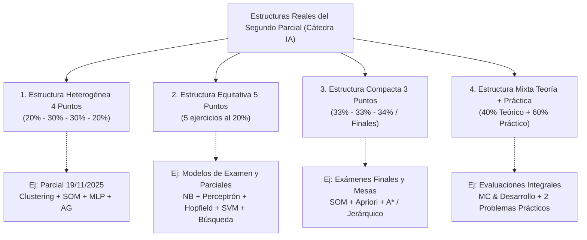
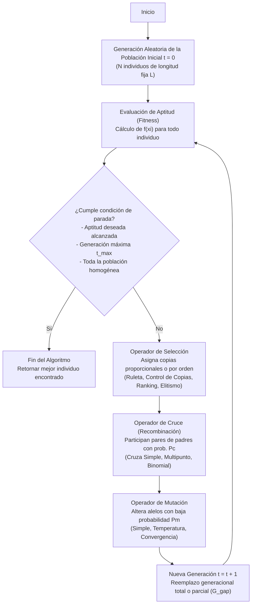
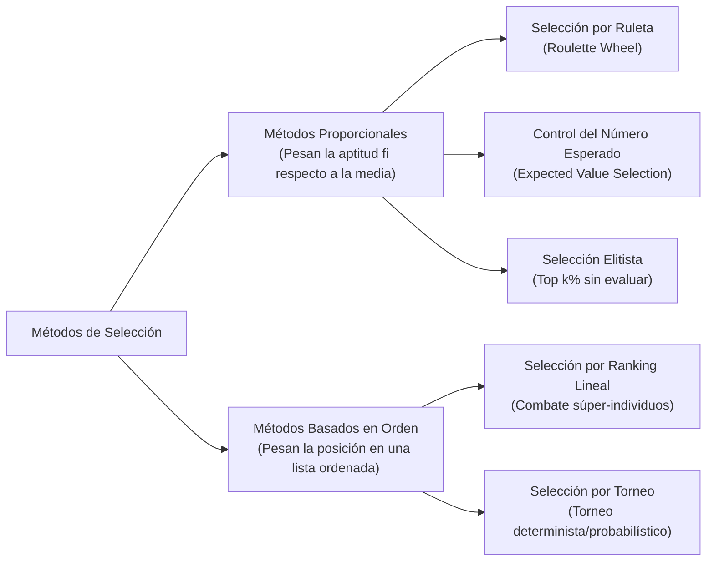
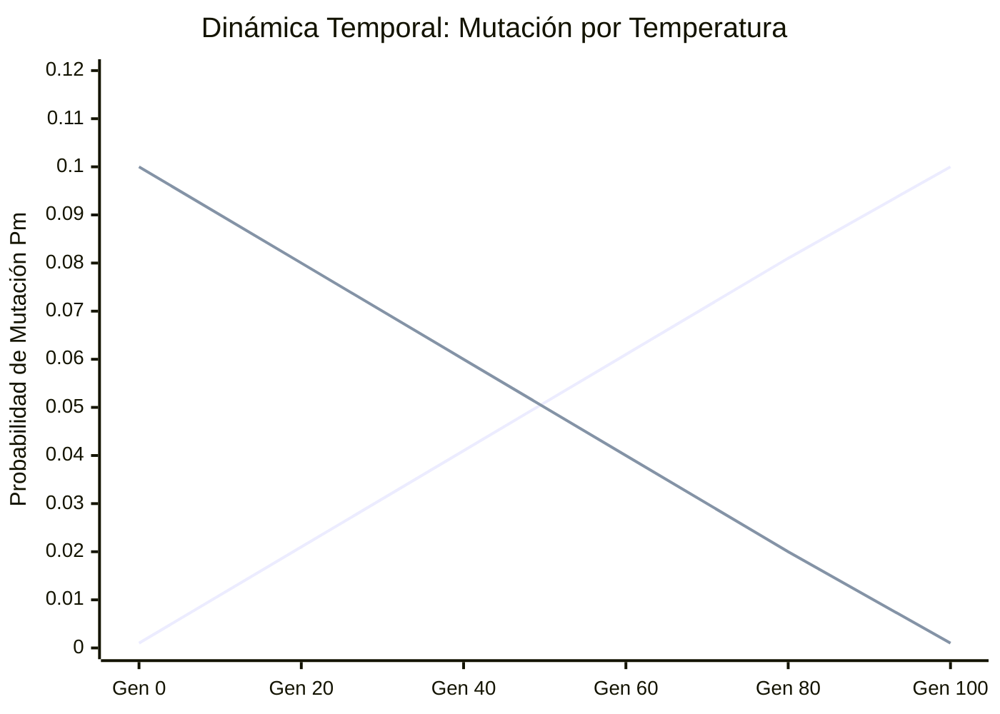
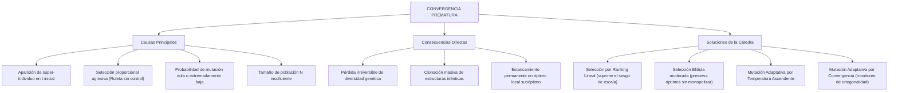

# GUÍA MAESTRA DEFINITIVA: ALGORITMOS GENÉTICOS Y ESTRUCTURA REAL DE EXÁMENES (SEGUNDO PARCIAL)
### Cátedra de Inteligencia Artificial — Universidad Tecnológica Nacional (UTN FRRe)

---

## ÍNDICE GENERAL

1. [PARTE I: Análisis Estructural y Distribución de Ponderación en el Examen](#parte-i-análisis-estructural-y-distribución-de-ponderación-en-el-examen)
   - 1.1 Distribución Real de Temas y Ponderaciones en Evaluaciones Presenciales
   - 1.2 Las 4 estructuras reales implementadas por la Cátedra
   - 1.3 Matriz de rotación de temas de examen
   - 1.4 Reglas tácticas de resolución en mesa de examen
2. [PARTE II: Fundamentos Biológicos y Computacionales de los Algoritmos Genéticos](#parte-ii-fundamentos-biológicos-y-computacionales)
   - 2.1 Mapeo sistemático: Biología natural vs. Algoritmos Genéticos artificiales
   - 2.2 Ciclo iterativo generacional y salto generacional ($G_{gap}$)
   - 2.3 Justificación formal: ¿Por qué y cuándo usar Algoritmos Genéticos?
3. [PARTE III: Operadores de Selección Paso a Paso (Formulación Matemática y Algoritmos)](#parte-iii-operadores-de-selección-paso-a-paso)
   - 3.1 Métodos proporcionales vs. Métodos basados en orden
   - 3.2 Selección por Ruleta (*Roulette Wheel Selection*)
   - 3.3 Selección con Control sobre el Número Esperado de Copias
   - 3.4 Selección por Ranking Lineal
   - 3.5 Selección Elitista
4. [PARTE IV: Operadores de Cruza (Recombinación de Material Genético)](#parte-iv-operadores-de-cruza)
   - 4.1 Cruza Simple en Gen $k$ ($G_k$)
   - 4.2 Cruza Multipunto en Múltiples Genes ($G_{k_1}, G_{k_2}, \dots, G_{k_m}$)
   - 4.3 Cruza Binomial / Uniforme y variantes de segundo hijo
5. [PARTE V: Operadores de Mutación (Exploración y Preservación de Diversidad)](#parte-v-operadores-de-mutación)
   - 5.1 Mutación Simple: Mecanismo y probabilidad constante
   - 5.2 Mutación Adaptativa por Temperatura (Ascendente vs. Descendente)
   - 5.3 Mutación Adaptativa por Convergencia
6. [PARTE VI: Fenómenos Teóricos Críticos y Preguntas Reales de Examen](#parte-vi-fenómenos-teóricos-críticos)
   - 6.1 Convergencia Prematura: Causas, consecuencias y soluciones de la Cátedra
   - 6.2 Medición Rigurosa de Diversidad Poblacional: El Índice de Ortogonalidad Bipolar
   - 6.3 Desglose Teórico: ¿Por qué no se puede reemplazar cruza y mutación por dos métodos de selección?
7. [PARTE VII: Banco de Ejercicios Prácticos Resueltos Paso a Paso](#parte-vii-banco-de-ejercicios-prácticos-resueltos)
   - 7.1 Examen Real del 19/11/2025 (Punto 4, 30% del Parcial Completo)
   - 7.2 Ejercicios y Exámenes de Cátedra: Temperatura, Homogeneidad y Ranking
   - 7.3 Ejercicios Oficiales de la Guía Práctica de la Cátedra (Guía TP-AG)
8. [PARTE VIII: Formulario Rápido y Checklist para el Examen](#parte-viii-formulario-rápido-y-checklist)

---

# PARTE I: ANÁLISIS ESTRUCTURAL Y DISTRIBUCIÓN DE PONDERACIÓN EN EL EXAMEN

### 1.1 Distribución Real de Temas y Ponderaciones en Evaluaciones Presenciales

El Segundo Parcial de Inteligencia Artificial evalúa de forma integrada los contenidos teóricos y prácticos de las Unidades 3 y 4 (Aprendizaje Automático y Redes Neuronales). Lejos de responder a una distribución predecible o a porcentajes idénticos fijos, la Cátedra adapta dinámicamente la ponderación y selección de ejercicios según el turno de examen, la mesa y la modalidad evaluativa.

Es fundamental considerar que **todos los temas del programa oficial son evaluables**:
- Perceptrón Multicapa (MLP) con Retropropagación
- Máquinas de Vectores de Soporte (SVM)
- Redes Autoorganizadas de Kohonen (SOM)
- Clustering (K-Means o Jerárquico Aglomerativo)
- **Algoritmos Genéticos (AG)** (con fuerte peso práctico y conceptual)
- Redes de Hopfield (memoria asociativa y energía de Lyapunov)
- Naïve Bayes (discretización por histogramas y continuo Gaussiano)
- K-Nearest Neighbors (KNN ponderado por distancia)

> [!IMPORTANT]
> **RELEVANCIA Y PONDERACIÓN EN EL EXAMEN MÁS RECIENTE:**  
> En el examen presencial oficial del **19 de Noviembre de 2025**, la distribución y ponderación fue:
> - **Punto 1 (20%):** Clustering Jerárquico Aglomerativo (*complete-link* y *average-link* con dendrogramas).
> - **Punto 2 (30%):** Red SOM con **función de vecindad no nula** ($h(t) = \frac{1}{1 + \text{dist}^2}$), actualización del patrón P4 y arquitectura.
> - **Punto 3 (30%):** Red MLP con cálculo analítico de errores sigmoidales y actualización de pesos.
> - **Punto 4 (20%):** **ALGORITMOS GENÉTICOS COMPLETO**, evaluando Cruza Simple (G4), Cruza Multipunto (G2, G5, G7) y Control de Copias al 50%.
>
> Como demuestra este modelo reciente, el ejercicio de Algoritmos Genéticos representó entre el **20% y el 30% de la nota final** según el tema, confirmando que dominar todos los ejes temáticos es indispensable para la regularidad y la promoción.

---

### 1.2 Las 4 estructuras reales implementadas por la Cátedra

El relevamiento exhaustivo de evaluaciones parciales, recuperatorios y exámenes finales de la Cátedra demuestra que la Cátedra utiliza **cuatro formatos estructurales dinámicos**:



#### Estructura 1: Heterogénea de 4 Puntos (20% - 30% - 30% - 20%)
- **Distribución de puntaje:** Dos ejercicios mayores de desarrollo intensivo (30% cada uno) y dos ejercicios analíticos medianos (20% cada uno).
- **Ejemplo prototípico:** Parcial del **19/11/2025**:
  - Punto 1 (20%): Clustering aglomerativo jerárquico comparando métricas de enlace.
  - Punto 2 (30%): SOM no nulo con formulación matemática de vecindad continua.
  - Punto 3 (30%): MLP con retropropagación multi-capa.
  - Punto 4 (20%/30%): Algoritmos Genéticos con múltiples operadores de cruza y control de copias.

#### Estructura 2: Equitativa de 5 Ejercicios de 20%
- **Distribución de puntaje:** 5 problemas de 20 puntos cada uno ($5 \times 20\% = 100\%$).
- **Ejemplo prototípico:** Evaluaciones de rotación amplia (relevadas en modelos manuscritos y banco fotográfico):
  - Ejercicio 1 (20%): Naïve Bayes con estimación por histogramas o densidades normales.
  - Ejercicio 2 (20%): Perceptrón simple analítico o convergencia geométrica.
  - Ejercicio 3 (20%): Redes asociativas de Hopfield (matriz de Hebb, ortogonalidad y recuperación).
  - Ejercicio 4 (20%): SVM (determinación de vectores soporte, hiperplano de margen máximo, multiplicadores de Lagrange).
  - Ejercicio 5 (20%): Algoritmos Genéticos (temperatura/ranking) o Búsqueda Heurística ($A^*$).

#### Estructura 3: Compacta de 3 Puntos (33% / 34%)
- **Distribución de puntaje:** 3 problemas extensos de 33% o 34% cada uno.
- **Ámbito usual:** Exámenes finales regulares y mesas libres / recuperatorios profundos.
- **Ejemplo prototípico:** Exámenes Finales y Mesas de Examen:
  - Ejercicio 1 (34%): Redes Neuronales (MLP con momento y análisis de error de validación).
  - Ejercicio 2 (33%): Minería / Aprendizaje no supervisado (K-Means / Clustering Jerárquico / SOM).
  - Ejercicio 3 (33%): Algoritmos Genéticos aplicados a problemas combinatorios (Criptoaritmética, TSP, Asignación de recursos) o Reglas de Asociación Apriori.

#### Estructura 4: Mixta Teoría (40%) + Práctica (60%)
- **Distribución de puntaje:**
  - Bloque Conceptual / Teórico (40%): Preguntas conceptuales de desarrollo y preguntas de opción múltiple (Multiple Choice) con justificación obligatoria.
  - Bloque Práctico-Analítico (60%): 2 ejercicios de cálculo numérico manual riguroso (30% cada uno).

---

### 1.3 Matriz de rotación de temas de examen

La Cátedra no evalúa siempre el mismo temario. Dispone de un catálogo de **8 unidades nucleares** que rotan estratégicamente entre turnos y fechas:

| Tema Nuclear | Presencia en Estructura 1 (4 Puntos) | Presencia en Estructura 2 (5 Puntos) | Presencia en Estructura 3 (3 Puntos) | Enfoque Teórico Exigido por la Cátedra | Enfoque Práctico Exigido por la Cátedra |
| :--- | :---: | :---: | :---: | :--- | :--- |
| **Algoritmos Genéticos (AG)** | **ALTA (20-30%)** | **MEDIA (20%)** | **MEDIA (33%)** | Convergencia prematura, índice de ortogonalidad, mutación adaptativa, reemplazo de operadores. | Ruleta, control de copias enteras/decimales, ranking lineal, cruza simple/multipunto/binomial. |
| **MLP (Backpropagation)** | **MUY ALTA (30%)** | **ALTA (20%)** | **MUY ALTA (34%)** | Término de momento ($\beta$), early stopping, error de entrenamiento vs. validación. | Propagación hacia adelante, cálculo de errores locales $\delta$, actualización analítica de pesos. |
| **SOM (Kohonen)** | **ALTA (30%)** | **MEDIA (20%)** | **ALTA (33%)** | Función de vecindad (nula vs. no nula), topología, autoorganización. | Cálculo de distancias a neuronas, selección de neurona ganadora ($BMU$), actualización con $h(t)$. |
| **Clustering** | **ALTA (20%)** | **MEDIA (20%)** | **ALTA (33%)** | Distancia inter-cluster, criterio de parada, aglomerativo vs. divisivo. | K-means con semillas, Single Link, Complete Link, Average Link, construcción de dendrogramas. |
| **SVM (Vectores Soporte)** | **MEDIA (20%)** | **MUY ALTA (20%)** | **MEDIA (33%)** | Márgenes rígidos vs. blandos, significado de $d^+$ y $d^-$, multiplicadores de Lagrange. | Cálculo manual de $\mathbf{w}$ y $b$, identificación de vectores de soporte, clasificación de nuevas instancias. |
| **Hopfield** | **MEDIA (Teoría)** | **ALTA (20%)** | **MEDIA (33%)** | Memoria asociativa, condición de ortogonalidad, recuperabilidad buena vs. perfecta. | Matriz de Hebb $W = \sum (P^k)(P^k)^T - M\cdot I$, actualización síncrona/asíncrona, estabilidad. |
| **Naïve Bayes** | **BAJA (Teoría)** | **ALTA (20%)** | **BAJA** | Suposición de independencia condicional, problema de probabilidades nulas. | Clasificación con distribución Normal ($\mu, \sigma$), conteo por histogramas o tablas de frecuencia. |
| **K-NN / Lazy Learning** | **BAJA (Teoría)** | **MEDIA (20%)** | **BAJA** | Maldición de la dimensionalidad, selección de hiperparámetro $k$. | K-NN simple, K-NN ponderado por inversa de la distancia ($1/d^2$), normalización mín-máx. |

---

### 1.4 Reglas tácticas de resolución en mesa de examen

1. **Reconocimiento del formato en el minuto 1:** Identificar de inmediato cuál de las 4 estructuras se tiene en mano para asignar los tiempos de resolución:
   - Si es Estructura Heterogénea (30% MLP, 30% SOM, 20% Clustering, 20% AG): Dedicar como máximo 25 minutos a cada punto del 30% y 15 minutos a cada punto del 20%.
2. **Algoritmos Genéticos es un generador de puntaje rápido:** A diferencia de un ejercicio de MLP (que exige decenas de multiplicaciones con decimales) o un SOM no nulo, los ejercicios de AG son **estructurados, aritméticamente limpios y directos** si se conocen las fórmulas de Ruleta, Ranking y las reglas de Cruza. Un punto del 20% o 30% de AG se puede resolver en forma perfecta en **12 a 15 minutos**.
3. **Impecabilidad en la notación:** La Cátedra califica rigurosamente el procedimiento:
   - En Ruleta: mostrar tabla con $f_i$, proporción normalizada $P_i$, ranuras asignadas y los rangos $[00-xx]$.
   - En Control de Copias: tabular $c_i = f_i / \bar{f}$, parte entera $\lfloor c_i \rfloor$, parte decimal, y el ordenamiento de desempate.
   - En Cruza: dibujar claramente el locus de corte y la partición cromosómica bit a bit.

---

# PARTE II: FUNDAMENTOS BIOLÓGICOS Y COMPUTACIONALES DE LOS ALGORITMOS GENÉTICOS

### 2.1 Mapeo sistemático: Biología natural vs. Algoritmos Genéticos artificiales

Los Algoritmos Genéticos (desarrollados conceptualmente por John Holland y extendidos por David Goldberg) simulan los mecanismos de la selección natural y la evolución biológica sobre poblaciones artificiales de estructuras de datos.

La Cátedra define un mapeo estricto entre el vocabulario genético biológico y los componentes de ingeniería de software e inteligencia artificial:

| Concepto Biológico Natural | Equivalente en Genética Artificial (Cátedra IA) | Definición Técnica Formal |
| :--- | :--- | :--- |
| **Cromosoma** | **Estructura / Individuo** | Vector o cadena que codifica una solución tentativa al problema (en la Cátedra, casi universalmente cadenas binarias $\{0, 1\}^L$). |
| **Gen** | **Característica / Atributo / Posición** | Subunidad elemental del cromosoma que codifica una propiedad o variable del espacio de soluciones. |
| **Alelo** | **Valor del Gen** | El valor concreto que adopta una característica en un locus específico (ej. `0` o `1` en codificación binaria). |
| **Locus** (plural: *loci*) | **Índice / Posición de la Característica** | La ubicación física secuencial dentro del cromosoma (del gen $1$ al gen $L$). |
| **Genotipo** | **Estructura Interna / Codificación** | La secuencia particular de alelos que componen el cromosoma del individuo. |
| **Fenotipo** | **Manifestación Física / Aptitud ($fitness$)** | El comportamiento y valor de evaluación de la estructura al interactuar con el entorno del problema. Representa la medida numérica de calidad de la solución candidata ($f_i$). |
| **Población** | **Conjunto de Soluciones en el Tiempo $t$** | Matriz o conjunto de $N$ estructuras que coexisten simultáneamente en una generación dada. |

---

### 2.2 Ciclo iterativo generacional y salto generacional ($G_{gap}$)

El algoritmo evolutivo sigue un flujo de control riguroso definido por la Cátedra:



#### Salto Generacional (*Generation Gap* - $G_{gap}$):
La Cátedra define formalmente el **salto generacional** como la proporción de la población que es reemplazada en cada ciclo de la evolución:
$$G_{gap} = \frac{N_{hijos}}{N_{poblacion}}$$
- **Salto Generacional Total ($G_{gap} = 1.0$):** Toda la población vieja es sustituida íntegramente por los descendientes generados por cruza y mutación.
- **Salto Generacional Parcial ($0 < G_{gap} < 1.0$):** Solo una fracción de la población es reemplazada en cada ciclo (conviviendo padres e hijos en la misma generación), técnica utilizada comúnmente en esquemas elitistas o de estado estacionario (*steady-state*).

---

### 2.3 Justificación formal: ¿Por qué y cuándo usar Algoritmos Genéticos?

De acuerdo al criterio teórico de la Cátedra, los Algoritmos Genéticos presentan ventajas excepcionales frente a los métodos clásicos de optimización matemática (gradiente descendente, programación lineal, métodos de Newton):

1. **Ausencia de requisitos de derivabilidad:** No requieren conocer la derivada analítica de la función objetivo ni que esta sea continua. Solo necesitan una función de caja negra capaz de evaluar un individuo y retornar un escalar de aptitud.
2. **Robustez ante alta dimensionalidad y no linealidad:** Son inmunes al atrapamiento sistemático en óptimos locales que sufren los algoritmos miopes de escalada de colinas (*hill-climbing*).
3. **Búsqueda simultánea poblacional (Paralelismo Implícito):** Al manipular una población de $N$ estructuras, exploran simultáneamente múltiples regiones del espacio de búsqueda muestreando esquemas (*schemata* de Holland) de manera combinatoria.
4. **Campos de Aplicación Canónicos en la Cátedra:**
   - **Problemas de Optimización Combinatoria y Numérica:** Problema de la mochila (*Knapsack Problem*), Problema del viajante de comercio (*TSP*), Criptoaritmética, dimensionamiento de componentes.
   - **Simulación de Ambientes Adaptativos:** Maximización de beneficios acumulados a lo largo del tiempo y evolución de estrategias dinámicas en agentes autónomos.

---

# PARTE III: OPERADORES DE SELECCIÓN PASO A PASO
## (FORMULACIÓN MATEMÁTICA Y ALGORITMOS)

El operador de selección modela el principio darwiniano de supervivencia del más apto. Su función es filtrar la población, premiando a los individuos de mejor aptitud con una mayor expectativa de reproducción.

### 3.1 Métodos proporcionales vs. Métodos basados en orden

La Cátedra clasifica los métodos de selección en dos grandes familias antagónicas:



- **Métodos Proporcionales:** La probabilidad de que un individuo reciba copias depende de la magnitud numérica absoluta de su aptitud $f_i$ comparada con la sumatoria o promedio de la población.
  - *Riesgo nuclear:* **Convergencia prematura**. Si aparece un individuo con aptitud desproporcionadamente alta en generaciones tempranas ("súper-individuo"), absorberá todas las ranuras o copias, clonándose en toda la población y extinguiendo la diversidad genética antes de que el algoritmo explore el espacio de soluciones.
- **Métodos Basados en Orden:** Desacoplan la asignación de copias del valor escalar de la aptitud. Solo consideran la posición relativa del individuo en una tabla ordenada de mayor a menor fitness. Protegen activamente al algoritmo de los súper-individuos.

---

### 3.2 Selección por Ruleta (*Roulette Wheel Selection*)

#### Definición y Procedimiento de la Cátedra
Consiste en concebir una ruleta de 100 ranuras (porcentajes de $[00, 99]$ o $[0, 100)$). A cada individuo $I_i$ se le asigna un número de ranuras directamente proporcional a su aptitud normalizada:

$$P_i = \frac{f_i}{\sum_{k=1}^N f_k}$$

$$\text{Ranuras}_i = \text{round}\left( P_i \cdot 100 \right) = \text{round}\left( \frac{f_i}{\sum f_k} \cdot 100 \right)$$

#### Algoritmo de Construcción de Intervalos de Ruleta:
1. Calcular la sumatoria de aptitudes: $S = \sum_{k=1}^N f_k$.
2. Para cada individuo $i = 1, \dots, N$: calcular la probabilidad $P_i = f_i / S$ y el porcentaje de ranuras entero.
3. Ajustar el redondeo para asegurar que $\sum \text{Ranuras}_i = 100$.
4. Construir los rangos cerrados $[R_{desde}, R_{hasta}]$ acumulando ranuras en el intervalo $[00, 99]$:
   - Primer individuo: $[00, \text{Ranuras}_1 - 1]$.
   - Individuo siguiente: $[\text{Anterior}\_{hasta} + 1, \; \text{Anterior}\_{hasta} + \text{Ranuras}\_i]$.
5. Muestreo estocástico: Para seleccionar $M$ individuos, se extraen $M$ números pseudo-aleatorios uniformes $r \in [00, 99]$. El individuo cuyo intervalo contenga a $r$ es seleccionado e ingresa a la población intermedia.

```
+---------------+---------------+--------------------+---------------+
|  I1 [00-11]   |  I2 [12-16]   |     I3 [17-27]     |   ... I10     |
+---------------+---------------+--------------------+---------------+
0              12              17                   28              99
```

> [!NOTE]
> **Limitación Teórica:** Como todo proceso de Monte Carlo, la selección por ruleta sufre de una **alta varianza estocástica**: el número real de copias asignadas a un individuo puede diferir sustancialmente de su número teórico esperado ($N \cdot P_i$), pudiendo descartar por puro azar individuos de aptitud excelente.

---

### 3.3 Selección con Control sobre el Número Esperado de Copias

Para subsanar la alta varianza de la ruleta simple, la Cátedra enseña formalmente la **Selección con Control sobre el Número Esperado** (*Baker's Stochastic Remainder Selection*).

#### Formulación Matemática Oficial:
Se define la aptitud media de la población:
$$\bar{f} = \frac{\sum_{k=1}^N f_k}{N}$$

El número esperado de copias $c_i$ que merece el individuo $i$ es:
$$c_i = \frac{f_i}{\bar{f}} = N \cdot \left(\frac{f_i}{\sum_{k=1}^N f_k}\right)$$

Nótese que matemáticamente:
$$\sum_{i=1}^N c_i = N$$

Cada individuo descompone su valor esperado $c_i$ en dos términos:
$$c_i = \lfloor c_i \rfloor + (c_i - \lfloor c_i \rfloor)$$
- **Parte Entera $\lfloor c_i \rfloor$:** Copias enteras asignadas de forma determinista y directa.
- **Parte Decimal / Fraccionaria $(c_i - \lfloor c_i \rfloor)$:** Resto fraccionario que compite por los cupos restantes hasta completar el cupo deseado.

#### Procedimiento de Asignación de Cupos Restantes (Cátedra IA):
El número total de copias fijas asignadas por parte entera es:
$$N_{fijas} = \sum_{i=1}^N \lfloor c_i \rfloor$$

Los cupos vacantes por asignar son:
$$\Delta N = M_{objetivo} - N_{fijas}$$
(donde $M\_{objetivo} = N$ si se completa la población, o $M\_{objetivo} = \alpha \cdot N$ si se selecciona un porcentaje, como el 50%).

Existen dos criterios exactos de resolución según el enunciado del examen:

##### Criterio A: Determinista por Mayor Parte Decimal (Examen 19/11/2025 y Guía 7-a)
1. Se calcula el resto decimal $d_i = c_i - \lfloor c_i \rfloor$ para cada individuo.
2. Se ordenan los individuos de mayor a menor según su residuo $d_i$.
3. Se asigna una copia adicional sucesiva a los individuos con mayor residuo hasta agotar los $\Delta N$ cupos.

##### Criterio B: Estocástico por Ruleta sobre Partes Fraccionarias (Guía TP-AG Ejercicio 01-e)
1. Se toman los residuos decimales $d_i = c_i - \lfloor c_i \rfloor$.
2. Se normalizan sobre la sumatoria de decimales:
   $$P_i^{dec} = \frac{d_i}{\sum_{k=1}^N d_k}$$
3. Se arma una nueva ruleta de 100 ranuras con $P_i^{dec}$.
4. Con los números aleatorios provistos por el examen, se sortean los $\Delta N$ cupos restantes.

---

### 3.4 Selección por Ranking Lineal

#### Justificación Teórica contra la Convergencia Prematura
En poblaciones con individuos de aptitud extrema ("súper-individuos"), tanto la Ruleta como el Control de Copias asignan una cantidad desmesurada de copias al líder, colapsando el espacio de búsqueda.  
La Cátedra implementa la **Selección por Ranking**, donde la aptitud física de la función objetivo se utiliza **exclusivamente para ordenar a la población en una tabla de posiciones descendente**.

#### Fórmula Oficial de la Cátedra (Slide 19 y Hoja de Fórmulas):
Dada una población de $n$ individuos, ordenados de forma decreciente según aptitud tal que:
- Posición $i = 1$: El mejor individuo de la población.
- Posición $i = n$: El peor individuo de la población.

La cantidad esperada de copias $c_i$ asignada al individuo en la posición $i$ viene dada por la ecuación lineal:

$$c_i = R_{min} + 2 \cdot \frac{(n - i) \cdot (1 - R_{min})}{n - 1}$$

Donde:
- $n$: Tamaño total de la población de la cual se calcula el ranking.
- $i$: Posición ordinal en la tabla ordenada ($i \in \{1, 2, \dots, n\}$).
- $R_{min} \in [0, 1]$: Parámetro de diseño que fija el número esperado de copias asignadas al peor individuo.

#### Demostración de Propiedades Matemáticas Fundamentales:
1. **Asignación al peor individuo ($i = n$):**
   $$c_n = R_{min} + 2 \cdot \frac{(n - n) \cdot (1 - R_{min})}{n - 1} = R_{min} + 0 = R_{min}$$
2. **Asignación al mejor individuo ($i = 1$):**
   $$c_1 = R_{min} + 2 \cdot \frac{(n - 1) \cdot (1 - R_{min})}{n - 1} = R_{min} + 2(1 - R_{min}) = 2 - R_{min}$$
3. **Conservación de la población ($\sum_{i=1}^n c_i = n$):**
   La sumatoria de una progresión aritmética es:
   $$\sum_{i=1}^n c_i = n \cdot \left( \frac{c_1 + c_n}{2} \right) = n \cdot \left( \frac{(2 - R_{min}) + R_{min}}{2} \right) = n \cdot \left(\frac{2}{2}\right) = n$$
   *Demostrado: La suma de copias esperadas es idénticamente igual al tamaño de la población.*

#### Impacto del parámetro $R_{min}$:
- Si $R_{min} = 1.0$: $c_i = 1 + 2 \frac{(n-i)(0)}{n-1} = 1.0$ para todo $i$. Presión selectiva nula (muestreo uniforme, todos reciben 1 copia).
- Si $R_{min} = 0.0$: $c_1 = 2.0$ y $c_n = 0.0$. Máxima presión selectiva lineal permitida sin generar copias negativas.
- Valor típico de examen: $R_{min} = 0.3$ $\implies c_1 = 1.70$ y $c_n = 0.30$.

---

### 3.5 Selección Elitista

#### Principio y Mecanismo:
El operador de selección elitista **blinda y preserva intactos a los mejores individuos de la generación actual**:
1. Se define una tasa de elitismo $k\%$ (por ejemplo, el $30\%$ o $10\%$ de la población).
2. Se ordenan los individuos por aptitud.
3. Los $\lceil k\% \cdot N \rceil$ mejores individuos son copiados de forma **directa, sin alteraciones, sin participar de la cruza ni de la mutación**, en la siguiente generación $t+1$.
4. El resto de la nueva población se completa mediante otros operadores (cruza y mutación sobre individuos seleccionados por ruleta o ranking).

#### Propiedad Matemática Crítica:
Garantiza formalmente la **monotonía no decreciente de la mejor aptitud histórica**:
$$\max_{i} f_i(t+1) \ge \max_{i} f_i(t)$$
Evita que el material genético sobresaliente sea destruido por operaciones estocásticas desfavorables de cruza o mutación.

---

# PARTE IV: OPERADORES DE CRUZA (RECOMBINACIÓN GENÉTICA)

El operador de cruce toma pares de cromosomas progenitores (madre y padre) y recombina segmentos de su estructura para producir nuevos individuos (hijos) que exploran combinaciones de bloques constructores (*building blocks*).

### 4.1 Cruza Simple en Gen $k$ ($G_k$)

#### Definición Formal de la Cátedra:
Dado un cromosoma binario de longitud $L$, se selecciona un punto de corte único en la posición del gen $k$ ($1 \le k < L$).
- El punto de corte divide a los cromosomas inmediatamente después del gen $k$.
- **Hijo 1:** Hereda los genes de las posiciones $1 \dots k$ del Padre 1 y las posiciones $(k+1) \dots L$ del Padre 2.
- **Hijo 2:** Hereda los genes de las posiciones $1 \dots k$ del Padre 2 y las posiciones $(k+1) \dots L$ del Padre 1.

```
Padre 1:  [ g1  g2  ... gk | g(k+1) ... gL ]
Padre 2:  [ p1  p2  ... pk | p(k+1) ... pL ]
--------------------------------------------
Hijo 1:   [ g1  g2  ... gk | p(k+1) ... pL ]
Hijo 2:   [ p1  p2  ... pk | g(k+1) ... gL ]
```

> [!IMPORTANT]
> **Variante Frecuente en Exámenes:**  
> Cuando el enunciado solicita generar un único hijo por cruce simple y *"obtener el segundo hijo por complemento binario del primero"*, el Hijo 2 no se obtiene invirtiendo los segmentos de los padres, sino **negando bit a bit los alelos del Hijo 1** ($0 \to 1$ y $1 \to 0$).

---

### 4.2 Cruza Multipunto en Múltiples Genes ($G_{k_1}, G_{k_2}, \dots, G_{k_m}$)

#### Concepción de Anillo y Paridad según la Cátedra:
En la cruza multipunto se eligen $m$ puntos de corte dentro de la estructura ($k_1 < k_2 < \dots < k_m$).
La Cátedra modela el cromosoma como un **anillo cerrado**:
- Si la cantidad de puntos de cruce es **par**: Los puntos de corte definen segmentos alternados que se intercambian entre los progenitores.
- Si la cantidad de puntos de cruce es **impar**: Se asume formalmente un **punto de cruce ficticio adicional en la posición cero (posición 0)** para equilibrar los intercambios cíclicos.

#### Esquema Canónico de Examen (Corte en 3 puntos: $G_2, G_5, G_7$ para $L = 8$):
Los 3 puntos de corte dividen la cadena en 4 segmentos:
- Segmento 1: Genes $1 \dots 2$ (Locus 1 y 2).
- Segmento 2: Genes $3 \dots 5$ (Loci 3, 4 y 5).
- Segmento 3: Genes $6 \dots 7$ (Loci 6 y 7).
- Segmento 4: Gen $8$ (Locus 8).

```
Padre 1:  [ 1 2 | 3 4 5 | 6 7 | 8 ]
Padre 2:  [ a b | c d e | f g | h ]
-----------------------------------
Hijo 1:   [ 1 2 | c d e | 6 7 | h ]  <-- (P1 - P2 - P1 - P2)
Hijo 2:   [ a b | 3 4 5 | f g | 8 ]  <-- (P2 - P1 - P2 - P1)
```

---

### 4.3 Cruza Binomial / Uniforme y variantes de segundo hijo

#### Cruza Binomial Asimétrica:
A diferencia de los cortes lineales, la cruza binomial toma decisiones independientes para cada locus de la estructura:
- Se define una probabilidad $P_0$ de heredar el alelo del Padre y una probabilidad $(1 - P_0)$ de heredarlo de la Madre.
- Para cada gen $k \in \{1, \dots, L\}$, se extrae un número aleatorio uniforme $r_k \in [00, 99]$:
  - Si $r_k < P_0 \cdot 100$: El gen se toma del **Padre**.
  - Si $r_k \ge P_0 \cdot 100$: El gen se toma de la **Madre**.

#### Cruza Uniforme ($P_0 = 0.5$):
Caso particular donde ambos progenitores tienen exactamente la misma probabilidad ($50\%$) de transferir su alelo en cada locus.

#### Métodos de Obtención del Segundo Hijo en Cruza Binomial (Guía TP-AG Ejercicio 02-c):
1. **Por Genes No Seleccionados:** En cada posición $k$, el Hijo 2 recibe el alelo del padre que **no** fue elegido para el Hijo 1 (herencia complementaria de fuentes progenitoras).
2. **Por Complemento Binario Directo:** El Hijo 2 es la inversión lógica negada bit a bit del Hijo 1 ($\text{NOT}(\text{Hijo 1})$ ).

---

# PARTE V: OPERADORES DE MUTACIÓN
## (EXPLORACIÓN Y PRESERVACIÓN DE DIVERSIDAD)

La mutación es el operador encargado de mantener la diversidad genética de la población y garantizar la ergodicidad del algoritmo, permitiendo acceder a cualquier punto del espacio de búsqueda hiperdimensional.

### 5.1 Mutación Simple: Mecanismo y probabilidad constante

- **Probabilidad por gen ($P_m$):** Es un valor escalar constante muy bajo (habitualmente $P_m \in [0.001, 0.05]$).
- **Regla Fundamental de la Cátedra (Doble Distinción):**
  > [!IMPORTANT]
  > La Cátedra distingue explícitamente entre:
  > 1. La probabilidad de seleccionar un individuo para el proceso de mutación.
  > 2. La aplicación de la mutación: **Si un individuo es seleccionado para mutar, muta sí o sí en al menos una de sus características**.
  > Si un individuo de longitud $L$ entra en mutación simple, se escoge aleatoriamente un locus $k \in \{1, \dots, L\}$ y su alelo se conmuta ($0 \to 1$ o $1 \to 0$).

---

### 5.2 Mutación Adaptativa por Temperatura (Ascendente vs. Descendente)

La mutación adaptativa por temperatura ajusta la probabilidad de mutación en función del **tiempo o número de generaciones transcurridas ($t$)**, desacoplándose por completo de las características genéticas de la población.

#### Ecuación General de Actualización:
$$P_m(t+1) = P_m(t) \pm \lambda$$

Sujeta a una cota estricta de saturación paramétrica:
$$P_{min} \le P_m(t) \le P_{max}$$

Donde $\lambda > 0$ es la tasa de cambio constante por generación.



#### Variante A: Temperatura Ascendente ($P_m(t+1) = P_m(t) + \lambda$)
- **Comportamiento:** Comienza en un valor mínimo $P_m(0) = P_{min}$ y se incrementa linealmente en cada generación hasta alcanzar la cota superior $P_{max}$, donde se estabiliza.
- **Justificación Teórica Oficial:** En las primeras generaciones, la población inicial (creada aleatoriamente) es altamente heterogénea y diversa, por lo que no se requiere alta mutación. A medida que transcurren las generaciones, la selección natural provoca que los individuos tiendan a parecerse entre sí (homogeneización). Al aumentar $P_m$ con el tiempo, se inyecta diversidad forzada para **romper el riesgo inminente de convergencia prematura**.
- **Cota máxima $P_{max}$:** Es obligatoria; si $P_m$ creciera indefinidamente hacia 1.0, el algoritmo degeneraría en un paseo aleatorio (*random walk*), destruyendo las soluciones óptimas halladas.

#### Variante B: Temperatura Descendente ($P_m(t+1) = P_m(t) - \lambda$)
- **Comportamiento:** Comienza en un valor alto $P_m(0) = P_{max}$ y disminuye progresivamente hasta alcanzar una cota inferior $P_{min} > 0$.
- **Justificación Teórica Oficial (*Simulated Annealing*):** Prioriza una **fase de exploración global extensiva** al comienzo de la búsqueda (evitando estancamientos en valles subóptimos locales), y conmuta progresivamente hacia una **fase de explotación local fina** a medida que el algoritmo converge hacia la cuenca de atracción del óptimo global.
- **Cota mínima $P_{min}$:** Debe ser estrictamente mayor a cero ($P_{min} > 0$); de lo contrario, si la mutación se anula, los alelos eliminados de la población nunca podrían recuperarse.

> [!WARNING]
> **PREGUNTA CLAVE DE EXAMEN (Finales y Parciales de Cátedra):**  
> *¿El método de mutación por temperatura descendente tiene en cuenta la homogeneidad de la población para establecer la probabilidad de mutar?*  
> **RESPUESTA ROTUNDA:** **NO.**  
> **JUSTIFICACIÓN OFICIAL:** La mutación por temperatura es un esquema **temporal/paramétrico exógeno**: $P_m$ es exclusivamente función del contador de generaciones transcurridas ($t$) y de $\lambda$. No calcula la varianza fenotípica, ni la distancia genética, ni la homogeneidad de los cromosomas. Quien sí mide la homogeneidad es la **Mutación Adaptativa por Convergencia**.

---

### 5.3 Mutación Adaptativa por Convergencia

A diferencia de la temperatura, la Mutación Adaptativa por Convergencia es un esquema **endógeno** que monitorea en tiempo real el estado de diversidad interna de la población.

- **Lógica de Retroalimentación:**
  - Si la población se vuelve **demasiado homogénea** (los individuos son casi idénticos, alta similitud genética): el algoritmo eleva la probabilidad de mutación $P_m$ para inducir variabilidad y evitar el colapso poblacional.
  - Si la población es **ampliamente heterogénea** (mucha dispersión y diversidad): el algoritmo reduce $P_m$ para permitir que la cruza recombine eficazmente los buenos esquemas sin perturbaciones destructivas.

---

# PARTE VI: FENÓMENOS TEÓRICOS CRÍTICOS Y PREGUNTAS REALES DE EXAMEN

### 6.1 Convergencia Prematura: Causas, consecuencias y soluciones de la Cátedra

La **convergencia prematura** es la patología más severa que amenaza a un Algoritmo Genético.



---

### 6.2 Medición Rigurosa de Diversidad Poblacional: El Índice de Ortogonalidad Bipolar

En la Guía de Trabajos Prácticos (Ejercicio 03-d), la Cátedra solicita:  
*"Proponga una función para medir el grado de homogeneidad de una población... que pueda ser implementada en el método de mutación adaptativa por convergencia"*.

La intuición ingenua de muchos alumnos consiste en contar el número de individuos idénticos dividido el tamaño de la población ($\frac{N_{repetidos}}{N}$). Sin embargo, **la Cátedra rechaza esta formulación simplista** porque dos individuos pueden no ser idénticos pero diferir únicamente en un solo bit en una cadena de 100 bits (lo que representa una homogeneidad genética del 99% que el conteo ingenuo clasificaría erróneamente como diversidad).

La formulación analítica de rigor académico adoptada en el criterio de la Cátedra se basa en la **Transformación Bipolar y el Producto Interno de Ortogonalidad**:

#### 1. Mapeo al Espacio Bipolar
Dado un cromosoma binario $\mathbf{x}^{(i)} \in \{0, 1\}^L$, se transforma cada alelo binario $x_k^{(i)}$ a un alelo bipolar $s_k^{(i)} \in \{-1, +1\}$ mediante la biyección:

$$s_k^{(i)} = 2 x_k^{(i)} - 1 \quad \Longleftrightarrow \quad s_k^{(i)} = \begin{cases} +1 & \text{si } x_k^{(i)} = 1 \\ -1 & \text{si } x_k^{(i)} = 0 \end{cases}$$

#### 2. Coeficiente de Ortogonalidad / Solapamiento entre Dos Individuos
El producto interno normalizado entre dos individuos bipolares $\mathbf{s}^{(i)}$ y $\mathbf{s}^{(j)}$ evalúa su grado de correlación espacial:

$$\rho_{ij} = \frac{1}{L} \langle \mathbf{s}^{(i)}, \mathbf{s}^{(j)} \rangle = \frac{1}{L} \sum_{k=1}^L s_k^{(i)} s_k^{(j)}$$

Propiedades del coeficiente $\rho_{ij}$:
- $\rho_{ij} = +1$: **Individuos idénticos** (todos los alelos coinciden, máxima homogeneidad).
- $\rho_{ij} = -1$: **Individuos complementarios** (todos los alelos opuestos).
- $\rho_{ij} = 0$: **Individuos ORTOGONALES**. Exactamente el $50\%$ de los bits coinciden y el $50\%$ difieren. Representa la **máxima independencia estadística y diversidad informativa** entre ambos individuos.

#### 3. Índice de Homogeneidad Poblacional Global ($H$)
Se calcula la similitud media par a par entre los $\binom{N}{2}$ pares no redundantes de la población:

$$H = \frac{2}{N(N-1)} \sum_{i=1}^{N-1} \sum_{j=i+1}^N \left( \frac{1 + \rho_{ij}}{2} \right)$$

Nótese que $\frac{1 + \rho_{ij}}{2} \in [0, 1]$ normaliza la correlación:
- Si todos los individuos son clones: $\rho_{ij} = 1 \implies H = 1.0$ (Homogeneidad Absoluta, Diversidad 0).
- Si los individuos son ortogonales en promedio: $\rho_{ij} \approx 0 \implies H \approx 0.5$.

#### 4. Función de Acoplamiento a la Mutación Adaptativa por Convergencia:
Con el índice $H \in [0, 1]$ calculado en cada generación, la probabilidad de mutación se ajusta dinámicamente mediante:

$$P_m(H) = P_{min} + (P_{max} - P_{min}) \cdot H$$

O mediante una regla de control por umbral crítico $H_{crit}$ (e.g., $0.80$):


$$
P_m(t+1) = \begin{cases}
\min(P_{max}, P_m(t) + \lambda) & \text{si } H > H_{crit} \quad \text{(alerta de homogeneidad, forzar mutación)} \\
\max(P_{min}, P_m(t) - \lambda) & \text{si } H \le H_{crit} \quad \text{(diversidad saludable, reducir mutación)}
\end{cases}
$$


---

### 6.3 Desglose Teórico: ¿Por qué no se puede reemplazar cruza y mutación por dos métodos de selección?

Esta es una de las preguntas de examen más profundas y reiteradas de la Cátedra (Pregunta 28 del Banco Oficial de Parciales):

> [!IMPORTANT]
> **PREGUNTA REAL DE EXAMEN:**  
> *Si se tiene una solución de AG que utiliza selección elitista 15%, cruza 70% y mutación 15% y no se llega a la solución esperada. ¿Es una buena alternativa cambiar los métodos de cruza y mutación por selección basada en orden? Justifique.*

#### Respuesta y Justificación Técnica Rigurosa:

**NO, bajo ningún punto de vista es una alternativa válida.** Reemplazar cruza y mutación por métodos de selección destruiría por completo la naturaleza evolutiva del algoritmo genético, transformándolo en un proceso estéril de replicación finita.

##### Justificación en 3 Fundamentos Teóricos:

1. **La Selección es un Operador de Filtrado y Muestreo (NO Generativo):**
   - El operador de selección (sea proporcional o basado en orden como el Ranking) tiene como única función decidir *cuántas copias recibe cada individuo ya existente*.
   - La selección **no puede generar nuevos puntos en el espacio de búsqueda**. Solo replica o descarta individuos que ya forman parte de la población actual.
   - Si se eliminan la cruza y la mutación y se aplican dos esquemas de selección superpuestos, la población se reducirá a copias idénticas del mejor individuo de la generación inicial en un puñado de pasos, provocando el congelamiento inmediato del sistema.

2. **La Cruza es el Motor de Recombinación de Bloques Constructores (*Crossover*):**
   - La cruza permite el **intercambio de hiperplanos o esquemas complementarios**. Si el Individuo A posee una buena codificación en los primeros genes y el Individuo B posee una buena codificación en los últimos genes, la cruza permite combinarlos en un descendiente superior que integra lo mejor de ambos progenitores.
   - La selección por orden es incapaz de ensamblar bloques constructores que residen en cromosomas separados.

3. **La Mutación es el Operador de Ergodicidad y Búsqueda Global:**
   - La mutación introduce alelos novedosos o recupera alelos críticos que hayan sido descartados por la selección en generaciones tempranas.
   - Sin mutación, si un alelo óptimo (por ejemplo, un `1` en el locus 5) no está presente en ninguno de los individuos de la población inicial, **ninguna combinación de selección podrá jamás hacer aparecer ese alelo**. El algoritmo queda matemáticamente incapacitado para alcanzar el óptimo global.

##### Conclusión que la Cátedra exige redactar:
Para mejorar el desempeño del algoritmo, lo correcto no es eliminar los operadores de variación genética, sino:
1. Reajustar la tasa de los operadores (ej. evaluar selección por ranking para amortiguar la presión selectiva).
2. Probar variantes de recombinación más exploratorias (cruza multipunto o binomial).
3. Implementar esquemas adaptativos de mutación (por temperatura o convergencia).

---

# PARTE VII: BANCO DE EJERCICIOS PRÁCTICOS RESUELTOS PASO A PASO

---

### 7.1 Examen Real del 19/11/2025 (Punto 4, 30% del Parcial Completo)

#### Enunciado Original:
> **Segundo Parcial de Inteligencia Artificial — 19 de Noviembre de 2025**  
> Para los siguientes 8 individuos:  
> a) Cruza simple ($G_4$) para los individuos ($I_{01}-I_{02}$) e ($I_{03}-I_{04}$).  
> b) Cruza multipunto en $G_2, G_5, G_7$ para ($I_{05}-I_{07}$) e ($I_{06}-I_{08}$).  
> c) Control de copias 50% (de ser necesario utilice la parte decimal).  
>
> | Individuo | Estructura | Aptitud ($f_i$) |
> | :---: | :---: | :---: |
> | 1 | `00110011` | 18 |
> | 2 | `01100101` | 14 |
> | 3 | `00001001` | 21 |
> | 4 | `00011110` | 22 |
> | 5 | `10100100` | 16 |
> | 6 | `01111010` | 44 |
> | 7 | `11000101` | 41 |
> | 8 | `01101110` | 12 |

---

#### Resolución Paso a Paso:

#### Item a) Cruza Simple en $G_4$ (Locus 4)

El punto de cruce $G_4$ divide al cromosoma binario de 8 bits tras la cuarta posición (primeros 4 bits del progenitor 1, últimos 4 bits del progenitor 2).

##### Cruce 1: Entre $I_{01}$ e $I_{02}$
- Progenitores:
  - $I_{01}$: `0 0 1 1` | `0 0 1 1`
  - $I_{02}$: `0 1 1 0` | `0 1 0 1`
- Recombinación:
  - **Hijo 1:** `0 0 1 1` (de $I_{01}$) + `0 1 0 1` (de $I_{02}$) $\implies$ **`00110101`**
  - **Hijo 2:** `0 1 1 0` (de $I_{02}$) + `0 0 1 1` (de $I_{01}$) $\implies$ **`01100011`**

##### Cruce 2: Entre $I_{03}$ e $I_{04}$
- Progenitores:
  - $I_{03}$: `0 0 0 0` | `1 0 0 1`
  - $I_{04}$: `0 0 0 1` | `1 1 1 0`
- Recombinación:
  - **Hijo 3:** `0 0 0 0` (de $I_{03}$) + `1 1 1 0` (de $I_{04}$) $\implies$ **`00001110`**
  - **Hijo 4:** `0 0 0 1` (de $I_{04}$) + `1 0 0 1` (de $I_{03}$) $\implies$ **`00011001`**

---

#### Item b) Cruza Multipunto en $G_2, G_5, G_7$

Los tres puntos de corte ($k_1=2, k_2=5, k_3=7$) segmentan los cromosomas de 8 bits en 4 bloques:
- **Seg 1 (pos 1-2):** 2 bits.
- **Seg 2 (pos 3-5):** 3 bits.
- **Seg 3 (pos 6-7):** 2 bits.
- **Seg 4 (pos 8):** 1 bit.

Los hijos se construyen alternando segmentos:
- $\text{Hijo}_A = \text{Seg}_1(P_1) + \text{Seg}_2(P_2) + \text{Seg}_3(P_1) + \text{Seg}_4(P_2)$
- $\text{Hijo}_B = \text{Seg}_1(P_2) + \text{Seg}_2(P_1) + \text{Seg}_3(P_2) + \text{Seg}_4(P_1)$

##### Cruce 1: Entre $I_{05}$ e $I_{07}$
- Segmentación de Progenitores:
  - $I_{05}$: `1 0` | `1 0 0` | `1 0` | `0`
  - $I_{07}$: `1 1` | `0 0 0` | `1 0` | `1`
- Recombinación por bloques:
  - **Hijo 5:** `10` ($I_{05}$) + `000` ($I_{07}$) + `10` ($I_{05}$) + `1` ($I_{07}$) $\implies$ **`10000101`**
  - **Hijo 6:** `11` ($I_{07}$) + `100` ($I_{05}$) + `10` ($I_{07}$) + `0` ($I_{05}$) $\implies$ **`11100100`**

##### Cruce 2: Entre $I_{06}$ e $I_{08}$
- Segmentación de Progenitores:
  - $I_{06}$: `0 1` | `1 1 1` | `0 1` | `0`
  - $I_{08}$: `0 1` | `1 0 1` | `1 1` | `0`
- Recombinación por bloques:
  - **Hijo 7:** `01` ($I_{06}$) + `101` ($I_{08}$) + `01` ($I_{06}$) + `0` ($I_{08}$) $\implies$ **`01101010`**
  - **Hijo 8:** `01` ($I_{08}$) + `111` ($I_{06}$) + `11` ($I_{08}$) + `0` ($I_{06}$) $\implies$ **`01111110`**

---

#### Item c) Control de Copias al 50% de la Población

- Población total: $N = 8$ individuos.
- Tamaño de la subpoblación seleccionada (50%):
  $$M = 50\% \cdot 8 = 4 \text{ individuos}$$
- Sumatoria de aptitudes:
  $$\sum_{i=1}^8 f_i = 18 + 14 + 21 + 22 + 16 + 44 + 41 + 12 = 188$$
- Aptitud media de la población:
  $$\bar{f} = \frac{188}{8} = 23.50$$

##### Cálculo del Número Esperado de Copias $c_i$:
Fórmula: $c_i = \frac{f_i}{\bar{f}}$

| Indiv | Estructura | Aptitud $f_i$ | $c_i = f_i / 23.50$ | Copias Enteras $\lfloor c_i \rfloor$ | Resto Decimal $(c_i - \lfloor c_i \rfloor)$ | Orden Decimal |
| :---: | :---: | :---: | :---: | :---: | :---: | :---: |
| $I_{01}$ | `00110011` | 18 | $18 / 23.50 = 0.7660$ | 0 | 0.7660 | 4° |
| $I_{02}$ | `01100101` | 14 | $14 / 23.50 = 0.5957$ | 0 | 0.5957 | 7° |
| $I_{03}$ | `00001001` | 21 | $21 / 23.50 = 0.8936$ | 0 | 0.8936 | **2°** |
| $I_{04}$ | `00011110` | 22 | $22 / 23.50 = 0.9362$ | 0 | 0.9362 | **1°** |
| $I_{05}$ | `10100100` | 16 | $16 / 23.50 = 0.6809$ | 0 | 0.6809 | 6° |
| $I_{06}$ | `01111010` | 44 | $44 / 23.50 = 1.8723$ | **1** | 0.8723 | 3° |
| $I_{07}$ | `11000101` | 41 | $41 / 23.50 = 1.7447$ | **1** | 0.7447 | 5° |
| $I_{08}$ | `01101110` | 12 | $12 / 23.50 = 0.5106$ | 0 | 0.5106 | 8° |
| **Total** | — | **188** | **8.0000** | **2 copias fijas** | — | — |

##### Asignación de Cupos para Completar los 4 Individuos (50%):
1. **Asignación por parte entera:**
   - $I_{06}$ recibe $\mathbf{1}$ copia fija ($\lfloor 1.8723 \rfloor = 1$).
   - $I_{07}$ recibe $\mathbf{1}$ copia fija ($\lfloor 1.7447 \rfloor = 1$).
   - Total asignado por parte entera = $1 + 1 = 2$ cupos.
2. **Cupos restantes a completar:**
   $$\Delta N = 4 - 2 = 2 \text{ cupos vacantes}$$
3. **Criterio de Desempate por Resto Decimal Ordenado:**
   Ordenamos los individuos de mayor a menor según su parte fraccionaria:
   - 1° mayor resto: $I_{04}$ con $0.9362 \implies$ **Recibe 1 copia**.
   - 2° mayor resto: $I_{03}$ con $0.8936 \implies$ **Recibe 1 copia**.
   - 3° resto: $I_{06}$ con $0.8723$ (no alcanza cupo adicional).
   - 4° resto: $I_{01}$ con $0.7660$.
   - ...

##### Individuos Seleccionados Definitivos (Población Intermedia del 50%):
1. **$I_{06}$** (`01111010`) — 1 copia (asignada por parte entera).
2. **$I_{07}$** (`11000101`) — 1 copia (asignada por parte entera).
3. **$I_{04}$** (`00011110`) — 1 copia (asignada por mayor residuo decimal).
4. **$I_{03}$** (`00001001`) — 1 copia (asignada por segundo mayor residuo decimal).

(Alternativa equivalente si el cálculo se escala directamente sobre el tamaño meta $M=4$: $c\_i' = 4 \cdot \frac{f\_i}{188} = \frac{f\_i}{47}$. Las partes enteras son todas 0, y los cuatro mayores restos decimales son exactamente $I_{06} (0.9362)$, $I_{07} (0.8723)$, $I_{04} (0.4681)$ e $I_{03} (0.4468)$, seleccionando exactamente el mismo conjunto idéntico de 4 individuos).

---

### 7.2 Ejercicios y Exámenes de Cátedra: Temperatura, Homogeneidad y Ranking

#### Ejercicio de Cátedra A: Dinámica de Mutación Adaptativa por Temperatura (Guía TP-AG Ej. 05 y 06)
> **Enunciado:**  
> Dado un problema de optimización resuelto mediante Algoritmos Genéticos que halló la solución óptima en la generación 950:  
> a) Determine la probabilidad de mutación en las generaciones $t = 300$ y $t = 400$ sabiendo que se utilizó **Mutación Adaptativa por Temperatura Ascendente** con $\lambda = 0.0001$, $P_{min} = 0.02$ y $P_{max} = 0.30$.  
> b) Determine los valores correspondientes si se hubiera utilizado **Mutación Adaptativa por Temperatura Descendente**.

##### Resolución Analítica:

**a) Temperatura Ascendente:**
Fórmula: $P_m(t) = \min(P_{max}, P_{min} + t \cdot \lambda)$
- Para $t = 300$:
  $$P_m(300) = 0.02 + 300 \cdot 0.0001 = 0.02 + 0.0300 = \mathbf{0.0500} \quad (5.00\%)$$
- Para $t = 400$:
  $$P_m(400) = 0.02 + 400 \cdot 0.0001 = 0.02 + 0.0400 = \mathbf{0.0600} \quad (6.00\%)$$
  (Nota de saturación: alcanzaría el tope $P_{max} = 0.30$ en la generación $t = \frac{0.30 - 0.02}{0.0001} = 2800$).

**b) Temperatura Descendente:**
Fórmula: $P_m(t) = \max(P_{min}, P_{max} - t \cdot \lambda)$
- Para $t = 300$:
  $$P_m(300) = 0.30 - 300 \cdot 0.0001 = 0.30 - 0.0300 = \mathbf{0.2700} \quad (27.00\%)$$
- Para $t = 400$:
  $$P_m(400) = 0.30 - 400 \cdot 0.0001 = 0.30 - 0.0400 = \mathbf{0.2600} \quad (26.00\%)$$

---

#### Ejercicio de Cátedra B: Selección por Ranking con Ruleta Decimal (Slide 03-04 y Guía TP-AG Ej. 07)
> **Enunciado:**  
> Dada la población de 10 individuos con aptitudes:  
> $I_{01}: 24$, $I_{02}: 14$, $I_{03}: 33$, $I_{04}: 65$, $I_{05}: 35$, $I_{06}: 38$, $I_{07}: 43$, $I_{08}: 12$, $I_{09}: 16$, $I_{10}: 30$.  
> a) Obtenga 3 individuos con Selección por Ranking sabiendo que $R_{min} = 0.3$.  
> b) Obtenga 3 individuos aplicando ruleta sobre la parte decimal del operador anterior con los aleatorios: $92, 99, 10$.

##### Resolución Paso a Paso:

**Paso 1: Ordenar la población de forma estrictamente descendente según aptitud:**

| Rango ($i$) | Individuo | Estructura | Aptitud $f$ |
| :---: | :---: | :---: | :---: |
| 1 | $I_{04}$ | `00011110` | 65 |
| 2 | $I_{07}$ | `11000101` | 43 |
| 3 | $I_{06}$ | `01111010` | 38 |
| 4 | $I_{05}$ | `10100100` | 35 |
| 5 | $I_{03}$ | `00001001` | 33 |
| 6 | $I_{10}$ | `11000001` | 30 |
| 7 | $I_{01}$ | `00110011` | 24 |
| 8 | $I_{09}$ | `00101011` | 16 |
| 9 | $I_{02}$ | `01100101` | 14 |
| 10 | $I_{08}$ | `01101110` | 12 |

**Paso 2: Aplicación de la fórmula de Ranking con $n = 10$ y $R_{min} = 0.3$:**
$$c_i = 0.3 + 2 \cdot \frac{(10 - i) \cdot (1 - 0.3)}{10 - 1} = 0.3 + \frac{1.4 \cdot (10 - i)}{9} = 0.3 + \frac{14 - 1.4 i}{9}$$

- $i=1$ ($I_{04}$): $c_1 = 0.3 + \frac{1.4 \cdot 9}{9} = 0.3 + 1.40 = \mathbf{1.70}$
- $i=2$ ($I_{07}$): $c_2 = 0.3 + \frac{1.4 \cdot 8}{9} = 0.3 + 1.244 = \mathbf{1.54}$
- $i=3$ ($I_{06}$): $c_3 = 0.3 + \frac{1.4 \cdot 7}{9} = 0.3 + 1.089 = \mathbf{1.39}$
- $i=4$ ($I_{05}$): $c_4 = 0.3 + \frac{1.4 \cdot 6}{9} = 0.3 + 0.933 = \mathbf{1.23}$
- $i=5$ ($I_{03}$): $c_5 = 0.3 + \frac{1.4 \cdot 5}{9} = 0.3 + 0.778 = \mathbf{1.08}$
- $i=6$ ($I_{10}$): $c_6 = 0.3 + \frac{1.4 \cdot 4}{9} = 0.3 + 0.622 = \mathbf{0.92}$
- $i=7$ ($I_{01}$): $c_7 = 0.3 + \frac{1.4 \cdot 3}{9} = 0.3 + 0.467 = \mathbf{0.77}$
- $i=8$ ($I_{09}$): $c_8 = 0.3 + \frac{1.4 \cdot 2}{9} = 0.3 + 0.311 = \mathbf{0.61}$
- $i=9$ ($I_{02}$): $c_9 = 0.3 + \frac{1.4 \cdot 1}{9} = 0.3 + 0.156 = \mathbf{0.46}$
- $i=10$ ($I_{08}$): $c_{10} = 0.3 + \frac{1.4 \cdot 0}{9} = 0.3 + 0.00 = \mathbf{0.30}$

**Item a) Selección de 3 individuos directos por Ranking:**
Se toman los 3 primeros individuos con mayor asignación: **$I_{04}, I_{07}, I_{06}$**.

**Item b) Selección de 3 individuos mediante Ruleta sobre las Partes Decimales:**
Sumatoria de los restos decimales:
$$\sum d_i = 0.70 + 0.54 + 0.39 + 0.23 + 0.08 + 0.92 + 0.77 + 0.61 + 0.46 + 0.30 = 5.00$$

Normalización y asignación de ranuras ($d_i / 5.00 \cdot 100$):

| Indiv | Resto Decimal | $P_i^{dec} = d_i / 5.00$ | Ranuras | Rango Asignado [00-99] |
| :---: | :---: | :---: | :---: | :---: |
| $I_{04}$ | 0.70 | 0.14 | 14 | $[00 - 13]$ |
| $I_{07}$ | 0.54 | 0.11 | 11 | $[14 - 24]$ |
| $I_{06}$ | 0.39 | 0.08 | 8 | $[25 - 32]$ |
| $I_{05}$ | 0.23 | 0.05 | 5 | $[33 - 37]$ |
| $I_{03}$ | 0.08 | 0.02 | 2 | $[38 - 39]$ |
| $I_{10}$ | 0.92 | 0.18 | 18 | $[40 - 57]$ |
| $I_{01}$ | 0.77 | 0.15 | 15 | $[58 - 72]$ |
| $I_{09}$ | 0.61 | 0.12 | 12 | $[73 - 84]$ |
| $I_{02}$ | 0.46 | 0.09 | 9 | $[85 - 93]$ |
| $I_{08}$ | 0.30 | 0.06 | 6 | $[94 - 99]$ |

Tiradas de Ruleta con los números aleatorios provistos:
- Número **92**: Cae en el intervalo $[85 - 93] \implies$ **Seleccionado $I_{02}$**.
- Número **99**: Cae en el intervalo $[94 - 99] \implies$ **Seleccionado $I_{08}$**.
- Número **10**: Cae en el intervalo $[00 - 13] \implies$ **Seleccionado $I_{04}$**.

Individuos seleccionados por ruleta decimal: **$I_{04}, I_{02}, I_{08}$** *(coincidencia exacta con la diapositiva oficial 04 de la Cátedra)*.

---

### 7.3 Ejercicios Oficiales de la Guía Práctica de la Cátedra (Guía TP-AG)

#### Ejercicio Canónico 1: Selección Elitista, Ruleta y Ranking (Guía TP-AG Ej. 01)
> Población inicial:  
> $I_{01}: 38$, $I_{02}: 14$, $I_{03}: 35$, $I_{04}: 33$, $I_{05}: 16$, $I_{06}: 65$, $I_{07}: 43$, $I_{08}: 12$, $I_{09}: 24$, $I_{10}: 30$.  
> $\sum f_i = 310$, $\bar{f} = 31.0$.

##### a) Selección Elitista del 30% (3 individuos):
Se ordenan los 3 mejores por aptitud absoluta:
1. $I_{06}$ ($f=65$)
2. $I_{07}$ ($f=43$)
3. $I_{01}$ ($f=38$)  
**Seleccionados elitistas:** **$I_{06}, I_{07}, I_{01}$**.

##### b) Selección por Ruleta del 40% (4 individuos) con aleatorios: $99, 02, 15, 21$:
Tabla de ruleta ($\text{Ranuras}\_i = \text{round}(f\_i / 310 \cdot 100)$ ):
- $I_{01}$ (38): 12 ranuras $\to [00 - 11]$
- $I_{02}$ (14): 5 ranuras $\to [12 - 16]$
- $I_{03}$ (35): 11 ranuras $\to [17 - 27]$
- $I_{04}$ (33): 11 ranuras $\to [28 - 38]$
- $I_{05}$ (16): 5 ranuras $\to [39 - 43]$
- $I_{06}$ (65): 21 ranuras $\to [44 - 64]$
- $I_{07}$ (43): 14 ranuras $\to [65 - 78]$
- $I_{08}$ (12): 4 ranuras $\to [79 - 82]$
- $I_{09}$ (24): 7 ranuras $\to [83 - 89]$
- $I_{10}$ (30): 10 ranuras $\to [90 - 99]$

Evaluación de los 4 aleatorios:
- $r = 99 \implies$ Cae en $[90 - 99] \to \mathbf{I_{10}}$
- $r = 02 \implies$ Cae en $[00 - 11] \to \mathbf{I_{01}}$
- $r = 15 \implies$ Cae en $[12 - 16] \to \mathbf{I_{02}}$
- $r = 21 \implies$ Cae en $[17 - 27] \to \mathbf{I_{03}}$  
**Seleccionados por ruleta:** **$I_{10}, I_{01}, I_{02}, I_{03}$**.

---

#### Ejercicio Canónico 4: Cruza Binomial Completa (Guía TP-AG Ej. 04)
> Progenitores binarios:  
> Padre $X_1$: `11001100`  
> Madre $X_2$: `10101010`  
> Parámetro: Probabilidad de heredar del Padre ($X_1$) $P_0 = 0.20 \implies$ Rango Padre: $[00 - 19]$, Rango Madre: $[20 - 99]$.  
> Números aleatorios para los 8 genes: $99, 00, 20, 32, 65, 89, 77, 19$.

##### Simulación Locus a Locus:

| Locus | Aleatorio | Condición | Origen Seleccionado | Bit Heredado |
| :---: | :---: | :---: | :---: | :---: |
| 1 | 99 | $\ge 20$ | Madre ($X_2$) | `1` |
| 2 | 00 | $< 20$ | **Padre ($X_1$)** | `1` |
| 3 | 20 | $\ge 20$ | Madre ($X_2$) | `1` |
| 4 | 32 | $\ge 20$ | Madre ($X_2$) | `0` |
| 5 | 65 | $\ge 20$ | Madre ($X_2$) | `1` |
| 6 | 89 | $\ge 20$ | Madre ($X_2$) | `0` |
| 7 | 77 | $\ge 20$ | Madre ($X_2$) | `1` |
| 8 | 19 | $< 20$ | **Padre ($X_1$)** | `0` |

- **Hijo 1 resultante:** **`11101010`**
- **Hijo 2 por Genes No Seleccionados:**  
  (Toma Padre en loci 1,3,4,5,6,7 y Madre en loci 2,8):
  - Loci: P1(`1`), M2(`0`), P3(`0`), P4(`0`), P5(`1`), P6(`1`), P7(`0`), M8(`0`) $\implies$ **`10001100`**
- **Hijo 2 por Complemento Binario:**  
  $\text{NOT}(11101010) \implies$ **`00010101`**

---

#### Ejercicio Canónico 8: Criptoaritmética en Algoritmos Genéticos (Guía TP-AG Ej. 08)
> **Problema Clásico:**  
> ```
>   S E N D
> + M O R E
> ---------
> M O N E Y
> ```
> Donde cada letra representa un dígito decimal único de $0$ a $9$, y dos letras distintas no pueden compartir el mismo dígito. Además, las letras iniciales $S \neq 0$ y $M \neq 0$.

##### a) Propuesta de Estructura Cromosómica:
- Hay 8 letras únicas involucradas: $\{S, E, N, D, M, O, R, Y\}$.
- El cromosoma es un vector de permutación de longitud 10 (con los 10 dígitos $[0 \dots 9]$ sin repetición) donde las primeras 8 posiciones representan a las letras, o bien un vector directo de 8 posiciones con restricción de unicidad:
  $$C = [d_S, d_E, d_N, d_D, d_M, d_O, d_R, d_Y] \quad \text{con } d_i \in \{0, \dots, 9\} \text{ y } d_i \neq d_j \ \forall i \neq j$$

##### b) Propuesta de Función de Aptitud ($Fitness$):
Se evalúa la magnitud del error absoluto de la ecuación aritmética.
Sean:
$$\text{SEND} = 1000 \cdot d_S + 100 \cdot d_E + 10 \cdot d_N + d_D$$
$$\text{MORE} = 1000 \cdot d_M + 100 \cdot d_O + 10 \cdot d_R + d_E$$
$$\text{MONEY} = 10000 \cdot d_M + 1000 \cdot d_O + 100 \cdot d_N + 10 \cdot d_E + d_Y$$

El residuo aritmético es:
$$\Delta = |(\text{SEND} + \text{MORE}) - \text{MONEY}|$$

Se añade una penalización $P$ si $d_S = 0$ o $d_M = 0$:
$$\text{Error} = \Delta + 10000 \cdot (\delta_{d_S, 0} + \delta_{d_M, 0})$$

Como los Algoritmos Genéticos maximizan la aptitud, se formula una función monótona decreciente respecto al error:
$$f(C) = \frac{1}{1 + \text{Error}}$$
*(Aptitud máxima $f(C) = 1.0$ cuando la ecuación es exacta y se cumple la solución matemática: $O=0, M=1, Y=2, E=5, N=6, D=7, R=8, S=9$).*

##### c) Método de Cruce Efectivo:
Una cruza estándar simple de un punto produciría cromosomas inválidos con dígitos duplicados y dígitos faltantes. Por ende, la Cátedra prescribe operadores que respetan permutaciones:
- **Cruza PMX (*Partially Mapped Crossover*):** Establece dos puntos de corte, intercambia el segmento central y define una función de mapeo biyectiva para reemplazar los dígitos duplicados en los segmentos exteriores.
- **Cruza Basada en Orden (*Order Crossover - OX*):** Copia un bloque contiguo del primer progenitor y rellena el resto conservando el orden relativo de los elementos del segundo progenitor.

---

# PARTE VIII: FORMULARIO RÁPIDO Y CHECKLIST PARA EL EXAMEN

### Fórmulas Maestras de Memoria Inmediata:

$$\begin{aligned}
\textbf{Ruleta:} \quad & \text{Ranuras}_i = \text{round}\left( \frac{f_i}{\sum f_k} \cdot 100 \right) \\
\textbf{Control de Copias:} \quad & c_i = \frac{f_i}{\bar{f}} = N \cdot \left(\frac{f_i}{\sum f_k}\right) = \lfloor c_i \rfloor + \text{decimal} \\
\textbf{Ranking Lineal:} \quad & c_i = R_{min} + 2 \cdot \frac{(n - i) \cdot (1 - R_{min})}{n - 1} \\
\textbf{Mejor individuo Ranking:} \quad & c_1 = 2 - R_{min} \\
\textbf{Peor individuo Ranking:} \quad & c_n = R_{min} \\
\textbf{Mutación Temp. Ascendente:} \quad & P_m(t+1) = \min(P_{max}, P_m(t) + \lambda) \\
\textbf{Mutación Temp. Descendente:} \quad & P_m(t+1) = \max(P_{min}, P_m(t) - \lambda) \\
\textbf{Transformación Bipolar:} \quad & s_k = 2 x_k - 1 \in \{-1, +1\} \\
\textbf{Ortogonalidad Inter-individuo:} \quad & \rho_{ij} = \frac{1}{L} \sum_{k=1}^L s_k^{(i)} s_k^{(j)} \quad (\rho=0 \implies \text{Ortogonales})
\end{aligned}$$

---

### Checklist Táctico para el Día del Examen:
- [ ] ¿Identifiqué la estructura del examen (Heterogénea 4 puntos, 5 puntos al 20%, 3 puntos, o Mixta)?
- [ ] En Ruleta: ¿Verifiqué que la suma de las ranuras redondeadas totalice exactamente 100?
- [ ] En Control de Copias: ¿Asigné primero las partes enteras $\lfloor c_i \rfloor$ y luego ordené por residuo decimal descendente?
- [ ] En Ranking: ¿Ordené la tabla de mayor a menor fitness antes de aplicar la fórmula ($i=1$ para el mejor)?
- [ ] En Cruza Multipunto: ¿Dividí correctamente los segmentos y alterné los bloques parentales?
- [ ] En Preguntas Teóricas: ¿Dejé en claro que la Mutación por Temperatura NO mide homogeneidad (es temporal/exógena) y que NO se puede reemplazar cruza/mutación por selección porque la selección carece de poder generativo?
