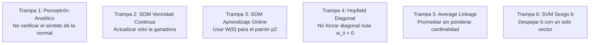

# 🧠 Inteligencia Artificial — Segundo Parcial UTN FRRe 🚀

[](http://www.frre.utn.edu.ar/)
[-green.svg)]()
[]()
[]()
[]()
[]()

> **¡Bienvenido/a al repositorio definitivo de preparación para el Segundo Parcial de IA!**  
> Este material fue elaborado minuciosamente por y para estudiantes de Ingeniería en Sistemas de Información de la **UTN Facultad Regional Resistencia**, a partir de la recopilación forense de más de 60 archivos reales de exámenes impresos, recuperatorios y finales de la cátedra de la cátedra de Inteligencia Artificial (período 2012–2023).

---

## 🗺️ Mapa de Navegación del Repositorio

```
📂 ia-segundo-parcial-utn-frre/
├── 📄 README.md                      <- Esta guía de aterrizaje y estrategia
├── 📄 FORMULARIO_OFICIAL.md          <- Formulario canónico de 2 carillas exacto
├── 📄 MACHETE_LEGAL_5_MINUTOS.md      <- Hoja de emergencia para leer 15 min antes
│
├── 📂 GUIAS_PASO_A_PASO/             <- 8 Guías algorítmicas con calculadora y ejercicios reales
│   ├── 01_svm_paso_a_paso.md         <- Support Vector Machines (w, b_prom, Dual KKT)
│   ├── 02_som_kohonen_paso_a_paso.md  <- Mapas de Kohonen (BMU, vecindad continua, online)
│   ├── 03_mlp_backpropagation.md     <- Perceptrón Multicapa (Forward, Backward δ, momento β)
│   ├── 04_clustering_average_link.md <- Clustering Jerárquico (Pares cruzados, dendrograma)
│   ├── 05_redes_hopfield.md          <- Redes de Hopfield (Hebbiano, diagonal 0, ortogonalidad)
│   ├── 06_naive_bayes_histogramas.md <- Naïve Bayes (Bins discretizados y continuo Gaussiano)
│   ├── 07_knn_leave_one_out.md       <- KNN ponderado 1/d² y Leave-One-Out CV
│   └── 08_algoritmos_geneticos.md    <- Algoritmos Genéticos (Ruleta 00-99, Ranking, Temp)
│
├── 📂 BANCO_TEORIA_Y_MC/             <- Exámenes teóricos históricos y claves oficiales
│   ├── multiple_choice_con_claves.md <- 14 preguntas MC oficiales corregidas en tinta roja
│   └── preguntas_desarrollo.md       <- Preguntas conceptuales explicadas con criterio docente
│
├── 📂 SIMULACROS/                    <- Ensayos cronometrados de 4 cuadrantes (2 horas)
│   ├── SIMULACRO_TEMA_A.md           <- Simulacro completo Tema A (SVM, SOM, MLP, Clustering)
│   └── SIMULACRO_TEMA_B.md           <- Simulacro completo Tema B (Dual KKT, Hopfield, KNN, Bayes)
│
├── 📂 PLANTILLAS_IMPRIMIBLES/        <- Hojas de cálculo en blanco para llevar al banco
│   ├── plantilla_backpropagation.md  <- Tablas limpias de gradientes δ y pesos para MLP
│   ├── plantilla_clustering_link.md  <- Matrices triangulares de distancias D0..D3 y dendrograma
│   └── plantilla_ruleta_geneticos.md <- Tablas de probabilidad acumulada y rangos 00-99
│
├── 📂 VARIANTES_PRACTICA/            <- Ejercicios adicionales clasificados por tipología
│   └── variantes_svm.md              <- Variaciones analíticas y geométricas de SVM
│
└── 📂 MODELOS_ORIGINALES/            <- Archivos originales escaneados y fotos de parciales
    ├── 2012_clasico/                 <- Exámenes históricos del plan antiguo
    ├── 2015_2019/                    <- Exámenes de consolidación de 4 cuadrantes
    ├── 2020_2021_virtuales/          <- Evaluaciones virtuales manuscritas (COVID)
    ├── 2022/                         <- Parciales presenciales de retorno
    ├── 2023/                         <- Parciales recientes contemporáneos (Temas 1 y 2)
    └── compilaciones_tematicas/      <- Recopilaciones temáticas en PDF por unidad
```

---

## 🎯 La Estructura del Examen: El Modelo de los 4 Cuadrantes

El examen práctico presencial de la cátedra se resuelve en papel y lápiz en un tiempo de **2 horas**. La hoja se divide estrictamente en **4 ejercicios independientes valorados en 25% cada uno**:

| Cuadrante | Tema Evaluado | Frecuencia | Probabilidad 2026 | Enfoque Canónico de Cátedra |
| :---: | :--- | :---: | :---: | :--- |
| **Q1** | **Support Vector Machines (SVM)** | **100%** | **100% (Fijo)** | Dados multiplicadores $\alpha_i$, calcular $\mathbf{w}$ y sesgo promediado $b_{prom}$, o plantear el Dual $L_D$ con KKT. |
| **Q2** | **Mapas de Kohonen (SOM)** | **85%** | **85% (Fijo)** | Distancia euclídea al vector de pesos, BMU, vecindad continua $h(i)$ y actualización en línea (*online*). |
| **Q3** | **Perceptrón Multicapa (MLP)** | **90%** | **90% (Fijo)** | Paso backward con gradientes $\delta$ en salida y capas ocultas, actualización de pesos con momento $\beta$ y parada temprana. |
| **Q4** | **Clustering / Hopfield / KNN / Bayes** | **100%** | **Rotativo** | **Var A (55%):** Clustering jerárquico con Average Linkage y dendrograma.<br>**Var B (25%):** KNN ponderado por $1/d^2$ o Leave-One-Out CV.<br>**Var C (20%):** Red de Hopfield con matriz Hebbiana de diagonal nula. |

> [!IMPORTANT]
> **Criterio de Aprobación Docente:**  
> Se requiere alcanzar un **mínimo de 60% en la parte práctica** y un **60% en la parte teórica** de manera independiente. En la práctica, resolver 3 de los 4 cuadrantes sin fallas matemáticas garantiza 75 puntos y la aprobación directa.

---

## 🛑 Advertencia Anti-Ruido P1: ¿Qué NO estudiar para el Segundo Parcial?

> [!CAUTION]
> ### FILTRO ANTI-RUIDO P1 (Aislamiento Curricular)
> Si revisás fotos de parciales viejos en grupos de WhatsApp (período 2012–2018), verás ejercicios de:
> * **Búsqueda Sistemática y Heurística:** Primero en Profundidad (DFS), Primero en Amplitud (BFS), Búsqueda en Grafos, Algoritmo $A^*$, y Escalada de Colinas (*Hill Climbing*).
> * **Planificación:** Planificación de Orden Parcial (POP) en grillas y bloques.
> 
> **¡NO PIERDAS TIEMPO ESTUDIANDO ESTOS TEMAS!**  
> Pertenecen al cronograma anterior. En la cursada 2026, **esos temas ya fueron evaluados y aprobados en el Primer Parcial del 07/10**. Este Segundo Parcial se concentra pura y exclusivamente en **Aprendizaje Automático y Redes Neuronales (Unidades 3 y 4)**.

---

## ⚠️ Las 6 Trampas Clásicas de Cátedra (¡Leelas con atención!)

Del análisis forense de exámenes corregidos por la cátedra, identificamos los 6 errores típicos donde los alumnos pierden entre el 10% y el 25% del parcial:



1. **Trampa 1 (Perceptrón Analítico):** Tras igualar $w_1 x_1 + w_2 x_2 - \theta = 0$, muchos olvidan comprobar si un punto testigo da positivo o negativo. Si el signo es opuesto, **se deben invertir los signos de todos los pesos y del umbral**.
2. **Trampa 2 (SOM Vecindad Continua):** Si el enunciado define una función de vecindad $h(i) = \frac{1}{2 + \text{dist}}$, **NO actualices solo la ganadora**. La ganadora tiene distancia 0 y factor 0.50, pero la neurona vecina tiene distancia $>0$ y factor $>0$. ¡Se deben actualizar **todas** las neuronas de la red!
3. **Trampa 3 (SOM Aprendizaje Online):** Al presentar el segundo patrón ($p_2$), las distancias euclidianas deben medirse contra la matriz de pesos **$W(1)$ recién actualizada**, jamás contra la matriz inicial $W(0)$.
4. **Trampa 4 (Hopfield y Autolazos):** La matriz Hebbiana debe tener **estrictamente ceros en toda la diagonal principal ($w_{ii} = 0$)**. Si dejás números en la diagonal, la red viola la función de energía de Lyapunov y la cátedra anula el ejercicio.
5. **Trampa 5 (Promediado en Average Link):** Al fusionar un cluster de 2 elementos $\{A, N\}$ con $\{R\}$, la distancia a $\{S, P\}$ (2 elementos) es el promedio de los **6 pares cruzados originales** ($\frac{\sum 6 \text{ distancias}}{6}$), o bien $\frac{2 \cdot d(AN, SP) + 1 \cdot d(R, SP)}{3}$. ¡Nunca hagas un promedio simple dividido 2!
6. **Trampa 6 (Sesgo en SVM):** Despejar $b$ usando un único punto suele tener descuentos por falta de rigor. La cátedra exige calcular $b_i = y_i - \mathbf{w}^T \mathbf{x}_i$ para cada uno de los vectores de soporte ($\alpha_i > 0$) y reportar el promedio: $b_{prom} = \frac{1}{|SV|} \sum b_i$.

---

## 📅 Hoja de Ruta de Estudio: Cuenta Regresiva a 10 Días (18/11/2026)

| Día / Fecha | Bloque Temático | Guía Recomendada | Objetivo Práctico en Papel y Lápiz |
| :---: | :--- | :--- | :--- |
| **Día 1-2 (08-09 Nov)** | **Support Vector Machines** | [`01_svm_paso_a_paso.md`](file:///c:/facultad/Inteligencia%20Artificial/ia-segundo-parcial-utn-frre/GUIAS_PASO_A_PASO/01_svm_paso_a_paso.md) | Dominar cálculo de $\mathbf{w}$, sesgo $b_{prom}$ y planteo de $L_D$ con restricciones KKT. |
| **Día 3-4 (10-11 Nov)** | **Mapas SOM de Kohonen** | [`02_som_kohonen_paso_a_paso.md`](file:///c:/facultad/Inteligencia%20Artificial/ia-segundo-parcial-utn-frre/GUIAS_PASO_A_PASO/02_som_kohonen_paso_a_paso.md) | Ejercitar cálculo de BMU, vecindad continua y persistencia de pesos para patrones sucesivos. |
| **Día 5-6 (12-13 Nov)** | **Perceptrón Multicapa (MLP)**| [`03_mlp_backpropagation.md`](file:///c:/facultad/Inteligencia%20Artificial/ia-segundo-parcial-utn-frre/GUIAS_PASO_A_PASO/03_mlp_backpropagation.md) | Mecanizar la derivada sigmoidal, errores $\delta$ hacia atrás y actualización con momento $\beta$. |
| **Día 7 (14 Nov)** | **Clustering Jerárquico** | [`04_clustering_average_link.md`](file:///c:/facultad/Inteligencia%20Artificial/ia-segundo-parcial-utn-frre/GUIAS_PASO_A_PASO/04_clustering_average_link.md) | Reducción de matrices de distancias por Average Link y dibujo técnico del dendrograma a escala. |
| **Día 8 (15 Nov)** | **Hopfield, KNN y Bayes** | [`05`](file:///c:/facultad/Inteligencia%20Artificial/ia-segundo-parcial-utn-frre/GUIAS_PASO_A_PASO/05_redes_hopfield.md), [`06`](file:///c:/facultad/Inteligencia%20Artificial/ia-segundo-parcial-utn-frre/GUIAS_PASO_A_PASO/06_naive_bayes_histogramas.md) y [`07`](file:///c:/facultad/Inteligencia%20Artificial/ia-segundo-parcial-utn-frre/GUIAS_PASO_A_PASO/07_knn_leave_one_out.md) | Resolver los temas alternantes de Q4: Hebbiano con diagonal 0, bins bayesianos y LOOCV. |
| **Día 9 (16 Nov)** | **Algoritmos Genéticos & MC** | [`08_algoritmos_geneticos.md`](file:///c:/facultad/Inteligencia%20Artificial/ia-segundo-parcial-utn-frre/GUIAS_PASO_A_PASO/08_algoritmos_geneticos.md) + [`BANCO_TEORIA`](file:///c:/facultad/Inteligencia%20Artificial/ia-segundo-parcial-utn-frre/BANCO_TEORIA_Y_MC/multiple_choice_con_claves.md) | Cerrar la brecha de AG (Ruleta 00-99 y temperatura) y repasar las 14 preguntas MC oficiales. |
| **Día 10 (17 Nov)** | **Simulacro y Machete Legal**| [`FORMULARIO_OFICIAL.md`](file:///c:/facultad/Inteligencia%20Artificial/ia-segundo-parcial-utn-frre/FORMULARIO_OFICIAL.md) + [`MACHETE`](file:///c:/facultad/Inteligencia%20Artificial/ia-segundo-parcial-utn-frre/MACHETE_LEGAL_5_MINUTOS.md) | Resolver un parcial completo de 4 cuadrantes con cronómetro en mano (2 horas) y repaso final. |

---

## 📝 Consejos de Presentación para el Día del Examen (Criterios de Cátedra)

1. **Nunca pongas números sueltos:** Escribí primero la fórmula general ($w = \sum \alpha_i y_i x_i$), luego reemplazá los valores numéricos y por último poné el resultado.
2. **Justificá cada paso con una línea ingenieril:** *"La neurona 2 es la ganadora por presentar menor distancia euclidiana ($d_2 = 1.476 < d_1 = 1.700$)"*. Eso demuestra solidez conceptual ante la corrección manual.
3. **Cuidá los decimales en la calculadora:** Truncar bruscamente en los pasos intermedios de Backpropagation propaga errores en cascada. Mantené al menos 3 o 4 decimales durante los cálculos.
4. **Dibujá las redes:** En ejercicios de SOM y MLP, hacer un esquema prolijo con nodos de entrada, nodos de salida y flechas con nombres de pesos suma puntos y ordena visualmente tu propio desarrollo.

---

<div align="center">
  <b>¡Mucho éxito en el parcial! A meterle garra en esta recta final hacia el título de Ingeniero/a en Sistemas. 🎓💪</b>
</div>
