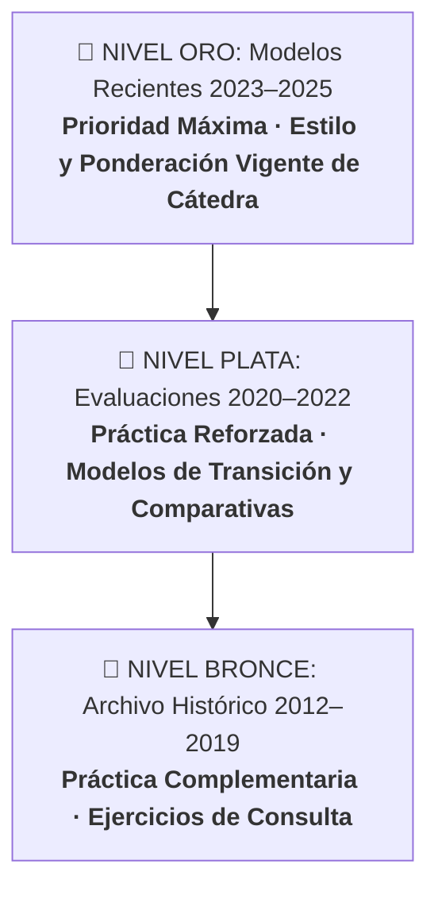
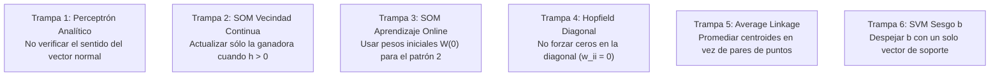

<div align="center">

# 🧠 Inteligencia Artificial — Segundo Parcial
### Repositorio Maestro de Preparación Oficial · UTN Facultad Regional Resistencia (ISI)

[](http://www.frre.utn.edu.ar/)
[]()
[]()
[](https://frandschz.github.io/ia-segundo-parcial-utn-frre/)
[](docs/index.html)
[]()

<br>

<p align="center">
  <b>Hub integral de preparación teórico-práctica para el Segundo Parcial y Exámenes Finales de Inteligencia Artificial.</b><br>
  Construido a partir de la recopilación y resolución analítica de exámenes reales presenciales (2012–2025), priorizando los modelos recientes de Cátedra, guías algorítmicas paso a paso en KaTeX y simulador interactivo con corrección Moodle.
</p>

---

### ⚡ Accesos Rápidos de Estudio

[🎮 **Simulador Web Online**](https://frandschz.github.io/ia-segundo-parcial-utn-frre/) &nbsp;·&nbsp;
[🥇 **Modelos Recientes 2024–2025**](#-1-banco-de-exámenes-priorizados-máximo-peso-evaluativo) &nbsp;·&nbsp;
[📚 **Las 8 Guías Paso a Paso**](#-3-matriz-temática-de-los-8-módulos-oficiales) &nbsp;·&nbsp;
[📝 **Formulario Oficial (2 Carillas)**](FORMULARIO_OFICIAL.md) &nbsp;·&nbsp;
[⏱ **Machete Legal 5–15 Min**](MACHETE_LEGAL_5_MINUTOS.md) &nbsp;·&nbsp;
[📁 **Mapa de Archivos**](#-mapa-completo-de-archivos-del-repositorio)

</div>

---

> [!TIP]
> ### 🎮 Simulador Interactivo de Examen (Web App & Modo Offline)
> Para entrenar el cuestionario teórico de selección múltiple bajo condiciones de evaluación presencial:
> - **Acceso Web Inmediato:** [frandschz.github.io/ia-segundo-parcial-utn-frre](https://frandschz.github.io/ia-segundo-parcial-utn-frre/)
> - **Uso Local (Sin Internet):** Hacé doble clic en [`docs/index.html`](docs/index.html) (corre en cualquier navegador sin instalar Node ni npm).
> - **Fórmula Moodle de Cátedra:** Penalización proporcional por opciones incorrectas marcadas:
>   $$\text{puntaje} = \max\!\left(0,\; 100 \cdot \left(\frac{a}{C} - \frac{e}{I}\right)\right)$$
> - **Umbrales Oficiales:** Promoción ($\ge 80\%$) · Aprobación / Regularidad ($\ge 60\%$) · No alcanzado ($< 60\%$).
> - **3 Modos Integrados + Atajos de Teclado:** **Simulacro Oficial** (40 min / 25 preguntas, atajos <kbd>1-6</kbd>, <kbd>←</kbd><kbd>→</kbd>, <kbd>F</kbd>), **Práctica Libre por Tema** con feedback inmediato y justificación doctrinal de cátedra, y **Modo QA** (`#qa`) con buscador en vivo sobre las 52 preguntas únicas y sus respuestas oficiales.
> - *Instrucciones de publicación:* [Guía de Activación en GitHub Pages en 2 Clics](docs/README_DEPLOY.md).

---

## 🏆 1. Banco de Exámenes Priorizados (Máximo Peso Evaluativo)

Para optimizar el tiempo de estudio hacia el examen del **18/11/2026**, el material se organiza en una pirámide de relevancia basada en la vigencia del equipo docente y el estilo contemporáneo de evaluación:



### 🥇 Nivel Oro — Exámenes Recientes y Vigentes (2023 – 2025) `[PRIORIDAD MÁXIMA]`
*Representan con exactitud el nivel de exigencia, el formato de consignas y la ponderación real en hojas en blanco:*
* **Segundo Parcial Presencial Oficial (19/11/2025):** El modelo más actual de la Cátedra ([enunciado normalizado](MODELOS_ORIGINALES/2024_2025/segundo_parcial_19_nov_2025.md)), resuelto número a número:
  * *Punto 1 (20%):* Clustering Jerárquico Complete Link y Average Link (matrices $D_0 \dots D_3$ y dendrogramas).
  * *Punto 2 (30%):* Mapas de Kohonen (SOM) con vecindad continua ($25\%$ actualización online + $5\%$ gráfico de arquitectura).
  * *Punto 3 (30%):* Perceptrón Multicapa (MLP) analítico / Backpropagation con derivadas sigmoidales.
  * *Punto 4 (20%):* **Algoritmos Genéticos (AG):** Cruza simple en gen 4, Cruza multipunto en $G_2, G_5, G_7$ y Control de copias esperadas al 50%.
* **Compendio de Evaluaciones 2024 – 2025:** Evaluaciones de **Junio 2025, Abril 2025, Febrero 2025, Diciembre 2024, Noviembre 2024, Octubre 2024 y Agosto 2024**.
* **Parciales Presenciales 2023 (Temas 1 y 2):** SVM con formulación dual y vectores de soporte ($\alpha_i > 0$), SOM y mutación adaptativa por temperatura.
* 📖 **Bancos Maestros Resueltos en KaTeX:**
  * [**Banco de Ejercicios Prácticos 2024–2025 y Finales**](GUIAS_PASO_A_PASO/BANCO_EJERCICIOS_PRACTICOS_2024_2025_FINALES.md) (128 KB de cálculos desarrollados).
  * [**Banco Teórico Doctrinal 2024–2025 y Finales**](BANCO_TEORIA_Y_MC/BANCO_PREGUNTAS_TEORICAS_2024_2025_FINALES.md) (149 KB con fundamentos canónicos).

### 🥈 Nivel Plata — Evaluaciones de Consolidación (2020 – 2022) `[PRÁCTICA REFORZADA]`
*Exámenes de retorno presencial y evaluaciones manuscritas estructuradas:*
* Parciales presenciales 2022 y mesas 2020–2021.
* Grandes matrices comparativas de arquitecturas (SOM vs Hopfield vs Perceptrón, MLP vs SVM vs Hopfield, KNN vs K-Means vs Naïve Bayes).
* Batería consolidada de 52 preguntas múltiple choice únicas validadas.

### 🥉 Nivel Bronce — Archivo Histórico de Consulta (2012 – 2019) `[COMPLEMENTARIO]`
*Colección histórica archivada para práctica adicional una vez afianzados los exámenes recientes:*
* Disponible en la carpeta [`MODELOS_ORIGINALES/`](MODELOS_ORIGINALES/) con catálogo forense clasificado por año y modalidad.

---

## 🎯 2. Formatos Oficiales de Evaluación y Distribución de Puntajes

El relevamiento de las evaluaciones presenciales contemporáneas demuestra que la Cátedra implementa **cuatro formatos estructurales dinámicos** según la mesa y el turno:

1. **Formato Heterogéneo de 4 Ejercicios (20% – 30% – 30% – 20%):**  
   *Es el formato oficial más reciente* (constatado en el examen del **19/11/2025**):
   * **Punto 1 (20%):** Clustering Jerárquico Complete Link y Average Link (matriz de distancias $D_0 \dots D_3$ y dendrogramas).
   * **Punto 2 (30%):** Mapas Auto-Organizados (SOM) con vecindad continua ($25\%$) y gráfico de arquitectura ($5\%$).
   * **Punto 3 (30%):** Perceptrón Multicapa (MLP) analítico / Backpropagation con derivadas y función sigmoide.
   * **Punto 4 (20%):** **Algoritmos Genéticos (AG):** Cruza simple (corte en gen $k$), cruza multipunto y control de copias esperadas al 50%.
2. **Formato Equitativo de 5 Ejercicios de 20%:**  
   Frecuente en parciales presenciales completos:
   * 5 ejercicios al 20% c/u: Naïve Bayes por histogramas, Perceptrón simple analítico con verificación de normal, Red de Hopfield con matriz Hebbiana de diagonal nula ($w_{ii}=0$), SVM planteo Dual $L_D$ con KKT, y Aprendizaje/Validación.
3. **Formato Compacto de 3 Ejercicios Integradores (33% / 34% o 40% – 30% – 30%):**  
   Habitual en mesas de examen final y turnos de recuperatorio con menor disponibilidad horaria.
4. **Formato Mixto Teórico-Práctico (40% Teoría + 60% Práctica):**  
   Evaluaciones combinadas donde la teoría se acredita mediante batería de Multiple Choice y preguntas conceptuales de desarrollo, complementada con 2 o 3 problemas numéricos.

---

## 🛑 Filtro Anti-Ruido P1: ¿Qué NO estudiar para el Segundo Parcial?

> [!CAUTION]
> ### AISLAMIENTO CURRICULAR DE PRIMER PARCIAL (`[TEMA_P1_RENDIDO]`)
> Al revisar archivos históricos viejos (período 2012–2018), aparecen ejercicios de:
> * **Búsqueda Sistemática y Heurística:** Primero en Profundidad (DFS), Primero en Amplitud (BFS), Algoritmo $A^{\ast}$ y Escalada Simple.
> * **Planificación:** Planificación de Orden Parcial (POP) en grillas y bloques.
> * **Sistemas Basados en Reglas, Reglas de Asociación (Apriori) y Árboles C4.5.**
> 
> **¡NO DEDIQUES TIEMPO A ESTOS TEMAS PARA EL 2DO PARCIAL!**  
> Corresponden a las Unidades 1 y 2, evaluadas y aprobadas en el Primer Parcial. Este Segundo Parcial se concentra pura y exclusivamente en **Aprendizaje Automático, Computación Evolutiva y Redes Neuronales (Unidades 3 y 4)**.

---

## ⚠️ Las 6 Trampas Clásicas de Cátedra (Checklist Obligatorio)

Del análisis de exámenes reales corregidos por la Cátedra, estos son los 6 errores donde más puntos se descuentan en hojas en blanco:



1. **Trampa 1 (Perceptrón Analítico):** Tras igualar $w_1 x_1 + w_2 x_2 - \theta = 0$, verificar obligatoriamente si un punto testigo da positivo o negativo. Si el signo es opuesto, **se deben invertir los signos de todos los pesos y del umbral**.
2. **Trampa 2 (SOM Vecindad Continua):** Si la función de vecindad es $h(i) = \frac{1}{1 + \text{dist}^2}$, **NO actualices solo la ganadora**. La vecina tiene distancia $>0$ y factor $>0$. ¡Se deben actualizar **todas** las neuronas de la red!
3. **Trampa 3 (SOM Aprendizaje Online):** Al presentar el segundo patrón ($p_2$), las distancias euclidianas deben medirse contra la matriz de pesos **$W(1)$ recién actualizada**, jamás contra $W(0)$.
4. **Trampa 4 (Hopfield y Autolazos):** La matriz Hebbiana debe tener **estrictamente ceros en toda la diagonal principal ($w_{ii} = 0$)**. De lo contrario, se viola la función de energía de Lyapunov y la cátedra anula el ejercicio.
5. **Trampa 5 (Average Link vs Centroides):** En *Average Linkage*, la distancia inter-cluster es el promedio de **todos los pares cruzados de puntos**. La distancia entre centroides es una técnica diferente (*Centroid Linkage*).
6. **Trampa 6 (Sesgo en SVM):** Despejar $b$ usando un solo vector tiene descuentos por falta de rigor. La cátedra exige calcular $b_i = \frac{1}{y_i} - \mathbf{w}^T \mathbf{x}\_i$ para **cada** vector de soporte ($\alpha_i > 0$) y reportar el promedio $b\_{\text{prom}} = \frac{1}{|SV|} \sum b_i$.

---

## 📚 3. Matriz Temática de los 8 Módulos Oficiales

El examen se rinde en **hojas en blanco**: la clave del éxito radica en mecanizar el orden de cálculo, la justificación formal y la tabulación prolija con calculadora científica.

| Módulo Temático | Complejidad | Guía, Plantilla y Variantes | Enfoque de Resolución en Hoja en Blanco |
| :--- | :---: | :--- | :--- |
| **1. Algoritmos Genéticos (AG)** | **Media - Alta** | • [Guía Maestra de AG y Examen](GUIAS_PASO_A_PASO/GUIA_MAESTRA_ALGORITMOS_GENETICOS_Y_ESTRUCTURA_EXAMEN.md)<br>• [Guía Paso a Paso 08](GUIAS_PASO_A_PASO/08_algoritmos_geneticos.md)<br>• [Estructura Tabulación Ruleta](ESTRUCTURAS_Y_TABLAS_DE_RESOLUCION/estructura_ruleta_geneticos.md)<br>• [Variantes AG](VARIANTES_PRACTICA/variantes_geneticos.md) | **Peso del 20% al 30%** en parciales presenciales recientes (ej. 19/11/2025). Mecanizar: Ruleta acumulada con ranuras [00–99], copias esperadas enteras $\lfloor c_i \rfloor$ con residuo fraccionario, cruces simples/multipunto y mutación por temperatura. |
| **2. Support Vector Machines (SVM)** | **Alta** | • [Guía Paso a Paso 01](GUIAS_PASO_A_PASO/01_svm_paso_a_paso.md)<br>• [Variantes SVM](VARIANTES_PRACTICA/variantes_svm.md) | Escribir la sumatoria $\mathbf{w} = \sum \alpha_i y_i \mathbf{x}\_i$, calcular el sesgo individual $b\_i$ para **cada** vector de soporte ($\alpha_i > 0$) y promediar $b\_{\text{prom}}$. En planteo Dual $L\_D$, expandir la matriz de Gram $K\_{ij}$ respetando signos $y\_i y\_j$ y aplicar KKT. |
| **3. Mapas Auto-Organizados (SOM)** | **Media** | • [Guía Paso a Paso 02](GUIAS_PASO_A_PASO/02_som_kohonen_paso_a_paso.md)<br>• [Variantes SOM](VARIANTES_PRACTICA/variantes_som.md) | Esquematizar la red. Calcular distancias euclidianas exactas para justificar la BMU. Si la vecindad es continua, actualizar **todas** las neuronas con $h > 0$. Para el patrón siguiente, medir distancias obligatoriamente contra $W(1)$. |
| **4. Perceptrón Multicapa (MLP)** | **Muy Alta** | • [Guía Paso a Paso 03](GUIAS_PASO_A_PASO/03_mlp_backpropagation.md)<br>• [Estructura Tabulación MLP](ESTRUCTURAS_Y_TABLAS_DE_RESOLUCION/estructura_backpropagation.md)<br>• [Variantes MLP](VARIANTES_PRACTICA/variantes_mlp.md) | Tabular el paso Forward ($Net$, $y$) y el paso Backward con gradientes $\delta$. Recordar $\delta_k = (d-y)f'$ y $\delta_j = f' \sum \delta_k w$. Incluir término de momento $\beta \Delta w(t-1)$. Mantener 4 decimales durante los cálculos. |
| **5. Clustering Jerárquico Aglomerativo** | **Media** | • [Guía Paso a Paso 04](GUIAS_PASO_A_PASO/04_clustering_average_link.md)<br>• [Estructura Tabulación Clustering](ESTRUCTURAS_Y_TABLAS_DE_RESOLUCION/estructura_clustering_link.md)<br>• [Variantes Clustering](VARIANTES_PRACTICA/variantes_clustering.md) | Reducir paso a paso las matrices simétricas $D_0 \dots D_{N-2}$. En Average Linkage, aplicar ponderación por cardinalidad ($\frac{\vert C_i\vert d_i + \vert C_j\vert d_j}{\vert C_i\vert+\vert C_j\vert}$). Dibujar dendrograma a escala con cotas métricas visibles. |
| **6. Redes de Hopfield, Naïve Bayes y $K$-NN / $K$-Means** | **Media** | • [Guía Hopfield 05](GUIAS_PASO_A_PASO/05_redes_hopfield.md) · [Variantes Hopfield](VARIANTES_PRACTICA/variantes_hopfield.md)<br>• [Guía Naïve Bayes 06](GUIAS_PASO_A_PASO/06_naive_bayes_histogramas.md) · [Variantes Naïve Bayes](VARIANTES_PRACTICA/variantes_naive_bayes.md)<br>• [Guía KNN y K-Means 07](GUIAS_PASO_A_PASO/07_knn_leave_one_out.md) · [Variantes KNN y K-Means](VARIANTES_PRACTICA/variantes_knn_kmeans.md) | En Hopfield: verificar ortogonalidad y asegurar **diagonal nula** ($w_{ii}=0$). En Naïve Bayes: tablas de frecuencias relativas por clase o densidad Gaussiana continua. En KNN: distancias ponderadas $w = 1/d^2$ y LOOCV. En K-Means: equivalencia con Disk K-Means. |
| **7. Banco Teórico, Tips y Multiple Choice** | **Media** | • [Banco Teórico Consolidado](BANCO_TEORIA_Y_MC/BANCO_TEORICO_Y_TIPS_CONSOLIDADO_TOTAL.md)<br>• [Preguntas 2024-2025 y Finales](BANCO_TEORIA_Y_MC/BANCO_PREGUNTAS_TEORICAS_2024_2025_FINALES.md)<br>• [Multiple Choice con Claves](BANCO_TEORIA_Y_MC/multiple_choice_con_claves.md)<br>• [Preguntas de Desarrollo](BANCO_TEORIA_Y_MC/preguntas_desarrollo.md) | Dominar los 13 Tips Doctrinales de Cátedra, repasar las justificaciones canónicas de desarrollo (diferencias arquitecturales, término de momento negativo, Early Stopping) y fijar las respuestas del banco oficial de 52 Multiple Choice. |
| **8. Ensayos Prácticos y Síntesis** | **Integradora** | • [Simulacro Tema A](SIMULACROS/SIMULACRO_TEMA_A.md)<br>• [Simulacro Tema B](SIMULACROS/SIMULACRO_TEMA_B.md)<br>• [Formulario Oficial de Cátedra](FORMULARIO_OFICIAL.md)<br>• [Machete Legal de 5–15 Minutos](MACHETE_LEGAL_5_MINUTOS.md) | Simular un examen real de 120 minutos en papel en blanco sin mirar soluciones. Autoevaluar con las rúbricas detalladas. Usar el Formulario Oficial para familiarizarse con las ecuaciones disponibles en mesa. |

---

<details>
<summary><b>📁 Mapa Completo de Archivos del Repositorio (Clic para desplegar)</b></summary>

<br>

```
📂 ia-segundo-parcial-utn-frre/
├── 📄 README.md                      <- Esta guía maestra de aterrizaje y estrategia
├── 📄 FORMULARIO_OFICIAL.md          <- Formulario canónico de 2 carillas exacto
├── 📄 MACHETE_LEGAL_5_MINUTOS.md      <- Hoja de emergencia para leer 5 a 15 min antes
├── 📄 preguntas_quiz.json            <- Banco maestro de 52 preguntas únicas estructuradas
│
├── 📂 docs/                          <- 🎮 Web App Simulador Interactivo (GitHub Pages Ready)
│   ├── index.html                    <- Interfaz SPA accesible offline y online
│   ├── styles.css                    <- Estilos responsive modernos con Dark/Light mode y Print
│   ├── app.js                        <- Motor de examen, atajos de teclado, buscador QA y scoring Moodle
│   ├── README_DEPLOY.md              <- Instrucciones en 2 clics para GitHub Pages
│   └── 📂 data/
│       └── preguntas.js              <- 52 preguntas únicas con KaTeX precargadas sin CORS
│
├── 📂 tools/                         <- Herramientas de automatización y validación QA
│   ├── extraer_preguntas.py          <- Extractor maestro sin spoilers ni duplicados
│   └── validar_banco.py              <- Validador estricto de esquema, SHA-256, KaTeX y scoring
│
├── 📂 GUIAS_PASO_A_PASO/             <- 8 Guías algorítmicas + Guía Maestra de AG y Exámenes
│   ├── GUIA_MAESTRA_ALGORITMOS_GENETICOS_Y_ESTRUCTURA_EXAMEN.md <- Guía completa AG y Ponderaciones
│   ├── BANCO_EJERCICIOS_PRACTICOS_2024_2025_FINALES.md         <- Banco numérico completo resuelto en KaTeX
│   ├── 01_svm_paso_a_paso.md         <- Support Vector Machines (w, b_prom, Dual KKT)
│   ├── 02_som_kohonen_paso_a_paso.md  <- Mapas de Kohonen (BMU, vecindad continua, online W(1))
│   ├── 03_mlp_backpropagation.md     <- Perceptrón Multicapa (Forward, Backward δ, momento β)
│   ├── 04_clustering_average_link.md <- Clustering Jerárquico (Pares cruzados, dendrograma)
│   ├── 05_redes_hopfield.md          <- Redes de Hopfield (Hebbiano, diagonal 0, ortogonalidad)
│   ├── 06_naive_bayes_histogramas.md <- Naïve Bayes (Bins discretizados y continuo Gaussiano)
│   ├── 07_knn_leave_one_out.md       <- KNN ponderado 1/d², LOOCV y K-Means / Disk K-Means
│   └── 08_algoritmos_geneticos.md    <- Algoritmos Genéticos (Ruleta 00-99, Ranking, Temperatura)
│
├── 📂 BANCO_TEORIA_Y_MC/             <- Exámenes teóricos históricos y claves oficiales
│   ├── BANCO_TEORICO_Y_TIPS_CONSOLIDADO_TOTAL.md      <- Compendio total: 13 Tips, desarrollo y MC
│   ├── BANCO_PREGUNTAS_TEORICAS_2024_2025_FINALES.md  <- Compendio teórico de exámenes 2024-2025 y finales
│   ├── multiple_choice_con_claves.md                  <- 14 preguntas MC oficiales corregidas en tinta roja
│   └── preguntas_desarrollo.md                        <- Preguntas conceptuales explicadas con criterio docente
│
├── 📂 SIMULACROS/                    <- Ensayos prácticos representativos de examen (120 minutos)
│   ├── SIMULACRO_TEMA_A.md           <- Simulacro completo Tema A (SVM, SOM, MLP, Clustering)
│   └── SIMULACRO_TEMA_B.md           <- Simulacro completo Tema B (Dual KKT, Hopfield, MLP, Genéticos)
│
├── 📂 ESTRUCTURAS_Y_TABLAS_DE_RESOLUCION/ <- Modelos mentales y tablas de estructuración para hojas en blanco
│   ├── estructura_backpropagation.md     <- Tabulación sistemática de gradientes δ, activaciones y pesos MLP
│   ├── estructura_clustering_link.md     <- Matrices de distancias D0..D3 y dendrograma a escala
│   └── estructura_ruleta_geneticos.md    <- Tabulación de probabilidades acumuladas, rangos 00-99 y copias
│
├── 📂 VARIANTES_PRACTICA/            <- 8 Dossiers de variantes numéricas en 3 niveles de dificultad
│   ├── variantes_svm.md              <- Variaciones analíticas y geométricas de SVM
│   ├── variantes_som.md              <- Variaciones de Mapas Auto-Organizados de Kohonen
│   ├── variantes_mlp.md              <- Variaciones de Backpropagation, sigmoide y momento
│   ├── variantes_clustering.md       <- Variaciones de Single, Complete y Average Linkage
│   ├── variantes_geneticos.md        <- Variaciones de Ruleta, Copias Esperadas, Cruza y Temperatura
│   ├── variantes_hopfield.md         <- Variaciones de Memoria Asociativa, Energía y Estados Espurios
│   ├── variantes_naive_bayes.md      <- Variaciones Categóricas, Gaussianas y Suavizado de Laplace
│   └── variantes_knn_kmeans.md       <- Variaciones de KNN Ponderado, LOOCV, K-Means y Disk K-Means
│
├── 📂 imagenes/                      <- 137 recortes de alta resolución de diagramas, tablas y redes reales
│
└── 📂 MODELOS_ORIGINALES/            <- Archivos originales escaneados, fotos de parciales y auditoría SHA-256
    ├── README.md                     <- Catálogo forense y fichas técnicas de cada modelo de examen
    ├── CATALOGO_HASHES_SHA256_Y_DEDUPLICACION.md <- Auditoría forense de 193 hashes SHA-256 únicos
    ├── catalogo_hashes_forense.json  <- Base estructurada completa de metadatos criptográficos
    ├── 2024_2025/                    <- Segundo Parcial 19/11/2025, Hoja de Fórmulas y Finales 2024-2025
    ├── 2023/                         <- Parciales presenciales contemporáneos (Temas 1 y 2) y Teoría
    ├── 2022/                         <- Evaluaciones presenciales 2022
    ├── 2020_2021_virtuales/          <- Evaluaciones virtuales y recuperatorios resueltos
    ├── 2015_2019/                    <- Exámenes históricos de consulta (2012 a 2019)
    ├── finales_historicos/           <- Mesas de examen final adicionales
    └── compilaciones_tematicas/      <- Cuadernillos oficiales en PDF deduplicados por unidad
```

</details>

---

## 📝 Consejos de Presentación para el Día del Examen (Criterios de Cátedra)

1. **Nunca pongas números sueltos:** Escribí primero la fórmula general ($\mathbf{w} = \sum \alpha_i y_i \mathbf{x}_i$), luego reemplazá los valores numéricos y por último calculá el resultado.
2. **Justificá cada paso con una línea ingenieril:** *"La neurona 2 es la ganadora por presentar menor distancia euclidiana"* ($d_2 = 1.476 < d_1 = 1.700$). Demuestra solidez conceptual ante la corrección manual.
3. **Cuidá los decimales en la calculadora:** Truncar bruscamente en los pasos intermedios de Backpropagation propaga errores en cascada. Mantené al menos 3 o 4 decimales durante los cálculos.
4. **Dibujá las redes:** En ejercicios de SOM y MLP, hacer un esquema prolijo con nodos de entrada, nodos de salida y flechas con nombres de pesos suma claridad visual y ordena tu desarrollo.

---

<div align="center">
  <b>¡Mucho éxito en la preparación! A meterle garra en esta recta final hacia el título de Ingeniero/a en Sistemas. 🎓💪</b>
</div>
