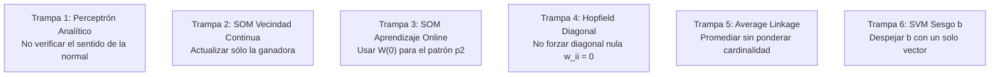

# 🧠 Inteligencia Artificial — Segundo Parcial UTN FRRe 🚀

[](http://www.frre.utn.edu.ar/)
[]()
[]()
[]()
[]()
[]()

> **¡Bienvenido/a al repositorio definitivo de preparación para el Segundo Parcial de IA!**  
> Este material fue elaborado minuciosamente por y para estudiantes de Ingeniería en Sistemas de Información de la **UTN Facultad Regional Resistencia**, a partir de la recopilación forense de más de 60 archivos reales de exámenes impresos, recuperatorios y finales de la cátedra de la cátedra de Inteligencia Artificial (período 2012–2023).

---

> [!IMPORTANT]
> ### 🚀 Actualización Mayor: Incorporación de Modelos 2024 – 2025 y Exámenes Finales Históricos
> Se ha completado la extracción e integración exhaustiva de los turnos de examen más recientes y finales históricos de la Cátedra:
> - **Exámenes 2024 – 2025:** Evaluaciones de **Junio 2025, Abril 2025, Febrero 2025, Diciembre 2024, Noviembre 2024, Octubre 2024 y Agosto 2024**, más el modelo completo del **Segundo Parcial (19/11/2025)** con datos numéricos.
> - **Exámenes Finales Históricos (2020 – 2021):** Evaluaciones escritas completas, grandes tablas comparativas de arquitecturas (SOM vs Hopfield vs Perceptrón, MLP vs SVM vs Hopfield, KNN vs K-Means vs NB) y banco de 37 múltiple choice oficiales verificados.
> - **Bancos Maestros Integrales:**
>   - [BANCO_PREGUNTAS_TEORICAS_2024_2025_FINALES.md](BANCO_TEORIA_Y_MC/BANCO_PREGUNTAS_TEORICAS_2024_2025_FINALES.md): Compendio teórico de 149 KB con resoluciones conceptuales y doctrinales canónicas.
>   - [BANCO_EJERCICIOS_PRACTICOS_2024_2025_FINALES.md](GUIAS_PASO_A_PASO/BANCO_EJERCICIOS_PRACTICOS_2024_2025_FINALES.md): Banco práctico de 128 KB con todos los ejercicios resueltos paso a paso en KaTeX.
> - **Aislamiento de Primer Parcial ([TEMA_P1_RENDIDO]):** Todo ejercicio o pregunta de búsqueda ($A^*$, DFS/BFS), planificación (POP) o árboles C4.5 se encuentra debidamente etiquetado para no contaminar el estudio del 2do parcial pero preservarse para recuperatorio.


## 🗺️ Mapa de Navegación del Repositorio

```
📂 ia-segundo-parcial-utn-frre/
├── 📄 README.md                      <- Esta guía de aterrizaje y estrategia
├── 📄 FORMULARIO_OFICIAL.md          <- Formulario canónico de 2 carillas exacto
├── 📄 MACHETE_LEGAL_5_MINUTOS.md      <- Hoja de emergencia para leer 15 min antes
│
├── 📂 GUIAS_PASO_A_PASO/             <- 8 Guías algorítmicas + Guía Maestra de AG y Estructura Real
│   ├── GUIA_MAESTRA_ALGORITMOS_GENETICOS_Y_ESTRUCTURA_EXAMEN.md <- Guía completa AG + Fin del mito 4 cuadrantes
│   ├── BANCO_EJERCICIOS_PRACTICOS_2024_2025_FINALES.md         <- Banco numérico completo resuelto en KaTeX
│   ├── 01_svm_paso_a_paso.md         <- Support Vector Machines (w, b_prom, Dual KKT)
│   ├── 02_som_kohonen_paso_a_paso.md  <- Mapas de Kohonen (BMU, vecindad continua, online)
│   ├── 03_mlp_backpropagation.md     <- Perceptrón Multicapa (Forward, Backward δ, momento β)
│   ├── 04_clustering_average_link.md <- Clustering Jerárquico (Pares cruzados, dendrograma)
│   ├── 05_redes_hopfield.md          <- Redes de Hopfield (Hebbiano, diagonal 0, ortogonalidad)
│   ├── 06_naive_bayes_histogramas.md <- Naïve Bayes (Bins discretizados y continuo Gaussiano)
│   ├── 07_knn_leave_one_out.md       <- KNN ponderado 1/d² y Leave-One-Out CV
│   └── 08_algoritmos_geneticos.md    <- Algoritmos Genéticos (Ruleta 00-99, Ranking, Temp)
│
├── 📂 BANCO_TEORIA_Y_MC/             <- Exámenes teóricos históricos y claves oficiales
│   ├── BANCO_TEORICO_Y_TIPS_CONSOLIDADO_TOTAL.md <- Compendio total: 13 Tips, 198 preguntas de desarrollo, 51 MC (339 KB)
│   ├── BANCO_PREGUNTAS_TEORICAS_2024_2025_FINALES.md <- Compendio teórico de exámenes 2024-2025 y finales
│   ├── multiple_choice_con_claves.md <- 14 preguntas MC oficiales corregidas en tinta roja
│   └── preguntas_desarrollo.md       <- Preguntas conceptuales explicadas con criterio docente
│
├── 📂 SIMULACROS/                    <- Ensayos prácticos representativos de examen (120 minutos)
│   ├── SIMULACRO_TEMA_A.md           <- Simulacro completo Tema A (SVM, SOM, MLP, Clustering)
│   └── SIMULACRO_TEMA_B.md           <- Simulacro completo Tema B (Dual KKT, Hopfield, MLP/Early Stopping, Genéticos)
│
├── 📂 ESTRUCTURAS_Y_TABLAS_DE_RESOLUCION/ <- Modelos mentales y tablas de estructuración para hojas en blanco
│   ├── estructura_backpropagation.md     <- Tabulación sistemática de gradientes δ, activaciones y pesos MLP
│   ├── estructura_clustering_link.md     <- Matrices de distancias D0..D3 y dendrograma a escala
│   └── estructura_ruleta_geneticos.md    <- Tabulación de probabilidades acumuladas, rangos 00-99 y copias
│
├── 📂 VARIANTES_PRACTICA/            <- Ejercicios adicionales clasificados por tipología
│   └── variantes_svm.md              <- Variaciones analíticas y geométricas de SVM
│
└── 📂 MODELOS_ORIGINALES/            <- Archivos originales escaneados, fotos de parciales y auditoría SHA-256
    ├── CATALOGO_HASHES_SHA256_Y_DEDUPLICACION.md <- Auditoría forense de 193 hashes SHA-256 únicos y deduplicación
    ├── catalogo_hashes_forense.json  <- Base estructurada completa de metadatos criptográficos
    ├── 2012_clasico/                 <- Exámenes históricos del plan antiguo
    ├── 2015_2019/                    <- Exámenes de consolidación de 4 cuadrantes
    ├── 2020_2021_virtuales/          <- Evaluaciones virtuales manuscritas (COVID)
    ├── 2022/                         <- Parciales presenciales de retorno
    ├── 2023/                         <- Parciales recientes contemporáneos (Temas 1 y 2)
    └── compilaciones_tematicas/      <- Recopilaciones temáticas en PDF por unidad
```

---

## 🎯 La Estructura Real del Examen: Desmitificación de los "4 Cuadrantes Fijos"

> [!WARNING]
> ### ⚠️ ALERTA METODOLÓGICA: NO ASUMIR UNA PLANTILLA RÍGIDA DE 4 CUADRANTES AL 25%
> Durante años circuló entre alumnos la creencia de que todo segundo parcial se compone estrictamente de 4 ejercicios de 25% (SVM, SOM, MLP y un rotativo).  
> **La auditoría forense sobre los exámenes reales (2012–2025) demuestra que la Cátedra NO utiliza una plantilla fija.**  
> Para un análisis exhaustivo y modelos resueltos, consultar la [GUÍA MAESTRA DE ALGORITMOS GENÉTICOS Y ESTRUCTURA REAL DE EXAMEN](GUIAS_PASO_A_PASO/GUIA_MAESTRA_ALGORITMOS_GENETICOS_Y_ESTRUCTURA_EXAMEN.md).

### Las 4 Estructuras Reales Implementadas por la Cátedra:

1. **Estructura Heterogénea de 4 Puntos (20% – 30% – 30% – 20%):**  
   *Es el formato oficial más reciente* (constatado en el examen del **19/11/2025**):
   * **Punto 1 (20%):** Clustering Jerárquico Complete Link (matriz de distancias $D_0 \dots D_3$ y dendrograma).
   * **Punto 2 (30%):** Perceptrón Multicapa (MLP) analítico / Backpropagation con derivadas y función sigmoidal.
   * **Punto 3 (20%):** Mapas Auto-Organizados (SOM de Kohonen) con función de vecindad no nula y actualización online.
   * **Punto 4 (30%):** **Algoritmos Genéticos (AG)**: Cruza simple (corte $k$), cruza multipunto y control de copias esperadas al 50%.
2. **Estructura Equitativa de 5 Ejercicios de 20%:**  
   Frecuente en parciales presenciales y finales históricos (ej. evaluación presencial `img4.jpg`):
   * 5 ejercicios ponderados al 20% cada uno: Naïve Bayes por histogramas, Perceptrón simple analítico con verificación del vector normal, Red de Hopfield con matriz Hebbiana de diagonal nula, SVM planteo Dual $L_D$ con KKT, y Búsqueda/Reglas.
3. **Estructura Compacta de 3 Puntos (33% / 34% o 40% – 30% – 30%):**  
   Habitual en mesas de examen final y turnos de recuperatorio con menor disponibilidad horaria:
   * Ejercicios integradores de mayor profundidad que fusionan teoría y cálculo en una misma consigna.
4. **Estructura Mixta Teórico-Práctica (40% Teoría + 60% Práctica):**  
   Evaluaciones combinadas donde la teoría se acredita mediante batería de Multiple Choice (51 preguntas oficiales) y preguntas conceptuales de desarrollo, complementada con 2 o 3 problemas prácticos numéricos.

---

### 🧬 El Papel Crítico de Algoritmos Genéticos en el Segundo Parcial
Históricamente, algunos resúmenes estudiantiles omitían **Algoritmos Genéticos (AG)** considerándolo un tema secundario.  
**Evidencia empírica irrefutable:**
* En el examen presencial del **19/11/2025**, el ejercicio de **Algoritmos Genéticos representó el 30% de la nota final**.
* En evaluaciones de 2023 se exigió **Mutación adaptativa por temperatura** (ascendente y descendente) y **Selección por Ranking**.
* En el compendio oficial de la Cátedra, la **Guía Práctica Nº 6** está íntegramente dedicada a AG.
* Se debe dominar: Selección por Ruleta acumulada (rangos porcentuales 00–99), Control de Copias Esperadas ($c_i = f_i / \bar{f}$), Cruza simple, Cruza multipunto, Cruza binomial, Mutación por temperatura y Diversidad poblacional.

---

## 🛑 Advertencia Anti-Ruido P1: ¿Qué NO estudiar para el Segundo Parcial?

> [!CAUTION]
> ### FILTRO ANTI-RUIDO P1 (Aislamiento Curricular)
> Si revisás fotos de parciales viejos en grupos de WhatsApp (período 2012–2018), verás ejercicios de:
> * **Búsqueda Sistemática y Heurística:** Primero en Profundidad (DFS), Primero en Amplitud (BFS), Búsqueda en Grafos, Algoritmo $A^*$, y Escalada de Colinas (*Hill Climbing*).
> * **Planificación:** Planificación de Orden Parcial (POP) en grillas y bloques.
> 
> **¡NO PIERDAS TIEMPO ESTUDIANDO ESTOS TEMAS!**  
> Pertenecen al cronograma anterior. En la cursada 2026, **esos temas ya fueron evaluados y aprobados en el Primer Parcial del 07/10**. Este Segundo Parcial se concentra pura y exclusivamente en **Aprendizaje Automático y Redes Neuronales (Unidades 3 y 4)**.

---

## ⚠️ Las 6 Trampas Clásicas de Cátedra (¡Leelas con atención!)

Del análisis forense de exámenes corregidos por la cátedra, identificamos los 6 errores típicos donde los alumnos pierden entre el 10% y el 25% del parcial:



1. **Trampa 1 (Perceptrón Analítico):** Tras igualar $w_1 x_1 + w_2 x_2 - \theta = 0$, muchos olvidan comprobar si un punto testigo da positivo o negativo. Si el signo es opuesto, **se deben invertir los signos de todos los pesos y del umbral**.
2. **Trampa 2 (SOM Vecindad Continua):** Si el enunciado define una función de vecindad $h(i) = \frac{1}{2 + \text{dist}}$, **NO actualices solo la ganadora**. La ganadora tiene distancia 0 y factor 0.50, pero la neurona vecina tiene distancia $>0$ y factor $>0$. ¡Se deben actualizar **todas** las neuronas de la red!
3. **Trampa 3 (SOM Aprendizaje Online):** Al presentar el segundo patrón ($p_2$), las distancias euclidianas deben medirse contra la matriz de pesos **$W(1)$ recién actualizada**, jamás contra la matriz inicial $W(0)$.
4. **Trampa 4 (Hopfield y Autolazos):** La matriz Hebbiana debe tener **estrictamente ceros en toda la diagonal principal ($w_{ii} = 0$)**. Si dejás números en la diagonal, la red viola la función de energía de Lyapunov y la cátedra anula el ejercicio.
5. **Trampa 5 (Promediado en Average Link):** Al fusionar un cluster de 2 elementos $\{A, N\}$ con $\{R\}$, la distancia a $\{S, P\}$ (2 elementos) es el promedio de los **6 pares cruzados originales** ($\frac{\sum 6 \text{ distancias}}{6}$), o bien $\frac{2 \cdot d(AN, SP) + 1 \cdot d(R, SP)}{3}$. ¡Nunca hagas un promedio simple dividido 2!
6. **Trampa 6 (Sesgo en SVM):** Despejar $b$ usando un único punto suele tener descuentos por falta de rigor. La cátedra exige calcular $b_i = y_i - \mathbf{w}^T \mathbf{x}_i$ para cada uno de los vectores de soporte ($\alpha_i > 0$) y reportar el promedio: $b_{prom} = \frac{1}{|SV|} \sum b_i$.

---

## 📚 Matriz Temática Modular de Autogestión (Estudio al Propio Ritmo)

Cada estudiante cuenta con tiempos, bases algebraicas y ritmos de estudio distintos. La preparación no requiere un calendario rígido predefinido, sino el **dominio autónomo y modular** de las unidades temáticas evaluadas por la Cátedra. 

El examen se rinde en **hojas en blanco**: la clave del éxito radica en mecanizar el orden de cálculo, la justificación formal y la tabulación prolija con calculadora científica.

| Módulo Temático | Complejidad | Recursos Clave en Repositorio | Enfoque de Resolución en Hojas en Blanco |
| :--- | :---: | :--- | :--- |
| **1. Algoritmos Genéticos (AG)** | **Media - Alta** | • [Guía Maestra AG y Estructura](GUIAS_PASO_A_PASO/GUIA_MAESTRA_ALGORITMOS_GENETICOS_Y_ESTRUCTURA_EXAMEN.md)<br>• [Guía Paso a Paso AG](GUIAS_PASO_A_PASO/08_algoritmos_geneticos.md)<br>• [Estructura Tabulación Ruleta](ESTRUCTURAS_Y_TABLAS_DE_RESOLUCION/estructura_ruleta_geneticos.md)<br>• [Variantes AG](VARIANTES_PRACTICA/variantes_geneticos.md) | **Peso de hasta 30%** en parciales presenciales recientes (ej. 19/11/2025). Mecanizar: Ruleta acumulada con intervalos [00-99], asignación entera de copias $C_i = \lfloor \eta_i \rfloor$ y sorteo de vacantes con parte decimal, cruces monopunto/multipunto y mutación adaptativa por temperatura. |
| **2. Support Vector Machines (SVM)** | **Alta** | • [Guía Paso a Paso SVM](GUIAS_PASO_A_PASO/01_svm_paso_a_paso.md)<br>• [Variantes SVM](VARIANTES_PRACTICA/variantes_svm.md) | Escribir siempre la sumatoria $\mathbf{w} = \sum \alpha_i y_i \mathbf{x}_i$, calcular el sesgo individual $b_i$ para **cada** vector de soporte ($\alpha_i > 0$) y obtener $b_{prom}$. En planteo Dual $L_D$, expandir la matriz de Gram $K_{ij}$ respetando signos $y_i y_j$ y aplicar KKT. |
| **3. Mapas Auto-Organizados (SOM)** | **Media** | • [Guía Paso a Paso SOM](GUIAS_PASO_A_PASO/02_som_kohonen_paso_a_paso.md)<br>• [Variantes SOM](VARIANTES_PRACTICA/variantes_som.md) | Esquematizar la red neuronal. Calcular distancias euclidianas exactas para justificar la BMU ($j^*$). Si la vecindad es continua, actualizar **todas** las neuronas con $h(i,j^*) > 0$. Para el patrón siguiente, medir distancias obligatoriamente contra los pesos actualizados $W(1)$. |
| **4. Perceptrón Multicapa (MLP)** | **Muy Alta** | • [Guía Paso a Paso MLP](GUIAS_PASO_A_PASO/03_mlp_backpropagation.md)<br>• [Estructura Tabulación MLP](ESTRUCTURAS_Y_TABLAS_DE_RESOLUCION/estructura_backpropagation.md)<br>• [Variantes MLP](VARIANTES_PRACTICA/variantes_mlp.md) | Tabular en papel el paso Forward ($net$, $\sigma(net)$) y el paso Backward con gradientes $\delta$. Recordar $\delta_s = (d-y)f'$ y $\delta_h = f' \sum \delta_s w$. Incorporar el término inercial $\beta \Delta w(t-1)$. Mantener 3-4 decimales para evitar errores en cascada. |
| **5. Clustering Jerárquico Aglomerativo** | **Media** | • [Guía Paso a Paso Clustering](GUIAS_PASO_A_PASO/04_clustering_average_link.md)<br>• [Estructura Tabulación Clustering](ESTRUCTURAS_Y_TABLAS_DE_RESOLUCION/estructura_clustering_link.md)<br>• [Variantes Clustering](VARIANTES_PRACTICA/variantes_clustering.md) | Reducir progresivamente las matrices simétricas $D_0 \dots D_{N-2}$. En Average Linkage (UPGMA), aplicar la ponderación por cardinalidad de clusters ($\frac{\vert C_i\vert d_i + \vert C_j\vert d_j}{\vert C_i\vert+\vert C_j\vert}$). Dibujar el dendrograma final a escala con cotas métricas visibles en el eje vertical. |
| **6. Modelos Alternantes (Hopfield, KNN, Bayes)** | **Media** | • [Guía Hopfield](GUIAS_PASO_A_PASO/05_redes_hopfield.md)<br>• [Guía Naïve Bayes](GUIAS_PASO_A_PASO/06_naive_bayes_histogramas.md)<br>• [Guía KNN LOOCV](GUIAS_PASO_A_PASO/07_knn_leave_one_out.md) | En Hopfield: verificar ortogonalidad y asegurar **diagonal estrictamente nula** ($w_{ii}=0$). En Naïve Bayes: armar tablas de frecuencias relativas por clase y normalizar probabilidades a 100%. En KNN: calcular distancias y ponderación $w = 1/d^2$ resolviendo empates. |
| **7. Banco Teórico, Tips y Multiple Choice** | **Media** | • [Banco Teórico Consolidado](BANCO_TEORIA_Y_MC/BANCO_TEORICO_Y_TIPS_CONSOLIDADO_TOTAL.md)<br>• [Preguntas 2024-2025 y Finales](BANCO_TEORIA_Y_MC/BANCO_PREGUNTAS_TEORICAS_2024_2025_FINALES.md)<br>• [Multiple Choice con Claves](BANCO_TEORIA_Y_MC/multiple_choice_con_claves.md)<br>• [Preguntas de Desarrollo](BANCO_TEORIA_Y_MC/preguntas_desarrollo.md) | Incorporar los 13 Tips Doctrinales de Cátedra, repasar las justificaciones canónicas de desarrollo (diferencias arquitecturales, momentos negativos, Early Stopping) y fijar las respuestas del banco oficial de 51 Multiple Choice. |
| **8. Ensayos Prácticos y Síntesis de Emergencia** | **Integradora** | • [Simulacro Tema A](SIMULACROS/SIMULACRO_TEMA_A.md)<br>• [Simulacro Tema B](SIMULACROS/SIMULACRO_TEMA_B.md)<br>• [Formulario Oficial de Cátedra](FORMULARIO_OFICIAL.md)<br>• [Machete Legal de 15 Minutos](MACHETE_LEGAL_5_MINUTOS.md) | Simular un examen real de 120 minutos en papel en blanco sin mirar soluciones. Autoevaluar con las rúbricas detalladas. Usar el Formulario Oficial para familiarizarse con las ecuaciones disponibles en el banco del parcial. |

---

## 📝 Consejos de Presentación para el Día del Examen (Criterios de Cátedra)

1. **Nunca pongas números sueltos:** Escribí primero la fórmula general ($w = \sum \alpha_i y_i x_i$), luego reemplazá los valores numéricos y por último poné el resultado.
2. **Justificá cada paso con una línea ingenieril:** *"La neurona 2 es la ganadora por presentar menor distancia euclidiana ($d_2 = 1.476 < d_1 = 1.700$)"*. Eso demuestra solidez conceptual ante la corrección manual.
3. **Cuidá los decimales en la calculadora:** Truncar bruscamente en los pasos intermedios de Backpropagation propaga errores en cascada. Mantené al menos 3 o 4 decimales durante los cálculos.
4. **Dibujá las redes:** En ejercicios de SOM y MLP, hacer un esquema prolijo con nodos de entrada, nodos de salida y flechas con nombres de pesos suma puntos y ordena visualmente tu propio desarrollo.

---

<div align="center">
  <b>¡Mucho éxito en el parcial! A meterle garra en esta recta final hacia el título de Ingeniero/a en Sistemas. 🎓💪</b>
</div>
