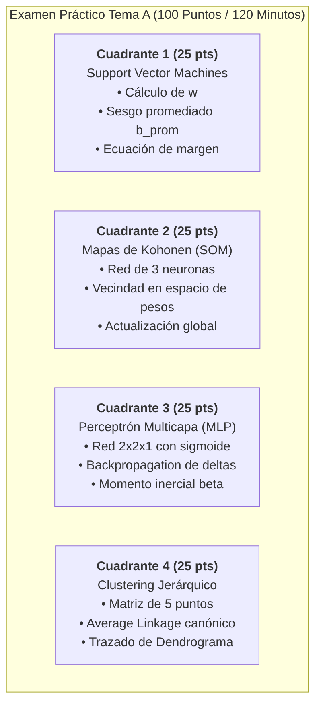
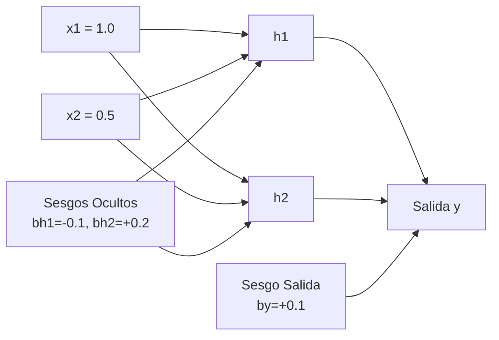

# Examen Simulacro Presencial — Segundo Parcial (Tema A)
**Universidad Tecnológica Nacional — Facultad Regional Resistencia (UTN FRRe)**  
**Carrera:** Ingeniería en Sistemas de Información (5to Nivel)  
**Cátedra:** Inteligencia Artificial  
**Profesor Titular:** Ing. Marcelo Karanik  
**Régimen de Evaluación:** 4 Cuadrantes Independientes (25% cada uno) | **Nota de Aprobación Práctica:** $\ge 60\%$ (60/100 pts)  
**Tiempo Límite Sugerido:** 120 minutos (2 horas de reloj en papel manuscrito con calculadora científica)  

---

## Instrucciones Generales para el Alumno
1. Cada cuadrante posee una ponderación de **25 puntos**.
2. **Desarrollo analítico obligatorio:** No se calificarán resultados numéricos huérfanos sin su correspondiente fórmula canónica, sustitución numérica explícita y despeje paso a paso.
3. Se exige precisión de redondeo a **3 decimales** o fracción irreducible en todas las etapas intermedias.
4. Justifique brevemente cada decisión algorítmica (ej. criterio de selección de neurona ganadora, condición de vector de soporte, fusión de clusters).

---



---

## Cuadrante 1 [25 pts]: Support Vector Machines (SVM Lineal)

### Enunciado
Se entrena un clasificador de vectores de soporte con margen estricto (*hard margin*) en el espacio bidimensional $\mathbb{R}^2$. El optimizador cuadrático ha arrojado los siguientes multiplicadores de Lagrange $\alpha_i$ correspondientes al conjunto de datos:

| Muestra | Coordenada $x_1$ | Coordenada $x_2$ | Clase Deseada ($y_i$) | Multiplicador de Lagrange ($\alpha_i$) |
| :---: | :---: | :---: | :---: | :---: |
| **$p_1$** | $1.0$ | $5.0$ | $+1$ | $0.40$ |
| **$p_2$** | $2.0$ | $1.0$ | $+1$ | $0.60$ |
| **$p_3$** | $-1.0$ | $1.0$ | $-1$ | $1.00$ |
| **$p_4$** | $-2.0$ | $-2.0$ | $-1$ | $0.00$ |

**Se solicita:**
1. Identificar analíticamente cuáles puntos constituyen *Vectores de Soporte* (Support Vectors) y cuáles son puntos interiores descartables para la definición de la frontera.
2. Calcular el vector ortogonal de pesos $\mathbf{w} = [w_1, w_2]^T$.
3. Determinar el sesgo individual $b_i$ para **cada uno** de los vectores de soporte y calcular el sesgo representativo promediado $b_{prom}$.
4. Escribir la ecuación explícita del hiperplano de decisión óptimo $f(\mathbf{x}) = 0$ y calcular el ancho geométrico del margen de separación $M = \frac{2}{\|\mathbf{w}\|}$.
5. Clasificar la nueva muestra de consulta $\mathbf{z}_{test} = [0.0, 2.0]^T$ e indicar a qué distancia orientada se encuentra de la frontera.

---

### Rúbrica de Corrección Detallada (Q1: 25 puntos)
* **[3 pts] Discriminación de Vectores de Soporte:** Identificación formal basada en la condición KKT $\alpha_i > 0$ versus $\alpha_4 = 0$.
* **[7 pts] Cálculo del Vector $\mathbf{w}$:** Planteo de la sumatoria $\sum \alpha_i y_i \mathbf{x}_i$, sustitución vectorial exacta y cálculo de $w_1$ y $w_2$.
* **[7 pts] Cálculo del Sesgo Promediado $b_{prom}$:** Despeje de la condición $y_i(\mathbf{w}^T \mathbf{x}_i + b) = 1$ para cada SV y promedio aritmético final. *(Nota docente: Si el alumno utiliza un único vector sin justificar o promediar, se descuentan 4 puntos por Trampa 6)*.
* **[4 pts] Hiperplano y Margen $M$:** Formulación analítica de la recta divisoria y cálculo normativo de la distancia entre planos de margen.
* **[4 pts] Clasificación de Muestra Test:** Evaluación en el hiperplano y deducción de clase $\operatorname{sgn}(f(\mathbf{z}))$.

---

### Solución Oficial Paso a Paso con Calculadora (Q1)

#### 1. Identificación de Vectores de Soporte
De acuerdo con las condiciones Karush-Kuhn-Tucker (KKT), solo aquellas muestras con multiplicadores estrictamente positivos $(\alpha_i > 0)$ yacen sobre los hiperplanos frontera y definen el clasificador:
* $p_1 = [1, 5]^T \implies \alpha_1 = 0.40 > 0 \implies \mathbf{SV}_1$
* $p_2 = [2, 1]^T \implies \alpha_2 = 0.60 > 0 \implies \mathbf{SV}_2$
* $p_3 = [-1, 1]^T \implies \alpha_3 = 1.00 > 0 \implies \mathbf{SV}_3$
* $p_4 = [-2, -2]^T \implies \alpha_4 = 0.00 \implies$ **Punto interior no soporte** (se ignora en el cómputo de $\mathbf{w}$ y $b$).

*Verificación de equilibrio de clases (restricción KKT):*
$$\sum_{i=1}^4 \alpha_i y_i = 0.40(+1) + 0.60(+1) + 1.00(-1) + 0(-1) = 0.40 + 0.60 - 1.00 = 0 \quad \text{(Verificado)}$$

#### 2. Cálculo del Vector de Pesos $\mathbf{w}$
$$\mathbf{w} = \sum_{i=1}^N \alpha_i y_i \mathbf{x}_i = \alpha_1 y_1 p_1 + \alpha_2 y_2 p_2 + \alpha_3 y_3 p_3$$
Sustituyendo los valores:
$$\mathbf{w} = (0.40)(+1)\begin{bmatrix} 1.0 \\ 5.0 \end{bmatrix} + (0.60)(+1)\begin{bmatrix} 2.0 \\ 1.0 \end{bmatrix} + (1.00)(-1)\begin{bmatrix} -1.0 \\ 1.0 \end{bmatrix}$$
$$\mathbf{w} = \begin{bmatrix} 0.40 \\ 2.00 \end{bmatrix} + \begin{bmatrix} 1.20 \\ 0.60 \end{bmatrix} + \begin{bmatrix} 1.00 \\ -1.00 \end{bmatrix} = \begin{bmatrix} 0.40 + 1.20 + 1.00 \\ 2.00 + 0.60 - 1.00 \end{bmatrix} = \begin{bmatrix} 2.600 \\ 1.600 \end{bmatrix}$$
Por lo tanto:
$$\mathbf{w} = \begin{bmatrix} 2.600 \\ 1.600 \end{bmatrix}$$

#### 3. Determinación de Sesgos Individuales y Sesgo Promediado $b_{prom}$
Para todo vector de soporte se cumple $y_i(\mathbf{w}^T \mathbf{x}_i + b) = 1$. Multiplicando por $y_i \in \{-1, +1\}$:
$$b_i = y_i - \mathbf{w}^T \mathbf{x}_i = y_i - (w_1 x_{i1} + w_2 x_{i2})$$

* **Para $p_1 = [1, 5]^T$ ($y_1 = +1$):**
  $$\mathbf{w}^T p_1 = (2.600)(1.0) + (1.600)(5.0) = 2.600 + 8.000 = 10.600$$
  $$b_1 = 1 - 10.600 = -9.600$$

* **Para $p_2 = [2, 1]^T$ ($y_2 = +1$):**
  $$\mathbf{w}^T p_2 = (2.600)(2.0) + (1.600)(1.0) = 5.200 + 1.600 = 6.800$$
  $$b_2 = 1 - 6.800 = -5.800$$

* **Para $p_3 = [-1, 1]^T$ ($y_3 = -1$):**
  $$\mathbf{w}^T p_3 = (2.600)(-1.0) + (1.600)(1.0) = -2.600 + 1.600 = -1.000$$
  $$b_3 = -1 - (-1.000) = 0.000$$

* **Sesgo Promediado Oficial de Cátedra:**
  $$b_{prom} = \frac{1}{|SV|} \sum_{i \in SV} b_i = \frac{b_1 + b_2 + b_3}{3} = \frac{-9.600 - 5.800 + 0.000}{3} = \frac{-15.400}{3} \approx -5.133$$

#### 4. Ecuación del Hiperplano y Ancho de Margen
* **Ecuación del hiperplano de decisión:**
  $$\mathbf{w}^T \mathbf{x} + b_{prom} = 0 \iff 2.600 x_1 + 1.600 x_2 - 5.133 = 0$$
* **Norma euclídea del vector de pesos:**
  $$\|\mathbf{w}\| = \sqrt{w_1^2 + w_2^2} = \sqrt{(2.600)^2 + (1.600)^2} = \sqrt{6.760 + 2.560} = \sqrt{9.320} \approx 3.053$$
* **Ancho del margen geométrico total:**
  $$M = \frac{2}{\|\mathbf{w}\|} = \frac{2}{3.053} \approx 0.655 \quad \left(\text{margen semi-espacio: } \gamma = \frac{1}{\|\mathbf{w}\|} \approx 0.328\right)$$

#### 5. Clasificación de la Muestra Test $\mathbf{z}_{test} = [0, 2]^T$
$$f(\mathbf{z}_{test}) = \mathbf{w}^T \mathbf{z}_{test} + b_{prom} = (2.600)(0.0) + (1.600)(2.0) - 5.133 = 3.200 - 5.133 = -1.933$$
$$\hat{y} = \operatorname{sgn}(f(\mathbf{z}_{test})) = \operatorname{sgn}(-1.933) = -1$$
*Distancia perpendicular orientada al hiperplano:*
$$d(\mathbf{z}_{test}, \mathcal{H}) = \frac{f(\mathbf{z}_{test})}{\|\mathbf{w}\|} = \frac{-1.933}{3.053} \approx -0.633$$
**Conclusión:** La muestra pertenece a la **Clase $-1$** y se sitúa en el lado negativo del espacio, más allá del hiperplano canónico de soporte.

---

## Cuadrante 2 [25 pts]: Redes Competitivas Autoorganizadas (SOM de Kohonen)

### Enunciado
Considere una red neuronal autoorganizada de Kohonen constituida por una capa de entrada de 2 dimensiones y una grilla unidimensional de 3 neuronas de salida ($N_1, N_2, N_3$). Los vectores de pesos sinápticos iniciales al instante $t=0$ son:
$$W_1(0) = \begin{bmatrix} 0.200 \\ 0.800 \end{bmatrix}, \quad W_2(0) = \begin{bmatrix} 0.600 \\ 0.400 \end{bmatrix}, \quad W_3(0) = \begin{bmatrix} 0.900 \\ 0.100 \end{bmatrix}$$

Se define una tasa de aprendizaje constante $\alpha = 0.50$ y una función de vecindad continua y topológica definida en el **espacio de pesos**:
$$h(i, j^*) = \frac{1}{1 + \operatorname{dist}(W_i(0), W_{j^*}(0))}$$
donde $\operatorname{dist}(W_i, W_{j^*}) = \|W_i - W_{j^*}\|_2$ representa la distancia euclídea entre el vector de pesos de la neurona $i$ y el vector de pesos de la neurona ganadora $j^*$.

**Se presenta el patrón de entrada:**
$$X = \begin{bmatrix} 0.500 \\ 0.500 \end{bmatrix}$$

**Se solicita:**
1. Dibujar el esquema arquitectural de la red SOM indicando entradas, conexiones sinápticas y neuronas competitivas.
2. Calcular la distancia euclídea de cada una de las 3 neuronas al vector de entrada $X$ e identificar analíticamente la neurona ganadora (Best Matching Unit, BMU $j^*$).
3. Calcular los factores de vecindad $h(1, j^*)$, $h(2, j^*)$ y $h(3, j^*)$ correspondientes.
4. Aplicar la regla de actualización de Kohonen para actualizar los vectores de pesos de **todas** las neuronas de la red al paso $t=1$:
   $$W_i(1) = W_i(0) + \alpha \cdot h(i, j^*) \cdot [X - W_i(0)]$$
5. Justificar conceptualmente por qué se actualizan las neuronas no ganadoras y qué efecto geométrico produce sobre el mapa.

---

### Rúbrica de Corrección Detallada (Q2: 25 puntos)
* **[3 pts] Diagrama de Arquitectura:** Red bi-dimensional de entrada conectada a las 3 neuronas de salida.
* **[6 pts] Distancias Euclídeas y Determinación de la Ganadora:** Cálculo cuadrático exacto y justificación por mínimo global.
* **[6 pts] Cálculo de Factores de Vecindad Topológica:** Aplicación estricta de la fórmula $h(i, j^*)$ en el espacio de pesos. *(Si el alumno aplica vecindad nula $h=0$ para las vecinas, pierde 10 pts por Trampa 2)*.
* **[8 pts] Actualización Sináptica Completa:** Actualización explícita de componentes para $W_1(1), W_2(1), W_3(1)$.
* **[2 pts] Justificación Teórica:** Explicación del principio de cooperación topológica de Kohonen.

---

### Solución Oficial Paso a Paso con Calculadora (Q2)

#### 1. Arquitectura de la Red
Entrada: $\mathbf{x} = [x_1, x_2]^T$. Capa de salida: Neuronas $N_1, N_2, N_3$.  
Cada neurona $i$ posee conexiones con pesos $[w_{i1}, w_{i2}]^T$ hacia ambas entradas.

#### 2. Distancias al Vector de Entrada $X = [0.5, 0.5]^T$
* **Neurona 1 ($W_1(0) = [0.2, 0.8]^T$):**
  $$d_1^2 = (0.500 - 0.200)^2 + (0.500 - 0.800)^2 = (0.300)^2 + (-0.300)^2 = 0.090 + 0.090 = 0.180$$
  $$d_1 = \sqrt{0.180} \approx 0.424$$

* **Neurona 2 ($W_2(0) = [0.6, 0.4]^T$):**
  $$d_2^2 = (0.500 - 0.600)^2 + (0.500 - 0.400)^2 = (-0.100)^2 + (0.100)^2 = 0.010 + 0.010 = 0.020$$
  $$d_2 = \sqrt{0.020} \approx 0.141$$

* **Neurona 3 ($W_3(0) = [0.9, 0.1]^T$):**
  $$d_3^2 = (0.500 - 0.900)^2 + (0.500 - 0.100)^2 = (-0.400)^2 + (0.400)^2 = 0.160 + 0.160 = 0.320$$
  $$d_3 = \sqrt{0.320} \approx 0.566$$

* **Determinación de la Ganadora (BMU):**
  $$j^* = \arg\min_i \{d_1, d_2, d_3\} = \arg\min \{0.424, 0.141, 0.566\} = 2 \implies \text{Neurona Ganadora: } N_2$$

#### 3. Cálculo de los Factores de Vecindad $h(i, j^*=2)$
La distancia entre neuronas se mide en el espacio de pesos respecto a $W_2(0)$:
* **Para Neurona 2 (Ganadora):**
  $$\operatorname{dist}(W_2, W_2) = 0.000 \implies h(2, 2) = \frac{1}{1 + 0.000} = 1.000$$

* **Para Neurona 1:**
  $$\operatorname{dist}(W_1, W_2) = \sqrt{(0.200 - 0.600)^2 + (0.800 - 0.400)^2} = \sqrt{(-0.400)^2 + (0.400)^2} = \sqrt{0.160 + 0.160} = \sqrt{0.320} \approx 0.566$$
  $$h(1, 2) = \frac{1}{1 + 0.566} = \frac{1}{1.566} \approx 0.639$$

* **Para Neurona 3:**
  $$\operatorname{dist}(W_3, W_2) = \sqrt{(0.900 - 0.600)^2 + (0.100 - 0.400)^2} = \sqrt{(0.300)^2 + (-0.300)^2} = \sqrt{0.090 + 0.090} = \sqrt{0.180} \approx 0.424$$
  $$h(3, 2) = \frac{1}{1 + 0.424} = \frac{1}{1.424} \approx 0.702$$

#### 4. Actualización de Pesos Sinápticos al Paso $t=1$
Utilizando $\alpha = 0.50$ y $X = [0.5, 0.5]^T$:
$$\Delta W_i = \alpha \cdot h(i, 2) \cdot (X - W_i(0))$$

* **Actualización Neurona 2 (Ganadora, $h(2,2)=1.000$):**
  $$X - W_2(0) = \begin{bmatrix} 0.500 - 0.600 \\ 0.500 - 0.400 \end{bmatrix} = \begin{bmatrix} -0.100 \\ +0.100 \end{bmatrix}$$
  $$\Delta W_2 = (0.50)(1.000)\begin{bmatrix} -0.100 \\ 0.100 \end{bmatrix} = \begin{bmatrix} -0.050 \\ +0.050 \end{bmatrix}$$
  $$W_2(1) = \begin{bmatrix} 0.600 - 0.050 \\ 0.400 + 0.050 \end{bmatrix} = \begin{bmatrix} \mathbf{0.550} \\ \mathbf{0.450} \end{bmatrix}$$

* **Actualización Neurona 1 (Vecina, $h(1,2)=0.639$):**
  $$X - W_1(0) = \begin{bmatrix} 0.500 - 0.200 \\ 0.500 - 0.800 \end{bmatrix} = \begin{bmatrix} +0.300 \\ -0.300 \end{bmatrix}$$
  $$\Delta W_1 = (0.50)(0.639)\begin{bmatrix} 0.300 \\ -0.300 \end{bmatrix} = 0.3195 \begin{bmatrix} 0.300 \\ -0.300 \end{bmatrix} = \begin{bmatrix} +0.096 \\ -0.096 \end{bmatrix}$$
  $$W_1(1) = \begin{bmatrix} 0.200 + 0.096 \\ 0.800 - 0.096 \end{bmatrix} = \begin{bmatrix} \mathbf{0.296} \\ \mathbf{0.704} \end{bmatrix}$$

* **Actualización Neurona 3 (Vecina, $h(3,2)=0.702$):**
  $$X - W_3(0) = \begin{bmatrix} 0.500 - 0.900 \\ 0.500 - 0.100 \end{bmatrix} = \begin{bmatrix} -0.400 \\ +0.400 \end{bmatrix}$$
  $$\Delta W_3 = (0.50)(0.702)\begin{bmatrix} -0.400 \\ 0.400 \end{bmatrix} = 0.3510 \begin{bmatrix} -0.400 \\ 0.400 \end{bmatrix} = \begin{bmatrix} -0.140 \\ +0.140 \end{bmatrix}$$
  $$W_3(1) = \begin{bmatrix} 0.900 - 0.140 \\ 0.100 + 0.140 \end{bmatrix} = \begin{bmatrix} \mathbf{0.760} \\ \mathbf{0.240} \end{bmatrix}$$

#### 5. Justificación Conceptual Docente
En la fase cooperativa del algoritmo SOM, las neuronas que se encuentran en el vecindario topológico de la ganadora son arrastradas en dirección al patrón presentado en proporción inversa a su distancia relativa. Esto preserva las relaciones métricas del espacio de entrada, permitiendo que la red ordene su malla de pesos de forma autoorganizada y suave.

---

## Cuadrante 3 [25 pts]: Perceptrón Multicapa (MLP) y Backpropagation con Momento

### Enunciado
Dada una red neuronal MLP con arquitectura **$2 \times 2 \times 1$** (2 entradas, 1 capa oculta de 2 neuronas $h_1, h_2$, y 1 neurona de salida $y$). Todas las unidades utilizan la función de activación logística sigmoidal unipolar:
$$f(net) = \frac{1}{1 + e^{-net}}, \quad f'(net) = f(net) \cdot [1 - f(net)]$$



**Parámetros actuales de la red al inicio de la iteración $t$:**
* **Pesos Capa Oculta:**
  $$w_{h1, x1} = 0.200, \quad w_{h1, x2} = 0.400, \quad \theta_{h1} = b_{h1} = -0.100$$
  $$w_{h2, x1} = -0.300, \quad w_{h2, x2} = 0.100, \quad \theta_{h2} = b_{h2} = +0.200$$
* **Pesos Capa de Salida:**
  $$w_{y, h1} = 0.500, \quad w_{y, h2} = -0.400, \quad \theta_y = b_y = +0.100$$
* **Término de Inercia / Momento previo al paso $t-1$ ($\Delta w(t-1)$):**
  $$\Delta w_{y, h1}(t-1) = +0.030, \quad \Delta w_{y, h2}(t-1) = -0.020, \quad \Delta b_y(t-1) = +0.010$$
  $$\Delta w_{h1, x1}(t-1) = +0.020, \quad \Delta w_{h1, x2}(t-1) = +0.010, \quad \Delta b_{h1}(t-1) = +0.010$$
  $$\Delta w_{h2, x1}(t-1) = -0.010, \quad \Delta w_{h2, x2}(t-1) = +0.020, \quad \Delta b_{h2}(t-1) = -0.010$$
* **Hiperparámetros:** Tasa de aprendizaje $\alpha = 0.60$, Coeficiente de momento $\beta = 0.40$.

**Muestra de entrenamiento presentada:**
* Entradas: $\mathbf{x} = [x_1, x_2]^T = [1.000, 0.500]^T$
* Salida deseada objetivo: $d = 1.000$

**Se solicita:**
1. Ejecutar el paso **Forward** (propagación hacia adelante): calcular los potenciales post-sinápticos ($net_{h1}, net_{h2}, net_y$) y las salidas activadas ($o_{h1}, o_{h2}, o_y$).
2. Ejecutar el paso **Backward**: calcular el gradiente local de error de salida $\delta_y = (d - o_y) f'(net_y)$ y los gradientes retropropagados hacia la capa oculta $\delta_{h1}$ y $\delta_{h2}$.
3. Actualizar con término de momento inercial $\beta$ los pesos:
   $$\Delta w_{ij}(t) = \alpha \cdot \delta_j \cdot o_i + \beta \cdot \Delta w_{ij}(t-1)$$
   $$w_{ij}(t+1) = w_{ij}(t) + \Delta w_{ij}(t)$$
   para las conexiones de salida ($w_{y, h1}, w_{y, h2}, b_y$) y las conexiones ocultas ($w_{h1, x1}, w_{h2, x1}, b_{h1}$).

---

### Rúbrica de Corrección Detallada (Q3: 25 puntos)
* **[6 pts] Propagación Forward:** Cálculo exacto de $net$ y activaciones con sigmoide para las 3 neuronas.
* **[7 pts] Cálculo de Gradientes Locales $\delta$:** Deducción rigurosa de $\delta_y$ y aplicación de la regla de la cadena para $\delta_{h1}$ y $\delta_{h2}$.
* **[8 pts] Regla Delta Generalizada con Momento:** Cómputo del gradiente actual $\alpha \delta x$ sumado a la inercia $\beta \Delta w(t-1)$ para pesos y sesgos.
* **[4 pts] Precisión Aritmética:** Tabulación clara de pesos nuevos y redondeo correcto.

---

### Solución Oficial Paso a Paso con Calculadora (Q3)

#### 1. Paso Forward (Propagación hacia adelante)
* **Neurona oculta $h_1$:**
  $$net_{h1} = x_1 w_{h1, x1} + x_2 w_{h1, x2} + b_{h1} = (1.000)(0.200) + (0.500)(0.400) + (-0.100) = 0.200 + 0.200 - 0.100 = 0.300$$
  $$o_{h1} = \sigma(0.300) = \frac{1}{1 + e^{-0.300}} = \frac{1}{1 + 0.7408} \approx \mathbf{0.5744}$$

* **Neurona oculta $h_2$:**
  $$net_{h2} = x_1 w_{h2, x1} + x_2 w_{h2, x2} + b_{h2} = (1.000)(-0.300) + (0.500)(0.100) + (+0.200) = -0.300 + 0.050 + 0.200 = -0.050$$
  $$o_{h2} = \sigma(-0.050) = \frac{1}{1 + e^{0.050}} = \frac{1}{1 + 1.0513} \approx \mathbf{0.4875}$$

* **Neurona de salida $y$:**
  $$net_y = o_{h1} w_{y, h1} + o_{h2} w_{y, h2} + b_y = (0.5744)(0.500) + (0.4875)(-0.400) + 0.100$$
  $$net_y = 0.2872 - 0.1950 + 0.1000 = 0.1922$$
  $$o_y = \sigma(0.1922) = \frac{1}{1 + e^{-0.1922}} = \frac{1}{1 + 0.8251} \approx \mathbf{0.5479}$$

#### 2. Paso Backward (Gradientes Locales de Error)
* **Error en la salida $y$ ($d = 1.000$):**
  $$e_y = d - o_y = 1.000 - 0.5479 = 0.4521$$
  $$f'(net_y) = o_y (1 - o_y) = (0.5479)(1 - 0.5479) = (0.5479)(0.4521) \approx 0.2477$$
  $$\delta_y = e_y \cdot f'(net_y) = (0.4521)(0.2477) \approx \mathbf{0.1120}$$

* **Gradientes de la capa oculta:**
  $$\delta_{hj} = f'(net_{hj}) \cdot [\delta_y \cdot w_{y, hj}]$$
  * Para $h_1$:
    $$f'(net_{h1}) = o_{h1}(1 - o_{h1}) = (0.5744)(1 - 0.5744) = (0.5744)(0.4256) \approx 0.2445$$
    $$\delta_{h1} = 0.2445 \cdot [(0.1120)(0.500)] = 0.2445 \cdot [0.0560] \approx \mathbf{0.0137}$$
  * Para $h_2$:
    $$f'(net_{h2}) = o_{h2}(1 - o_{h2}) = (0.4875)(1 - 0.4875) = (0.4875)(0.5125) \approx 0.2498$$
    $$\delta_{h2} = 0.2498 \cdot [(0.1120)(-0.400)] = 0.2498 \cdot [-0.0448] \approx \mathbf{-0.0112}$$

#### 3. Actualización de Pesos con Término de Momento ($\alpha = 0.60, \beta = 0.40$)
Fórmula canónica: $\Delta w(t) = \alpha \delta_{\text{destino}} o_{\text{origen}} + \beta \Delta w(t-1)$

* **Capa de Salida:**
  * **Peso $w_{y, h1}$:**
    $$\Delta w_{y, h1}(t) = (0.60)(0.1120)(0.5744) + (0.40)(+0.030) = 0.0386 + 0.0120 = +0.0506$$
    $$w_{y, h1}^{\text{nuevo}} = 0.500 + 0.0506 = \mathbf{0.5506}$$
  * **Peso $w_{y, h2}$:**
    $$\Delta w_{y, h2}(t) = (0.60)(0.1120)(0.4875) + (0.40)(-0.020) = 0.0328 - 0.0080 = +0.0248$$
    $$w_{y, h2}^{\text{nuevo}} = -0.400 + 0.0248 = \mathbf{-0.3752}$$
  * **Sesgo $b_y$ (entrada fija $+1.0$):**
    $$\Delta b_y(t) = (0.60)(0.1120)(1.000) + (0.40)(+0.010) = 0.0672 + 0.0040 = +0.0712$$
    $$b_y^{\text{nuevo}} = 0.100 + 0.0712 = \mathbf{0.1712}$$

* **Capa Oculta:**
  * **Peso $w_{h1, x1}$:**
    $$\Delta w_{h1, x1}(t) = (0.60)(0.0137)(1.000) + (0.40)(+0.020) = 0.0082 + 0.0080 = +0.0162$$
    $$w_{h1, x1}^{\text{nuevo}} = 0.200 + 0.0162 = \mathbf{0.2162}$$
  * **Peso $w_{h2, x1}$:**
    $$\Delta w_{h2, x1}(t) = (0.60)(-0.0112)(1.000) + (0.40)(-0.010) = -0.0067 - 0.0040 = -0.0107$$
    $$w_{h2, x1}^{\text{nuevo}} = -0.300 - 0.0107 = \mathbf{-0.3107}$$
  * **Sesgo $b_{h1}$:**
    $$\Delta b_{h1}(t) = (0.60)(0.0137)(1.000) + (0.40)(+0.010) = 0.0082 + 0.0040 = +0.0122$$
    $$b_{h1}^{\text{nuevo}} = -0.100 + 0.0122 = \mathbf{-0.0878}$$

---

## Cuadrante 4 [25 pts]: Clustering Jerárquico Aglomerativo (Average Linkage)

### Enunciado
Dada la siguiente matriz simétrica de distancias euclídeas $D_0$ entre 5 elementos $\{A, B, C, D, E\}$:

| | A | B | C | D | E |
| :---: | :---: | :---: | :---: | :---: | :---: |
| **A** | $0.00$ | $2.00$ | $6.00$ | $10.00$ | $9.00$ |
| **B** | $2.00$ | $0.00$ | $5.00$ | $9.00$ | $8.00$ |
| **C** | $6.00$ | $5.00$ | $0.00$ | $4.00$ | $5.00$ |
| **D** | $10.00$ | $9.00$ | $4.00$ | $0.00$ | $3.00$ |
| **E** | $9.00$ | $8.00$ | $5.00$ | $3.00$ | $0.00$ |

**Se solicita:**
1. Aplicar el algoritmo de Clustering Jerárquico Aglomerativo utilizando la métrica de enlace promedio (**Average Linkage / UPGMA**).
2. Desarrollar paso a paso cada una de las 4 fusiones sucesivas, mostrando:
   - Los dos clusters fusionados y el nivel de distancia exacto de unión.
   - Las matrices reducidas intermedias correspondientes ($4\times 4$, $3\times 3$, $2\times 2$).
   - La demostración explícita del recálculo de distancias ponderadas por el cardinal de cada cluster según la fórmula canónica:
     $$d(C_i \cup C_j, C_k) = \frac{|C_i| \cdot d(C_i, C_k) + |C_j| \cdot d(C_j, C_k)}{|C_i| + |C_j|}$$
3. Dibujar el **Dendrograma** resultante con escala vertical métrica indicando claramente los niveles de altura de cada enlace.

---

### Rúbrica de Corrección Detallada (Q4: 25 puntos)
* **[4 pts] Fusión 1 y Matriz $4\times 4$:** Identificación del mínimo en 2.00 y recálculo promedio exacto.
* **[5 pts] Fusión 2 y Matriz $3\times 3$:** Fusión $\{D, E\}$ a nivel 3.00 y cálculo cruzado de 4 pares.
* **[6 pts] Fusión 3 y Matriz $2\times 2$:** Fusión ponderada respetando el número de elementos. *(Si el alumno promedia directamente sin ponderar por los cardinales, se descuentan 4 pts por Trampa 5)*.
* **[4 pts] Fusión 4 Final:** Fusión raíz a nivel $7.833$.
* **[6 pts] Trazado del Dendrograma:** Gráfico claro con cotas de nivel proporcionales y etiquetas de hojas.

---

### Solución Oficial Paso a Paso con Calculadora (Q4)

#### Paso 1: Fusión Inicial y Matriz $4\times 4$
En la matriz $D_0$, la distancia mínima no nula es:
$$\min_{i \ne j} D_0 = d(A, B) = \mathbf{2.00}$$
Se crea el primer cluster agrupando $\{A, B\} \to \mathbf{(AB)}$ a nivel **$2.00$**. El cluster $(AB)$ posee cardinal $|AB| = 2$.

*Recálculo de distancias de $(AB)$ hacia los elementos restantes:*
$$d((AB), C) = \frac{d(A, C) + d(B, C)}{2} = \frac{6.00 + 5.00}{2} = \mathbf{5.500}$$
$$d((AB), D) = \frac{d(A, D) + d(B, D)}{2} = \frac{10.00 + 9.00}{2} = \mathbf{9.500}$$
$$d((AB), E) = \frac{d(A, E) + d(B, E)}{2} = \frac{9.00 + 8.00}{2} = \mathbf{8.500}$$

**Matriz Reducida $D_1$ ($4 \times 4$):**
| | (AB) | C | D | E |
| :---: | :---: | :---: | :---: | :---: |
| **(AB)** | $0.000$ | $5.500$ | $9.500$ | $8.500$ |
| **C** | $5.500$ | $0.000$ | $4.000$ | $5.000$ |
| **D** | $9.500$ | $4.000$ | $0.000$ | $3.000$ |
| **E** | $8.500$ | $5.000$ | $3.000$ | $0.000$ |

---

#### Paso 2: Segunda Fusión y Matriz $3\times 3$
En la matriz $D_1$, la menor distancia es:
$$\min D_1 = d(D, E) = \mathbf{3.000}$$
Se fusionan $\{D, E\} \to \mathbf{(DE)}$ a nivel **$3.000$**. Cardinal $|DE| = 2$.

*Recálculo de distancias hacia $(DE)$:*
* Hacia $C$ ($|C| = 1$):
  $$d((DE), C) = \frac{d(D, C) + d(E, C)}{2} = \frac{4.000 + 5.000}{2} = \mathbf{4.500}$$
* Hacia $(AB)$ ($|AB| = 2$):
  $$d((DE), (AB)) = \frac{d(D, A) + d(D, B) + d(E, A) + d(E, B)}{2 \times 2} = \frac{10.00 + 9.00 + 9.00 + 8.00}{4} = \frac{36.00}{4} = \mathbf{9.000}$$

**Matriz Reducida $D_2$ ($3 \times 3$):**
| | (AB) | C | (DE) |
| :---: | :---: | :---: | :---: |
| **(AB)** | $0.000$ | $5.500$ | $9.000$ |
| **C** | $5.500$ | $0.000$ | $4.500$ |
| **(DE)** | $9.000$ | $4.500$ | $0.000$ |

---

#### Paso 3: Tercera Fusión y Matriz $2\times 2$
En la matriz $D_2$, la distancia mínima es:
$$\min D_2 = d(C, (DE)) = \mathbf{4.500}$$
Se fusiona $C$ con $(DE) \to \mathbf{(CDE)}$ a nivel **$4.500$**. Cardinal del nuevo cluster: $|CDE| = 1 + 2 = 3$.

*Recálculo de distancia entre $(AB)$ (cardinal 2) y $(CDE)$ (cardinal 3):*
* **Método 1 (Promedio cruzado completo sobre las distancias primitivas de $D_0$):**
  $$d((AB), (CDE)) = \frac{1}{|AB| \cdot |CDE|} \sum_{x \in \{A, B\}} \sum_{y \in \{C, D, E\}} d(x, y)$$
  $$d((AB), (CDE)) = \frac{d(A, C) + d(A, D) + d(A, E) + d(B, C) + d(B, D) + d(B, E)}{2 \times 3}$$
  $$d((AB), (CDE)) = \frac{6.00 + 10.00 + 9.00 + 5.00 + 9.00 + 8.00}{6} = \frac{47.00}{6} \approx \mathbf{7.833}$$

* **Método 2 (Fórmula de Lance-Williams / Actualización Ponderada):**
  $$d((AB), C \cup (DE)) = \frac{|C| \cdot d((AB), C) + |DE| \cdot d((AB), (DE))}{|C| + |DE|} = \frac{1(5.500) + 2(9.000)}{1 + 2} = \frac{5.500 + 18.000}{3} = \frac{23.500}{3} \approx \mathbf{7.833}$$
  *(Ambos métodos coinciden con rigor estricto)*.

**Matriz Reducida $D_3$ ($2 \times 2$):**
| | (AB) | (CDE) |
| :---: | :---: | :---: |
| **(AB)** | $0.000$ | $7.833$ |
| **(CDE)** | $7.833$ | $0.000$ |

---

#### Paso 4: Fusión Final
Se unen los dos últimos macro-clusters:
$$(AB) \cup (CDE) \to \mathbf{((AB)(CDE))} \quad \text{a nivel } \mathbf{7.833}$$

---

#### 5. Trazado del Dendrograma
```
 Altura d
   ▲
8.0│               ┌───────────────────────────────┐  <--- Fusión Raíz a 7.833
   │               │                               │
6.0│               │                       ┌───────┴───────┐
   │               │                       │               │  <--- Fusión (CDE) a 4.500
4.0│               │               ┌───────┴───────┐       │
   │               │               │       ┌───────┴───────┐  <--- Fusión (DE) a 3.000
2.0│       ┌───────┴───────┐       │       │       │       │  <--- Fusión (AB) a 2.000
   │       │               │       │       │       │       │
0.0└───┬───┴───────┬───────┴───┬───┴───────┬───┴───┬───────┴───► Elementos
       A           B           C           D       E
```
**Resumen de Fusiones Jerárquicas:**
1. Fusión $\{A, B\}$ a $d = 2.000$
2. Fusión $\{D, E\}$ a $d = 3.000$
3. Fusión $\{C, (DE)\}$ a $d = 4.500$
4. Fusión $\{(AB), (CDE)\}$ a $d = 7.833$
