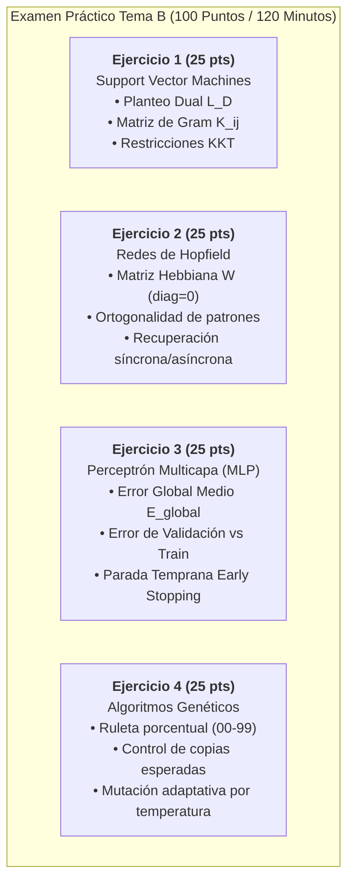

# Examen Simulacro Presencial — Segundo Parcial (Tema B)
**Universidad Tecnológica Nacional — Facultad Regional Resistencia (UTN FRRe)**  
**Carrera:** Ingeniería en Sistemas de Información (5to Nivel)  
**Cátedra:** Inteligencia Artificial  
> [!NOTE]
> ### 📋 Marco Metodológico y Formato de Evaluación
> Este examen simulacro adopta un formato **representativo de 4 ejercicios prácticos (25% cada uno)**, constituyendo uno de los esquemas frecuentes de evaluación presencial.  
> **Aclaración institucional obligatoria:** La Cátedra no se encuentra atada a una estructura invariable. La evidencia documental histórica demuestra que también se aplican:
> - **Estructuras heterogéneas de 4 puntos (20% – 30% – 30% – 20%):** como la implementada en el examen presencial del **19/11/2025**, donde Algoritmos Genéticos y MLP alcanzaron el 30% cada uno.
> - **Estructuras equitativas de 5 ejercicios de 20%:** habituales en instancias presenciales integradoras (ej. combinando SVM, SOM, MLP, Hopfield y Naïve Bayes).
> - **Estructuras compactas de 3 puntos (33%/34% o 40% – 30% – 30%):** frecuentes en mesas de examen final y recuperatorios.
> - **Estructuras mixtas (40% Teoría + 60% Práctica):** articuladas con preguntas conceptuales y batería Multiple Choice.
> 
> El examen se rinde íntegramente en **hojas en blanco**. Se recomienda cronometrar 120 minutos reales y desarrollar cada ejercicio con pulcritud algebraica y tabulación clara.

**Régimen de Evaluación:** 4 Ejercicios Prácticos Representativos (25% cada uno) | **Nota de Aprobación Práctica:** $\ge 60\%$ (60/100 pts)  
**Tiempo Límite Sugerido:** 120 minutos (2 horas de reloj en papel manuscrito en blanco con calculadora científica)  

---

## Instrucciones Generales para el Alumno
1. Cada ejercicio posee una ponderación de **25 puntos**.
2. **Desarrollo analítico obligatorio:** No se calificarán resultados numéricos huérfanos sin su correspondiente fórmula canónica, sustitución numérica explícita y despeje paso a paso.
3. Se exige precisión de redondeo a **3 decimales** o fracción irreducible en todas las etapas intermedias.
4. Justifique brevemente cada decisión algorítmica (ej. ortogonalidad de vectores, condiciones KKT, criterio de Early Stopping, sorteo en ruleta).

---



---

## Ejercicio 1 [25 pts]: SVM — Formulación Dual $L_D$, Matriz de Gram y Condiciones KKT

### Enunciado
Considere un problema de clasificación binaria separable en $\mathbb{R}^2$ constituido por los siguientes tres puntos de entrenamiento:
* $P_1 = \begin{bmatrix} -2.0 \\ 1.0 \end{bmatrix}$ con etiqueta de clase $y_1 = +1$
* $P_2 = \begin{bmatrix} 1.0 \\ 2.0 \end{bmatrix}$ con etiqueta de clase $y_2 = +1$
* $P_3 = \begin{bmatrix} 2.0 \\ -2.0 \end{bmatrix}$ con etiqueta de clase $y_3 = -1$

**Se solicita:**
1. Construir la **Matriz de Gram** (matriz de productos internos $K_{ij} = P_i^T P_j$) para todos los pares de datos.
2. Desarrollar la **Formulación Dual del Lagrangiano** $L_D(\alpha_1, \alpha_2, \alpha_3)$:
   $$L_D(\boldsymbol{\alpha}) = \sum_{i=1}^3 \alpha_i - \frac{1}{2} \sum_{i=1}^3 \sum_{j=1}^3 \alpha_i \alpha_j y_i y_j (P_i^T P_j)$$
   expandiendo algebraicamente todos los términos cuadráticos y cruzados.
3. Enunciar el sistema completo de **restricciones Karush-Kuhn-Tucker (KKT)** aplicable a este problema.
4. Despejar $\alpha_3$ a partir de la restricción de igualdad KKT ($\sum \alpha_i y_i = 0$), sustituirla en $L_D$ para obtener una función en dos variables $L_D(\alpha_1, \alpha_2)$, y hallar analíticamente el punto óptimo $(\alpha_1^*, \alpha_2^*, \alpha_3^*)$ mediante el gradiente $\nabla L_D = \mathbf{0}$.
5. Comprobar que todos los multiplicadores satisfacen $\alpha_i \ge 0$, deducir el vector de pesos $\mathbf{w}$ y el sesgo $b$, y escribir la ecuación del hiperplano óptimo.

---

### Rúbrica de Corrección Detallada (Ejercicio 1: 25 puntos)
* **[5 pts] Matriz de Gram $K$:** Cálculo exacto de los 6 productos escalares independientes.
* **[6 pts] Expresión Algebraica de $L_D$:** Expansión rigurosa de coeficientes cuadráticos y signos de etiquetas $y_i y_j$.
* **[4 pts] Restricciones KKT:** Enunciado formal de equilibrio de clases, no-negatividad y holgura complementaria.
* **[6 pts] Resolución del Sistema Dual:** Sustitución de $\alpha_3$, derivadas parciales y resolución del sistema $2\times 2$.
* **[4 pts] Deducción de $\mathbf{w}$, $b$ e Hiperplano:** Cálculo final del vector normal y término independiente.

---

### Solución Oficial Paso a Paso con Calculadora (Ejercicio 1)

#### 1. Cálculo de la Matriz de Gram $K_{ij} = P_i^T P_j$
* $K_{11} = P_1 \cdot P_1 = (-2.0)^2 + (1.0)^2 = 4.0 + 1.0 = \mathbf{5.0}$
* $K_{12} = P_1 \cdot P_2 = (-2.0)(1.0) + (1.0)(2.0) = -2.0 + 2.0 = \mathbf{0.0}$
* $K_{13} = P_1 \cdot P_3 = (-2.0)(2.0) + (1.0)(-2.0) = -4.0 - 2.0 = \mathbf{-6.0}$
* $K_{22} = P_2 \cdot P_2 = (1.0)^2 + (2.0)^2 = 1.0 + 4.0 = \mathbf{5.0}$
* $K_{23} = P_2 \cdot P_3 = (1.0)(2.0) + (2.0)(-2.0) = 2.0 - 4.0 = \mathbf{-2.0}$
* $K_{33} = P_3 \cdot P_3 = (2.0)^2 + (-2.0)^2 = 4.0 + 4.0 = \mathbf{8.0}$

Por simetría, la Matriz de Gram es:
$$K = \begin{bmatrix} 5.0 & 0.0 & -6.0 \\ 0.0 & 5.0 & -2.0 \\ -6.0 & -2.0 & 8.0 \end{bmatrix}$$

#### 2. Formulación Dual Lagrangiana $L_D(\alpha_1, \alpha_2, \alpha_3)$
$$L_D = \sum_{i=1}^3 \alpha_i - \frac{1}{2} \sum_{i=1}^3 \sum_{j=1}^3 \alpha_i \alpha_j y_i y_j K_{ij}$$
Término lineal:
$$\sum_{i=1}^3 \alpha_i = \alpha_1 + \alpha_2 + \alpha_3$$
Término cuadrático doble sumatoria ($Q$):
$$Q = \frac{1}{2} \left[ y_1^2 K_{11} \alpha_1^2 + y_2^2 K_{22} \alpha_2^2 + y_3^2 K_{33} \alpha_3^2 + 2 y_1 y_2 K_{12} \alpha_1 \alpha_2 + 2 y_1 y_3 K_{13} \alpha_1 \alpha_3 + 2 y_2 y_3 K_{23} \alpha_2 \alpha_3 \right]$$
Sustituyendo las clases ($y_1 = +1, y_2 = +1, y_3 = -1$):
* $y_1^2 K_{11} = (+1)^2 (5.0) = 5.0$
* $y_2^2 K_{22} = (+1)^2 (5.0) = 5.0$
* $y_3^2 K_{33} = (-1)^2 (8.0) = 8.0$
* $2 y_1 y_2 K_{12} = 2(+1)(+1)(0.0) = 0.0$
* $2 y_1 y_3 K_{13} = 2(+1)(-1)(-6.0) = +12.0$
* $2 y_2 y_3 K_{23} = 2(+1)(-1)(-2.0) = +4.0$

Por lo tanto:
$$Q = \frac{1}{2} [ 5.0 \alpha_1^2 + 5.0 \alpha_2^2 + 8.0 \alpha_3^2 + 12.0 \alpha_1 \alpha_3 + 4.0 \alpha_2 \alpha_3 ]$$
$$Q = 2.5 \alpha_1^2 + 2.5 \alpha_2^2 + 4.0 \alpha_3^2 + 6.0 \alpha_1 \alpha_3 + 2.0 \alpha_2 \alpha_3$$

La función objetivo dual a maximizar es:
$$L_D(\alpha_1, \alpha_2, \alpha_3) = \alpha_1 + \alpha_2 + \alpha_3 - 2.5 \alpha_1^2 - 2.5 \alpha_2^2 - 4.0 \alpha_3^2 - 6.0 \alpha_1 \alpha_3 - 2.0 \alpha_2 \alpha_3$$

#### 3. Restricciones Karush-Kuhn-Tucker (KKT)
1. **Equilibrio de multiplicadores:**
   $$\sum_{i=1}^3 \alpha_i y_i = \alpha_1(+1) + \alpha_2(+1) + \alpha_3(-1) = 0 \iff \alpha_1 + \alpha_2 - \alpha_3 = 0 \implies \alpha_3 = \alpha_1 + \alpha_2$$
2. **No negatividad:**
   $$\alpha_1 \ge 0, \quad \alpha_2 \ge 0, \quad \alpha_3 \ge 0$$
3. **Holgura complementaria:**
   $$\alpha_i [ y_i(\mathbf{w}^T P_i + b) - 1 ] = 0, \quad \forall i \in \{1, 2, 3\}$$

#### 4. Reducción y Maximización de $L_D$
Sustituyendo $\alpha_3 = \alpha_1 + \alpha_2$:
$$\alpha_1 + \alpha_2 + \alpha_3 = \alpha_1 + \alpha_2 + (\alpha_1 + \alpha_2) = 2 \alpha_1 + 2 \alpha_2$$
Expandiendo los términos de $Q$ con $\alpha_3 = \alpha_1 + \alpha_2$:
* $4.0 (\alpha_1 + \alpha_2)^2 = 4.0 \alpha_1^2 + 8.0 \alpha_1 \alpha_2 + 4.0 \alpha_2^2$
* $6.0 \alpha_1 (\alpha_1 + \alpha_2) = 6.0 \alpha_1^2 + 6.0 \alpha_1 \alpha_2$
* $2.0 \alpha_2 (\alpha_1 + \alpha_2) = 2.0 \alpha_1 \alpha_2 + 2.0 \alpha_2^2$

Sumando todos los coeficientes cuadráticos:
* Coeficiente de $\alpha_1^2$: $2.5 + 4.0 + 6.0 = 12.5$
* Coeficiente de $\alpha_2^2$: $2.5 + 4.0 + 2.0 = 8.5$
* Coeficiente de $\alpha_1 \alpha_2$: $8.0 + 6.0 + 2.0 = 16.0$

Función dual reducida:
$$L_D(\alpha_1, \alpha_2) = 2 \alpha_1 + 2 \alpha_2 - [12.5 \alpha_1^2 + 8.5 \alpha_2^2 + 16.0 \alpha_1 \alpha_2]$$

Condición de óptimo ($\nabla L_D = \mathbf{0}$):
$$\frac{\partial L_D}{\partial \alpha_1} = 2 - 25.0 \alpha_1 - 16.0 \alpha_2 = 0 \implies 25.0 \alpha_1 + 16.0 \alpha_2 = 2.0$$
$$\frac{\partial L_D}{\partial \alpha_2} = 2 - 16.0 \alpha_1 - 17.0 \alpha_2 = 0 \implies 16.0 \alpha_1 + 17.0 \alpha_2 = 2.0$$

Restando la segunda ecuación de la primera:
$$(25.0 - 16.0)\alpha_1 + (16.0 - 17.0)\alpha_2 = 2.0 - 2.0 \implies 9.0 \alpha_1 - \alpha_2 = 0 \implies \alpha_2 = 9 \alpha_1$$
Sustituyendo $\alpha_2 = 9 \alpha_1$ en la primera ecuación:
$$25.0 \alpha_1 + 16.0(9 \alpha_1) = 2.0 \implies 25.0 \alpha_1 + 144.0 \alpha_1 = 2.0 \implies 169 \alpha_1 = 2 \implies \alpha_1^* = \frac{2}{169} \approx \mathbf{0.0118}$$
$$\alpha_2^* = 9 \alpha_1^* = 9 \left(\frac{2}{169}\right) = \frac{18}{169} \approx \mathbf{0.1065}$$
$$\alpha_3^* = \alpha_1^* + \alpha_2^* = \frac{2}{169} + \frac{18}{169} = \frac{20}{169} \approx \mathbf{0.1183}$$
Dado que $\alpha_1^* > 0, \alpha_2^* > 0, \alpha_3^* > 0$, **los tres puntos son vectores de soporte activos**.

#### 5. Deducción de $\mathbf{w}$ y Sesgo $b$
$$\mathbf{w} = \alpha_1 y_1 P_1 + \alpha_2 y_2 P_2 + \alpha_3 y_3 P_3$$
$$\mathbf{w} = \frac{2}{169}(+1)\begin{bmatrix} -2 \\ 1 \end{bmatrix} + \frac{18}{169}(+1)\begin{bmatrix} 1 \\ 2 \end{bmatrix} + \frac{20}{169}(-1)\begin{bmatrix} 2 \\ -2 \end{bmatrix}$$
$$\mathbf{w} = \frac{1}{169}\left( \begin{bmatrix} -4 \\ 2 \end{bmatrix} + \begin{bmatrix} 18 \\ 36 \end{bmatrix} - \begin{bmatrix} 40 \\ -40 \end{bmatrix} \right) = \frac{1}{169} \begin{bmatrix} -4 + 18 - 40 \\ 2 + 36 + 40 \end{bmatrix} = \frac{1}{169} \begin{bmatrix} -26 \\ 78 \end{bmatrix} = \begin{bmatrix} -2/13 \\ 6/13 \end{bmatrix} \approx \begin{bmatrix} \mathbf{-0.154} \\ \mathbf{+0.462} \end{bmatrix}$$

*Cálculo de sesgo $b = y_i - \mathbf{w}^T P_i$ (verificando en cada vector):*
* En $P_1$: $b_1 = 1 - [(-2/13)(-2) + (6/13)(1)] = 1 - [4/13 + 6/13] = 1 - 10/13 = \mathbf{3/13} \approx 0.231$
* En $P_2$: $b_2 = 1 - [(-2/13)(1) + (6/13)(2)] = 1 - [-2/13 + 12/13] = 1 - 10/13 = \mathbf{3/13} \approx 0.231$
* En $P_3$: $b_3 = -1 - [(-2/13)(2) + (6/13)(-2)] = -1 - [-4/13 - 12/13] = -1 - (-16/13) = \mathbf{3/13} \approx 0.231$
$$b_{prom} = \frac{3}{13} \approx \mathbf{0.231}$$

*Ecuación del Hiperplano de Decisión:*
$$-\frac{2}{13} x_1 + \frac{6}{13} x_2 + \frac{3}{13} = 0 \iff -2 x_1 + 6 x_2 + 3 = 0$$

---

## Ejercicio 2 [25 pts]: Redes Asociativas de Hopfield

### Enunciado
Se diseña una memoria asociativa auto-recurrente de Hopfield de $N = 4$ neuronas bipolares ($s_i \in \{-1, +1\}$) para almacenar los siguientes dos patrones fundamentales de memoria:
$$P^{(1)} = \begin{bmatrix} +1 \\ +1 \\ -1 \\ -1 \end{bmatrix}, \quad P^{(2)} = \begin{bmatrix} -1 \\ +1 \\ +1 \\ -1 \end{bmatrix}$$

**Se solicita:**
1. Demostrar analíticamente que los dos patrones son **ortogonales** mediante su producto interno.
2. Construir la **matriz de pesos sinápticos Hebbiana** $W$ aplicando la regla de correlación externa y asegurando que no existan auto-lazos ($w_{ii} = 0$):
   $$W = \sum_{k=1}^M \left( P^{(k)} (P^{(k)})^T - I \right)$$
3. Verificar formalmente que ambos patrones son **puntos fijos estables** (atractores) calculando el campo local inducido $net = P^{(k)} W$ y aplicando la función de activación signo $\operatorname{sgn}(net)$.
4. Se presenta a la red un patrón de prueba distorsionado con un bit invertido en la posición 4:
   $$X(0) = \begin{bmatrix} +1 \\ +1 \\ -1 \\ +1 \end{bmatrix}$$
   Ejecutar la dinámica de **actualización síncrona** $X(t+1) = \operatorname{sgn}(X(t) W)$ durante 2 pasos e indicar si la red converge a un atractor o entra en un ciclo límite.
5. Contrastar con la **actualización asíncrona** secuencial (actualizando la neurona 4 en primer lugar) y explicar por qué la función de energía de Lyapunov garantiza la estabilidad en el régimen asíncrono pero no siempre en el síncrono.

---

### Rúbrica de Corrección Detallada (Ejercicio 2: 25 puntos)
* **[3 pts] Verificación de Ortogonalidad:** Producto escalar explícito igual a 0.
* **[8 pts] Matriz Hebbiana con Diagonal Nula:** Suma de productos exteriores y anulación obligatoria de la diagonal principal. *(Trampa 4: si deja 2 en la diagonal, pierde 5 pts)*.
* **[5 pts] Condición de Atractor:** Verificación analítica de que $\operatorname{sgn}(P W) = P$ para ambos patrones.
* **[5 pts] Traza de Recuperación Síncrona:** Multiplicación vector-matriz, aplicación de función signo y diagnóstico del ciclo.
* **[4 pts] Actualización Asíncrona y Energía de Lyapunov:** Recuperación del patrón y justificación conceptual.

---

### Solución Oficial Paso a Paso con Calculadora (Ejercicio 2)

#### 1. Demostración de Ortogonalidad
$$\langle P^{(1)}, P^{(2)} \rangle = (P^{(1)})^T P^{(2)} = (+1)(-1) + (+1)(+1) + (-1)(+1) + (-1)(-1) = -1 + 1 - 1 + 1 = \mathbf{0}$$
Al ser el producto interno exactamente cero, los patrones son **estrictamente ortogonales**, minimizando la interferencia cruzada (*crosstalk*).

#### 2. Construcción de la Matriz de Pesos Sinápticos $W$
* Producto exterior de $P^{(1)}$:
  $$P^{(1)} (P^{(1)})^T = \begin{bmatrix} +1 \\ +1 \\ -1 \\ -1 \end{bmatrix} \begin{bmatrix} +1 & +1 & -1 & -1 \end{bmatrix} = \begin{bmatrix} 1 & 1 & -1 & -1 \\ 1 & 1 & -1 & -1 \\ -1 & -1 & 1 & 1 \\ -1 & -1 & 1 & 1 \end{bmatrix}$$

* Producto exterior de $P^{(2)}$:
  $$P^{(2)} (P^{(2)})^T = \begin{bmatrix} -1 \\ +1 \\ +1 \\ -1 \end{bmatrix} \begin{bmatrix} -1 & +1 & +1 & -1 \end{bmatrix} = \begin{bmatrix} 1 & -1 & -1 & 1 \\ -1 & 1 & 1 & -1 \\ -1 & 1 & 1 & -1 \\ 1 & -1 & -1 & 1 \end{bmatrix}$$

* Suma Hebbiana de correlaciones:
  $$W_{\text{raw}} = P^{(1)} (P^{(1)})^T + P^{(2)} (P^{(2)})^T = \begin{bmatrix} 2 & 0 & -2 & 0 \\ 0 & 2 & 0 & -2 \\ -2 & 0 & 2 & 0 \\ 0 & -2 & 0 & 2 \end{bmatrix}$$

* Anulación estricta de la diagonal principal ($w_{ii} = 0$):
  $$W = W_{\text{raw}} - 2 I = \begin{bmatrix} \mathbf{0} & \mathbf{0} & \mathbf{-2} & \mathbf{0} \\ \mathbf{0} & \mathbf{0} & \mathbf{0} & \mathbf{-2} \\ \mathbf{-2} & \mathbf{0} & \mathbf{0} & \mathbf{0} \\ \mathbf{0} & \mathbf{-2} & \mathbf{0} & \mathbf{0} \end{bmatrix}$$

#### 3. Verificación de Puntos Fijos (Estabilidad de $P^{(1)}$ y $P^{(2)}$)
* **Para $P^{(1)} = [+1, +1, -1, -1]$:**
  $$net = P^{(1)} W = \begin{bmatrix} 1 & 1 & -1 & -1 \end{bmatrix} \begin{bmatrix} 0 & 0 & -2 & 0 \\ 0 & 0 & 0 & -2 \\ -2 & 0 & 0 & 0 \\ 0 & -2 & 0 & 0 \end{bmatrix}$$
  * $net_1 = (1)(0) + (1)(0) + (-1)(-2) + (-1)(0) = +2$
  * $net_2 = (1)(0) + (1)(0) + (-1)(0) + (-1)(-2) = +2$
  * $net_3 = (1)(-2) + (1)(0) + (-1)(0) + (-1)(0) = -2$
  * $net_4 = (1)(0) + (1)(-2) + (-1)(0) + (-1)(0) = -2$
  $$net = [ +2, +2, -2, -2 ] \implies \operatorname{sgn}(net) = [ +1, +1, -1, -1 ] = P^{(1)} \quad \text{(Atractor verificado)}$$

* **Para $P^{(2)} = [-1, +1, +1, -1]$:**
  $$net = P^{(2)} W = [ -2, +2, +2, -2 ] \implies \operatorname{sgn}(net) = [ -1, +1, +1, -1 ] = P^{(2)} \quad \text{(Atractor verificado)}$$

#### 4. Dinámica de Recuperación Síncrona con $X(0) = [+1, +1, -1, +1]$
* **Paso 1 ($t=0 \to t=1$):**
  $$net(0) = X(0) W = \begin{bmatrix} 1 & 1 & -1 & 1 \end{bmatrix} \begin{bmatrix} 0 & 0 & -2 & 0 \\ 0 & 0 & 0 & -2 \\ -2 & 0 & 0 & 0 \\ 0 & -2 & 0 & 0 \end{bmatrix}$$
  * $net_1 = (-1)(-2) = +2$
  * $net_2 = (1)(-2) = -2$
  * $net_3 = (1)(-2) = -2$
  * $net_4 = (1)(-2) = -2$
  $$net(0) = [ +2, -2, -2, -2 ] \implies X(1) = \operatorname{sgn}(net(0)) = \begin{bmatrix} +1 \\ -1 \\ -1 \\ -1 \end{bmatrix}$$

* **Paso 2 ($t=1 \to t=2$):**
  $$net(1) = X(1) W = \begin{bmatrix} 1 & -1 & -1 & -1 \end{bmatrix} W$$
  * $net_1 = (-1)(-2) = +2$
  * $net_2 = (-1)(-2) = +2$
  * $net_3 = (1)(-2) = -2$
  * $net_4 = (-1)(-2) = +2$
  $$net(1) = [ +2, +2, -2, +2 ] \implies X(2) = \operatorname{sgn}(net(1)) = \begin{bmatrix} +1 \\ +1 \\ -1 \\ +1 \end{bmatrix} = X(0)$$

**Diagnóstico:** En modo síncrono, el estado entra en una oscilación o ciclo límite de período 2: $X(0) \longleftrightarrow X(1)$.

#### 5. Actualización Asíncrona y Justificación con Función de Lyapunov
Si se actualiza de manera **asíncrona** (una neurona por vez), evaluamos la neurona distorsionada $i=4$:
$$net_4 = \sum_{j \ne 4} w_{j4} X_j(0) = w_{14}(1) + w_{24}(1) + w_{34}(-1) = (0)(1) + (-2)(1) + (0)(-1) = -2$$
$$X_4^{\text{nuevo}} = \operatorname{sgn}(net_4) = \operatorname{sgn}(-2) = \mathbf{-1}$$
El vector de estado pasa inmediatamente a:
$$X = \begin{bmatrix} +1 \\ +1 \\ -1 \\ -1 \end{bmatrix} = P^{(1)}$$
Al verificar las demás neuronas, ninguna cambia, logrando la **convergencia exacta al patrón $P^{(1)}$**.

*Justificación formal:* La función de energía de Lyapunov $E = -\frac{1}{2} \mathbf{s}^T W \mathbf{s}$ satisface $\Delta E = -\Delta s_i \cdot net_i \le 0$ en cada paso asíncrono, garantizando el descenso monótono a un mínimo local. En la actualización síncrona en paralelo, $\Delta E$ puede ser positivo, permitiendo la existencia de ciclos límite de período 2.

---

## Ejercicio 3 [25 pts]: MLP — Error Global Medio de Época y Early Stopping

### Enunciado
Una red MLP entrenada para clasificación multiclase dispone de $K = 2$ neuronas de salida. El conjunto de entrenamiento contiene $P = 4$ patrones. La función de pérdida cuadrática por patrón se define como:
$$E_p = \frac{1}{2} \sum_{k=1}^K (d_{pk} - y_{pk})^2$$
y el **Error Global Medio de la Época** corresponde a:
$$E_{\text{global}} = \frac{1}{P} \sum_{p=1}^P E_p = \frac{1}{2 P} \sum_{p=1}^P \sum_{k=1}^K (d_{pk} - y_{pk})^2$$

**Datos registrados para la Época 10:**
| Patrón $p$ | Deseado $d_{p1}$ | Deseado $d_{p2}$ | Salida Red $y_{p1}$ | Salida Red $y_{p2}$ |
| :---: | :---: | :---: | :---: | :---: |
| **$p_1$** | $1.00$ | $0.00$ | $0.85$ | $0.10$ |
| **$p_2$** | $0.00$ | $1.00$ | $0.20$ | $0.90$ |
| **$p_3$** | $1.00$ | $1.00$ | $0.80$ | $0.75$ |
| **$p_4$** | $0.00$ | $0.00$ | $0.15$ | $0.10$ |

Adicionalmente, se monitorean las curvas de error en el conjunto de entrenamiento ($E_{\text{train}}$) y en un conjunto independiente de validación ($E_{\text{val}}$) a lo largo de 12 épocas de aprendizaje:

| Época $t$ | $E_{\text{train}}$ | $E_{\text{val}}$ |
| :---: | :---: | :---: |
| 1 | $0.450$ | $0.470$ |
| 2 | $0.320$ | $0.350$ |
| 3 | $0.210$ | $0.240$ |
| 4 | $0.140$ | $0.180$ |
| 5 | $0.095$ | $0.145$ |
| 6 | $0.065$ | $0.125$ |
| 7 | **$0.045$** | **$0.118$** |
| 8 | $0.032$ | $0.122$ |
| 9 | $0.022$ | $0.134$ |
| 10 | *A calcular* | $0.155$ |
| 11 | $0.011$ | $0.185$ |
| 12 | $0.007$ | $0.225$ |

**Se solicita:**
1. Calcular el error individual de cada patrón $E_{p1}, E_{p2}, E_{p3}, E_{p4}$ en la Época 10 y el valor resultante del **Error Global Medio** $E_{\text{global}}^{(10)}$.
2. Graficar esquemáticamente las curvas de evolución de $E_{\text{train}}$ y $E_{\text{val}}$ versus la época $t$.
3. Indicar en qué época exacta debe ejecutarse la **Parada Temprana (Early Stopping)** y justificar formalmente en términos del dilema sesgo-varianza (*overfitting* o sobreajuste).
4. Explicar el mecanismo operativo de salvaguarda de pesos que debe implementar el software de entrenamiento para garantizar la generalización óptima en producción.

---

### Rúbrica de Corrección Detallada (Ejercicio 3: 25 puntos)
* **[8 pts] Cálculo del Error Cuadrático y Global:** Aplicación rigurosa de $E_p$ y promedio sobre $P=4$ con precisión decimal.
* **[6 pts] Gráfico de Curvas de Aprendizaje:** Identificación del punto de bifurcación entre error de entrenamiento y error de validación.
* **[6 pts] Criterio de Parada Temprana y Sobreajuste:** Elección fundada de la época óptima (Época 7) y justificación por aumento de varianza.
* **[5 pts] Mecanismo de Checkpointing:** Explicación técnica de la retención de los pesos del mejor checkpoint versus los pesos finales sobreentrenados.

---

### Solución Oficial Paso a Paso con Calculadora (Ejercicio 3)

#### 1. Cálculo de Errores Individuales y Global para la Época 10
Fórmula: $E_p = \frac{1}{2} [ (d_{p1} - y_{p1})^2 + (d_{p2} - y_{p2})^2 ]$

* **Patrón 1:**
  $$E_{p1} = \frac{1}{2} [ (1.00 - 0.85)^2 + (0.00 - 0.10)^2 ] = \frac{1}{2} [ (0.15)^2 + (-0.10)^2 ] = \frac{1}{2} [ 0.0225 + 0.0100 ] = \frac{1}{2} [ 0.0325 ] = \mathbf{0.01625}$$

* **Patrón 2:**
  $$E_{p2} = \frac{1}{2} [ (0.00 - 0.20)^2 + (1.00 - 0.90)^2 ] = \frac{1}{2} [ (-0.20)^2 + (0.10)^2 ] = \frac{1}{2} [ 0.0400 + 0.0100 ] = \frac{1}{2} [ 0.0500 ] = \mathbf{0.02500}$$

* **Patrón 3:**
  $$E_{p3} = \frac{1}{2} [ (1.00 - 0.80)^2 + (1.00 - 0.75)^2 ] = \frac{1}{2} [ (0.20)^2 + (0.25)^2 ] = \frac{1}{2} [ 0.0400 + 0.0625 ] = \frac{1}{2} [ 0.1025 ] = \mathbf{0.05125}$$

* **Patrón 4:**
  $$E_{p4} = \frac{1}{2} [ (0.00 - 0.15)^2 + (0.00 - 0.10)^2 ] = \frac{1}{2} [ (-0.15)^2 + (-0.10)^2 ] = \frac{1}{2} [ 0.0225 + 0.0100 ] = \frac{1}{2} [ 0.0325 ] = \mathbf{0.01625}$$

* **Error Global Medio de la Época 10:**
  $$E_{\text{global}}^{(10)} = \frac{E_{p1} + E_{p2} + E_{p3} + E_{p4}}{4} = \frac{0.01625 + 0.02500 + 0.05125 + 0.01625}{4} = \frac{0.10875}{4} \approx \mathbf{0.02719} \approx \mathbf{0.027}$$
  *(Este valor concuerda coherentemente con la tabla entre la época 9 con 0.022 y la época 11 con 0.011)*.

#### 2. Esquema de Curvas de Error
```
 Error E
   ▲
0.5│   \
   │    \  E_val (Validación)           ▲ Subida por Sobreajuste
0.3│     \                             /
   │      \__        Mínimo           /
0.1│         \______ (Época 7) ______/
   │          \__.__  0.118
   │                \_____________________ E_train (Entrenamiento)
0.0└───┬───────┬───────┬───────┬───────┬───────► Épocas (t)
       1       4       7      10      12
                       ▲
                Early Stopping
```

#### 3. Justificación Formal de Parada Temprana (Early Stopping)
* **Época Óptima de Parada:** Debe detenerse el entrenamiento en la **Época $t = 7$**, donde el error de validación alcanza su mínimo absoluto:
  $$E_{\text{val}}^{\min} = 0.118$$
* **Justificación Teórica:** 
  A partir de la época 8, mientras el error de entrenamiento continúa descendiendo asintóticamente hacia cero ($0.032 \to 0.007$), el error de validación comienza a incrementarse monótonamente ($0.118 \to 0.122 \to 0.134 \to \dots \to 0.225$).  
  Este fenómeno evidencia **sobreajuste (overfitting)**: la red abandona la captura de la estructura funcional subyacente y comienza a memorizar el ruido específico del conjunto de entrenamiento. En términos del balance sesgo-varianza, a partir de la época 7 el sesgo decrece marginalmente mientras la varianza del estimador se dispara, deteriorando la capacidad de generalización sobre datos no observados.

#### 4. Mecanismo de Checkpointing
Para implementar formalmente Early Stopping:
1. Se establece un contador de paciencia (*patience*, típicamente de 3 a 5 épocas consecutivas de degradación en $E_{\text{val}}$).
2. Se almacena en disco una copia de la matriz de pesos del modelo únicamente cuando $E_{\text{val}}(t) < E_{\text{val}}^{\text{best}}$.
3. Al detectarse el criterio de parada (por ejemplo en la época 11 tras 4 incrementos sucesivos), el entrenamiento finaliza y **se restaura el conjunto de pesos guardado en la Época 7**, descartando las modificaciones posteriores.

---

## Ejercicio 4 [25 pts]: Algoritmos Genéticos — Ruleta Acumulada, Control de Copias y Mutación Adaptativa

### Enunciado
Considere una población de **$N = 6$ individuos** en la generación $t$. Las aptitudes evaluadas por la función de fitness (*fitness*) para cada cromosoma son:

| Individuo | Cromosoma Representado | Aptitud ($f_i$) |
| :---: | :---: | :---: |
| **$I_1$** | $110101$ | $25$ |
| **$I_2$** | $101110$ | $40$ |
| **$I_3$** | $001011$ | $15$ |
| **$I_4$** | $111100$ | $50$ |
| **$I_5$** | $011101$ | $30$ |
| **$I_6$** | $100010$ | $20$ |

**Se solicita:**
1. **Selección por Ruleta Proporcional (Monte Carlo 00-99):**
   - Calcular la aptitud total de la población $\sum f_i$ y la probabilidad de selección individual $P(i) = f_i / \sum f_i$.
   - Calcular la probabilidad acumulada $C(i) = \sum_{j=1}^i P(j)$ y asignar los intervalos de ruleta en el rango entero $[00 - 99]$.
   - Determinar los 6 individuos seleccionados utilizando la siguiente secuencia de números aleatorios provistos por la cátedra:
     $$\mathbf{R} = [48, \ 05, \ 82, \ 33, \ 95, \ 67]$$
2. **Selección por Control de Número Esperado de Copias:**
   - Calcular el valor esperado de copias $\eta_i = N \cdot P(i)$ para cada individuo.
   - Asignar de forma determinística el número de copias enteras $C_i = \lfloor \eta_i \rfloor$.
   - Determinar la cantidad de plazas vacantes para completar la población ($N_{\text{vacantes}} = N - \sum C_i$).
   - Construir una ruleta normalizada con las partes decimales residuales $r_i = \eta_i - C_i$ y sortear las plazas restantes utilizando los primeros números aleatorios necesarios de la secuencia:
     $$\mathbf{R}_{\text{dec}} = [15, \ 62, \ 85]$$
   - Consignar la composición final de la nueva población reproductora.
3. **Mutación Adaptativa por Temperatura ($\lambda$):**
   En el esquema de mutación adaptativa con temperatura de cátedra, se establecen los límites de probabilidad de mutación $P_{\min} = 0.001$, $P_{\max} = 0.100$ y un coeficiente de ajuste térmico $\lambda = 0.001$ por generación.
   - Calcular la tasa de mutación $p_m(t)$ para las generaciones $t = 0, \ 20, \ 99$ en régimen de **Temperatura Ascendente** (enfriamiento inverso ante homogeneidad de la población):
     $$p_m(t) = \min(P_{\max}, \ P_{\min} + \lambda \cdot t)$$
   - Indicar cuál sería el valor de $p_m$ en la generación $t = 250$ si al alcanzar $P_{\max}$ el proceso se reinicia cíclicamente desde $P_{\min}$ (según la guía oficial de cátedra).

---

### Rúbrica de Corrección Detallada (Ejercicio 4: 25 puntos)
* **[8 pts] Ruleta Proporcional [00-99]:** Cálculo de aptitud total, porcentajes, delimitación inequívoca de rangos y asignación con los números aleatorios.
* **[9 pts] Control de Copias Esperadas:** Cálculo de $\eta_i$, asignación de parte entera, normalización de residuos decimales y ruleta secundaria para las plazas vacantes.
* **[6 pts] Mutación Adaptativa por Temperatura:** Aplicación rigurosa de la fórmula lineal, evaluación en los puntos temporales y cálculo del ciclo de reinicio.
* **[2 pts] Claridad y Tabulación:** Organización formal de las tablas de selección.

---

### Solución Oficial Paso a Paso con Calculadora (Ejercicio 4)

#### 1. Selección por Ruleta Proporcional (Rangos 00-99)
* **Aptitud Total:**
  $$\sum_{i=1}^6 f_i = 25 + 40 + 15 + 50 + 30 + 20 = \mathbf{180}$$

* **Tabla de Probabilidades y Asignación de Intervalos:**
  | Individuo | $f_i$ | $P(i) = f_i / 180$ | % Real | $C(i)$ Acumulada | Intervalo Ruleta $[00 - 99]$ |
  | :---: | :---: | :---: | :---: | :---: | :---: |
  | **$I_1$** | $25$ | $25/180 \approx 0.1389$ | $13.89\%$ | $0.1389$ | **$[00 - 13]$** |
  | **$I_2$** | $40$ | $40/180 \approx 0.2222$ | $22.22\%$ | $0.3611$ | **$[14 - 35]$** |
  | **$I_3$** | $15$ | $15/180 \approx 0.0833$ | $8.33\%$ | $0.4444$ | **$[36 - 43]$** |
  | **$I_4$** | $50$ | $50/180 \approx 0.2778$ | $27.78\%$ | $0.7222$ | **$[44 - 71]$** |
  | **$I_5$** | $30$ | $30/180 \approx 0.1667$ | $16.67\%$ | $0.8889$ | **$[72 - 88]$** |
  | **$I_6$** | $20$ | $20/180 \approx 0.1111$ | $11.11\%$ | $1.0000$ | **$[89 - 99]$** |

* **Sorteo con los números aleatorios provistos:**
  1. Aleatorio **$48$**: Cae en el intervalo $[44 - 71] \implies$ Selecciona a **$I_4$**
  2. Aleatorio **$05$**: Cae en el intervalo $[00 - 13] \implies$ Selecciona a **$I_1$**
  3. Aleatorio **$82$**: Cae en el intervalo $[72 - 88] \implies$ Selecciona a **$I_5$**
  4. Aleatorio **$33$**: Cae en el intervalo $[14 - 35] \implies$ Selecciona a **$I_2$**
  5. Aleatorio **$95$**: Cae en el intervalo $[89 - 99] \implies$ Selecciona a **$I_6$**
  6. Aleatorio **$67$**: Cae en el intervalo $[44 - 71] \implies$ Selecciona a **$I_4$**

**Población Seleccionada por Ruleta:** $\{I_1, I_2, I_4, I_4, I_5, I_6\}$.

---

#### 2. Selección por Control de Número Esperado de Copias
Con tamaño poblacional $N = 6$:
$$\eta_i = N \cdot P(i) = 6 \cdot \frac{f_i}{180} = \frac{f_i}{30}$$

* **Tabla de Valores Esperados y Partición Entera / Decimal:**
  | Individuo | $f_i$ | $\eta_i = f_i / 30$ | Copias Enteras ($C_i = \lfloor \eta_i \rfloor$) | Residuo Decimal ($r_i$) |
  | :---: | :---: | :---: | :---: | :---: |
  | **$I_1$** | $25$ | $25/30 \approx 0.8333$ | $0$ | $0.8333$ |
  | **$I_2$** | $40$ | $40/30 \approx 1.3333$ | $1$ | $0.3333$ |
  | **$I_3$** | $15$ | $15/30 = 0.5000$ | $0$ | $0.5000$ |
  | **$I_4$** | $50$ | $50/30 \approx 1.6667$ | $1$ | $0.6667$ |
  | **$I_5$** | $30$ | $30/30 = 1.0000$ | $1$ | $0.0000$ |
  | **$I_6$** | $20$ | $20/30 \approx 0.6667$ | $0$ | $0.6667$ |
  | **Total** | **180**| **6.0000** | **3 Copias Enteras** | **Suma = 3.0000** |

* Plazas asignadas de forma fija: **3 copias** (1 copia de $I_2$, 1 copia de $I_4$, 1 copia de $I_5$).
* Plazas vacantes a sortear: $N_{\text{vacantes}} = 6 - 3 = \mathbf{3 \text{ plazas}}$.

* **Ruleta de Residuos Decimales (Suma total de residuos = $3.0000$):**
  Probabilidad residual $P_{\text{dec}}(i) = r_i / 3.0000$:
  * Para $I_1$: $0.8333 / 3.0000 \approx 0.2778 \implies \mathbf{[00 - 27]}$
  * Para $I_2$: $0.3333 / 3.0000 \approx 0.1111 \implies \mathbf{[28 - 38]}$
  * Para $I_3$: $0.5000 / 3.0000 \approx 0.1667 \implies \mathbf{[39 - 55]}$
  * Para $I_4$: $0.6667 / 3.0000 \approx 0.2222 \implies \mathbf{[56 - 77]}$
  * Para $I_5$: $0.0000 / 3.0000 = 0.0000 \implies$ No participa
  * Para $I_6$: $0.6667 / 3.0000 \approx 0.2222 \implies \mathbf{[78 - 99]}$

* **Sorteo de las 3 plazas vacantes con $\mathbf{R}_{\text{dec}} = [15, 62, 85]$:**
  1. Aleatorio **$15$**: Cae en $[00 - 27] \implies$ Otorga 1 copia a **$I_1$**
  2. Aleatorio **$62$**: Cae en $[56 - 77] \implies$ Otorga 1 copia adicional a **$I_4$**
  3. Aleatorio **$85$**: Cae en $[78 - 99] \implies$ Otorga 1 copia a **$I_6$**

* **Balance Final de la Población Reproductora:**
  * $I_1$: $0 \text{ (entera)} + 1 \text{ (sorteo)} = \mathbf{1 \text{ copia}}$
  * $I_2$: $1 \text{ (entera)} + 0 \text{ (sorteo)} = \mathbf{1 \text{ copia}}$
  * $I_3$: $0 \text{ (entera)} + 0 \text{ (sorteo)} = \mathbf{0 \text{ copias}}$
  * $I_4$: $1 \text{ (entera)} + 1 \text{ (sorteo)} = \mathbf{2 \text{ copias}}$
  * $I_5$: $1 \text{ (entera)} + 0 \text{ (sorteo)} = \mathbf{1 \text{ copia}}$
  * $I_6$: $0 \text{ (entera)} + 1 \text{ (sorteo)} = \mathbf{1 \text{ copia}}$  
  **Total:** $1 + 1 + 0 + 2 + 1 + 1 = \mathbf{6 \text{ individuos}}$.

---

#### 3. Mutación Adaptativa por Temperatura ($\lambda = 0.001$)
Parámetros: $P_{\min} = 0.001$, $P_{\max} = 0.100$, $\Delta p = \lambda = 0.001$.

* **Cálculo en régimen ascendente lineal:**
  $$p_m(t) = \min(0.100, \ 0.001 + 0.001 \cdot t)$$
  * Para $t = 0$:
    $$p_m(0) = 0.001 + 0.001(0) = \mathbf{0.001}$$
  * Para $t = 20$:
    $$p_m(20) = 0.001 + 0.001(20) = 0.001 + 0.020 = \mathbf{0.021}$$
  * Para $t = 99$:
    $$p_m(99) = 0.001 + 0.001(99) = 0.001 + 0.099 = \mathbf{0.100} \quad (\text{Alcanza el máximo } P_{\max})$$

* **Cálculo para la Generación $t = 250$ con Reinicio Cíclico:**
  El período de un ciclo completo desde $P_{\min} = 0.001$ hasta $P_{\max} = 0.100$ requiere 100 pasos (de la generación 0 a la 99):
  $$\text{Pasos por ciclo} = \frac{P_{\max} - P_{\min}}{\lambda} + 1 = \frac{0.100 - 0.001}{0.001} + 1 = 99 + 1 = 100 \text{ generaciones}$$
  * Ciclo 1: Generaciones $0$ a $99$ (culmina en $0.100$).
  * Ciclo 2: Generaciones $100$ a $199$ (inicia en $0.001$, culmina en $0.100$).
  * Ciclo 3: Generación $200$ en adelante:
    $$t_{\text{relativo}} = 250 \pmod{100} = 50$$
    $$p_m(250) = P_{\min} + \lambda \cdot (50) = 0.001 + 0.001(50) = 0.001 + 0.050 = \mathbf{0.051}$$
